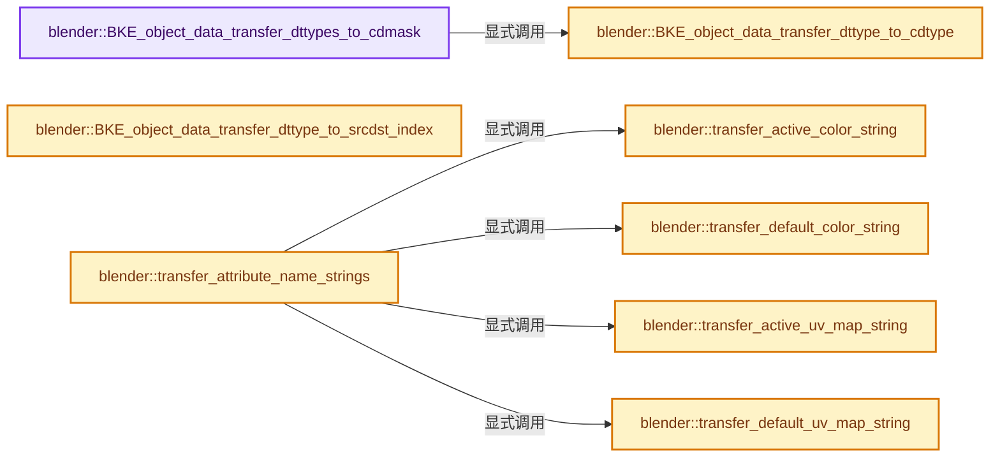
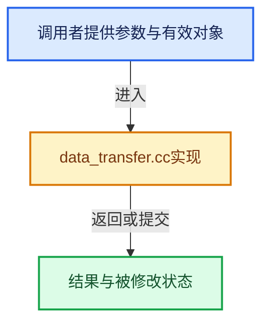

# 实现依赖专题：source/blender/blenkernel/intern/data_transfer.cc

[方向导航](README.md) · [符号索引](../%E7%AC%A6%E5%8F%B7%E4%BE%9D%E8%B5%96%E4%B8%8E%E5%AE%9E%E7%8E%B0%E7%B4%A2%E5%BC%95.md)

本专题从正文实际调用进入，集中保存共享实现。函数有稳定锚点，可从调用处直接跳到对应完整函数；递归与互相调用通过回链组织。

## 本文件的实现关系






## 完整成员与函数实现

<a id="f-b98dbf4c24e0f972"></a>

### `blender::BKE_object_data_transfer_dttypes_to_cdmask`

实现位置：[source/blender/blenkernel/intern/data_transfer.cc](../../../../../source/blender/blenkernel/intern/data_transfer.cc) · L42—L75。

接口参数：

- `const int dtdata_types`
- `CustomData_MeshMasks *r_data_masks`

**教学注释版**

<!-- annotated:f8b2853bf31ec6 -->

```cpp
void BKE_object_data_transfer_dttypes_to_cdmask(const int dtdata_types,
                                                CustomData_MeshMasks *r_data_masks)
{
  for (int i = 0; i < DT_TYPE_MAX; i++) {
    const int dtdata_type = 1 << i;
    int cddata_type;

    if (!(dtdata_types & dtdata_type)) {
      continue;
    }

    cddata_type = BKE_object_data_transfer_dttype_to_cdtype(dtdata_type);
    if (!(cddata_type & CD_FAKE)) {
      if (DT_DATATYPE_IS_VERT(dtdata_type)) {
        r_data_masks->vmask |= 1LL << cddata_type;
      }
      else if (DT_DATATYPE_IS_EDGE(dtdata_type)) {
        r_data_masks->emask |= 1LL << cddata_type;
      }
      else if (DT_DATATYPE_IS_LOOP(dtdata_type)) {
        r_data_masks->lmask |= 1LL << cddata_type;
      }
      else if (DT_DATATYPE_IS_FACE(dtdata_type)) {
        r_data_masks->pmask |= 1LL << cddata_type;
      }
    }
    else if (cddata_type == CD_FAKE_MDEFORMVERT) {
      r_data_masks->vmask |= CD_MASK_MDEFORMVERT; /* Exception for vgroups :/ */
    }
    else if (cddata_type == CD_FAKE_UV) {
      r_data_masks->lmask |= CD_MASK_PROP_FLOAT2;
    }
  }
}
```

<details>
<summary>核对原始源码：source/blender/blenkernel/intern/data_transfer.cc · L42—L75</summary>

<!-- original:f8b2853bf31ec6:source/blender/blenkernel/intern/data_transfer.cc:42:75 -->

```cpp
void BKE_object_data_transfer_dttypes_to_cdmask(const int dtdata_types,
                                                CustomData_MeshMasks *r_data_masks)
{
  for (int i = 0; i < DT_TYPE_MAX; i++) {
    const int dtdata_type = 1 << i;
    int cddata_type;

    if (!(dtdata_types & dtdata_type)) {
      continue;
    }

    cddata_type = BKE_object_data_transfer_dttype_to_cdtype(dtdata_type);
    if (!(cddata_type & CD_FAKE)) {
      if (DT_DATATYPE_IS_VERT(dtdata_type)) {
        r_data_masks->vmask |= 1LL << cddata_type;
      }
      else if (DT_DATATYPE_IS_EDGE(dtdata_type)) {
        r_data_masks->emask |= 1LL << cddata_type;
      }
      else if (DT_DATATYPE_IS_LOOP(dtdata_type)) {
        r_data_masks->lmask |= 1LL << cddata_type;
      }
      else if (DT_DATATYPE_IS_FACE(dtdata_type)) {
        r_data_masks->pmask |= 1LL << cddata_type;
      }
    }
    else if (cddata_type == CD_FAKE_MDEFORMVERT) {
      r_data_masks->vmask |= CD_MASK_MDEFORMVERT; /* Exception for vgroups :/ */
    }
    else if (cddata_type == CD_FAKE_UV) {
      r_data_masks->lmask |= CD_MASK_PROP_FLOAT2;
    }
  }
}
```

</details>

**沿实际写入检查状态**

- `cddata_type = BKE_object_data_transfer_dttype_to_cdtype(dtdata_type);`
- `r_data_masks->vmask |= 1LL << cddata_type;`
- `r_data_masks->emask |= 1LL << cddata_type;`
- `r_data_masks->lmask |= 1LL << cddata_type;`
- `r_data_masks->pmask |= 1LL << cddata_type;`
- `r_data_masks->vmask |= CD_MASK_MDEFORMVERT; /* Exception for vgroups :/ */`
- `r_data_masks->lmask |= CD_MASK_PROP_FLOAT2;`

**继续追踪实现**

- `BKE_object_data_transfer_dttype_to_cdtype` → [blender::BKE_object_data_transfer_dttype_to_cdtype · L184](%E4%BE%9D%E8%B5%96-data_transfer-8584e8.md#f-116d7e3ae76fc8ab)。
- `DT_DATATYPE_IS_VERT` → [DT_DATATYPE_IS_VERT · L165](%E4%BE%9D%E8%B5%96-DNA_modifier_enums-c5afd8.md#m-dfd5a2276cdd)。宏定义由构建条件选择。
- `DT_DATATYPE_IS_EDGE` → [DT_DATATYPE_IS_EDGE · L173](%E4%BE%9D%E8%B5%96-DNA_modifier_enums-c5afd8.md#m-1d72abc7a4bd)。宏定义由构建条件选择。
- `DT_DATATYPE_IS_LOOP` → [DT_DATATYPE_IS_LOOP · L180](%E4%BE%9D%E8%B5%96-DNA_modifier_enums-c5afd8.md#m-d83f51ace117)。宏定义由构建条件选择。
- `DT_DATATYPE_IS_FACE` → [DT_DATATYPE_IS_FACE · L187](%E4%BE%9D%E8%B5%96-DNA_modifier_enums-c5afd8.md#m-12271712e8ea)。宏定义由构建条件选择。

<a id="f-116d7e3ae76fc8ab"></a>

### `blender::BKE_object_data_transfer_dttype_to_cdtype`

实现位置：[source/blender/blenkernel/intern/data_transfer.cc](../../../../../source/blender/blenkernel/intern/data_transfer.cc) · L184—L223。

接口参数：

- `const int dtdata_type`

**教学注释版**

<!-- annotated:b5740678a8b37d -->

```cpp
int BKE_object_data_transfer_dttype_to_cdtype(const int dtdata_type)
{
  switch (dtdata_type) {
    case DT_TYPE_MDEFORMVERT:
      return CD_FAKE_MDEFORMVERT;
    case DT_TYPE_SKIN:
      return CD_FAKE_SKIN_RADIUS;
    case DT_TYPE_BWEIGHT_VERT:
      return CD_FAKE_BWEIGHT;

    case DT_TYPE_SHARP_EDGE:
      return CD_FAKE_SHARP;
    case DT_TYPE_SEAM:
      return CD_FAKE_SEAM;
    case DT_TYPE_CREASE:
      return CD_FAKE_CREASE;
    case DT_TYPE_BWEIGHT_EDGE:
      return CD_FAKE_BWEIGHT;
    case DT_TYPE_FREESTYLE_EDGE:
      return CD_FAKE_FREESTYLE_EDGE;

    case DT_TYPE_UV:
      return CD_FAKE_UV;
    case DT_TYPE_SHARP_FACE:
      return CD_FAKE_SHARP;
    case DT_TYPE_FREESTYLE_FACE:
      return CD_FAKE_FREESTYLE_FACE;
    case DT_TYPE_LNOR:
      return CD_FAKE_LNOR;
    case DT_TYPE_MLOOPCOL_VERT:
    case DT_TYPE_MLOOPCOL_LOOP:
      return CD_PROP_BYTE_COLOR;
    case DT_TYPE_MPROPCOL_VERT:
    case DT_TYPE_MPROPCOL_LOOP:
      return CD_PROP_COLOR;
    default:
      BLI_assert_unreachable();
  }
  return 0; /* Should never be reached! */
}
```

<details>
<summary>核对原始源码：source/blender/blenkernel/intern/data_transfer.cc · L184—L223</summary>

<!-- original:b5740678a8b37d:source/blender/blenkernel/intern/data_transfer.cc:184:223 -->

```cpp
int BKE_object_data_transfer_dttype_to_cdtype(const int dtdata_type)
{
  switch (dtdata_type) {
    case DT_TYPE_MDEFORMVERT:
      return CD_FAKE_MDEFORMVERT;
    case DT_TYPE_SKIN:
      return CD_FAKE_SKIN_RADIUS;
    case DT_TYPE_BWEIGHT_VERT:
      return CD_FAKE_BWEIGHT;

    case DT_TYPE_SHARP_EDGE:
      return CD_FAKE_SHARP;
    case DT_TYPE_SEAM:
      return CD_FAKE_SEAM;
    case DT_TYPE_CREASE:
      return CD_FAKE_CREASE;
    case DT_TYPE_BWEIGHT_EDGE:
      return CD_FAKE_BWEIGHT;
    case DT_TYPE_FREESTYLE_EDGE:
      return CD_FAKE_FREESTYLE_EDGE;

    case DT_TYPE_UV:
      return CD_FAKE_UV;
    case DT_TYPE_SHARP_FACE:
      return CD_FAKE_SHARP;
    case DT_TYPE_FREESTYLE_FACE:
      return CD_FAKE_FREESTYLE_FACE;
    case DT_TYPE_LNOR:
      return CD_FAKE_LNOR;
    case DT_TYPE_MLOOPCOL_VERT:
    case DT_TYPE_MLOOPCOL_LOOP:
      return CD_PROP_BYTE_COLOR;
    case DT_TYPE_MPROPCOL_VERT:
    case DT_TYPE_MPROPCOL_LOOP:
      return CD_PROP_COLOR;
    default:
      BLI_assert_unreachable();
  }
  return 0; /* Should never be reached! */
}
```

</details>

**结果出口**

- `return CD_FAKE_MDEFORMVERT;`
- `return CD_FAKE_SKIN_RADIUS;`
- `return CD_FAKE_BWEIGHT;`
- `return CD_FAKE_SHARP;`
- `return CD_FAKE_SEAM;`
- `return CD_FAKE_CREASE;`
- `return CD_FAKE_FREESTYLE_EDGE;`
- `return CD_FAKE_UV;`
- `return CD_FAKE_FREESTYLE_FACE;`
- `return CD_FAKE_LNOR;`
- `return CD_PROP_BYTE_COLOR;`
- `return CD_PROP_COLOR;`
- `return 0; /* Should never be reached! */`

**继续追踪实现**

- `BLI_assert_unreachable` → [BLI_assert_unreachable · L77](../01-%E5%9F%BA%E7%A1%80%E5%AE%B9%E5%99%A8%E4%B8%8E%E7%8E%B0%E4%BB%A3CPP/%E4%BE%9D%E8%B5%96-BLI_assert-cc98e8.md#m-7a2d91a67d8e)。宏定义由构建条件选择。

<a id="f-210f55ba3b620780"></a>

### `blender::BKE_object_data_transfer_dttype_to_srcdst_index`

实现位置：[source/blender/blenkernel/intern/data_transfer.cc](../../../../../source/blender/blenkernel/intern/data_transfer.cc) · L225—L243。

接口参数：

- `const int dtdata_type`

**教学注释版**

<!-- annotated:070884a6d3d183 -->

```cpp
int BKE_object_data_transfer_dttype_to_srcdst_index(const int dtdata_type)
{
  switch (dtdata_type) {
    case DT_TYPE_MDEFORMVERT:
      return DT_MULTILAYER_INDEX_MDEFORMVERT;
    case DT_TYPE_UV:
      return DT_MULTILAYER_INDEX_UV;
    case DT_TYPE_MPROPCOL_VERT:
    case DT_TYPE_MLOOPCOL_VERT:
    case DT_TYPE_MPROPCOL_VERT | DT_TYPE_MLOOPCOL_VERT:
      return DT_MULTILAYER_INDEX_VCOL_VERT;
    case DT_TYPE_MPROPCOL_LOOP:
    case DT_TYPE_MLOOPCOL_LOOP:
    case DT_TYPE_MPROPCOL_LOOP | DT_TYPE_MLOOPCOL_LOOP:
      return DT_MULTILAYER_INDEX_VCOL_LOOP;
    default:
      return DT_MULTILAYER_INDEX_INVALID;
  }
}
```

<details>
<summary>核对原始源码：source/blender/blenkernel/intern/data_transfer.cc · L225—L243</summary>

<!-- original:070884a6d3d183:source/blender/blenkernel/intern/data_transfer.cc:225:243 -->

```cpp
int BKE_object_data_transfer_dttype_to_srcdst_index(const int dtdata_type)
{
  switch (dtdata_type) {
    case DT_TYPE_MDEFORMVERT:
      return DT_MULTILAYER_INDEX_MDEFORMVERT;
    case DT_TYPE_UV:
      return DT_MULTILAYER_INDEX_UV;
    case DT_TYPE_MPROPCOL_VERT:
    case DT_TYPE_MLOOPCOL_VERT:
    case DT_TYPE_MPROPCOL_VERT | DT_TYPE_MLOOPCOL_VERT:
      return DT_MULTILAYER_INDEX_VCOL_VERT;
    case DT_TYPE_MPROPCOL_LOOP:
    case DT_TYPE_MLOOPCOL_LOOP:
    case DT_TYPE_MPROPCOL_LOOP | DT_TYPE_MLOOPCOL_LOOP:
      return DT_MULTILAYER_INDEX_VCOL_LOOP;
    default:
      return DT_MULTILAYER_INDEX_INVALID;
  }
}
```

</details>

**结果出口**

- `return DT_MULTILAYER_INDEX_MDEFORMVERT;`
- `return DT_MULTILAYER_INDEX_UV;`
- `return DT_MULTILAYER_INDEX_VCOL_VERT;`
- `return DT_MULTILAYER_INDEX_VCOL_LOOP;`
- `return DT_MULTILAYER_INDEX_INVALID;`

**继续追踪实现**

本实现没有需要继续展开的显式调用；检查返回表达式、对象转换和调用者前置条件。

<a id="f-b1faf1de95f538af"></a>

### `blender::transfer_active_color_string`

实现位置：[source/blender/blenkernel/intern/data_transfer.cc](../../../../../source/blender/blenkernel/intern/data_transfer.cc) · L252—L280。

接口参数：

- `Mesh *mesh_dst`
- `const Mesh *mesh_src`

**教学注释版**

<!-- annotated:c14dc47f7f6736 -->

```cpp
static void transfer_active_color_string(Mesh *mesh_dst, const Mesh *mesh_src)
{
  if (mesh_dst->active_color_attribute) {
    return;
  }

  const StringRef name = mesh_src->active_color_attribute;
  const bke::AttributeAccessor attributes_src = mesh_src->attributes();
  const bke::AttributeAccessor attributes_dst = mesh_dst->attributes();

  if (!bke::mesh::is_color_attribute(attributes_src.lookup_meta_data(name))) {
    return;
  }

  if (bke::mesh::is_color_attribute(attributes_dst.lookup_meta_data(name))) {
    mesh_dst->active_color_attribute = BLI_strdupn(name.data(), name.size());
  }
  else {
    mesh_dst->attributes().foreach_attribute([&](const bke::AttributeIter &iter) {
      if (mesh_dst->active_color_attribute) {
        return;
      }
      if (!bke::mesh::is_color_attribute({iter.domain, iter.data_type})) {
        return;
      }
      mesh_dst->active_color_attribute = BLI_strdupn(iter.name.data(), iter.name.size());
    });
  }
}
```

<details>
<summary>核对原始源码：source/blender/blenkernel/intern/data_transfer.cc · L252—L280</summary>

<!-- original:c14dc47f7f6736:source/blender/blenkernel/intern/data_transfer.cc:252:280 -->

```cpp
static void transfer_active_color_string(Mesh *mesh_dst, const Mesh *mesh_src)
{
  if (mesh_dst->active_color_attribute) {
    return;
  }

  const StringRef name = mesh_src->active_color_attribute;
  const bke::AttributeAccessor attributes_src = mesh_src->attributes();
  const bke::AttributeAccessor attributes_dst = mesh_dst->attributes();

  if (!bke::mesh::is_color_attribute(attributes_src.lookup_meta_data(name))) {
    return;
  }

  if (bke::mesh::is_color_attribute(attributes_dst.lookup_meta_data(name))) {
    mesh_dst->active_color_attribute = BLI_strdupn(name.data(), name.size());
  }
  else {
    mesh_dst->attributes().foreach_attribute([&](const bke::AttributeIter &iter) {
      if (mesh_dst->active_color_attribute) {
        return;
      }
      if (!bke::mesh::is_color_attribute({iter.domain, iter.data_type})) {
        return;
      }
      mesh_dst->active_color_attribute = BLI_strdupn(iter.name.data(), iter.name.size());
    });
  }
}
```

</details>

**沿实际写入检查状态**

- `mesh_dst->active_color_attribute = BLI_strdupn(name.data(), name.size());`
- `mesh_dst->active_color_attribute = BLI_strdupn(iter.name.data(), iter.name.size());`

**继续追踪实现**

- `mesh_src->attributes` → [Mesh::attributes · L1298](03-MPoly%E8%BF%81%E7%A7%BB%E4%B8%8E%E5%85%BC%E5%AE%B9.md#f-607bbfe3e57cfc7f)。
- `mesh_dst->attributes` → [Mesh::attributes · L1298](03-MPoly%E8%BF%81%E7%A7%BB%E4%B8%8E%E5%85%BC%E5%AE%B9.md#f-607bbfe3e57cfc7f)。
- `bke::mesh::is_color_attribute` → [bke::mesh::is_color_attribute · L1400](03-MPoly%E8%BF%81%E7%A7%BB%E4%B8%8E%E5%85%BC%E5%AE%B9.md#f-a46946697ca88d8b)；[bke::mesh::is_color_attribute · L1406](03-MPoly%E8%BF%81%E7%A7%BB%E4%B8%8E%E5%85%BC%E5%AE%B9.md#f-a459162c156510fd)。同名重载需按实参类型选择。
- `attributes_src.lookup_meta_data` → [blender::bke::AttributeAccessor::lookup_meta_data · L533](08-AttributeAccessor%E6%8E%A5%E5%8F%A3.md#f-8e846cee4b51f075)。
- `attributes_dst.lookup_meta_data` → [blender::bke::AttributeAccessor::lookup_meta_data · L533](08-AttributeAccessor%E6%8E%A5%E5%8F%A3.md#f-8e846cee4b51f075)。
- `BLI_strdupn` → [blender::BLI_strdupn · L32](../01-%E5%9F%BA%E7%A1%80%E5%AE%B9%E5%99%A8%E4%B8%8E%E7%8E%B0%E4%BB%A3CPP/%E4%BE%9D%E8%B5%96-string-1d986f.md#f-65dc033cf6e67cff)。
- `name.data` → [blender::StringRefBase::data · L209](../01-%E5%9F%BA%E7%A1%80%E5%AE%B9%E5%99%A8%E4%B8%8E%E7%8E%B0%E4%BB%A3CPP/15-StringRef%E5%AD%97%E7%AC%A6%E4%B8%B2%E8%A7%86%E5%9B%BE.md#f-cced1a1ccd124155)。
- `name.size` → [blender::MainAllIDsIterator::size · L1291](%E4%BE%9D%E8%B5%96-main-ffa8b3.md#f-520d1311c646452f)。
- `mesh_dst->attributes().foreach_attribute` → [调用协议](../%E6%A8%A1%E6%9D%BF%E5%AE%8F%E4%B8%8E%E5%8A%A8%E6%80%81%E5%88%86%E6%B4%BE%E5%8D%8F%E8%AE%AE.md)：接收对象类型依赖auto、返回值或模板实例；不按同名猜测目标。调用位置L270。
- `iter.name.data` → [调用协议](../%E6%A8%A1%E6%9D%BF%E5%AE%8F%E4%B8%8E%E5%8A%A8%E6%80%81%E5%88%86%E6%B4%BE%E5%8D%8F%E8%AE%AE.md)：接收对象类型依赖auto、返回值或模板实例；不按同名猜测目标。调用位置L277。
- `iter.name.size` → [调用协议](../%E6%A8%A1%E6%9D%BF%E5%AE%8F%E4%B8%8E%E5%8A%A8%E6%80%81%E5%88%86%E6%B4%BE%E5%8D%8F%E8%AE%AE.md)：接收对象类型依赖auto、返回值或模板实例；不按同名猜测目标。调用位置L277。

<a id="f-2f20647b3c76410e"></a>

### `blender::transfer_default_color_string`

实现位置：[source/blender/blenkernel/intern/data_transfer.cc](../../../../../source/blender/blenkernel/intern/data_transfer.cc) · L287—L315。

接口参数：

- `Mesh *mesh_dst`
- `const Mesh *mesh_src`

**教学注释版**

<!-- annotated:0e1fcd0e3cb23b -->

```cpp
static void transfer_default_color_string(Mesh *mesh_dst, const Mesh *mesh_src)
{
  if (mesh_dst->default_color_attribute) {
    return;
  }

  const StringRef name = mesh_src->default_color_attribute;
  const bke::AttributeAccessor attributes_src = mesh_src->attributes();
  const bke::AttributeAccessor attributes_dst = mesh_dst->attributes();

  if (!bke::mesh::is_color_attribute(attributes_src.lookup_meta_data(name))) {
    return;
  }

  if (bke::mesh::is_color_attribute(attributes_dst.lookup_meta_data(name))) {
    mesh_dst->default_color_attribute = BLI_strdupn(name.data(), name.size());
  }
  else {
    mesh_dst->attributes().foreach_attribute([&](const bke::AttributeIter &iter) {
      if (mesh_dst->default_color_attribute) {
        return;
      }
      if (!bke::mesh::is_color_attribute({iter.domain, iter.data_type})) {
        return;
      }
      mesh_dst->default_color_attribute = BLI_strdupn(iter.name.data(), iter.name.size());
    });
  }
}
```

<details>
<summary>核对原始源码：source/blender/blenkernel/intern/data_transfer.cc · L287—L315</summary>

<!-- original:0e1fcd0e3cb23b:source/blender/blenkernel/intern/data_transfer.cc:287:315 -->

```cpp
static void transfer_default_color_string(Mesh *mesh_dst, const Mesh *mesh_src)
{
  if (mesh_dst->default_color_attribute) {
    return;
  }

  const StringRef name = mesh_src->default_color_attribute;
  const bke::AttributeAccessor attributes_src = mesh_src->attributes();
  const bke::AttributeAccessor attributes_dst = mesh_dst->attributes();

  if (!bke::mesh::is_color_attribute(attributes_src.lookup_meta_data(name))) {
    return;
  }

  if (bke::mesh::is_color_attribute(attributes_dst.lookup_meta_data(name))) {
    mesh_dst->default_color_attribute = BLI_strdupn(name.data(), name.size());
  }
  else {
    mesh_dst->attributes().foreach_attribute([&](const bke::AttributeIter &iter) {
      if (mesh_dst->default_color_attribute) {
        return;
      }
      if (!bke::mesh::is_color_attribute({iter.domain, iter.data_type})) {
        return;
      }
      mesh_dst->default_color_attribute = BLI_strdupn(iter.name.data(), iter.name.size());
    });
  }
}
```

</details>

**沿实际写入检查状态**

- `mesh_dst->default_color_attribute = BLI_strdupn(name.data(), name.size());`
- `mesh_dst->default_color_attribute = BLI_strdupn(iter.name.data(), iter.name.size());`

**继续追踪实现**

- `mesh_src->attributes` → [Mesh::attributes · L1298](03-MPoly%E8%BF%81%E7%A7%BB%E4%B8%8E%E5%85%BC%E5%AE%B9.md#f-607bbfe3e57cfc7f)。
- `mesh_dst->attributes` → [Mesh::attributes · L1298](03-MPoly%E8%BF%81%E7%A7%BB%E4%B8%8E%E5%85%BC%E5%AE%B9.md#f-607bbfe3e57cfc7f)。
- `bke::mesh::is_color_attribute` → [bke::mesh::is_color_attribute · L1400](03-MPoly%E8%BF%81%E7%A7%BB%E4%B8%8E%E5%85%BC%E5%AE%B9.md#f-a46946697ca88d8b)；[bke::mesh::is_color_attribute · L1406](03-MPoly%E8%BF%81%E7%A7%BB%E4%B8%8E%E5%85%BC%E5%AE%B9.md#f-a459162c156510fd)。同名重载需按实参类型选择。
- `attributes_src.lookup_meta_data` → [blender::bke::AttributeAccessor::lookup_meta_data · L533](08-AttributeAccessor%E6%8E%A5%E5%8F%A3.md#f-8e846cee4b51f075)。
- `attributes_dst.lookup_meta_data` → [blender::bke::AttributeAccessor::lookup_meta_data · L533](08-AttributeAccessor%E6%8E%A5%E5%8F%A3.md#f-8e846cee4b51f075)。
- `BLI_strdupn` → [blender::BLI_strdupn · L32](../01-%E5%9F%BA%E7%A1%80%E5%AE%B9%E5%99%A8%E4%B8%8E%E7%8E%B0%E4%BB%A3CPP/%E4%BE%9D%E8%B5%96-string-1d986f.md#f-65dc033cf6e67cff)。
- `name.data` → [blender::StringRefBase::data · L209](../01-%E5%9F%BA%E7%A1%80%E5%AE%B9%E5%99%A8%E4%B8%8E%E7%8E%B0%E4%BB%A3CPP/15-StringRef%E5%AD%97%E7%AC%A6%E4%B8%B2%E8%A7%86%E5%9B%BE.md#f-cced1a1ccd124155)。
- `name.size` → [blender::MainAllIDsIterator::size · L1291](%E4%BE%9D%E8%B5%96-main-ffa8b3.md#f-520d1311c646452f)。
- `mesh_dst->attributes().foreach_attribute` → [调用协议](../%E6%A8%A1%E6%9D%BF%E5%AE%8F%E4%B8%8E%E5%8A%A8%E6%80%81%E5%88%86%E6%B4%BE%E5%8D%8F%E8%AE%AE.md)：接收对象类型依赖auto、返回值或模板实例；不按同名猜测目标。调用位置L305。
- `iter.name.data` → [调用协议](../%E6%A8%A1%E6%9D%BF%E5%AE%8F%E4%B8%8E%E5%8A%A8%E6%80%81%E5%88%86%E6%B4%BE%E5%8D%8F%E8%AE%AE.md)：接收对象类型依赖auto、返回值或模板实例；不按同名猜测目标。调用位置L312。
- `iter.name.size` → [调用协议](../%E6%A8%A1%E6%9D%BF%E5%AE%8F%E4%B8%8E%E5%8A%A8%E6%80%81%E5%88%86%E6%B4%BE%E5%8D%8F%E8%AE%AE.md)：接收对象类型依赖auto、返回值或模板实例；不按同名猜测目标。调用位置L312。

<a id="f-1a99ef7b85c28001"></a>

### `blender::transfer_active_uv_map_string`

实现位置：[source/blender/blenkernel/intern/data_transfer.cc](../../../../../source/blender/blenkernel/intern/data_transfer.cc) · L317—L344。

接口参数：

- `Mesh *mesh_dst`
- `const Mesh *mesh_src`

**教学注释版**

<!-- annotated:a98d9fe4068ee8 -->

```cpp
static void transfer_active_uv_map_string(Mesh *mesh_dst, const Mesh *mesh_src)
{
  if (!mesh_dst->active_uv_map_name().is_empty()) {
    return;
  }
  const StringRef name = mesh_src->active_uv_map_name();
  const bke::AttributeAccessor attributes_src = mesh_src->attributes();
  const bke::AttributeAccessor attributes_dst = mesh_dst->attributes();

  if (!bke::mesh::is_uv_map(attributes_src.lookup_meta_data(name))) {
    return;
  }

  if (bke::mesh::is_uv_map(attributes_dst.lookup_meta_data(name))) {
    mesh_dst->uv_maps_active_set(name);
  }
  else {
    mesh_dst->attributes().foreach_attribute([&](const bke::AttributeIter &iter) {
      if (!mesh_dst->active_uv_map_name().is_empty()) {
        return;
      }
      if (!bke::mesh::is_uv_map({iter.domain, iter.data_type})) {
        return;
      }
      mesh_dst->uv_maps_active_set(iter.name);
    });
  }
}
```

<details>
<summary>核对原始源码：source/blender/blenkernel/intern/data_transfer.cc · L317—L344</summary>

<!-- original:a98d9fe4068ee8:source/blender/blenkernel/intern/data_transfer.cc:317:344 -->

```cpp
static void transfer_active_uv_map_string(Mesh *mesh_dst, const Mesh *mesh_src)
{
  if (!mesh_dst->active_uv_map_name().is_empty()) {
    return;
  }
  const StringRef name = mesh_src->active_uv_map_name();
  const bke::AttributeAccessor attributes_src = mesh_src->attributes();
  const bke::AttributeAccessor attributes_dst = mesh_dst->attributes();

  if (!bke::mesh::is_uv_map(attributes_src.lookup_meta_data(name))) {
    return;
  }

  if (bke::mesh::is_uv_map(attributes_dst.lookup_meta_data(name))) {
    mesh_dst->uv_maps_active_set(name);
  }
  else {
    mesh_dst->attributes().foreach_attribute([&](const bke::AttributeIter &iter) {
      if (!mesh_dst->active_uv_map_name().is_empty()) {
        return;
      }
      if (!bke::mesh::is_uv_map({iter.domain, iter.data_type})) {
        return;
      }
      mesh_dst->uv_maps_active_set(iter.name);
    });
  }
}
```

</details>

**继续追踪实现**

- `mesh_dst->active_uv_map_name().is_empty` → [调用协议](../%E6%A8%A1%E6%9D%BF%E5%AE%8F%E4%B8%8E%E5%8A%A8%E6%80%81%E5%88%86%E6%B4%BE%E5%8D%8F%E8%AE%AE.md)：接收对象类型依赖auto、返回值或模板实例；不按同名猜测目标。调用位置L319。
- `mesh_dst->active_uv_map_name` → [Mesh::active_uv_map_name · L1319](03-MPoly%E8%BF%81%E7%A7%BB%E4%B8%8E%E5%85%BC%E5%AE%B9.md#f-9b4762e851836e79)。
- `mesh_src->active_uv_map_name` → [Mesh::active_uv_map_name · L1319](03-MPoly%E8%BF%81%E7%A7%BB%E4%B8%8E%E5%85%BC%E5%AE%B9.md#f-9b4762e851836e79)。
- `mesh_src->attributes` → [Mesh::attributes · L1298](03-MPoly%E8%BF%81%E7%A7%BB%E4%B8%8E%E5%85%BC%E5%AE%B9.md#f-607bbfe3e57cfc7f)。
- `mesh_dst->attributes` → [Mesh::attributes · L1298](03-MPoly%E8%BF%81%E7%A7%BB%E4%B8%8E%E5%85%BC%E5%AE%B9.md#f-607bbfe3e57cfc7f)。
- `bke::mesh::is_uv_map` → [bke::mesh::is_uv_map · L1390](03-MPoly%E8%BF%81%E7%A7%BB%E4%B8%8E%E5%85%BC%E5%AE%B9.md#f-d54e2b7387551a2a)；[bke::mesh::is_uv_map · L1395](03-MPoly%E8%BF%81%E7%A7%BB%E4%B8%8E%E5%85%BC%E5%AE%B9.md#f-ccba85e25e6455e3)。同名重载需按实参类型选择。
- `attributes_src.lookup_meta_data` → [blender::bke::AttributeAccessor::lookup_meta_data · L533](08-AttributeAccessor%E6%8E%A5%E5%8F%A3.md#f-8e846cee4b51f075)。
- `attributes_dst.lookup_meta_data` → [blender::bke::AttributeAccessor::lookup_meta_data · L533](08-AttributeAccessor%E6%8E%A5%E5%8F%A3.md#f-8e846cee4b51f075)。
- `mesh_dst->uv_maps_active_set` → [Mesh::uv_maps_active_set · L1346](03-MPoly%E8%BF%81%E7%A7%BB%E4%B8%8E%E5%85%BC%E5%AE%B9.md#f-bcaa0129e8e6bbb3)。
- `mesh_dst->attributes().foreach_attribute` → [调用协议](../%E6%A8%A1%E6%9D%BF%E5%AE%8F%E4%B8%8E%E5%8A%A8%E6%80%81%E5%88%86%E6%B4%BE%E5%8D%8F%E8%AE%AE.md)：接收对象类型依赖auto、返回值或模板实例；不按同名猜测目标。调用位置L334。

<a id="f-60fe4c68184927a8"></a>

### `blender::transfer_default_uv_map_string`

实现位置：[source/blender/blenkernel/intern/data_transfer.cc](../../../../../source/blender/blenkernel/intern/data_transfer.cc) · L346—L374。

接口参数：

- `Mesh *mesh_dst`
- `const Mesh *mesh_src`

**教学注释版**

<!-- annotated:b27b71e55f7fec -->

```cpp
static void transfer_default_uv_map_string(Mesh *mesh_dst, const Mesh *mesh_src)
{
  if (!mesh_dst->default_uv_map_name().is_empty()) {
    return;
  }

  const StringRef name = mesh_src->default_uv_map_name();
  const bke::AttributeAccessor attributes_src = mesh_src->attributes();
  const bke::AttributeAccessor attributes_dst = mesh_dst->attributes();

  if (!bke::mesh::is_uv_map(attributes_src.lookup_meta_data(name))) {
    return;
  }

  if (bke::mesh::is_uv_map(attributes_dst.lookup_meta_data(name))) {
    mesh_dst->uv_maps_default_set(name);
  }
  else {
    mesh_dst->attributes().foreach_attribute([&](const bke::AttributeIter &iter) {
      if (!mesh_dst->default_uv_map_name().is_empty()) {
        return;
      }
      if (!bke::mesh::is_uv_map({iter.domain, iter.data_type})) {
        return;
      }
      mesh_dst->uv_maps_default_set(iter.name);
    });
  }
}
```

<details>
<summary>核对原始源码：source/blender/blenkernel/intern/data_transfer.cc · L346—L374</summary>

<!-- original:b27b71e55f7fec:source/blender/blenkernel/intern/data_transfer.cc:346:374 -->

```cpp
static void transfer_default_uv_map_string(Mesh *mesh_dst, const Mesh *mesh_src)
{
  if (!mesh_dst->default_uv_map_name().is_empty()) {
    return;
  }

  const StringRef name = mesh_src->default_uv_map_name();
  const bke::AttributeAccessor attributes_src = mesh_src->attributes();
  const bke::AttributeAccessor attributes_dst = mesh_dst->attributes();

  if (!bke::mesh::is_uv_map(attributes_src.lookup_meta_data(name))) {
    return;
  }

  if (bke::mesh::is_uv_map(attributes_dst.lookup_meta_data(name))) {
    mesh_dst->uv_maps_default_set(name);
  }
  else {
    mesh_dst->attributes().foreach_attribute([&](const bke::AttributeIter &iter) {
      if (!mesh_dst->default_uv_map_name().is_empty()) {
        return;
      }
      if (!bke::mesh::is_uv_map({iter.domain, iter.data_type})) {
        return;
      }
      mesh_dst->uv_maps_default_set(iter.name);
    });
  }
}
```

</details>

**继续追踪实现**

- `mesh_dst->default_uv_map_name().is_empty` → [调用协议](../%E6%A8%A1%E6%9D%BF%E5%AE%8F%E4%B8%8E%E5%8A%A8%E6%80%81%E5%88%86%E6%B4%BE%E5%8D%8F%E8%AE%AE.md)：接收对象类型依赖auto、返回值或模板实例；不按同名猜测目标。调用位置L348。
- `mesh_dst->default_uv_map_name` → [Mesh::default_uv_map_name · L1328](03-MPoly%E8%BF%81%E7%A7%BB%E4%B8%8E%E5%85%BC%E5%AE%B9.md#f-69e95ac159da434a)。
- `mesh_src->default_uv_map_name` → [Mesh::default_uv_map_name · L1328](03-MPoly%E8%BF%81%E7%A7%BB%E4%B8%8E%E5%85%BC%E5%AE%B9.md#f-69e95ac159da434a)。
- `mesh_src->attributes` → [Mesh::attributes · L1298](03-MPoly%E8%BF%81%E7%A7%BB%E4%B8%8E%E5%85%BC%E5%AE%B9.md#f-607bbfe3e57cfc7f)。
- `mesh_dst->attributes` → [Mesh::attributes · L1298](03-MPoly%E8%BF%81%E7%A7%BB%E4%B8%8E%E5%85%BC%E5%AE%B9.md#f-607bbfe3e57cfc7f)。
- `bke::mesh::is_uv_map` → [bke::mesh::is_uv_map · L1390](03-MPoly%E8%BF%81%E7%A7%BB%E4%B8%8E%E5%85%BC%E5%AE%B9.md#f-d54e2b7387551a2a)；[bke::mesh::is_uv_map · L1395](03-MPoly%E8%BF%81%E7%A7%BB%E4%B8%8E%E5%85%BC%E5%AE%B9.md#f-ccba85e25e6455e3)。同名重载需按实参类型选择。
- `attributes_src.lookup_meta_data` → [blender::bke::AttributeAccessor::lookup_meta_data · L533](08-AttributeAccessor%E6%8E%A5%E5%8F%A3.md#f-8e846cee4b51f075)。
- `attributes_dst.lookup_meta_data` → [blender::bke::AttributeAccessor::lookup_meta_data · L533](08-AttributeAccessor%E6%8E%A5%E5%8F%A3.md#f-8e846cee4b51f075)。
- `mesh_dst->uv_maps_default_set` → [Mesh::uv_maps_default_set · L1361](03-MPoly%E8%BF%81%E7%A7%BB%E4%B8%8E%E5%85%BC%E5%AE%B9.md#f-d754397489bfa6aa)。
- `mesh_dst->attributes().foreach_attribute` → [调用协议](../%E6%A8%A1%E6%9D%BF%E5%AE%8F%E4%B8%8E%E5%8A%A8%E6%80%81%E5%88%86%E6%B4%BE%E5%8D%8F%E8%AE%AE.md)：接收对象类型依赖auto、返回值或模板实例；不按同名猜测目标。调用位置L364。

<a id="f-d7cff53b17843cdd"></a>

### `blender::transfer_attribute_name_strings`

实现位置：[source/blender/blenkernel/intern/data_transfer.cc](../../../../../source/blender/blenkernel/intern/data_transfer.cc) · L381—L393。

接口参数：

- `const eCustomDataType cddata_type`
- `Mesh &mesh_dst`
- `const Mesh &mesh_src`

**教学注释版**

<!-- annotated:3ac04ed8a4d08a -->

```cpp
static void transfer_attribute_name_strings(const eCustomDataType cddata_type,
                                            Mesh &mesh_dst,
                                            const Mesh &mesh_src)
{
  if (ELEM(cddata_type, CD_PROP_COLOR, CD_PROP_BYTE_COLOR)) {
    transfer_active_color_string(&mesh_dst, &mesh_src);
    transfer_default_color_string(&mesh_dst, &mesh_src);
  }
  else if (ELEM(cddata_type, CD_PROP_FLOAT2)) {
    transfer_active_uv_map_string(&mesh_dst, &mesh_src);
    transfer_default_uv_map_string(&mesh_dst, &mesh_src);
  }
}
```

<details>
<summary>核对原始源码：source/blender/blenkernel/intern/data_transfer.cc · L381—L393</summary>

<!-- original:3ac04ed8a4d08a:source/blender/blenkernel/intern/data_transfer.cc:381:393 -->

```cpp
static void transfer_attribute_name_strings(const eCustomDataType cddata_type,
                                            Mesh &mesh_dst,
                                            const Mesh &mesh_src)
{
  if (ELEM(cddata_type, CD_PROP_COLOR, CD_PROP_BYTE_COLOR)) {
    transfer_active_color_string(&mesh_dst, &mesh_src);
    transfer_default_color_string(&mesh_dst, &mesh_src);
  }
  else if (ELEM(cddata_type, CD_PROP_FLOAT2)) {
    transfer_active_uv_map_string(&mesh_dst, &mesh_src);
    transfer_default_uv_map_string(&mesh_dst, &mesh_src);
  }
}
```

</details>

**继续追踪实现**

- `ELEM` → [ELEM · L88](%E4%BE%9D%E8%B5%96-GHOST_utildefines-34b996.md#m-d28724a15928)；[ELEM · L135](../01-%E5%9F%BA%E7%A1%80%E5%AE%B9%E5%99%A8%E4%B8%8E%E7%8E%B0%E4%BB%A3CPP/%E4%BE%9D%E8%B5%96-BLI_utildefines-293a0a.md#m-d6572de7cae0)。宏定义由构建条件选择。
- `transfer_active_color_string` → [blender::transfer_active_color_string · L252](%E4%BE%9D%E8%B5%96-data_transfer-8584e8.md#f-b1faf1de95f538af)。
- `transfer_default_color_string` → [blender::transfer_default_color_string · L287](%E4%BE%9D%E8%B5%96-data_transfer-8584e8.md#f-2f20647b3c76410e)。
- `transfer_active_uv_map_string` → [blender::transfer_active_uv_map_string · L317](%E4%BE%9D%E8%B5%96-data_transfer-8584e8.md#f-1a99ef7b85c28001)。
- `transfer_default_uv_map_string` → [blender::transfer_default_uv_map_string · L346](%E4%BE%9D%E8%B5%96-data_transfer-8584e8.md#f-60fe4c68184927a8)。

<a id="f-8a6cfb76117916d9"></a>

### `blender::data_transfer_dtdata_type_postprocess`

实现位置：[source/blender/blenkernel/intern/data_transfer.cc](../../../../../source/blender/blenkernel/intern/data_transfer.cc) · L397—L436。

接口参数：

- `Mesh *me_dst`
- `const int dtdata_type`
- `const bool changed`

**教学注释版**

<!-- annotated:f3f7a73c3093a2 -->

```cpp
static void data_transfer_dtdata_type_postprocess(Mesh *me_dst,
                                                  const int dtdata_type,
                                                  const bool changed)
{
  if (dtdata_type == DT_TYPE_LNOR) {
    if (!changed) {
      return;
    }
    /* Bake edited destination loop normals into custom normals again. */
    CustomData *ldata_dst = &me_dst->corner_data;

    float3 *loop_nors_dst = static_cast<float3 *>(
        CustomData_get_layer_for_write(ldata_dst, CD_NORMAL, me_dst->corners_num));

    bke::MutableAttributeAccessor attributes = me_dst->attributes_for_write();
    bke::SpanAttributeWriter custom_nors_dst = attributes.lookup_or_add_for_write_span<short2>(
        "custom_normal", bke::AttrDomain::Corner);
    if (!custom_nors_dst) {
      return;
    }
    bke::SpanAttributeWriter<bool> sharp_edges = attributes.lookup_or_add_for_write_span<bool>(
        "sharp_edge", bke::AttrDomain::Edge);
    const VArraySpan sharp_faces = *attributes.lookup<bool>("sharp_face", bke::AttrDomain::Face);
    /* Note loop_nors_dst contains our custom normals as transferred from source... */
    bke::mesh::normals_corner_custom_set(me_dst->vert_positions(),
                                         me_dst->faces(),
                                         me_dst->corner_verts(),
                                         me_dst->corner_edges(),
                                         me_dst->vert_to_face_map(),
                                         me_dst->vert_normals(),
                                         me_dst->face_normals_true(),
                                         sharp_faces,
                                         sharp_edges.span,
                                         {loop_nors_dst, me_dst->corners_num},
                                         custom_nors_dst.span);
    custom_nors_dst.finish();
    sharp_edges.finish();
    CustomData_free_layers(ldata_dst, CD_NORMAL);
  }
}
```

<details>
<summary>核对原始源码：source/blender/blenkernel/intern/data_transfer.cc · L397—L436</summary>

<!-- original:f3f7a73c3093a2:source/blender/blenkernel/intern/data_transfer.cc:397:436 -->

```cpp
static void data_transfer_dtdata_type_postprocess(Mesh *me_dst,
                                                  const int dtdata_type,
                                                  const bool changed)
{
  if (dtdata_type == DT_TYPE_LNOR) {
    if (!changed) {
      return;
    }
    /* Bake edited destination loop normals into custom normals again. */
    CustomData *ldata_dst = &me_dst->corner_data;

    float3 *loop_nors_dst = static_cast<float3 *>(
        CustomData_get_layer_for_write(ldata_dst, CD_NORMAL, me_dst->corners_num));

    bke::MutableAttributeAccessor attributes = me_dst->attributes_for_write();
    bke::SpanAttributeWriter custom_nors_dst = attributes.lookup_or_add_for_write_span<short2>(
        "custom_normal", bke::AttrDomain::Corner);
    if (!custom_nors_dst) {
      return;
    }
    bke::SpanAttributeWriter<bool> sharp_edges = attributes.lookup_or_add_for_write_span<bool>(
        "sharp_edge", bke::AttrDomain::Edge);
    const VArraySpan sharp_faces = *attributes.lookup<bool>("sharp_face", bke::AttrDomain::Face);
    /* Note loop_nors_dst contains our custom normals as transferred from source... */
    bke::mesh::normals_corner_custom_set(me_dst->vert_positions(),
                                         me_dst->faces(),
                                         me_dst->corner_verts(),
                                         me_dst->corner_edges(),
                                         me_dst->vert_to_face_map(),
                                         me_dst->vert_normals(),
                                         me_dst->face_normals_true(),
                                         sharp_faces,
                                         sharp_edges.span,
                                         {loop_nors_dst, me_dst->corners_num},
                                         custom_nors_dst.span);
    custom_nors_dst.finish();
    sharp_edges.finish();
    CustomData_free_layers(ldata_dst, CD_NORMAL);
  }
}
```

</details>

**继续追踪实现**

- `CustomData_get_layer_for_write` → [blender::CustomData_get_layer_for_write · L3318](%E4%BE%9D%E8%B5%96-customdata-2eef81.md#f-6af158905e2c1274)。
- `me_dst->attributes_for_write` → [Mesh::attributes_for_write · L1303](03-MPoly%E8%BF%81%E7%A7%BB%E4%B8%8E%E5%85%BC%E5%AE%B9.md#f-ca7af2f1a15f0bc4)。
- `attributes.lookup_or_add_for_write_span<short2>` → [blender::bke::MutableAttributeAccessor::lookup_or_add_for_write_span · L533](%E4%BE%9D%E8%B5%96-attribute_access-bceef3.md#f-c533eff1b9a4973e)。
- `attributes.lookup_or_add_for_write_span<bool>` → [blender::bke::MutableAttributeAccessor::lookup_or_add_for_write_span · L533](%E4%BE%9D%E8%B5%96-attribute_access-bceef3.md#f-c533eff1b9a4973e)。
- `attributes.lookup<bool>` → [blender::GLVaoCache::lookup · L182](%E4%BE%9D%E8%B5%96-gl_batch-d8877a.md#f-e4f56cc3d9a969de)。
- `bke::mesh::normals_corner_custom_set` → [blender::bke::mesh::normals_corner_custom_set · L1600](../06-%E9%9A%90%E5%BC%8F%E5%85%B1%E4%BA%AB%E4%B8%8E%E7%BC%93%E5%AD%98%E7%B3%BB%E7%BB%9F/08-%E6%B3%95%E7%BA%BF%E7%BC%93%E5%AD%98%E7%9A%84%E7%9C%9F%E5%AE%9E%E4%BE%9D%E8%B5%96.md#f-047f5ce7040508c8)。
- `me_dst->vert_positions` → [Mesh::vert_positions · L1193](03-MPoly%E8%BF%81%E7%A7%BB%E4%B8%8E%E5%85%BC%E5%AE%B9.md#f-ae4177e5c5f2b371)。
- `me_dst->faces` → [Mesh::faces · L1217](03-MPoly%E8%BF%81%E7%A7%BB%E4%B8%8E%E5%85%BC%E5%AE%B9.md#f-ea444760154e17b2)。
- `me_dst->corner_verts` → [Mesh::corner_verts · L1238](03-MPoly%E8%BF%81%E7%A7%BB%E4%B8%8E%E5%85%BC%E5%AE%B9.md#f-a59c61f583b64bc4)。
- `me_dst->corner_edges` → [Mesh::corner_edges · L1252](03-MPoly%E8%BF%81%E7%A7%BB%E4%B8%8E%E5%85%BC%E5%AE%B9.md#f-687b790868e7f257)。
- `me_dst->vert_to_face_map` → [blender::Mesh::vert_to_face_map · L119](../06-%E9%9A%90%E5%BC%8F%E5%85%B1%E4%BA%AB%E4%B8%8E%E7%BC%93%E5%AD%98%E7%B3%BB%E7%BB%9F/10-%E5%B1%80%E9%83%A8%E6%9B%B4%E6%96%B0%E4%B8%8E%E5%A4%B1%E6%95%88%E4%BF%AE%E5%A4%8D.md#f-343af7b6eb5a9239)。
- `me_dst->vert_normals` → [blender::Mesh::vert_normals · L349](../06-%E9%9A%90%E5%BC%8F%E5%85%B1%E4%BA%AB%E4%B8%8E%E7%BC%93%E5%AD%98%E7%B3%BB%E7%BB%9F/08-%E6%B3%95%E7%BA%BF%E7%BC%93%E5%AD%98%E7%9A%84%E7%9C%9F%E5%AE%9E%E4%BE%9D%E8%B5%96.md#f-e9a9d50dc8e15fba)。
- `me_dst->face_normals_true` → [blender::Mesh::face_normals_true · L458](../06-%E9%9A%90%E5%BC%8F%E5%85%B1%E4%BA%AB%E4%B8%8E%E7%BC%93%E5%AD%98%E7%B3%BB%E7%BB%9F/08-%E6%B3%95%E7%BA%BF%E7%BC%93%E5%AD%98%E7%9A%84%E7%9C%9F%E5%AE%9E%E4%BE%9D%E8%B5%96.md#f-fe50f8ea920f5198)。
- `custom_nors_dst.finish` → [blender::bke::SpanAttributeWriter::finish · L279](08-AttributeAccessor%E6%8E%A5%E5%8F%A3.md#f-585970a3b1bd4da4)。
- `sharp_edges.finish` → [blender::bke::SpanAttributeWriter::finish · L279](08-AttributeAccessor%E6%8E%A5%E5%8F%A3.md#f-585970a3b1bd4da4)。
- `CustomData_free_layers` → [blender::CustomData_free_layers · L2988](%E4%BE%9D%E8%B5%96-customdata-2eef81.md#f-13fed7d5cd3b8b69)。

<a id="f-e7fbf148ffd457ee"></a>

### `blender::data_transfer_get_loop_islands_generator`

实现位置：[source/blender/blenkernel/intern/data_transfer.cc](../../../../../source/blender/blenkernel/intern/data_transfer.cc) · L440—L449。

接口参数：

- `const int cddata_type`

**教学注释版**

<!-- annotated:17ab3ad761868d -->

```cpp
static MeshRemapIslandsCalc data_transfer_get_loop_islands_generator(const int cddata_type)
{
  switch (cddata_type) {
    case CD_FAKE_UV:
      return BKE_mesh_calc_islands_loop_face_edgeseam;
    default:
      break;
  }
  return nullptr;
}
```

<details>
<summary>核对原始源码：source/blender/blenkernel/intern/data_transfer.cc · L440—L449</summary>

<!-- original:17ab3ad761868d:source/blender/blenkernel/intern/data_transfer.cc:440:449 -->

```cpp
static MeshRemapIslandsCalc data_transfer_get_loop_islands_generator(const int cddata_type)
{
  switch (cddata_type) {
    case CD_FAKE_UV:
      return BKE_mesh_calc_islands_loop_face_edgeseam;
    default:
      break;
  }
  return nullptr;
}
```

</details>

**结果出口**

- `return BKE_mesh_calc_islands_loop_face_edgeseam;`
- `return nullptr;`

**继续追踪实现**

本实现没有需要继续展开的显式调用；检查返回表达式、对象转换和调用者前置条件。

<a id="f-b8bb3e958bc522ce"></a>

### `blender::data_transfer_layersmapping_add_item`

实现位置：[source/blender/blenkernel/intern/data_transfer.cc](../../../../../source/blender/blenkernel/intern/data_transfer.cc) · L491—L535。

接口参数：

- `Vector<CustomDataTransferLayerMap> *r_map`
- `const int cddata_type`
- `const int mix_mode`
- `const float mix_factor`
- `const float *mix_weights`
- `std::variant<const void *, GVArray> data_src`
- `std::variant<void *, bke::GSpanAttributeWriter> data_dst`
- `const int data_src_n`
- `const int data_dst_n`
- `const size_t elem_size`
- `const size_t data_size`
- `const size_t data_offset`
- `cd_datatransfer_interp interp`
- `void *interp_data`

**教学注释版**

<!-- annotated:57980b85dfbefb -->

```cpp
static void data_transfer_layersmapping_add_item(
    Vector<CustomDataTransferLayerMap> *r_map,
    const int cddata_type,
    const int mix_mode,
    const float mix_factor,
    const float *mix_weights,
    std::variant<const void *, GVArray> data_src,
    std::variant<void *, bke::GSpanAttributeWriter> data_dst,
    const int data_src_n,
    const int data_dst_n,
    const size_t elem_size,
    const size_t data_size,
    const size_t data_offset,
    cd_datatransfer_interp interp,
    void *interp_data)
{
  CustomDataTransferLayerMap item{};

  // [讲解] std::visit：按variant当前活动分支调用访客；所有候选分支的类型要求需满足，不能读取非活动分支的对象表示。
  BLI_assert(std::visit([](const auto &value) { return bool(value); }, data_dst));

  item.data_type = cddata_type;
  item.mix_mode = mix_mode;
  item.mix_factor = mix_factor;
  item.mix_weights = mix_weights;

  // [讲解] std::move：把表达式转换成可供移动重载选择的值类别；不保证真的移动，不结束源对象寿命，对const值可能选择复制。
  item.data_src = std::move(data_src);
  if (auto *attr = std::get_if<bke::GSpanAttributeWriter>(&data_dst)) {
    item.data_dst = std::move(attr->span);
    item.tag_modified_fn = std::move(attr->tag_modified_fn);
  }
  else {
    item.data_dst = std::get<void *>(data_dst);
  }
  item.data_src_n = data_src_n;
  item.data_dst_n = data_dst_n;
  item.elem_size = elem_size;

  item.data_size = data_size;
  item.data_offset = data_offset;

  item.interp = interp;
  item.interp_data = interp_data;

  // [讲解] r_map->append：在尾部建立新元素，必要时先扩大存储。
  r_map->append(std::move(item));
}
```

<details>
<summary>核对原始源码：source/blender/blenkernel/intern/data_transfer.cc · L491—L535</summary>

<!-- original:57980b85dfbefb:source/blender/blenkernel/intern/data_transfer.cc:491:535 -->

```cpp
static void data_transfer_layersmapping_add_item(
    Vector<CustomDataTransferLayerMap> *r_map,
    const int cddata_type,
    const int mix_mode,
    const float mix_factor,
    const float *mix_weights,
    std::variant<const void *, GVArray> data_src,
    std::variant<void *, bke::GSpanAttributeWriter> data_dst,
    const int data_src_n,
    const int data_dst_n,
    const size_t elem_size,
    const size_t data_size,
    const size_t data_offset,
    cd_datatransfer_interp interp,
    void *interp_data)
{
  CustomDataTransferLayerMap item{};

  BLI_assert(std::visit([](const auto &value) { return bool(value); }, data_dst));

  item.data_type = cddata_type;
  item.mix_mode = mix_mode;
  item.mix_factor = mix_factor;
  item.mix_weights = mix_weights;

  item.data_src = std::move(data_src);
  if (auto *attr = std::get_if<bke::GSpanAttributeWriter>(&data_dst)) {
    item.data_dst = std::move(attr->span);
    item.tag_modified_fn = std::move(attr->tag_modified_fn);
  }
  else {
    item.data_dst = std::get<void *>(data_dst);
  }
  item.data_src_n = data_src_n;
  item.data_dst_n = data_dst_n;
  item.elem_size = elem_size;

  item.data_size = data_size;
  item.data_offset = data_offset;

  item.interp = interp;
  item.interp_data = interp_data;

  r_map->append(std::move(item));
}
```

</details>

**沿实际写入检查状态**

- `item.data_type = cddata_type;`
- `item.mix_mode = mix_mode;`
- `item.mix_factor = mix_factor;`
- `item.mix_weights = mix_weights;`
- `item.data_src = std::move(data_src);`
- `item.data_dst = std::move(attr->span);`
- `item.tag_modified_fn = std::move(attr->tag_modified_fn);`
- `item.data_dst = std::get<void *>(data_dst);`
- `item.data_src_n = data_src_n;`
- `item.data_dst_n = data_dst_n;`
- `item.elem_size = elem_size;`
- `item.data_size = data_size;`
- `item.data_offset = data_offset;`
- `item.interp = interp;`
- `item.interp_data = interp_data;`

**继续追踪实现**

- `BLI_assert` → [BLI_assert · L48](../01-%E5%9F%BA%E7%A1%80%E5%AE%B9%E5%99%A8%E4%B8%8E%E7%8E%B0%E4%BB%A3CPP/%E4%BE%9D%E8%B5%96-BLI_assert-cc98e8.md#m-57a88495704d)；[BLI_assert · L63](../01-%E5%9F%BA%E7%A1%80%E5%AE%B9%E5%99%A8%E4%B8%8E%E7%8E%B0%E4%BB%A3CPP/%E4%BE%9D%E8%B5%96-BLI_assert-cc98e8.md#m-d07050020cb5)。宏定义由构建条件选择。
- `std::visit` → [外部契约](https://eel.is/c++draft/variant.visit)：按variant当前活动分支调用访客；所有候选分支的类型要求需满足，不能读取非活动分支的对象表示。
- `std::move` → [外部契约](https://eel.is/c++draft/utility.forward)：把表达式转换成可供移动重载选择的值类别；不保证真的移动，不结束源对象寿命，对const值可能选择复制。
- `std::get_if<bke::GSpanAttributeWriter>` → [外部契约](https://eel.is/c++draft/)：这个边界按实际表达式及所属类型核对参数、返回值、寿命与失败行为。这里提供接口入口，不声称已解释该第三方版本的内部实现。
- `std::get<void *>` → [外部契约](https://eel.is/c++draft/)：这个边界按实际表达式及所属类型核对参数、返回值、寿命与失败行为。这里提供接口入口，不声称已解释该第三方版本的内部实现。
- `r_map->append` → [blender::Vector::append · L498](../01-%E5%9F%BA%E7%A1%80%E5%AE%B9%E5%99%A8%E4%B8%8E%E7%8E%B0%E4%BB%A3CPP/11-Vector%E6%8F%92%E5%85%A5%E5%88%A0%E9%99%A4%E4%B8%8E%E9%87%8D%E6%8E%92.md#f-5bde268a69e443ec)；[blender::Vector::append · L502](../01-%E5%9F%BA%E7%A1%80%E5%AE%B9%E5%99%A8%E4%B8%8E%E7%8E%B0%E4%BB%A3CPP/11-Vector%E6%8F%92%E5%85%A5%E5%88%A0%E9%99%A4%E4%B8%8E%E9%87%8D%E6%8E%92.md#f-591e0b15e6308532)。同名重载需按实参类型选择。

<a id="f-73b61d8534192dbf"></a>

### `blender::data_transfer_layersmapping_add_item`

实现位置：[source/blender/blenkernel/intern/data_transfer.cc](../../../../../source/blender/blenkernel/intern/data_transfer.cc) · L537—L566。

接口参数：

- `Vector<CustomDataTransferLayerMap> *r_map`
- `const int cddata_type`
- `const int mix_mode`
- `const float mix_factor`
- `const float *mix_weights`
- `const void *data_src`
- `void *data_dst`
- `const int data_src_n`
- `const int data_dst_n`
- `const size_t elem_size`
- `const size_t data_size`
- `const size_t data_offset`
- `cd_datatransfer_interp interp`
- `void *interp_data`

**教学注释版**

<!-- annotated:5b939967203d15 -->

```cpp
void data_transfer_layersmapping_add_item(Vector<CustomDataTransferLayerMap> *r_map,
                                          const int cddata_type,
                                          const int mix_mode,
                                          const float mix_factor,
                                          const float *mix_weights,
                                          const void *data_src,
                                          void *data_dst,
                                          const int data_src_n,
                                          const int data_dst_n,
                                          const size_t elem_size,
                                          const size_t data_size,
                                          const size_t data_offset,
                                          cd_datatransfer_interp interp,
                                          void *interp_data)
{
  data_transfer_layersmapping_add_item(r_map,
                                       cddata_type,
                                       mix_mode,
                                       mix_factor,
                                       mix_weights,
                                       std::variant<const void *, GVArray>(data_src),
                                       std::variant<void *, bke::GSpanAttributeWriter>(data_dst),
                                       data_src_n,
                                       data_dst_n,
                                       elem_size,
                                       data_size,
                                       data_offset,
                                       interp,
                                       interp_data);
}
```

<details>
<summary>核对原始源码：source/blender/blenkernel/intern/data_transfer.cc · L537—L566</summary>

<!-- original:5b939967203d15:source/blender/blenkernel/intern/data_transfer.cc:537:566 -->

```cpp
void data_transfer_layersmapping_add_item(Vector<CustomDataTransferLayerMap> *r_map,
                                          const int cddata_type,
                                          const int mix_mode,
                                          const float mix_factor,
                                          const float *mix_weights,
                                          const void *data_src,
                                          void *data_dst,
                                          const int data_src_n,
                                          const int data_dst_n,
                                          const size_t elem_size,
                                          const size_t data_size,
                                          const size_t data_offset,
                                          cd_datatransfer_interp interp,
                                          void *interp_data)
{
  data_transfer_layersmapping_add_item(r_map,
                                       cddata_type,
                                       mix_mode,
                                       mix_factor,
                                       mix_weights,
                                       std::variant<const void *, GVArray>(data_src),
                                       std::variant<void *, bke::GSpanAttributeWriter>(data_dst),
                                       data_src_n,
                                       data_dst_n,
                                       elem_size,
                                       data_size,
                                       data_offset,
                                       interp,
                                       interp_data);
}
```

</details>

**继续追踪实现**

- `data_transfer_layersmapping_add_item` → [blender::data_transfer_layersmapping_add_item · L491](%E4%BE%9D%E8%B5%96-data_transfer-8584e8.md#f-b8bb3e958bc522ce)；[blender::data_transfer_layersmapping_add_item · L537](%E4%BE%9D%E8%B5%96-data_transfer-8584e8.md#f-73b61d8534192dbf)。同名重载需按实参类型选择。
- `std::variant<const void *, GVArray>` → [外部契约](https://eel.is/c++draft/)：这个边界按实际表达式及所属类型核对参数、返回值、寿命与失败行为。这里提供接口入口，不声称已解释该第三方版本的内部实现。
- `std::variant<void *, bke::GSpanAttributeWriter>` → [外部契约](https://eel.is/c++draft/)：这个边界按实际表达式及所属类型核对参数、返回值、寿命与失败行为。这里提供接口入口，不声称已解释该第三方版本的内部实现。

<a id="f-d77daa5ac40581b9"></a>

### `blender::data_transfer_layersmapping_add_item_cd`

实现位置：[source/blender/blenkernel/intern/data_transfer.cc](../../../../../source/blender/blenkernel/intern/data_transfer.cc) · L568—L593。

接口参数：

- `Vector<CustomDataTransferLayerMap> *r_map`
- `const int cddata_type`
- `const int mix_mode`
- `const float mix_factor`
- `const float *mix_weights`
- `std::variant<const void *, GVArray> data_src`
- `std::variant<void *, bke::GSpanAttributeWriter> data_dst`
- `cd_datatransfer_interp interp`
- `void *interp_data`

**教学注释版**

<!-- annotated:fa800f35aa9a19 -->

```cpp
static void data_transfer_layersmapping_add_item_cd(
    Vector<CustomDataTransferLayerMap> *r_map,
    const int cddata_type,
    const int mix_mode,
    const float mix_factor,
    const float *mix_weights,
    std::variant<const void *, GVArray> data_src,
    std::variant<void *, bke::GSpanAttributeWriter> data_dst,
    cd_datatransfer_interp interp,
    void *interp_data)
{
  data_transfer_layersmapping_add_item(r_map,
                                       cddata_type,
                                       mix_mode,
                                       mix_factor,
                                       mix_weights,
                                       // [讲解] std::move：把表达式转换成可供移动重载选择的值类别；不保证真的移动，不结束源对象寿命，对const值可能选择复制。
                                       std::move(data_src),
                                       std::move(data_dst),
                                       0,
                                       0,
                                       0,
                                       0,
                                       0,
                                       interp,
                                       interp_data);
}
```

<details>
<summary>核对原始源码：source/blender/blenkernel/intern/data_transfer.cc · L568—L593</summary>

<!-- original:fa800f35aa9a19:source/blender/blenkernel/intern/data_transfer.cc:568:593 -->

```cpp
static void data_transfer_layersmapping_add_item_cd(
    Vector<CustomDataTransferLayerMap> *r_map,
    const int cddata_type,
    const int mix_mode,
    const float mix_factor,
    const float *mix_weights,
    std::variant<const void *, GVArray> data_src,
    std::variant<void *, bke::GSpanAttributeWriter> data_dst,
    cd_datatransfer_interp interp,
    void *interp_data)
{
  data_transfer_layersmapping_add_item(r_map,
                                       cddata_type,
                                       mix_mode,
                                       mix_factor,
                                       mix_weights,
                                       std::move(data_src),
                                       std::move(data_dst),
                                       0,
                                       0,
                                       0,
                                       0,
                                       0,
                                       interp,
                                       interp_data);
}
```

</details>

**继续追踪实现**

- `data_transfer_layersmapping_add_item` → [blender::data_transfer_layersmapping_add_item · L491](%E4%BE%9D%E8%B5%96-data_transfer-8584e8.md#f-b8bb3e958bc522ce)；[blender::data_transfer_layersmapping_add_item · L537](%E4%BE%9D%E8%B5%96-data_transfer-8584e8.md#f-73b61d8534192dbf)。同名重载需按实参类型选择。
- `std::move` → [外部契约](https://eel.is/c++draft/utility.forward)：把表达式转换成可供移动重载选择的值类别；不保证真的移动，不结束源对象寿命，对const值可能选择复制。

<a id="f-76eefced111a1f7d"></a>

### `blender::data_transfer_layersmapping_cdlayers_multisrc_to_dst`

实现位置：[source/blender/blenkernel/intern/data_transfer.cc](../../../../../source/blender/blenkernel/intern/data_transfer.cc) · L602—L746。

接口参数：

- `Vector<CustomDataTransferLayerMap> *r_map`
- `const eCustomDataType cddata_type`
- `const bke::AttrDomain domain`
- `const int mix_mode`
- `const float mix_factor`
- `const float *mix_weights`
- `const bool use_create`
- `const bool use_delete`
- `const Mesh &mesh_src`
- `Mesh &mesh_dst`
- `const Span<std::string> src_names`
- `const Span<std::string> dst_names`
- `const int tolayers`
- `const bool *use_layers_src`
- `const int num_layers_src`

**教学注释版**

<!-- annotated:aea69297abad44 -->

```cpp
static bool data_transfer_layersmapping_cdlayers_multisrc_to_dst(
    Vector<CustomDataTransferLayerMap> *r_map,
    const eCustomDataType cddata_type,
    const bke::AttrDomain domain,
    const int mix_mode,
    const float mix_factor,
    const float *mix_weights,
    const bool use_create,
    const bool use_delete,
    const Mesh &mesh_src,
    Mesh &mesh_dst,
    const Span<std::string> src_names,
    const Span<std::string> dst_names,
    const int tolayers,
    const bool *use_layers_src,
    const int num_layers_src)
{
  bke::AttributeAccessor src_attributes = mesh_src.attributes();
  bke::MutableAttributeAccessor dst_attributes = mesh_dst.attributes_for_write();
  const bke::AttrType attr_type = *bke::custom_data_type_to_attr_type(cddata_type);
  std::variant<const void *, GVArray> data_src;
  std::variant<void *, bke::GSpanAttributeWriter> data_dst = nullptr;
  int idx_src = num_layers_src;
  // [讲解] dst_names.size：查询视图长度或生成对应有效索引区间。
  int idx_dst, tot_dst = dst_names.size();

  if (!use_layers_src) {
    /* No source at all, we can only delete all destination if requested. */
    if (use_delete) {
      idx_dst = tot_dst;
      while (idx_dst--) {
        dst_attributes.remove(dst_names[idx_dst]);
      }
    }
    return true;
  }

  switch (tolayers) {
    case DT_LAYERS_INDEX_DST:
      idx_dst = tot_dst;

      /* Find last source actually used! */
      while (idx_src-- && !use_layers_src[idx_src]) {
        /* pass */
      }
      idx_src++;

      if (idx_dst < idx_src) {
        if (use_create) {
          /* Create as much data layers as necessary! */
          for (; idx_dst < idx_src; idx_dst++) {
            dst_attributes.add(
                src_names[idx_dst], domain, attr_type, bke::AttributeInitDefaultValue());
          }
        }
        else {
          /* Otherwise, just try to map what we can with existing dst data layers. */
          idx_src = idx_dst;
        }
      }
      else if (use_delete && idx_dst > idx_src) {
        while (idx_dst-- > idx_src) {
          dst_attributes.remove(dst_names[idx_dst]);
        }
      }
      if (r_map) {
        while (idx_src--) {
          if (!use_layers_src[idx_src]) {
            continue;
          }
          data_src = *src_attributes.lookup(src_names[idx_src], domain, attr_type);
          data_dst = dst_attributes.lookup_for_write_span(dst_names[idx_src]);
          data_transfer_layersmapping_add_item_cd(r_map,
                                                  cddata_type,
                                                  mix_mode,
                                                  mix_factor,
                                                  mix_weights,
                                                  // [讲解] std::move：把表达式转换成可供移动重载选择的值类别；不保证真的移动，不结束源对象寿命，对const值可能选择复制。
                                                  std::move(data_src),
                                                  std::move(data_dst),
                                                  nullptr,
                                                  nullptr);
        }
      }
      break;
    case DT_LAYERS_NAME_DST: {
      Vector<std::string> data_dst_to_delete;

      while (idx_src--) {
        const char *name;

        if (!use_layers_src[idx_src]) {
          continue;
        }

        name = src_names[idx_src].c_str();
        data_src = *src_attributes.lookup(src_names[idx_src], domain, attr_type);
        data_dst = dst_attributes.lookup_for_write_span(name);
        if (!std::get<bke::GSpanAttributeWriter>(data_dst)) {
          if (use_create) {
            dst_attributes.add(name, domain, attr_type, bke::AttributeInitDefaultValue());
            data_dst = dst_attributes.lookup_for_write_span(name);
          }
          else {
            /* If we are not allowed to create missing dst data layers,
             * just skip matching src one. */
            continue;
          }
        }
        else if (use_delete) {
          // [讲解] data_dst_to_delete.append：在尾部建立新元素，必要时先扩大存储。
          data_dst_to_delete.append(name);
        }
        if (r_map) {
          data_transfer_layersmapping_add_item_cd(r_map,
                                                  cddata_type,
                                                  mix_mode,
                                                  mix_factor,
                                                  mix_weights,
                                                  std::move(data_src),
                                                  std::move(data_dst),
                                                  nullptr,
                                                  nullptr);
        }
        else {
          /* Layout-only transfer, the writer isn't moved into the map so finish it. */
          std::get<bke::GSpanAttributeWriter>(data_dst).finish();
        }
      }

      /* NOTE:
       * This won't affect newly created layers, if any, since tot_dst has not been updated!
       * Also, looping backward ensures us we do not suffer
       * from index shifting when deleting a layer. */
      for (const StringRef name : data_dst_to_delete) {
        dst_attributes.remove(name);
      }

      break;
    }
    default:
      return false;
  }

  transfer_attribute_name_strings(cddata_type, mesh_dst, mesh_src);

  return true;
}
```

<details>
<summary>核对原始源码：source/blender/blenkernel/intern/data_transfer.cc · L602—L746</summary>

<!-- original:aea69297abad44:source/blender/blenkernel/intern/data_transfer.cc:602:746 -->

```cpp
static bool data_transfer_layersmapping_cdlayers_multisrc_to_dst(
    Vector<CustomDataTransferLayerMap> *r_map,
    const eCustomDataType cddata_type,
    const bke::AttrDomain domain,
    const int mix_mode,
    const float mix_factor,
    const float *mix_weights,
    const bool use_create,
    const bool use_delete,
    const Mesh &mesh_src,
    Mesh &mesh_dst,
    const Span<std::string> src_names,
    const Span<std::string> dst_names,
    const int tolayers,
    const bool *use_layers_src,
    const int num_layers_src)
{
  bke::AttributeAccessor src_attributes = mesh_src.attributes();
  bke::MutableAttributeAccessor dst_attributes = mesh_dst.attributes_for_write();
  const bke::AttrType attr_type = *bke::custom_data_type_to_attr_type(cddata_type);
  std::variant<const void *, GVArray> data_src;
  std::variant<void *, bke::GSpanAttributeWriter> data_dst = nullptr;
  int idx_src = num_layers_src;
  int idx_dst, tot_dst = dst_names.size();

  if (!use_layers_src) {
    /* No source at all, we can only delete all destination if requested. */
    if (use_delete) {
      idx_dst = tot_dst;
      while (idx_dst--) {
        dst_attributes.remove(dst_names[idx_dst]);
      }
    }
    return true;
  }

  switch (tolayers) {
    case DT_LAYERS_INDEX_DST:
      idx_dst = tot_dst;

      /* Find last source actually used! */
      while (idx_src-- && !use_layers_src[idx_src]) {
        /* pass */
      }
      idx_src++;

      if (idx_dst < idx_src) {
        if (use_create) {
          /* Create as much data layers as necessary! */
          for (; idx_dst < idx_src; idx_dst++) {
            dst_attributes.add(
                src_names[idx_dst], domain, attr_type, bke::AttributeInitDefaultValue());
          }
        }
        else {
          /* Otherwise, just try to map what we can with existing dst data layers. */
          idx_src = idx_dst;
        }
      }
      else if (use_delete && idx_dst > idx_src) {
        while (idx_dst-- > idx_src) {
          dst_attributes.remove(dst_names[idx_dst]);
        }
      }
      if (r_map) {
        while (idx_src--) {
          if (!use_layers_src[idx_src]) {
            continue;
          }
          data_src = *src_attributes.lookup(src_names[idx_src], domain, attr_type);
          data_dst = dst_attributes.lookup_for_write_span(dst_names[idx_src]);
          data_transfer_layersmapping_add_item_cd(r_map,
                                                  cddata_type,
                                                  mix_mode,
                                                  mix_factor,
                                                  mix_weights,
                                                  std::move(data_src),
                                                  std::move(data_dst),
                                                  nullptr,
                                                  nullptr);
        }
      }
      break;
    case DT_LAYERS_NAME_DST: {
      Vector<std::string> data_dst_to_delete;

      while (idx_src--) {
        const char *name;

        if (!use_layers_src[idx_src]) {
          continue;
        }

        name = src_names[idx_src].c_str();
        data_src = *src_attributes.lookup(src_names[idx_src], domain, attr_type);
        data_dst = dst_attributes.lookup_for_write_span(name);
        if (!std::get<bke::GSpanAttributeWriter>(data_dst)) {
          if (use_create) {
            dst_attributes.add(name, domain, attr_type, bke::AttributeInitDefaultValue());
            data_dst = dst_attributes.lookup_for_write_span(name);
          }
          else {
            /* If we are not allowed to create missing dst data layers,
             * just skip matching src one. */
            continue;
          }
        }
        else if (use_delete) {
          data_dst_to_delete.append(name);
        }
        if (r_map) {
          data_transfer_layersmapping_add_item_cd(r_map,
                                                  cddata_type,
                                                  mix_mode,
                                                  mix_factor,
                                                  mix_weights,
                                                  std::move(data_src),
                                                  std::move(data_dst),
                                                  nullptr,
                                                  nullptr);
        }
        else {
          /* Layout-only transfer, the writer isn't moved into the map so finish it. */
          std::get<bke::GSpanAttributeWriter>(data_dst).finish();
        }
      }

      /* NOTE:
       * This won't affect newly created layers, if any, since tot_dst has not been updated!
       * Also, looping backward ensures us we do not suffer
       * from index shifting when deleting a layer. */
      for (const StringRef name : data_dst_to_delete) {
        dst_attributes.remove(name);
      }

      break;
    }
    default:
      return false;
  }

  transfer_attribute_name_strings(cddata_type, mesh_dst, mesh_src);

  return true;
}
```

</details>

**沿实际写入检查状态**

- `idx_dst = tot_dst;`
- `idx_src = idx_dst;`
- `data_src = *src_attributes.lookup(src_names[idx_src], domain, attr_type);`
- `data_dst = dst_attributes.lookup_for_write_span(dst_names[idx_src]);`
- `name = src_names[idx_src].c_str();`
- `data_dst = dst_attributes.lookup_for_write_span(name);`

**结果出口**

- `return true;`
- `return false;`

**继续追踪实现**

- `mesh_src.attributes` → [Mesh::attributes · L1298](03-MPoly%E8%BF%81%E7%A7%BB%E4%B8%8E%E5%85%BC%E5%AE%B9.md#f-607bbfe3e57cfc7f)。
- `mesh_dst.attributes_for_write` → [Mesh::attributes_for_write · L1303](03-MPoly%E8%BF%81%E7%A7%BB%E4%B8%8E%E5%85%BC%E5%AE%B9.md#f-ca7af2f1a15f0bc4)。
- `bke::custom_data_type_to_attr_type` → [blender::bke::custom_data_type_to_attr_type · L25](%E4%BE%9D%E8%B5%96-attribute_legacy_convert-5c03a1.md#f-765b795490374bcf)。
- `dst_names.size` → [blender::Span::size · L256](../01-%E5%9F%BA%E7%A1%80%E5%AE%B9%E5%99%A8%E4%B8%8E%E7%8E%B0%E4%BB%A3CPP/05-Span%E5%8F%AA%E8%AF%BB%E8%BF%9E%E7%BB%AD%E8%A7%86%E5%9B%BE.md#f-5f80fa006089c998)。
- `dst_attributes.remove` → [blender::bke::MutableAttributeAccessor::remove · L1007](08-AttributeAccessor%E6%8E%A5%E5%8F%A3.md#f-70cc562b046f24be)。
- `dst_attributes.add` → [blender::bke::MutableAttributeAccessor::add · L769](08-AttributeAccessor%E6%8E%A5%E5%8F%A3.md#f-5fa7f06d7e22891a)；[blender::bke::MutableAttributeAccessor::add · L785](08-AttributeAccessor%E6%8E%A5%E5%8F%A3.md#f-42998ceb23ada8cc)。同名重载需按实参类型选择。
- `bke::AttributeInitDefaultValue` → [blender::bke::AttributeInitDefaultValue::AttributeInitDefaultValue · L111](08-AttributeAccessor%E6%8E%A5%E5%8F%A3.md#f-7601b35c9f910252)。
- `src_attributes.lookup` → [blender::bke::AttributeAccessor::lookup · L401](%E4%BE%9D%E8%B5%96-attribute_access-bceef3.md#f-4673351b7bb3b651)。
- `dst_attributes.lookup_for_write_span` → [blender::bke::MutableAttributeAccessor::lookup_for_write_span · L505](%E4%BE%9D%E8%B5%96-attribute_access-bceef3.md#f-eac5b5d8814ff900)。
- `data_transfer_layersmapping_add_item_cd` → [blender::data_transfer_layersmapping_add_item_cd · L568](%E4%BE%9D%E8%B5%96-data_transfer-8584e8.md#f-d77daa5ac40581b9)。
- `std::move` → [外部契约](https://eel.is/c++draft/utility.forward)：把表达式转换成可供移动重载选择的值类别；不保证真的移动，不结束源对象寿命，对const值可能选择复制。
- `src_names[idx_src].c_str` → [调用协议](../%E6%A8%A1%E6%9D%BF%E5%AE%8F%E4%B8%8E%E5%8A%A8%E6%80%81%E5%88%86%E6%B4%BE%E5%8D%8F%E8%AE%AE.md)：接收对象类型依赖auto、返回值或模板实例；不按同名猜测目标。调用位置L695。
- `std::get<bke::GSpanAttributeWriter>` → [外部契约](https://eel.is/c++draft/)：这个边界按实际表达式及所属类型核对参数、返回值、寿命与失败行为。这里提供接口入口，不声称已解释该第三方版本的内部实现。
- `data_dst_to_delete.append` → [blender::Vector::append · L498](../01-%E5%9F%BA%E7%A1%80%E5%AE%B9%E5%99%A8%E4%B8%8E%E7%8E%B0%E4%BB%A3CPP/11-Vector%E6%8F%92%E5%85%A5%E5%88%A0%E9%99%A4%E4%B8%8E%E9%87%8D%E6%8E%92.md#f-5bde268a69e443ec)；[blender::Vector::append · L502](../01-%E5%9F%BA%E7%A1%80%E5%AE%B9%E5%99%A8%E4%B8%8E%E7%8E%B0%E4%BB%A3CPP/11-Vector%E6%8F%92%E5%85%A5%E5%88%A0%E9%99%A4%E4%B8%8E%E9%87%8D%E6%8E%92.md#f-591e0b15e6308532)。同名重载需按实参类型选择。
- `std::get<bke::GSpanAttributeWriter>(data_dst).finish` → [外部契约](https://eel.is/c++draft/)：这个边界按实际表达式及所属类型核对参数、返回值、寿命与失败行为。这里提供接口入口，不声称已解释该第三方版本的内部实现。
- `transfer_attribute_name_strings` → [blender::transfer_attribute_name_strings · L381](%E4%BE%9D%E8%B5%96-data_transfer-8584e8.md#f-d7cff53b17843cdd)。

<a id="f-5fa1e5561b5d33ce"></a>

### `blender::data_transfer_layersmapping_cdlayers`

实现位置：[source/blender/blenkernel/intern/data_transfer.cc](../../../../../source/blender/blenkernel/intern/data_transfer.cc) · L748—L940。

接口参数：

- `Vector<CustomDataTransferLayerMap> *r_map`
- `const eCustomDataType cddata_type`
- `const bke::AttrDomain domain`
- `const int mix_mode`
- `const float mix_factor`
- `const float *mix_weights`
- `const bool use_create`
- `const bool use_delete`
- `const Mesh &mesh_src`
- `Mesh &mesh_dst`
- `const int fromlayers`
- `const int tolayers`

**教学注释版**

<!-- annotated:26a7f67b8953d1 -->

```cpp
static bool data_transfer_layersmapping_cdlayers(Vector<CustomDataTransferLayerMap> *r_map,
                                                 const eCustomDataType cddata_type,
                                                 const bke::AttrDomain domain,
                                                 const int mix_mode,
                                                 const float mix_factor,
                                                 const float *mix_weights,
                                                 const bool use_create,
                                                 const bool use_delete,
                                                 const Mesh &mesh_src,
                                                 Mesh &mesh_dst,
                                                 const int fromlayers,
                                                 const int tolayers)
{
  bke::AttributeAccessor src_attributes = mesh_src.attributes();
  bke::MutableAttributeAccessor dst_attributes = mesh_dst.attributes_for_write();
  const bke::AttrType attr_type = *bke::custom_data_type_to_attr_type(cddata_type);

  Vector<std::string> src_names;
  mesh_src.attributes().foreach_attribute([&](const bke::AttributeIter &iter) {
    if (iter.domain == domain && iter.data_type == attr_type) {
      // [讲解] src_names.append：在尾部建立新元素，必要时先扩大存储。
      src_names.append(iter.name);
    }
  });
  if (src_names.is_empty()) {
    /* Can happen for colors, since we go over both CD_PROP_COLOR and CD_PROP_BYTE_COLOR. */
    return true;
  }

  Vector<std::string> dst_names;
  mesh_dst.attributes().foreach_attribute([&](const bke::AttributeIter &iter) {
    if (iter.domain == domain && iter.data_type == attr_type) {
      dst_names.append(iter.name);
    }
  });

  std::variant<void *, bke::GSpanAttributeWriter> data_dst = nullptr;

  if (fromlayers == DT_LAYERS_ACTIVE_SRC || fromlayers >= 0) {
    /* NOTE: use_delete has not much meaning in this case, ignored. */

    std::string name_src;
    if (fromlayers >= 0) { /* Real-layer index */
      name_src = src_names[fromlayers];
    }
    else {
      name_src = [&]() -> StringRef {
        switch (cddata_type) {
          case CD_PROP_FLOAT2:
            return mesh_src.active_uv_map_name();
          case CD_PROP_COLOR:
          case CD_PROP_BYTE_COLOR:
            return StringRef(mesh_src.active_color_attribute);
          default:
            BLI_assert_unreachable();
            return "";
        }
      }();
      if (name_src.empty()) {
        return true;
      }
    }
    const int idx_src = src_names.first_index_of(name_src);

    GVArray data_src = *src_attributes.lookup(name_src, domain, attr_type);
    if (!data_src) {
      return true;
    }

    std::string name_dst;
    int idx_dst;
    if (tolayers >= 0) { /* Real-layer index */
      name_dst = dst_names[tolayers];
      data_dst = dst_attributes.lookup_for_write_span(name_dst);
    }
    else if (tolayers == DT_LAYERS_ACTIVE_DST) {
      name_dst = [&]() -> StringRef {
        switch (cddata_type) {
          case CD_PROP_FLOAT2:
            return mesh_dst.active_uv_map_name();
          case CD_PROP_COLOR:
          case CD_PROP_BYTE_COLOR:
            return StringRef(mesh_dst.active_color_attribute);
          default:
            BLI_assert_unreachable();
            return "";
        }
      }();
      if (name_dst.empty()) {
        if (!use_create) {
          return true;
        }
        name_dst = name_src;
        dst_attributes.add(name_dst, domain, attr_type, bke::AttributeInitDefaultValue());
        data_dst = dst_attributes.lookup_for_write_span(name_dst);
      }
      else {
        data_dst = dst_attributes.lookup_for_write_span(name_dst);
      }
    }
    else if (tolayers == DT_LAYERS_INDEX_DST) {
      // [讲解] dst_names.size：用end_减begin_得到活元素数量。
      int num = dst_names.size();
      idx_dst = idx_src;
      if (num <= idx_dst) {
        if (!use_create) {
          return true;
        }
        /* Create as much data layers as necessary! */
        for (; num <= idx_dst; num++) {
          dst_attributes.add(src_names[num], domain, attr_type, bke::AttributeInitDefaultValue());
        }
      }

      data_dst = dst_attributes.lookup_for_write_span(name_dst);
    }
    else if (tolayers == DT_LAYERS_NAME_DST) {
      const char *name = name_src.c_str();
      if (mesh_dst.attributes().lookup_meta_data(name) !=
          bke::AttributeMetaData{domain, attr_type})
      {
        if (!use_create) {
          return true;
        }

        dst_attributes.add(name, domain, attr_type, bke::AttributeInitDefaultValue());
      }
      data_dst = dst_attributes.lookup_for_write_span(name);
    }
    else {
      return false;
    }

    // [讲解] std::visit：按variant当前活动分支调用访客；所有候选分支的类型要求需满足，不能读取非活动分支的对象表示。
    if (!std::visit([&](const auto &value) { return bool(value); }, data_dst)) {
      return false;
    }

    transfer_attribute_name_strings(cddata_type, mesh_dst, mesh_src);

    if (r_map) {
      data_transfer_layersmapping_add_item_cd(r_map,
                                              cddata_type,
                                              mix_mode,
                                              mix_factor,
                                              mix_weights,
                                              data_src,
                                              // [讲解] std::move：把表达式转换成可供移动重载选择的值类别；不保证真的移动，不结束源对象寿命，对const值可能选择复制。
                                              std::move(data_dst),
                                              nullptr,
                                              nullptr);
    }
    else {
      /* Layout-only transfer, the writer isn't moved into the map so finish it. */
      std::get<bke::GSpanAttributeWriter>(data_dst).finish();
    }
  }
  else if (fromlayers == DT_LAYERS_ALL_SRC) {
    int num_src = src_names.size();
    bool *use_layers_src = num_src ? MEM_new_array_uninitialized<bool>(size_t(num_src), __func__) :
                                     nullptr;
    bool ret;

    if (use_layers_src) {
      // [讲解] memset：填充字节，不调用T构造函数，也不保证任意类型的全零表示是合法或期望值。
      memset(use_layers_src, true, sizeof(*use_layers_src) * num_src);
    }

    ret = data_transfer_layersmapping_cdlayers_multisrc_to_dst(r_map,
                                                               cddata_type,
                                                               domain,
                                                               mix_mode,
                                                               mix_factor,
                                                               mix_weights,
                                                               use_create,
                                                               use_delete,
                                                               mesh_src,
                                                               mesh_dst,
                                                               src_names,
                                                               dst_names,
                                                               tolayers,
                                                               use_layers_src,
                                                               num_src);

    if (use_layers_src) {
      MEM_delete(use_layers_src);
    }

    transfer_attribute_name_strings(cddata_type, mesh_dst, mesh_src);

    return ret;
  }
  else {
    return false;
  }

  return true;
}
```

<details>
<summary>核对原始源码：source/blender/blenkernel/intern/data_transfer.cc · L748—L940</summary>

<!-- original:26a7f67b8953d1:source/blender/blenkernel/intern/data_transfer.cc:748:940 -->

```cpp
static bool data_transfer_layersmapping_cdlayers(Vector<CustomDataTransferLayerMap> *r_map,
                                                 const eCustomDataType cddata_type,
                                                 const bke::AttrDomain domain,
                                                 const int mix_mode,
                                                 const float mix_factor,
                                                 const float *mix_weights,
                                                 const bool use_create,
                                                 const bool use_delete,
                                                 const Mesh &mesh_src,
                                                 Mesh &mesh_dst,
                                                 const int fromlayers,
                                                 const int tolayers)
{
  bke::AttributeAccessor src_attributes = mesh_src.attributes();
  bke::MutableAttributeAccessor dst_attributes = mesh_dst.attributes_for_write();
  const bke::AttrType attr_type = *bke::custom_data_type_to_attr_type(cddata_type);

  Vector<std::string> src_names;
  mesh_src.attributes().foreach_attribute([&](const bke::AttributeIter &iter) {
    if (iter.domain == domain && iter.data_type == attr_type) {
      src_names.append(iter.name);
    }
  });
  if (src_names.is_empty()) {
    /* Can happen for colors, since we go over both CD_PROP_COLOR and CD_PROP_BYTE_COLOR. */
    return true;
  }

  Vector<std::string> dst_names;
  mesh_dst.attributes().foreach_attribute([&](const bke::AttributeIter &iter) {
    if (iter.domain == domain && iter.data_type == attr_type) {
      dst_names.append(iter.name);
    }
  });

  std::variant<void *, bke::GSpanAttributeWriter> data_dst = nullptr;

  if (fromlayers == DT_LAYERS_ACTIVE_SRC || fromlayers >= 0) {
    /* NOTE: use_delete has not much meaning in this case, ignored. */

    std::string name_src;
    if (fromlayers >= 0) { /* Real-layer index */
      name_src = src_names[fromlayers];
    }
    else {
      name_src = [&]() -> StringRef {
        switch (cddata_type) {
          case CD_PROP_FLOAT2:
            return mesh_src.active_uv_map_name();
          case CD_PROP_COLOR:
          case CD_PROP_BYTE_COLOR:
            return StringRef(mesh_src.active_color_attribute);
          default:
            BLI_assert_unreachable();
            return "";
        }
      }();
      if (name_src.empty()) {
        return true;
      }
    }
    const int idx_src = src_names.first_index_of(name_src);

    GVArray data_src = *src_attributes.lookup(name_src, domain, attr_type);
    if (!data_src) {
      return true;
    }

    std::string name_dst;
    int idx_dst;
    if (tolayers >= 0) { /* Real-layer index */
      name_dst = dst_names[tolayers];
      data_dst = dst_attributes.lookup_for_write_span(name_dst);
    }
    else if (tolayers == DT_LAYERS_ACTIVE_DST) {
      name_dst = [&]() -> StringRef {
        switch (cddata_type) {
          case CD_PROP_FLOAT2:
            return mesh_dst.active_uv_map_name();
          case CD_PROP_COLOR:
          case CD_PROP_BYTE_COLOR:
            return StringRef(mesh_dst.active_color_attribute);
          default:
            BLI_assert_unreachable();
            return "";
        }
      }();
      if (name_dst.empty()) {
        if (!use_create) {
          return true;
        }
        name_dst = name_src;
        dst_attributes.add(name_dst, domain, attr_type, bke::AttributeInitDefaultValue());
        data_dst = dst_attributes.lookup_for_write_span(name_dst);
      }
      else {
        data_dst = dst_attributes.lookup_for_write_span(name_dst);
      }
    }
    else if (tolayers == DT_LAYERS_INDEX_DST) {
      int num = dst_names.size();
      idx_dst = idx_src;
      if (num <= idx_dst) {
        if (!use_create) {
          return true;
        }
        /* Create as much data layers as necessary! */
        for (; num <= idx_dst; num++) {
          dst_attributes.add(src_names[num], domain, attr_type, bke::AttributeInitDefaultValue());
        }
      }

      data_dst = dst_attributes.lookup_for_write_span(name_dst);
    }
    else if (tolayers == DT_LAYERS_NAME_DST) {
      const char *name = name_src.c_str();
      if (mesh_dst.attributes().lookup_meta_data(name) !=
          bke::AttributeMetaData{domain, attr_type})
      {
        if (!use_create) {
          return true;
        }

        dst_attributes.add(name, domain, attr_type, bke::AttributeInitDefaultValue());
      }
      data_dst = dst_attributes.lookup_for_write_span(name);
    }
    else {
      return false;
    }

    if (!std::visit([&](const auto &value) { return bool(value); }, data_dst)) {
      return false;
    }

    transfer_attribute_name_strings(cddata_type, mesh_dst, mesh_src);

    if (r_map) {
      data_transfer_layersmapping_add_item_cd(r_map,
                                              cddata_type,
                                              mix_mode,
                                              mix_factor,
                                              mix_weights,
                                              data_src,
                                              std::move(data_dst),
                                              nullptr,
                                              nullptr);
    }
    else {
      /* Layout-only transfer, the writer isn't moved into the map so finish it. */
      std::get<bke::GSpanAttributeWriter>(data_dst).finish();
    }
  }
  else if (fromlayers == DT_LAYERS_ALL_SRC) {
    int num_src = src_names.size();
    bool *use_layers_src = num_src ? MEM_new_array_uninitialized<bool>(size_t(num_src), __func__) :
                                     nullptr;
    bool ret;

    if (use_layers_src) {
      memset(use_layers_src, true, sizeof(*use_layers_src) * num_src);
    }

    ret = data_transfer_layersmapping_cdlayers_multisrc_to_dst(r_map,
                                                               cddata_type,
                                                               domain,
                                                               mix_mode,
                                                               mix_factor,
                                                               mix_weights,
                                                               use_create,
                                                               use_delete,
                                                               mesh_src,
                                                               mesh_dst,
                                                               src_names,
                                                               dst_names,
                                                               tolayers,
                                                               use_layers_src,
                                                               num_src);

    if (use_layers_src) {
      MEM_delete(use_layers_src);
    }

    transfer_attribute_name_strings(cddata_type, mesh_dst, mesh_src);

    return ret;
  }
  else {
    return false;
  }

  return true;
}
```

</details>

**沿实际写入检查状态**

- `name_src = src_names[fromlayers];`
- `name_src = [&]() -> StringRef {`
- `name_dst = dst_names[tolayers];`
- `data_dst = dst_attributes.lookup_for_write_span(name_dst);`
- `name_dst = [&]() -> StringRef {`
- `name_dst = name_src;`
- `idx_dst = idx_src;`
- `data_dst = dst_attributes.lookup_for_write_span(name);`
- `ret = data_transfer_layersmapping_cdlayers_multisrc_to_dst(r_map,`

**结果出口**

- `return true;`
- `return mesh_src.active_uv_map_name();`
- `return StringRef(mesh_src.active_color_attribute);`
- `return "";`
- `return mesh_dst.active_uv_map_name();`
- `return StringRef(mesh_dst.active_color_attribute);`
- `return false;`
- `return ret;`

**继续追踪实现**

- `mesh_src.attributes` → [Mesh::attributes · L1298](03-MPoly%E8%BF%81%E7%A7%BB%E4%B8%8E%E5%85%BC%E5%AE%B9.md#f-607bbfe3e57cfc7f)。
- `mesh_dst.attributes_for_write` → [Mesh::attributes_for_write · L1303](03-MPoly%E8%BF%81%E7%A7%BB%E4%B8%8E%E5%85%BC%E5%AE%B9.md#f-ca7af2f1a15f0bc4)。
- `bke::custom_data_type_to_attr_type` → [blender::bke::custom_data_type_to_attr_type · L25](%E4%BE%9D%E8%B5%96-attribute_legacy_convert-5c03a1.md#f-765b795490374bcf)。
- `mesh_src.attributes().foreach_attribute` → [调用协议](../%E6%A8%A1%E6%9D%BF%E5%AE%8F%E4%B8%8E%E5%8A%A8%E6%80%81%E5%88%86%E6%B4%BE%E5%8D%8F%E8%AE%AE.md)：接收对象类型依赖auto、返回值或模板实例；不按同名猜测目标。调用位置L766。
- `src_names.append` → [blender::Vector::append · L498](../01-%E5%9F%BA%E7%A1%80%E5%AE%B9%E5%99%A8%E4%B8%8E%E7%8E%B0%E4%BB%A3CPP/11-Vector%E6%8F%92%E5%85%A5%E5%88%A0%E9%99%A4%E4%B8%8E%E9%87%8D%E6%8E%92.md#f-5bde268a69e443ec)；[blender::Vector::append · L502](../01-%E5%9F%BA%E7%A1%80%E5%AE%B9%E5%99%A8%E4%B8%8E%E7%8E%B0%E4%BB%A3CPP/11-Vector%E6%8F%92%E5%85%A5%E5%88%A0%E9%99%A4%E4%B8%8E%E9%87%8D%E6%8E%92.md#f-591e0b15e6308532)。同名重载需按实参类型选择。
- `src_names.is_empty` → [blender::Vector::is_empty · L792](../01-%E5%9F%BA%E7%A1%80%E5%AE%B9%E5%99%A8%E4%B8%8E%E7%8E%B0%E4%BB%A3CPP/11-Vector%E6%8F%92%E5%85%A5%E5%88%A0%E9%99%A4%E4%B8%8E%E9%87%8D%E6%8E%92.md#f-937bbd9cb80bdcc8)。
- `mesh_dst.attributes().foreach_attribute` → [调用协议](../%E6%A8%A1%E6%9D%BF%E5%AE%8F%E4%B8%8E%E5%8A%A8%E6%80%81%E5%88%86%E6%B4%BE%E5%8D%8F%E8%AE%AE.md)：接收对象类型依赖auto、返回值或模板实例；不按同名猜测目标。调用位置L777。
- `mesh_dst.attributes` → [Mesh::attributes · L1298](03-MPoly%E8%BF%81%E7%A7%BB%E4%B8%8E%E5%85%BC%E5%AE%B9.md#f-607bbfe3e57cfc7f)。
- `dst_names.append` → [blender::Vector::append · L498](../01-%E5%9F%BA%E7%A1%80%E5%AE%B9%E5%99%A8%E4%B8%8E%E7%8E%B0%E4%BB%A3CPP/11-Vector%E6%8F%92%E5%85%A5%E5%88%A0%E9%99%A4%E4%B8%8E%E9%87%8D%E6%8E%92.md#f-5bde268a69e443ec)；[blender::Vector::append · L502](../01-%E5%9F%BA%E7%A1%80%E5%AE%B9%E5%99%A8%E4%B8%8E%E7%8E%B0%E4%BB%A3CPP/11-Vector%E6%8F%92%E5%85%A5%E5%88%A0%E9%99%A4%E4%B8%8E%E9%87%8D%E6%8E%92.md#f-591e0b15e6308532)。同名重载需按实参类型选择。
- `[&]() -> StringRef { switch (cddata_type) { case CD_PROP_FLOAT2: return mesh_src.active_uv_map_name(); case CD_PROP_COLOR: case CD_PROP_BYTE_COLOR: return StringRef(mesh_src.active …（完整表达式见本函数源码）` → [调用协议](../%E6%A8%A1%E6%9D%BF%E5%AE%8F%E4%B8%8E%E5%8A%A8%E6%80%81%E5%88%86%E6%B4%BE%E5%8D%8F%E8%AE%AE.md)：函数指针、局部可调用对象或未展开的宏；必须结合调用者环境。调用位置L793。
- `mesh_src.active_uv_map_name` → [Mesh::active_uv_map_name · L1319](03-MPoly%E8%BF%81%E7%A7%BB%E4%B8%8E%E5%85%BC%E5%AE%B9.md#f-9b4762e851836e79)。
- `StringRef` → [blender::StringRef::StringRef · L555](../01-%E5%9F%BA%E7%A1%80%E5%AE%B9%E5%99%A8%E4%B8%8E%E7%8E%B0%E4%BB%A3CPP/15-StringRef%E5%AD%97%E7%AC%A6%E4%B8%B2%E8%A7%86%E5%9B%BE.md#f-f6aca324a36faa7e)；[blender::StringRef::StringRef · L560](../01-%E5%9F%BA%E7%A1%80%E5%AE%B9%E5%99%A8%E4%B8%8E%E7%8E%B0%E4%BB%A3CPP/15-StringRef%E5%AD%97%E7%AC%A6%E4%B8%B2%E8%A7%86%E5%9B%BE.md#f-ab9714781ca51bac)；[blender::StringRef::StringRef · L565](../01-%E5%9F%BA%E7%A1%80%E5%AE%B9%E5%99%A8%E4%B8%8E%E7%8E%B0%E4%BB%A3CPP/15-StringRef%E5%AD%97%E7%AC%A6%E4%B8%B2%E8%A7%86%E5%9B%BE.md#f-95f0b483bbdd7739)；[blender::StringRef::StringRef · L570](../01-%E5%9F%BA%E7%A1%80%E5%AE%B9%E5%99%A8%E4%B8%8E%E7%8E%B0%E4%BB%A3CPP/15-StringRef%E5%AD%97%E7%AC%A6%E4%B8%B2%E8%A7%86%E5%9B%BE.md#f-808d05699cb33334)；[blender::StringRef::StringRef · L631](../01-%E5%9F%BA%E7%A1%80%E5%AE%B9%E5%99%A8%E4%B8%8E%E7%8E%B0%E4%BB%A3CPP/15-StringRef%E5%AD%97%E7%AC%A6%E4%B8%B2%E8%A7%86%E5%9B%BE.md#f-37788e5f3fa3b736)；[blender::StringRef::StringRef · L641](../01-%E5%9F%BA%E7%A1%80%E5%AE%B9%E5%99%A8%E4%B8%8E%E7%8E%B0%E4%BB%A3CPP/15-StringRef%E5%AD%97%E7%AC%A6%E4%B8%B2%E8%A7%86%E5%9B%BE.md#f-11abd0510fb6b926)；[blender::StringRef::StringRef · L646](../01-%E5%9F%BA%E7%A1%80%E5%AE%B9%E5%99%A8%E4%B8%8E%E7%8E%B0%E4%BB%A3CPP/15-StringRef%E5%AD%97%E7%AC%A6%E4%B8%B2%E8%A7%86%E5%9B%BE.md#f-8437dbd8a582eefd)；[blender::StringRef::StringRef · L651](../01-%E5%9F%BA%E7%A1%80%E5%AE%B9%E5%99%A8%E4%B8%8E%E7%8E%B0%E4%BB%A3CPP/15-StringRef%E5%AD%97%E7%AC%A6%E4%B8%B2%E8%A7%86%E5%9B%BE.md#f-70bcb338de0db978)。同名重载需按实参类型选择。
- `BLI_assert_unreachable` → [BLI_assert_unreachable · L77](../01-%E5%9F%BA%E7%A1%80%E5%AE%B9%E5%99%A8%E4%B8%8E%E7%8E%B0%E4%BB%A3CPP/%E4%BE%9D%E8%B5%96-BLI_assert-cc98e8.md#m-7a2d91a67d8e)。宏定义由构建条件选择。
- `name_src.empty` → [外部契约](https://eel.is/c++draft/)：这个边界按实际表达式及所属类型核对参数、返回值、寿命与失败行为。这里提供接口入口，不声称已解释该第三方版本的内部实现。
- `src_names.first_index_of` → [blender::Vector::first_index_of · L927](../01-%E5%9F%BA%E7%A1%80%E5%AE%B9%E5%99%A8%E4%B8%8E%E7%8E%B0%E4%BB%A3CPP/11-Vector%E6%8F%92%E5%85%A5%E5%88%A0%E9%99%A4%E4%B8%8E%E9%87%8D%E6%8E%92.md#f-957f1fbe5a6868c8)。
- `src_attributes.lookup` → [blender::bke::AttributeAccessor::lookup · L401](%E4%BE%9D%E8%B5%96-attribute_access-bceef3.md#f-4673351b7bb3b651)。
- `dst_attributes.lookup_for_write_span` → [blender::bke::MutableAttributeAccessor::lookup_for_write_span · L505](%E4%BE%9D%E8%B5%96-attribute_access-bceef3.md#f-eac5b5d8814ff900)。
- `[&]() -> StringRef { switch (cddata_type) { case CD_PROP_FLOAT2: return mesh_dst.active_uv_map_name(); case CD_PROP_COLOR: case CD_PROP_BYTE_COLOR: return StringRef(mesh_dst.active …（完整表达式见本函数源码）` → [调用协议](../%E6%A8%A1%E6%9D%BF%E5%AE%8F%E4%B8%8E%E5%8A%A8%E6%80%81%E5%88%86%E6%B4%BE%E5%8D%8F%E8%AE%AE.md)：函数指针、局部可调用对象或未展开的宏；必须结合调用者环境。调用位置L823。
- `mesh_dst.active_uv_map_name` → [Mesh::active_uv_map_name · L1319](03-MPoly%E8%BF%81%E7%A7%BB%E4%B8%8E%E5%85%BC%E5%AE%B9.md#f-9b4762e851836e79)。
- `name_dst.empty` → [外部契约](https://eel.is/c++draft/)：这个边界按实际表达式及所属类型核对参数、返回值、寿命与失败行为。这里提供接口入口，不声称已解释该第三方版本的内部实现。
- `dst_attributes.add` → [blender::bke::MutableAttributeAccessor::add · L769](08-AttributeAccessor%E6%8E%A5%E5%8F%A3.md#f-5fa7f06d7e22891a)；[blender::bke::MutableAttributeAccessor::add · L785](08-AttributeAccessor%E6%8E%A5%E5%8F%A3.md#f-42998ceb23ada8cc)。同名重载需按实参类型选择。
- `bke::AttributeInitDefaultValue` → [blender::bke::AttributeInitDefaultValue::AttributeInitDefaultValue · L111](08-AttributeAccessor%E6%8E%A5%E5%8F%A3.md#f-7601b35c9f910252)。
- `dst_names.size` → [blender::Vector::size · L780](../01-%E5%9F%BA%E7%A1%80%E5%AE%B9%E5%99%A8%E4%B8%8E%E7%8E%B0%E4%BB%A3CPP/11-Vector%E6%8F%92%E5%85%A5%E5%88%A0%E9%99%A4%E4%B8%8E%E9%87%8D%E6%8E%92.md#f-714773731767349c)。
- `name_src.c_str` → [外部契约](https://eel.is/c++draft/)：这个边界按实际表达式及所属类型核对参数、返回值、寿命与失败行为。这里提供接口入口，不声称已解释该第三方版本的内部实现。
- `mesh_dst.attributes().lookup_meta_data` → [调用协议](../%E6%A8%A1%E6%9D%BF%E5%AE%8F%E4%B8%8E%E5%8A%A8%E6%80%81%E5%88%86%E6%B4%BE%E5%8D%8F%E8%AE%AE.md)：接收对象类型依赖auto、返回值或模板实例；不按同名猜测目标。调用位置L864。
- `std::visit` → [外部契约](https://eel.is/c++draft/variant.visit)：按variant当前活动分支调用访客；所有候选分支的类型要求需满足，不能读取非活动分支的对象表示。
- `transfer_attribute_name_strings` → [blender::transfer_attribute_name_strings · L381](%E4%BE%9D%E8%B5%96-data_transfer-8584e8.md#f-d7cff53b17843cdd)。
- `data_transfer_layersmapping_add_item_cd` → [blender::data_transfer_layersmapping_add_item_cd · L568](%E4%BE%9D%E8%B5%96-data_transfer-8584e8.md#f-d77daa5ac40581b9)。
- `std::move` → [外部契约](https://eel.is/c++draft/utility.forward)：把表达式转换成可供移动重载选择的值类别；不保证真的移动，不结束源对象寿命，对const值可能选择复制。
- `std::get<bke::GSpanAttributeWriter>(data_dst).finish` → [外部契约](https://eel.is/c++draft/)：这个边界按实际表达式及所属类型核对参数、返回值、寿命与失败行为。这里提供接口入口，不声称已解释该第三方版本的内部实现。
- `std::get<bke::GSpanAttributeWriter>` → [外部契约](https://eel.is/c++draft/)：这个边界按实际表达式及所属类型核对参数、返回值、寿命与失败行为。这里提供接口入口，不声称已解释该第三方版本的内部实现。
- `src_names.size` → [blender::Vector::size · L780](../01-%E5%9F%BA%E7%A1%80%E5%AE%B9%E5%99%A8%E4%B8%8E%E7%8E%B0%E4%BB%A3CPP/11-Vector%E6%8F%92%E5%85%A5%E5%88%A0%E9%99%A4%E4%B8%8E%E9%87%8D%E6%8E%92.md#f-714773731767349c)。
- `MEM_new_array_uninitialized<bool>` → [MEM_new_array_uninitialized · L608](../03-%E5%86%85%E5%AD%98%E5%88%86%E9%85%8D%E4%B8%8E%E8%BF%90%E8%A1%8C%E6%97%B6%E7%B1%BB%E5%9E%8B/%E4%BE%9D%E8%B5%96-MEM_guardedalloc-b54eca.md#f-b7103eae8eb57b05)；[MEM_new_array_uninitialized · L129](../03-%E5%86%85%E5%AD%98%E5%88%86%E9%85%8D%E4%B8%8E%E8%BF%90%E8%A1%8C%E6%97%B6%E7%B1%BB%E5%9E%8B/%E4%BE%9D%E8%B5%96-mallocn-afdcd4.md#f-bf6ef4ddcfb6e5df)。同名重载需按实参类型选择。
- `memset` → [外部契约](https://eel.is/c++draft/cstring.syn)：填充字节，不调用T构造函数，也不保证任意类型的全零表示是合法或期望值。
- `data_transfer_layersmapping_cdlayers_multisrc_to_dst` → [blender::data_transfer_layersmapping_cdlayers_multisrc_to_dst · L602](%E4%BE%9D%E8%B5%96-data_transfer-8584e8.md#f-76eefced111a1f7d)。
- `MEM_delete` → [MEM_delete · L400](../03-%E5%86%85%E5%AD%98%E5%88%86%E9%85%8D%E4%B8%8E%E8%BF%90%E8%A1%8C%E6%97%B6%E7%B1%BB%E5%9E%8B/%E4%BE%9D%E8%B5%96-MEM_guardedalloc-b54eca.md#f-9049ffdd1682887c)。

<a id="f-e2dfd7b3ac7ef64d"></a>

### `blender::data_transfer_layersmapping_add_item_attr`

实现位置：[source/blender/blenkernel/intern/data_transfer.cc](../../../../../source/blender/blenkernel/intern/data_transfer.cc) · L942—L987。

接口参数：

- `Vector<CustomDataTransferLayerMap> *r_map`
- `const eCustomDataType cddata_type`
- `const bke::AttrDomain domain`
- `const StringRef name`
- `const int mix_mode`
- `const float mix_factor`
- `const float *mix_weights`
- `const bool use_create`
- `const bool use_delete`
- `const Mesh &mesh_src`
- `Mesh &mesh_dst`

**教学注释版**

<!-- annotated:eb2e886d0b04c7 -->

```cpp
static void data_transfer_layersmapping_add_item_attr(Vector<CustomDataTransferLayerMap> *r_map,
                                                      const eCustomDataType cddata_type,
                                                      const bke::AttrDomain domain,
                                                      const StringRef name,
                                                      const int mix_mode,
                                                      const float mix_factor,
                                                      const float *mix_weights,
                                                      const bool use_create,
                                                      const bool use_delete,
                                                      const Mesh &mesh_src,
                                                      Mesh &mesh_dst)
{
  bke::AttributeAccessor src_attributes = mesh_src.attributes();
  bke::MutableAttributeAccessor dst_attributes = mesh_dst.attributes_for_write();
  const bke::AttrType attr_type = *bke::custom_data_type_to_attr_type(cddata_type);

  const GVArray data_src = *src_attributes.lookup(name, domain, attr_type);
  if (data_src) {
    bke::GSpanAttributeWriter data_dst = dst_attributes.lookup_for_write_span(name);
    if (!data_dst && use_create) {
      data_dst = dst_attributes.lookup_or_add_for_write_span(name, domain, attr_type);
    }
    if (r_map && data_dst && data_dst.domain == domain &&
        bke::cpp_type_to_attribute_type(data_dst.span.type()) == attr_type)
    {
      data_transfer_layersmapping_add_item_cd(r_map,
                                              cddata_type,
                                              mix_mode,
                                              mix_factor,
                                              mix_weights,
                                              // [讲解] std::move：把表达式转换成可供移动重载选择的值类别；不保证真的移动，不结束源对象寿命，对const值可能选择复制。
                                              std::move(data_src),
                                              std::move(data_dst),
                                              nullptr,
                                              nullptr);
    }
    else if (data_dst) {
      /* The writer wasn't moved into the map (layout-only transfer or mismatched domain/type). */
      data_dst.finish();
    }
  }
  else {
    if (use_delete) {
      dst_attributes.remove(name);
    }
  }
}
```

<details>
<summary>核对原始源码：source/blender/blenkernel/intern/data_transfer.cc · L942—L987</summary>

<!-- original:eb2e886d0b04c7:source/blender/blenkernel/intern/data_transfer.cc:942:987 -->

```cpp
static void data_transfer_layersmapping_add_item_attr(Vector<CustomDataTransferLayerMap> *r_map,
                                                      const eCustomDataType cddata_type,
                                                      const bke::AttrDomain domain,
                                                      const StringRef name,
                                                      const int mix_mode,
                                                      const float mix_factor,
                                                      const float *mix_weights,
                                                      const bool use_create,
                                                      const bool use_delete,
                                                      const Mesh &mesh_src,
                                                      Mesh &mesh_dst)
{
  bke::AttributeAccessor src_attributes = mesh_src.attributes();
  bke::MutableAttributeAccessor dst_attributes = mesh_dst.attributes_for_write();
  const bke::AttrType attr_type = *bke::custom_data_type_to_attr_type(cddata_type);

  const GVArray data_src = *src_attributes.lookup(name, domain, attr_type);
  if (data_src) {
    bke::GSpanAttributeWriter data_dst = dst_attributes.lookup_for_write_span(name);
    if (!data_dst && use_create) {
      data_dst = dst_attributes.lookup_or_add_for_write_span(name, domain, attr_type);
    }
    if (r_map && data_dst && data_dst.domain == domain &&
        bke::cpp_type_to_attribute_type(data_dst.span.type()) == attr_type)
    {
      data_transfer_layersmapping_add_item_cd(r_map,
                                              cddata_type,
                                              mix_mode,
                                              mix_factor,
                                              mix_weights,
                                              std::move(data_src),
                                              std::move(data_dst),
                                              nullptr,
                                              nullptr);
    }
    else if (data_dst) {
      /* The writer wasn't moved into the map (layout-only transfer or mismatched domain/type). */
      data_dst.finish();
    }
  }
  else {
    if (use_delete) {
      dst_attributes.remove(name);
    }
  }
}
```

</details>

**沿实际写入检查状态**

- `data_dst = dst_attributes.lookup_or_add_for_write_span(name, domain, attr_type);`

**继续追踪实现**

- `mesh_src.attributes` → [Mesh::attributes · L1298](03-MPoly%E8%BF%81%E7%A7%BB%E4%B8%8E%E5%85%BC%E5%AE%B9.md#f-607bbfe3e57cfc7f)。
- `mesh_dst.attributes_for_write` → [Mesh::attributes_for_write · L1303](03-MPoly%E8%BF%81%E7%A7%BB%E4%B8%8E%E5%85%BC%E5%AE%B9.md#f-ca7af2f1a15f0bc4)。
- `bke::custom_data_type_to_attr_type` → [blender::bke::custom_data_type_to_attr_type · L25](%E4%BE%9D%E8%B5%96-attribute_legacy_convert-5c03a1.md#f-765b795490374bcf)。
- `src_attributes.lookup` → [blender::bke::AttributeAccessor::lookup · L401](%E4%BE%9D%E8%B5%96-attribute_access-bceef3.md#f-4673351b7bb3b651)。
- `dst_attributes.lookup_for_write_span` → [blender::bke::MutableAttributeAccessor::lookup_for_write_span · L505](%E4%BE%9D%E8%B5%96-attribute_access-bceef3.md#f-eac5b5d8814ff900)。
- `dst_attributes.lookup_or_add_for_write_span` → [blender::bke::MutableAttributeAccessor::lookup_or_add_for_write_span · L533](%E4%BE%9D%E8%B5%96-attribute_access-bceef3.md#f-c533eff1b9a4973e)。
- `bke::cpp_type_to_attribute_type` → [blender::bke::cpp_type_to_attribute_type · L80](%E4%BE%9D%E8%B5%96-attribute_access-bceef3.md#f-6ce44c9d2f385cb5)。
- `data_dst.span.type` → [调用协议](../%E6%A8%A1%E6%9D%BF%E5%AE%8F%E4%B8%8E%E5%8A%A8%E6%80%81%E5%88%86%E6%B4%BE%E5%8D%8F%E8%AE%AE.md)：接收对象类型依赖auto、返回值或模板实例；不按同名猜测目标。调用位置L965。
- `data_transfer_layersmapping_add_item_cd` → [blender::data_transfer_layersmapping_add_item_cd · L568](%E4%BE%9D%E8%B5%96-data_transfer-8584e8.md#f-d77daa5ac40581b9)。
- `std::move` → [外部契约](https://eel.is/c++draft/utility.forward)：把表达式转换成可供移动重载选择的值类别；不保证真的移动，不结束源对象寿命，对const值可能选择复制。
- `data_dst.finish` → [blender::bke::GSpanAttributeWriter::finish · L372](08-AttributeAccessor%E6%8E%A5%E5%8F%A3.md#f-6e58c9c72c82f592)。
- `dst_attributes.remove` → [blender::bke::MutableAttributeAccessor::remove · L1007](08-AttributeAccessor%E6%8E%A5%E5%8F%A3.md#f-70cc562b046f24be)。

<a id="f-33d7c0c02383e437"></a>

### `blender::data_transfer_layersmapping_generate`

实现位置：[source/blender/blenkernel/intern/data_transfer.cc](../../../../../source/blender/blenkernel/intern/data_transfer.cc) · L989—L1276。

接口参数：

- `Vector<CustomDataTransferLayerMap> *r_map`
- `Object *ob_src`
- `Object *ob_dst`
- `const Mesh *me_src`
- `Mesh *me_dst`
- `const int elem_type`
- `const int cddata_type`
- `int mix_mode`
- `float mix_factor`
- `const float *mix_weights`
- `const bool use_create`
- `const bool use_delete`
- `const int fromlayers`
- `const int tolayers`
- `SpaceTransform *space_transform`

**教学注释版**

<!-- annotated:622eeb8fb5963c -->

```cpp
static bool data_transfer_layersmapping_generate(Vector<CustomDataTransferLayerMap> *r_map,
                                                 Object *ob_src,
                                                 Object *ob_dst,
                                                 const Mesh *me_src,
                                                 Mesh *me_dst,
                                                 const int elem_type,
                                                 const int cddata_type,
                                                 int mix_mode,
                                                 float mix_factor,
                                                 const float *mix_weights,
                                                 const bool use_create,
                                                 const bool use_delete,
                                                 const int fromlayers,
                                                 const int tolayers,
                                                 SpaceTransform *space_transform)
{
  if (elem_type == ME_VERT) {
    if (cddata_type == CD_PROP_BYTE_COLOR) {
      if (!data_transfer_layersmapping_cdlayers(r_map,
                                                CD_PROP_BYTE_COLOR,
                                                bke::AttrDomain::Point,
                                                mix_mode,
                                                mix_factor,
                                                mix_weights,
                                                use_create,
                                                use_delete,
                                                *me_src,
                                                *me_dst,
                                                fromlayers,
                                                tolayers))
      {
        return false;
      }
      return true;
    }
    else if (cddata_type == CD_PROP_COLOR) {
      if (!data_transfer_layersmapping_cdlayers(r_map,
                                                CD_PROP_COLOR,
                                                bke::AttrDomain::Point,
                                                mix_mode,
                                                mix_factor,
                                                mix_weights,
                                                use_create,
                                                use_delete,
                                                *me_src,
                                                *me_dst,
                                                fromlayers,
                                                tolayers))
      {
        return false;
      }
      return true;
    }
    if (cddata_type == CD_FAKE_MDEFORMVERT) {
      return data_transfer_layersmapping_vgroups(r_map,
                                                 mix_mode,
                                                 mix_factor,
                                                 mix_weights,
                                                 use_create,
                                                 use_delete,
                                                 ob_src,
                                                 ob_dst,
                                                 *me_src,
                                                 *me_dst,
                                                 id_cast<const ID *>(me_dst) != ob_dst->data,
                                                 fromlayers,
                                                 tolayers);
    }
    if (cddata_type == CD_FAKE_BWEIGHT) {
      data_transfer_layersmapping_add_item_attr(r_map,
                                                CD_PROP_FLOAT,
                                                bke::AttrDomain::Point,
                                                "bevel_weight_vert",
                                                mix_mode,
                                                mix_factor,
                                                mix_weights,
                                                use_create,
                                                use_delete,
                                                *me_src,
                                                *me_dst);
      return true;
    }
    if (cddata_type == CD_FAKE_SKIN_RADIUS) {
      data_transfer_layersmapping_add_item_attr(r_map,
                                                CD_PROP_FLOAT2,
                                                bke::AttrDomain::Point,
                                                "skin_modifier_radius",
                                                mix_mode,
                                                mix_factor,
                                                mix_weights,
                                                use_create,
                                                use_delete,
                                                *me_src,
                                                *me_dst);
      return true;
    }
  }
  else if (elem_type == ME_EDGE) {
    if (cddata_type == CD_FAKE_SEAM) {
      data_transfer_layersmapping_add_item_attr(r_map,
                                                CD_PROP_BOOL,
                                                bke::AttrDomain::Edge,
                                                "uv_seam",
                                                mix_mode,
                                                mix_factor,
                                                mix_weights,
                                                use_create,
                                                use_delete,
                                                *me_src,
                                                *me_dst);
      return true;
    }
    if (cddata_type == CD_FAKE_SHARP) {
      data_transfer_layersmapping_add_item_attr(r_map,
                                                CD_PROP_BOOL,
                                                bke::AttrDomain::Edge,
                                                "sharp_edge",
                                                mix_mode,
                                                mix_factor,
                                                mix_weights,
                                                use_create,
                                                use_delete,
                                                *me_src,
                                                *me_dst);
      return true;
    }
    if (cddata_type == CD_FAKE_BWEIGHT) {
      data_transfer_layersmapping_add_item_attr(r_map,
                                                CD_PROP_FLOAT,
                                                bke::AttrDomain::Edge,
                                                "bevel_weight_edge",
                                                mix_mode,
                                                mix_factor,
                                                mix_weights,
                                                use_create,
                                                use_delete,
                                                *me_src,
                                                *me_dst);
      return true;
    }
    if (cddata_type == CD_FAKE_CREASE) {
      data_transfer_layersmapping_add_item_attr(r_map,
                                                CD_PROP_FLOAT,
                                                bke::AttrDomain::Edge,
                                                "crease_edge",
                                                mix_mode,
                                                mix_factor,
                                                mix_weights,
                                                use_create,
                                                use_delete,
                                                *me_src,
                                                *me_dst);
      return true;
    }
    if (r_map && cddata_type == CD_FAKE_FREESTYLE_EDGE) {
      data_transfer_layersmapping_add_item_attr(r_map,
                                                CD_PROP_BOOL,
                                                bke::AttrDomain::Edge,
                                                "freestyle_edge",
                                                mix_mode,
                                                mix_factor,
                                                mix_weights,
                                                use_create,
                                                use_delete,
                                                *me_src,
                                                *me_dst);
      return true;
    }

    return false;
  }
  else if (elem_type == ME_LOOP) {
    if (cddata_type == CD_FAKE_UV) {
      if (!data_transfer_layersmapping_cdlayers(r_map,
                                                CD_PROP_FLOAT2,
                                                bke::AttrDomain::Corner,
                                                mix_mode,
                                                mix_factor,
                                                mix_weights,
                                                use_create,
                                                use_delete,
                                                *me_src,
                                                *me_dst,
                                                fromlayers,
                                                tolayers))
      {
        return false;
      }
      return true;
    }
    if (cddata_type == CD_FAKE_LNOR) {
      if (r_map) {
        /* Use #CD_NORMAL as a temporary storage for custom normals in 3D vector form.
         * A post-process step will convert this layer to "custom_normal". */
        float3 *dst_data = static_cast<float3 *>(
            CustomData_get_layer_for_write(&me_dst->corner_data, CD_NORMAL, me_dst->corners_num));
        if (!dst_data) {
          dst_data = static_cast<float3 *>(CustomData_add_layer(
              &me_dst->corner_data, CD_NORMAL, CD_SET_DEFAULT, me_dst->corners_num));
        }
        if (mix_factor != 1.0f || mix_weights) {
          MutableSpan(dst_data, me_dst->corners_num).copy_from(me_dst->corner_normals());
        }
        /* Post-process will convert it back to "custom_normal". */
        data_transfer_layersmapping_add_item_cd(r_map,
                                                CD_NORMAL,
                                                mix_mode,
                                                mix_factor,
                                                mix_weights,
                                                me_src->corner_normals().data(),
                                                dst_data,
                                                customdata_data_transfer_interp_normal_normals,
                                                space_transform);
      }
      return true;
    }
    if (cddata_type == CD_PROP_BYTE_COLOR) {
      if (!data_transfer_layersmapping_cdlayers(r_map,
                                                CD_PROP_BYTE_COLOR,
                                                bke::AttrDomain::Corner,
                                                mix_mode,
                                                mix_factor,
                                                mix_weights,
                                                use_create,
                                                use_delete,
                                                *me_src,
                                                *me_dst,
                                                fromlayers,
                                                tolayers))
      {
        return false;
      }
      return true;
    }
    if (cddata_type == CD_PROP_COLOR) {
      if (!data_transfer_layersmapping_cdlayers(r_map,
                                                CD_PROP_COLOR,
                                                bke::AttrDomain::Corner,
                                                mix_mode,
                                                mix_factor,
                                                mix_weights,
                                                use_create,
                                                use_delete,
                                                *me_src,
                                                *me_dst,
                                                fromlayers,
                                                tolayers))
      {
        return false;
      }
      return true;
    }
    return false;
  }
  else if (elem_type == ME_POLY) {
    if (cddata_type == CD_FAKE_SHARP) {
      data_transfer_layersmapping_add_item_attr(r_map,
                                                CD_PROP_BOOL,
                                                bke::AttrDomain::Face,
                                                "sharp_face",
                                                mix_mode,
                                                mix_factor,
                                                mix_weights,
                                                use_create,
                                                use_delete,
                                                *me_src,
                                                *me_dst);
      return true;
    }
    if (cddata_type == CD_FAKE_FREESTYLE_FACE) {
      data_transfer_layersmapping_add_item_attr(r_map,
                                                CD_PROP_BOOL,
                                                bke::AttrDomain::Face,
                                                "freestyle_face",
                                                mix_mode,
                                                mix_factor,
                                                mix_weights,
                                                use_create,
                                                use_delete,
                                                *me_src,
                                                *me_dst);
      return true;
    }
    return false;
  }

  return false;
}
```

<details>
<summary>核对原始源码：source/blender/blenkernel/intern/data_transfer.cc · L989—L1276</summary>

<!-- original:622eeb8fb5963c:source/blender/blenkernel/intern/data_transfer.cc:989:1276 -->

```cpp
static bool data_transfer_layersmapping_generate(Vector<CustomDataTransferLayerMap> *r_map,
                                                 Object *ob_src,
                                                 Object *ob_dst,
                                                 const Mesh *me_src,
                                                 Mesh *me_dst,
                                                 const int elem_type,
                                                 const int cddata_type,
                                                 int mix_mode,
                                                 float mix_factor,
                                                 const float *mix_weights,
                                                 const bool use_create,
                                                 const bool use_delete,
                                                 const int fromlayers,
                                                 const int tolayers,
                                                 SpaceTransform *space_transform)
{
  if (elem_type == ME_VERT) {
    if (cddata_type == CD_PROP_BYTE_COLOR) {
      if (!data_transfer_layersmapping_cdlayers(r_map,
                                                CD_PROP_BYTE_COLOR,
                                                bke::AttrDomain::Point,
                                                mix_mode,
                                                mix_factor,
                                                mix_weights,
                                                use_create,
                                                use_delete,
                                                *me_src,
                                                *me_dst,
                                                fromlayers,
                                                tolayers))
      {
        return false;
      }
      return true;
    }
    else if (cddata_type == CD_PROP_COLOR) {
      if (!data_transfer_layersmapping_cdlayers(r_map,
                                                CD_PROP_COLOR,
                                                bke::AttrDomain::Point,
                                                mix_mode,
                                                mix_factor,
                                                mix_weights,
                                                use_create,
                                                use_delete,
                                                *me_src,
                                                *me_dst,
                                                fromlayers,
                                                tolayers))
      {
        return false;
      }
      return true;
    }
    if (cddata_type == CD_FAKE_MDEFORMVERT) {
      return data_transfer_layersmapping_vgroups(r_map,
                                                 mix_mode,
                                                 mix_factor,
                                                 mix_weights,
                                                 use_create,
                                                 use_delete,
                                                 ob_src,
                                                 ob_dst,
                                                 *me_src,
                                                 *me_dst,
                                                 id_cast<const ID *>(me_dst) != ob_dst->data,
                                                 fromlayers,
                                                 tolayers);
    }
    if (cddata_type == CD_FAKE_BWEIGHT) {
      data_transfer_layersmapping_add_item_attr(r_map,
                                                CD_PROP_FLOAT,
                                                bke::AttrDomain::Point,
                                                "bevel_weight_vert",
                                                mix_mode,
                                                mix_factor,
                                                mix_weights,
                                                use_create,
                                                use_delete,
                                                *me_src,
                                                *me_dst);
      return true;
    }
    if (cddata_type == CD_FAKE_SKIN_RADIUS) {
      data_transfer_layersmapping_add_item_attr(r_map,
                                                CD_PROP_FLOAT2,
                                                bke::AttrDomain::Point,
                                                "skin_modifier_radius",
                                                mix_mode,
                                                mix_factor,
                                                mix_weights,
                                                use_create,
                                                use_delete,
                                                *me_src,
                                                *me_dst);
      return true;
    }
  }
  else if (elem_type == ME_EDGE) {
    if (cddata_type == CD_FAKE_SEAM) {
      data_transfer_layersmapping_add_item_attr(r_map,
                                                CD_PROP_BOOL,
                                                bke::AttrDomain::Edge,
                                                "uv_seam",
                                                mix_mode,
                                                mix_factor,
                                                mix_weights,
                                                use_create,
                                                use_delete,
                                                *me_src,
                                                *me_dst);
      return true;
    }
    if (cddata_type == CD_FAKE_SHARP) {
      data_transfer_layersmapping_add_item_attr(r_map,
                                                CD_PROP_BOOL,
                                                bke::AttrDomain::Edge,
                                                "sharp_edge",
                                                mix_mode,
                                                mix_factor,
                                                mix_weights,
                                                use_create,
                                                use_delete,
                                                *me_src,
                                                *me_dst);
      return true;
    }
    if (cddata_type == CD_FAKE_BWEIGHT) {
      data_transfer_layersmapping_add_item_attr(r_map,
                                                CD_PROP_FLOAT,
                                                bke::AttrDomain::Edge,
                                                "bevel_weight_edge",
                                                mix_mode,
                                                mix_factor,
                                                mix_weights,
                                                use_create,
                                                use_delete,
                                                *me_src,
                                                *me_dst);
      return true;
    }
    if (cddata_type == CD_FAKE_CREASE) {
      data_transfer_layersmapping_add_item_attr(r_map,
                                                CD_PROP_FLOAT,
                                                bke::AttrDomain::Edge,
                                                "crease_edge",
                                                mix_mode,
                                                mix_factor,
                                                mix_weights,
                                                use_create,
                                                use_delete,
                                                *me_src,
                                                *me_dst);
      return true;
    }
    if (r_map && cddata_type == CD_FAKE_FREESTYLE_EDGE) {
      data_transfer_layersmapping_add_item_attr(r_map,
                                                CD_PROP_BOOL,
                                                bke::AttrDomain::Edge,
                                                "freestyle_edge",
                                                mix_mode,
                                                mix_factor,
                                                mix_weights,
                                                use_create,
                                                use_delete,
                                                *me_src,
                                                *me_dst);
      return true;
    }

    return false;
  }
  else if (elem_type == ME_LOOP) {
    if (cddata_type == CD_FAKE_UV) {
      if (!data_transfer_layersmapping_cdlayers(r_map,
                                                CD_PROP_FLOAT2,
                                                bke::AttrDomain::Corner,
                                                mix_mode,
                                                mix_factor,
                                                mix_weights,
                                                use_create,
                                                use_delete,
                                                *me_src,
                                                *me_dst,
                                                fromlayers,
                                                tolayers))
      {
        return false;
      }
      return true;
    }
    if (cddata_type == CD_FAKE_LNOR) {
      if (r_map) {
        /* Use #CD_NORMAL as a temporary storage for custom normals in 3D vector form.
         * A post-process step will convert this layer to "custom_normal". */
        float3 *dst_data = static_cast<float3 *>(
            CustomData_get_layer_for_write(&me_dst->corner_data, CD_NORMAL, me_dst->corners_num));
        if (!dst_data) {
          dst_data = static_cast<float3 *>(CustomData_add_layer(
              &me_dst->corner_data, CD_NORMAL, CD_SET_DEFAULT, me_dst->corners_num));
        }
        if (mix_factor != 1.0f || mix_weights) {
          MutableSpan(dst_data, me_dst->corners_num).copy_from(me_dst->corner_normals());
        }
        /* Post-process will convert it back to "custom_normal". */
        data_transfer_layersmapping_add_item_cd(r_map,
                                                CD_NORMAL,
                                                mix_mode,
                                                mix_factor,
                                                mix_weights,
                                                me_src->corner_normals().data(),
                                                dst_data,
                                                customdata_data_transfer_interp_normal_normals,
                                                space_transform);
      }
      return true;
    }
    if (cddata_type == CD_PROP_BYTE_COLOR) {
      if (!data_transfer_layersmapping_cdlayers(r_map,
                                                CD_PROP_BYTE_COLOR,
                                                bke::AttrDomain::Corner,
                                                mix_mode,
                                                mix_factor,
                                                mix_weights,
                                                use_create,
                                                use_delete,
                                                *me_src,
                                                *me_dst,
                                                fromlayers,
                                                tolayers))
      {
        return false;
      }
      return true;
    }
    if (cddata_type == CD_PROP_COLOR) {
      if (!data_transfer_layersmapping_cdlayers(r_map,
                                                CD_PROP_COLOR,
                                                bke::AttrDomain::Corner,
                                                mix_mode,
                                                mix_factor,
                                                mix_weights,
                                                use_create,
                                                use_delete,
                                                *me_src,
                                                *me_dst,
                                                fromlayers,
                                                tolayers))
      {
        return false;
      }
      return true;
    }
    return false;
  }
  else if (elem_type == ME_POLY) {
    if (cddata_type == CD_FAKE_SHARP) {
      data_transfer_layersmapping_add_item_attr(r_map,
                                                CD_PROP_BOOL,
                                                bke::AttrDomain::Face,
                                                "sharp_face",
                                                mix_mode,
                                                mix_factor,
                                                mix_weights,
                                                use_create,
                                                use_delete,
                                                *me_src,
                                                *me_dst);
      return true;
    }
    if (cddata_type == CD_FAKE_FREESTYLE_FACE) {
      data_transfer_layersmapping_add_item_attr(r_map,
                                                CD_PROP_BOOL,
                                                bke::AttrDomain::Face,
                                                "freestyle_face",
                                                mix_mode,
                                                mix_factor,
                                                mix_weights,
                                                use_create,
                                                use_delete,
                                                *me_src,
                                                *me_dst);
      return true;
    }
    return false;
  }

  return false;
}
```

</details>

**沿实际写入检查状态**

- `dst_data = static_cast<float3 *>(CustomData_add_layer(`

**结果出口**

- `return false;`
- `return true;`
- `return data_transfer_layersmapping_vgroups(r_map,`

**继续追踪实现**

- `data_transfer_layersmapping_cdlayers` → [blender::data_transfer_layersmapping_cdlayers · L748](%E4%BE%9D%E8%B5%96-data_transfer-8584e8.md#f-5fa1e5561b5d33ce)。
- `data_transfer_layersmapping_vgroups` → [blender::data_transfer_layersmapping_vgroups · L1397](%E4%BE%9D%E8%B5%96-deform-6949f4.md#f-4a667c1428d1efdf)。
- `id_cast<const ID *>` → [blender::id_cast · L1417](%E4%BE%9D%E8%B5%96-DNA_ID-3eb091.md#f-6c8ac6412850ac5a)。
- `data_transfer_layersmapping_add_item_attr` → [blender::data_transfer_layersmapping_add_item_attr · L942](%E4%BE%9D%E8%B5%96-data_transfer-8584e8.md#f-e2dfd7b3ac7ef64d)。
- `CustomData_get_layer_for_write` → [blender::CustomData_get_layer_for_write · L3318](%E4%BE%9D%E8%B5%96-customdata-2eef81.md#f-6af158905e2c1274)。
- `CustomData_add_layer` → [blender::CustomData_add_layer · L2851](%E4%BE%9D%E8%B5%96-customdata-2eef81.md#f-4c7988e825541059)。
- `MutableSpan(dst_data, me_dst->corners_num).copy_from` → [调用协议](../%E6%A8%A1%E6%9D%BF%E5%AE%8F%E4%B8%8E%E5%8A%A8%E6%80%81%E5%88%86%E6%B4%BE%E5%8D%8F%E8%AE%AE.md)：接收对象类型依赖auto、返回值或模板实例；不按同名猜测目标。调用位置L1190。
- `MutableSpan` → [blender::MutableSpan::MutableSpan · L462](../01-%E5%9F%BA%E7%A1%80%E5%AE%B9%E5%99%A8%E4%B8%8E%E7%8E%B0%E4%BB%A3CPP/06-MutableSpan%E5%8F%AF%E5%86%99%E8%A7%86%E5%9B%BE.md#f-0f07034aaffc3384)；[blender::MutableSpan::MutableSpan · L464](../01-%E5%9F%BA%E7%A1%80%E5%AE%B9%E5%99%A8%E4%B8%8E%E7%8E%B0%E4%BB%A3CPP/06-MutableSpan%E5%8F%AF%E5%86%99%E8%A7%86%E5%9B%BE.md#f-39977234ad0ce192)；[blender::MutableSpan::MutableSpan · L466](../01-%E5%9F%BA%E7%A1%80%E5%AE%B9%E5%99%A8%E4%B8%8E%E7%8E%B0%E4%BB%A3CPP/06-MutableSpan%E5%8F%AF%E5%86%99%E8%A7%86%E5%9B%BE.md#f-ee249b5042dd38aa)；[blender::MutableSpan::MutableSpan · L468](../01-%E5%9F%BA%E7%A1%80%E5%AE%B9%E5%99%A8%E4%B8%8E%E7%8E%B0%E4%BB%A3CPP/06-MutableSpan%E5%8F%AF%E5%86%99%E8%A7%86%E5%9B%BE.md#f-479c5f85921e531f)；[blender::MutableSpan::MutableSpan · L477](../01-%E5%9F%BA%E7%A1%80%E5%AE%B9%E5%99%A8%E4%B8%8E%E7%8E%B0%E4%BB%A3CPP/06-MutableSpan%E5%8F%AF%E5%86%99%E8%A7%86%E5%9B%BE.md#f-afcce5325e6f19e0)。同名重载需按实参类型选择。
- `me_dst->corner_normals` → [blender::Mesh::corner_normals · L468](../06-%E9%9A%90%E5%BC%8F%E5%85%B1%E4%BA%AB%E4%B8%8E%E7%BC%93%E5%AD%98%E7%B3%BB%E7%BB%9F/08-%E6%B3%95%E7%BA%BF%E7%BC%93%E5%AD%98%E7%9A%84%E7%9C%9F%E5%AE%9E%E4%BE%9D%E8%B5%96.md#f-91d46c2a581e44bc)。
- `data_transfer_layersmapping_add_item_cd` → [blender::data_transfer_layersmapping_add_item_cd · L568](%E4%BE%9D%E8%B5%96-data_transfer-8584e8.md#f-d77daa5ac40581b9)。
- `me_src->corner_normals().data` → [调用协议](../%E6%A8%A1%E6%9D%BF%E5%AE%8F%E4%B8%8E%E5%8A%A8%E6%80%81%E5%88%86%E6%B4%BE%E5%8D%8F%E8%AE%AE.md)：接收对象类型依赖auto、返回值或模板实例；不按同名猜测目标。调用位置L1198。
- `me_src->corner_normals` → [blender::Mesh::corner_normals · L468](../06-%E9%9A%90%E5%BC%8F%E5%85%B1%E4%BA%AB%E4%B8%8E%E7%BC%93%E5%AD%98%E7%B3%BB%E7%BB%9F/08-%E6%B3%95%E7%BA%BF%E7%BC%93%E5%AD%98%E7%9A%84%E7%9C%9F%E5%AE%9E%E4%BE%9D%E8%B5%96.md#f-91d46c2a581e44bc)。

<a id="f-197a03e302904e20"></a>

### `blender::BKE_object_data_transfer_ex`

实现位置：[source/blender/blenkernel/intern/data_transfer.cc](../../../../../source/blender/blenkernel/intern/data_transfer.cc) · L1396—L1838。

接口参数：

- `Depsgraph *depsgraph`
- `Object *ob_src`
- `Object *ob_dst`
- `Mesh *me_dst`
- `const int data_types`
- `bool use_create`
- `const int map_vert_mode`
- `const int map_edge_mode`
- `const int map_loop_mode`
- `const int map_face_mode`
- `SpaceTransform *space_transform`
- `const bool auto_transform`
- `const float max_distance`
- `const float ray_radius`
- `const float islands_handling_precision`
- `const int fromlayers_select[DT_MULTILAYER_INDEX_MAX]`
- `const int tolayers_select[DT_MULTILAYER_INDEX_MAX]`
- `const int mix_mode`
- `const float mix_factor`
- `const char *vgroup_name`
- `const bool invert_vgroup`
- `ReportList *reports`

**教学注释版**

<!-- annotated:aee93502718586 -->

```cpp
bool BKE_object_data_transfer_ex(Depsgraph *depsgraph,
                                 Object *ob_src,
                                 Object *ob_dst,
                                 Mesh *me_dst,
                                 const int data_types,
                                 bool use_create,
                                 const int map_vert_mode,
                                 const int map_edge_mode,
                                 const int map_loop_mode,
                                 const int map_face_mode,
                                 SpaceTransform *space_transform,
                                 const bool auto_transform,
                                 const float max_distance,
                                 const float ray_radius,
                                 const float islands_handling_precision,
                                 const int fromlayers_select[DT_MULTILAYER_INDEX_MAX],
                                 const int tolayers_select[DT_MULTILAYER_INDEX_MAX],
                                 const int mix_mode,
                                 const float mix_factor,
                                 const char *vgroup_name,
                                 const bool invert_vgroup,
                                 ReportList *reports)
{
#define VDATA 0
#define EDATA 1
#define LDATA 2
#define PDATA 3
#define DATAMAX 4

  SpaceTransform auto_space_transform;

  const Mesh *me_src;

  const MDeformVert *mdef = nullptr;
  int vg_idx = -1;
  float *weights[DATAMAX] = {nullptr};

  MeshPairRemap geom_map[DATAMAX] = {{0}};
  bool geom_map_init[DATAMAX] = {false};
  Vector<CustomDataTransferLayerMap> lay_map;
  bool changed = false;
  bool is_modifier = false;

  const bool use_delete = false; /* We never delete data layers from destination here. */

  BLI_assert((ob_src != ob_dst) && (ob_src->type == OB_MESH) && (ob_dst->type == OB_MESH));

  if (me_dst) {
    /* Never create needed custom layers on passed destination mesh
     * (assumed to *not* be ob_dst->data, aka modifier case). */
    use_create = false;
    is_modifier = true;
  }
  else {
    me_dst = id_cast<Mesh *>(ob_dst->data);
  }

  if (vgroup_name) {
    mdef = me_dst->deform_verts().data();
    if (mdef) {
      vg_idx = BKE_id_defgroup_name_index(&me_dst->id, vgroup_name);
    }
  }

  /* Get source evaluated mesh. */
  if (is_modifier) {
    me_src = BKE_modifier_get_evaluated_mesh_from_evaluated_object(ob_src);
  }
  else {
    const Object *ob_eval = DEG_get_evaluated(depsgraph, ob_src);
    me_src = BKE_object_get_evaluated_mesh(ob_eval);
  }
  if (!me_src) {
    return changed;
  }
  BKE_mesh_wrapper_ensure_mdata(const_cast<Mesh *>(me_src));

  if (auto_transform) {
    if (space_transform == nullptr) {
      space_transform = &auto_space_transform;
    }

    if ((me_src->verts_num != 0) && (me_dst->verts_num != 0)) {
      BKE_mesh_remap_find_best_match_from_mesh(me_dst->vert_positions(), me_src, space_transform);
    }
    else {
      /* Just use the object matrices if there is no geometry, #160022. */
      BLI_SPACE_TRANSFORM_SETUP(space_transform, ob_dst, ob_src);
    }
  }

  /* Check all possible data types.
   * Note item mappings and destination mix weights are cached. */
  for (int i = 0; i < DT_TYPE_MAX; i++) {
    const int dtdata_type = 1 << i;
    int cddata_type;
    int fromlayers, tolayers, fromto_idx;

    if (!(data_types & dtdata_type)) {
      continue;
    }

    cddata_type = BKE_object_data_transfer_dttype_to_cdtype(dtdata_type);

    fromto_idx = BKE_object_data_transfer_dttype_to_srcdst_index(dtdata_type);
    if (fromto_idx != DT_MULTILAYER_INDEX_INVALID) {
      fromlayers = fromlayers_select[fromto_idx];
      tolayers = tolayers_select[fromto_idx];
    }
    else {
      fromlayers = tolayers = 0;
    }

    if (DT_DATATYPE_IS_VERT(dtdata_type)) {
      MutableSpan<float3> positions_dst = me_dst->vert_positions_for_write();
      const int num_verts_dst = me_dst->verts_num;

      if (!geom_map_init[VDATA]) {
        const int num_verts_src = me_src->verts_num;

        if ((map_vert_mode == MREMAP_MODE_TOPOLOGY) && (num_verts_dst != num_verts_src)) {
          BKE_report(reports,
                     RPT_ERROR,
                     "Source and destination meshes do not have the same number of vertices, "
                     "'Topology' mapping cannot be used in this case");
          continue;
        }
        if ((map_vert_mode & MREMAP_USE_EDGE) && (me_src->edges_num == 0)) {
          BKE_report(reports,
                     RPT_ERROR,
                     "Source mesh does not have any edges, "
                     "none of the 'Edge' mappings can be used in this case");
          continue;
        }
        if ((map_vert_mode & MREMAP_USE_POLY) && (me_src->faces_num == 0)) {
          BKE_report(reports,
                     RPT_ERROR,
                     "Source mesh does not have any faces, "
                     "none of the 'Face' mappings can be used in this case");
          continue;
        }
        if (ELEM(0, num_verts_dst, num_verts_src)) {
          BKE_report(reports,
                     RPT_ERROR,
                     "Source or destination meshes do not have any vertices, cannot transfer "
                     "vertex data");
          continue;
        }

        BKE_mesh_remap_calc_verts_from_mesh(map_vert_mode,
                                            space_transform,
                                            max_distance,
                                            ray_radius,
                                            positions_dst,
                                            me_src,
                                            me_dst,
                                            &geom_map[VDATA]);
        geom_map_init[VDATA] = true;
      }

      if (mdef && vg_idx != -1 && !weights[VDATA]) {
        weights[VDATA] = MEM_new_array_uninitialized<float>(size_t(num_verts_dst), __func__);
        BKE_defvert_extract_vgroup_to_vertweights(
            mdef, vg_idx, num_verts_dst, invert_vgroup, weights[VDATA]);
      }

      if (data_transfer_layersmapping_generate(&lay_map,
                                               ob_src,
                                               ob_dst,
                                               me_src,
                                               me_dst,
                                               ME_VERT,
                                               cddata_type,
                                               mix_mode,
                                               mix_factor,
                                               weights[VDATA],
                                               use_create,
                                               use_delete,
                                               fromlayers,
                                               tolayers,
                                               space_transform))
      {
        changed |= !lay_map.is_empty();

        for (CustomDataTransferLayerMap &lay_mapit : lay_map) {
          CustomData_data_transfer(&geom_map[VDATA], &lay_mapit);
        }

        // [讲解] lay_map.clear：销毁所有有效元素，把size变为0，但保留原分配或内嵌容量。
        lay_map.clear();
      }
    }
    if (DT_DATATYPE_IS_EDGE(dtdata_type)) {
      MutableSpan<float3> positions_dst = me_dst->vert_positions_for_write();

      const int num_verts_dst = me_dst->verts_num;
      const Span<int2> edges_dst = me_dst->edges();

      if (!geom_map_init[EDATA]) {
        const int num_edges_src = me_src->edges_num;

        // [讲解] edges_dst.size：查询视图长度或生成对应有效索引区间。
        if ((map_edge_mode == MREMAP_MODE_TOPOLOGY) && (edges_dst.size() != num_edges_src)) {
          BKE_report(reports,
                     RPT_ERROR,
                     "Source and destination meshes do not have the same number of edges, "
                     "'Topology' mapping cannot be used in this case");
          continue;
        }
        if ((map_edge_mode & MREMAP_USE_POLY) && (me_src->faces_num == 0)) {
          BKE_report(reports,
                     RPT_ERROR,
                     "Source mesh does not have any faces, "
                     "none of the 'Face' mappings can be used in this case");
          continue;
        }
        if (ELEM(0, edges_dst.size(), num_edges_src)) {
          BKE_report(
              reports,
              RPT_ERROR,
              "Source or destination meshes do not have any edges, cannot transfer edge data");
          continue;
        }

        BKE_mesh_remap_calc_edges_from_mesh(map_edge_mode,
                                            space_transform,
                                            max_distance,
                                            ray_radius,
                                            positions_dst,
                                            edges_dst,
                                            me_src,
                                            me_dst,
                                            &geom_map[EDATA]);
        geom_map_init[EDATA] = true;
      }

      if (mdef && vg_idx != -1 && !weights[EDATA]) {
        weights[EDATA] = MEM_new_array_uninitialized<float>(size_t(edges_dst.size()), __func__);
        BKE_defvert_extract_vgroup_to_edgeweights(
            mdef, vg_idx, num_verts_dst, edges_dst, invert_vgroup, weights[EDATA]);
      }

      if (data_transfer_layersmapping_generate(&lay_map,
                                               ob_src,
                                               ob_dst,
                                               me_src,
                                               me_dst,
                                               ME_EDGE,
                                               cddata_type,
                                               mix_mode,
                                               mix_factor,
                                               weights[EDATA],
                                               use_create,
                                               use_delete,
                                               fromlayers,
                                               tolayers,
                                               space_transform))
      {
        changed |= !lay_map.is_empty();

        for (CustomDataTransferLayerMap &lay_mapit : lay_map) {
          CustomData_data_transfer(&geom_map[EDATA], &lay_mapit);
        }

        lay_map.clear();
      }
    }
    if (DT_DATATYPE_IS_LOOP(dtdata_type)) {
      const Span<float3> positions_dst = me_dst->vert_positions();
      const int num_verts_dst = me_dst->verts_num;
      const OffsetIndices faces_dst = me_dst->faces();
      const Span<int> corner_verts_dst = me_dst->corner_verts();

      MeshRemapIslandsCalc island_callback = data_transfer_get_loop_islands_generator(cddata_type);

      if (!geom_map_init[LDATA]) {
        const int num_loops_src = me_src->corners_num;

        if ((map_loop_mode == MREMAP_MODE_TOPOLOGY) && (corner_verts_dst.size() != num_loops_src))
        {
          BKE_report(reports,
                     RPT_ERROR,
                     "Source and destination meshes do not have the same number of face corners, "
                     "'Topology' mapping cannot be used in this case");
          continue;
        }
        if ((map_loop_mode & MREMAP_USE_EDGE) && (me_src->edges_num == 0)) {
          BKE_report(reports,
                     RPT_ERROR,
                     "Source mesh does not have any edges, "
                     "none of the 'Edge' mappings can be used in this case");
          continue;
        }
        if (ELEM(0, corner_verts_dst.size(), num_loops_src)) {
          BKE_report(
              reports,
              RPT_ERROR,
              "Source or destination meshes do not have any faces, cannot transfer corner data");
          continue;
        }

        BKE_mesh_remap_calc_loops_from_mesh(map_loop_mode,
                                            space_transform,
                                            max_distance,
                                            ray_radius,
                                            me_dst,
                                            positions_dst,
                                            corner_verts_dst,
                                            faces_dst,
                                            me_src,
                                            island_callback,
                                            islands_handling_precision,
                                            &geom_map[LDATA]);
        geom_map_init[LDATA] = true;
      }

      if (mdef && vg_idx != -1 && !weights[LDATA]) {
        weights[LDATA] = MEM_new_array_uninitialized<float>(size_t(corner_verts_dst.size()),
                                                            __func__);
        BKE_defvert_extract_vgroup_to_loopweights(
            mdef, vg_idx, num_verts_dst, corner_verts_dst, invert_vgroup, weights[LDATA]);
      }

      if (data_transfer_layersmapping_generate(&lay_map,
                                               ob_src,
                                               ob_dst,
                                               me_src,
                                               me_dst,
                                               ME_LOOP,
                                               cddata_type,
                                               mix_mode,
                                               mix_factor,
                                               weights[LDATA],
                                               use_create,
                                               use_delete,
                                               fromlayers,
                                               tolayers,
                                               space_transform))
      {
        changed |= !lay_map.is_empty();

        for (CustomDataTransferLayerMap &lay_mapit : lay_map) {
          CustomData_data_transfer(&geom_map[LDATA], &lay_mapit);
        }

        lay_map.clear();
      }
    }
    if (DT_DATATYPE_IS_FACE(dtdata_type)) {
      const Span<float3> positions_dst = me_dst->vert_positions();
      const int num_verts_dst = me_dst->verts_num;
      const OffsetIndices faces_dst = me_dst->faces();
      const Span<int> corner_verts_dst = me_dst->corner_verts();

      if (!geom_map_init[PDATA]) {
        const int num_faces_src = me_src->faces_num;

        if ((map_face_mode == MREMAP_MODE_TOPOLOGY) && (faces_dst.size() != num_faces_src)) {
          BKE_report(reports,
                     RPT_ERROR,
                     "Source and destination meshes do not have the same number of faces, "
                     "'Topology' mapping cannot be used in this case");
          continue;
        }
        if ((map_face_mode & MREMAP_USE_EDGE) && (me_src->edges_num == 0)) {
          BKE_report(reports,
                     RPT_ERROR,
                     "Source mesh does not have any edges, "
                     "none of the 'Edge' mappings can be used in this case");
          continue;
        }
        if (ELEM(0, faces_dst.size(), num_faces_src)) {
          BKE_report(
              reports,
              RPT_ERROR,
              "Source or destination meshes do not have any faces, cannot transfer face data");
          continue;
        }

        BKE_mesh_remap_calc_faces_from_mesh(map_face_mode,
                                            space_transform,
                                            max_distance,
                                            ray_radius,
                                            me_dst,
                                            positions_dst,
                                            corner_verts_dst,
                                            faces_dst,
                                            me_src,
                                            &geom_map[PDATA]);
        geom_map_init[PDATA] = true;
      }

      if (mdef && vg_idx != -1 && !weights[PDATA]) {
        weights[PDATA] = MEM_new_array_uninitialized<float>(size_t(faces_dst.size()), __func__);
        BKE_defvert_extract_vgroup_to_faceweights(mdef,
                                                  vg_idx,
                                                  num_verts_dst,
                                                  corner_verts_dst,
                                                  faces_dst,
                                                  invert_vgroup,
                                                  weights[PDATA]);
      }

      if (data_transfer_layersmapping_generate(&lay_map,
                                               ob_src,
                                               ob_dst,
                                               me_src,
                                               me_dst,
                                               ME_POLY,
                                               cddata_type,
                                               mix_mode,
                                               mix_factor,
                                               weights[PDATA],
                                               use_create,
                                               use_delete,
                                               fromlayers,
                                               tolayers,
                                               space_transform))
      {
        changed |= !lay_map.is_empty();

        for (CustomDataTransferLayerMap &lay_mapit : lay_map) {
          CustomData_data_transfer(&geom_map[PDATA], &lay_mapit);
        }

        lay_map.clear();
      }
    }

    data_transfer_dtdata_type_postprocess(me_dst, dtdata_type, changed);
  }

  for (int i = 0; i < DATAMAX; i++) {
    BKE_mesh_remap_free(&geom_map[i]);
    MEM_SAFE_DELETE(weights[i]);
  }

  return changed;

#undef VDATA
#undef EDATA
#undef LDATA
#undef PDATA
#undef DATAMAX
}
```

<details>
<summary>核对原始源码：source/blender/blenkernel/intern/data_transfer.cc · L1396—L1838</summary>

<!-- original:aee93502718586:source/blender/blenkernel/intern/data_transfer.cc:1396:1838 -->

```cpp
bool BKE_object_data_transfer_ex(Depsgraph *depsgraph,
                                 Object *ob_src,
                                 Object *ob_dst,
                                 Mesh *me_dst,
                                 const int data_types,
                                 bool use_create,
                                 const int map_vert_mode,
                                 const int map_edge_mode,
                                 const int map_loop_mode,
                                 const int map_face_mode,
                                 SpaceTransform *space_transform,
                                 const bool auto_transform,
                                 const float max_distance,
                                 const float ray_radius,
                                 const float islands_handling_precision,
                                 const int fromlayers_select[DT_MULTILAYER_INDEX_MAX],
                                 const int tolayers_select[DT_MULTILAYER_INDEX_MAX],
                                 const int mix_mode,
                                 const float mix_factor,
                                 const char *vgroup_name,
                                 const bool invert_vgroup,
                                 ReportList *reports)
{
#define VDATA 0
#define EDATA 1
#define LDATA 2
#define PDATA 3
#define DATAMAX 4

  SpaceTransform auto_space_transform;

  const Mesh *me_src;

  const MDeformVert *mdef = nullptr;
  int vg_idx = -1;
  float *weights[DATAMAX] = {nullptr};

  MeshPairRemap geom_map[DATAMAX] = {{0}};
  bool geom_map_init[DATAMAX] = {false};
  Vector<CustomDataTransferLayerMap> lay_map;
  bool changed = false;
  bool is_modifier = false;

  const bool use_delete = false; /* We never delete data layers from destination here. */

  BLI_assert((ob_src != ob_dst) && (ob_src->type == OB_MESH) && (ob_dst->type == OB_MESH));

  if (me_dst) {
    /* Never create needed custom layers on passed destination mesh
     * (assumed to *not* be ob_dst->data, aka modifier case). */
    use_create = false;
    is_modifier = true;
  }
  else {
    me_dst = id_cast<Mesh *>(ob_dst->data);
  }

  if (vgroup_name) {
    mdef = me_dst->deform_verts().data();
    if (mdef) {
      vg_idx = BKE_id_defgroup_name_index(&me_dst->id, vgroup_name);
    }
  }

  /* Get source evaluated mesh. */
  if (is_modifier) {
    me_src = BKE_modifier_get_evaluated_mesh_from_evaluated_object(ob_src);
  }
  else {
    const Object *ob_eval = DEG_get_evaluated(depsgraph, ob_src);
    me_src = BKE_object_get_evaluated_mesh(ob_eval);
  }
  if (!me_src) {
    return changed;
  }
  BKE_mesh_wrapper_ensure_mdata(const_cast<Mesh *>(me_src));

  if (auto_transform) {
    if (space_transform == nullptr) {
      space_transform = &auto_space_transform;
    }

    if ((me_src->verts_num != 0) && (me_dst->verts_num != 0)) {
      BKE_mesh_remap_find_best_match_from_mesh(me_dst->vert_positions(), me_src, space_transform);
    }
    else {
      /* Just use the object matrices if there is no geometry, #160022. */
      BLI_SPACE_TRANSFORM_SETUP(space_transform, ob_dst, ob_src);
    }
  }

  /* Check all possible data types.
   * Note item mappings and destination mix weights are cached. */
  for (int i = 0; i < DT_TYPE_MAX; i++) {
    const int dtdata_type = 1 << i;
    int cddata_type;
    int fromlayers, tolayers, fromto_idx;

    if (!(data_types & dtdata_type)) {
      continue;
    }

    cddata_type = BKE_object_data_transfer_dttype_to_cdtype(dtdata_type);

    fromto_idx = BKE_object_data_transfer_dttype_to_srcdst_index(dtdata_type);
    if (fromto_idx != DT_MULTILAYER_INDEX_INVALID) {
      fromlayers = fromlayers_select[fromto_idx];
      tolayers = tolayers_select[fromto_idx];
    }
    else {
      fromlayers = tolayers = 0;
    }

    if (DT_DATATYPE_IS_VERT(dtdata_type)) {
      MutableSpan<float3> positions_dst = me_dst->vert_positions_for_write();
      const int num_verts_dst = me_dst->verts_num;

      if (!geom_map_init[VDATA]) {
        const int num_verts_src = me_src->verts_num;

        if ((map_vert_mode == MREMAP_MODE_TOPOLOGY) && (num_verts_dst != num_verts_src)) {
          BKE_report(reports,
                     RPT_ERROR,
                     "Source and destination meshes do not have the same number of vertices, "
                     "'Topology' mapping cannot be used in this case");
          continue;
        }
        if ((map_vert_mode & MREMAP_USE_EDGE) && (me_src->edges_num == 0)) {
          BKE_report(reports,
                     RPT_ERROR,
                     "Source mesh does not have any edges, "
                     "none of the 'Edge' mappings can be used in this case");
          continue;
        }
        if ((map_vert_mode & MREMAP_USE_POLY) && (me_src->faces_num == 0)) {
          BKE_report(reports,
                     RPT_ERROR,
                     "Source mesh does not have any faces, "
                     "none of the 'Face' mappings can be used in this case");
          continue;
        }
        if (ELEM(0, num_verts_dst, num_verts_src)) {
          BKE_report(reports,
                     RPT_ERROR,
                     "Source or destination meshes do not have any vertices, cannot transfer "
                     "vertex data");
          continue;
        }

        BKE_mesh_remap_calc_verts_from_mesh(map_vert_mode,
                                            space_transform,
                                            max_distance,
                                            ray_radius,
                                            positions_dst,
                                            me_src,
                                            me_dst,
                                            &geom_map[VDATA]);
        geom_map_init[VDATA] = true;
      }

      if (mdef && vg_idx != -1 && !weights[VDATA]) {
        weights[VDATA] = MEM_new_array_uninitialized<float>(size_t(num_verts_dst), __func__);
        BKE_defvert_extract_vgroup_to_vertweights(
            mdef, vg_idx, num_verts_dst, invert_vgroup, weights[VDATA]);
      }

      if (data_transfer_layersmapping_generate(&lay_map,
                                               ob_src,
                                               ob_dst,
                                               me_src,
                                               me_dst,
                                               ME_VERT,
                                               cddata_type,
                                               mix_mode,
                                               mix_factor,
                                               weights[VDATA],
                                               use_create,
                                               use_delete,
                                               fromlayers,
                                               tolayers,
                                               space_transform))
      {
        changed |= !lay_map.is_empty();

        for (CustomDataTransferLayerMap &lay_mapit : lay_map) {
          CustomData_data_transfer(&geom_map[VDATA], &lay_mapit);
        }

        lay_map.clear();
      }
    }
    if (DT_DATATYPE_IS_EDGE(dtdata_type)) {
      MutableSpan<float3> positions_dst = me_dst->vert_positions_for_write();

      const int num_verts_dst = me_dst->verts_num;
      const Span<int2> edges_dst = me_dst->edges();

      if (!geom_map_init[EDATA]) {
        const int num_edges_src = me_src->edges_num;

        if ((map_edge_mode == MREMAP_MODE_TOPOLOGY) && (edges_dst.size() != num_edges_src)) {
          BKE_report(reports,
                     RPT_ERROR,
                     "Source and destination meshes do not have the same number of edges, "
                     "'Topology' mapping cannot be used in this case");
          continue;
        }
        if ((map_edge_mode & MREMAP_USE_POLY) && (me_src->faces_num == 0)) {
          BKE_report(reports,
                     RPT_ERROR,
                     "Source mesh does not have any faces, "
                     "none of the 'Face' mappings can be used in this case");
          continue;
        }
        if (ELEM(0, edges_dst.size(), num_edges_src)) {
          BKE_report(
              reports,
              RPT_ERROR,
              "Source or destination meshes do not have any edges, cannot transfer edge data");
          continue;
        }

        BKE_mesh_remap_calc_edges_from_mesh(map_edge_mode,
                                            space_transform,
                                            max_distance,
                                            ray_radius,
                                            positions_dst,
                                            edges_dst,
                                            me_src,
                                            me_dst,
                                            &geom_map[EDATA]);
        geom_map_init[EDATA] = true;
      }

      if (mdef && vg_idx != -1 && !weights[EDATA]) {
        weights[EDATA] = MEM_new_array_uninitialized<float>(size_t(edges_dst.size()), __func__);
        BKE_defvert_extract_vgroup_to_edgeweights(
            mdef, vg_idx, num_verts_dst, edges_dst, invert_vgroup, weights[EDATA]);
      }

      if (data_transfer_layersmapping_generate(&lay_map,
                                               ob_src,
                                               ob_dst,
                                               me_src,
                                               me_dst,
                                               ME_EDGE,
                                               cddata_type,
                                               mix_mode,
                                               mix_factor,
                                               weights[EDATA],
                                               use_create,
                                               use_delete,
                                               fromlayers,
                                               tolayers,
                                               space_transform))
      {
        changed |= !lay_map.is_empty();

        for (CustomDataTransferLayerMap &lay_mapit : lay_map) {
          CustomData_data_transfer(&geom_map[EDATA], &lay_mapit);
        }

        lay_map.clear();
      }
    }
    if (DT_DATATYPE_IS_LOOP(dtdata_type)) {
      const Span<float3> positions_dst = me_dst->vert_positions();
      const int num_verts_dst = me_dst->verts_num;
      const OffsetIndices faces_dst = me_dst->faces();
      const Span<int> corner_verts_dst = me_dst->corner_verts();

      MeshRemapIslandsCalc island_callback = data_transfer_get_loop_islands_generator(cddata_type);

      if (!geom_map_init[LDATA]) {
        const int num_loops_src = me_src->corners_num;

        if ((map_loop_mode == MREMAP_MODE_TOPOLOGY) && (corner_verts_dst.size() != num_loops_src))
        {
          BKE_report(reports,
                     RPT_ERROR,
                     "Source and destination meshes do not have the same number of face corners, "
                     "'Topology' mapping cannot be used in this case");
          continue;
        }
        if ((map_loop_mode & MREMAP_USE_EDGE) && (me_src->edges_num == 0)) {
          BKE_report(reports,
                     RPT_ERROR,
                     "Source mesh does not have any edges, "
                     "none of the 'Edge' mappings can be used in this case");
          continue;
        }
        if (ELEM(0, corner_verts_dst.size(), num_loops_src)) {
          BKE_report(
              reports,
              RPT_ERROR,
              "Source or destination meshes do not have any faces, cannot transfer corner data");
          continue;
        }

        BKE_mesh_remap_calc_loops_from_mesh(map_loop_mode,
                                            space_transform,
                                            max_distance,
                                            ray_radius,
                                            me_dst,
                                            positions_dst,
                                            corner_verts_dst,
                                            faces_dst,
                                            me_src,
                                            island_callback,
                                            islands_handling_precision,
                                            &geom_map[LDATA]);
        geom_map_init[LDATA] = true;
      }

      if (mdef && vg_idx != -1 && !weights[LDATA]) {
        weights[LDATA] = MEM_new_array_uninitialized<float>(size_t(corner_verts_dst.size()),
                                                            __func__);
        BKE_defvert_extract_vgroup_to_loopweights(
            mdef, vg_idx, num_verts_dst, corner_verts_dst, invert_vgroup, weights[LDATA]);
      }

      if (data_transfer_layersmapping_generate(&lay_map,
                                               ob_src,
                                               ob_dst,
                                               me_src,
                                               me_dst,
                                               ME_LOOP,
                                               cddata_type,
                                               mix_mode,
                                               mix_factor,
                                               weights[LDATA],
                                               use_create,
                                               use_delete,
                                               fromlayers,
                                               tolayers,
                                               space_transform))
      {
        changed |= !lay_map.is_empty();

        for (CustomDataTransferLayerMap &lay_mapit : lay_map) {
          CustomData_data_transfer(&geom_map[LDATA], &lay_mapit);
        }

        lay_map.clear();
      }
    }
    if (DT_DATATYPE_IS_FACE(dtdata_type)) {
      const Span<float3> positions_dst = me_dst->vert_positions();
      const int num_verts_dst = me_dst->verts_num;
      const OffsetIndices faces_dst = me_dst->faces();
      const Span<int> corner_verts_dst = me_dst->corner_verts();

      if (!geom_map_init[PDATA]) {
        const int num_faces_src = me_src->faces_num;

        if ((map_face_mode == MREMAP_MODE_TOPOLOGY) && (faces_dst.size() != num_faces_src)) {
          BKE_report(reports,
                     RPT_ERROR,
                     "Source and destination meshes do not have the same number of faces, "
                     "'Topology' mapping cannot be used in this case");
          continue;
        }
        if ((map_face_mode & MREMAP_USE_EDGE) && (me_src->edges_num == 0)) {
          BKE_report(reports,
                     RPT_ERROR,
                     "Source mesh does not have any edges, "
                     "none of the 'Edge' mappings can be used in this case");
          continue;
        }
        if (ELEM(0, faces_dst.size(), num_faces_src)) {
          BKE_report(
              reports,
              RPT_ERROR,
              "Source or destination meshes do not have any faces, cannot transfer face data");
          continue;
        }

        BKE_mesh_remap_calc_faces_from_mesh(map_face_mode,
                                            space_transform,
                                            max_distance,
                                            ray_radius,
                                            me_dst,
                                            positions_dst,
                                            corner_verts_dst,
                                            faces_dst,
                                            me_src,
                                            &geom_map[PDATA]);
        geom_map_init[PDATA] = true;
      }

      if (mdef && vg_idx != -1 && !weights[PDATA]) {
        weights[PDATA] = MEM_new_array_uninitialized<float>(size_t(faces_dst.size()), __func__);
        BKE_defvert_extract_vgroup_to_faceweights(mdef,
                                                  vg_idx,
                                                  num_verts_dst,
                                                  corner_verts_dst,
                                                  faces_dst,
                                                  invert_vgroup,
                                                  weights[PDATA]);
      }

      if (data_transfer_layersmapping_generate(&lay_map,
                                               ob_src,
                                               ob_dst,
                                               me_src,
                                               me_dst,
                                               ME_POLY,
                                               cddata_type,
                                               mix_mode,
                                               mix_factor,
                                               weights[PDATA],
                                               use_create,
                                               use_delete,
                                               fromlayers,
                                               tolayers,
                                               space_transform))
      {
        changed |= !lay_map.is_empty();

        for (CustomDataTransferLayerMap &lay_mapit : lay_map) {
          CustomData_data_transfer(&geom_map[PDATA], &lay_mapit);
        }

        lay_map.clear();
      }
    }

    data_transfer_dtdata_type_postprocess(me_dst, dtdata_type, changed);
  }

  for (int i = 0; i < DATAMAX; i++) {
    BKE_mesh_remap_free(&geom_map[i]);
    MEM_SAFE_DELETE(weights[i]);
  }

  return changed;

#undef VDATA
#undef EDATA
#undef LDATA
#undef PDATA
#undef DATAMAX
}
```

</details>

**沿实际写入检查状态**

- `use_create = false;`
- `is_modifier = true;`
- `me_dst = id_cast<Mesh *>(ob_dst->data);`
- `mdef = me_dst->deform_verts().data();`
- `vg_idx = BKE_id_defgroup_name_index(&me_dst->id, vgroup_name);`
- `me_src = BKE_modifier_get_evaluated_mesh_from_evaluated_object(ob_src);`
- `me_src = BKE_object_get_evaluated_mesh(ob_eval);`
- `space_transform = &auto_space_transform;`
- `cddata_type = BKE_object_data_transfer_dttype_to_cdtype(dtdata_type);`
- `fromto_idx = BKE_object_data_transfer_dttype_to_srcdst_index(dtdata_type);`
- `fromlayers = fromlayers_select[fromto_idx];`
- `tolayers = tolayers_select[fromto_idx];`
- `fromlayers = tolayers = 0;`
- `geom_map_init[VDATA] = true;`
- `weights[VDATA] = MEM_new_array_uninitialized<float>(size_t(num_verts_dst), __func__);`
- `changed |= !lay_map.is_empty();`
- `geom_map_init[EDATA] = true;`
- `weights[EDATA] = MEM_new_array_uninitialized<float>(size_t(edges_dst.size()), __func__);`
- `geom_map_init[LDATA] = true;`
- `weights[LDATA] = MEM_new_array_uninitialized<float>(size_t(corner_verts_dst.size()),`
- `geom_map_init[PDATA] = true;`
- `weights[PDATA] = MEM_new_array_uninitialized<float>(size_t(faces_dst.size()), __func__);`

**结果出口**

- `return changed;`

**继续追踪实现**

- `BLI_assert` → [BLI_assert · L48](../01-%E5%9F%BA%E7%A1%80%E5%AE%B9%E5%99%A8%E4%B8%8E%E7%8E%B0%E4%BB%A3CPP/%E4%BE%9D%E8%B5%96-BLI_assert-cc98e8.md#m-57a88495704d)；[BLI_assert · L63](../01-%E5%9F%BA%E7%A1%80%E5%AE%B9%E5%99%A8%E4%B8%8E%E7%8E%B0%E4%BB%A3CPP/%E4%BE%9D%E8%B5%96-BLI_assert-cc98e8.md#m-d07050020cb5)。宏定义由构建条件选择。
- `id_cast<Mesh *>` → [blender::id_cast · L1417](%E4%BE%9D%E8%B5%96-DNA_ID-3eb091.md#f-6c8ac6412850ac5a)。
- `me_dst->deform_verts().data` → [调用协议](../%E6%A8%A1%E6%9D%BF%E5%AE%8F%E4%B8%8E%E5%8A%A8%E6%80%81%E5%88%86%E6%B4%BE%E5%8D%8F%E8%AE%AE.md)：接收对象类型依赖auto、返回值或模板实例；不按同名猜测目标。调用位置L1454。
- `me_dst->deform_verts` → [Mesh::deform_verts · L1266](03-MPoly%E8%BF%81%E7%A7%BB%E4%B8%8E%E5%85%BC%E5%AE%B9.md#f-4c0433aad24aa301)。
- `BKE_id_defgroup_name_index` → [blender::BKE_id_defgroup_name_index · L557](%E4%BE%9D%E8%B5%96-deform-6949f4.md#f-886667bbd10fa710)。
- `BKE_modifier_get_evaluated_mesh_from_evaluated_object` → [blender::BKE_modifier_get_evaluated_mesh_from_evaluated_object · L1041](%E4%BE%9D%E8%B5%96-modifier-ab0273.md#f-75729c35b147b115)。
- `DEG_get_evaluated` → [blender::DEG_get_evaluated · L106](../11-Depsgraph%E4%B8%8E%E5%B9%B6%E8%A1%8C%E4%BB%BB%E5%8A%A1%E7%B3%BB%E7%BB%9F/%E4%BE%9D%E8%B5%96-DEG_depsgraph_query-db0d31.md#f-e70143fa875363bf)；[blender::DEG_get_evaluated · L112](../11-Depsgraph%E4%B8%8E%E5%B9%B6%E8%A1%8C%E4%BB%BB%E5%8A%A1%E7%B3%BB%E7%BB%9F/%E4%BE%9D%E8%B5%96-DEG_depsgraph_query-db0d31.md#f-129df72cfb5a1bad)。同名重载需按实参类型选择。
- `BKE_object_get_evaluated_mesh` → [blender::BKE_object_get_evaluated_mesh · L4436](%E4%BE%9D%E8%B5%96-object-843689.md#f-51b5453b29547868)。
- `BKE_mesh_wrapper_ensure_mdata` → [blender::BKE_mesh_wrapper_ensure_mdata · L79](%E4%BE%9D%E8%B5%96-mesh_wrapper-33fdae.md#f-391cdba59bba6a12)。
- `BKE_mesh_remap_find_best_match_from_mesh` → [blender::BKE_mesh_remap_find_best_match_from_mesh · L250](%E4%BE%9D%E8%B5%96-mesh_remap-b14c80.md#f-b72a525f511dc419)。
- `me_dst->vert_positions` → [Mesh::vert_positions · L1193](03-MPoly%E8%BF%81%E7%A7%BB%E4%B8%8E%E5%85%BC%E5%AE%B9.md#f-ae4177e5c5f2b371)。
- `BLI_SPACE_TRANSFORM_SETUP` → [BLI_SPACE_TRANSFORM_SETUP · L571](../12-%E7%A9%BA%E9%97%B4%E6%95%B0%E6%8D%AE%E7%BB%93%E6%9E%84%E4%B8%8E%E5%87%A0%E4%BD%95%E7%AE%97%E6%B3%95/%E4%BE%9D%E8%B5%96-BLI_math_matrix_c-8ca9e4.md#m-19c543923357)。宏定义由构建条件选择。
- `BKE_object_data_transfer_dttype_to_cdtype` → [blender::BKE_object_data_transfer_dttype_to_cdtype · L184](%E4%BE%9D%E8%B5%96-data_transfer-8584e8.md#f-116d7e3ae76fc8ab)。
- `BKE_object_data_transfer_dttype_to_srcdst_index` → [blender::BKE_object_data_transfer_dttype_to_srcdst_index · L225](%E4%BE%9D%E8%B5%96-data_transfer-8584e8.md#f-210f55ba3b620780)。
- `DT_DATATYPE_IS_VERT` → [DT_DATATYPE_IS_VERT · L165](%E4%BE%9D%E8%B5%96-DNA_modifier_enums-c5afd8.md#m-dfd5a2276cdd)。宏定义由构建条件选择。
- `me_dst->vert_positions_for_write` → [Mesh::vert_positions_for_write · L1199](03-MPoly%E8%BF%81%E7%A7%BB%E4%B8%8E%E5%85%BC%E5%AE%B9.md#f-ae8d77205112d843)。
- `BKE_report` → [blender::BKE_report · L162](%E4%BE%9D%E8%B5%96-report-f916fd.md#f-56816f68adfe537b)。
- `ELEM` → [ELEM · L88](%E4%BE%9D%E8%B5%96-GHOST_utildefines-34b996.md#m-d28724a15928)；[ELEM · L135](../01-%E5%9F%BA%E7%A1%80%E5%AE%B9%E5%99%A8%E4%B8%8E%E7%8E%B0%E4%BB%A3CPP/%E4%BE%9D%E8%B5%96-BLI_utildefines-293a0a.md#m-d6572de7cae0)。宏定义由构建条件选择。
- `BKE_mesh_remap_calc_verts_from_mesh` → [blender::BKE_mesh_remap_calc_verts_from_mesh · L453](%E4%BE%9D%E8%B5%96-mesh_remap-b14c80.md#f-c42e6bd234136d13)。
- `MEM_new_array_uninitialized<float>` → [MEM_new_array_uninitialized · L608](../03-%E5%86%85%E5%AD%98%E5%88%86%E9%85%8D%E4%B8%8E%E8%BF%90%E8%A1%8C%E6%97%B6%E7%B1%BB%E5%9E%8B/%E4%BE%9D%E8%B5%96-MEM_guardedalloc-b54eca.md#f-b7103eae8eb57b05)；[MEM_new_array_uninitialized · L129](../03-%E5%86%85%E5%AD%98%E5%88%86%E9%85%8D%E4%B8%8E%E8%BF%90%E8%A1%8C%E6%97%B6%E7%B1%BB%E5%9E%8B/%E4%BE%9D%E8%B5%96-mallocn-afdcd4.md#f-bf6ef4ddcfb6e5df)。同名重载需按实参类型选择。
- `BKE_defvert_extract_vgroup_to_vertweights` → [blender::BKE_defvert_extract_vgroup_to_vertweights · L1094](%E4%BE%9D%E8%B5%96-deform-6949f4.md#f-8b24a93939083468)。
- `data_transfer_layersmapping_generate` → [blender::data_transfer_layersmapping_generate · L989](%E4%BE%9D%E8%B5%96-data_transfer-8584e8.md#f-33d7c0c02383e437)。
- `lay_map.is_empty` → [blender::Vector::is_empty · L792](../01-%E5%9F%BA%E7%A1%80%E5%AE%B9%E5%99%A8%E4%B8%8E%E7%8E%B0%E4%BB%A3CPP/11-Vector%E6%8F%92%E5%85%A5%E5%88%A0%E9%99%A4%E4%B8%8E%E9%87%8D%E6%8E%92.md#f-937bbd9cb80bdcc8)。
- `CustomData_data_transfer` → [blender::CustomData_data_transfer · L4604](%E4%BE%9D%E8%B5%96-customdata-2eef81.md#f-7fbdac92e31c00ee)。
- `lay_map.clear` → [blender::Vector::clear · L468](../01-%E5%9F%BA%E7%A1%80%E5%AE%B9%E5%99%A8%E4%B8%8E%E7%8E%B0%E4%BB%A3CPP/10-Vector%E6%89%A9%E5%AE%B9%E4%B8%8E%E5%A2%9E%E9%95%BF.md#f-d051bebff5275a43)。
- `DT_DATATYPE_IS_EDGE` → [DT_DATATYPE_IS_EDGE · L173](%E4%BE%9D%E8%B5%96-DNA_modifier_enums-c5afd8.md#m-1d72abc7a4bd)。宏定义由构建条件选择。
- `me_dst->edges` → [Mesh::edges · L1205](03-MPoly%E8%BF%81%E7%A7%BB%E4%B8%8E%E5%85%BC%E5%AE%B9.md#f-7232f6756b674d12)。
- `edges_dst.size` → [blender::Span::size · L256](../01-%E5%9F%BA%E7%A1%80%E5%AE%B9%E5%99%A8%E4%B8%8E%E7%8E%B0%E4%BB%A3CPP/05-Span%E5%8F%AA%E8%AF%BB%E8%BF%9E%E7%BB%AD%E8%A7%86%E5%9B%BE.md#f-5f80fa006089c998)。
- `BKE_mesh_remap_calc_edges_from_mesh` → [blender::BKE_mesh_remap_calc_edges_from_mesh · L670](%E4%BE%9D%E8%B5%96-mesh_remap-b14c80.md#f-a6a67e842b49a1e9)。
- `BKE_defvert_extract_vgroup_to_edgeweights` → [blender::BKE_defvert_extract_vgroup_to_edgeweights · L1113](%E4%BE%9D%E8%B5%96-deform-6949f4.md#f-97264a44762595f7)。
- `DT_DATATYPE_IS_LOOP` → [DT_DATATYPE_IS_LOOP · L180](%E4%BE%9D%E8%B5%96-DNA_modifier_enums-c5afd8.md#m-d83f51ace117)。宏定义由构建条件选择。
- `me_dst->faces` → [Mesh::faces · L1217](03-MPoly%E8%BF%81%E7%A7%BB%E4%B8%8E%E5%85%BC%E5%AE%B9.md#f-ea444760154e17b2)。
- `me_dst->corner_verts` → [Mesh::corner_verts · L1238](03-MPoly%E8%BF%81%E7%A7%BB%E4%B8%8E%E5%85%BC%E5%AE%B9.md#f-a59c61f583b64bc4)。
- `data_transfer_get_loop_islands_generator` → [blender::data_transfer_get_loop_islands_generator · L440](%E4%BE%9D%E8%B5%96-data_transfer-8584e8.md#f-e7fbf148ffd457ee)。
- `corner_verts_dst.size` → [blender::Span::size · L256](../01-%E5%9F%BA%E7%A1%80%E5%AE%B9%E5%99%A8%E4%B8%8E%E7%8E%B0%E4%BB%A3CPP/05-Span%E5%8F%AA%E8%AF%BB%E8%BF%9E%E7%BB%AD%E8%A7%86%E5%9B%BE.md#f-5f80fa006089c998)。
- `BKE_mesh_remap_calc_loops_from_mesh` → [blender::BKE_mesh_remap_calc_loops_from_mesh · L1195](%E4%BE%9D%E8%B5%96-mesh_remap-b14c80.md#f-e88b2be59050edfc)。
- `BKE_defvert_extract_vgroup_to_loopweights` → [blender::BKE_defvert_extract_vgroup_to_loopweights · L1140](%E4%BE%9D%E8%B5%96-deform-6949f4.md#f-f6c45cb1476a0b89)。
- `DT_DATATYPE_IS_FACE` → [DT_DATATYPE_IS_FACE · L187](%E4%BE%9D%E8%B5%96-DNA_modifier_enums-c5afd8.md#m-12271712e8ea)。宏定义由构建条件选择。
- `faces_dst.size` → [blender::offset_indices::OffsetIndices::size · L67](02-OffsetIndices%E5%AE%8C%E6%95%B4%E6%8E%A5%E5%8F%A3.md#f-e238abc62ed42abd)。
- `BKE_mesh_remap_calc_faces_from_mesh` → [blender::BKE_mesh_remap_calc_faces_from_mesh · L2004](%E4%BE%9D%E8%B5%96-mesh_remap-b14c80.md#f-2baac3769d87fc06)。
- `BKE_defvert_extract_vgroup_to_faceweights` → [blender::BKE_defvert_extract_vgroup_to_faceweights · L1165](%E4%BE%9D%E8%B5%96-deform-6949f4.md#f-d2c2bde0c68a47b3)。
- `data_transfer_dtdata_type_postprocess` → [blender::data_transfer_dtdata_type_postprocess · L397](%E4%BE%9D%E8%B5%96-data_transfer-8584e8.md#f-8a6cfb76117916d9)。
- `BKE_mesh_remap_free` → [blender::BKE_mesh_remap_free · L317](%E4%BE%9D%E8%B5%96-mesh_remap-b14c80.md#f-c1d81dbd52fee27b)。
- `MEM_SAFE_DELETE` → [MEM_SAFE_DELETE · L436](../03-%E5%86%85%E5%AD%98%E5%88%86%E9%85%8D%E4%B8%8E%E8%BF%90%E8%A1%8C%E6%97%B6%E7%B1%BB%E5%9E%8B/%E4%BE%9D%E8%B5%96-MEM_guardedalloc-b54eca.md#m-eadb3bc5b902)。宏定义由构建条件选择。
