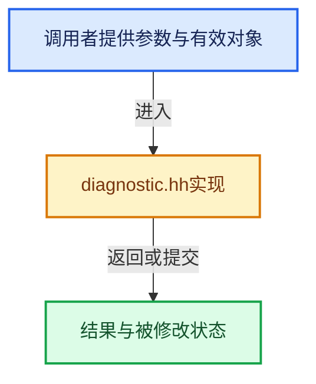

# 实现依赖专题：source/blender/gpu/shader_tool/bsl/diagnostic.hh

[方向导航](README.md) · [符号索引](../%E7%AC%A6%E5%8F%B7%E4%BE%9D%E8%B5%96%E4%B8%8E%E5%AE%9E%E7%8E%B0%E7%B4%A2%E5%BC%95.md)

本专题从正文实际调用进入，集中保存共享实现。函数有稳定锚点，可从调用处直接跳到对应完整函数；递归与互相调用通过回链组织。

## 本文件的实现关系





## 完整成员与函数实现

<a id="f-14652ab695a3c203"></a>

### `bsl::mini_fmt::detail::to_string_arg`

实现位置：[source/blender/gpu/shader_tool/bsl/diagnostic.hh](../../../../../source/blender/gpu/shader_tool/bsl/diagnostic.hh) · L29—L34。

接口参数：

- `T &&arg`

**教学注释版**

<!-- annotated:9771d48b0530d1 -->

```cpp
template<typename T> std::string to_string_arg(T &&arg)
{
  std::ostringstream ss;
  // [讲解] std::forward<T>：在转发引用中恢复调用者传入的值类别；依赖推导类型，不能与无条件move互换。
  ss << std::forward<T>(arg);
  return ss.str();
}
```

<details>
<summary>核对原始源码：source/blender/gpu/shader_tool/bsl/diagnostic.hh · L29—L34</summary>

<!-- original:9771d48b0530d1:source/blender/gpu/shader_tool/bsl/diagnostic.hh:29:34 -->

```cpp
template<typename T> std::string to_string_arg(T &&arg)
{
  std::ostringstream ss;
  ss << std::forward<T>(arg);
  return ss.str();
}
```

</details>

**结果出口**

- `return ss.str();`

**继续追踪实现**

- `std::forward<T>` → [外部契约](https://eel.is/c++draft/utility.forward)：在转发引用中恢复调用者传入的值类别；依赖推导类型，不能与无条件move互换。
- `ss.str` → [外部契约](https://eel.is/c++draft/)：这个边界按实际表达式及所属类型核对参数、返回值、寿命与失败行为。这里提供接口入口，不声称已解释该第三方版本的内部实现。

<a id="f-7e1574cf7fa0f1d7"></a>

### `bsl::mini_fmt::detail::args_to_strings`

实现位置：[source/blender/gpu/shader_tool/bsl/diagnostic.hh](../../../../../source/blender/gpu/shader_tool/bsl/diagnostic.hh) · L37—L40。

**教学注释版**

<!-- annotated:c11bd76be375a2 -->

```cpp
template<typename... Args> std::vector<std::string> args_to_strings(Args &&...args)
{
  // [讲解] std::forward<Args>：在转发引用中恢复调用者传入的值类别；依赖推导类型，不能与无条件move互换。
  return {to_string_arg(std::forward<Args>(args))...};
}
```

<details>
<summary>核对原始源码：source/blender/gpu/shader_tool/bsl/diagnostic.hh · L37—L40</summary>

<!-- original:c11bd76be375a2:source/blender/gpu/shader_tool/bsl/diagnostic.hh:37:40 -->

```cpp
template<typename... Args> std::vector<std::string> args_to_strings(Args &&...args)
{
  return {to_string_arg(std::forward<Args>(args))...};
}
```

</details>

**结果出口**

- `return {to_string_arg(std::forward<Args>(args))...};`

**继续追踪实现**

- `to_string_arg` → [bsl::mini_fmt::detail::to_string_arg · L29](%E4%BE%9D%E8%B5%96-diagnostic-f76547.md#f-14652ab695a3c203)。
- `std::forward<Args>` → [外部契约](https://eel.is/c++draft/utility.forward)：在转发引用中恢复调用者传入的值类别；依赖推导类型，不能与无条件move互换。

<a id="f-8c6ce9cf41894828"></a>

### `bsl::mini_fmt::format`

实现位置：[source/blender/gpu/shader_tool/bsl/diagnostic.hh](../../../../../source/blender/gpu/shader_tool/bsl/diagnostic.hh) · L43—L92。

接口参数：

- `const std::string &fmt`

**教学注释版**

<!-- annotated:39bbe0f8594b45 -->

```cpp
template<typename... Args> std::string format(const std::string &fmt, Args &&...args)
{
  // [讲解] std::forward<Args>：在转发引用中恢复调用者传入的值类别；依赖推导类型，不能与无条件move互换。
  std::vector<std::string> str_args = detail::args_to_strings(std::forward<Args>(args)...);
  std::string result;
  result.reserve(fmt.size() + 16 * sizeof...(args));

  size_t auto_idx = 0;
  size_t i = 0;
  size_t len = fmt.size();

  while (i < len) {
    if (fmt[i] == '{' && i + 1 < len) {
      // Case 1: Sequential placeholder "{}"
      if (fmt[i + 1] == '}') {
        if (auto_idx < str_args.size()) {
          result += str_args[auto_idx++];
        }
        i += 2;
        continue;
      }

      // Case 2: Positional placeholder "{N}"
      size_t end_pos = fmt.find('}', i + 1);
      if (end_pos != std::string::npos) {
        std::string num_str = fmt.substr(i + 1, end_pos - (i + 1));

        // Parse integer index manually to avoid std::stoi dependency
        bool valid = !num_str.empty();
        size_t idx = 0;
        for (char c : num_str) {
          if (c < '0' || c > '9') {
            valid = false;
            break;
          }
          idx = idx * 10 + (c - '0');
        }

        if (valid && idx < str_args.size()) {
          result += str_args[idx];
          i = end_pos + 1;
          continue;
        }
      }
    }

    result += fmt[i++];
  }

  return result;
}
```

<details>
<summary>核对原始源码：source/blender/gpu/shader_tool/bsl/diagnostic.hh · L43—L92</summary>

<!-- original:39bbe0f8594b45:source/blender/gpu/shader_tool/bsl/diagnostic.hh:43:92 -->

```cpp
template<typename... Args> std::string format(const std::string &fmt, Args &&...args)
{
  std::vector<std::string> str_args = detail::args_to_strings(std::forward<Args>(args)...);
  std::string result;
  result.reserve(fmt.size() + 16 * sizeof...(args));

  size_t auto_idx = 0;
  size_t i = 0;
  size_t len = fmt.size();

  while (i < len) {
    if (fmt[i] == '{' && i + 1 < len) {
      // Case 1: Sequential placeholder "{}"
      if (fmt[i + 1] == '}') {
        if (auto_idx < str_args.size()) {
          result += str_args[auto_idx++];
        }
        i += 2;
        continue;
      }

      // Case 2: Positional placeholder "{N}"
      size_t end_pos = fmt.find('}', i + 1);
      if (end_pos != std::string::npos) {
        std::string num_str = fmt.substr(i + 1, end_pos - (i + 1));

        // Parse integer index manually to avoid std::stoi dependency
        bool valid = !num_str.empty();
        size_t idx = 0;
        for (char c : num_str) {
          if (c < '0' || c > '9') {
            valid = false;
            break;
          }
          idx = idx * 10 + (c - '0');
        }

        if (valid && idx < str_args.size()) {
          result += str_args[idx];
          i = end_pos + 1;
          continue;
        }
      }
    }

    result += fmt[i++];
  }

  return result;
}
```

</details>

**沿实际写入检查状态**

- `result += str_args[auto_idx++];`
- `i += 2;`
- `valid = false;`
- `idx = idx * 10 + (c - '0');`
- `result += str_args[idx];`
- `i = end_pos + 1;`
- `result += fmt[i++];`

**结果出口**

- `return result;`

**继续追踪实现**

- `detail::args_to_strings` → [bsl::mini_fmt::detail::args_to_strings · L37](%E4%BE%9D%E8%B5%96-diagnostic-f76547.md#f-7e1574cf7fa0f1d7)。
- `std::forward<Args>` → [外部契约](https://eel.is/c++draft/utility.forward)：在转发引用中恢复调用者传入的值类别；依赖推导类型，不能与无条件move互换。
- `result.reserve` → [外部契约](https://eel.is/c++draft/)：这个边界按实际表达式及所属类型核对参数、返回值、寿命与失败行为。这里提供接口入口，不声称已解释该第三方版本的内部实现。
- `fmt.size` → [外部契约](https://eel.is/c++draft/)：这个边界按实际表达式及所属类型核对参数、返回值、寿命与失败行为。这里提供接口入口，不声称已解释该第三方版本的内部实现。
- `str_args.size` → [外部契约](https://eel.is/c++draft/)：这个边界按实际表达式及所属类型核对参数、返回值、寿命与失败行为。这里提供接口入口，不声称已解释该第三方版本的内部实现。
- `fmt.find` → [外部契约](https://eel.is/c++draft/)：这个边界按实际表达式及所属类型核对参数、返回值、寿命与失败行为。这里提供接口入口，不声称已解释该第三方版本的内部实现。
- `fmt.substr` → [外部契约](https://eel.is/c++draft/)：这个边界按实际表达式及所属类型核对参数、返回值、寿命与失败行为。这里提供接口入口，不声称已解释该第三方版本的内部实现。
- `num_str.empty` → [外部契约](https://eel.is/c++draft/)：这个边界按实际表达式及所属类型核对参数、返回值、寿命与失败行为。这里提供接口入口，不声称已解释该第三方版本的内部实现。
