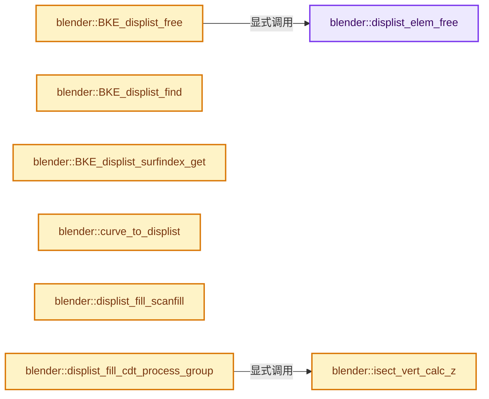
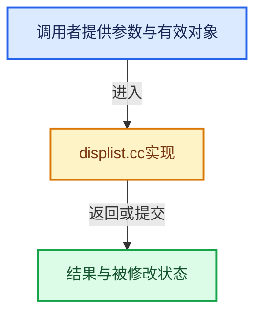

# 实现依赖专题：source/blender/blenkernel/intern/displist.cc

[方向导航](README.md) · [符号索引](../%E7%AC%A6%E5%8F%B7%E4%BE%9D%E8%B5%96%E4%B8%8E%E5%AE%9E%E7%8E%B0%E7%B4%A2%E5%BC%95.md)

本专题从正文实际调用进入，集中保存共享实现。函数有稳定锚点，可从调用处直接跳到对应完整函数；递归与互相调用通过回链组织。

## 本文件的实现关系






## 完整成员与函数实现

<a id="f-c36878a302c24286"></a>

### `blender::displist_elem_free`

实现位置：[source/blender/blenkernel/intern/displist.cc](../../../../../source/blender/blenkernel/intern/displist.cc) · L52—L66。

接口参数：

- `DispList *dl`

**教学注释版**

<!-- annotated:52fc2bc765ff15 -->

```cpp
static void displist_elem_free(DispList *dl)
{
  if (dl) {
    if (dl->verts) {
      MEM_delete(dl->verts);
    }
    if (dl->nors) {
      MEM_delete(dl->nors);
    }
    if (dl->index) {
      MEM_delete(dl->index);
    }
    MEM_delete(dl);
  }
}
```

<details>
<summary>核对原始源码：source/blender/blenkernel/intern/displist.cc · L52—L66</summary>

<!-- original:52fc2bc765ff15:source/blender/blenkernel/intern/displist.cc:52:66 -->

```cpp
static void displist_elem_free(DispList *dl)
{
  if (dl) {
    if (dl->verts) {
      MEM_delete(dl->verts);
    }
    if (dl->nors) {
      MEM_delete(dl->nors);
    }
    if (dl->index) {
      MEM_delete(dl->index);
    }
    MEM_delete(dl);
  }
}
```

</details>

**继续追踪实现**

- `MEM_delete` → [MEM_delete · L400](../03-%E5%86%85%E5%AD%98%E5%88%86%E9%85%8D%E4%B8%8E%E8%BF%90%E8%A1%8C%E6%97%B6%E7%B1%BB%E5%9E%8B/%E4%BE%9D%E8%B5%96-MEM_guardedalloc-b54eca.md#f-9049ffdd1682887c)。

<a id="f-fe6903944ada1ff4"></a>

### `blender::BKE_displist_free`

实现位置：[source/blender/blenkernel/intern/displist.cc](../../../../../source/blender/blenkernel/intern/displist.cc) · L68—L73。

接口参数：

- `ListBaseT<DispList> *lb`

**教学注释版**

<!-- annotated:5be6fd92eaeefc -->

```cpp
void BKE_displist_free(ListBaseT<DispList> *lb)
{
  while (DispList *dl = static_cast<DispList *>(BLI_pophead(lb))) {
    displist_elem_free(dl);
  }
}
```

<details>
<summary>核对原始源码：source/blender/blenkernel/intern/displist.cc · L68—L73</summary>

<!-- original:5be6fd92eaeefc:source/blender/blenkernel/intern/displist.cc:68:73 -->

```cpp
void BKE_displist_free(ListBaseT<DispList> *lb)
{
  while (DispList *dl = static_cast<DispList *>(BLI_pophead(lb))) {
    displist_elem_free(dl);
  }
}
```

</details>

**继续追踪实现**

- `BLI_pophead` → [blender::BLI_pophead · L259](../01-%E5%9F%BA%E7%A1%80%E5%AE%B9%E5%99%A8%E4%B8%8E%E7%8E%B0%E4%BB%A3CPP/%E4%BE%9D%E8%B5%96-listbase-2816d9.md#f-c1491382e532f81c)。
- `displist_elem_free` → [blender::displist_elem_free · L52](%E4%BE%9D%E8%B5%96-displist-7e6457.md#f-c36878a302c24286)。

<a id="f-64a8e45792ce7493"></a>

### `blender::BKE_displist_find`

实现位置：[source/blender/blenkernel/intern/displist.cc](../../../../../source/blender/blenkernel/intern/displist.cc) · L75—L84。

接口参数：

- `ListBaseT<DispList> *lb`
- `int type`

**教学注释版**

<!-- annotated:61539e0673d336 -->

```cpp
DispList *BKE_displist_find(ListBaseT<DispList> *lb, int type)
{
  for (DispList &dl : *lb) {
    if (dl.type == type) {
      return &dl;
    }
  }

  return nullptr;
}
```

<details>
<summary>核对原始源码：source/blender/blenkernel/intern/displist.cc · L75—L84</summary>

<!-- original:61539e0673d336:source/blender/blenkernel/intern/displist.cc:75:84 -->

```cpp
DispList *BKE_displist_find(ListBaseT<DispList> *lb, int type)
{
  for (DispList &dl : *lb) {
    if (dl.type == type) {
      return &dl;
    }
  }

  return nullptr;
}
```

</details>

**结果出口**

- `return &dl;`
- `return nullptr;`

**继续追踪实现**

本实现没有需要继续展开的显式调用；检查返回表达式、对象转换和调用者前置条件。

<a id="f-c4b74d5394ea869b"></a>

### `blender::BKE_displist_surfindex_get`

实现位置：[source/blender/blenkernel/intern/displist.cc](../../../../../source/blender/blenkernel/intern/displist.cc) · L86—L114。

接口参数：

- `const DispList *dl`
- `int a`
- `int *b`
- `int *p1`
- `int *p2`
- `int *p3`
- `int *p4`

**教学注释版**

<!-- annotated:b11fb59741302a -->

```cpp
bool BKE_displist_surfindex_get(
    const DispList *dl, int a, int *b, int *p1, int *p2, int *p3, int *p4)
{
  if ((dl->flag & DL_CYCL_V) == 0 && a == (dl->parts) - 1) {
    return false;
  }

  if (dl->flag & DL_CYCL_U) {
    (*p1) = dl->nr * a;
    (*p2) = (*p1) + dl->nr - 1;
    (*p3) = (*p1) + dl->nr;
    (*p4) = (*p2) + dl->nr;
    (*b) = 0;
  }
  else {
    (*p2) = dl->nr * a;
    (*p1) = (*p2) + 1;
    (*p4) = (*p2) + dl->nr;
    (*p3) = (*p1) + dl->nr;
    (*b) = 1;
  }

  if ((dl->flag & DL_CYCL_V) && a == dl->parts - 1) {
    (*p3) -= dl->nr * dl->parts;
    (*p4) -= dl->nr * dl->parts;
  }

  return true;
}
```

<details>
<summary>核对原始源码：source/blender/blenkernel/intern/displist.cc · L86—L114</summary>

<!-- original:b11fb59741302a:source/blender/blenkernel/intern/displist.cc:86:114 -->

```cpp
bool BKE_displist_surfindex_get(
    const DispList *dl, int a, int *b, int *p1, int *p2, int *p3, int *p4)
{
  if ((dl->flag & DL_CYCL_V) == 0 && a == (dl->parts) - 1) {
    return false;
  }

  if (dl->flag & DL_CYCL_U) {
    (*p1) = dl->nr * a;
    (*p2) = (*p1) + dl->nr - 1;
    (*p3) = (*p1) + dl->nr;
    (*p4) = (*p2) + dl->nr;
    (*b) = 0;
  }
  else {
    (*p2) = dl->nr * a;
    (*p1) = (*p2) + 1;
    (*p4) = (*p2) + dl->nr;
    (*p3) = (*p1) + dl->nr;
    (*b) = 1;
  }

  if ((dl->flag & DL_CYCL_V) && a == dl->parts - 1) {
    (*p3) -= dl->nr * dl->parts;
    (*p4) -= dl->nr * dl->parts;
  }

  return true;
}
```

</details>

**结果出口**

- `return false;`
- `return true;`

**继续追踪实现**

本实现没有需要继续展开的显式调用；检查返回表达式、对象转换和调用者前置条件。

<a id="f-13a47d37a8b44cc0"></a>

### `blender::curve_to_displist`

实现位置：[source/blender/blenkernel/intern/displist.cc](../../../../../source/blender/blenkernel/intern/displist.cc) · L121—L256。

接口参数：

- `const Curve *cu`
- `const ListBaseT<Nurb> *nubase`
- `const bool for_render`
- `ListBaseT<DispList> *r_dispbase`

**教学注释版**

<!-- annotated:f9158b23480612 -->

```cpp
static void curve_to_displist(const Curve *cu,
                              const ListBaseT<Nurb> *nubase,
                              const bool for_render,
                              ListBaseT<DispList> *r_dispbase)
{
  const bool editmode = (!for_render && (cu->editnurb || cu->editfont));

  for (Nurb &nu : *nubase) {
    if (nu.hide != 0 && editmode) {
      continue;
    }
    if (!BKE_nurb_check_valid_u(&nu)) {
      continue;
    }

    const int resolution = (for_render && cu->resolu_ren != 0) ? cu->resolu_ren : nu.resolu;
    const bool is_cyclic = nu.flagu & CU_NURB_CYCLIC;

    if (nu.type == CU_BEZIER) {
      const BezTriple *bezt_first = &nu.bezt[0];
      const BezTriple *bezt_last = &nu.bezt[nu.pntsu - 1];
      int samples_len = 0;
      for (int i = 1; i < nu.pntsu; i++) {
        const BezTriple *prevbezt = &nu.bezt[i - 1];
        const BezTriple *bezt = &nu.bezt[i];
        if (prevbezt->h2 == HD_VECT && bezt->h1 == HD_VECT) {
          samples_len++;
        }
        else {
          samples_len += resolution;
        }
      }
      if (is_cyclic) {
        /* If the curve is cyclic, sample the last edge between the last and first points. */
        if (bezt_first->h1 == HD_VECT && bezt_last->h2 == HD_VECT) {
          samples_len++;
        }
        else {
          samples_len += resolution;
        }
      }
      else {
        /* Otherwise, we only need one additional sample to complete the last edge. */
        samples_len++;
      }

      /* Check that there are more than two points so the curve doesn't loop back on itself. This
       * needs to be separate from `is_cyclic` because cyclic sampling can work with two points
       * and resolution > 1. */
      const bool use_cyclic_sample = is_cyclic && (samples_len != 2);

      DispList *dl = MEM_new_zeroed<DispList>(__func__);
      /* Add one to the length because of #BKE_curve_forward_diff_bezier. */
      dl->verts = MEM_new_array_uninitialized<float>(3 * size_t(samples_len + 1), __func__);
      BLI_addtail(r_dispbase, dl);
      dl->parts = 1;
      dl->nr = samples_len;
      dl->col = nu.mat_nr;
      dl->charidx = nu.charidx;

      dl->type = use_cyclic_sample ? DL_POLY : DL_SEGM;

      float *data = dl->verts;
      for (int i = 1; i < nu.pntsu; i++) {
        const BezTriple *prevbezt = &nu.bezt[i - 1];
        const BezTriple *bezt = &nu.bezt[i];

        if (prevbezt->h2 == HD_VECT && bezt->h1 == HD_VECT) {
          copy_v3_v3(data, prevbezt->vec[1]);
          data += 3;
        }
        else {
          for (int j = 0; j < 3; j++) {
            BKE_curve_forward_diff_bezier(prevbezt->vec[1][j],
                                          prevbezt->vec[2][j],
                                          bezt->vec[0][j],
                                          bezt->vec[1][j],
                                          data + j,
                                          resolution,
                                          sizeof(float[3]));
          }
          data += 3 * resolution;
        }
      }
      if (is_cyclic) {
        if (bezt_first->h1 == HD_VECT && bezt_last->h2 == HD_VECT) {
          copy_v3_v3(data, bezt_last->vec[1]);
        }
        else {
          for (int j = 0; j < 3; j++) {
            BKE_curve_forward_diff_bezier(bezt_last->vec[1][j],
                                          bezt_last->vec[2][j],
                                          bezt_first->vec[0][j],
                                          bezt_first->vec[1][j],
                                          data + j,
                                          resolution,
                                          sizeof(float[3]));
          }
        }
      }
      else {
        copy_v3_v3(data, bezt_last->vec[1]);
      }
    }
    else if (nu.type == CU_NURBS) {
      const int len = (resolution * SEGMENTSU(&nu));
      DispList *dl = MEM_new_zeroed<DispList>(__func__);
      dl->verts = MEM_new_array_uninitialized<float>(3 * size_t(len), __func__);
      BLI_addtail(r_dispbase, dl);
      dl->parts = 1;
      dl->nr = len;
      dl->col = nu.mat_nr;
      dl->charidx = nu.charidx;
      dl->type = is_cyclic ? DL_POLY : DL_SEGM;

      BKE_nurb_makeCurve(&nu, dl->verts, nullptr, nullptr, nullptr, resolution, sizeof(float[3]));
    }
    else if (nu.type == CU_POLY) {
      const int len = nu.pntsu;
      DispList *dl = MEM_new_zeroed<DispList>(__func__);
      dl->verts = MEM_new_array_uninitialized<float>(3 * size_t(len), __func__);
      BLI_addtail(r_dispbase, dl);
      dl->parts = 1;
      dl->nr = len;
      dl->col = nu.mat_nr;
      dl->charidx = nu.charidx;
      dl->type = (is_cyclic && (dl->nr != 2)) ? DL_POLY : DL_SEGM;

      float (*coords)[3] = reinterpret_cast<float (*)[3]>(dl->verts);
      for (int i = 0; i < len; i++) {
        const BPoint *bp = &nu.bp[i];
        copy_v3_v3(coords[i], bp->vec);
      }
    }
  }
}
```

<details>
<summary>核对原始源码：source/blender/blenkernel/intern/displist.cc · L121—L256</summary>

<!-- original:f9158b23480612:source/blender/blenkernel/intern/displist.cc:121:256 -->

```cpp
static void curve_to_displist(const Curve *cu,
                              const ListBaseT<Nurb> *nubase,
                              const bool for_render,
                              ListBaseT<DispList> *r_dispbase)
{
  const bool editmode = (!for_render && (cu->editnurb || cu->editfont));

  for (Nurb &nu : *nubase) {
    if (nu.hide != 0 && editmode) {
      continue;
    }
    if (!BKE_nurb_check_valid_u(&nu)) {
      continue;
    }

    const int resolution = (for_render && cu->resolu_ren != 0) ? cu->resolu_ren : nu.resolu;
    const bool is_cyclic = nu.flagu & CU_NURB_CYCLIC;

    if (nu.type == CU_BEZIER) {
      const BezTriple *bezt_first = &nu.bezt[0];
      const BezTriple *bezt_last = &nu.bezt[nu.pntsu - 1];
      int samples_len = 0;
      for (int i = 1; i < nu.pntsu; i++) {
        const BezTriple *prevbezt = &nu.bezt[i - 1];
        const BezTriple *bezt = &nu.bezt[i];
        if (prevbezt->h2 == HD_VECT && bezt->h1 == HD_VECT) {
          samples_len++;
        }
        else {
          samples_len += resolution;
        }
      }
      if (is_cyclic) {
        /* If the curve is cyclic, sample the last edge between the last and first points. */
        if (bezt_first->h1 == HD_VECT && bezt_last->h2 == HD_VECT) {
          samples_len++;
        }
        else {
          samples_len += resolution;
        }
      }
      else {
        /* Otherwise, we only need one additional sample to complete the last edge. */
        samples_len++;
      }

      /* Check that there are more than two points so the curve doesn't loop back on itself. This
       * needs to be separate from `is_cyclic` because cyclic sampling can work with two points
       * and resolution > 1. */
      const bool use_cyclic_sample = is_cyclic && (samples_len != 2);

      DispList *dl = MEM_new_zeroed<DispList>(__func__);
      /* Add one to the length because of #BKE_curve_forward_diff_bezier. */
      dl->verts = MEM_new_array_uninitialized<float>(3 * size_t(samples_len + 1), __func__);
      BLI_addtail(r_dispbase, dl);
      dl->parts = 1;
      dl->nr = samples_len;
      dl->col = nu.mat_nr;
      dl->charidx = nu.charidx;

      dl->type = use_cyclic_sample ? DL_POLY : DL_SEGM;

      float *data = dl->verts;
      for (int i = 1; i < nu.pntsu; i++) {
        const BezTriple *prevbezt = &nu.bezt[i - 1];
        const BezTriple *bezt = &nu.bezt[i];

        if (prevbezt->h2 == HD_VECT && bezt->h1 == HD_VECT) {
          copy_v3_v3(data, prevbezt->vec[1]);
          data += 3;
        }
        else {
          for (int j = 0; j < 3; j++) {
            BKE_curve_forward_diff_bezier(prevbezt->vec[1][j],
                                          prevbezt->vec[2][j],
                                          bezt->vec[0][j],
                                          bezt->vec[1][j],
                                          data + j,
                                          resolution,
                                          sizeof(float[3]));
          }
          data += 3 * resolution;
        }
      }
      if (is_cyclic) {
        if (bezt_first->h1 == HD_VECT && bezt_last->h2 == HD_VECT) {
          copy_v3_v3(data, bezt_last->vec[1]);
        }
        else {
          for (int j = 0; j < 3; j++) {
            BKE_curve_forward_diff_bezier(bezt_last->vec[1][j],
                                          bezt_last->vec[2][j],
                                          bezt_first->vec[0][j],
                                          bezt_first->vec[1][j],
                                          data + j,
                                          resolution,
                                          sizeof(float[3]));
          }
        }
      }
      else {
        copy_v3_v3(data, bezt_last->vec[1]);
      }
    }
    else if (nu.type == CU_NURBS) {
      const int len = (resolution * SEGMENTSU(&nu));
      DispList *dl = MEM_new_zeroed<DispList>(__func__);
      dl->verts = MEM_new_array_uninitialized<float>(3 * size_t(len), __func__);
      BLI_addtail(r_dispbase, dl);
      dl->parts = 1;
      dl->nr = len;
      dl->col = nu.mat_nr;
      dl->charidx = nu.charidx;
      dl->type = is_cyclic ? DL_POLY : DL_SEGM;

      BKE_nurb_makeCurve(&nu, dl->verts, nullptr, nullptr, nullptr, resolution, sizeof(float[3]));
    }
    else if (nu.type == CU_POLY) {
      const int len = nu.pntsu;
      DispList *dl = MEM_new_zeroed<DispList>(__func__);
      dl->verts = MEM_new_array_uninitialized<float>(3 * size_t(len), __func__);
      BLI_addtail(r_dispbase, dl);
      dl->parts = 1;
      dl->nr = len;
      dl->col = nu.mat_nr;
      dl->charidx = nu.charidx;
      dl->type = (is_cyclic && (dl->nr != 2)) ? DL_POLY : DL_SEGM;

      float (*coords)[3] = reinterpret_cast<float (*)[3]>(dl->verts);
      for (int i = 0; i < len; i++) {
        const BPoint *bp = &nu.bp[i];
        copy_v3_v3(coords[i], bp->vec);
      }
    }
  }
}
```

</details>

**沿实际写入检查状态**

- `samples_len += resolution;`
- `dl->verts = MEM_new_array_uninitialized<float>(3 * size_t(samples_len + 1), __func__);`
- `dl->parts = 1;`
- `dl->nr = samples_len;`
- `dl->col = nu.mat_nr;`
- `dl->charidx = nu.charidx;`
- `dl->type = use_cyclic_sample ? DL_POLY : DL_SEGM;`
- `data += 3;`
- `data += 3 * resolution;`
- `dl->verts = MEM_new_array_uninitialized<float>(3 * size_t(len), __func__);`
- `dl->nr = len;`
- `dl->type = is_cyclic ? DL_POLY : DL_SEGM;`
- `dl->type = (is_cyclic && (dl->nr != 2)) ? DL_POLY : DL_SEGM;`

**继续追踪实现**

- `BKE_nurb_check_valid_u` → [blender::BKE_nurb_check_valid_u · L4800](%E4%BE%9D%E8%B5%96-curve-ae13d5.md#f-72d8d7b02dd70bd5)。
- `MEM_new_zeroed<DispList>` → [MEM_new_zeroed · L550](../03-%E5%86%85%E5%AD%98%E5%88%86%E9%85%8D%E4%B8%8E%E8%BF%90%E8%A1%8C%E6%97%B6%E7%B1%BB%E5%9E%8B/%E4%BE%9D%E8%B5%96-MEM_guardedalloc-b54eca.md#f-eeb1e2a7f57dd231)；[MEM_new_zeroed · L114](../03-%E5%86%85%E5%AD%98%E5%88%86%E9%85%8D%E4%B8%8E%E8%BF%90%E8%A1%8C%E6%97%B6%E7%B1%BB%E5%9E%8B/%E4%BE%9D%E8%B5%96-mallocn-afdcd4.md#f-e04cf01c64c8b180)。同名重载需按实参类型选择。
- `MEM_new_array_uninitialized<float>` → [MEM_new_array_uninitialized · L608](../03-%E5%86%85%E5%AD%98%E5%88%86%E9%85%8D%E4%B8%8E%E8%BF%90%E8%A1%8C%E6%97%B6%E7%B1%BB%E5%9E%8B/%E4%BE%9D%E8%B5%96-MEM_guardedalloc-b54eca.md#f-b7103eae8eb57b05)；[MEM_new_array_uninitialized · L129](../03-%E5%86%85%E5%AD%98%E5%88%86%E9%85%8D%E4%B8%8E%E8%BF%90%E8%A1%8C%E6%97%B6%E7%B1%BB%E5%9E%8B/%E4%BE%9D%E8%B5%96-mallocn-afdcd4.md#f-bf6ef4ddcfb6e5df)。同名重载需按实参类型选择。
- `BLI_addtail` → [blender::BLI_addtail · L118](../01-%E5%9F%BA%E7%A1%80%E5%AE%B9%E5%99%A8%E4%B8%8E%E7%8E%B0%E4%BB%A3CPP/%E4%BE%9D%E8%B5%96-listbase-2816d9.md#f-4fb027713fa3115b)。
- `copy_v3_v3` → [blender::copy_v3_v3 · L47](../12-%E7%A9%BA%E9%97%B4%E6%95%B0%E6%8D%AE%E7%BB%93%E6%9E%84%E4%B8%8E%E5%87%A0%E4%BD%95%E7%AE%97%E6%B3%95/%E4%BE%9D%E8%B5%96-math_vector_inline-0c8541.md#f-037a0d5fa5060bd6)。
- `BKE_curve_forward_diff_bezier` → [blender::BKE_curve_forward_diff_bezier · L1696](%E4%BE%9D%E8%B5%96-curve-ae13d5.md#f-2796edbd071c95c8)。
- `SEGMENTSU` → [SEGMENTSU · L84](%E4%BE%9D%E8%B5%96-BKE_curve-04dd17.md#m-d1b4e857a9fa)。宏定义由构建条件选择。
- `BKE_nurb_makeCurve` → [blender::BKE_nurb_makeCurve · L1493](%E4%BE%9D%E8%B5%96-curve-ae13d5.md#f-7f758bb98a7bb71b)。

<a id="f-63feac214888b294"></a>

### `blender::isect_vert_calc_z`

实现位置：[source/blender/blenkernel/intern/displist.cc](../../../../../source/blender/blenkernel/intern/displist.cc) · L274—L342。

接口参数：

- `int vert_index`
- `int edge_index`
- `const meshintersect::CDT_result<double> &result`
- `Span<PolyRange> poly_ranges`
- `Span<double2> input_verts_2d`

**教学注释版**

<!-- annotated:7ff544ff1dbfae -->

```cpp
static float isect_vert_calc_z(int vert_index,
                               int edge_index,
                               const meshintersect::CDT_result<double> &result,
                               Span<PolyRange> poly_ranges,
                               Span<double2> input_verts_2d)
{
  /* -1 if this intersection vertex only appears on Delaunay edges
   * (edges created by triangulation) rather than edges deriving from
   * input polygon edges. Fall back to Z=0. */
  if (edge_index == -1) [[unlikely]] {
    return 0.0f;
  }

  const double2 &vert_co = result.vert[vert_index];

  /* Find a face edge in the original edge info. */
  for (const uint32_t orig_id : result.edge_orig[edge_index]) {
    if (orig_id < result.face_edge_offset) {
      /* Standalone edge - skip. */
      continue;
    }
    /* Decode face index and edge position. */
    const int face_index = (orig_id / result.face_edge_offset) - 1;
    const int edge_in_face = orig_id % result.face_edge_offset;

    // [讲解] poly_ranges.size：查询视图长度或生成对应有效索引区间。
    if (face_index == -1 || face_index >= int(poly_ranges.size())) [[unlikely]] {
      continue;
    }

    const PolyRange &poly = poly_ranges[face_index];
    if (edge_in_face >= poly.count) [[unlikely]] {
      continue;
    }

    /* Get the two endpoints of the original edge. */
    const int v0_local = edge_in_face;
    const int v1_local = (edge_in_face + 1) % poly.count;

    const int v0_global = poly.start + v0_local;
    const int v1_global = poly.start + v1_local;

    const double2 &p0 = input_verts_2d[v0_global];
    const double2 &p1 = input_verts_2d[v1_global];

    /* Project the intersection vertex onto this edge to find parameter t. */
    const double2 edge_vec = p1 - p0;
    const double edge_len_sq = math::length_squared(edge_vec);

    double t;
    if (edge_len_sq < 1e-16) [[unlikely]] {
      t = 0.5;
    }
    else {
      const double2 to_point = vert_co - p0;
      t = math::dot(to_point, edge_vec) / edge_len_sq;
      t = math::clamp(t, 0.0, 1.0);
    }

    /* Get the Z coordinates of the original edge endpoints. */
    const float z0 = poly.dl->verts[(3 * v0_local) + 2];
    const float z1 = poly.dl->verts[(3 * v1_local) + 2];

    /* Interpolate Z. */
    return z0 + (float(t) * (z1 - z0));
  }

  /* Fallback: return 0 if no edge found. */
  return 0.0f;
}
```

<details>
<summary>核对原始源码：source/blender/blenkernel/intern/displist.cc · L274—L342</summary>

<!-- original:7ff544ff1dbfae:source/blender/blenkernel/intern/displist.cc:274:342 -->

```cpp
static float isect_vert_calc_z(int vert_index,
                               int edge_index,
                               const meshintersect::CDT_result<double> &result,
                               Span<PolyRange> poly_ranges,
                               Span<double2> input_verts_2d)
{
  /* -1 if this intersection vertex only appears on Delaunay edges
   * (edges created by triangulation) rather than edges deriving from
   * input polygon edges. Fall back to Z=0. */
  if (edge_index == -1) [[unlikely]] {
    return 0.0f;
  }

  const double2 &vert_co = result.vert[vert_index];

  /* Find a face edge in the original edge info. */
  for (const uint32_t orig_id : result.edge_orig[edge_index]) {
    if (orig_id < result.face_edge_offset) {
      /* Standalone edge - skip. */
      continue;
    }
    /* Decode face index and edge position. */
    const int face_index = (orig_id / result.face_edge_offset) - 1;
    const int edge_in_face = orig_id % result.face_edge_offset;

    if (face_index == -1 || face_index >= int(poly_ranges.size())) [[unlikely]] {
      continue;
    }

    const PolyRange &poly = poly_ranges[face_index];
    if (edge_in_face >= poly.count) [[unlikely]] {
      continue;
    }

    /* Get the two endpoints of the original edge. */
    const int v0_local = edge_in_face;
    const int v1_local = (edge_in_face + 1) % poly.count;

    const int v0_global = poly.start + v0_local;
    const int v1_global = poly.start + v1_local;

    const double2 &p0 = input_verts_2d[v0_global];
    const double2 &p1 = input_verts_2d[v1_global];

    /* Project the intersection vertex onto this edge to find parameter t. */
    const double2 edge_vec = p1 - p0;
    const double edge_len_sq = math::length_squared(edge_vec);

    double t;
    if (edge_len_sq < 1e-16) [[unlikely]] {
      t = 0.5;
    }
    else {
      const double2 to_point = vert_co - p0;
      t = math::dot(to_point, edge_vec) / edge_len_sq;
      t = math::clamp(t, 0.0, 1.0);
    }

    /* Get the Z coordinates of the original edge endpoints. */
    const float z0 = poly.dl->verts[(3 * v0_local) + 2];
    const float z1 = poly.dl->verts[(3 * v1_local) + 2];

    /* Interpolate Z. */
    return z0 + (float(t) * (z1 - z0));
  }

  /* Fallback: return 0 if no edge found. */
  return 0.0f;
}
```

</details>

**沿实际写入检查状态**

- `t = 0.5;`
- `t = math::dot(to_point, edge_vec) / edge_len_sq;`
- `t = math::clamp(t, 0.0, 1.0);`

**结果出口**

- `return 0.0f;`
- `return z0 + (float(t) * (z1 - z0));`

**继续追踪实现**

- `poly_ranges.size` → [blender::Span::size · L256](../01-%E5%9F%BA%E7%A1%80%E5%AE%B9%E5%99%A8%E4%B8%8E%E7%8E%B0%E4%BB%A3CPP/05-Span%E5%8F%AA%E8%AF%BB%E8%BF%9E%E7%BB%AD%E8%A7%86%E5%9B%BE.md#f-5f80fa006089c998)。
- `math::length_squared` → [blender::math::length_squared · L452](../12-%E7%A9%BA%E9%97%B4%E6%95%B0%E6%8D%AE%E7%BB%93%E6%9E%84%E4%B8%8E%E5%87%A0%E4%BD%95%E7%AE%97%E6%B3%95/%E4%BE%9D%E8%B5%96-BLI_math_vector-906a87.md#f-b1e1749f57230265)。
- `math::dot` → [blender::math::dot · L430](../12-%E7%A9%BA%E9%97%B4%E6%95%B0%E6%8D%AE%E7%BB%93%E6%9E%84%E4%B8%8E%E5%87%A0%E4%BD%95%E7%AE%97%E6%B3%95/%E4%BE%9D%E8%B5%96-BLI_math_vector-906a87.md#f-6f0c6a081b107428)；[blender::math::dot · L198](../12-%E7%A9%BA%E9%97%B4%E6%95%B0%E6%8D%AE%E7%BB%93%E6%9E%84%E4%B8%8E%E5%87%A0%E4%BD%95%E7%AE%97%E6%B3%95/%E4%BE%9D%E8%B5%96-BLI_math_quaternion-cf105d.md#f-5b1ef457981dbc76)。同名重载需按实参类型选择。
- `math::clamp` → [blender::math::clamp · L118](../12-%E7%A9%BA%E9%97%B4%E6%95%B0%E6%8D%AE%E7%BB%93%E6%9E%84%E4%B8%8E%E5%87%A0%E4%BD%95%E7%AE%97%E6%B3%95/%E4%BE%9D%E8%B5%96-BLI_math_vector-906a87.md#f-65702e97e59fc41e)；[blender::math::clamp · L130](../12-%E7%A9%BA%E9%97%B4%E6%95%B0%E6%8D%AE%E7%BB%93%E6%9E%84%E4%B8%8E%E5%87%A0%E4%BD%95%E7%AE%97%E6%B3%95/%E4%BE%9D%E8%B5%96-BLI_math_vector-906a87.md#f-0365873940e23a11)；[blender::math::clamp · L69](../12-%E7%A9%BA%E9%97%B4%E6%95%B0%E6%8D%AE%E7%BB%93%E6%9E%84%E4%B8%8E%E5%87%A0%E4%BD%95%E7%AE%97%E6%B3%95/%E4%BE%9D%E8%B5%96-BLI_math_base-0728eb.md#f-9282cf5d06fa3723)。同名重载需按实参类型选择。

<a id="f-270ddc94f6242327"></a>

### `blender::displist_fill_scanfill`

实现位置：[source/blender/blenkernel/intern/displist.cc](../../../../../source/blender/blenkernel/intern/displist.cc) · L347—L465。

接口参数：

- `const ListBaseT<DispList> *dispbase`
- `ListBaseT<DispList> *to`
- `const float normal_proj[3]`
- `const bool flip_normal`

**教学注释版**

<!-- annotated:1a915180a5ba1e -->

```cpp
static void displist_fill_scanfill(const ListBaseT<DispList> *dispbase,
                                   ListBaseT<DispList> *to,
                                   const float normal_proj[3],
                                   const bool flip_normal)
{
  if (dispbase == nullptr) {
    return;
  }
  if (BLI_listbase_is_empty(dispbase)) {
    return;
  }

  const int scanfill_flag = BLI_SCANFILL_CALC_REMOVE_DOUBLES | BLI_SCANFILL_CALC_POLYS |
                            BLI_SCANFILL_CALC_HOLES;

  MemArena *sf_arena = BLI_memarena_new(BLI_SCANFILL_ARENA_SIZE, __func__);

  short colnr = 0;
  int charidx = 0;
  bool should_continue = true;
  while (should_continue) {
    should_continue = false;
    bool nextcol = false;

    ScanFillContext sf_ctx;
    BLI_scanfill_begin_arena(&sf_ctx, sf_arena);

    int totvert = 0;
    short dl_flag_accum = 0;
    short dl_rt_accum = 0;
    for (const DispList &dl : *dispbase) {
      if (dl.type == DL_POLY) {
        if (charidx < dl.charidx) {
          should_continue = true;
        }
        else if (charidx == dl.charidx) { /* character with needed index */
          if (colnr == dl.col) {

            sf_ctx.poly_nr++;

            /* Make verts and edges. */
            ScanFillVert *sf_vert = nullptr;
            ScanFillVert *sf_vert_last = nullptr;
            ScanFillVert *sf_vert_new = nullptr;
            for (int i = 0; i < dl.nr; i++) {
              sf_vert_last = sf_vert;
              sf_vert = BLI_scanfill_vert_add(&sf_ctx, &dl.verts[3 * i]);
              totvert++;
              if (sf_vert_last == nullptr) {
                sf_vert_new = sf_vert;
              }
              else {
                BLI_scanfill_edge_add(&sf_ctx, sf_vert_last, sf_vert);
              }
            }

            if (sf_vert != nullptr && sf_vert_new != nullptr) {
              BLI_scanfill_edge_add(&sf_ctx, sf_vert, sf_vert_new);
            }

            dl_flag_accum |= dl.flag;
            dl_rt_accum |= dl.rt;
          }
          else if (colnr < dl.col) {
            /* got poly with next material at current char */
            should_continue = true;
            nextcol = true;
          }
        }
      }
    }

    const int triangles_len = BLI_scanfill_calc_ex(&sf_ctx, scanfill_flag, normal_proj);
    if (totvert != 0 && triangles_len != 0) {
      DispList *dlnew = MEM_new_zeroed<DispList>(__func__);
      dlnew->type = DL_INDEX3;
      dlnew->flag = (dl_flag_accum & (DL_BACK_CURVE | DL_FRONT_CURVE));
      dlnew->rt = (dl_rt_accum & CU_SMOOTH);
      dlnew->col = colnr;
      dlnew->nr = totvert;
      dlnew->parts = triangles_len;

      dlnew->index = MEM_new_array_uninitialized<int>(3 * size_t(triangles_len), __func__);
      dlnew->verts = MEM_new_array_uninitialized<float>(3 * size_t(totvert), __func__);

      /* vert data */

      for (const auto [i, sf_vert] : sf_ctx.fillvertbase.enumerate()) {
        copy_v3_v3(&dlnew->verts[3 * i], sf_vert.co);
        sf_vert.tmp.i = i; /* Index number. */
      }

      /* index data */
      int *index = dlnew->index;
      for (const ScanFillFace &sf_tri : sf_ctx.fillfacebase) {
        index[0] = sf_tri.v1->tmp.i;
        index[1] = flip_normal ? sf_tri.v3->tmp.i : sf_tri.v2->tmp.i;
        index[2] = flip_normal ? sf_tri.v2->tmp.i : sf_tri.v3->tmp.i;
        index += 3;
      }

      BLI_addhead(to, dlnew);
    }
    BLI_scanfill_end_arena(&sf_ctx, sf_arena);

    if (nextcol) {
      /* stay at current char but fill polys with next material */
      colnr++;
    }
    else {
      /* switch to next char and start filling from first material */
      charidx++;
      colnr = 0;
    }
  }

  BLI_memarena_free(sf_arena);
  /* do not free polys, needed for wireframe display */
}
```

<details>
<summary>核对原始源码：source/blender/blenkernel/intern/displist.cc · L347—L465</summary>

<!-- original:1a915180a5ba1e:source/blender/blenkernel/intern/displist.cc:347:465 -->

```cpp
static void displist_fill_scanfill(const ListBaseT<DispList> *dispbase,
                                   ListBaseT<DispList> *to,
                                   const float normal_proj[3],
                                   const bool flip_normal)
{
  if (dispbase == nullptr) {
    return;
  }
  if (BLI_listbase_is_empty(dispbase)) {
    return;
  }

  const int scanfill_flag = BLI_SCANFILL_CALC_REMOVE_DOUBLES | BLI_SCANFILL_CALC_POLYS |
                            BLI_SCANFILL_CALC_HOLES;

  MemArena *sf_arena = BLI_memarena_new(BLI_SCANFILL_ARENA_SIZE, __func__);

  short colnr = 0;
  int charidx = 0;
  bool should_continue = true;
  while (should_continue) {
    should_continue = false;
    bool nextcol = false;

    ScanFillContext sf_ctx;
    BLI_scanfill_begin_arena(&sf_ctx, sf_arena);

    int totvert = 0;
    short dl_flag_accum = 0;
    short dl_rt_accum = 0;
    for (const DispList &dl : *dispbase) {
      if (dl.type == DL_POLY) {
        if (charidx < dl.charidx) {
          should_continue = true;
        }
        else if (charidx == dl.charidx) { /* character with needed index */
          if (colnr == dl.col) {

            sf_ctx.poly_nr++;

            /* Make verts and edges. */
            ScanFillVert *sf_vert = nullptr;
            ScanFillVert *sf_vert_last = nullptr;
            ScanFillVert *sf_vert_new = nullptr;
            for (int i = 0; i < dl.nr; i++) {
              sf_vert_last = sf_vert;
              sf_vert = BLI_scanfill_vert_add(&sf_ctx, &dl.verts[3 * i]);
              totvert++;
              if (sf_vert_last == nullptr) {
                sf_vert_new = sf_vert;
              }
              else {
                BLI_scanfill_edge_add(&sf_ctx, sf_vert_last, sf_vert);
              }
            }

            if (sf_vert != nullptr && sf_vert_new != nullptr) {
              BLI_scanfill_edge_add(&sf_ctx, sf_vert, sf_vert_new);
            }

            dl_flag_accum |= dl.flag;
            dl_rt_accum |= dl.rt;
          }
          else if (colnr < dl.col) {
            /* got poly with next material at current char */
            should_continue = true;
            nextcol = true;
          }
        }
      }
    }

    const int triangles_len = BLI_scanfill_calc_ex(&sf_ctx, scanfill_flag, normal_proj);
    if (totvert != 0 && triangles_len != 0) {
      DispList *dlnew = MEM_new_zeroed<DispList>(__func__);
      dlnew->type = DL_INDEX3;
      dlnew->flag = (dl_flag_accum & (DL_BACK_CURVE | DL_FRONT_CURVE));
      dlnew->rt = (dl_rt_accum & CU_SMOOTH);
      dlnew->col = colnr;
      dlnew->nr = totvert;
      dlnew->parts = triangles_len;

      dlnew->index = MEM_new_array_uninitialized<int>(3 * size_t(triangles_len), __func__);
      dlnew->verts = MEM_new_array_uninitialized<float>(3 * size_t(totvert), __func__);

      /* vert data */

      for (const auto [i, sf_vert] : sf_ctx.fillvertbase.enumerate()) {
        copy_v3_v3(&dlnew->verts[3 * i], sf_vert.co);
        sf_vert.tmp.i = i; /* Index number. */
      }

      /* index data */
      int *index = dlnew->index;
      for (const ScanFillFace &sf_tri : sf_ctx.fillfacebase) {
        index[0] = sf_tri.v1->tmp.i;
        index[1] = flip_normal ? sf_tri.v3->tmp.i : sf_tri.v2->tmp.i;
        index[2] = flip_normal ? sf_tri.v2->tmp.i : sf_tri.v3->tmp.i;
        index += 3;
      }

      BLI_addhead(to, dlnew);
    }
    BLI_scanfill_end_arena(&sf_ctx, sf_arena);

    if (nextcol) {
      /* stay at current char but fill polys with next material */
      colnr++;
    }
    else {
      /* switch to next char and start filling from first material */
      charidx++;
      colnr = 0;
    }
  }

  BLI_memarena_free(sf_arena);
  /* do not free polys, needed for wireframe display */
}
```

</details>

**沿实际写入检查状态**

- `should_continue = false;`
- `should_continue = true;`
- `sf_vert_last = sf_vert;`
- `sf_vert = BLI_scanfill_vert_add(&sf_ctx, &dl.verts[3 * i]);`
- `sf_vert_new = sf_vert;`
- `dl_flag_accum |= dl.flag;`
- `dl_rt_accum |= dl.rt;`
- `nextcol = true;`
- `dlnew->type = DL_INDEX3;`
- `dlnew->flag = (dl_flag_accum & (DL_BACK_CURVE | DL_FRONT_CURVE));`
- `dlnew->rt = (dl_rt_accum & CU_SMOOTH);`
- `dlnew->col = colnr;`
- `dlnew->nr = totvert;`
- `dlnew->parts = triangles_len;`
- `dlnew->index = MEM_new_array_uninitialized<int>(3 * size_t(triangles_len), __func__);`
- `dlnew->verts = MEM_new_array_uninitialized<float>(3 * size_t(totvert), __func__);`
- `sf_vert.tmp.i = i; /* Index number. */`
- `index[0] = sf_tri.v1->tmp.i;`
- `index[1] = flip_normal ? sf_tri.v3->tmp.i : sf_tri.v2->tmp.i;`
- `index[2] = flip_normal ? sf_tri.v2->tmp.i : sf_tri.v3->tmp.i;`
- `index += 3;`
- `colnr = 0;`

**继续追踪实现**

- `BLI_listbase_is_empty` → [blender::BLI_listbase_is_empty · L302](../01-%E5%9F%BA%E7%A1%80%E5%AE%B9%E5%99%A8%E4%B8%8E%E7%8E%B0%E4%BB%A3CPP/%E4%BE%9D%E8%B5%96-BLI_listbase-7dbed3.md#f-b225ef49078904fd)。
- `BLI_memarena_new` → [blender::BLI_memarena_new · L73](../01-%E5%9F%BA%E7%A1%80%E5%AE%B9%E5%99%A8%E4%B8%8E%E7%8E%B0%E4%BB%A3CPP/%E4%BE%9D%E8%B5%96-BLI_memarena-aea32a.md#f-590ef4f6ab548c98)。
- `BLI_scanfill_begin_arena` → [blender::BLI_scanfill_begin_arena · L791](../01-%E5%9F%BA%E7%A1%80%E5%AE%B9%E5%99%A8%E4%B8%8E%E7%8E%B0%E4%BB%A3CPP/%E4%BE%9D%E8%B5%96-scanfill-ec083a.md#f-650b7709facca73e)。
- `BLI_scanfill_vert_add` → [blender::BLI_scanfill_vert_add · L105](../01-%E5%9F%BA%E7%A1%80%E5%AE%B9%E5%99%A8%E4%B8%8E%E7%8E%B0%E4%BB%A3CPP/%E4%BE%9D%E8%B5%96-scanfill-ec083a.md#f-8ea614be8f1d1a91)。
- `BLI_scanfill_edge_add` → [blender::BLI_scanfill_edge_add · L127](../01-%E5%9F%BA%E7%A1%80%E5%AE%B9%E5%99%A8%E4%B8%8E%E7%8E%B0%E4%BB%A3CPP/%E4%BE%9D%E8%B5%96-scanfill-ec083a.md#f-ec7e87290e5fd476)。
- `BLI_scanfill_calc_ex` → [blender::BLI_scanfill_calc_ex · L818](../01-%E5%9F%BA%E7%A1%80%E5%AE%B9%E5%99%A8%E4%B8%8E%E7%8E%B0%E4%BB%A3CPP/%E4%BE%9D%E8%B5%96-scanfill-ec083a.md#f-7c1970563e115591)。
- `MEM_new_zeroed<DispList>` → [MEM_new_zeroed · L550](../03-%E5%86%85%E5%AD%98%E5%88%86%E9%85%8D%E4%B8%8E%E8%BF%90%E8%A1%8C%E6%97%B6%E7%B1%BB%E5%9E%8B/%E4%BE%9D%E8%B5%96-MEM_guardedalloc-b54eca.md#f-eeb1e2a7f57dd231)；[MEM_new_zeroed · L114](../03-%E5%86%85%E5%AD%98%E5%88%86%E9%85%8D%E4%B8%8E%E8%BF%90%E8%A1%8C%E6%97%B6%E7%B1%BB%E5%9E%8B/%E4%BE%9D%E8%B5%96-mallocn-afdcd4.md#f-e04cf01c64c8b180)。同名重载需按实参类型选择。
- `MEM_new_array_uninitialized<int>` → [MEM_new_array_uninitialized · L608](../03-%E5%86%85%E5%AD%98%E5%88%86%E9%85%8D%E4%B8%8E%E8%BF%90%E8%A1%8C%E6%97%B6%E7%B1%BB%E5%9E%8B/%E4%BE%9D%E8%B5%96-MEM_guardedalloc-b54eca.md#f-b7103eae8eb57b05)；[MEM_new_array_uninitialized · L129](../03-%E5%86%85%E5%AD%98%E5%88%86%E9%85%8D%E4%B8%8E%E8%BF%90%E8%A1%8C%E6%97%B6%E7%B1%BB%E5%9E%8B/%E4%BE%9D%E8%B5%96-mallocn-afdcd4.md#f-bf6ef4ddcfb6e5df)。同名重载需按实参类型选择。
- `MEM_new_array_uninitialized<float>` → [MEM_new_array_uninitialized · L608](../03-%E5%86%85%E5%AD%98%E5%88%86%E9%85%8D%E4%B8%8E%E8%BF%90%E8%A1%8C%E6%97%B6%E7%B1%BB%E5%9E%8B/%E4%BE%9D%E8%B5%96-MEM_guardedalloc-b54eca.md#f-b7103eae8eb57b05)；[MEM_new_array_uninitialized · L129](../03-%E5%86%85%E5%AD%98%E5%88%86%E9%85%8D%E4%B8%8E%E8%BF%90%E8%A1%8C%E6%97%B6%E7%B1%BB%E5%9E%8B/%E4%BE%9D%E8%B5%96-mallocn-afdcd4.md#f-bf6ef4ddcfb6e5df)。同名重载需按实参类型选择。
- `sf_ctx.fillvertbase.enumerate` → [调用协议](../%E6%A8%A1%E6%9D%BF%E5%AE%8F%E4%B8%8E%E5%8A%A8%E6%80%81%E5%88%86%E6%B4%BE%E5%8D%8F%E8%AE%AE.md)：接收对象类型依赖auto、返回值或模板实例；不按同名猜测目标。调用位置L434。
- `copy_v3_v3` → [blender::copy_v3_v3 · L47](../12-%E7%A9%BA%E9%97%B4%E6%95%B0%E6%8D%AE%E7%BB%93%E6%9E%84%E4%B8%8E%E5%87%A0%E4%BD%95%E7%AE%97%E6%B3%95/%E4%BE%9D%E8%B5%96-math_vector_inline-0c8541.md#f-037a0d5fa5060bd6)。
- `BLI_addhead` → [blender::BLI_addhead · L98](../01-%E5%9F%BA%E7%A1%80%E5%AE%B9%E5%99%A8%E4%B8%8E%E7%8E%B0%E4%BB%A3CPP/%E4%BE%9D%E8%B5%96-listbase-2816d9.md#f-fed3ad483fcdfeb9)。
- `BLI_scanfill_end_arena` → [blender::BLI_scanfill_end_arena · L808](../01-%E5%9F%BA%E7%A1%80%E5%AE%B9%E5%99%A8%E4%B8%8E%E7%8E%B0%E4%BB%A3CPP/%E4%BE%9D%E8%B5%96-scanfill-ec083a.md#f-ba4b9c082aa167e1)。
- `BLI_memarena_free` → [blender::BLI_memarena_free · L103](../01-%E5%9F%BA%E7%A1%80%E5%AE%B9%E5%99%A8%E4%B8%8E%E7%8E%B0%E4%BB%A3CPP/%E4%BE%9D%E8%B5%96-BLI_memarena-aea32a.md#f-a655794ad41d1bdf)。

<a id="f-7edee42fc3e16cd7"></a>

### `blender::displist_fill_cdt_process_group`

实现位置：[source/blender/blenkernel/intern/displist.cc](../../../../../source/blender/blenkernel/intern/displist.cc) · L480—L610。

接口参数：

- `const CDTFillGroup &group`
- `const bool flip_normal`
- `const CDT_output_type cdt_output_type`

**教学注释版**

<!-- annotated:03c82275df5440 -->

```cpp
static DispList *displist_fill_cdt_process_group(const CDTFillGroup &group,
                                                 const bool flip_normal,
                                                 const CDT_output_type cdt_output_type)
{
  /* Build CDT input, tracking if all Z coordinates are uniform.
   * Also build vert_to_poly map for O(1) polygon lookup. */
  Array<double2, 64> verts_2d(group.total_verts);
  Array<int, 64> vert_to_poly(group.total_verts);

  const float first_z = group.poly_ranges[0].dl->verts[2];
  bool uniform_z = true;

  Array<int, 8> face_offset_data(group.poly_ranges.size() + 1);
  for (const int64_t p : group.poly_ranges.index_range()) {
    face_offset_data[p] = group.poly_ranges[p].count;
  }
  const OffsetIndices<int> face_offsets = offset_indices::accumulate_counts_to_offsets(
      face_offset_data);
  BLI_assert(face_offsets.total_size() == group.total_verts);

  Array<int, 64> face_vert_indices_data(face_offsets.total_size());
  for (const int64_t p : group.poly_ranges.index_range()) {
    const PolyRange &poly = group.poly_ranges[p];

    /* Build face indices: sequential vertex indices for this polygon. Hole contours have
     * reversed winding (done during bevel list generation for correct surface normals).
     *
     * Fill indices in reverse order to restore consistent winding
     * so the CDT winding number calculation produces correct results.
     * Needed for correct non-zero filling but harmless for odd/even, see: #155733. */
    // [讲解] face_vert_indices_data.as_mutable_span：提供数组的借用访问入口。
    MutableSpan<int> indices = face_vert_indices_data.as_mutable_span().slice(face_offsets[p]);
    if (poly.dl->flag & DL_REVERSED) {
      std::iota(indices.rbegin(), indices.rend(), poly.start);
    }
    else {
      // [讲解] indices.begin：返回借用范围的地址。
      std::iota(indices.begin(), indices.end(), poly.start);
    }

    /* Build vertex data. */
    for (int i = 0; i < poly.count; i++) {
      const float *v = &poly.dl->verts[3 * i];
      const int vert_index = poly.start + i;
      verts_2d[vert_index] = double2(v[0], v[1]);
      vert_to_poly[vert_index] = int(p);
      if (uniform_z && v[2] != first_z) {
        uniform_z = false;
      }
    }
  }

  meshintersect::CDT_input<double> input;
  input.vert = verts_2d;
  input.face_offsets = face_offsets;
  input.face_vert_indices = face_vert_indices_data;
  input.epsilon = 1e-8;
  input.needed_ids = CDT_ORIG_VERTS | CDT_ORIG_EDGES;

  meshintersect::CDT_result<double> result = meshintersect::delaunay_2d_calc(input,
                                                                             cdt_output_type);

  if (result.face.is_empty()) [[unlikely]] {
    return nullptr;
  }

  /* Build output DispList. */
  const int out_verts = int(result.vert.size());
  const int out_tris = int(result.face.size());

  DispList *dlnew = MEM_new_zeroed<DispList>(__func__);
  dlnew->type = DL_INDEX3;
  dlnew->flag = (group.dl_flag_accum & (DL_BACK_CURVE | DL_FRONT_CURVE));
  dlnew->rt = (group.dl_rt_accum & CU_SMOOTH);
  dlnew->col = group.colnr;
  dlnew->nr = out_verts;
  dlnew->parts = out_tris;
  dlnew->verts = MEM_new_array_uninitialized<float>(3 * size_t(out_verts), __func__);
  dlnew->index = MEM_new_array_uninitialized<int>(3 * size_t(out_tris), __func__);

  /* Build map from intersection vertex to an edge with original edge info.
   * Only needed when Z coordinates vary and interpolation is required. */
  Array<int> isect_vert_to_edge;
  if (!uniform_z) {
    // [讲解] isect_vert_to_edge.reinitialize：以新长度重建数组。
    isect_vert_to_edge.reinitialize(out_verts);
    // [讲解] isect_vert_to_edge.fill：对现有元素赋同一个值。
    isect_vert_to_edge.fill(-1);
    for (int e = 0; e < int(result.edge.size()); e++) {
      if (result.edge_orig[e].is_empty()) {
        continue;
      }
      const int v0 = result.edge[e][0];
      const int v1 = result.edge[e][1];
      if (result.vert_orig[v0].is_empty()) {
        isect_vert_to_edge[v0] = e;
      }
      if (result.vert_orig[v1].is_empty()) {
        isect_vert_to_edge[v1] = e;
      }
    }
  }

  /* Map output vertices to 3D. */
  for (int i = 0; i < out_verts; i++) {
    float *out = &dlnew->verts[3 * i];
    if (!result.vert_orig[i].is_empty()) {
      /* Original vertex - copy from input using direct lookup. */
      const int orig_index = result.vert_orig[i][0];
      const PolyRange &poly = group.poly_ranges[vert_to_poly[orig_index]];
      const int local_index = orig_index - poly.start;
      copy_v3_v3(out, &poly.dl->verts[3 * local_index]);
    }
    else {
      /* Intersection vertex. */
      out[0] = float(result.vert[i].x);
      out[1] = float(result.vert[i].y);
      out[2] = uniform_z ? first_z :
                           isect_vert_calc_z(
                               i, isect_vert_to_edge[i], result, group.poly_ranges, input.vert);
    }
  }

  /* Build triangle indices. */
  int *index = dlnew->index;
  for (const Vector<int> &face : result.face) {
    BLI_assert(face.size() == 3);
    index[0] = face[0];
    index[1] = flip_normal ? face[1] : face[2];
    index[2] = flip_normal ? face[2] : face[1];
    index += 3;
  }

  return dlnew;
}
```

<details>
<summary>核对原始源码：source/blender/blenkernel/intern/displist.cc · L480—L610</summary>

<!-- original:03c82275df5440:source/blender/blenkernel/intern/displist.cc:480:610 -->

```cpp
static DispList *displist_fill_cdt_process_group(const CDTFillGroup &group,
                                                 const bool flip_normal,
                                                 const CDT_output_type cdt_output_type)
{
  /* Build CDT input, tracking if all Z coordinates are uniform.
   * Also build vert_to_poly map for O(1) polygon lookup. */
  Array<double2, 64> verts_2d(group.total_verts);
  Array<int, 64> vert_to_poly(group.total_verts);

  const float first_z = group.poly_ranges[0].dl->verts[2];
  bool uniform_z = true;

  Array<int, 8> face_offset_data(group.poly_ranges.size() + 1);
  for (const int64_t p : group.poly_ranges.index_range()) {
    face_offset_data[p] = group.poly_ranges[p].count;
  }
  const OffsetIndices<int> face_offsets = offset_indices::accumulate_counts_to_offsets(
      face_offset_data);
  BLI_assert(face_offsets.total_size() == group.total_verts);

  Array<int, 64> face_vert_indices_data(face_offsets.total_size());
  for (const int64_t p : group.poly_ranges.index_range()) {
    const PolyRange &poly = group.poly_ranges[p];

    /* Build face indices: sequential vertex indices for this polygon. Hole contours have
     * reversed winding (done during bevel list generation for correct surface normals).
     *
     * Fill indices in reverse order to restore consistent winding
     * so the CDT winding number calculation produces correct results.
     * Needed for correct non-zero filling but harmless for odd/even, see: #155733. */
    MutableSpan<int> indices = face_vert_indices_data.as_mutable_span().slice(face_offsets[p]);
    if (poly.dl->flag & DL_REVERSED) {
      std::iota(indices.rbegin(), indices.rend(), poly.start);
    }
    else {
      std::iota(indices.begin(), indices.end(), poly.start);
    }

    /* Build vertex data. */
    for (int i = 0; i < poly.count; i++) {
      const float *v = &poly.dl->verts[3 * i];
      const int vert_index = poly.start + i;
      verts_2d[vert_index] = double2(v[0], v[1]);
      vert_to_poly[vert_index] = int(p);
      if (uniform_z && v[2] != first_z) {
        uniform_z = false;
      }
    }
  }

  meshintersect::CDT_input<double> input;
  input.vert = verts_2d;
  input.face_offsets = face_offsets;
  input.face_vert_indices = face_vert_indices_data;
  input.epsilon = 1e-8;
  input.needed_ids = CDT_ORIG_VERTS | CDT_ORIG_EDGES;

  meshintersect::CDT_result<double> result = meshintersect::delaunay_2d_calc(input,
                                                                             cdt_output_type);

  if (result.face.is_empty()) [[unlikely]] {
    return nullptr;
  }

  /* Build output DispList. */
  const int out_verts = int(result.vert.size());
  const int out_tris = int(result.face.size());

  DispList *dlnew = MEM_new_zeroed<DispList>(__func__);
  dlnew->type = DL_INDEX3;
  dlnew->flag = (group.dl_flag_accum & (DL_BACK_CURVE | DL_FRONT_CURVE));
  dlnew->rt = (group.dl_rt_accum & CU_SMOOTH);
  dlnew->col = group.colnr;
  dlnew->nr = out_verts;
  dlnew->parts = out_tris;
  dlnew->verts = MEM_new_array_uninitialized<float>(3 * size_t(out_verts), __func__);
  dlnew->index = MEM_new_array_uninitialized<int>(3 * size_t(out_tris), __func__);

  /* Build map from intersection vertex to an edge with original edge info.
   * Only needed when Z coordinates vary and interpolation is required. */
  Array<int> isect_vert_to_edge;
  if (!uniform_z) {
    isect_vert_to_edge.reinitialize(out_verts);
    isect_vert_to_edge.fill(-1);
    for (int e = 0; e < int(result.edge.size()); e++) {
      if (result.edge_orig[e].is_empty()) {
        continue;
      }
      const int v0 = result.edge[e][0];
      const int v1 = result.edge[e][1];
      if (result.vert_orig[v0].is_empty()) {
        isect_vert_to_edge[v0] = e;
      }
      if (result.vert_orig[v1].is_empty()) {
        isect_vert_to_edge[v1] = e;
      }
    }
  }

  /* Map output vertices to 3D. */
  for (int i = 0; i < out_verts; i++) {
    float *out = &dlnew->verts[3 * i];
    if (!result.vert_orig[i].is_empty()) {
      /* Original vertex - copy from input using direct lookup. */
      const int orig_index = result.vert_orig[i][0];
      const PolyRange &poly = group.poly_ranges[vert_to_poly[orig_index]];
      const int local_index = orig_index - poly.start;
      copy_v3_v3(out, &poly.dl->verts[3 * local_index]);
    }
    else {
      /* Intersection vertex. */
      out[0] = float(result.vert[i].x);
      out[1] = float(result.vert[i].y);
      out[2] = uniform_z ? first_z :
                           isect_vert_calc_z(
                               i, isect_vert_to_edge[i], result, group.poly_ranges, input.vert);
    }
  }

  /* Build triangle indices. */
  int *index = dlnew->index;
  for (const Vector<int> &face : result.face) {
    BLI_assert(face.size() == 3);
    index[0] = face[0];
    index[1] = flip_normal ? face[1] : face[2];
    index[2] = flip_normal ? face[2] : face[1];
    index += 3;
  }

  return dlnew;
}
```

</details>

**沿实际写入检查状态**

- `face_offset_data[p] = group.poly_ranges[p].count;`
- `verts_2d[vert_index] = double2(v[0], v[1]);`
- `vert_to_poly[vert_index] = int(p);`
- `uniform_z = false;`
- `input.vert = verts_2d;`
- `input.face_offsets = face_offsets;`
- `input.face_vert_indices = face_vert_indices_data;`
- `input.epsilon = 1e-8;`
- `input.needed_ids = CDT_ORIG_VERTS | CDT_ORIG_EDGES;`
- `dlnew->type = DL_INDEX3;`
- `dlnew->flag = (group.dl_flag_accum & (DL_BACK_CURVE | DL_FRONT_CURVE));`
- `dlnew->rt = (group.dl_rt_accum & CU_SMOOTH);`
- `dlnew->col = group.colnr;`
- `dlnew->nr = out_verts;`
- `dlnew->parts = out_tris;`
- `dlnew->verts = MEM_new_array_uninitialized<float>(3 * size_t(out_verts), __func__);`
- `dlnew->index = MEM_new_array_uninitialized<int>(3 * size_t(out_tris), __func__);`
- `isect_vert_to_edge[v0] = e;`
- `isect_vert_to_edge[v1] = e;`
- `out[0] = float(result.vert[i].x);`
- `out[1] = float(result.vert[i].y);`
- `out[2] = uniform_z ? first_z :`
- `index[0] = face[0];`
- `index[1] = flip_normal ? face[1] : face[2];`
- `index[2] = flip_normal ? face[2] : face[1];`
- `index += 3;`

**结果出口**

- `return nullptr;`
- `return dlnew;`

**继续追踪实现**

- `group.poly_ranges.size` → [调用协议](../%E6%A8%A1%E6%9D%BF%E5%AE%8F%E4%B8%8E%E5%8A%A8%E6%80%81%E5%88%86%E6%B4%BE%E5%8D%8F%E8%AE%AE.md)：接收对象类型依赖auto、返回值或模板实例；不按同名猜测目标。调用位置L492。
- `group.poly_ranges.index_range` → [调用协议](../%E6%A8%A1%E6%9D%BF%E5%AE%8F%E4%B8%8E%E5%8A%A8%E6%80%81%E5%88%86%E6%B4%BE%E5%8D%8F%E8%AE%AE.md)：接收对象类型依赖auto、返回值或模板实例；不按同名猜测目标。调用位置L493。
- `offset_indices::accumulate_counts_to_offsets` → [blender::offset_indices::accumulate_counts_to_offsets · L24](05-%E9%82%BB%E6%8E%A5%E5%85%B3%E7%B3%BB%E4%B8%8E%E5%89%8D%E7%BC%80%E5%92%8C.md#f-cfa9fbd186afcdd5)。
- `BLI_assert` → [BLI_assert · L48](../01-%E5%9F%BA%E7%A1%80%E5%AE%B9%E5%99%A8%E4%B8%8E%E7%8E%B0%E4%BB%A3CPP/%E4%BE%9D%E8%B5%96-BLI_assert-cc98e8.md#m-57a88495704d)；[BLI_assert · L63](../01-%E5%9F%BA%E7%A1%80%E5%AE%B9%E5%99%A8%E4%B8%8E%E7%8E%B0%E4%BB%A3CPP/%E4%BE%9D%E8%B5%96-BLI_assert-cc98e8.md#m-d07050020cb5)。宏定义由构建条件选择。
- `face_offsets.total_size` → [blender::offset_indices::OffsetIndices::total_size · L58](02-OffsetIndices%E5%AE%8C%E6%95%B4%E6%8E%A5%E5%8F%A3.md#f-c111ffdac7a19248)。
- `face_vert_indices_data.as_mutable_span().slice` → [调用协议](../%E6%A8%A1%E6%9D%BF%E5%AE%8F%E4%B8%8E%E5%8A%A8%E6%80%81%E5%88%86%E6%B4%BE%E5%8D%8F%E8%AE%AE.md)：接收对象类型依赖auto、返回值或模板实例；不按同名猜测目标。调用位置L510。
- `face_vert_indices_data.as_mutable_span` → [blender::Array::as_mutable_span · L259](../01-%E5%9F%BA%E7%A1%80%E5%AE%B9%E5%99%A8%E4%B8%8E%E7%8E%B0%E4%BB%A3CPP/08-Array%E5%A4%8D%E5%88%B6%E7%A7%BB%E5%8A%A8%E4%B8%8E%E9%94%80%E6%AF%81.md#f-4e91de9f1337c144)。
- `std::iota` → [外部契约](https://eel.is/c++draft/)：这个边界按实际表达式及所属类型核对参数、返回值、寿命与失败行为。这里提供接口入口，不声称已解释该第三方版本的内部实现。
- `indices.rbegin` → [blender::MutableSpan::rbegin · L559](../01-%E5%9F%BA%E7%A1%80%E5%AE%B9%E5%99%A8%E4%B8%8E%E7%8E%B0%E4%BB%A3CPP/06-MutableSpan%E5%8F%AF%E5%86%99%E8%A7%86%E5%9B%BE.md#f-458240dd97e75d71)。
- `indices.rend` → [blender::MutableSpan::rend · L563](../01-%E5%9F%BA%E7%A1%80%E5%AE%B9%E5%99%A8%E4%B8%8E%E7%8E%B0%E4%BB%A3CPP/06-MutableSpan%E5%8F%AF%E5%86%99%E8%A7%86%E5%9B%BE.md#f-fb016849ac8f1ed3)。
- `indices.begin` → [blender::MutableSpan::begin · L550](../01-%E5%9F%BA%E7%A1%80%E5%AE%B9%E5%99%A8%E4%B8%8E%E7%8E%B0%E4%BB%A3CPP/06-MutableSpan%E5%8F%AF%E5%86%99%E8%A7%86%E5%9B%BE.md#f-02a6b28889d59da1)；[blender::gpu::shader::parser::MutableSpan::begin · L97](%E4%BE%9D%E8%B5%96-utils-06433d.md#f-707ab8fcbd90899b)；[blender::gpu::shader::parser::MutableSpan::begin · L106](%E4%BE%9D%E8%B5%96-utils-06433d.md#f-24291c7b5f37860b)。同名重载需按实参类型选择。
- `indices.end` → [blender::MutableSpan::end · L554](../01-%E5%9F%BA%E7%A1%80%E5%AE%B9%E5%99%A8%E4%B8%8E%E7%8E%B0%E4%BB%A3CPP/06-MutableSpan%E5%8F%AF%E5%86%99%E8%A7%86%E5%9B%BE.md#f-4bf60034b9ddbc44)；[blender::gpu::shader::parser::MutableSpan::end · L101](%E4%BE%9D%E8%B5%96-utils-06433d.md#f-21cd00bb95944779)；[blender::gpu::shader::parser::MutableSpan::end · L110](%E4%BE%9D%E8%B5%96-utils-06433d.md#f-b75205cae5a07f2c)。同名重载需按实参类型选择。
- `double2` → [调用协议](../%E6%A8%A1%E6%9D%BF%E5%AE%8F%E4%B8%8E%E5%8A%A8%E6%80%81%E5%88%86%E6%B4%BE%E5%8D%8F%E8%AE%AE.md)：函数指针、局部可调用对象或未展开的宏；必须结合调用者环境。调用位置L522。
- `meshintersect::delaunay_2d_calc` → [调用协议](../%E6%A8%A1%E6%9D%BF%E5%AE%8F%E4%B8%8E%E5%8A%A8%E6%80%81%E5%88%86%E6%B4%BE%E5%8D%8F%E8%AE%AE.md)：函数指针、局部可调用对象或未展开的宏；必须结合调用者环境。调用位置L537。
- `result.face.is_empty` → [调用协议](../%E6%A8%A1%E6%9D%BF%E5%AE%8F%E4%B8%8E%E5%8A%A8%E6%80%81%E5%88%86%E6%B4%BE%E5%8D%8F%E8%AE%AE.md)：接收对象类型依赖auto、返回值或模板实例；不按同名猜测目标。调用位置L540。
- `result.vert.size` → [调用协议](../%E6%A8%A1%E6%9D%BF%E5%AE%8F%E4%B8%8E%E5%8A%A8%E6%80%81%E5%88%86%E6%B4%BE%E5%8D%8F%E8%AE%AE.md)：接收对象类型依赖auto、返回值或模板实例；不按同名猜测目标。调用位置L545。
- `result.face.size` → [调用协议](../%E6%A8%A1%E6%9D%BF%E5%AE%8F%E4%B8%8E%E5%8A%A8%E6%80%81%E5%88%86%E6%B4%BE%E5%8D%8F%E8%AE%AE.md)：接收对象类型依赖auto、返回值或模板实例；不按同名猜测目标。调用位置L546。
- `MEM_new_zeroed<DispList>` → [MEM_new_zeroed · L550](../03-%E5%86%85%E5%AD%98%E5%88%86%E9%85%8D%E4%B8%8E%E8%BF%90%E8%A1%8C%E6%97%B6%E7%B1%BB%E5%9E%8B/%E4%BE%9D%E8%B5%96-MEM_guardedalloc-b54eca.md#f-eeb1e2a7f57dd231)；[MEM_new_zeroed · L114](../03-%E5%86%85%E5%AD%98%E5%88%86%E9%85%8D%E4%B8%8E%E8%BF%90%E8%A1%8C%E6%97%B6%E7%B1%BB%E5%9E%8B/%E4%BE%9D%E8%B5%96-mallocn-afdcd4.md#f-e04cf01c64c8b180)。同名重载需按实参类型选择。
- `MEM_new_array_uninitialized<float>` → [MEM_new_array_uninitialized · L608](../03-%E5%86%85%E5%AD%98%E5%88%86%E9%85%8D%E4%B8%8E%E8%BF%90%E8%A1%8C%E6%97%B6%E7%B1%BB%E5%9E%8B/%E4%BE%9D%E8%B5%96-MEM_guardedalloc-b54eca.md#f-b7103eae8eb57b05)；[MEM_new_array_uninitialized · L129](../03-%E5%86%85%E5%AD%98%E5%88%86%E9%85%8D%E4%B8%8E%E8%BF%90%E8%A1%8C%E6%97%B6%E7%B1%BB%E5%9E%8B/%E4%BE%9D%E8%B5%96-mallocn-afdcd4.md#f-bf6ef4ddcfb6e5df)。同名重载需按实参类型选择。
- `MEM_new_array_uninitialized<int>` → [MEM_new_array_uninitialized · L608](../03-%E5%86%85%E5%AD%98%E5%88%86%E9%85%8D%E4%B8%8E%E8%BF%90%E8%A1%8C%E6%97%B6%E7%B1%BB%E5%9E%8B/%E4%BE%9D%E8%B5%96-MEM_guardedalloc-b54eca.md#f-b7103eae8eb57b05)；[MEM_new_array_uninitialized · L129](../03-%E5%86%85%E5%AD%98%E5%88%86%E9%85%8D%E4%B8%8E%E8%BF%90%E8%A1%8C%E6%97%B6%E7%B1%BB%E5%9E%8B/%E4%BE%9D%E8%B5%96-mallocn-afdcd4.md#f-bf6ef4ddcfb6e5df)。同名重载需按实参类型选择。
- `isect_vert_to_edge.reinitialize` → [blender::Array::reinitialize · L430](../01-%E5%9F%BA%E7%A1%80%E5%AE%B9%E5%99%A8%E4%B8%8E%E7%8E%B0%E4%BB%A3CPP/08-Array%E5%A4%8D%E5%88%B6%E7%A7%BB%E5%8A%A8%E4%B8%8E%E9%94%80%E6%AF%81.md#f-3414f619e246b688)。
- `isect_vert_to_edge.fill` → [blender::Array::fill · L283](../01-%E5%9F%BA%E7%A1%80%E5%AE%B9%E5%99%A8%E4%B8%8E%E7%8E%B0%E4%BB%A3CPP/08-Array%E5%A4%8D%E5%88%B6%E7%A7%BB%E5%8A%A8%E4%B8%8E%E9%94%80%E6%AF%81.md#f-7c4a16a0c445ca41)。
- `result.edge.size` → [调用协议](../%E6%A8%A1%E6%9D%BF%E5%AE%8F%E4%B8%8E%E5%8A%A8%E6%80%81%E5%88%86%E6%B4%BE%E5%8D%8F%E8%AE%AE.md)：接收对象类型依赖auto、返回值或模板实例；不按同名猜测目标。调用位置L564。
- `result.edge_orig[e].is_empty` → [调用协议](../%E6%A8%A1%E6%9D%BF%E5%AE%8F%E4%B8%8E%E5%8A%A8%E6%80%81%E5%88%86%E6%B4%BE%E5%8D%8F%E8%AE%AE.md)：接收对象类型依赖auto、返回值或模板实例；不按同名猜测目标。调用位置L565。
- `result.vert_orig[v0].is_empty` → [调用协议](../%E6%A8%A1%E6%9D%BF%E5%AE%8F%E4%B8%8E%E5%8A%A8%E6%80%81%E5%88%86%E6%B4%BE%E5%8D%8F%E8%AE%AE.md)：接收对象类型依赖auto、返回值或模板实例；不按同名猜测目标。调用位置L570。
- `result.vert_orig[v1].is_empty` → [调用协议](../%E6%A8%A1%E6%9D%BF%E5%AE%8F%E4%B8%8E%E5%8A%A8%E6%80%81%E5%88%86%E6%B4%BE%E5%8D%8F%E8%AE%AE.md)：接收对象类型依赖auto、返回值或模板实例；不按同名猜测目标。调用位置L573。
- `result.vert_orig[i].is_empty` → [调用协议](../%E6%A8%A1%E6%9D%BF%E5%AE%8F%E4%B8%8E%E5%8A%A8%E6%80%81%E5%88%86%E6%B4%BE%E5%8D%8F%E8%AE%AE.md)：接收对象类型依赖auto、返回值或模板实例；不按同名猜测目标。调用位置L582。
- `copy_v3_v3` → [blender::copy_v3_v3 · L47](../12-%E7%A9%BA%E9%97%B4%E6%95%B0%E6%8D%AE%E7%BB%93%E6%9E%84%E4%B8%8E%E5%87%A0%E4%BD%95%E7%AE%97%E6%B3%95/%E4%BE%9D%E8%B5%96-math_vector_inline-0c8541.md#f-037a0d5fa5060bd6)。
- `isect_vert_calc_z` → [blender::isect_vert_calc_z · L274](%E4%BE%9D%E8%B5%96-displist-7e6457.md#f-63feac214888b294)。
- `face.size` → [调用协议](../%E6%A8%A1%E6%9D%BF%E5%AE%8F%E4%B8%8E%E5%8A%A8%E6%80%81%E5%88%86%E6%B4%BE%E5%8D%8F%E8%AE%AE.md)：接收对象类型依赖auto、返回值或模板实例；不按同名猜测目标。调用位置L602。

<a id="f-57d1f3e11a331fcf"></a>

### `blender::displist_fill_cdt`

实现位置：[source/blender/blenkernel/intern/displist.cc](../../../../../source/blender/blenkernel/intern/displist.cc) · L615—L670。

接口参数：

- `const ListBaseT<DispList> *dispbase`
- `ListBaseT<DispList> *to`
- `const bool flip_normal`
- `const CDT_output_type cdt_output_type`

**教学注释版**

<!-- annotated:c3b8a19e3adb5e -->

```cpp
static void displist_fill_cdt(const ListBaseT<DispList> *dispbase,
                              ListBaseT<DispList> *to,
                              const bool flip_normal,
                              const CDT_output_type cdt_output_type)
{
  if (dispbase == nullptr || BLI_listbase_is_empty(dispbase)) {
    return;
  }

  /* Collect groups in a single pass over dispbase.
   * Polygons are grouped by (charidx, colnr) key. */
  Map<std::pair<int, short>, CDTFillGroup> group_map;

  for (const DispList &dl : *dispbase) {
    if (dl.type != DL_POLY) {
      continue;
    }
    const std::pair<int, short> key(dl.charidx, dl.col);
    CDTFillGroup &group = group_map.lookup_or_add_default(key);
    if (group.poly_ranges.is_empty()) {
      /* First polygon for this key - set colnr. */
      group.colnr = dl.col;
    }
    group.poly_ranges.append({group.total_verts, dl.nr, &dl});
    group.total_verts += dl.nr;
    group.dl_flag_accum |= dl.flag;
    group.dl_rt_accum |= dl.rt;
  }

  /* Move groups from map to vector for processing. */
  Vector<CDTFillGroup> groups;
  // [讲解] groups.reserve：确保可容纳至少min_capacity个元素；当前size和已有元素值不因容量请求本身而增加。
  groups.reserve(group_map.size());
  for (CDTFillGroup &group : group_map.values()) {
    // [讲解] groups.append_unchecked：在调用者已保证容量足够的条件下扩展尾部。
    groups.append_unchecked(std::move(group));
  }

  if (groups.is_empty()) [[unlikely]] {
    return;
  }

  /* Process groups in parallel. */
  // [讲解] groups.size：用end_减begin_得到活元素数量。
  Array<DispList *, 32> results(groups.size(), nullptr);

  threading::parallel_for(groups.index_range(), 1, [&](const IndexRange range) {
    for (const int i : range) {
      results[i] = displist_fill_cdt_process_group(groups[i], flip_normal, cdt_output_type);
    }
  });

  /* Add results to output list (serial). */
  for (DispList *dl : results) {
    if (dl != nullptr) {
      BLI_addhead(to, dl);
    }
  }
}
```

<details>
<summary>核对原始源码：source/blender/blenkernel/intern/displist.cc · L615—L670</summary>

<!-- original:c3b8a19e3adb5e:source/blender/blenkernel/intern/displist.cc:615:670 -->

```cpp
static void displist_fill_cdt(const ListBaseT<DispList> *dispbase,
                              ListBaseT<DispList> *to,
                              const bool flip_normal,
                              const CDT_output_type cdt_output_type)
{
  if (dispbase == nullptr || BLI_listbase_is_empty(dispbase)) {
    return;
  }

  /* Collect groups in a single pass over dispbase.
   * Polygons are grouped by (charidx, colnr) key. */
  Map<std::pair<int, short>, CDTFillGroup> group_map;

  for (const DispList &dl : *dispbase) {
    if (dl.type != DL_POLY) {
      continue;
    }
    const std::pair<int, short> key(dl.charidx, dl.col);
    CDTFillGroup &group = group_map.lookup_or_add_default(key);
    if (group.poly_ranges.is_empty()) {
      /* First polygon for this key - set colnr. */
      group.colnr = dl.col;
    }
    group.poly_ranges.append({group.total_verts, dl.nr, &dl});
    group.total_verts += dl.nr;
    group.dl_flag_accum |= dl.flag;
    group.dl_rt_accum |= dl.rt;
  }

  /* Move groups from map to vector for processing. */
  Vector<CDTFillGroup> groups;
  groups.reserve(group_map.size());
  for (CDTFillGroup &group : group_map.values()) {
    groups.append_unchecked(std::move(group));
  }

  if (groups.is_empty()) [[unlikely]] {
    return;
  }

  /* Process groups in parallel. */
  Array<DispList *, 32> results(groups.size(), nullptr);

  threading::parallel_for(groups.index_range(), 1, [&](const IndexRange range) {
    for (const int i : range) {
      results[i] = displist_fill_cdt_process_group(groups[i], flip_normal, cdt_output_type);
    }
  });

  /* Add results to output list (serial). */
  for (DispList *dl : results) {
    if (dl != nullptr) {
      BLI_addhead(to, dl);
    }
  }
}
```

</details>

**沿实际写入检查状态**

- `group.colnr = dl.col;`
- `group.total_verts += dl.nr;`
- `group.dl_flag_accum |= dl.flag;`
- `group.dl_rt_accum |= dl.rt;`
- `results[i] = displist_fill_cdt_process_group(groups[i], flip_normal, cdt_output_type);`

**继续追踪实现**

- `BLI_listbase_is_empty` → [blender::BLI_listbase_is_empty · L302](../01-%E5%9F%BA%E7%A1%80%E5%AE%B9%E5%99%A8%E4%B8%8E%E7%8E%B0%E4%BB%A3CPP/%E4%BE%9D%E8%B5%96-BLI_listbase-7dbed3.md#f-b225ef49078904fd)。
- `group_map.lookup_or_add_default` → [blender::Map::lookup_or_add_default · L639](../02-%E5%93%88%E5%B8%8C%E8%A1%A8%E4%B8%8E%E5%85%B3%E8%81%94%E6%95%B0%E6%8D%AE%E7%BB%93%E6%9E%84/05-Map%E6%8F%92%E5%85%A5%E4%B8%8E%E5%9B%9E%E8%B0%83.md#f-e8d33f0bfe1f3153)；[blender::Map::lookup_or_add_default · L643](../02-%E5%93%88%E5%B8%8C%E8%A1%A8%E4%B8%8E%E5%85%B3%E8%81%94%E6%95%B0%E6%8D%AE%E7%BB%93%E6%9E%84/05-Map%E6%8F%92%E5%85%A5%E4%B8%8E%E5%9B%9E%E8%B0%83.md#f-d67ab6e12fd0a267)。同名重载需按实参类型选择。
- `group.poly_ranges.is_empty` → [调用协议](../%E6%A8%A1%E6%9D%BF%E5%AE%8F%E4%B8%8E%E5%8A%A8%E6%80%81%E5%88%86%E6%B4%BE%E5%8D%8F%E8%AE%AE.md)：接收对象类型依赖auto、返回值或模板实例；不按同名猜测目标。调用位置L634。
- `group.poly_ranges.append` → [调用协议](../%E6%A8%A1%E6%9D%BF%E5%AE%8F%E4%B8%8E%E5%8A%A8%E6%80%81%E5%88%86%E6%B4%BE%E5%8D%8F%E8%AE%AE.md)：接收对象类型依赖auto、返回值或模板实例；不按同名猜测目标。调用位置L638。
- `groups.reserve` → [blender::Vector::reserve · L405](../01-%E5%9F%BA%E7%A1%80%E5%AE%B9%E5%99%A8%E4%B8%8E%E7%8E%B0%E4%BB%A3CPP/10-Vector%E6%89%A9%E5%AE%B9%E4%B8%8E%E5%A2%9E%E9%95%BF.md#f-4cf9c0f00e01102e)。
- `group_map.size` → [blender::Map::size · L976](../02-%E5%93%88%E5%B8%8C%E8%A1%A8%E4%B8%8E%E5%85%B3%E8%81%94%E6%95%B0%E6%8D%AE%E7%BB%93%E6%9E%84/06-%E5%88%A0%E9%99%A4%E5%A2%93%E7%A2%91%E4%B8%8E%E5%80%BC%E9%94%80%E6%AF%81.md#f-ac1e466c97fbbebe)。
- `group_map.values` → [blender::Map::values · L884](../02-%E5%93%88%E5%B8%8C%E8%A1%A8%E4%B8%8E%E5%85%B3%E8%81%94%E6%95%B0%E6%8D%AE%E7%BB%93%E6%9E%84/06-%E5%88%A0%E9%99%A4%E5%A2%93%E7%A2%91%E4%B8%8E%E5%80%BC%E9%94%80%E6%AF%81.md#f-1ac557fce41bc5ad)；[blender::Map::values · L893](../02-%E5%93%88%E5%B8%8C%E8%A1%A8%E4%B8%8E%E5%85%B3%E8%81%94%E6%95%B0%E6%8D%AE%E7%BB%93%E6%9E%84/06-%E5%88%A0%E9%99%A4%E5%A2%93%E7%A2%91%E4%B8%8E%E5%80%BC%E9%94%80%E6%AF%81.md#f-990baba928a54f33)；[blender::Map::values · L924](../02-%E5%93%88%E5%B8%8C%E8%A1%A8%E4%B8%8E%E5%85%B3%E8%81%94%E6%95%B0%E6%8D%AE%E7%BB%93%E6%9E%84/06-%E5%88%A0%E9%99%A4%E5%A2%93%E7%A2%91%E4%B8%8E%E5%80%BC%E9%94%80%E6%AF%81.md#f-170edfefcc9656c1)；[blender::Map::values · L925](../02-%E5%93%88%E5%B8%8C%E8%A1%A8%E4%B8%8E%E5%85%B3%E8%81%94%E6%95%B0%E6%8D%AE%E7%BB%93%E6%9E%84/06-%E5%88%A0%E9%99%A4%E5%A2%93%E7%A2%91%E4%B8%8E%E5%80%BC%E9%94%80%E6%AF%81.md#f-b7260376cafdd01d)。同名重载需按实参类型选择。
- `groups.append_unchecked` → [blender::Vector::append_unchecked · L549](../01-%E5%9F%BA%E7%A1%80%E5%AE%B9%E5%99%A8%E4%B8%8E%E7%8E%B0%E4%BB%A3CPP/11-Vector%E6%8F%92%E5%85%A5%E5%88%A0%E9%99%A4%E4%B8%8E%E9%87%8D%E6%8E%92.md#f-b24d60bc615a7ccd)；[blender::Vector::append_unchecked · L553](../01-%E5%9F%BA%E7%A1%80%E5%AE%B9%E5%99%A8%E4%B8%8E%E7%8E%B0%E4%BB%A3CPP/11-Vector%E6%8F%92%E5%85%A5%E5%88%A0%E9%99%A4%E4%B8%8E%E9%87%8D%E6%8E%92.md#f-415919ea0bfd674a)。同名重载需按实参类型选择。
- `std::move` → [外部契约](https://eel.is/c++draft/utility.forward)：把表达式转换成可供移动重载选择的值类别；不保证真的移动，不结束源对象寿命，对const值可能选择复制。
- `groups.is_empty` → [blender::Vector::is_empty · L792](../01-%E5%9F%BA%E7%A1%80%E5%AE%B9%E5%99%A8%E4%B8%8E%E7%8E%B0%E4%BB%A3CPP/11-Vector%E6%8F%92%E5%85%A5%E5%88%A0%E9%99%A4%E4%B8%8E%E9%87%8D%E6%8E%92.md#f-937bbd9cb80bdcc8)。
- `groups.size` → [blender::Vector::size · L780](../01-%E5%9F%BA%E7%A1%80%E5%AE%B9%E5%99%A8%E4%B8%8E%E7%8E%B0%E4%BB%A3CPP/11-Vector%E6%8F%92%E5%85%A5%E5%88%A0%E9%99%A4%E4%B8%8E%E9%87%8D%E6%8E%92.md#f-714773731767349c)。
- `threading::parallel_for` → [blender::threading::parallel_for · L68](../11-Depsgraph%E4%B8%8E%E5%B9%B6%E8%A1%8C%E4%BB%BB%E5%8A%A1%E7%B3%BB%E7%BB%9F/07-%E4%BB%BB%E5%8A%A1%E6%B1%A0%E4%B8%8ETBB%E6%8E%A5%E5%85%A5.md#f-838294754c24426c)。
- `groups.index_range` → [blender::Vector::index_range · L1026](../01-%E5%9F%BA%E7%A1%80%E5%AE%B9%E5%99%A8%E4%B8%8E%E7%8E%B0%E4%BB%A3CPP/12-Vector%E5%BC%82%E5%B8%B8%E5%AE%89%E5%85%A8%E4%B8%8E%E8%BE%B9%E7%95%8C.md#f-ac29cf36ef185ab9)。
- `displist_fill_cdt_process_group` → [blender::displist_fill_cdt_process_group · L480](%E4%BE%9D%E8%B5%96-displist-7e6457.md#f-7edee42fc3e16cd7)。
- `BLI_addhead` → [blender::BLI_addhead · L98](../01-%E5%9F%BA%E7%A1%80%E5%AE%B9%E5%99%A8%E4%B8%8E%E7%8E%B0%E4%BB%A3CPP/%E4%BE%9D%E8%B5%96-listbase-2816d9.md#f-fed3ad483fcdfeb9)。

<a id="f-90de512860a828b3"></a>

### `blender::BKE_displist_fill`

实现位置：[source/blender/blenkernel/intern/displist.cc](../../../../../source/blender/blenkernel/intern/displist.cc) · L672—L702。

接口参数：

- `const ListBaseT<DispList> *dispbase`
- `ListBaseT<DispList> *to`
- `const float normal_proj[3]`
- `const bool flip_normal`
- `const CurveFillSolverType fill_solver`
- `const CurveFillRuleType fill_rule`

**教学注释版**

<!-- annotated:83be36acdcd7a2 -->

```cpp
void BKE_displist_fill(const ListBaseT<DispList> *dispbase,
                       ListBaseT<DispList> *to,
                       const float normal_proj[3],
                       const bool flip_normal,
                       const CurveFillSolverType fill_solver,
                       const CurveFillRuleType fill_rule)
{
  switch (fill_solver) {
    case CU_FILL_SOLVER_CDT: {
      CDT_output_type output_type = CDT_INSIDE_WITH_HOLES;
      switch (fill_rule) {
        case CU_FILL_RULE_NONZERO: {
          output_type = CDT_INSIDE_WITH_HOLES_NONZERO;
          break;
        }
        case CU_FILL_RULE_EVEN_ODD: {
          /* Default, already set. */
          break;
        }
      }
      displist_fill_cdt(dispbase, to, flip_normal, output_type);
      return;
    }
    case CU_FILL_SOLVER_SWEEP_LINE: {
      /* Use the fallback, below. */
      break;
    }
  }
  /* Fallback for SWEEP_LINE and any unknown values. */
  displist_fill_scanfill(dispbase, to, normal_proj, flip_normal);
}
```

<details>
<summary>核对原始源码：source/blender/blenkernel/intern/displist.cc · L672—L702</summary>

<!-- original:83be36acdcd7a2:source/blender/blenkernel/intern/displist.cc:672:702 -->

```cpp
void BKE_displist_fill(const ListBaseT<DispList> *dispbase,
                       ListBaseT<DispList> *to,
                       const float normal_proj[3],
                       const bool flip_normal,
                       const CurveFillSolverType fill_solver,
                       const CurveFillRuleType fill_rule)
{
  switch (fill_solver) {
    case CU_FILL_SOLVER_CDT: {
      CDT_output_type output_type = CDT_INSIDE_WITH_HOLES;
      switch (fill_rule) {
        case CU_FILL_RULE_NONZERO: {
          output_type = CDT_INSIDE_WITH_HOLES_NONZERO;
          break;
        }
        case CU_FILL_RULE_EVEN_ODD: {
          /* Default, already set. */
          break;
        }
      }
      displist_fill_cdt(dispbase, to, flip_normal, output_type);
      return;
    }
    case CU_FILL_SOLVER_SWEEP_LINE: {
      /* Use the fallback, below. */
      break;
    }
  }
  /* Fallback for SWEEP_LINE and any unknown values. */
  displist_fill_scanfill(dispbase, to, normal_proj, flip_normal);
}
```

</details>

**沿实际写入检查状态**

- `output_type = CDT_INSIDE_WITH_HOLES_NONZERO;`

**继续追踪实现**

- `displist_fill_cdt` → [blender::displist_fill_cdt · L615](%E4%BE%9D%E8%B5%96-displist-7e6457.md#f-57d1f3e11a331fcf)。
- `displist_fill_scanfill` → [blender::displist_fill_scanfill · L347](%E4%BE%9D%E8%B5%96-displist-7e6457.md#f-270ddc94f6242327)。

<a id="f-60ce4cc4e45e2557"></a>

### `blender::bevels_to_filledpoly`

实现位置：[source/blender/blenkernel/intern/displist.cc](../../../../../source/blender/blenkernel/intern/displist.cc) · L704—L777。

接口参数：

- `const Curve *cu`
- `ListBaseT<DispList> *dispbase`

**教学注释版**

<!-- annotated:e1741df4f6f6b9 -->

```cpp
static void bevels_to_filledpoly(const Curve *cu, ListBaseT<DispList> *dispbase)
{
  ListBaseT<DispList> front = {nullptr, nullptr};
  ListBaseT<DispList> back = {nullptr, nullptr};

  for (const DispList &dl : *dispbase) {
    if (dl.type == DL_SURF) {
      if ((dl.flag & DL_CYCL_V) && (dl.flag & DL_CYCL_U) == 0) {
        if ((cu->flag & CU_BACK) && (dl.flag & DL_BACK_CURVE)) {
          DispList *dlnew = MEM_new_zeroed<DispList>(__func__);
          BLI_addtail(&front, dlnew);
          dlnew->verts = MEM_new_array_uninitialized<float>(3 * size_t(dl.parts), __func__);
          dlnew->nr = dl.parts;
          dlnew->parts = 1;
          dlnew->type = DL_POLY;
          dlnew->flag = DL_BACK_CURVE | (dl.flag & DL_REVERSED);
          dlnew->col = dl.col;
          dlnew->charidx = dl.charidx;

          const float *old_verts = dl.verts;
          float *new_verts = dlnew->verts;
          for (int i = 0; i < dl.parts; i++) {
            copy_v3_v3(new_verts, old_verts);
            new_verts += 3;
            old_verts += 3 * dl.nr;
          }
        }
        if ((cu->flag & CU_FRONT) && (dl.flag & DL_FRONT_CURVE)) {
          DispList *dlnew = MEM_new_zeroed<DispList>(__func__);
          BLI_addtail(&back, dlnew);
          dlnew->verts = MEM_new_array_uninitialized<float>(3 * size_t(dl.parts), __func__);
          dlnew->nr = dl.parts;
          dlnew->parts = 1;
          dlnew->type = DL_POLY;
          dlnew->flag = DL_FRONT_CURVE | (dl.flag & DL_REVERSED);
          dlnew->col = dl.col;
          dlnew->charidx = dl.charidx;

          const float *old_verts = dl.verts + 3 * (dl.nr - 1);
          float *new_verts = dlnew->verts;
          for (int i = 0; i < dl.parts; i++) {
            copy_v3_v3(new_verts, old_verts);
            new_verts += 3;
            old_verts += 3 * dl.nr;
          }
        }
      }
    }
  }

  const float z_up[3] = {0.0f, 0.0f, -1.0f};
  BKE_displist_fill(&front,
                    dispbase,
                    z_up,
                    true,
                    CurveFillSolverType(cu->fill_solver),
                    CurveFillRuleType(cu->fill_rule));
  BKE_displist_fill(&back,
                    dispbase,
                    z_up,
                    false,
                    CurveFillSolverType(cu->fill_solver),
                    CurveFillRuleType(cu->fill_rule));

  BKE_displist_free(&front);
  BKE_displist_free(&back);

  BKE_displist_fill(dispbase,
                    dispbase,
                    z_up,
                    false,
                    CurveFillSolverType(cu->fill_solver),
                    CurveFillRuleType(cu->fill_rule));
}
```

<details>
<summary>核对原始源码：source/blender/blenkernel/intern/displist.cc · L704—L777</summary>

<!-- original:e1741df4f6f6b9:source/blender/blenkernel/intern/displist.cc:704:777 -->

```cpp
static void bevels_to_filledpoly(const Curve *cu, ListBaseT<DispList> *dispbase)
{
  ListBaseT<DispList> front = {nullptr, nullptr};
  ListBaseT<DispList> back = {nullptr, nullptr};

  for (const DispList &dl : *dispbase) {
    if (dl.type == DL_SURF) {
      if ((dl.flag & DL_CYCL_V) && (dl.flag & DL_CYCL_U) == 0) {
        if ((cu->flag & CU_BACK) && (dl.flag & DL_BACK_CURVE)) {
          DispList *dlnew = MEM_new_zeroed<DispList>(__func__);
          BLI_addtail(&front, dlnew);
          dlnew->verts = MEM_new_array_uninitialized<float>(3 * size_t(dl.parts), __func__);
          dlnew->nr = dl.parts;
          dlnew->parts = 1;
          dlnew->type = DL_POLY;
          dlnew->flag = DL_BACK_CURVE | (dl.flag & DL_REVERSED);
          dlnew->col = dl.col;
          dlnew->charidx = dl.charidx;

          const float *old_verts = dl.verts;
          float *new_verts = dlnew->verts;
          for (int i = 0; i < dl.parts; i++) {
            copy_v3_v3(new_verts, old_verts);
            new_verts += 3;
            old_verts += 3 * dl.nr;
          }
        }
        if ((cu->flag & CU_FRONT) && (dl.flag & DL_FRONT_CURVE)) {
          DispList *dlnew = MEM_new_zeroed<DispList>(__func__);
          BLI_addtail(&back, dlnew);
          dlnew->verts = MEM_new_array_uninitialized<float>(3 * size_t(dl.parts), __func__);
          dlnew->nr = dl.parts;
          dlnew->parts = 1;
          dlnew->type = DL_POLY;
          dlnew->flag = DL_FRONT_CURVE | (dl.flag & DL_REVERSED);
          dlnew->col = dl.col;
          dlnew->charidx = dl.charidx;

          const float *old_verts = dl.verts + 3 * (dl.nr - 1);
          float *new_verts = dlnew->verts;
          for (int i = 0; i < dl.parts; i++) {
            copy_v3_v3(new_verts, old_verts);
            new_verts += 3;
            old_verts += 3 * dl.nr;
          }
        }
      }
    }
  }

  const float z_up[3] = {0.0f, 0.0f, -1.0f};
  BKE_displist_fill(&front,
                    dispbase,
                    z_up,
                    true,
                    CurveFillSolverType(cu->fill_solver),
                    CurveFillRuleType(cu->fill_rule));
  BKE_displist_fill(&back,
                    dispbase,
                    z_up,
                    false,
                    CurveFillSolverType(cu->fill_solver),
                    CurveFillRuleType(cu->fill_rule));

  BKE_displist_free(&front);
  BKE_displist_free(&back);

  BKE_displist_fill(dispbase,
                    dispbase,
                    z_up,
                    false,
                    CurveFillSolverType(cu->fill_solver),
                    CurveFillRuleType(cu->fill_rule));
}
```

</details>

**沿实际写入检查状态**

- `dlnew->verts = MEM_new_array_uninitialized<float>(3 * size_t(dl.parts), __func__);`
- `dlnew->nr = dl.parts;`
- `dlnew->parts = 1;`
- `dlnew->type = DL_POLY;`
- `dlnew->flag = DL_BACK_CURVE | (dl.flag & DL_REVERSED);`
- `dlnew->col = dl.col;`
- `dlnew->charidx = dl.charidx;`
- `new_verts += 3;`
- `old_verts += 3 * dl.nr;`
- `dlnew->flag = DL_FRONT_CURVE | (dl.flag & DL_REVERSED);`

**继续追踪实现**

- `MEM_new_zeroed<DispList>` → [MEM_new_zeroed · L550](../03-%E5%86%85%E5%AD%98%E5%88%86%E9%85%8D%E4%B8%8E%E8%BF%90%E8%A1%8C%E6%97%B6%E7%B1%BB%E5%9E%8B/%E4%BE%9D%E8%B5%96-MEM_guardedalloc-b54eca.md#f-eeb1e2a7f57dd231)；[MEM_new_zeroed · L114](../03-%E5%86%85%E5%AD%98%E5%88%86%E9%85%8D%E4%B8%8E%E8%BF%90%E8%A1%8C%E6%97%B6%E7%B1%BB%E5%9E%8B/%E4%BE%9D%E8%B5%96-mallocn-afdcd4.md#f-e04cf01c64c8b180)。同名重载需按实参类型选择。
- `BLI_addtail` → [blender::BLI_addtail · L118](../01-%E5%9F%BA%E7%A1%80%E5%AE%B9%E5%99%A8%E4%B8%8E%E7%8E%B0%E4%BB%A3CPP/%E4%BE%9D%E8%B5%96-listbase-2816d9.md#f-4fb027713fa3115b)。
- `MEM_new_array_uninitialized<float>` → [MEM_new_array_uninitialized · L608](../03-%E5%86%85%E5%AD%98%E5%88%86%E9%85%8D%E4%B8%8E%E8%BF%90%E8%A1%8C%E6%97%B6%E7%B1%BB%E5%9E%8B/%E4%BE%9D%E8%B5%96-MEM_guardedalloc-b54eca.md#f-b7103eae8eb57b05)；[MEM_new_array_uninitialized · L129](../03-%E5%86%85%E5%AD%98%E5%88%86%E9%85%8D%E4%B8%8E%E8%BF%90%E8%A1%8C%E6%97%B6%E7%B1%BB%E5%9E%8B/%E4%BE%9D%E8%B5%96-mallocn-afdcd4.md#f-bf6ef4ddcfb6e5df)。同名重载需按实参类型选择。
- `copy_v3_v3` → [blender::copy_v3_v3 · L47](../12-%E7%A9%BA%E9%97%B4%E6%95%B0%E6%8D%AE%E7%BB%93%E6%9E%84%E4%B8%8E%E5%87%A0%E4%BD%95%E7%AE%97%E6%B3%95/%E4%BE%9D%E8%B5%96-math_vector_inline-0c8541.md#f-037a0d5fa5060bd6)。
- `BKE_displist_fill` → [blender::BKE_displist_fill · L672](%E4%BE%9D%E8%B5%96-displist-7e6457.md#f-90de512860a828b3)。
- `CurveFillSolverType` → [blender::CurveFillSolverType](%E4%BE%9D%E8%B5%96-DNA_curve_enums-dd6d52.md#t-2a1384b9a1cd)。
- `CurveFillRuleType` → [blender::CurveFillRuleType](%E4%BE%9D%E8%B5%96-DNA_curve_enums-dd6d52.md#t-4f7baa6fd007)。
- `BKE_displist_free` → [blender::BKE_displist_free · L68](%E4%BE%9D%E8%B5%96-displist-7e6457.md#f-fe6903944ada1ff4)。

<a id="f-87f6ac91fe39925b"></a>

### `blender::curve_to_filledpoly`

实现位置：[source/blender/blenkernel/intern/displist.cc](../../../../../source/blender/blenkernel/intern/displist.cc) · L779—L797。

接口参数：

- `const Curve *cu`
- `ListBaseT<DispList> *dispbase`

**教学注释版**

<!-- annotated:7f1bd21ef24e2e -->

```cpp
static void curve_to_filledpoly(const Curve *cu, ListBaseT<DispList> *dispbase)
{
  if (!CU_DO_2DFILL(cu)) {
    return;
  }

  if (dispbase->first() && (dispbase->first())->type == DL_SURF) {
    bevels_to_filledpoly(cu, dispbase);
  }
  else {
    const float z_up[3] = {0.0f, 0.0f, -1.0f};
    BKE_displist_fill(dispbase,
                      dispbase,
                      z_up,
                      false,
                      CurveFillSolverType(cu->fill_solver),
                      CurveFillRuleType(cu->fill_rule));
  }
}
```

<details>
<summary>核对原始源码：source/blender/blenkernel/intern/displist.cc · L779—L797</summary>

<!-- original:7f1bd21ef24e2e:source/blender/blenkernel/intern/displist.cc:779:797 -->

```cpp
static void curve_to_filledpoly(const Curve *cu, ListBaseT<DispList> *dispbase)
{
  if (!CU_DO_2DFILL(cu)) {
    return;
  }

  if (dispbase->first() && (dispbase->first())->type == DL_SURF) {
    bevels_to_filledpoly(cu, dispbase);
  }
  else {
    const float z_up[3] = {0.0f, 0.0f, -1.0f};
    BKE_displist_fill(dispbase,
                      dispbase,
                      z_up,
                      false,
                      CurveFillSolverType(cu->fill_solver),
                      CurveFillRuleType(cu->fill_rule));
  }
}
```

</details>

**继续追踪实现**

- `CU_DO_2DFILL` → [CU_DO_2DFILL · L96](%E4%BE%9D%E8%B5%96-BKE_curve-04dd17.md#m-b3dd99c47394)。宏定义由构建条件选择。
- `dispbase->first` → [blender::ListBaseT::first · L102](%E4%BE%9D%E8%B5%96-DNA_listBase-48dbc9.md#f-3d12ff35da057c9e)；[blender::ListBaseT::first · L106](%E4%BE%9D%E8%B5%96-DNA_listBase-48dbc9.md#f-0df87c3480e059f9)。同名重载需按实参类型选择。
- `bevels_to_filledpoly` → [blender::bevels_to_filledpoly · L704](%E4%BE%9D%E8%B5%96-displist-7e6457.md#f-60ce4cc4e45e2557)。
- `BKE_displist_fill` → [blender::BKE_displist_fill · L672](%E4%BE%9D%E8%B5%96-displist-7e6457.md#f-90de512860a828b3)。
- `CurveFillSolverType` → [blender::CurveFillSolverType](%E4%BE%9D%E8%B5%96-DNA_curve_enums-dd6d52.md#t-2a1384b9a1cd)。
- `CurveFillRuleType` → [blender::CurveFillRuleType](%E4%BE%9D%E8%B5%96-DNA_curve_enums-dd6d52.md#t-4f7baa6fd007)。

<a id="f-a4187d149397d42e"></a>

### `blender::displist_calc_taper`

实现位置：[source/blender/blenkernel/intern/displist.cc](../../../../../source/blender/blenkernel/intern/displist.cc) · L804—L846。

接口参数：

- `Depsgraph *depsgraph`
- `const Scene *scene`
- `Object *taperobj`
- `float fac`

**教学注释版**

<!-- annotated:caabd0bdb6319d -->

```cpp
static float displist_calc_taper(Depsgraph *depsgraph,
                                 const Scene *scene,
                                 Object *taperobj,
                                 float fac)
{
  if (taperobj == nullptr || taperobj->type != OB_CURVES_LEGACY) {
    return 1.0;
  }

  DispList *dl = taperobj->runtime->curve_cache ? taperobj->runtime->curve_cache->disp.first() :
                                                  nullptr;
  if (dl == nullptr) {
    BKE_displist_make_curveTypes(depsgraph, scene, taperobj, false);
    dl = taperobj->runtime->curve_cache->disp.first();
  }
  if (dl) {
    float minx, dx, *fp;
    int a;

    /* horizontal size */
    minx = dl->verts[0];
    dx = dl->verts[3 * (dl->nr - 1)] - minx;
    if (dx > 0.0f) {
      fp = dl->verts;
      for (a = 0; a < dl->nr; a++, fp += 3) {
        if ((fp[0] - minx) / dx >= fac) {
          /* interpolate with prev */
          if (a > 0) {
            float fac1 = (fp[-3] - minx) / dx;
            float fac2 = (fp[0] - minx) / dx;
            if (fac1 != fac2) {
              return fp[1] * (fac1 - fac) / (fac1 - fac2) + fp[-2] * (fac - fac2) / (fac1 - fac2);
            }
          }
          return fp[1];
        }
      }
      return fp[-2]; /* Last y coordinate. */
    }
  }

  return 1.0;
}
```

<details>
<summary>核对原始源码：source/blender/blenkernel/intern/displist.cc · L804—L846</summary>

<!-- original:caabd0bdb6319d:source/blender/blenkernel/intern/displist.cc:804:846 -->

```cpp
static float displist_calc_taper(Depsgraph *depsgraph,
                                 const Scene *scene,
                                 Object *taperobj,
                                 float fac)
{
  if (taperobj == nullptr || taperobj->type != OB_CURVES_LEGACY) {
    return 1.0;
  }

  DispList *dl = taperobj->runtime->curve_cache ? taperobj->runtime->curve_cache->disp.first() :
                                                  nullptr;
  if (dl == nullptr) {
    BKE_displist_make_curveTypes(depsgraph, scene, taperobj, false);
    dl = taperobj->runtime->curve_cache->disp.first();
  }
  if (dl) {
    float minx, dx, *fp;
    int a;

    /* horizontal size */
    minx = dl->verts[0];
    dx = dl->verts[3 * (dl->nr - 1)] - minx;
    if (dx > 0.0f) {
      fp = dl->verts;
      for (a = 0; a < dl->nr; a++, fp += 3) {
        if ((fp[0] - minx) / dx >= fac) {
          /* interpolate with prev */
          if (a > 0) {
            float fac1 = (fp[-3] - minx) / dx;
            float fac2 = (fp[0] - minx) / dx;
            if (fac1 != fac2) {
              return fp[1] * (fac1 - fac) / (fac1 - fac2) + fp[-2] * (fac - fac2) / (fac1 - fac2);
            }
          }
          return fp[1];
        }
      }
      return fp[-2]; /* Last y coordinate. */
    }
  }

  return 1.0;
}
```

</details>

**沿实际写入检查状态**

- `dl = taperobj->runtime->curve_cache->disp.first();`
- `minx = dl->verts[0];`
- `dx = dl->verts[3 * (dl->nr - 1)] - minx;`
- `fp = dl->verts;`

**结果出口**

- `return 1.0;`
- `return fp[1] * (fac1 - fac) / (fac1 - fac2) + fp[-2] * (fac - fac2) / (fac1 - fac2);`
- `return fp[1];`
- `return fp[-2]; /* Last y coordinate. */`

**继续追踪实现**

- `taperobj->runtime->curve_cache->disp.first` → [调用协议](../%E6%A8%A1%E6%9D%BF%E5%AE%8F%E4%B8%8E%E5%8A%A8%E6%80%81%E5%88%86%E6%B4%BE%E5%8D%8F%E8%AE%AE.md)：接收对象类型依赖auto、返回值或模板实例；不按同名猜测目标。调用位置L813。
- `BKE_displist_make_curveTypes` → [blender::BKE_displist_make_curveTypes · L1688](%E4%BE%9D%E8%B5%96-displist-7e6457.md#f-104e42208a4d8e29)。

<a id="f-10e920f54e563d82"></a>

### `blender::BKE_displist_calc_taper`

实现位置：[source/blender/blenkernel/intern/displist.cc](../../../../../source/blender/blenkernel/intern/displist.cc) · L848—L854。

接口参数：

- `Depsgraph *depsgraph`
- `const Scene *scene`
- `Object *taperobj`
- `int cur`
- `int tot`

**教学注释版**

<!-- annotated:3d88f92e85338d -->

```cpp
float BKE_displist_calc_taper(
    Depsgraph *depsgraph, const Scene *scene, Object *taperobj, int cur, int tot)
{
  const float fac = float(cur) / float(tot - 1);

  return displist_calc_taper(depsgraph, scene, taperobj, fac);
}
```

<details>
<summary>核对原始源码：source/blender/blenkernel/intern/displist.cc · L848—L854</summary>

<!-- original:3d88f92e85338d:source/blender/blenkernel/intern/displist.cc:848:854 -->

```cpp
float BKE_displist_calc_taper(
    Depsgraph *depsgraph, const Scene *scene, Object *taperobj, int cur, int tot)
{
  const float fac = float(cur) / float(tot - 1);

  return displist_calc_taper(depsgraph, scene, taperobj, fac);
}
```

</details>

**结果出口**

- `return displist_calc_taper(depsgraph, scene, taperobj, fac);`

**继续追踪实现**

- `displist_calc_taper` → [blender::displist_calc_taper · L804](%E4%BE%9D%E8%B5%96-displist-7e6457.md#f-a4187d149397d42e)。

<a id="f-53c3a6c616f1c1ba"></a>

### `blender::curve_get_tessellate_point`

实现位置：[source/blender/blenkernel/intern/displist.cc](../../../../../source/blender/blenkernel/intern/displist.cc) · L856—L900。

接口参数：

- `const Scene *scene`
- `const Object *ob`
- `const bool for_render`
- `const bool editmode`

**教学注释版**

<!-- annotated:231b8f1bece281 -->

```cpp
static ModifierData *curve_get_tessellate_point(const Scene *scene,
                                                const Object *ob,
                                                const bool for_render,
                                                const bool editmode)
{
  VirtualModifierData virtual_modifier_data;
  ModifierData *md = BKE_modifiers_get_virtual_modifierlist(ob, &virtual_modifier_data);

  ModifierMode required_mode = for_render ? eModifierMode_Render : eModifierMode_Realtime;
  if (editmode) {
    required_mode = ModifierMode(int(required_mode) | eModifierMode_Editmode);
  }

  ModifierData *pretessellatePoint = nullptr;
  for (; md; md = md->next) {
    const ModifierTypeInfo *mti = BKE_modifier_get_info(md->type);

    if (!BKE_modifier_is_enabled(scene, md, required_mode)) {
      continue;
    }
    if (mti->type == ModifierTypeType::Constructive) {
      return pretessellatePoint;
    }

    if (md->type == eModifierType_Smooth) {
      /* Smooth modifier works with mesh edges explicitly
       * (so needs tessellation, thus cannot work on control points). */
      md->mode &= ~eModifierMode_ApplyOnSpline;
      return pretessellatePoint;
    }
    if (ELEM(md->type, eModifierType_Hook, eModifierType_Softbody, eModifierType_MeshDeform)) {
      pretessellatePoint = md;

      /* this modifiers are moving point of tessellation automatically
       * (some of them even can't be applied on tessellated curve), set flag
       * for information button in modifier's header. */
      md->mode |= eModifierMode_ApplyOnSpline;
    }
    else if (md->mode & eModifierMode_ApplyOnSpline) {
      pretessellatePoint = md;
    }
  }

  return pretessellatePoint;
}
```

<details>
<summary>核对原始源码：source/blender/blenkernel/intern/displist.cc · L856—L900</summary>

<!-- original:231b8f1bece281:source/blender/blenkernel/intern/displist.cc:856:900 -->

```cpp
static ModifierData *curve_get_tessellate_point(const Scene *scene,
                                                const Object *ob,
                                                const bool for_render,
                                                const bool editmode)
{
  VirtualModifierData virtual_modifier_data;
  ModifierData *md = BKE_modifiers_get_virtual_modifierlist(ob, &virtual_modifier_data);

  ModifierMode required_mode = for_render ? eModifierMode_Render : eModifierMode_Realtime;
  if (editmode) {
    required_mode = ModifierMode(int(required_mode) | eModifierMode_Editmode);
  }

  ModifierData *pretessellatePoint = nullptr;
  for (; md; md = md->next) {
    const ModifierTypeInfo *mti = BKE_modifier_get_info(md->type);

    if (!BKE_modifier_is_enabled(scene, md, required_mode)) {
      continue;
    }
    if (mti->type == ModifierTypeType::Constructive) {
      return pretessellatePoint;
    }

    if (md->type == eModifierType_Smooth) {
      /* Smooth modifier works with mesh edges explicitly
       * (so needs tessellation, thus cannot work on control points). */
      md->mode &= ~eModifierMode_ApplyOnSpline;
      return pretessellatePoint;
    }
    if (ELEM(md->type, eModifierType_Hook, eModifierType_Softbody, eModifierType_MeshDeform)) {
      pretessellatePoint = md;

      /* this modifiers are moving point of tessellation automatically
       * (some of them even can't be applied on tessellated curve), set flag
       * for information button in modifier's header. */
      md->mode |= eModifierMode_ApplyOnSpline;
    }
    else if (md->mode & eModifierMode_ApplyOnSpline) {
      pretessellatePoint = md;
    }
  }

  return pretessellatePoint;
}
```

</details>

**沿实际写入检查状态**

- `required_mode = ModifierMode(int(required_mode) | eModifierMode_Editmode);`
- `md->mode &= ~eModifierMode_ApplyOnSpline;`
- `pretessellatePoint = md;`
- `md->mode |= eModifierMode_ApplyOnSpline;`

**结果出口**

- `return pretessellatePoint;`

**继续追踪实现**

- `BKE_modifiers_get_virtual_modifierlist` → [blender::BKE_modifiers_get_virtual_modifierlist · L620](%E4%BE%9D%E8%B5%96-modifier-ab0273.md#f-47967058788364c5)。
- `ModifierMode` → [blender::ModifierMode](%E4%BE%9D%E8%B5%96-DNA_modifier_types-56a227.md#t-2e244905d690)。
- `BKE_modifier_get_info` → [blender::BKE_modifier_get_info · L120](%E4%BE%9D%E8%B5%96-modifier-ab0273.md#f-88218d6d450f0291)。
- `BKE_modifier_is_enabled` → [blender::BKE_modifier_is_enabled · L529](%E4%BE%9D%E8%B5%96-modifier-ab0273.md#f-1debd86d0fcbcc8e)。
- `ELEM` → [ELEM · L88](%E4%BE%9D%E8%B5%96-GHOST_utildefines-34b996.md#m-d28724a15928)；[ELEM · L135](../01-%E5%9F%BA%E7%A1%80%E5%AE%B9%E5%99%A8%E4%B8%8E%E7%8E%B0%E4%BB%A3CPP/%E4%BE%9D%E8%B5%96-BLI_utildefines-293a0a.md#m-d6572de7cae0)。宏定义由构建条件选择。

<a id="f-c1c3307a1eac1365"></a>

### `blender::BKE_curve_calc_modifiers_pre`

实现位置：[source/blender/blenkernel/intern/displist.cc](../../../../../source/blender/blenkernel/intern/displist.cc) · L902—L985。

接口参数：

- `Depsgraph *depsgraph`
- `const Scene *scene`
- `Object *ob`
- `ListBaseT<Nurb> *source_nurb`
- `ListBaseT<Nurb> *target_nurb`
- `const bool for_render`

**教学注释版**

<!-- annotated:bef17fba28123b -->

```cpp
void BKE_curve_calc_modifiers_pre(Depsgraph *depsgraph,
                                  const Scene *scene,
                                  Object *ob,
                                  ListBaseT<Nurb> *source_nurb,
                                  ListBaseT<Nurb> *target_nurb,
                                  const bool for_render)
{
  const Curve *cu = id_cast<const Curve *>(ob->data);

  BKE_modifiers_clear_errors(ob);

  const bool editmode = (!for_render && (cu->editnurb || cu->editfont));
  ModifierMode required_mode = for_render ? eModifierMode_Render : eModifierMode_Realtime;
  if (editmode) {
    required_mode = ModifierMode(int(required_mode) | eModifierMode_Editmode);
  }

  ModifierApplyFlag apply_flag = ModifierApplyFlag(0);
  if (editmode) {
    apply_flag = MOD_APPLY_USECACHE;
  }
  if (for_render) {
    apply_flag = MOD_APPLY_RENDER;
  }

  float *keyVerts = nullptr;
  Array<float3> deformedVerts;
  if (!editmode) {
    int numElems = 0;
    keyVerts = BKE_key_evaluate_object(ob, &numElems);

    if (keyVerts) {
      BLI_assert(BKE_keyblock_curve_element_count(source_nurb) == numElems);

      /* split coords from key data, the latter also includes
       * tilts, which is passed through in the modifier stack.
       * this is also the reason curves do not use a virtual
       * shape key modifier yet. */
      deformedVerts = BKE_curve_nurbs_key_vert_coords_alloc(source_nurb, keyVerts);
    }
  }

  const ModifierEvalContext mectx = {depsgraph, ob, apply_flag};
  ModifierData *pretessellatePoint = curve_get_tessellate_point(scene, ob, for_render, editmode);

  if (pretessellatePoint) {
    VirtualModifierData virtual_modifier_data;
    for (ModifierData *md = BKE_modifiers_get_virtual_modifierlist(ob, &virtual_modifier_data); md;
         md = md->next)
    {
      const ModifierTypeInfo *mti = BKE_modifier_get_info(md->type);

      if (!BKE_modifier_is_enabled(scene, md, required_mode)) {
        continue;
      }
      if (mti->type != ModifierTypeType::OnlyDeform) {
        continue;
      }

      bke::ScopedModifierTimer modifier_timer{*md};

      // [讲解] deformedVerts.is_empty：查询固定有效长度及其索引范围。
      if (deformedVerts.is_empty()) {
        deformedVerts = BKE_curve_nurbs_vert_coords_alloc(source_nurb);
      }

      mti->deform_verts(md, &mectx, nullptr, deformedVerts);

      if (md == pretessellatePoint) {
        break;
      }
    }
  }

  if (!deformedVerts.is_empty()) {
    BKE_curve_nurbs_vert_coords_apply(target_nurb, deformedVerts, false);
  }
  if (keyVerts) { /* these are not passed through modifier stack */
    BKE_curve_nurbs_key_vert_tilts_apply(target_nurb, keyVerts);
  }

  if (keyVerts) {
    MEM_delete(keyVerts);
  }
}
```

<details>
<summary>核对原始源码：source/blender/blenkernel/intern/displist.cc · L902—L985</summary>

<!-- original:bef17fba28123b:source/blender/blenkernel/intern/displist.cc:902:985 -->

```cpp
void BKE_curve_calc_modifiers_pre(Depsgraph *depsgraph,
                                  const Scene *scene,
                                  Object *ob,
                                  ListBaseT<Nurb> *source_nurb,
                                  ListBaseT<Nurb> *target_nurb,
                                  const bool for_render)
{
  const Curve *cu = id_cast<const Curve *>(ob->data);

  BKE_modifiers_clear_errors(ob);

  const bool editmode = (!for_render && (cu->editnurb || cu->editfont));
  ModifierMode required_mode = for_render ? eModifierMode_Render : eModifierMode_Realtime;
  if (editmode) {
    required_mode = ModifierMode(int(required_mode) | eModifierMode_Editmode);
  }

  ModifierApplyFlag apply_flag = ModifierApplyFlag(0);
  if (editmode) {
    apply_flag = MOD_APPLY_USECACHE;
  }
  if (for_render) {
    apply_flag = MOD_APPLY_RENDER;
  }

  float *keyVerts = nullptr;
  Array<float3> deformedVerts;
  if (!editmode) {
    int numElems = 0;
    keyVerts = BKE_key_evaluate_object(ob, &numElems);

    if (keyVerts) {
      BLI_assert(BKE_keyblock_curve_element_count(source_nurb) == numElems);

      /* split coords from key data, the latter also includes
       * tilts, which is passed through in the modifier stack.
       * this is also the reason curves do not use a virtual
       * shape key modifier yet. */
      deformedVerts = BKE_curve_nurbs_key_vert_coords_alloc(source_nurb, keyVerts);
    }
  }

  const ModifierEvalContext mectx = {depsgraph, ob, apply_flag};
  ModifierData *pretessellatePoint = curve_get_tessellate_point(scene, ob, for_render, editmode);

  if (pretessellatePoint) {
    VirtualModifierData virtual_modifier_data;
    for (ModifierData *md = BKE_modifiers_get_virtual_modifierlist(ob, &virtual_modifier_data); md;
         md = md->next)
    {
      const ModifierTypeInfo *mti = BKE_modifier_get_info(md->type);

      if (!BKE_modifier_is_enabled(scene, md, required_mode)) {
        continue;
      }
      if (mti->type != ModifierTypeType::OnlyDeform) {
        continue;
      }

      bke::ScopedModifierTimer modifier_timer{*md};

      if (deformedVerts.is_empty()) {
        deformedVerts = BKE_curve_nurbs_vert_coords_alloc(source_nurb);
      }

      mti->deform_verts(md, &mectx, nullptr, deformedVerts);

      if (md == pretessellatePoint) {
        break;
      }
    }
  }

  if (!deformedVerts.is_empty()) {
    BKE_curve_nurbs_vert_coords_apply(target_nurb, deformedVerts, false);
  }
  if (keyVerts) { /* these are not passed through modifier stack */
    BKE_curve_nurbs_key_vert_tilts_apply(target_nurb, keyVerts);
  }

  if (keyVerts) {
    MEM_delete(keyVerts);
  }
}
```

</details>

**沿实际写入检查状态**

- `required_mode = ModifierMode(int(required_mode) | eModifierMode_Editmode);`
- `apply_flag = MOD_APPLY_USECACHE;`
- `apply_flag = MOD_APPLY_RENDER;`
- `keyVerts = BKE_key_evaluate_object(ob, &numElems);`
- `deformedVerts = BKE_curve_nurbs_key_vert_coords_alloc(source_nurb, keyVerts);`
- `md = md->next)`
- `deformedVerts = BKE_curve_nurbs_vert_coords_alloc(source_nurb);`

**继续追踪实现**

- `id_cast<const Curve *>` → [blender::id_cast · L1417](%E4%BE%9D%E8%B5%96-DNA_ID-3eb091.md#f-6c8ac6412850ac5a)。
- `BKE_modifiers_clear_errors` → [blender::BKE_modifiers_clear_errors · L282](%E4%BE%9D%E8%B5%96-modifier-ab0273.md#f-aeccb28cb209861b)。
- `ModifierMode` → [blender::ModifierMode](%E4%BE%9D%E8%B5%96-DNA_modifier_types-56a227.md#t-2e244905d690)。
- `ModifierApplyFlag` → [blender::ModifierApplyFlag](%E4%BE%9D%E8%B5%96-BKE_modifier-47a96c.md#t-de246822eca5)。
- `BKE_key_evaluate_object` → [blender::BKE_key_evaluate_object · L1137](%E4%BE%9D%E8%B5%96-key-2b3be3.md#f-e217ac1eaa1e8a5f)。
- `BLI_assert` → [BLI_assert · L48](../01-%E5%9F%BA%E7%A1%80%E5%AE%B9%E5%99%A8%E4%B8%8E%E7%8E%B0%E4%BB%A3CPP/%E4%BE%9D%E8%B5%96-BLI_assert-cc98e8.md#m-57a88495704d)；[BLI_assert · L63](../01-%E5%9F%BA%E7%A1%80%E5%AE%B9%E5%99%A8%E4%B8%8E%E7%8E%B0%E4%BB%A3CPP/%E4%BE%9D%E8%B5%96-BLI_assert-cc98e8.md#m-d07050020cb5)。宏定义由构建条件选择。
- `BKE_keyblock_curve_element_count` → [blender::BKE_keyblock_curve_element_count · L1528](%E4%BE%9D%E8%B5%96-key-2b3be3.md#f-026103526401f73f)。
- `BKE_curve_nurbs_key_vert_coords_alloc` → [blender::BKE_curve_nurbs_key_vert_coords_alloc · L4670](%E4%BE%9D%E8%B5%96-curve-ae13d5.md#f-b748bd63c058d781)。
- `curve_get_tessellate_point` → [blender::curve_get_tessellate_point · L856](%E4%BE%9D%E8%B5%96-displist-7e6457.md#f-53c3a6c616f1c1ba)。
- `BKE_modifiers_get_virtual_modifierlist` → [blender::BKE_modifiers_get_virtual_modifierlist · L620](%E4%BE%9D%E8%B5%96-modifier-ab0273.md#f-47967058788364c5)。
- `BKE_modifier_get_info` → [blender::BKE_modifier_get_info · L120](%E4%BE%9D%E8%B5%96-modifier-ab0273.md#f-88218d6d450f0291)。
- `BKE_modifier_is_enabled` → [blender::BKE_modifier_is_enabled · L529](%E4%BE%9D%E8%B5%96-modifier-ab0273.md#f-1debd86d0fcbcc8e)。
- `deformedVerts.is_empty` → [blender::Array::is_empty · L275](../01-%E5%9F%BA%E7%A1%80%E5%AE%B9%E5%99%A8%E4%B8%8E%E7%8E%B0%E4%BB%A3CPP/08-Array%E5%A4%8D%E5%88%B6%E7%A7%BB%E5%8A%A8%E4%B8%8E%E9%94%80%E6%AF%81.md#f-5eba6dba0f0e521b)。
- `BKE_curve_nurbs_vert_coords_alloc` → [blender::BKE_curve_nurbs_vert_coords_alloc · L4592](%E4%BE%9D%E8%B5%96-curve-ae13d5.md#f-24a9bcfbde718428)。
- `mti->deform_verts` → [blender::deform_verts · L278](%E4%BE%9D%E8%B5%96-MOD_wave-b6885d.md#f-3a377a5528fe6b4e)；[blender::deform_verts · L331](%E4%BE%9D%E8%B5%96-MOD_warp-e1832f.md#f-98dd715a1dab904a)；[blender::deform_verts · L1565](%E4%BE%9D%E8%B5%96-MOD_surfacedeform-984aaa.md#f-16234210ff29d27a)；[blender::deform_verts · L78](%E4%BE%9D%E8%B5%96-MOD_surface-807b53.md#f-de03bdbc3c06dedc)；[blender::deform_verts · L326](%E4%BE%9D%E8%B5%96-MOD_displace-57c869.md#f-5dd2136571461346)；[blender::deform_verts · L92](%E4%BE%9D%E8%B5%96-MOD_curve-81222f.md#f-d99984e6cde8d521)；[blender::deform_verts · L739](%E4%BE%9D%E8%B5%96-MOD_correctivesmooth-01d5fb.md#f-08b18fb3793bd32b)；[blender::deform_verts · L75](%E4%BE%9D%E8%B5%96-MOD_collision-49ad1c.md#f-cef5b0b08bece31a)；[blender::deform_verts · L72](%E4%BE%9D%E8%B5%96-MOD_cloth-232a0e.md#f-3cf7020249825dc5)；[blender::deform_verts · L445](%E4%BE%9D%E8%B5%96-MOD_cast-c4f475.md#f-e68dfcf9b31b2381)；[blender::deform_verts · L115](%E4%BE%9D%E8%B5%96-MOD_armature-a4abb0.md#f-00659aeadfbf2ac6)；[blender::deform_verts · L31](%E4%BE%9D%E8%B5%96-MOD_softbody-51bfa6.md#f-ec3526265f5cd79f)；[blender::deform_verts · L166](%E4%BE%9D%E8%B5%96-MOD_smooth-c5a1bf.md#f-e340cd99ecd4b8fd)；[blender::deform_verts · L423](%E4%BE%9D%E8%B5%96-MOD_simpledeform-ac2cad.md#f-9392b95e994a8195)；[blender::deform_verts · L77](%E4%BE%9D%E8%B5%96-MOD_shrinkwrap-b862d4.md#f-a55a40eb67d99344)；[blender::deform_verts · L26](%E4%BE%9D%E8%B5%96-MOD_shapekey-f95e99.md#f-28f15a07a028259a)；[blender::deform_verts · L93](%E4%BE%9D%E8%B5%96-MOD_particlesystem-809fe4.md#f-0e74765bf7dcf203)；[blender::deform_verts · L416](%E4%BE%9D%E8%B5%96-MOD_meshdeform-fc8efd.md#f-1962f813b7776661)；[blender::deform_verts · L273](%E4%BE%9D%E8%B5%96-MOD_meshcache-95a09c.md#f-9705a04062fd0b35)；[blender::deform_verts · L85](%E4%BE%9D%E8%B5%96-MOD_lattice-0787ab.md#f-ecfdd18aaaaf0313)；[blender::deform_verts · L500](%E4%BE%9D%E8%B5%96-MOD_laplaciansmooth-616d2e.md#f-1f652ed905148aa6)；[blender::deform_verts · L764](%E4%BE%9D%E8%B5%96-MOD_laplaciandeform-15347d.md#f-5a090dd99388d5a1)；[blender::deform_verts · L422](%E4%BE%9D%E8%B5%96-MOD_hook-b76f1b.md#f-a8fb3eec0222e7e8)。同名重载需按实参类型选择。
- `BKE_curve_nurbs_vert_coords_apply` → [blender::BKE_curve_nurbs_vert_coords_apply · L4635](%E4%BE%9D%E8%B5%96-curve-ae13d5.md#f-f1e5faf8d5e720ce)。
- `BKE_curve_nurbs_key_vert_tilts_apply` → [blender::BKE_curve_nurbs_key_vert_tilts_apply · L4699](%E4%BE%9D%E8%B5%96-curve-ae13d5.md#f-8eb9d3f6fc3e90a2)。
- `MEM_delete` → [MEM_delete · L400](../03-%E5%86%85%E5%AD%98%E5%88%86%E9%85%8D%E4%B8%8E%E8%BF%90%E8%A1%8C%E6%97%B6%E7%B1%BB%E5%9E%8B/%E4%BE%9D%E8%B5%96-MEM_guardedalloc-b54eca.md#f-9049ffdd1682887c)。

<a id="f-848515bd01ea10c1"></a>

### `blender::do_curve_implicit_mesh_conversion`

实现位置：[source/blender/blenkernel/intern/displist.cc](../../../../../source/blender/blenkernel/intern/displist.cc) · L991—L1030。

接口参数：

- `const Curve *curve`
- `ModifierData *first_modifier`
- `const Scene *scene`
- `const ModifierMode required_mode`
- `const bool editmode`

**教学注释版**

<!-- annotated:d02103246ee478 -->

```cpp
static bool do_curve_implicit_mesh_conversion(const Curve *curve,
                                              ModifierData *first_modifier,
                                              const Scene *scene,
                                              const ModifierMode required_mode,
                                              const bool editmode)
{
  /* Skip implicit filling and conversion to mesh when using "fast text editing". */
  if ((curve->flag & CU_FAST) && editmode) {
    return false;
  }

  /* Do implicit conversion to mesh with the object bevel mode. */
  if (curve->bevel_mode == CU_BEV_MODE_OBJECT && curve->bevobj != nullptr) {
    return true;
  }

  /* 2D curves are sometimes implicitly filled and converted to a mesh. */
  if (CU_DO_2DFILL(curve)) {
    return true;
  }

  /* Curve objects with implicit "tube" meshes should convert implicitly to a mesh. */
  if (curve->extrude != 0.0f || curve->bevel_radius != 0.0f) {
    return true;
  }

  /* If a non-geometry-nodes modifier is enabled before a nodes modifier,
   * force conversion to mesh, since only the nodes modifier supports curve data. */
  ModifierData *md = first_modifier;
  for (; md; md = md->next) {
    if (BKE_modifier_is_enabled(scene, md, required_mode)) {
      if (md->type == eModifierType_Nodes) {
        break;
      }
      return true;
    }
  }

  return false;
}
```

<details>
<summary>核对原始源码：source/blender/blenkernel/intern/displist.cc · L991—L1030</summary>

<!-- original:d02103246ee478:source/blender/blenkernel/intern/displist.cc:991:1030 -->

```cpp
static bool do_curve_implicit_mesh_conversion(const Curve *curve,
                                              ModifierData *first_modifier,
                                              const Scene *scene,
                                              const ModifierMode required_mode,
                                              const bool editmode)
{
  /* Skip implicit filling and conversion to mesh when using "fast text editing". */
  if ((curve->flag & CU_FAST) && editmode) {
    return false;
  }

  /* Do implicit conversion to mesh with the object bevel mode. */
  if (curve->bevel_mode == CU_BEV_MODE_OBJECT && curve->bevobj != nullptr) {
    return true;
  }

  /* 2D curves are sometimes implicitly filled and converted to a mesh. */
  if (CU_DO_2DFILL(curve)) {
    return true;
  }

  /* Curve objects with implicit "tube" meshes should convert implicitly to a mesh. */
  if (curve->extrude != 0.0f || curve->bevel_radius != 0.0f) {
    return true;
  }

  /* If a non-geometry-nodes modifier is enabled before a nodes modifier,
   * force conversion to mesh, since only the nodes modifier supports curve data. */
  ModifierData *md = first_modifier;
  for (; md; md = md->next) {
    if (BKE_modifier_is_enabled(scene, md, required_mode)) {
      if (md->type == eModifierType_Nodes) {
        break;
      }
      return true;
    }
  }

  return false;
}
```

</details>

**结果出口**

- `return false;`
- `return true;`

**继续追踪实现**

- `CU_DO_2DFILL` → [CU_DO_2DFILL · L96](%E4%BE%9D%E8%B5%96-BKE_curve-04dd17.md#m-b3dd99c47394)。宏定义由构建条件选择。
- `BKE_modifier_is_enabled` → [blender::BKE_modifier_is_enabled · L529](%E4%BE%9D%E8%B5%96-modifier-ab0273.md#f-1debd86d0fcbcc8e)。

<a id="f-4e1fd9f53cb454cd"></a>

### `blender::curve_calc_modifiers_post`

实现位置：[source/blender/blenkernel/intern/displist.cc](../../../../../source/blender/blenkernel/intern/displist.cc) · L1032—L1109。

接口参数：

- `Depsgraph *depsgraph`
- `const Scene *scene`
- `Object *ob`
- `const ListBaseT<DispList> *dispbase`
- `const bool for_render`

**教学注释版**

<!-- annotated:2e2019da68e8cd -->

```cpp
static bke::GeometrySet curve_calc_modifiers_post(Depsgraph *depsgraph,
                                                  const Scene *scene,
                                                  Object *ob,
                                                  const ListBaseT<DispList> *dispbase,
                                                  const bool for_render)
{
  const Curve *cu = id_cast<const Curve *>(ob->data);
  const bool editmode = (!for_render && (cu->editnurb || cu->editfont));
  const bool use_cache = !for_render;

  ModifierApplyFlag apply_flag = for_render ? MOD_APPLY_RENDER : ModifierApplyFlag(0);
  ModifierMode required_mode = for_render ? eModifierMode_Render : eModifierMode_Realtime;
  if (editmode) {
    required_mode = ModifierMode(int(required_mode) | eModifierMode_Editmode);
  }

  const ModifierEvalContext mectx_deform = {
      depsgraph, ob, editmode ? (apply_flag | MOD_APPLY_USECACHE) : apply_flag};
  const ModifierEvalContext mectx_apply = {
      depsgraph, ob, use_cache ? (apply_flag | MOD_APPLY_USECACHE) : apply_flag};

  ModifierData *pretessellatePoint = curve_get_tessellate_point(scene, ob, for_render, editmode);

  VirtualModifierData virtual_modifier_data;
  ModifierData *md = pretessellatePoint == nullptr ?
                         BKE_modifiers_get_virtual_modifierlist(ob, &virtual_modifier_data) :
                         pretessellatePoint->next;

  bke::GeometrySet geometry_set;
  if (ob->type == OB_SURF ||
      do_curve_implicit_mesh_conversion(cu, md, scene, required_mode, editmode))
  {
    Mesh *mesh = BKE_mesh_new_nomain_from_curve_displist(ob, dispbase);
    geometry_set.replace_mesh(mesh);
  }
  else {
    geometry_set.replace_curves(
        bke::curve_legacy_to_curves(*cu, ob->runtime->curve_cache->deformed_nurbs));
  }

  for (; md; md = md->next) {
    const ModifierTypeInfo *mti = BKE_modifier_get_info(md->type);
    if (!BKE_modifier_is_enabled(scene, md, required_mode)) {
      continue;
    }

    bke::ScopedModifierTimer modifier_timer{*md};

    if (md->type == eModifierType_Nodes) {
      mti->modify_geometry_set(md, &mectx_apply, &geometry_set);
      continue;
    }

    if (!geometry_set.has_mesh()) {
      geometry_set.replace_mesh(BKE_mesh_new_nomain(0, 0, 0, 0));
    }
    Mesh *mesh = geometry_set.get_mesh_for_write();

    if (mti->type == ModifierTypeType::OnlyDeform) {
      mti->deform_verts(md, &mectx_deform, mesh, mesh->vert_positions_for_write());
      mesh->tag_positions_changed();
    }
    else {
      Mesh *output_mesh = mti->modify_mesh(md, &mectx_apply, mesh);
      if (mesh != output_mesh) {
        geometry_set.replace_mesh(output_mesh);
      }
    }
  }

  if (geometry_set.has_mesh()) {
    Mesh *final_mesh = geometry_set.get_mesh_for_write();
    STRNCPY(final_mesh->id.name, cu->id.name);
    *(reinterpret_cast<short *>(final_mesh->id.name)) = ID_ME;
  }

  return geometry_set;
}
```

<details>
<summary>核对原始源码：source/blender/blenkernel/intern/displist.cc · L1032—L1109</summary>

<!-- original:2e2019da68e8cd:source/blender/blenkernel/intern/displist.cc:1032:1109 -->

```cpp
static bke::GeometrySet curve_calc_modifiers_post(Depsgraph *depsgraph,
                                                  const Scene *scene,
                                                  Object *ob,
                                                  const ListBaseT<DispList> *dispbase,
                                                  const bool for_render)
{
  const Curve *cu = id_cast<const Curve *>(ob->data);
  const bool editmode = (!for_render && (cu->editnurb || cu->editfont));
  const bool use_cache = !for_render;

  ModifierApplyFlag apply_flag = for_render ? MOD_APPLY_RENDER : ModifierApplyFlag(0);
  ModifierMode required_mode = for_render ? eModifierMode_Render : eModifierMode_Realtime;
  if (editmode) {
    required_mode = ModifierMode(int(required_mode) | eModifierMode_Editmode);
  }

  const ModifierEvalContext mectx_deform = {
      depsgraph, ob, editmode ? (apply_flag | MOD_APPLY_USECACHE) : apply_flag};
  const ModifierEvalContext mectx_apply = {
      depsgraph, ob, use_cache ? (apply_flag | MOD_APPLY_USECACHE) : apply_flag};

  ModifierData *pretessellatePoint = curve_get_tessellate_point(scene, ob, for_render, editmode);

  VirtualModifierData virtual_modifier_data;
  ModifierData *md = pretessellatePoint == nullptr ?
                         BKE_modifiers_get_virtual_modifierlist(ob, &virtual_modifier_data) :
                         pretessellatePoint->next;

  bke::GeometrySet geometry_set;
  if (ob->type == OB_SURF ||
      do_curve_implicit_mesh_conversion(cu, md, scene, required_mode, editmode))
  {
    Mesh *mesh = BKE_mesh_new_nomain_from_curve_displist(ob, dispbase);
    geometry_set.replace_mesh(mesh);
  }
  else {
    geometry_set.replace_curves(
        bke::curve_legacy_to_curves(*cu, ob->runtime->curve_cache->deformed_nurbs));
  }

  for (; md; md = md->next) {
    const ModifierTypeInfo *mti = BKE_modifier_get_info(md->type);
    if (!BKE_modifier_is_enabled(scene, md, required_mode)) {
      continue;
    }

    bke::ScopedModifierTimer modifier_timer{*md};

    if (md->type == eModifierType_Nodes) {
      mti->modify_geometry_set(md, &mectx_apply, &geometry_set);
      continue;
    }

    if (!geometry_set.has_mesh()) {
      geometry_set.replace_mesh(BKE_mesh_new_nomain(0, 0, 0, 0));
    }
    Mesh *mesh = geometry_set.get_mesh_for_write();

    if (mti->type == ModifierTypeType::OnlyDeform) {
      mti->deform_verts(md, &mectx_deform, mesh, mesh->vert_positions_for_write());
      mesh->tag_positions_changed();
    }
    else {
      Mesh *output_mesh = mti->modify_mesh(md, &mectx_apply, mesh);
      if (mesh != output_mesh) {
        geometry_set.replace_mesh(output_mesh);
      }
    }
  }

  if (geometry_set.has_mesh()) {
    Mesh *final_mesh = geometry_set.get_mesh_for_write();
    STRNCPY(final_mesh->id.name, cu->id.name);
    *(reinterpret_cast<short *>(final_mesh->id.name)) = ID_ME;
  }

  return geometry_set;
}
```

</details>

**沿实际写入检查状态**

- `required_mode = ModifierMode(int(required_mode) | eModifierMode_Editmode);`

**结果出口**

- `return geometry_set;`

**继续追踪实现**

- `id_cast<const Curve *>` → [blender::id_cast · L1417](%E4%BE%9D%E8%B5%96-DNA_ID-3eb091.md#f-6c8ac6412850ac5a)。
- `ModifierApplyFlag` → [blender::ModifierApplyFlag](%E4%BE%9D%E8%B5%96-BKE_modifier-47a96c.md#t-de246822eca5)。
- `ModifierMode` → [blender::ModifierMode](%E4%BE%9D%E8%B5%96-DNA_modifier_types-56a227.md#t-2e244905d690)。
- `curve_get_tessellate_point` → [blender::curve_get_tessellate_point · L856](%E4%BE%9D%E8%B5%96-displist-7e6457.md#f-53c3a6c616f1c1ba)。
- `BKE_modifiers_get_virtual_modifierlist` → [blender::BKE_modifiers_get_virtual_modifierlist · L620](%E4%BE%9D%E8%B5%96-modifier-ab0273.md#f-47967058788364c5)。
- `do_curve_implicit_mesh_conversion` → [blender::do_curve_implicit_mesh_conversion · L991](%E4%BE%9D%E8%B5%96-displist-7e6457.md#f-848515bd01ea10c1)。
- `BKE_mesh_new_nomain_from_curve_displist` → [blender::BKE_mesh_new_nomain_from_curve_displist · L324](%E4%BE%9D%E8%B5%96-mesh_convert-9d2753.md#f-1e80d96d2f1dd3b3)。
- `geometry_set.replace_mesh` → [blender::bke::GeometrySet::replace_mesh · L477](../06-%E9%9A%90%E5%BC%8F%E5%85%B1%E4%BA%AB%E4%B8%8E%E7%BC%93%E5%AD%98%E7%B3%BB%E7%BB%9F/05-GeometrySet%E8%AF%BB%E5%86%99%E4%B8%8E%E5%A4%8D%E5%88%B6.md#f-bf82c30bb38f2007)。
- `geometry_set.replace_curves` → [blender::bke::GeometrySet::replace_curves · L491](../06-%E9%9A%90%E5%BC%8F%E5%85%B1%E4%BA%AB%E4%B8%8E%E7%BC%93%E5%AD%98%E7%B3%BB%E7%BB%9F/05-GeometrySet%E8%AF%BB%E5%86%99%E4%B8%8E%E5%A4%8D%E5%88%B6.md#f-2ca8a73c1f6ef2f1)。
- `bke::curve_legacy_to_curves` → [blender::bke::curve_legacy_to_curves · L90](%E4%BE%9D%E8%B5%96-curve_legacy_convert-a698dd.md#f-9ba8d5c6c02eba1d)；[blender::bke::curve_legacy_to_curves · L244](%E4%BE%9D%E8%B5%96-curve_legacy_convert-a698dd.md#f-69eb5c2a53a7999e)。同名重载需按实参类型选择。
- `BKE_modifier_get_info` → [blender::BKE_modifier_get_info · L120](%E4%BE%9D%E8%B5%96-modifier-ab0273.md#f-88218d6d450f0291)。
- `BKE_modifier_is_enabled` → [blender::BKE_modifier_is_enabled · L529](%E4%BE%9D%E8%B5%96-modifier-ab0273.md#f-1debd86d0fcbcc8e)。
- `mti->modify_geometry_set` → [blender::modify_geometry_set · L243](%E4%BE%9D%E8%B5%96-MOD_grease_pencil_noise-eae4f5.md#f-230f261ee5b301b9)；[blender::modify_geometry_set · L218](%E4%BE%9D%E8%B5%96-MOD_grease_pencil_multiply-2e50d7.md#f-20b39fa517056ba3)；[blender::modify_geometry_set · L184](%E4%BE%9D%E8%B5%96-MOD_grease_pencil_mirror-70efb7.md#f-3dc669ce25b45890)；[blender::modify_geometry_set · L303](%E4%BE%9D%E8%B5%96-MOD_volume_displace-d9d5ed.md#f-ebaffe948c472b25)；[blender::modify_geometry_set · L245](%E4%BE%9D%E8%B5%96-MOD_grease_pencil_length-522992.md#f-115999e601704e66)；[blender::modify_geometry_set · L127](%E4%BE%9D%E8%B5%96-MOD_grease_pencil_lattice-8f886f.md#f-08d3356602673303)；[blender::modify_geometry_set · L237](%E4%BE%9D%E8%B5%96-MOD_grease_pencil_hook-a8b10b.md#f-7d8cba698be3f21f)；[blender::modify_geometry_set · L648](%E4%BE%9D%E8%B5%96-MOD_grease_pencil_envelope-fe9b70.md#f-89a88be68c707af7)；[blender::modify_geometry_set · L383](%E4%BE%9D%E8%B5%96-MOD_grease_pencil_dash-8edc8e.md#f-77a5c0cf948381ba)；[blender::modify_geometry_set · L186](%E4%BE%9D%E8%B5%96-MOD_grease_pencil_color-247c5a.md#f-b7d9cea51cff81d7)；[blender::modify_geometry_set · L708](%E4%BE%9D%E8%B5%96-MOD_grease_pencil_build-c03219.md#f-5dd5fbb27a45198a)；[blender::modify_geometry_set · L256](%E4%BE%9D%E8%B5%96-MOD_grease_pencil_array-6250c2.md#f-5bbc1bf941a9346b)；[blender::modify_geometry_set · L228](%E4%BE%9D%E8%B5%96-MOD_grease_pencil_armature-b733ac.md#f-aa0222d18ac7bd5e)；[blender::modify_geometry_set · L1862](%E4%BE%9D%E8%B5%96-MOD_nodes-3d10f5.md#f-2a30b7b16d4a8c31)；[blender::modify_geometry_set · L176](%E4%BE%9D%E8%B5%96-MOD_mesh_to_volume-98590f.md#f-d3eb652ca6ad569c)；[blender::modify_geometry_set · L146](%E4%BE%9D%E8%B5%96-MOD_meshsequencecache-651784.md#f-293a594730db07db)；[blender::modify_geometry_set · L873](%E4%BE%9D%E8%B5%96-MOD_lineart-b0a62c.md#f-5f731799aa2bb8f9)；[blender::modify_geometry_set · L212](%E4%BE%9D%E8%B5%96-MOD_grease_pencil_weight_proximity-e5bd3c.md#f-ea5a620d5c23e64e)；[blender::modify_geometry_set · L192](%E4%BE%9D%E8%B5%96-MOD_grease_pencil_weight_angle-591cee.md#f-782ecf61845b0827)；[blender::modify_geometry_set · L409](%E4%BE%9D%E8%B5%96-MOD_grease_pencil_tint-130b42.md#f-54a72eb9cf6cff28)；[blender::modify_geometry_set · L480](%E4%BE%9D%E8%B5%96-MOD_grease_pencil_time-b2b2fa.md#f-9ab3d6f606c2eab8)；[blender::modify_geometry_set · L150](%E4%BE%9D%E8%B5%96-MOD_grease_pencil_thickness-bd8572.md#f-4e7b0f538b12bed5)；[blender::modify_geometry_set · L276](%E4%BE%9D%E8%B5%96-MOD_grease_pencil_texture-53cfff.md#f-1ff4ec887af41ab7)；[blender::modify_geometry_set · L130](%E4%BE%9D%E8%B5%96-MOD_grease_pencil_subdiv-1b017f.md#f-931890f60d4fecdf)；[blender::modify_geometry_set · L202](%E4%BE%9D%E8%B5%96-MOD_grease_pencil_smooth-84378f.md#f-b3cfc63152b3b8cf)；[blender::modify_geometry_set · L161](%E4%BE%9D%E8%B5%96-MOD_grease_pencil_simplify-084e93.md#f-43ffd26310c793e0)；[blender::modify_geometry_set · L204](%E4%BE%9D%E8%B5%96-MOD_grease_pencil_shrinkwrap-67e646.md#f-46686f6c416f5e15)；[blender::modify_geometry_set · L231](%E4%BE%9D%E8%B5%96-MOD_grease_pencil_outline-52807d.md#f-fa4d9a8d843e52d6)；[blender::modify_geometry_set · L206](%E4%BE%9D%E8%B5%96-MOD_grease_pencil_opacity-33f86c.md#f-e612ca2075a8aa0f)；[blender::modify_geometry_set · L359](%E4%BE%9D%E8%B5%96-MOD_grease_pencil_offset-ea9491.md#f-efbe77084a15801e)。同名重载需按实参类型选择。
- `geometry_set.has_mesh` → [blender::bke::GeometrySet::has_mesh · L321](../06-%E9%9A%90%E5%BC%8F%E5%85%B1%E4%BA%AB%E4%B8%8E%E7%BC%93%E5%AD%98%E7%B3%BB%E7%BB%9F/05-GeometrySet%E8%AF%BB%E5%86%99%E4%B8%8E%E5%A4%8D%E5%88%B6.md#f-8d9a6e8a3a3c9006)。
- `BKE_mesh_new_nomain` → [BKE_mesh_new_nomain · L1376](03-MPoly%E8%BF%81%E7%A7%BB%E4%B8%8E%E5%85%BC%E5%AE%B9.md#f-d63806a6e34190f2)。
- `geometry_set.get_mesh_for_write` → [blender::bke::GeometrySet::get_mesh_for_write · L562](../06-%E9%9A%90%E5%BC%8F%E5%85%B1%E4%BA%AB%E4%B8%8E%E7%BC%93%E5%AD%98%E7%B3%BB%E7%BB%9F/05-GeometrySet%E8%AF%BB%E5%86%99%E4%B8%8E%E5%A4%8D%E5%88%B6.md#f-0988a6845ad4e207)。
- `mti->deform_verts` → [blender::deform_verts · L278](%E4%BE%9D%E8%B5%96-MOD_wave-b6885d.md#f-3a377a5528fe6b4e)；[blender::deform_verts · L331](%E4%BE%9D%E8%B5%96-MOD_warp-e1832f.md#f-98dd715a1dab904a)；[blender::deform_verts · L1565](%E4%BE%9D%E8%B5%96-MOD_surfacedeform-984aaa.md#f-16234210ff29d27a)；[blender::deform_verts · L78](%E4%BE%9D%E8%B5%96-MOD_surface-807b53.md#f-de03bdbc3c06dedc)；[blender::deform_verts · L326](%E4%BE%9D%E8%B5%96-MOD_displace-57c869.md#f-5dd2136571461346)；[blender::deform_verts · L92](%E4%BE%9D%E8%B5%96-MOD_curve-81222f.md#f-d99984e6cde8d521)；[blender::deform_verts · L739](%E4%BE%9D%E8%B5%96-MOD_correctivesmooth-01d5fb.md#f-08b18fb3793bd32b)；[blender::deform_verts · L75](%E4%BE%9D%E8%B5%96-MOD_collision-49ad1c.md#f-cef5b0b08bece31a)；[blender::deform_verts · L72](%E4%BE%9D%E8%B5%96-MOD_cloth-232a0e.md#f-3cf7020249825dc5)；[blender::deform_verts · L445](%E4%BE%9D%E8%B5%96-MOD_cast-c4f475.md#f-e68dfcf9b31b2381)；[blender::deform_verts · L115](%E4%BE%9D%E8%B5%96-MOD_armature-a4abb0.md#f-00659aeadfbf2ac6)；[blender::deform_verts · L31](%E4%BE%9D%E8%B5%96-MOD_softbody-51bfa6.md#f-ec3526265f5cd79f)；[blender::deform_verts · L166](%E4%BE%9D%E8%B5%96-MOD_smooth-c5a1bf.md#f-e340cd99ecd4b8fd)；[blender::deform_verts · L423](%E4%BE%9D%E8%B5%96-MOD_simpledeform-ac2cad.md#f-9392b95e994a8195)；[blender::deform_verts · L77](%E4%BE%9D%E8%B5%96-MOD_shrinkwrap-b862d4.md#f-a55a40eb67d99344)；[blender::deform_verts · L26](%E4%BE%9D%E8%B5%96-MOD_shapekey-f95e99.md#f-28f15a07a028259a)；[blender::deform_verts · L93](%E4%BE%9D%E8%B5%96-MOD_particlesystem-809fe4.md#f-0e74765bf7dcf203)；[blender::deform_verts · L416](%E4%BE%9D%E8%B5%96-MOD_meshdeform-fc8efd.md#f-1962f813b7776661)；[blender::deform_verts · L273](%E4%BE%9D%E8%B5%96-MOD_meshcache-95a09c.md#f-9705a04062fd0b35)；[blender::deform_verts · L85](%E4%BE%9D%E8%B5%96-MOD_lattice-0787ab.md#f-ecfdd18aaaaf0313)；[blender::deform_verts · L500](%E4%BE%9D%E8%B5%96-MOD_laplaciansmooth-616d2e.md#f-1f652ed905148aa6)；[blender::deform_verts · L764](%E4%BE%9D%E8%B5%96-MOD_laplaciandeform-15347d.md#f-5a090dd99388d5a1)；[blender::deform_verts · L422](%E4%BE%9D%E8%B5%96-MOD_hook-b76f1b.md#f-a8fb3eec0222e7e8)。同名重载需按实参类型选择。
- `mesh->vert_positions_for_write` → [Mesh::vert_positions_for_write · L1199](03-MPoly%E8%BF%81%E7%A7%BB%E4%B8%8E%E5%85%BC%E5%AE%B9.md#f-ae8d77205112d843)。
- `mesh->tag_positions_changed` → [blender::Mesh::tag_positions_changed · L407](../06-%E9%9A%90%E5%BC%8F%E5%85%B1%E4%BA%AB%E4%B8%8E%E7%BC%93%E5%AD%98%E7%B3%BB%E7%BB%9F/10-%E5%B1%80%E9%83%A8%E6%9B%B4%E6%96%B0%E4%B8%8E%E5%A4%B1%E6%95%88%E4%BF%AE%E5%A4%8D.md#f-90e852663d44ad53)。
- `mti->modify_mesh` → [blender::modify_mesh · L94](%E4%BE%9D%E8%B5%96-MOD_wireframe-19a323.md#f-2018bace2c01e7f2)；[blender::modify_mesh · L110](%E4%BE%9D%E8%B5%96-MOD_weld-95ccc8.md#f-42477853422458a5)；[blender::modify_mesh · L375](%E4%BE%9D%E8%B5%96-MOD_weightvgproximity-9e7c30.md#f-840941c6f22e2d38)；[blender::modify_mesh · L198](%E4%BE%9D%E8%B5%96-MOD_weightvgmix-25acab.md#f-7b7861fae34b0118)；[blender::modify_mesh · L152](%E4%BE%9D%E8%B5%96-MOD_weightvgedit-9945f1.md#f-520e4757b2d9c83a)；[blender::modify_mesh · L457](%E4%BE%9D%E8%B5%96-MOD_weighted_normal-c83003.md#f-c1dc6635a4cdcf84)；[blender::modify_mesh · L122](%E4%BE%9D%E8%B5%96-MOD_volume_to_mesh-299535.md#f-447259e37a88bc45)；[blender::modify_mesh · L129](%E4%BE%9D%E8%B5%96-MOD_uvwarp-2ac084.md#f-4b428d054f564867)；[blender::modify_mesh · L282](%E4%BE%9D%E8%B5%96-MOD_uvproject-0da7db.md#f-521196bc0893d619)；[blender::modify_mesh · L90](%E4%BE%9D%E8%B5%96-MOD_triangulate-256626.md#f-f9c60fc8bb90fbca)；[blender::modify_mesh · L110](%E4%BE%9D%E8%B5%96-MOD_fluid-b54017.md#f-91b6794656049368)；[blender::modify_mesh · L1122](%E4%BE%9D%E8%B5%96-MOD_explode-ca1cc3.md#f-3e07754de9b473fc)；[blender::modify_mesh · L117](%E4%BE%9D%E8%B5%96-MOD_edgesplit-999271.md#f-a36e9239c8ee43f5)；[blender::modify_mesh · L96](%E4%BE%9D%E8%B5%96-MOD_dynamicpaint-261347.md#f-e7f6366ff47651d8)；[blender::modify_mesh · L88](%E4%BE%9D%E8%B5%96-MOD_decimate-897b44.md#f-496f30be359e788a)；[blender::modify_mesh · L125](%E4%BE%9D%E8%B5%96-MOD_datatransfer-82a2d8.md#f-d2d7e2e53627726b)；[blender::modify_mesh · L51](%E4%BE%9D%E8%B5%96-MOD_build-bbceaf.md#f-8cf9bea3f3d62f86)；[blender::modify_mesh · L529](%E4%BE%9D%E8%B5%96-MOD_boolean-e93e01.md#f-a2d36bcc6b6ded5e)；[blender::modify_mesh · L111](%E4%BE%9D%E8%B5%96-MOD_bevel-51eff1.md#f-6c1ffde44f5e210f)；[blender::modify_mesh · L873](%E4%BE%9D%E8%B5%96-MOD_array-c062b5.md#f-627d0c886ccc4f9c)；[blender::modify_mesh · L192](%E4%BE%9D%E8%B5%96-MOD_subsurf-270fc2.md#f-d9135367697e81ab)；[blender::modify_mesh · L56](%E4%BE%9D%E8%B5%96-MOD_solidify-773cc8.md#f-8b40cd9373c9beba)；[blender::modify_mesh · L2077](%E4%BE%9D%E8%B5%96-MOD_skin-4e2c68.md#f-55f9d97a3370780c)；[blender::modify_mesh · L195](%E4%BE%9D%E8%B5%96-MOD_screw-6d60f6.md#f-028a98adac20a31c)；[blender::modify_mesh · L128](%E4%BE%9D%E8%B5%96-MOD_remesh-819440.md#f-702db60b0f535f6d)；[blender::modify_mesh · L210](%E4%BE%9D%E8%B5%96-MOD_remesh-819440.md#f-ce53748128827805)；[blender::modify_mesh · L187](%E4%BE%9D%E8%B5%96-MOD_particleinstance-7571a9.md#f-00d648e50cd89a76)；[blender::modify_mesh · L466](%E4%BE%9D%E8%B5%96-MOD_ocean-10186e.md#f-d98d16e9f5be35ca)；[blender::modify_mesh · L596](%E4%BE%9D%E8%B5%96-MOD_normal_edit-e6de24.md#f-cdb7c40448b9ba5c)；[blender::modify_mesh · L1841](%E4%BE%9D%E8%B5%96-MOD_nodes-3d10f5.md#f-dba18c704cb53dbc)；[blender::modify_mesh · L177](%E4%BE%9D%E8%B5%96-MOD_multires-fc3ced.md#f-0e8f5da31f8b1dea)；[blender::modify_mesh · L118](%E4%BE%9D%E8%B5%96-MOD_mirror-c39588.md#f-adb02f7a41373a80)；[blender::modify_mesh · L221](%E4%BE%9D%E8%B5%96-MOD_meshsequencecache-651784.md#f-4f105893c7a0629b)；[blender::modify_mesh · L590](%E4%BE%9D%E8%B5%96-MOD_mask-a069c0.md#f-238fa80e5d6ebaf8)。同名重载需按实参类型选择。
- `STRNCPY` → [blender::STRNCPY · L690](../01-%E5%9F%BA%E7%A1%80%E5%AE%B9%E5%99%A8%E4%B8%8E%E7%8E%B0%E4%BB%A3CPP/%E4%BE%9D%E8%B5%96-BLI_string-b43058.md#f-6b2d861724026be6)。

<a id="f-36485c79b05e1a38"></a>

### `blender::displist_surf_indices`

实现位置：[source/blender/blenkernel/intern/displist.cc](../../../../../source/blender/blenkernel/intern/displist.cc) · L1111—L1140。

接口参数：

- `DispList *dl`

**教学注释版**

<!-- annotated:4b57264f98cad7 -->

```cpp
static void displist_surf_indices(DispList *dl)
{
  int b, p1, p2, p3, p4;

  dl->totindex = 0;

  int *index = dl->index = MEM_new_array_uninitialized<int>(
      4 * size_t(dl->parts + 1) * size_t(dl->nr + 1), __func__);

  for (int a = 0; a < dl->parts; a++) {

    if (BKE_displist_surfindex_get(dl, a, &b, &p1, &p2, &p3, &p4) == 0) {
      break;
    }

    for (; b < dl->nr; b++, index += 4) {
      index[0] = p1;
      index[1] = p2;
      index[2] = p4;
      index[3] = p3;

      dl->totindex++;

      p2 = p1;
      p1++;
      p4 = p3;
      p3++;
    }
  }
}
```

<details>
<summary>核对原始源码：source/blender/blenkernel/intern/displist.cc · L1111—L1140</summary>

<!-- original:4b57264f98cad7:source/blender/blenkernel/intern/displist.cc:1111:1140 -->

```cpp
static void displist_surf_indices(DispList *dl)
{
  int b, p1, p2, p3, p4;

  dl->totindex = 0;

  int *index = dl->index = MEM_new_array_uninitialized<int>(
      4 * size_t(dl->parts + 1) * size_t(dl->nr + 1), __func__);

  for (int a = 0; a < dl->parts; a++) {

    if (BKE_displist_surfindex_get(dl, a, &b, &p1, &p2, &p3, &p4) == 0) {
      break;
    }

    for (; b < dl->nr; b++, index += 4) {
      index[0] = p1;
      index[1] = p2;
      index[2] = p4;
      index[3] = p3;

      dl->totindex++;

      p2 = p1;
      p1++;
      p4 = p3;
      p3++;
    }
  }
}
```

</details>

**沿实际写入检查状态**

- `dl->totindex = 0;`
- `index[0] = p1;`
- `index[1] = p2;`
- `index[2] = p4;`
- `index[3] = p3;`
- `p2 = p1;`
- `p4 = p3;`

**继续追踪实现**

- `MEM_new_array_uninitialized<int>` → [MEM_new_array_uninitialized · L608](../03-%E5%86%85%E5%AD%98%E5%88%86%E9%85%8D%E4%B8%8E%E8%BF%90%E8%A1%8C%E6%97%B6%E7%B1%BB%E5%9E%8B/%E4%BE%9D%E8%B5%96-MEM_guardedalloc-b54eca.md#f-b7103eae8eb57b05)；[MEM_new_array_uninitialized · L129](../03-%E5%86%85%E5%AD%98%E5%88%86%E9%85%8D%E4%B8%8E%E8%BF%90%E8%A1%8C%E6%97%B6%E7%B1%BB%E5%9E%8B/%E4%BE%9D%E8%B5%96-mallocn-afdcd4.md#f-bf6ef4ddcfb6e5df)。同名重载需按实参类型选择。
- `BKE_displist_surfindex_get` → [blender::BKE_displist_surfindex_get · L86](%E4%BE%9D%E8%B5%96-displist-7e6457.md#f-c4b74d5394ea869b)。

<a id="f-fb77c1b0a7cb5648"></a>

### `blender::evaluate_surface_object`

实现位置：[source/blender/blenkernel/intern/displist.cc](../../../../../source/blender/blenkernel/intern/displist.cc) · L1142—L1230。

接口参数：

- `Depsgraph *depsgraph`
- `const Scene *scene`
- `Object *ob`
- `const bool for_render`
- `ListBaseT<DispList> *r_dispbase`

**教学注释版**

<!-- annotated:5f9ee41fab2387 -->

```cpp
static bke::GeometrySet evaluate_surface_object(Depsgraph *depsgraph,
                                                const Scene *scene,
                                                Object *ob,
                                                const bool for_render,
                                                ListBaseT<DispList> *r_dispbase)
{
  BLI_assert(ob->type == OB_SURF);
  const Curve *cu = id_cast<const Curve *>(ob->data);

  ListBaseT<Nurb> *deformed_nurbs = &ob->runtime->curve_cache->deformed_nurbs;

  if (!for_render && cu->editnurb) {
    BKE_nurbList_duplicate(deformed_nurbs, BKE_curve_editNurbs_get_for_read(cu));
  }
  else {
    BKE_nurbList_duplicate(deformed_nurbs, &cu->nurb);
  }

  BKE_curve_calc_modifiers_pre(depsgraph, scene, ob, deformed_nurbs, deformed_nurbs, for_render);

  for (const Nurb &nu : *deformed_nurbs) {
    if (!(for_render || nu.hide == 0) || !BKE_nurb_check_valid_uv(&nu)) {
      continue;
    }

    const int resolu = (for_render && cu->resolu_ren) ? cu->resolu_ren : nu.resolu;
    const int resolv = (for_render && cu->resolv_ren) ? cu->resolv_ren : nu.resolv;

    if (nu.pntsv == 1) {
      const int len = SEGMENTSU(&nu) * resolu;

      DispList *dl = MEM_new_zeroed<DispList>(__func__);
      dl->verts = MEM_new_array_uninitialized<float>(3 * size_t(len), __func__);

      BLI_addtail(r_dispbase, dl);
      dl->parts = 1;
      dl->nr = len;
      dl->col = nu.mat_nr;
      dl->charidx = nu.charidx;
      dl->rt = nu.flag;

      float *data = dl->verts;
      if (nu.flagu & CU_NURB_CYCLIC) {
        dl->type = DL_POLY;
      }
      else {
        dl->type = DL_SEGM;
      }

      BKE_nurb_makeCurve(&nu, data, nullptr, nullptr, nullptr, resolu, sizeof(float[3]));
    }
    else {
      const int len = (nu.pntsu * resolu) * (nu.pntsv * resolv);

      DispList *dl = MEM_new_zeroed<DispList>(__func__);
      dl->verts = MEM_new_array_uninitialized<float>(3 * size_t(len), __func__);
      BLI_addtail(r_dispbase, dl);

      dl->col = nu.mat_nr;
      dl->charidx = nu.charidx;
      dl->rt = nu.flag;

      float *data = dl->verts;
      dl->type = DL_SURF;

      dl->parts = (nu.pntsu * resolu); /* in reverse, because makeNurbfaces works that way */
      dl->nr = (nu.pntsv * resolv);
      if (nu.flagv & CU_NURB_CYCLIC) {
        dl->flag |= DL_CYCL_U; /* reverse too! */
      }
      if (nu.flagu & CU_NURB_CYCLIC) {
        dl->flag |= DL_CYCL_V;
      }

      BKE_nurb_makeFaces(&nu, data, 0, resolu, resolv);

      /* gl array drawing: using indices */
      displist_surf_indices(dl);
    }
  }

  curve_to_filledpoly(cu, r_dispbase);
  bke::GeometrySet geometry_set = curve_calc_modifiers_post(
      depsgraph, scene, ob, r_dispbase, for_render);
  if (!geometry_set.has_mesh()) {
    geometry_set.replace_mesh(BKE_mesh_new_nomain(0, 0, 0, 0));
  }
  return geometry_set;
}
```

<details>
<summary>核对原始源码：source/blender/blenkernel/intern/displist.cc · L1142—L1230</summary>

<!-- original:5f9ee41fab2387:source/blender/blenkernel/intern/displist.cc:1142:1230 -->

```cpp
static bke::GeometrySet evaluate_surface_object(Depsgraph *depsgraph,
                                                const Scene *scene,
                                                Object *ob,
                                                const bool for_render,
                                                ListBaseT<DispList> *r_dispbase)
{
  BLI_assert(ob->type == OB_SURF);
  const Curve *cu = id_cast<const Curve *>(ob->data);

  ListBaseT<Nurb> *deformed_nurbs = &ob->runtime->curve_cache->deformed_nurbs;

  if (!for_render && cu->editnurb) {
    BKE_nurbList_duplicate(deformed_nurbs, BKE_curve_editNurbs_get_for_read(cu));
  }
  else {
    BKE_nurbList_duplicate(deformed_nurbs, &cu->nurb);
  }

  BKE_curve_calc_modifiers_pre(depsgraph, scene, ob, deformed_nurbs, deformed_nurbs, for_render);

  for (const Nurb &nu : *deformed_nurbs) {
    if (!(for_render || nu.hide == 0) || !BKE_nurb_check_valid_uv(&nu)) {
      continue;
    }

    const int resolu = (for_render && cu->resolu_ren) ? cu->resolu_ren : nu.resolu;
    const int resolv = (for_render && cu->resolv_ren) ? cu->resolv_ren : nu.resolv;

    if (nu.pntsv == 1) {
      const int len = SEGMENTSU(&nu) * resolu;

      DispList *dl = MEM_new_zeroed<DispList>(__func__);
      dl->verts = MEM_new_array_uninitialized<float>(3 * size_t(len), __func__);

      BLI_addtail(r_dispbase, dl);
      dl->parts = 1;
      dl->nr = len;
      dl->col = nu.mat_nr;
      dl->charidx = nu.charidx;
      dl->rt = nu.flag;

      float *data = dl->verts;
      if (nu.flagu & CU_NURB_CYCLIC) {
        dl->type = DL_POLY;
      }
      else {
        dl->type = DL_SEGM;
      }

      BKE_nurb_makeCurve(&nu, data, nullptr, nullptr, nullptr, resolu, sizeof(float[3]));
    }
    else {
      const int len = (nu.pntsu * resolu) * (nu.pntsv * resolv);

      DispList *dl = MEM_new_zeroed<DispList>(__func__);
      dl->verts = MEM_new_array_uninitialized<float>(3 * size_t(len), __func__);
      BLI_addtail(r_dispbase, dl);

      dl->col = nu.mat_nr;
      dl->charidx = nu.charidx;
      dl->rt = nu.flag;

      float *data = dl->verts;
      dl->type = DL_SURF;

      dl->parts = (nu.pntsu * resolu); /* in reverse, because makeNurbfaces works that way */
      dl->nr = (nu.pntsv * resolv);
      if (nu.flagv & CU_NURB_CYCLIC) {
        dl->flag |= DL_CYCL_U; /* reverse too! */
      }
      if (nu.flagu & CU_NURB_CYCLIC) {
        dl->flag |= DL_CYCL_V;
      }

      BKE_nurb_makeFaces(&nu, data, 0, resolu, resolv);

      /* gl array drawing: using indices */
      displist_surf_indices(dl);
    }
  }

  curve_to_filledpoly(cu, r_dispbase);
  bke::GeometrySet geometry_set = curve_calc_modifiers_post(
      depsgraph, scene, ob, r_dispbase, for_render);
  if (!geometry_set.has_mesh()) {
    geometry_set.replace_mesh(BKE_mesh_new_nomain(0, 0, 0, 0));
  }
  return geometry_set;
}
```

</details>

**沿实际写入检查状态**

- `dl->verts = MEM_new_array_uninitialized<float>(3 * size_t(len), __func__);`
- `dl->parts = 1;`
- `dl->nr = len;`
- `dl->col = nu.mat_nr;`
- `dl->charidx = nu.charidx;`
- `dl->rt = nu.flag;`
- `dl->type = DL_POLY;`
- `dl->type = DL_SEGM;`
- `dl->type = DL_SURF;`
- `dl->parts = (nu.pntsu * resolu); /* in reverse, because makeNurbfaces works that way */`
- `dl->nr = (nu.pntsv * resolv);`
- `dl->flag |= DL_CYCL_U; /* reverse too! */`
- `dl->flag |= DL_CYCL_V;`

**结果出口**

- `return geometry_set;`

**继续追踪实现**

- `BLI_assert` → [BLI_assert · L48](../01-%E5%9F%BA%E7%A1%80%E5%AE%B9%E5%99%A8%E4%B8%8E%E7%8E%B0%E4%BB%A3CPP/%E4%BE%9D%E8%B5%96-BLI_assert-cc98e8.md#m-57a88495704d)；[BLI_assert · L63](../01-%E5%9F%BA%E7%A1%80%E5%AE%B9%E5%99%A8%E4%B8%8E%E7%8E%B0%E4%BB%A3CPP/%E4%BE%9D%E8%B5%96-BLI_assert-cc98e8.md#m-d07050020cb5)。宏定义由构建条件选择。
- `id_cast<const Curve *>` → [blender::id_cast · L1417](%E4%BE%9D%E8%B5%96-DNA_ID-3eb091.md#f-6c8ac6412850ac5a)。
- `BKE_nurbList_duplicate` → [blender::BKE_nurbList_duplicate · L697](%E4%BE%9D%E8%B5%96-curve-ae13d5.md#f-5948c6713b5eb631)。
- `BKE_curve_editNurbs_get_for_read` → [blender::BKE_curve_editNurbs_get_for_read · L450](%E4%BE%9D%E8%B5%96-curve-ae13d5.md#f-13154d6db5ff3c5f)。
- `BKE_curve_calc_modifiers_pre` → [blender::BKE_curve_calc_modifiers_pre · L902](%E4%BE%9D%E8%B5%96-displist-7e6457.md#f-c1c3307a1eac1365)。
- `BKE_nurb_check_valid_uv` → [blender::BKE_nurb_check_valid_uv · L4816](%E4%BE%9D%E8%B5%96-curve-ae13d5.md#f-674f4ab24c178e68)。
- `SEGMENTSU` → [SEGMENTSU · L84](%E4%BE%9D%E8%B5%96-BKE_curve-04dd17.md#m-d1b4e857a9fa)。宏定义由构建条件选择。
- `MEM_new_zeroed<DispList>` → [MEM_new_zeroed · L550](../03-%E5%86%85%E5%AD%98%E5%88%86%E9%85%8D%E4%B8%8E%E8%BF%90%E8%A1%8C%E6%97%B6%E7%B1%BB%E5%9E%8B/%E4%BE%9D%E8%B5%96-MEM_guardedalloc-b54eca.md#f-eeb1e2a7f57dd231)；[MEM_new_zeroed · L114](../03-%E5%86%85%E5%AD%98%E5%88%86%E9%85%8D%E4%B8%8E%E8%BF%90%E8%A1%8C%E6%97%B6%E7%B1%BB%E5%9E%8B/%E4%BE%9D%E8%B5%96-mallocn-afdcd4.md#f-e04cf01c64c8b180)。同名重载需按实参类型选择。
- `MEM_new_array_uninitialized<float>` → [MEM_new_array_uninitialized · L608](../03-%E5%86%85%E5%AD%98%E5%88%86%E9%85%8D%E4%B8%8E%E8%BF%90%E8%A1%8C%E6%97%B6%E7%B1%BB%E5%9E%8B/%E4%BE%9D%E8%B5%96-MEM_guardedalloc-b54eca.md#f-b7103eae8eb57b05)；[MEM_new_array_uninitialized · L129](../03-%E5%86%85%E5%AD%98%E5%88%86%E9%85%8D%E4%B8%8E%E8%BF%90%E8%A1%8C%E6%97%B6%E7%B1%BB%E5%9E%8B/%E4%BE%9D%E8%B5%96-mallocn-afdcd4.md#f-bf6ef4ddcfb6e5df)。同名重载需按实参类型选择。
- `BLI_addtail` → [blender::BLI_addtail · L118](../01-%E5%9F%BA%E7%A1%80%E5%AE%B9%E5%99%A8%E4%B8%8E%E7%8E%B0%E4%BB%A3CPP/%E4%BE%9D%E8%B5%96-listbase-2816d9.md#f-4fb027713fa3115b)。
- `BKE_nurb_makeCurve` → [blender::BKE_nurb_makeCurve · L1493](%E4%BE%9D%E8%B5%96-curve-ae13d5.md#f-7f758bb98a7bb71b)。
- `BKE_nurb_makeFaces` → [blender::BKE_nurb_makeFaces · L1300](%E4%BE%9D%E8%B5%96-curve-ae13d5.md#f-473653981486ba06)。
- `displist_surf_indices` → [blender::displist_surf_indices · L1111](%E4%BE%9D%E8%B5%96-displist-7e6457.md#f-36485c79b05e1a38)。
- `curve_to_filledpoly` → [blender::curve_to_filledpoly · L779](%E4%BE%9D%E8%B5%96-displist-7e6457.md#f-87f6ac91fe39925b)。
- `curve_calc_modifiers_post` → [blender::curve_calc_modifiers_post · L1032](%E4%BE%9D%E8%B5%96-displist-7e6457.md#f-4e1fd9f53cb454cd)。
- `geometry_set.has_mesh` → [blender::bke::GeometrySet::has_mesh · L321](../06-%E9%9A%90%E5%BC%8F%E5%85%B1%E4%BA%AB%E4%B8%8E%E7%BC%93%E5%AD%98%E7%B3%BB%E7%BB%9F/05-GeometrySet%E8%AF%BB%E5%86%99%E4%B8%8E%E5%A4%8D%E5%88%B6.md#f-8d9a6e8a3a3c9006)。
- `geometry_set.replace_mesh` → [blender::bke::GeometrySet::replace_mesh · L477](../06-%E9%9A%90%E5%BC%8F%E5%85%B1%E4%BA%AB%E4%B8%8E%E7%BC%93%E5%AD%98%E7%B3%BB%E7%BB%9F/05-GeometrySet%E8%AF%BB%E5%86%99%E4%B8%8E%E5%A4%8D%E5%88%B6.md#f-bf82c30bb38f2007)。
- `BKE_mesh_new_nomain` → [BKE_mesh_new_nomain · L1376](03-MPoly%E8%BF%81%E7%A7%BB%E4%B8%8E%E5%85%BC%E5%AE%B9.md#f-d63806a6e34190f2)。

<a id="f-c8643020cf572099"></a>

### `blender::rotateBevelPiece`

实现位置：[source/blender/blenkernel/intern/displist.cc](../../../../../source/blender/blenkernel/intern/displist.cc) · L1232—L1291。

接口参数：

- `const Curve *cu`
- `const BevPoint *bevp`
- `const BevPoint *nbevp`
- `const DispList *dlb`
- `const float bev_blend`
- `const float widfac`
- `const float radius_factor`
- `float **r_data`

**教学注释版**

<!-- annotated:b2b4a12dd48b27 -->

```cpp
static void rotateBevelPiece(const Curve *cu,
                             const BevPoint *bevp,
                             const BevPoint *nbevp,
                             const DispList *dlb,
                             const float bev_blend,
                             const float widfac,
                             const float radius_factor,
                             float **r_data)
{
  float *data = *r_data;
  const float *fp = dlb->verts;
  for (int b = 0; b < dlb->nr; b++, fp += 3, data += 3) {
    if (cu->flag & CU_3D) {
      float vec[3], quat[4];

      vec[0] = fp[1] + widfac;
      vec[1] = fp[2];
      vec[2] = 0.0;

      if (nbevp == nullptr) {
        copy_v3_v3(data, bevp->vec);
        copy_qt_qt(quat, bevp->quat);
      }
      else {
        interp_v3_v3v3(data, bevp->vec, nbevp->vec, bev_blend);
        interp_qt_qtqt(quat, bevp->quat, nbevp->quat, bev_blend);
      }

      mul_qt_v3(quat, vec);

      data[0] += radius_factor * vec[0];
      data[1] += radius_factor * vec[1];
      data[2] += radius_factor * vec[2];
    }
    else {
      float sina, cosa;

      if (nbevp == nullptr) {
        copy_v3_v3(data, bevp->vec);
        sina = bevp->sina;
        cosa = bevp->cosa;
      }
      else {
        interp_v3_v3v3(data, bevp->vec, nbevp->vec, bev_blend);

        /* perhaps we need to interpolate angles instead. but the thing is
         * cosa and sina are not actually sine and cosine
         */
        sina = nbevp->sina * bev_blend + bevp->sina * (1.0f - bev_blend);
        cosa = nbevp->cosa * bev_blend + bevp->cosa * (1.0f - bev_blend);
      }

      data[0] += radius_factor * (widfac + fp[1]) * sina;
      data[1] += radius_factor * (widfac + fp[1]) * cosa;
      data[2] += radius_factor * fp[2];
    }
  }

  *r_data = data;
}
```

<details>
<summary>核对原始源码：source/blender/blenkernel/intern/displist.cc · L1232—L1291</summary>

<!-- original:b2b4a12dd48b27:source/blender/blenkernel/intern/displist.cc:1232:1291 -->

```cpp
static void rotateBevelPiece(const Curve *cu,
                             const BevPoint *bevp,
                             const BevPoint *nbevp,
                             const DispList *dlb,
                             const float bev_blend,
                             const float widfac,
                             const float radius_factor,
                             float **r_data)
{
  float *data = *r_data;
  const float *fp = dlb->verts;
  for (int b = 0; b < dlb->nr; b++, fp += 3, data += 3) {
    if (cu->flag & CU_3D) {
      float vec[3], quat[4];

      vec[0] = fp[1] + widfac;
      vec[1] = fp[2];
      vec[2] = 0.0;

      if (nbevp == nullptr) {
        copy_v3_v3(data, bevp->vec);
        copy_qt_qt(quat, bevp->quat);
      }
      else {
        interp_v3_v3v3(data, bevp->vec, nbevp->vec, bev_blend);
        interp_qt_qtqt(quat, bevp->quat, nbevp->quat, bev_blend);
      }

      mul_qt_v3(quat, vec);

      data[0] += radius_factor * vec[0];
      data[1] += radius_factor * vec[1];
      data[2] += radius_factor * vec[2];
    }
    else {
      float sina, cosa;

      if (nbevp == nullptr) {
        copy_v3_v3(data, bevp->vec);
        sina = bevp->sina;
        cosa = bevp->cosa;
      }
      else {
        interp_v3_v3v3(data, bevp->vec, nbevp->vec, bev_blend);

        /* perhaps we need to interpolate angles instead. but the thing is
         * cosa and sina are not actually sine and cosine
         */
        sina = nbevp->sina * bev_blend + bevp->sina * (1.0f - bev_blend);
        cosa = nbevp->cosa * bev_blend + bevp->cosa * (1.0f - bev_blend);
      }

      data[0] += radius_factor * (widfac + fp[1]) * sina;
      data[1] += radius_factor * (widfac + fp[1]) * cosa;
      data[2] += radius_factor * fp[2];
    }
  }

  *r_data = data;
}
```

</details>

**沿实际写入检查状态**

- `vec[0] = fp[1] + widfac;`
- `vec[1] = fp[2];`
- `vec[2] = 0.0;`
- `data[0] += radius_factor * vec[0];`
- `data[1] += radius_factor * vec[1];`
- `data[2] += radius_factor * vec[2];`
- `sina = bevp->sina;`
- `cosa = bevp->cosa;`
- `sina = nbevp->sina * bev_blend + bevp->sina * (1.0f - bev_blend);`
- `cosa = nbevp->cosa * bev_blend + bevp->cosa * (1.0f - bev_blend);`
- `data[0] += radius_factor * (widfac + fp[1]) * sina;`
- `data[1] += radius_factor * (widfac + fp[1]) * cosa;`
- `data[2] += radius_factor * fp[2];`

**继续追踪实现**

- `copy_v3_v3` → [blender::copy_v3_v3 · L47](../12-%E7%A9%BA%E9%97%B4%E6%95%B0%E6%8D%AE%E7%BB%93%E6%9E%84%E4%B8%8E%E5%87%A0%E4%BD%95%E7%AE%97%E6%B3%95/%E4%BE%9D%E8%B5%96-math_vector_inline-0c8541.md#f-037a0d5fa5060bd6)。
- `copy_qt_qt` → [blender::copy_qt_qt · L51](../12-%E7%A9%BA%E9%97%B4%E6%95%B0%E6%8D%AE%E7%BB%93%E6%9E%84%E4%B8%8E%E5%87%A0%E4%BD%95%E7%AE%97%E6%B3%95/%E4%BE%9D%E8%B5%96-math_rotation_c-8e57f4.md#f-503531a8e10b755b)。
- `interp_v3_v3v3` → [blender::interp_v3_v3v3 · L41](../12-%E7%A9%BA%E9%97%B4%E6%95%B0%E6%8D%AE%E7%BB%93%E6%9E%84%E4%B8%8E%E5%87%A0%E4%BD%95%E7%AE%97%E6%B3%95/%E4%BE%9D%E8%B5%96-math_vector-5f35fa.md#f-18251c70c00824d7)。
- `interp_qt_qtqt` → [blender::interp_qt_qtqt · L900](../12-%E7%A9%BA%E9%97%B4%E6%95%B0%E6%8D%AE%E7%BB%93%E6%9E%84%E4%B8%8E%E5%87%A0%E4%BD%95%E7%AE%97%E6%B3%95/%E4%BE%9D%E8%B5%96-math_rotation_c-8e57f4.md#f-f74c2afc010cc3f9)。
- `mul_qt_v3` → [blender::mul_qt_v3 · L77](../12-%E7%A9%BA%E9%97%B4%E6%95%B0%E6%8D%AE%E7%BB%93%E6%9E%84%E4%B8%8E%E5%87%A0%E4%BD%95%E7%AE%97%E6%B3%95/%E4%BE%9D%E8%B5%96-math_rotation_c-8e57f4.md#f-de1eaa8cb3a56e7b)。

<a id="f-712af1e2b61a2d4e"></a>

### `blender::fillBevelCap`

实现位置：[source/blender/blenkernel/intern/displist.cc](../../../../../source/blender/blenkernel/intern/displist.cc) · L1293—L1311。

接口参数：

- `const Nurb *nu`
- `const DispList *dlb`
- `const float *prev_fp`
- `ListBaseT<DispList> *dispbase`

**教学注释版**

<!-- annotated:3f57c98e6a4711 -->

```cpp
static void fillBevelCap(const Nurb *nu,
                         const DispList *dlb,
                         const float *prev_fp,
                         ListBaseT<DispList> *dispbase)
{
  DispList *dl = MEM_new_zeroed<DispList>(__func__);
  dl->verts = MEM_new_array_uninitialized<float>(3 * size_t(dlb->nr), __func__);
  // [讲解] memcpy：复制字节，源与目标不应重叠。类型生命周期、对齐和可复制表示须由调用者证明，不是任意对象的复制构造。
  memcpy(dl->verts, prev_fp, sizeof(float[3]) * dlb->nr);

  dl->type = DL_POLY;

  dl->parts = 1;
  dl->nr = dlb->nr;
  dl->col = nu->mat_nr;
  dl->charidx = nu->charidx;
  dl->rt = nu->flag;

  BLI_addtail(dispbase, dl);
}
```

<details>
<summary>核对原始源码：source/blender/blenkernel/intern/displist.cc · L1293—L1311</summary>

<!-- original:3f57c98e6a4711:source/blender/blenkernel/intern/displist.cc:1293:1311 -->

```cpp
static void fillBevelCap(const Nurb *nu,
                         const DispList *dlb,
                         const float *prev_fp,
                         ListBaseT<DispList> *dispbase)
{
  DispList *dl = MEM_new_zeroed<DispList>(__func__);
  dl->verts = MEM_new_array_uninitialized<float>(3 * size_t(dlb->nr), __func__);
  memcpy(dl->verts, prev_fp, sizeof(float[3]) * dlb->nr);

  dl->type = DL_POLY;

  dl->parts = 1;
  dl->nr = dlb->nr;
  dl->col = nu->mat_nr;
  dl->charidx = nu->charidx;
  dl->rt = nu->flag;

  BLI_addtail(dispbase, dl);
}
```

</details>

**沿实际写入检查状态**

- `dl->verts = MEM_new_array_uninitialized<float>(3 * size_t(dlb->nr), __func__);`
- `dl->type = DL_POLY;`
- `dl->parts = 1;`
- `dl->nr = dlb->nr;`
- `dl->col = nu->mat_nr;`
- `dl->charidx = nu->charidx;`
- `dl->rt = nu->flag;`

**继续追踪实现**

- `MEM_new_zeroed<DispList>` → [MEM_new_zeroed · L550](../03-%E5%86%85%E5%AD%98%E5%88%86%E9%85%8D%E4%B8%8E%E8%BF%90%E8%A1%8C%E6%97%B6%E7%B1%BB%E5%9E%8B/%E4%BE%9D%E8%B5%96-MEM_guardedalloc-b54eca.md#f-eeb1e2a7f57dd231)；[MEM_new_zeroed · L114](../03-%E5%86%85%E5%AD%98%E5%88%86%E9%85%8D%E4%B8%8E%E8%BF%90%E8%A1%8C%E6%97%B6%E7%B1%BB%E5%9E%8B/%E4%BE%9D%E8%B5%96-mallocn-afdcd4.md#f-e04cf01c64c8b180)。同名重载需按实参类型选择。
- `MEM_new_array_uninitialized<float>` → [MEM_new_array_uninitialized · L608](../03-%E5%86%85%E5%AD%98%E5%88%86%E9%85%8D%E4%B8%8E%E8%BF%90%E8%A1%8C%E6%97%B6%E7%B1%BB%E5%9E%8B/%E4%BE%9D%E8%B5%96-MEM_guardedalloc-b54eca.md#f-b7103eae8eb57b05)；[MEM_new_array_uninitialized · L129](../03-%E5%86%85%E5%AD%98%E5%88%86%E9%85%8D%E4%B8%8E%E8%BF%90%E8%A1%8C%E6%97%B6%E7%B1%BB%E5%9E%8B/%E4%BE%9D%E8%B5%96-mallocn-afdcd4.md#f-bf6ef4ddcfb6e5df)。同名重载需按实参类型选择。
- `memcpy` → [外部契约](https://eel.is/c++draft/cstring.syn)：复制字节，源与目标不应重叠。类型生命周期、对齐和可复制表示须由调用者证明，不是任意对象的复制构造。
- `BLI_addtail` → [blender::BLI_addtail · L118](../01-%E5%9F%BA%E7%A1%80%E5%AE%B9%E5%99%A8%E4%B8%8E%E7%8E%B0%E4%BB%A3CPP/%E4%BE%9D%E8%B5%96-listbase-2816d9.md#f-4fb027713fa3115b)。

<a id="f-cd022264ede31259"></a>

### `blender::calc_bevfac_segment_mapping`

实现位置：[source/blender/blenkernel/intern/displist.cc](../../../../../source/blender/blenkernel/intern/displist.cc) · L1313—L1337。

接口参数：

- `const BevList *bl`
- `float bevfac`
- `float spline_length`
- `int *r_bev`
- `float *r_blend`

**教学注释版**

<!-- annotated:3f5d097a10c920 -->

```cpp
static void calc_bevfac_segment_mapping(
    const BevList *bl, float bevfac, float spline_length, int *r_bev, float *r_blend)
{
  float normsum = 0.0f;
  float *seglen = bl->seglen;
  int *segbevcount = bl->segbevcount;
  int bevcount = 0, nr = bl->nr;

  float bev_fl = bevfac * (bl->nr - 1);
  *r_bev = int(bev_fl);

  while (bevcount < nr - 1) {
    float normlen = *seglen / spline_length;
    if (normsum + normlen > bevfac) {
      bev_fl = bevcount + (bevfac - normsum) / normlen * *segbevcount;
      *r_bev = int(bev_fl);
      *r_blend = bev_fl - *r_bev;
      break;
    }
    normsum += normlen;
    bevcount += *segbevcount;
    segbevcount++;
    seglen++;
  }
}
```

<details>
<summary>核对原始源码：source/blender/blenkernel/intern/displist.cc · L1313—L1337</summary>

<!-- original:3f5d097a10c920:source/blender/blenkernel/intern/displist.cc:1313:1337 -->

```cpp
static void calc_bevfac_segment_mapping(
    const BevList *bl, float bevfac, float spline_length, int *r_bev, float *r_blend)
{
  float normsum = 0.0f;
  float *seglen = bl->seglen;
  int *segbevcount = bl->segbevcount;
  int bevcount = 0, nr = bl->nr;

  float bev_fl = bevfac * (bl->nr - 1);
  *r_bev = int(bev_fl);

  while (bevcount < nr - 1) {
    float normlen = *seglen / spline_length;
    if (normsum + normlen > bevfac) {
      bev_fl = bevcount + (bevfac - normsum) / normlen * *segbevcount;
      *r_bev = int(bev_fl);
      *r_blend = bev_fl - *r_bev;
      break;
    }
    normsum += normlen;
    bevcount += *segbevcount;
    segbevcount++;
    seglen++;
  }
}
```

</details>

**沿实际写入检查状态**

- `bev_fl = bevcount + (bevfac - normsum) / normlen * *segbevcount;`
- `normsum += normlen;`
- `bevcount += *segbevcount;`

**继续追踪实现**

本实现没有需要继续展开的显式调用；检查返回表达式、对象转换和调用者前置条件。

<a id="f-5a6f1ab2e074dec7"></a>

### `blender::calc_bevfac_spline_mapping`

实现位置：[source/blender/blenkernel/intern/displist.cc](../../../../../source/blender/blenkernel/intern/displist.cc) · L1339—L1359。

接口参数：

- `const BevList *bl`
- `float bevfac`
- `float spline_length`
- `int *r_bev`
- `float *r_blend`

**教学注释版**

<!-- annotated:eafcf6e0b89aca -->

```cpp
static void calc_bevfac_spline_mapping(
    const BevList *bl, float bevfac, float spline_length, int *r_bev, float *r_blend)
{
  const float len_target = bevfac * spline_length;
  BevPoint *bevp = bl->bevpoints;
  float len_next = 0.0f, len = 0.0f;
  int i = 0, nr = bl->nr;

  while (nr--) {
    bevp++;
    len_next = len + bevp->offset;
    if (len_next > len_target) {
      break;
    }
    len = len_next;
    i++;
  }

  *r_bev = i;
  *r_blend = (len_target - len) / bevp->offset;
}
```

<details>
<summary>核对原始源码：source/blender/blenkernel/intern/displist.cc · L1339—L1359</summary>

<!-- original:eafcf6e0b89aca:source/blender/blenkernel/intern/displist.cc:1339:1359 -->

```cpp
static void calc_bevfac_spline_mapping(
    const BevList *bl, float bevfac, float spline_length, int *r_bev, float *r_blend)
{
  const float len_target = bevfac * spline_length;
  BevPoint *bevp = bl->bevpoints;
  float len_next = 0.0f, len = 0.0f;
  int i = 0, nr = bl->nr;

  while (nr--) {
    bevp++;
    len_next = len + bevp->offset;
    if (len_next > len_target) {
      break;
    }
    len = len_next;
    i++;
  }

  *r_bev = i;
  *r_blend = (len_target - len) / bevp->offset;
}
```

</details>

**沿实际写入检查状态**

- `len_next = len + bevp->offset;`
- `len = len_next;`

**继续追踪实现**

本实现没有需要继续展开的显式调用；检查返回表达式、对象转换和调用者前置条件。

<a id="f-f5fec09ceb789bd3"></a>

### `blender::calc_bevfac_mapping_default`

实现位置：[source/blender/blenkernel/intern/displist.cc](../../../../../source/blender/blenkernel/intern/displist.cc) · L1361—L1368。

接口参数：

- `const BevList *bl`
- `int *r_start`
- `float *r_firstblend`
- `int *r_steps`
- `float *r_lastblend`

**教学注释版**

<!-- annotated:8a93d1a6dc7921 -->

```cpp
static void calc_bevfac_mapping_default(
    const BevList *bl, int *r_start, float *r_firstblend, int *r_steps, float *r_lastblend)
{
  *r_start = 0;
  *r_steps = bl->nr;
  *r_firstblend = 1.0f;
  *r_lastblend = 1.0f;
}
```

<details>
<summary>核对原始源码：source/blender/blenkernel/intern/displist.cc · L1361—L1368</summary>

<!-- original:8a93d1a6dc7921:source/blender/blenkernel/intern/displist.cc:1361:1368 -->

```cpp
static void calc_bevfac_mapping_default(
    const BevList *bl, int *r_start, float *r_firstblend, int *r_steps, float *r_lastblend)
{
  *r_start = 0;
  *r_steps = bl->nr;
  *r_firstblend = 1.0f;
  *r_lastblend = 1.0f;
}
```

</details>

**继续追踪实现**

本实现没有需要继续展开的显式调用；检查返回表达式、对象转换和调用者前置条件。

<a id="f-b003283a7732b7ad"></a>

### `blender::calc_bevfac_mapping`

实现位置：[source/blender/blenkernel/intern/displist.cc](../../../../../source/blender/blenkernel/intern/displist.cc) · L1370—L1449。

接口参数：

- `const Curve *cu`
- `const BevList *bl`
- `const Nurb *nu`
- `int *r_start`
- `float *r_firstblend`
- `int *r_steps`
- `float *r_lastblend`

**教学注释版**

<!-- annotated:28263a6fde8c13 -->

```cpp
static void calc_bevfac_mapping(const Curve *cu,
                                const BevList *bl,
                                const Nurb *nu,
                                int *r_start,
                                float *r_firstblend,
                                int *r_steps,
                                float *r_lastblend)
{
  float tmpf, total_length = 0.0f;
  int end = 0, i;

  if ((BKE_nurb_check_valid_u(nu) == false) ||
      /* not essential, but skips unnecessary calculation */
      (min_ff(cu->bevfac1, cu->bevfac2) == 0.0f && max_ff(cu->bevfac1, cu->bevfac2) == 1.0f))
  {
    calc_bevfac_mapping_default(bl, r_start, r_firstblend, r_steps, r_lastblend);
    return;
  }

  if (ELEM(cu->bevfac1_mapping, CU_BEVFAC_MAP_SEGMENT, CU_BEVFAC_MAP_SPLINE) ||
      ELEM(cu->bevfac2_mapping, CU_BEVFAC_MAP_SEGMENT, CU_BEVFAC_MAP_SPLINE))
  {
    for (i = 0; i < SEGMENTSU(nu); i++) {
      total_length += bl->seglen[i];
    }
  }

  switch (cu->bevfac1_mapping) {
    case CU_BEVFAC_MAP_RESOLU: {
      const float start_fl = cu->bevfac1 * (bl->nr - 1);
      *r_start = int(start_fl);
      *r_firstblend = 1.0f - (start_fl - (*r_start));
      break;
    }
    case CU_BEVFAC_MAP_SEGMENT: {
      calc_bevfac_segment_mapping(bl, cu->bevfac1, total_length, r_start, r_firstblend);
      *r_firstblend = 1.0f - *r_firstblend;
      break;
    }
    case CU_BEVFAC_MAP_SPLINE: {
      calc_bevfac_spline_mapping(bl, cu->bevfac1, total_length, r_start, r_firstblend);
      *r_firstblend = 1.0f - *r_firstblend;
      break;
    }
  }

  switch (cu->bevfac2_mapping) {
    case CU_BEVFAC_MAP_RESOLU: {
      const float end_fl = cu->bevfac2 * (bl->nr - 1);
      end = int(end_fl);

      *r_steps = 2 + end - *r_start;
      *r_lastblend = end_fl - end;
      break;
    }
    case CU_BEVFAC_MAP_SEGMENT: {
      calc_bevfac_segment_mapping(bl, cu->bevfac2, total_length, &end, r_lastblend);
      *r_steps = end - *r_start + 2;
      break;
    }
    case CU_BEVFAC_MAP_SPLINE: {
      calc_bevfac_spline_mapping(bl, cu->bevfac2, total_length, &end, r_lastblend);
      *r_steps = end - *r_start + 2;
      break;
    }
  }

  if (end < *r_start || (end == *r_start && *r_lastblend < 1.0f - *r_firstblend)) {
    std::swap(*r_start, end);
    tmpf = *r_lastblend;
    *r_lastblend = 1.0f - *r_firstblend;
    *r_firstblend = 1.0f - tmpf;
    *r_steps = end - *r_start + 2;
  }

  if (*r_start + *r_steps > bl->nr) {
    *r_steps = bl->nr - *r_start;
    *r_lastblend = 1.0f;
  }
}
```

<details>
<summary>核对原始源码：source/blender/blenkernel/intern/displist.cc · L1370—L1449</summary>

<!-- original:28263a6fde8c13:source/blender/blenkernel/intern/displist.cc:1370:1449 -->

```cpp
static void calc_bevfac_mapping(const Curve *cu,
                                const BevList *bl,
                                const Nurb *nu,
                                int *r_start,
                                float *r_firstblend,
                                int *r_steps,
                                float *r_lastblend)
{
  float tmpf, total_length = 0.0f;
  int end = 0, i;

  if ((BKE_nurb_check_valid_u(nu) == false) ||
      /* not essential, but skips unnecessary calculation */
      (min_ff(cu->bevfac1, cu->bevfac2) == 0.0f && max_ff(cu->bevfac1, cu->bevfac2) == 1.0f))
  {
    calc_bevfac_mapping_default(bl, r_start, r_firstblend, r_steps, r_lastblend);
    return;
  }

  if (ELEM(cu->bevfac1_mapping, CU_BEVFAC_MAP_SEGMENT, CU_BEVFAC_MAP_SPLINE) ||
      ELEM(cu->bevfac2_mapping, CU_BEVFAC_MAP_SEGMENT, CU_BEVFAC_MAP_SPLINE))
  {
    for (i = 0; i < SEGMENTSU(nu); i++) {
      total_length += bl->seglen[i];
    }
  }

  switch (cu->bevfac1_mapping) {
    case CU_BEVFAC_MAP_RESOLU: {
      const float start_fl = cu->bevfac1 * (bl->nr - 1);
      *r_start = int(start_fl);
      *r_firstblend = 1.0f - (start_fl - (*r_start));
      break;
    }
    case CU_BEVFAC_MAP_SEGMENT: {
      calc_bevfac_segment_mapping(bl, cu->bevfac1, total_length, r_start, r_firstblend);
      *r_firstblend = 1.0f - *r_firstblend;
      break;
    }
    case CU_BEVFAC_MAP_SPLINE: {
      calc_bevfac_spline_mapping(bl, cu->bevfac1, total_length, r_start, r_firstblend);
      *r_firstblend = 1.0f - *r_firstblend;
      break;
    }
  }

  switch (cu->bevfac2_mapping) {
    case CU_BEVFAC_MAP_RESOLU: {
      const float end_fl = cu->bevfac2 * (bl->nr - 1);
      end = int(end_fl);

      *r_steps = 2 + end - *r_start;
      *r_lastblend = end_fl - end;
      break;
    }
    case CU_BEVFAC_MAP_SEGMENT: {
      calc_bevfac_segment_mapping(bl, cu->bevfac2, total_length, &end, r_lastblend);
      *r_steps = end - *r_start + 2;
      break;
    }
    case CU_BEVFAC_MAP_SPLINE: {
      calc_bevfac_spline_mapping(bl, cu->bevfac2, total_length, &end, r_lastblend);
      *r_steps = end - *r_start + 2;
      break;
    }
  }

  if (end < *r_start || (end == *r_start && *r_lastblend < 1.0f - *r_firstblend)) {
    std::swap(*r_start, end);
    tmpf = *r_lastblend;
    *r_lastblend = 1.0f - *r_firstblend;
    *r_firstblend = 1.0f - tmpf;
    *r_steps = end - *r_start + 2;
  }

  if (*r_start + *r_steps > bl->nr) {
    *r_steps = bl->nr - *r_start;
    *r_lastblend = 1.0f;
  }
}
```

</details>

**沿实际写入检查状态**

- `total_length += bl->seglen[i];`
- `end = int(end_fl);`
- `tmpf = *r_lastblend;`

**继续追踪实现**

- `BKE_nurb_check_valid_u` → [blender::BKE_nurb_check_valid_u · L4800](%E4%BE%9D%E8%B5%96-curve-ae13d5.md#f-72d8d7b02dd70bd5)。
- `min_ff` → [blender::min_ff · L321](../12-%E7%A9%BA%E9%97%B4%E6%95%B0%E6%8D%AE%E7%BB%93%E6%9E%84%E4%B8%8E%E5%87%A0%E4%BD%95%E7%AE%97%E6%B3%95/%E4%BE%9D%E8%B5%96-math_base_inline-546b00.md#f-5b8d83d6f191be1a)。
- `max_ff` → [blender::max_ff · L325](../12-%E7%A9%BA%E9%97%B4%E6%95%B0%E6%8D%AE%E7%BB%93%E6%9E%84%E4%B8%8E%E5%87%A0%E4%BD%95%E7%AE%97%E6%B3%95/%E4%BE%9D%E8%B5%96-math_base_inline-546b00.md#f-05a351a3afd7dc2a)。
- `calc_bevfac_mapping_default` → [blender::calc_bevfac_mapping_default · L1361](%E4%BE%9D%E8%B5%96-displist-7e6457.md#f-f5fec09ceb789bd3)。
- `ELEM` → [ELEM · L88](%E4%BE%9D%E8%B5%96-GHOST_utildefines-34b996.md#m-d28724a15928)；[ELEM · L135](../01-%E5%9F%BA%E7%A1%80%E5%AE%B9%E5%99%A8%E4%B8%8E%E7%8E%B0%E4%BB%A3CPP/%E4%BE%9D%E8%B5%96-BLI_utildefines-293a0a.md#m-d6572de7cae0)。宏定义由构建条件选择。
- `SEGMENTSU` → [SEGMENTSU · L84](%E4%BE%9D%E8%B5%96-BKE_curve-04dd17.md#m-d1b4e857a9fa)。宏定义由构建条件选择。
- `calc_bevfac_segment_mapping` → [blender::calc_bevfac_segment_mapping · L1313](%E4%BE%9D%E8%B5%96-displist-7e6457.md#f-cd022264ede31259)。
- `calc_bevfac_spline_mapping` → [blender::calc_bevfac_spline_mapping · L1339](%E4%BE%9D%E8%B5%96-displist-7e6457.md#f-5a6f1ab2e074dec7)。
- `std::swap` → [外部契约](https://eel.is/c++draft/)：这个边界按实际表达式及所属类型核对参数、返回值、寿命与失败行为。这里提供接口入口，不声称已解释该第三方版本的内部实现。

<a id="f-a2c754c8e4b9d4c6"></a>

### `blender::evaluate_curve_type_object`

实现位置：[source/blender/blenkernel/intern/displist.cc](../../../../../source/blender/blenkernel/intern/displist.cc) · L1451—L1686。

接口参数：

- `Depsgraph *depsgraph`
- `const Scene *scene`
- `Object *ob`
- `const bool for_render`
- `ListBaseT<DispList> *r_dispbase`

**教学注释版**

<!-- annotated:63deedbbcec0ef -->

```cpp
static bke::GeometrySet evaluate_curve_type_object(Depsgraph *depsgraph,
                                                   const Scene *scene,
                                                   Object *ob,
                                                   const bool for_render,
                                                   ListBaseT<DispList> *r_dispbase)
{
  BLI_assert(ELEM(ob->type, OB_CURVES_LEGACY, OB_FONT));
  const Curve *cu = id_cast<const Curve *>(ob->data);

  ListBaseT<Nurb> *deformed_nurbs = &ob->runtime->curve_cache->deformed_nurbs;

  if (ob->type == OB_FONT) {
    BKE_vfont_to_curve_nubase(ob, FO_EDIT, deformed_nurbs);
  }
  else {
    BKE_nurbList_duplicate(deformed_nurbs, BKE_curve_nurbs_get_for_read(cu));
  }

  BKE_curve_calc_modifiers_pre(depsgraph, scene, ob, deformed_nurbs, deformed_nurbs, for_render);

  BKE_curve_bevelList_make(ob, deformed_nurbs, for_render);

  if ((cu->flag & CU_PATH) ||
      DEG_get_eval_flags_for_id(depsgraph, &ob->id) & DAG_EVAL_NEED_CURVE_PATH)
  {
    BKE_anim_path_calc_data(ob);
  }

  /* If curve has no bevel will return nothing */
  ListBaseT<DispList> dlbev = BKE_curve_bevel_make(cu);

  /* no bevel or extrude, and no width correction? */
  if (dlbev.is_empty() && cu->offset == 1.0f) {
    curve_to_displist(cu, deformed_nurbs, for_render, r_dispbase);
  }
  else {
    const float widfac = cu->offset - 1.0f;

    const BevList *bl = ob->runtime->curve_cache->bev.first();
    const Nurb *nu = deformed_nurbs->first();
    for (; bl && nu; bl = bl->next, nu = nu->next) {
      float *data;

      if (bl->nr == 0) { /* blank bevel lists can happen */
        continue;
      }

      /* exception handling; curve without bevel or extrude, with width correction */
      if (dlbev.is_empty()) {
        DispList *dl = MEM_new_zeroed<DispList>("makeDispListbev");
        dl->verts = MEM_new_array_uninitialized<float>(3 * size_t(bl->nr), "dlverts");
        BLI_addtail(r_dispbase, dl);

        if (bl->poly != -1) {
          dl->type = DL_POLY;
        }
        else {
          dl->type = DL_SEGM;
          dl->flag = (DL_FRONT_CURVE | DL_BACK_CURVE);
        }
        if (bl->reversed) {
          dl->flag |= DL_REVERSED;
        }

        dl->parts = 1;
        dl->nr = bl->nr;
        dl->col = nu->mat_nr;
        dl->charidx = nu->charidx;
        dl->rt = nu->flag;

        int a = dl->nr;
        BevPoint *bevp = bl->bevpoints;
        data = dl->verts;
        while (a--) {
          data[0] = bevp->vec[0] + widfac * bevp->sina;
          data[1] = bevp->vec[1] + widfac * bevp->cosa;
          data[2] = bevp->vec[2];
          bevp++;
          data += 3;
        }
      }
      else {
        ListBaseT<DispList> bottom_capbase = {nullptr, nullptr};
        ListBaseT<DispList> top_capbase = {nullptr, nullptr};
        float bottom_no[3] = {0.0f};
        float top_no[3] = {0.0f};
        float first_blend = 0.0f, last_blend = 0.0f;
        int start, steps = 0;

        if (nu->flagu & CU_NURB_CYCLIC) {
          calc_bevfac_mapping_default(bl, &start, &first_blend, &steps, &last_blend);
        }
        else {
          if (fabsf(cu->bevfac2 - cu->bevfac1) < FLT_EPSILON) {
            continue;
          }

          calc_bevfac_mapping(cu, bl, nu, &start, &first_blend, &steps, &last_blend);
        }

        for (DispList &dlb : dlbev) {
          /* For each part of the bevel use a separate display-block. */
          DispList *dl = MEM_new_zeroed<DispList>(__func__);
          dl->verts = data = MEM_new_array_uninitialized<float>(3 * size_t(dlb.nr) * size_t(steps),
                                                                __func__);
          BLI_addtail(r_dispbase, dl);

          dl->type = DL_SURF;

          dl->flag = dlb.flag & (DL_FRONT_CURVE | DL_BACK_CURVE);
          if (dlb.type == DL_POLY) {
            dl->flag |= DL_CYCL_U;
          }
          if ((bl->poly >= 0) && (steps > 2)) {
            dl->flag |= DL_CYCL_V;
          }
          if (bl->reversed) {
            dl->flag |= DL_REVERSED;
          }

          dl->parts = steps;
          dl->nr = dlb.nr;
          dl->col = nu->mat_nr;
          dl->charidx = nu->charidx;
          dl->rt = nu->flag;

          /* for each point of poly make a bevel piece */
          BevPoint *bevp_first = bl->bevpoints;
          BevPoint *bevp_last = &bl->bevpoints[bl->nr - 1];
          BevPoint *bevp = &bl->bevpoints[start];
          for (int i = start, a = 0; a < steps; i++, bevp++, a++) {
            float radius_factor = 1.0;
            float *cur_data = data;

            if (cu->taperobj == nullptr) {
              radius_factor = bevp->radius;
            }
            else {
              float taper_factor;
              if (cu->flag & CU_MAP_TAPER) {
                float len = (steps - 3) + first_blend + last_blend;

                if (a == 0) {
                  taper_factor = 0.0f;
                }
                else if (a == steps - 1) {
                  taper_factor = 1.0f;
                }
                else {
                  taper_factor = (float(a) - (1.0f - first_blend)) / len;
                }
              }
              else {
                float len = bl->nr - 1;
                taper_factor = float(i) / len;

                if (a == 0) {
                  taper_factor += (1.0f - first_blend) / len;
                }
                else if (a == steps - 1) {
                  taper_factor -= (1.0f - last_blend) / len;
                }
              }

              radius_factor = displist_calc_taper(depsgraph, scene, cu->taperobj, taper_factor);

              if (cu->taper_radius_mode == CU_TAPER_RADIUS_MULTIPLY) {
                radius_factor *= bevp->radius;
              }
              else if (cu->taper_radius_mode == CU_TAPER_RADIUS_ADD) {
                radius_factor += bevp->radius;
              }
            }

            /* rotate bevel piece and write in data */
            if ((a == 0) && (bevp != bevp_last)) {
              rotateBevelPiece(
                  cu, bevp, bevp + 1, &dlb, 1.0f - first_blend, widfac, radius_factor, &data);
            }
            else if ((a == steps - 1) && (bevp != bevp_first)) {
              rotateBevelPiece(
                  cu, bevp, bevp - 1, &dlb, 1.0f - last_blend, widfac, radius_factor, &data);
            }
            else {
              rotateBevelPiece(cu, bevp, nullptr, &dlb, 0.0f, widfac, radius_factor, &data);
            }

            if ((cu->flag & CU_FILL_CAPS) && !(nu->flagu & CU_NURB_CYCLIC)) {
              if (a == 1) {
                /* Can occur when the `bevp->vec` is NAN, see: #141612. */
                if (len_squared_v3(bevp->dir) > 0.0f) {
                  fillBevelCap(nu, &dlb, cur_data - 3 * dlb.nr, &bottom_capbase);
                  copy_v3_v3(bottom_no, bevp->dir);
                }
              }
              if (a == steps - 1) {
                /* Can occur when the `bevp->vec` is NAN, see: #141612. */
                if (len_squared_v3(bevp->dir) > 0.0f) {
                  fillBevelCap(nu, &dlb, cur_data, &top_capbase);
                  negate_v3_v3(top_no, bevp->dir);
                }
              }
            }
          }

          /* gl array drawing: using indices */
          displist_surf_indices(dl);
        }

        if (bottom_capbase.first()) {
          BKE_displist_fill(&bottom_capbase,
                            r_dispbase,
                            bottom_no,
                            false,
                            CurveFillSolverType(cu->fill_solver),
                            CurveFillRuleType(cu->fill_rule));
          BKE_displist_free(&bottom_capbase);
        }
        if (top_capbase.first()) {
          BKE_displist_fill(&top_capbase,
                            r_dispbase,
                            top_no,
                            false,
                            CurveFillSolverType(cu->fill_solver),
                            CurveFillRuleType(cu->fill_rule));
          BKE_displist_free(&top_capbase);
        }
      }
    }
  }

  BKE_displist_free(&dlbev);

  curve_to_filledpoly(cu, r_dispbase);
  return curve_calc_modifiers_post(depsgraph, scene, ob, r_dispbase, for_render);
}
```

<details>
<summary>核对原始源码：source/blender/blenkernel/intern/displist.cc · L1451—L1686</summary>

<!-- original:63deedbbcec0ef:source/blender/blenkernel/intern/displist.cc:1451:1686 -->

```cpp
static bke::GeometrySet evaluate_curve_type_object(Depsgraph *depsgraph,
                                                   const Scene *scene,
                                                   Object *ob,
                                                   const bool for_render,
                                                   ListBaseT<DispList> *r_dispbase)
{
  BLI_assert(ELEM(ob->type, OB_CURVES_LEGACY, OB_FONT));
  const Curve *cu = id_cast<const Curve *>(ob->data);

  ListBaseT<Nurb> *deformed_nurbs = &ob->runtime->curve_cache->deformed_nurbs;

  if (ob->type == OB_FONT) {
    BKE_vfont_to_curve_nubase(ob, FO_EDIT, deformed_nurbs);
  }
  else {
    BKE_nurbList_duplicate(deformed_nurbs, BKE_curve_nurbs_get_for_read(cu));
  }

  BKE_curve_calc_modifiers_pre(depsgraph, scene, ob, deformed_nurbs, deformed_nurbs, for_render);

  BKE_curve_bevelList_make(ob, deformed_nurbs, for_render);

  if ((cu->flag & CU_PATH) ||
      DEG_get_eval_flags_for_id(depsgraph, &ob->id) & DAG_EVAL_NEED_CURVE_PATH)
  {
    BKE_anim_path_calc_data(ob);
  }

  /* If curve has no bevel will return nothing */
  ListBaseT<DispList> dlbev = BKE_curve_bevel_make(cu);

  /* no bevel or extrude, and no width correction? */
  if (dlbev.is_empty() && cu->offset == 1.0f) {
    curve_to_displist(cu, deformed_nurbs, for_render, r_dispbase);
  }
  else {
    const float widfac = cu->offset - 1.0f;

    const BevList *bl = ob->runtime->curve_cache->bev.first();
    const Nurb *nu = deformed_nurbs->first();
    for (; bl && nu; bl = bl->next, nu = nu->next) {
      float *data;

      if (bl->nr == 0) { /* blank bevel lists can happen */
        continue;
      }

      /* exception handling; curve without bevel or extrude, with width correction */
      if (dlbev.is_empty()) {
        DispList *dl = MEM_new_zeroed<DispList>("makeDispListbev");
        dl->verts = MEM_new_array_uninitialized<float>(3 * size_t(bl->nr), "dlverts");
        BLI_addtail(r_dispbase, dl);

        if (bl->poly != -1) {
          dl->type = DL_POLY;
        }
        else {
          dl->type = DL_SEGM;
          dl->flag = (DL_FRONT_CURVE | DL_BACK_CURVE);
        }
        if (bl->reversed) {
          dl->flag |= DL_REVERSED;
        }

        dl->parts = 1;
        dl->nr = bl->nr;
        dl->col = nu->mat_nr;
        dl->charidx = nu->charidx;
        dl->rt = nu->flag;

        int a = dl->nr;
        BevPoint *bevp = bl->bevpoints;
        data = dl->verts;
        while (a--) {
          data[0] = bevp->vec[0] + widfac * bevp->sina;
          data[1] = bevp->vec[1] + widfac * bevp->cosa;
          data[2] = bevp->vec[2];
          bevp++;
          data += 3;
        }
      }
      else {
        ListBaseT<DispList> bottom_capbase = {nullptr, nullptr};
        ListBaseT<DispList> top_capbase = {nullptr, nullptr};
        float bottom_no[3] = {0.0f};
        float top_no[3] = {0.0f};
        float first_blend = 0.0f, last_blend = 0.0f;
        int start, steps = 0;

        if (nu->flagu & CU_NURB_CYCLIC) {
          calc_bevfac_mapping_default(bl, &start, &first_blend, &steps, &last_blend);
        }
        else {
          if (fabsf(cu->bevfac2 - cu->bevfac1) < FLT_EPSILON) {
            continue;
          }

          calc_bevfac_mapping(cu, bl, nu, &start, &first_blend, &steps, &last_blend);
        }

        for (DispList &dlb : dlbev) {
          /* For each part of the bevel use a separate display-block. */
          DispList *dl = MEM_new_zeroed<DispList>(__func__);
          dl->verts = data = MEM_new_array_uninitialized<float>(3 * size_t(dlb.nr) * size_t(steps),
                                                                __func__);
          BLI_addtail(r_dispbase, dl);

          dl->type = DL_SURF;

          dl->flag = dlb.flag & (DL_FRONT_CURVE | DL_BACK_CURVE);
          if (dlb.type == DL_POLY) {
            dl->flag |= DL_CYCL_U;
          }
          if ((bl->poly >= 0) && (steps > 2)) {
            dl->flag |= DL_CYCL_V;
          }
          if (bl->reversed) {
            dl->flag |= DL_REVERSED;
          }

          dl->parts = steps;
          dl->nr = dlb.nr;
          dl->col = nu->mat_nr;
          dl->charidx = nu->charidx;
          dl->rt = nu->flag;

          /* for each point of poly make a bevel piece */
          BevPoint *bevp_first = bl->bevpoints;
          BevPoint *bevp_last = &bl->bevpoints[bl->nr - 1];
          BevPoint *bevp = &bl->bevpoints[start];
          for (int i = start, a = 0; a < steps; i++, bevp++, a++) {
            float radius_factor = 1.0;
            float *cur_data = data;

            if (cu->taperobj == nullptr) {
              radius_factor = bevp->radius;
            }
            else {
              float taper_factor;
              if (cu->flag & CU_MAP_TAPER) {
                float len = (steps - 3) + first_blend + last_blend;

                if (a == 0) {
                  taper_factor = 0.0f;
                }
                else if (a == steps - 1) {
                  taper_factor = 1.0f;
                }
                else {
                  taper_factor = (float(a) - (1.0f - first_blend)) / len;
                }
              }
              else {
                float len = bl->nr - 1;
                taper_factor = float(i) / len;

                if (a == 0) {
                  taper_factor += (1.0f - first_blend) / len;
                }
                else if (a == steps - 1) {
                  taper_factor -= (1.0f - last_blend) / len;
                }
              }

              radius_factor = displist_calc_taper(depsgraph, scene, cu->taperobj, taper_factor);

              if (cu->taper_radius_mode == CU_TAPER_RADIUS_MULTIPLY) {
                radius_factor *= bevp->radius;
              }
              else if (cu->taper_radius_mode == CU_TAPER_RADIUS_ADD) {
                radius_factor += bevp->radius;
              }
            }

            /* rotate bevel piece and write in data */
            if ((a == 0) && (bevp != bevp_last)) {
              rotateBevelPiece(
                  cu, bevp, bevp + 1, &dlb, 1.0f - first_blend, widfac, radius_factor, &data);
            }
            else if ((a == steps - 1) && (bevp != bevp_first)) {
              rotateBevelPiece(
                  cu, bevp, bevp - 1, &dlb, 1.0f - last_blend, widfac, radius_factor, &data);
            }
            else {
              rotateBevelPiece(cu, bevp, nullptr, &dlb, 0.0f, widfac, radius_factor, &data);
            }

            if ((cu->flag & CU_FILL_CAPS) && !(nu->flagu & CU_NURB_CYCLIC)) {
              if (a == 1) {
                /* Can occur when the `bevp->vec` is NAN, see: #141612. */
                if (len_squared_v3(bevp->dir) > 0.0f) {
                  fillBevelCap(nu, &dlb, cur_data - 3 * dlb.nr, &bottom_capbase);
                  copy_v3_v3(bottom_no, bevp->dir);
                }
              }
              if (a == steps - 1) {
                /* Can occur when the `bevp->vec` is NAN, see: #141612. */
                if (len_squared_v3(bevp->dir) > 0.0f) {
                  fillBevelCap(nu, &dlb, cur_data, &top_capbase);
                  negate_v3_v3(top_no, bevp->dir);
                }
              }
            }
          }

          /* gl array drawing: using indices */
          displist_surf_indices(dl);
        }

        if (bottom_capbase.first()) {
          BKE_displist_fill(&bottom_capbase,
                            r_dispbase,
                            bottom_no,
                            false,
                            CurveFillSolverType(cu->fill_solver),
                            CurveFillRuleType(cu->fill_rule));
          BKE_displist_free(&bottom_capbase);
        }
        if (top_capbase.first()) {
          BKE_displist_fill(&top_capbase,
                            r_dispbase,
                            top_no,
                            false,
                            CurveFillSolverType(cu->fill_solver),
                            CurveFillRuleType(cu->fill_rule));
          BKE_displist_free(&top_capbase);
        }
      }
    }
  }

  BKE_displist_free(&dlbev);

  curve_to_filledpoly(cu, r_dispbase);
  return curve_calc_modifiers_post(depsgraph, scene, ob, r_dispbase, for_render);
}
```

</details>

**沿实际写入检查状态**

- `dl->verts = MEM_new_array_uninitialized<float>(3 * size_t(bl->nr), "dlverts");`
- `dl->type = DL_POLY;`
- `dl->type = DL_SEGM;`
- `dl->flag = (DL_FRONT_CURVE | DL_BACK_CURVE);`
- `dl->flag |= DL_REVERSED;`
- `dl->parts = 1;`
- `dl->nr = bl->nr;`
- `dl->col = nu->mat_nr;`
- `dl->charidx = nu->charidx;`
- `dl->rt = nu->flag;`
- `data = dl->verts;`
- `data[0] = bevp->vec[0] + widfac * bevp->sina;`
- `data[1] = bevp->vec[1] + widfac * bevp->cosa;`
- `data[2] = bevp->vec[2];`
- `data += 3;`
- `dl->verts = data = MEM_new_array_uninitialized<float>(3 * size_t(dlb.nr) * size_t(steps),`
- `dl->type = DL_SURF;`
- `dl->flag = dlb.flag & (DL_FRONT_CURVE | DL_BACK_CURVE);`
- `dl->flag |= DL_CYCL_U;`
- `dl->flag |= DL_CYCL_V;`
- `dl->parts = steps;`
- `dl->nr = dlb.nr;`
- `radius_factor = bevp->radius;`
- `taper_factor = 0.0f;`
- `taper_factor = 1.0f;`
- `taper_factor = (float(a) - (1.0f - first_blend)) / len;`
- `taper_factor = float(i) / len;`
- `taper_factor += (1.0f - first_blend) / len;`
- `taper_factor -= (1.0f - last_blend) / len;`
- `radius_factor = displist_calc_taper(depsgraph, scene, cu->taperobj, taper_factor);`
- `radius_factor *= bevp->radius;`
- `radius_factor += bevp->radius;`

**结果出口**

- `return curve_calc_modifiers_post(depsgraph, scene, ob, r_dispbase, for_render);`

**继续追踪实现**

- `BLI_assert` → [BLI_assert · L48](../01-%E5%9F%BA%E7%A1%80%E5%AE%B9%E5%99%A8%E4%B8%8E%E7%8E%B0%E4%BB%A3CPP/%E4%BE%9D%E8%B5%96-BLI_assert-cc98e8.md#m-57a88495704d)；[BLI_assert · L63](../01-%E5%9F%BA%E7%A1%80%E5%AE%B9%E5%99%A8%E4%B8%8E%E7%8E%B0%E4%BB%A3CPP/%E4%BE%9D%E8%B5%96-BLI_assert-cc98e8.md#m-d07050020cb5)。宏定义由构建条件选择。
- `ELEM` → [ELEM · L88](%E4%BE%9D%E8%B5%96-GHOST_utildefines-34b996.md#m-d28724a15928)；[ELEM · L135](../01-%E5%9F%BA%E7%A1%80%E5%AE%B9%E5%99%A8%E4%B8%8E%E7%8E%B0%E4%BB%A3CPP/%E4%BE%9D%E8%B5%96-BLI_utildefines-293a0a.md#m-d6572de7cae0)。宏定义由构建条件选择。
- `id_cast<const Curve *>` → [blender::id_cast · L1417](%E4%BE%9D%E8%B5%96-DNA_ID-3eb091.md#f-6c8ac6412850ac5a)。
- `BKE_vfont_to_curve_nubase` → [blender::BKE_vfont_to_curve_nubase · L2050](%E4%BE%9D%E8%B5%96-vfont_curve-7ff4cd.md#f-9238ee3532e18529)。
- `BKE_nurbList_duplicate` → [blender::BKE_nurbList_duplicate · L697](%E4%BE%9D%E8%B5%96-curve-ae13d5.md#f-5948c6713b5eb631)。
- `BKE_curve_nurbs_get_for_read` → [blender::BKE_curve_nurbs_get_for_read · L5001](%E4%BE%9D%E8%B5%96-curve-ae13d5.md#f-59ec5756694bdc79)。
- `BKE_curve_calc_modifiers_pre` → [blender::BKE_curve_calc_modifiers_pre · L902](%E4%BE%9D%E8%B5%96-displist-7e6457.md#f-c1c3307a1eac1365)。
- `BKE_curve_bevelList_make` → [blender::BKE_curve_bevelList_make · L2562](%E4%BE%9D%E8%B5%96-curve-ae13d5.md#f-eacd84a91fa1ba48)。
- `DEG_get_eval_flags_for_id` → [blender::DEG_get_eval_flags_for_id · L164](../11-Depsgraph%E4%B8%8E%E5%B9%B6%E8%A1%8C%E4%BB%BB%E5%8A%A1%E7%B3%BB%E7%BB%9F/%E4%BE%9D%E8%B5%96-depsgraph_query-e8b1e4.md#f-473af2481ec478f5)。
- `BKE_anim_path_calc_data` → [blender::BKE_anim_path_calc_data · L61](%E4%BE%9D%E8%B5%96-anim_path-3d7dfa.md#f-72f786efe330d2a0)。
- `BKE_curve_bevel_make` → [blender::BKE_curve_bevel_make · L282](%E4%BE%9D%E8%B5%96-curve_bevel-a226b9.md#f-387fef87e7348cf6)。
- `dlbev.is_empty` → [blender::ListBaseT::is_empty · L54](%E4%BE%9D%E8%B5%96-DNA_listBase-48dbc9.md#f-189938e5bf0f989b)。
- `curve_to_displist` → [blender::curve_to_displist · L121](%E4%BE%9D%E8%B5%96-displist-7e6457.md#f-13a47d37a8b44cc0)。
- `ob->runtime->curve_cache->bev.first` → [调用协议](../%E6%A8%A1%E6%9D%BF%E5%AE%8F%E4%B8%8E%E5%8A%A8%E6%80%81%E5%88%86%E6%B4%BE%E5%8D%8F%E8%AE%AE.md)：接收对象类型依赖auto、返回值或模板实例；不按同名猜测目标。调用位置L1489。
- `deformed_nurbs->first` → [blender::ListBaseT::first · L102](%E4%BE%9D%E8%B5%96-DNA_listBase-48dbc9.md#f-3d12ff35da057c9e)；[blender::ListBaseT::first · L106](%E4%BE%9D%E8%B5%96-DNA_listBase-48dbc9.md#f-0df87c3480e059f9)。同名重载需按实参类型选择。
- `MEM_new_zeroed<DispList>` → [MEM_new_zeroed · L550](../03-%E5%86%85%E5%AD%98%E5%88%86%E9%85%8D%E4%B8%8E%E8%BF%90%E8%A1%8C%E6%97%B6%E7%B1%BB%E5%9E%8B/%E4%BE%9D%E8%B5%96-MEM_guardedalloc-b54eca.md#f-eeb1e2a7f57dd231)；[MEM_new_zeroed · L114](../03-%E5%86%85%E5%AD%98%E5%88%86%E9%85%8D%E4%B8%8E%E8%BF%90%E8%A1%8C%E6%97%B6%E7%B1%BB%E5%9E%8B/%E4%BE%9D%E8%B5%96-mallocn-afdcd4.md#f-e04cf01c64c8b180)。同名重载需按实参类型选择。
- `MEM_new_array_uninitialized<float>` → [MEM_new_array_uninitialized · L608](../03-%E5%86%85%E5%AD%98%E5%88%86%E9%85%8D%E4%B8%8E%E8%BF%90%E8%A1%8C%E6%97%B6%E7%B1%BB%E5%9E%8B/%E4%BE%9D%E8%B5%96-MEM_guardedalloc-b54eca.md#f-b7103eae8eb57b05)；[MEM_new_array_uninitialized · L129](../03-%E5%86%85%E5%AD%98%E5%88%86%E9%85%8D%E4%B8%8E%E8%BF%90%E8%A1%8C%E6%97%B6%E7%B1%BB%E5%9E%8B/%E4%BE%9D%E8%B5%96-mallocn-afdcd4.md#f-bf6ef4ddcfb6e5df)。同名重载需按实参类型选择。
- `BLI_addtail` → [blender::BLI_addtail · L118](../01-%E5%9F%BA%E7%A1%80%E5%AE%B9%E5%99%A8%E4%B8%8E%E7%8E%B0%E4%BB%A3CPP/%E4%BE%9D%E8%B5%96-listbase-2816d9.md#f-4fb027713fa3115b)。
- `calc_bevfac_mapping_default` → [blender::calc_bevfac_mapping_default · L1361](%E4%BE%9D%E8%B5%96-displist-7e6457.md#f-f5fec09ceb789bd3)。
- `fabsf` → [fabsf · L21](%E4%BE%9D%E8%B5%96-radial_tiling_shared-98abf9.md#m-02cc4c69cfb3)；[fabsf · L43](%E4%BE%9D%E8%B5%96-radial_tiling_shared-98abf9.md#m-04effe61803b)；[fabsf · L74](%E4%BE%9D%E8%B5%96-radial_tiling_shared-98abf9.md#m-927dd4eba7dc)；[fabsf · L25](../01-%E5%9F%BA%E7%A1%80%E5%AE%B9%E5%99%A8%E4%B8%8E%E7%8E%B0%E4%BB%A3CPP/%E4%BE%9D%E8%B5%96-radial_tiling_shared-7989a4.md#m-8348d6b3d08f)；[fabsf · L47](../01-%E5%9F%BA%E7%A1%80%E5%AE%B9%E5%99%A8%E4%B8%8E%E7%8E%B0%E4%BB%A3CPP/%E4%BE%9D%E8%B5%96-radial_tiling_shared-7989a4.md#m-13b7e0b6d84f)；[fabsf · L78](../01-%E5%9F%BA%E7%A1%80%E5%AE%B9%E5%99%A8%E4%B8%8E%E7%8E%B0%E4%BB%A3CPP/%E4%BE%9D%E8%B5%96-radial_tiling_shared-7989a4.md#m-326c83464a0d)；[fabsf · L21](%E4%BE%9D%E8%B5%96-node_radial_tiling_shared-b14bc2.md#m-7c3ee12fc119)；[fabsf · L43](%E4%BE%9D%E8%B5%96-node_radial_tiling_shared-b14bc2.md#m-9112db0e2dd1)；[fabsf · L74](%E4%BE%9D%E8%B5%96-node_radial_tiling_shared-b14bc2.md#m-ee4e61908a6f)；[fabsf · L167](%E4%BE%9D%E8%B5%96-compat-56205c.md#m-b039ee6c1601)；[fabsf · L265](%E4%BE%9D%E8%B5%96-compat-efe0e9.md#m-6b21869e9f3f)。宏定义由构建条件选择。
- `calc_bevfac_mapping` → [blender::calc_bevfac_mapping · L1370](%E4%BE%9D%E8%B5%96-displist-7e6457.md#f-b003283a7732b7ad)。
- `displist_calc_taper` → [blender::displist_calc_taper · L804](%E4%BE%9D%E8%B5%96-displist-7e6457.md#f-a4187d149397d42e)。
- `rotateBevelPiece` → [blender::rotateBevelPiece · L1232](%E4%BE%9D%E8%B5%96-displist-7e6457.md#f-c8643020cf572099)。
- `len_squared_v3` → [blender::len_squared_v3 · L724](../12-%E7%A9%BA%E9%97%B4%E6%95%B0%E6%8D%AE%E7%BB%93%E6%9E%84%E4%B8%8E%E5%87%A0%E4%BD%95%E7%AE%97%E6%B3%95/%E4%BE%9D%E8%B5%96-math_vector_inline-0c8541.md#f-089409f6f09f82ef)。
- `fillBevelCap` → [blender::fillBevelCap · L1293](%E4%BE%9D%E8%B5%96-displist-7e6457.md#f-712af1e2b61a2d4e)。
- `copy_v3_v3` → [blender::copy_v3_v3 · L47](../12-%E7%A9%BA%E9%97%B4%E6%95%B0%E6%8D%AE%E7%BB%93%E6%9E%84%E4%B8%8E%E5%87%A0%E4%BD%95%E7%AE%97%E6%B3%95/%E4%BE%9D%E8%B5%96-math_vector_inline-0c8541.md#f-037a0d5fa5060bd6)。
- `negate_v3_v3` → [blender::negate_v3_v3 · L578](../12-%E7%A9%BA%E9%97%B4%E6%95%B0%E6%8D%AE%E7%BB%93%E6%9E%84%E4%B8%8E%E5%87%A0%E4%BD%95%E7%AE%97%E6%B3%95/%E4%BE%9D%E8%B5%96-math_vector_inline-0c8541.md#f-b680e10c32373391)。
- `displist_surf_indices` → [blender::displist_surf_indices · L1111](%E4%BE%9D%E8%B5%96-displist-7e6457.md#f-36485c79b05e1a38)。
- `bottom_capbase.first` → [blender::ListBaseT::first · L102](%E4%BE%9D%E8%B5%96-DNA_listBase-48dbc9.md#f-3d12ff35da057c9e)；[blender::ListBaseT::first · L106](%E4%BE%9D%E8%B5%96-DNA_listBase-48dbc9.md#f-0df87c3480e059f9)。同名重载需按实参类型选择。
- `BKE_displist_fill` → [blender::BKE_displist_fill · L672](%E4%BE%9D%E8%B5%96-displist-7e6457.md#f-90de512860a828b3)。
- `CurveFillSolverType` → [blender::CurveFillSolverType](%E4%BE%9D%E8%B5%96-DNA_curve_enums-dd6d52.md#t-2a1384b9a1cd)。
- `CurveFillRuleType` → [blender::CurveFillRuleType](%E4%BE%9D%E8%B5%96-DNA_curve_enums-dd6d52.md#t-4f7baa6fd007)。
- `BKE_displist_free` → [blender::BKE_displist_free · L68](%E4%BE%9D%E8%B5%96-displist-7e6457.md#f-fe6903944ada1ff4)。
- `top_capbase.first` → [blender::ListBaseT::first · L102](%E4%BE%9D%E8%B5%96-DNA_listBase-48dbc9.md#f-3d12ff35da057c9e)；[blender::ListBaseT::first · L106](%E4%BE%9D%E8%B5%96-DNA_listBase-48dbc9.md#f-0df87c3480e059f9)。同名重载需按实参类型选择。
- `curve_to_filledpoly` → [blender::curve_to_filledpoly · L779](%E4%BE%9D%E8%B5%96-displist-7e6457.md#f-87f6ac91fe39925b)。
- `curve_calc_modifiers_post` → [blender::curve_calc_modifiers_post · L1032](%E4%BE%9D%E8%B5%96-displist-7e6457.md#f-4e1fd9f53cb454cd)。

<a id="f-104e42208a4d8e29"></a>

### `blender::BKE_displist_make_curveTypes`

实现位置：[source/blender/blenkernel/intern/displist.cc](../../../../../source/blender/blenkernel/intern/displist.cc) · L1688—L1739。

接口参数：

- `Depsgraph *depsgraph`
- `const Scene *scene`
- `Object *ob`
- `const bool for_render`

**教学注释版**

<!-- annotated:ab501638465595 -->

```cpp
void BKE_displist_make_curveTypes(Depsgraph *depsgraph,
                                  const Scene *scene,
                                  Object *ob,
                                  const bool for_render)
{
  BLI_assert(ELEM(ob->type, OB_SURF, OB_CURVES_LEGACY, OB_FONT));

  BKE_object_free_derived_caches(ob);

  /* It's important to retrieve this after calling #BKE_object_free_derived_caches,
   * which may reset the object data pointer in some cases. */
  const Curve &original_curve = *id_cast<const Curve *>(ob->data);

  ob->runtime->curve_cache = MEM_new_zeroed<CurveCache>(__func__);
  ListBaseT<DispList> *dispbase = &ob->runtime->curve_cache->disp;

  if (ob->type == OB_SURF) {
    bke::GeometrySet geometry = evaluate_surface_object(
        depsgraph, scene, ob, for_render, dispbase);
    // [讲解] std::move：把表达式转换成可供移动重载选择的值类别；不保证真的移动，不结束源对象寿命，对const值可能选择复制。
    ob->runtime->geometry_set_eval = new bke::GeometrySet(std::move(geometry));
  }
  else {
    bke::GeometrySet geometry = evaluate_curve_type_object(
        depsgraph, scene, ob, for_render, dispbase);

    if (geometry.has_curves()) {
      /* Create a copy of the original curve and add necessary pointers to evaluated and edit mode
       * data. This is needed for a few reasons:
       * - Existing code from before curve evaluation was changed to use #GeometrySet expected to
       *   have a copy of the original curve data. (Any evaluated data was placed in
       *   #Object.runtime->curve_cache).
       * - The result of modifier evaluation is not a #Curve data-block but a #Curves data-block,
       *   which can support constructive modifiers and geometry nodes.
       * - The dependency graph has handling of edit mode pointers (see #update_edit_mode_pointers)
       *   but it doesn't seem to work in this case.
       *
       * Since the plan is to replace this legacy curve object with the curves data-block
       * (see #95355), this somewhat hacky inefficient solution is relatively temporary.
       */
      Curve &cow_curve = *reinterpret_cast<Curve *>(
          BKE_id_copy_ex(nullptr, &original_curve.id, nullptr, LIB_ID_COPY_LOCALIZE));
      cow_curve.curve_eval = geometry.get_curves();
      /* Copy edit mode pointers necessary for drawing to the duplicated curve. */
      cow_curve.editnurb = original_curve.editnurb;
      cow_curve.editfont = original_curve.editfont;
      cow_curve.edit_data_from_original = true;
      BKE_object_eval_assign_data(ob, &cow_curve.id, true);
    }

    ob->runtime->geometry_set_eval = new bke::GeometrySet(std::move(geometry));
  }
}
```

<details>
<summary>核对原始源码：source/blender/blenkernel/intern/displist.cc · L1688—L1739</summary>

<!-- original:ab501638465595:source/blender/blenkernel/intern/displist.cc:1688:1739 -->

```cpp
void BKE_displist_make_curveTypes(Depsgraph *depsgraph,
                                  const Scene *scene,
                                  Object *ob,
                                  const bool for_render)
{
  BLI_assert(ELEM(ob->type, OB_SURF, OB_CURVES_LEGACY, OB_FONT));

  BKE_object_free_derived_caches(ob);

  /* It's important to retrieve this after calling #BKE_object_free_derived_caches,
   * which may reset the object data pointer in some cases. */
  const Curve &original_curve = *id_cast<const Curve *>(ob->data);

  ob->runtime->curve_cache = MEM_new_zeroed<CurveCache>(__func__);
  ListBaseT<DispList> *dispbase = &ob->runtime->curve_cache->disp;

  if (ob->type == OB_SURF) {
    bke::GeometrySet geometry = evaluate_surface_object(
        depsgraph, scene, ob, for_render, dispbase);
    ob->runtime->geometry_set_eval = new bke::GeometrySet(std::move(geometry));
  }
  else {
    bke::GeometrySet geometry = evaluate_curve_type_object(
        depsgraph, scene, ob, for_render, dispbase);

    if (geometry.has_curves()) {
      /* Create a copy of the original curve and add necessary pointers to evaluated and edit mode
       * data. This is needed for a few reasons:
       * - Existing code from before curve evaluation was changed to use #GeometrySet expected to
       *   have a copy of the original curve data. (Any evaluated data was placed in
       *   #Object.runtime->curve_cache).
       * - The result of modifier evaluation is not a #Curve data-block but a #Curves data-block,
       *   which can support constructive modifiers and geometry nodes.
       * - The dependency graph has handling of edit mode pointers (see #update_edit_mode_pointers)
       *   but it doesn't seem to work in this case.
       *
       * Since the plan is to replace this legacy curve object with the curves data-block
       * (see #95355), this somewhat hacky inefficient solution is relatively temporary.
       */
      Curve &cow_curve = *reinterpret_cast<Curve *>(
          BKE_id_copy_ex(nullptr, &original_curve.id, nullptr, LIB_ID_COPY_LOCALIZE));
      cow_curve.curve_eval = geometry.get_curves();
      /* Copy edit mode pointers necessary for drawing to the duplicated curve. */
      cow_curve.editnurb = original_curve.editnurb;
      cow_curve.editfont = original_curve.editfont;
      cow_curve.edit_data_from_original = true;
      BKE_object_eval_assign_data(ob, &cow_curve.id, true);
    }

    ob->runtime->geometry_set_eval = new bke::GeometrySet(std::move(geometry));
  }
}
```

</details>

**沿实际写入检查状态**

- `ob->runtime->curve_cache = MEM_new_zeroed<CurveCache>(__func__);`
- `ob->runtime->geometry_set_eval = new bke::GeometrySet(std::move(geometry));`
- `cow_curve.curve_eval = geometry.get_curves();`
- `cow_curve.editnurb = original_curve.editnurb;`
- `cow_curve.editfont = original_curve.editfont;`
- `cow_curve.edit_data_from_original = true;`

**继续追踪实现**

- `BLI_assert` → [BLI_assert · L48](../01-%E5%9F%BA%E7%A1%80%E5%AE%B9%E5%99%A8%E4%B8%8E%E7%8E%B0%E4%BB%A3CPP/%E4%BE%9D%E8%B5%96-BLI_assert-cc98e8.md#m-57a88495704d)；[BLI_assert · L63](../01-%E5%9F%BA%E7%A1%80%E5%AE%B9%E5%99%A8%E4%B8%8E%E7%8E%B0%E4%BB%A3CPP/%E4%BE%9D%E8%B5%96-BLI_assert-cc98e8.md#m-d07050020cb5)。宏定义由构建条件选择。
- `ELEM` → [ELEM · L88](%E4%BE%9D%E8%B5%96-GHOST_utildefines-34b996.md#m-d28724a15928)；[ELEM · L135](../01-%E5%9F%BA%E7%A1%80%E5%AE%B9%E5%99%A8%E4%B8%8E%E7%8E%B0%E4%BB%A3CPP/%E4%BE%9D%E8%B5%96-BLI_utildefines-293a0a.md#m-d6572de7cae0)。宏定义由构建条件选择。
- `BKE_object_free_derived_caches` → [blender::BKE_object_free_derived_caches · L1810](%E4%BE%9D%E8%B5%96-object-843689.md#f-74071902e41326eb)。
- `id_cast<const Curve *>` → [blender::id_cast · L1417](%E4%BE%9D%E8%B5%96-DNA_ID-3eb091.md#f-6c8ac6412850ac5a)。
- `MEM_new_zeroed<CurveCache>` → [MEM_new_zeroed · L550](../03-%E5%86%85%E5%AD%98%E5%88%86%E9%85%8D%E4%B8%8E%E8%BF%90%E8%A1%8C%E6%97%B6%E7%B1%BB%E5%9E%8B/%E4%BE%9D%E8%B5%96-MEM_guardedalloc-b54eca.md#f-eeb1e2a7f57dd231)；[MEM_new_zeroed · L114](../03-%E5%86%85%E5%AD%98%E5%88%86%E9%85%8D%E4%B8%8E%E8%BF%90%E8%A1%8C%E6%97%B6%E7%B1%BB%E5%9E%8B/%E4%BE%9D%E8%B5%96-mallocn-afdcd4.md#f-e04cf01c64c8b180)。同名重载需按实参类型选择。
- `evaluate_surface_object` → [blender::evaluate_surface_object · L1142](%E4%BE%9D%E8%B5%96-displist-7e6457.md#f-fb77c1b0a7cb5648)。
- `std::move` → [外部契约](https://eel.is/c++draft/utility.forward)：把表达式转换成可供移动重载选择的值类别；不保证真的移动，不结束源对象寿命，对const值可能选择复制。
- `evaluate_curve_type_object` → [blender::evaluate_curve_type_object · L1451](%E4%BE%9D%E8%B5%96-displist-7e6457.md#f-a2c754c8e4b9d4c6)。
- `geometry.has_curves` → [blender::bke::GeometrySet::has_curves · L394](../06-%E9%9A%90%E5%BC%8F%E5%85%B1%E4%BA%AB%E4%B8%8E%E7%BC%93%E5%AD%98%E7%B3%BB%E7%BB%9F/05-GeometrySet%E8%AF%BB%E5%86%99%E4%B8%8E%E5%A4%8D%E5%88%B6.md#f-56204772a0e108bd)。
- `BKE_id_copy_ex` → [blender::BKE_id_copy_ex · L851](%E4%BE%9D%E8%B5%96-lib_id-d4e6bd.md#f-24272170c95f49fb)。
- `geometry.get_curves` → [blender::bke::GeometrySet::get_curves · L339](../06-%E9%9A%90%E5%BC%8F%E5%85%B1%E4%BA%AB%E4%B8%8E%E7%BC%93%E5%AD%98%E7%B3%BB%E7%BB%9F/05-GeometrySet%E8%AF%BB%E5%86%99%E4%B8%8E%E5%A4%8D%E5%88%B6.md#f-1d7b3a3ddbc6c57b)。
- `BKE_object_eval_assign_data` → [blender::BKE_object_eval_assign_data · L1786](%E4%BE%9D%E8%B5%96-object-843689.md#f-8f43c337a2db2299)。

<a id="f-4900455f69ce6a60"></a>

### `blender::BKE_displist_minmax`

实现位置：[source/blender/blenkernel/intern/displist.cc](../../../../../source/blender/blenkernel/intern/displist.cc) · L1741—L1759。

接口参数：

- `const ListBaseT<DispList> *dispbase`
- `float min[3]`
- `float max[3]`

**教学注释版**

<!-- annotated:3bd262e59f1d10 -->

```cpp
void BKE_displist_minmax(const ListBaseT<DispList> *dispbase, float min[3], float max[3])
{
  bool empty = true;

  for (const DispList &dl : *dispbase) {
    const int tot = dl.type == DL_INDEX3 ? dl.nr : dl.nr * dl.parts;
    for (const int i : IndexRange(tot)) {
      minmax_v3v3_v3(min, max, &dl.verts[i * 3]);
    }
    if (tot != 0) {
      empty = false;
    }
  }

  if (empty) {
    zero_v3(min);
    zero_v3(max);
  }
}
```

<details>
<summary>核对原始源码：source/blender/blenkernel/intern/displist.cc · L1741—L1759</summary>

<!-- original:3bd262e59f1d10:source/blender/blenkernel/intern/displist.cc:1741:1759 -->

```cpp
void BKE_displist_minmax(const ListBaseT<DispList> *dispbase, float min[3], float max[3])
{
  bool empty = true;

  for (const DispList &dl : *dispbase) {
    const int tot = dl.type == DL_INDEX3 ? dl.nr : dl.nr * dl.parts;
    for (const int i : IndexRange(tot)) {
      minmax_v3v3_v3(min, max, &dl.verts[i * 3]);
    }
    if (tot != 0) {
      empty = false;
    }
  }

  if (empty) {
    zero_v3(min);
    zero_v3(max);
  }
}
```

</details>

**沿实际写入检查状态**

- `empty = false;`

**继续追踪实现**

- `IndexRange` → [blender::IndexRange](../01-%E5%9F%BA%E7%A1%80%E5%AE%B9%E5%99%A8%E4%B8%8E%E7%8E%B0%E4%BB%A3CPP/%E4%BE%9D%E8%B5%96-BLI_index_range-7d7cc5.md#t-caa3466d6776)；[blender::gpu::shader::parser::IndexRange](%E4%BE%9D%E8%B5%96-utils-06433d.md#t-82d2bd4ea71c)；[blender::IndexRange](%E4%BE%9D%E8%B5%96-DNA_node_types-6708b9.md#t-0448cc889d39)。
- `minmax_v3v3_v3` → [blender::minmax_v3v3_v3 · L716](../12-%E7%A9%BA%E9%97%B4%E6%95%B0%E6%8D%AE%E7%BB%93%E6%9E%84%E4%B8%8E%E5%87%A0%E4%BD%95%E7%AE%97%E6%B3%95/%E4%BE%9D%E8%B5%96-math_vector-5f35fa.md#f-9d9c3397f2360838)。
- `zero_v3` → [blender::zero_v3 · L26](../12-%E7%A9%BA%E9%97%B4%E6%95%B0%E6%8D%AE%E7%BB%93%E6%9E%84%E4%B8%8E%E5%87%A0%E4%BD%95%E7%AE%97%E6%B3%95/%E4%BE%9D%E8%B5%96-math_vector_inline-0c8541.md#f-13235b08fdecb098)。
