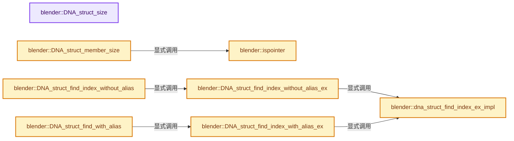
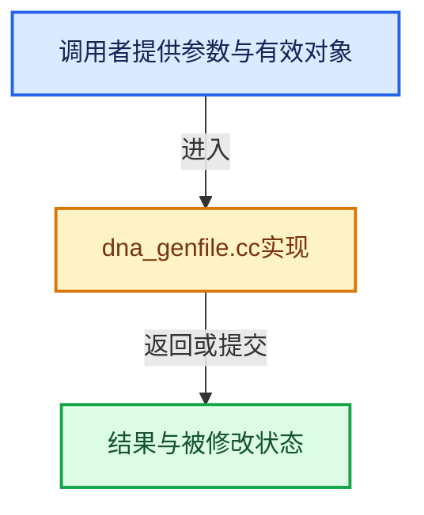

# 实现依赖专题：source/blender/makesdna/intern/dna_genfile.cc

[方向导航](README.md) · [符号索引](../%E7%AC%A6%E5%8F%B7%E4%BE%9D%E8%B5%96%E4%B8%8E%E5%AE%9E%E7%8E%B0%E7%B4%A2%E5%BC%95.md)

本专题从正文实际调用进入，集中保存共享实现。函数有稳定锚点，可从调用处直接跳到对应完整函数；递归与互相调用通过回链组织。

## 本文件的实现关系






<a id="m-1f75814fb1cc"></a>

## 宏 `MAKE_ID`

<!-- annotated:453d61f4cdc70a -->

```cpp
#define MAKE_ID(a, b, c, d) (int(d) << 24 | int(c) << 16 | (b) << 8 | (a))

```

<details>
<summary>核对原始源码：source/blender/makesdna/intern/dna_genfile.cc · L121—L122</summary>

<!-- original:453d61f4cdc70a:source/blender/makesdna/intern/dna_genfile.cc:121:122 -->

```cpp
#define MAKE_ID(a, b, c, d) (int(d) << 24 | int(c) << 16 | (b) << 8 | (a))

```

</details>

宏在预处理阶段展开，参数替换、重复求值和条件编译应直接从该定义检查。与普通函数不同，宏不会自动提供参数类型检查；构建配置选择哪个定义需结合外围条件。

## 完整成员与函数实现

<a id="f-2d896c5eb6e153ca"></a>

### `blender::DNA_struct_size`

实现位置：[source/blender/makesdna/intern/dna_genfile.cc](../../../../../source/blender/makesdna/intern/dna_genfile.cc) · L132—L135。

接口参数：

- `const SDNA *sdna`
- `int struct_index`

**教学注释版**

<!-- annotated:324926439a0581 -->

```cpp
int DNA_struct_size(const SDNA *sdna, int struct_index)
{
  return sdna->types_size[sdna->structs[struct_index]->type_index];
}
```

<details>
<summary>核对原始源码：source/blender/makesdna/intern/dna_genfile.cc · L132—L135</summary>

<!-- original:324926439a0581:source/blender/makesdna/intern/dna_genfile.cc:132:135 -->

```cpp
int DNA_struct_size(const SDNA *sdna, int struct_index)
{
  return sdna->types_size[sdna->structs[struct_index]->type_index];
}
```

</details>

**结果出口**

- `return sdna->types_size[sdna->structs[struct_index]->type_index];`

**继续追踪实现**

本实现没有需要继续展开的显式调用；检查返回表达式、对象转换和调用者前置条件。

<a id="f-93df55d5db12ecd3"></a>

### `blender::ispointer`

实现位置：[source/blender/makesdna/intern/dna_genfile.cc](../../../../../source/blender/makesdna/intern/dna_genfile.cc) · L140—L144。

接口参数：

- `const StringRef name`

**教学注释版**

<!-- annotated:00826cbe23bbd8 -->

```cpp
static bool ispointer(const StringRef name)
{
  /* check if pointer or function pointer */
  return (name[0] == '*' || (name[0] == '(' && name[1] == '*'));
}
```

<details>
<summary>核对原始源码：source/blender/makesdna/intern/dna_genfile.cc · L140—L144</summary>

<!-- original:00826cbe23bbd8:source/blender/makesdna/intern/dna_genfile.cc:140:144 -->

```cpp
static bool ispointer(const StringRef name)
{
  /* check if pointer or function pointer */
  return (name[0] == '*' || (name[0] == '(' && name[1] == '*'));
}
```

</details>

**结果出口**

- `return (name[0] == '*' || (name[0] == '(' && name[1] == '*'));`

**继续追踪实现**

本实现没有需要继续展开的显式调用；检查返回表达式、对象转换和调用者前置条件。

<a id="f-21de17d157a404ea"></a>

### `blender::DNA_struct_member_size`

实现位置：[source/blender/makesdna/intern/dna_genfile.cc](../../../../../source/blender/makesdna/intern/dna_genfile.cc) · L146—L162。

接口参数：

- `const SDNA *sdna`
- `short type`
- `short member_index`

**教学注释版**

<!-- annotated:8df37478a2fa97 -->

```cpp
int DNA_struct_member_size(const SDNA *sdna, short type, short member_index)
{
  const StringRef cp = sdna->members[member_index];
  int len = 0;

  /* is it a pointer or function pointer? */
  if (ispointer(cp)) {
    /* has the name an extra length? (array) */
    len = sdna->pointer_size * sdna->members_array_num[member_index];
  }
  else if (sdna->types_size[type]) {
    /* has the name an extra length? (array) */
    len = int(sdna->types_size[type]) * sdna->members_array_num[member_index];
  }

  return len;
}
```

<details>
<summary>核对原始源码：source/blender/makesdna/intern/dna_genfile.cc · L146—L162</summary>

<!-- original:8df37478a2fa97:source/blender/makesdna/intern/dna_genfile.cc:146:162 -->

```cpp
int DNA_struct_member_size(const SDNA *sdna, short type, short member_index)
{
  const StringRef cp = sdna->members[member_index];
  int len = 0;

  /* is it a pointer or function pointer? */
  if (ispointer(cp)) {
    /* has the name an extra length? (array) */
    len = sdna->pointer_size * sdna->members_array_num[member_index];
  }
  else if (sdna->types_size[type]) {
    /* has the name an extra length? (array) */
    len = int(sdna->types_size[type]) * sdna->members_array_num[member_index];
  }

  return len;
}
```

</details>

**沿实际写入检查状态**

- `len = sdna->pointer_size * sdna->members_array_num[member_index];`
- `len = int(sdna->types_size[type]) * sdna->members_array_num[member_index];`

**结果出口**

- `return len;`

**继续追踪实现**

- `ispointer` → [blender::ispointer · L140](%E4%BE%9D%E8%B5%96-dna_genfile-f567f8.md#f-93df55d5db12ecd3)。

<a id="f-d9fc47cb423a1233"></a>

### `blender::dna_struct_find_index_ex_impl`

实现位置：[source/blender/makesdna/intern/dna_genfile.cc](../../../../../source/blender/makesdna/intern/dna_genfile.cc) · L182—L218。

接口参数：

- `const Span<StringRef> types`
- `const int`
- `const Span<SDNA_Struct *> structs`
- `WITH_DNA_GHASH
     const Map<StringRef, int> &structs_map`
- `const StringRef str`
- `uint *struct_index_last`

**教学注释版**

<!-- annotated:ddee7fb3b143d7 -->

```cpp
static int dna_struct_find_index_ex_impl(
    /* From SDNA struct. */
    const Span<StringRef> types,
    const int /*types_num*/,
    const Span<SDNA_Struct *> structs,
#ifdef WITH_DNA_GHASH
    const Map<StringRef, int> &structs_map,
#endif
    /* Regular args. */
    const StringRef str,
    uint *struct_index_last)
{
  // [讲解] structs.size：查询视图长度或生成对应有效索引区间。
  if (*struct_index_last < structs.size()) {
    const SDNA_Struct *struct_info = structs[*struct_index_last];
    if (types[struct_info->type_index] == str) {
      return *struct_index_last;
    }
  }

#ifdef WITH_DNA_GHASH
  if (const std::optional<int> struct_index = structs_map.lookup_try(str)) {
    *struct_index_last = *struct_index;
    return *struct_index;
  }
#else
  {
    for (int struct_index = 0; struct_index < types_num; struct_index++) {
      const SDNA_Struct *struct_info = structs[struct_index];
      if (types[struct_info->type] == str) {
        *struct_index_last = struct_index;
        return struct_index;
      }
    }
  }
#endif
  return -1;
}
```

<details>
<summary>核对原始源码：source/blender/makesdna/intern/dna_genfile.cc · L182—L218</summary>

<!-- original:ddee7fb3b143d7:source/blender/makesdna/intern/dna_genfile.cc:182:218 -->

```cpp
static int dna_struct_find_index_ex_impl(
    /* From SDNA struct. */
    const Span<StringRef> types,
    const int /*types_num*/,
    const Span<SDNA_Struct *> structs,
#ifdef WITH_DNA_GHASH
    const Map<StringRef, int> &structs_map,
#endif
    /* Regular args. */
    const StringRef str,
    uint *struct_index_last)
{
  if (*struct_index_last < structs.size()) {
    const SDNA_Struct *struct_info = structs[*struct_index_last];
    if (types[struct_info->type_index] == str) {
      return *struct_index_last;
    }
  }

#ifdef WITH_DNA_GHASH
  if (const std::optional<int> struct_index = structs_map.lookup_try(str)) {
    *struct_index_last = *struct_index;
    return *struct_index;
  }
#else
  {
    for (int struct_index = 0; struct_index < types_num; struct_index++) {
      const SDNA_Struct *struct_info = structs[struct_index];
      if (types[struct_info->type] == str) {
        *struct_index_last = struct_index;
        return struct_index;
      }
    }
  }
#endif
  return -1;
}
```

</details>

**结果出口**

- `return *struct_index_last;`
- `return *struct_index;`
- `return struct_index;`
- `return -1;`

**继续追踪实现**

- `structs.size` → [blender::Span::size · L256](../01-%E5%9F%BA%E7%A1%80%E5%AE%B9%E5%99%A8%E4%B8%8E%E7%8E%B0%E4%BB%A3CPP/05-Span%E5%8F%AA%E8%AF%BB%E8%BF%9E%E7%BB%AD%E8%A7%86%E5%9B%BE.md#f-5f80fa006089c998)。
- `structs_map.lookup_try` → [blender::Map::lookup_try · L531](../02-%E5%93%88%E5%B8%8C%E8%A1%A8%E4%B8%8E%E5%85%B3%E8%81%94%E6%95%B0%E6%8D%AE%E7%BB%93%E6%9E%84/04-Map%E6%9F%A5%E6%89%BE%E4%B8%8E%E9%94%AE%E8%AE%BF%E9%97%AE.md#f-665dd73b209925d1)。

<a id="f-f1a0618eeed47da3"></a>

### `blender::DNA_struct_find_index_without_alias_ex`

实现位置：[source/blender/makesdna/intern/dna_genfile.cc](../../../../../source/blender/makesdna/intern/dna_genfile.cc) · L220—L235。

接口参数：

- `const SDNA *sdna`
- `const StringRef str`
- `uint *struct_index_last`

**教学注释版**

<!-- annotated:908795b5cd1c78 -->

```cpp
int DNA_struct_find_index_without_alias_ex(const SDNA *sdna,
                                           const StringRef str,
                                           uint *struct_index_last)
{
  return dna_struct_find_index_ex_impl(
      /* Expand SDNA. */
      sdna->types,
      sdna->types_num,
      sdna->structs,
#ifdef WITH_DNA_GHASH
      sdna->types_to_structs_map,
#endif
      /* Regular args. */
      str,
      struct_index_last);
}
```

<details>
<summary>核对原始源码：source/blender/makesdna/intern/dna_genfile.cc · L220—L235</summary>

<!-- original:908795b5cd1c78:source/blender/makesdna/intern/dna_genfile.cc:220:235 -->

```cpp
int DNA_struct_find_index_without_alias_ex(const SDNA *sdna,
                                           const StringRef str,
                                           uint *struct_index_last)
{
  return dna_struct_find_index_ex_impl(
      /* Expand SDNA. */
      sdna->types,
      sdna->types_num,
      sdna->structs,
#ifdef WITH_DNA_GHASH
      sdna->types_to_structs_map,
#endif
      /* Regular args. */
      str,
      struct_index_last);
}
```

</details>

**结果出口**

- `return dna_struct_find_index_ex_impl(`

**继续追踪实现**

- `dna_struct_find_index_ex_impl` → [blender::dna_struct_find_index_ex_impl · L182](%E4%BE%9D%E8%B5%96-dna_genfile-f567f8.md#f-d9fc47cb423a1233)。

<a id="f-217f3e651dabee0b"></a>

### `blender::DNA_struct_find_index_with_alias_ex`

实现位置：[source/blender/makesdna/intern/dna_genfile.cc](../../../../../source/blender/makesdna/intern/dna_genfile.cc) · L237—L252。

接口参数：

- `const SDNA *sdna`
- `const StringRef str`
- `uint *struct_index_last`

**教学注释版**

<!-- annotated:fc3f3345f65dde -->

```cpp
int DNA_struct_find_index_with_alias_ex(const SDNA *sdna,
                                        const StringRef str,
                                        uint *struct_index_last)
{
  return dna_struct_find_index_ex_impl(
      /* Expand SDNA. */
      sdna->alias.types,
      sdna->types_num,
      sdna->structs,
#ifdef WITH_DNA_GHASH
      sdna->alias.types_to_structs_map,
#endif
      /* Regular args. */
      str,
      struct_index_last);
}
```

<details>
<summary>核对原始源码：source/blender/makesdna/intern/dna_genfile.cc · L237—L252</summary>

<!-- original:fc3f3345f65dde:source/blender/makesdna/intern/dna_genfile.cc:237:252 -->

```cpp
int DNA_struct_find_index_with_alias_ex(const SDNA *sdna,
                                        const StringRef str,
                                        uint *struct_index_last)
{
  return dna_struct_find_index_ex_impl(
      /* Expand SDNA. */
      sdna->alias.types,
      sdna->types_num,
      sdna->structs,
#ifdef WITH_DNA_GHASH
      sdna->alias.types_to_structs_map,
#endif
      /* Regular args. */
      str,
      struct_index_last);
}
```

</details>

**结果出口**

- `return dna_struct_find_index_ex_impl(`

**继续追踪实现**

- `dna_struct_find_index_ex_impl` → [blender::dna_struct_find_index_ex_impl · L182](%E4%BE%9D%E8%B5%96-dna_genfile-f567f8.md#f-d9fc47cb423a1233)。

<a id="f-2c97201a5e95e02b"></a>

### `blender::DNA_struct_find_index_without_alias`

实现位置：[source/blender/makesdna/intern/dna_genfile.cc](../../../../../source/blender/makesdna/intern/dna_genfile.cc) · L254—L258。

接口参数：

- `const SDNA *sdna`
- `const StringRef str`

**教学注释版**

<!-- annotated:a07ae09a9f38be -->

```cpp
int DNA_struct_find_index_without_alias(const SDNA *sdna, const StringRef str)
{
  uint index_last_dummy = UINT_MAX;
  return DNA_struct_find_index_without_alias_ex(sdna, str, &index_last_dummy);
}
```

<details>
<summary>核对原始源码：source/blender/makesdna/intern/dna_genfile.cc · L254—L258</summary>

<!-- original:a07ae09a9f38be:source/blender/makesdna/intern/dna_genfile.cc:254:258 -->

```cpp
int DNA_struct_find_index_without_alias(const SDNA *sdna, const StringRef str)
{
  uint index_last_dummy = UINT_MAX;
  return DNA_struct_find_index_without_alias_ex(sdna, str, &index_last_dummy);
}
```

</details>

**结果出口**

- `return DNA_struct_find_index_without_alias_ex(sdna, str, &index_last_dummy);`

**继续追踪实现**

- `DNA_struct_find_index_without_alias_ex` → [blender::DNA_struct_find_index_without_alias_ex · L220](%E4%BE%9D%E8%B5%96-dna_genfile-f567f8.md#f-f1a0618eeed47da3)。

<a id="f-f3b3eeba5ac5b125"></a>

### `blender::DNA_struct_find_with_alias`

实现位置：[source/blender/makesdna/intern/dna_genfile.cc](../../../../../source/blender/makesdna/intern/dna_genfile.cc) · L260—L264。

接口参数：

- `const SDNA *sdna`
- `const StringRef str`

**教学注释版**

<!-- annotated:f20c076241ad03 -->

```cpp
int DNA_struct_find_with_alias(const SDNA *sdna, const StringRef str)
{
  uint index_last_dummy = UINT_MAX;
  return DNA_struct_find_index_with_alias_ex(sdna, str, &index_last_dummy);
}
```

<details>
<summary>核对原始源码：source/blender/makesdna/intern/dna_genfile.cc · L260—L264</summary>

<!-- original:f20c076241ad03:source/blender/makesdna/intern/dna_genfile.cc:260:264 -->

```cpp
int DNA_struct_find_with_alias(const SDNA *sdna, const StringRef str)
{
  uint index_last_dummy = UINT_MAX;
  return DNA_struct_find_index_with_alias_ex(sdna, str, &index_last_dummy);
}
```

</details>

**结果出口**

- `return DNA_struct_find_index_with_alias_ex(sdna, str, &index_last_dummy);`

**继续追踪实现**

- `DNA_struct_find_index_with_alias_ex` → [blender::DNA_struct_find_index_with_alias_ex · L237](%E4%BE%9D%E8%B5%96-dna_genfile-f567f8.md#f-217f3e651dabee0b)。

<a id="f-2c1b9e4c25eab4d8"></a>

### `blender::pad_up_4`

实现位置：[source/blender/makesdna/intern/dna_genfile.cc](../../../../../source/blender/makesdna/intern/dna_genfile.cc) · L275—L278。

接口参数：

- `const char *ptr`

**教学注释版**

<!-- annotated:2594e1f0bfa687 -->

```cpp
BLI_INLINE const char *pad_up_4(const char *ptr)
{
  return reinterpret_cast<const char *>((uintptr_t(ptr) + 3) & ~3);
}
```

<details>
<summary>核对原始源码：source/blender/makesdna/intern/dna_genfile.cc · L275—L278</summary>

<!-- original:2594e1f0bfa687:source/blender/makesdna/intern/dna_genfile.cc:275:278 -->

```cpp
BLI_INLINE const char *pad_up_4(const char *ptr)
{
  return reinterpret_cast<const char *>((uintptr_t(ptr) + 3) & ~3);
}
```

</details>

**结果出口**

- `return reinterpret_cast<const char *>((uintptr_t(ptr) + 3) & ~3);`

**继续追踪实现**

本实现没有需要继续展开的显式调用；检查返回表达式、对象转换和调用者前置条件。

<a id="f-811e081ef900684e"></a>

### `blender::sdna_data_pointer_read`

实现位置：[source/blender/makesdna/intern/dna_genfile.cc](../../../../../source/blender/makesdna/intern/dna_genfile.cc) · L280—L296。

接口参数：

- `T &data`
- `const int64_t num`
- `const void *const data_pointer_end`
- `const char **r_error_message`

**教学注释版**

<!-- annotated:c9f1c61cf4666d -->

```cpp
template<typename T>
static T sdna_data_pointer_read(T &data,
                                const int64_t num,
                                const void *const data_pointer_end,
                                const char **r_error_message)
{
  BLI_STATIC_ASSERT(std::is_pointer_v<T> && std::is_const_v<std::remove_pointer_t<T>>,
                    "Data type for this util must be a pointer to const data")
  BLI_assert_msg(num >= 0, "Caller should ensure read size is always >= 0");
  if ((data + num) > data_pointer_end) [[unlikely]] {
    *r_error_message = "Invalid data in SDNA file";
    return nullptr;
  }
  T ret = data;
  data += num;
  return ret;
}
```

<details>
<summary>核对原始源码：source/blender/makesdna/intern/dna_genfile.cc · L280—L296</summary>

<!-- original:c9f1c61cf4666d:source/blender/makesdna/intern/dna_genfile.cc:280:296 -->

```cpp
template<typename T>
static T sdna_data_pointer_read(T &data,
                                const int64_t num,
                                const void *const data_pointer_end,
                                const char **r_error_message)
{
  BLI_STATIC_ASSERT(std::is_pointer_v<T> && std::is_const_v<std::remove_pointer_t<T>>,
                    "Data type for this util must be a pointer to const data")
  BLI_assert_msg(num >= 0, "Caller should ensure read size is always >= 0");
  if ((data + num) > data_pointer_end) [[unlikely]] {
    *r_error_message = "Invalid data in SDNA file";
    return nullptr;
  }
  T ret = data;
  data += num;
  return ret;
}
```

</details>

**沿实际写入检查状态**

- `data += num;`

**结果出口**

- `return nullptr;`
- `return ret;`

**继续追踪实现**

- `BLI_STATIC_ASSERT` → [BLI_STATIC_ASSERT · L68](../01-%E5%9F%BA%E7%A1%80%E5%AE%B9%E5%99%A8%E4%B8%8E%E7%8E%B0%E4%BB%A3CPP/%E4%BE%9D%E8%B5%96-BLI_assert-cc98e8.md#m-2847bd43464c)；[BLI_STATIC_ASSERT · L37](%E4%BE%9D%E8%B5%96-GPU_shader_shared_utils-0adda3.md#m-84775b53af8c)；[BLI_STATIC_ASSERT · L58](%E4%BE%9D%E8%B5%96-GPU_shader_shared_utils-0adda3.md#m-4227322768f0)。宏定义由构建条件选择。
- `BLI_assert_msg` → [BLI_assert_msg · L55](../01-%E5%9F%BA%E7%A1%80%E5%AE%B9%E5%99%A8%E4%B8%8E%E7%8E%B0%E4%BB%A3CPP/%E4%BE%9D%E8%B5%96-BLI_assert-cc98e8.md#m-695eed20dceb)；[BLI_assert_msg · L64](../01-%E5%9F%BA%E7%A1%80%E5%AE%B9%E5%99%A8%E4%B8%8E%E7%8E%B0%E4%BB%A3CPP/%E4%BE%9D%E8%B5%96-BLI_assert-cc98e8.md#m-7de5563de4db)。宏定义由构建条件选择。

<a id="f-73f4035796d85665"></a>

### `blender::sdna_data_validate_array_size`

实现位置：[source/blender/makesdna/intern/dna_genfile.cc](../../../../../source/blender/makesdna/intern/dna_genfile.cc) · L298—L311。

接口参数：

- `const int64_t size`
- `T data_pointer_current`
- `const void *const data_pointer_end`
- `const char **r_error_message`

**教学注释版**

<!-- annotated:8b17bf0467a0ef -->

```cpp
template<typename T>
static bool sdna_data_validate_array_size(const int64_t size,
                                          T data_pointer_current,
                                          const void *const data_pointer_end,
                                          const char **r_error_message)
{
  BLI_STATIC_ASSERT(std::is_pointer_v<T> && std::is_const_v<std::remove_pointer_t<T>>,
                    "Data type for this util must be a pointer to const data")
  if (size < 0 || size > (static_cast<T>(data_pointer_end) - data_pointer_current)) [[unlikely]] {
    *r_error_message = "Invalid array size data in SDNA file";
    return false;
  }
  return true;
}
```

<details>
<summary>核对原始源码：source/blender/makesdna/intern/dna_genfile.cc · L298—L311</summary>

<!-- original:8b17bf0467a0ef:source/blender/makesdna/intern/dna_genfile.cc:298:311 -->

```cpp
template<typename T>
static bool sdna_data_validate_array_size(const int64_t size,
                                          T data_pointer_current,
                                          const void *const data_pointer_end,
                                          const char **r_error_message)
{
  BLI_STATIC_ASSERT(std::is_pointer_v<T> && std::is_const_v<std::remove_pointer_t<T>>,
                    "Data type for this util must be a pointer to const data")
  if (size < 0 || size > (static_cast<T>(data_pointer_end) - data_pointer_current)) [[unlikely]] {
    *r_error_message = "Invalid array size data in SDNA file";
    return false;
  }
  return true;
}
```

</details>

**结果出口**

- `return false;`
- `return true;`

**继续追踪实现**

- `BLI_STATIC_ASSERT(std::is_pointer_v<T> && std::is_const_v<std::remove_pointer_t<T>>, "Data type for this util must be a pointer to const data")` → [BLI_STATIC_ASSERT · L68](../01-%E5%9F%BA%E7%A1%80%E5%AE%B9%E5%99%A8%E4%B8%8E%E7%8E%B0%E4%BB%A3CPP/%E4%BE%9D%E8%B5%96-BLI_assert-cc98e8.md#m-2847bd43464c)；[BLI_STATIC_ASSERT · L37](%E4%BE%9D%E8%B5%96-GPU_shader_shared_utils-0adda3.md#m-84775b53af8c)；[BLI_STATIC_ASSERT · L58](%E4%BE%9D%E8%B5%96-GPU_shader_shared_utils-0adda3.md#m-4227322768f0)。宏定义由构建条件选择。
- `BLI_STATIC_ASSERT` → [BLI_STATIC_ASSERT · L68](../01-%E5%9F%BA%E7%A1%80%E5%AE%B9%E5%99%A8%E4%B8%8E%E7%8E%B0%E4%BB%A3CPP/%E4%BE%9D%E8%B5%96-BLI_assert-cc98e8.md#m-2847bd43464c)；[BLI_STATIC_ASSERT · L37](%E4%BE%9D%E8%B5%96-GPU_shader_shared_utils-0adda3.md#m-84775b53af8c)；[BLI_STATIC_ASSERT · L58](%E4%BE%9D%E8%B5%96-GPU_shader_shared_utils-0adda3.md#m-4227322768f0)。宏定义由构建条件选择。
- `size < 0 || size >` → [调用协议](../%E6%A8%A1%E6%9D%BF%E5%AE%8F%E4%B8%8E%E5%8A%A8%E6%80%81%E5%88%86%E6%B4%BE%E5%8D%8F%E8%AE%AE.md)：函数指针、局部可调用对象或未展开的宏；必须结合调用者环境。调用位置L306。

<a id="f-ba9428f30be04373"></a>

### `blender::sdna_data_pointer_read_string`

实现位置：[source/blender/makesdna/intern/dna_genfile.cc](../../../../../source/blender/makesdna/intern/dna_genfile.cc) · L313—L334。

接口参数：

- `const char *&data`
- `const void *const data_pointer_end`
- `const char **r_error_message`

**教学注释版**

<!-- annotated:1a42d55705ddef -->

```cpp
static const StringRef sdna_data_pointer_read_string(const char *&data,
                                                     const void *const data_pointer_end,
                                                     const char **r_error_message)
{
  BLI_assert(static_cast<const char *>(data_pointer_end) >= data);
  const char *str_end = std::char_traits<char>::find(
      data, size_t(static_cast<const char *>(data_pointer_end) - data), '\0');
  if (!str_end) [[unlikely]] {
    *r_error_message = "Invalid string data in SDNA file";
    return nullptr;
  }
  const int64_t string_size = str_end - data;
  BLI_assert(string_size >= 0);
  /* Non-empty string is a hard requirement by all use-cases currently. */
  if (!string_size) [[unlikely]] {
    *r_error_message = "Invalid string data in SDNA file";
    return nullptr;
  }
  StringRef ret = StringRef(data, string_size);
  data += (string_size + 1); /* String size + null terminator. */
  return ret;
}
```

<details>
<summary>核对原始源码：source/blender/makesdna/intern/dna_genfile.cc · L313—L334</summary>

<!-- original:1a42d55705ddef:source/blender/makesdna/intern/dna_genfile.cc:313:334 -->

```cpp
static const StringRef sdna_data_pointer_read_string(const char *&data,
                                                     const void *const data_pointer_end,
                                                     const char **r_error_message)
{
  BLI_assert(static_cast<const char *>(data_pointer_end) >= data);
  const char *str_end = std::char_traits<char>::find(
      data, size_t(static_cast<const char *>(data_pointer_end) - data), '\0');
  if (!str_end) [[unlikely]] {
    *r_error_message = "Invalid string data in SDNA file";
    return nullptr;
  }
  const int64_t string_size = str_end - data;
  BLI_assert(string_size >= 0);
  /* Non-empty string is a hard requirement by all use-cases currently. */
  if (!string_size) [[unlikely]] {
    *r_error_message = "Invalid string data in SDNA file";
    return nullptr;
  }
  StringRef ret = StringRef(data, string_size);
  data += (string_size + 1); /* String size + null terminator. */
  return ret;
}
```

</details>

**沿实际写入检查状态**

- `data += (string_size + 1); /* String size + null terminator. */`

**结果出口**

- `return nullptr;`
- `return ret;`

**继续追踪实现**

- `BLI_assert` → [BLI_assert · L48](../01-%E5%9F%BA%E7%A1%80%E5%AE%B9%E5%99%A8%E4%B8%8E%E7%8E%B0%E4%BB%A3CPP/%E4%BE%9D%E8%B5%96-BLI_assert-cc98e8.md#m-57a88495704d)；[BLI_assert · L63](../01-%E5%9F%BA%E7%A1%80%E5%AE%B9%E5%99%A8%E4%B8%8E%E7%8E%B0%E4%BB%A3CPP/%E4%BE%9D%E8%B5%96-BLI_assert-cc98e8.md#m-d07050020cb5)。宏定义由构建条件选择。
- `std::char_traits<char>::find` → [外部契约](https://eel.is/c++draft/)：这个边界按实际表达式及所属类型核对参数、返回值、寿命与失败行为。这里提供接口入口，不声称已解释该第三方版本的内部实现。
- `StringRef` → [blender::StringRef::StringRef · L555](../01-%E5%9F%BA%E7%A1%80%E5%AE%B9%E5%99%A8%E4%B8%8E%E7%8E%B0%E4%BB%A3CPP/15-StringRef%E5%AD%97%E7%AC%A6%E4%B8%B2%E8%A7%86%E5%9B%BE.md#f-f6aca324a36faa7e)；[blender::StringRef::StringRef · L560](../01-%E5%9F%BA%E7%A1%80%E5%AE%B9%E5%99%A8%E4%B8%8E%E7%8E%B0%E4%BB%A3CPP/15-StringRef%E5%AD%97%E7%AC%A6%E4%B8%B2%E8%A7%86%E5%9B%BE.md#f-ab9714781ca51bac)；[blender::StringRef::StringRef · L565](../01-%E5%9F%BA%E7%A1%80%E5%AE%B9%E5%99%A8%E4%B8%8E%E7%8E%B0%E4%BB%A3CPP/15-StringRef%E5%AD%97%E7%AC%A6%E4%B8%B2%E8%A7%86%E5%9B%BE.md#f-95f0b483bbdd7739)；[blender::StringRef::StringRef · L570](../01-%E5%9F%BA%E7%A1%80%E5%AE%B9%E5%99%A8%E4%B8%8E%E7%8E%B0%E4%BB%A3CPP/15-StringRef%E5%AD%97%E7%AC%A6%E4%B8%B2%E8%A7%86%E5%9B%BE.md#f-808d05699cb33334)；[blender::StringRef::StringRef · L631](../01-%E5%9F%BA%E7%A1%80%E5%AE%B9%E5%99%A8%E4%B8%8E%E7%8E%B0%E4%BB%A3CPP/15-StringRef%E5%AD%97%E7%AC%A6%E4%B8%B2%E8%A7%86%E5%9B%BE.md#f-37788e5f3fa3b736)；[blender::StringRef::StringRef · L641](../01-%E5%9F%BA%E7%A1%80%E5%AE%B9%E5%99%A8%E4%B8%8E%E7%8E%B0%E4%BB%A3CPP/15-StringRef%E5%AD%97%E7%AC%A6%E4%B8%B2%E8%A7%86%E5%9B%BE.md#f-11abd0510fb6b926)；[blender::StringRef::StringRef · L646](../01-%E5%9F%BA%E7%A1%80%E5%AE%B9%E5%99%A8%E4%B8%8E%E7%8E%B0%E4%BB%A3CPP/15-StringRef%E5%AD%97%E7%AC%A6%E4%B8%B2%E8%A7%86%E5%9B%BE.md#f-8437dbd8a582eefd)；[blender::StringRef::StringRef · L651](../01-%E5%9F%BA%E7%A1%80%E5%AE%B9%E5%99%A8%E4%B8%8E%E7%8E%B0%E4%BB%A3CPP/15-StringRef%E5%AD%97%E7%AC%A6%E4%B8%B2%E8%A7%86%E5%9B%BE.md#f-70bcb338de0db978)。同名重载需按实参类型选择。

<a id="f-dc52f667e8546d78"></a>

### `blender::sdna_struct_size_check`

实现位置：[source/blender/makesdna/intern/dna_genfile.cc](../../../../../source/blender/makesdna/intern/dna_genfile.cc) · L346—L363。

接口参数：

- `const SDNA *sdna`
- `const SDNA_Struct *struct_info`
- `const char **r_error_message`

**教学注释版**

<!-- annotated:3ac0da088b1f7a -->

```cpp
static bool sdna_struct_size_check(const SDNA *sdna,
                                   const SDNA_Struct *struct_info,
                                   const char **r_error_message)
{
  int64_t members_size = 0;
  for (const SDNA_StructMember &member : Span(struct_info->members, struct_info->members_num)) {
    const StringRef member_name = sdna->members[member.member_index];
    const int64_t array_num = sdna->members_array_num[member.member_index];
    const int64_t member_size = ispointer(member_name) ? sdna->pointer_size :
                                                         sdna->types_size[member.type_index];
    members_size += member_size * array_num;
  }
  if (members_size != sdna->types_size[struct_info->type_index]) [[unlikely]] {
    *r_error_message = "Invalid struct size in SDNA file";
    return false;
  }
  return true;
}
```

<details>
<summary>核对原始源码：source/blender/makesdna/intern/dna_genfile.cc · L346—L363</summary>

<!-- original:3ac0da088b1f7a:source/blender/makesdna/intern/dna_genfile.cc:346:363 -->

```cpp
static bool sdna_struct_size_check(const SDNA *sdna,
                                   const SDNA_Struct *struct_info,
                                   const char **r_error_message)
{
  int64_t members_size = 0;
  for (const SDNA_StructMember &member : Span(struct_info->members, struct_info->members_num)) {
    const StringRef member_name = sdna->members[member.member_index];
    const int64_t array_num = sdna->members_array_num[member.member_index];
    const int64_t member_size = ispointer(member_name) ? sdna->pointer_size :
                                                         sdna->types_size[member.type_index];
    members_size += member_size * array_num;
  }
  if (members_size != sdna->types_size[struct_info->type_index]) [[unlikely]] {
    *r_error_message = "Invalid struct size in SDNA file";
    return false;
  }
  return true;
}
```

</details>

**沿实际写入检查状态**

- `members_size += member_size * array_num;`

**结果出口**

- `return false;`
- `return true;`

**继续追踪实现**

- `Span` → [blender::Span · L214](../01-%E5%9F%BA%E7%A1%80%E5%AE%B9%E5%99%A8%E4%B8%8E%E7%8E%B0%E4%BB%A3CPP/15-StringRef%E5%AD%97%E7%AC%A6%E4%B8%B2%E8%A7%86%E5%9B%BE.md#f-eea723436ab634ed)。
- `ispointer` → [blender::ispointer · L140](%E4%BE%9D%E8%B5%96-dna_genfile-f567f8.md#f-93df55d5db12ecd3)。

<a id="f-43599079ff067a8b"></a>

### `blender::init_structDNA`

实现位置：[source/blender/makesdna/intern/dna_genfile.cc](../../../../../source/blender/makesdna/intern/dna_genfile.cc) · L368—L661。

接口参数：

- `SDNA *sdna`
- `const char **r_error_message`

**教学注释版**

<!-- annotated:d5fb870a58d5b9 -->

```cpp
static bool init_structDNA(SDNA *sdna, const char **r_error_message)
{
  /* The various pointers iterating over the SDNA::data buffer in this function should never reach
   * this address. */
  const void *const data_pointer_end = sdna->data + sdna->data_size;

  int member_index_gravity_fix = -1;

  const int *int_buf = reinterpret_cast<int *>(const_cast<char *>(sdna->data));
  const int *int_data;
  const short *short_buf;
  const short *short_data;
  const char *char_buf;

  /* Clear pointers in case of error. */
  sdna->types_size = nullptr;

  /* Lazy initialize. */
  sdna->alias = {};

  /* Struct DNA ('SDNA') */
  if (!(int_data = sdna_data_pointer_read(int_buf, 1, data_pointer_end, r_error_message))) {
    return false;
  }
  if (*int_data != MAKE_ID('S', 'D', 'N', 'A')) {
    *r_error_message = "SDNA error in SDNA file";
    return false;
  }

  /* Names array ('NAME') */
  if (!(int_data = sdna_data_pointer_read(int_buf, 1, data_pointer_end, r_error_message))) {
    return false;
  }
  if (*int_data == MAKE_ID('N', 'A', 'M', 'E')) {
    /* NOTE: this is endianness-sensitive. */
    if (!(int_data = sdna_data_pointer_read(int_buf, 1, data_pointer_end, r_error_message)) ||
        !sdna_data_validate_array_size(*int_data, int_buf, data_pointer_end, r_error_message))
    {
      return false;
    }
    sdna->members_num = *int_data;
    sdna->members.resize(sdna->members_num, nullptr);
  }
  if (sdna->members.is_empty()) {
    *r_error_message = "NAME error in SDNA file";
    return false;
  }

  char_buf = reinterpret_cast<const char *>(int_buf);
  for (int member_index = 0; member_index < sdna->members_num; member_index++) {
    const StringRef orig_member_name = sdna_data_pointer_read_string(
        char_buf, data_pointer_end, r_error_message);
    if (orig_member_name.is_empty()) {
      return false;
    }
    sdna->members[member_index] = orig_member_name;

    /* "float gravity [3]" was parsed wrong giving both "gravity" and
     * "[3]"  members. we rename "[3]", and later set the type of
     * "gravity" to "void" so the offsets work out correct. See #20330. */
    if (orig_member_name == "[3]") {
      if (member_index && sdna->members[member_index - 1] == "Cvi") {
        sdna->members[member_index] = "gravity[3]";
        member_index_gravity_fix = member_index;
      }
    }
  }
  char_buf = pad_up_4(char_buf);

  /* Type names array ('TYPE') */
  int_buf = reinterpret_cast<const int *>(char_buf);
  if (!(int_data = sdna_data_pointer_read(int_buf, 1, data_pointer_end, r_error_message))) {
    return false;
  }
  if (*int_data == MAKE_ID('T', 'Y', 'P', 'E')) {
    /* NOTE: this is endianness-sensitive. */
    if (!(int_data = sdna_data_pointer_read(int_buf, 1, data_pointer_end, r_error_message)) ||
        !sdna_data_validate_array_size(*int_data, int_buf, data_pointer_end, r_error_message))
    {
      return false;
    }
    sdna->types_num = *int_data;
    sdna->types = Array<StringRef>(sdna->types_num, nullptr);
  }
  if (sdna->types.is_empty()) {
    *r_error_message = "TYPE error in SDNA file";
    return false;
  }

  char_buf = reinterpret_cast<const char *>(int_buf);
  for (int type_index = 0; type_index < sdna->types_num; type_index++) {
    const StringRef orig_type_name = sdna_data_pointer_read_string(
        char_buf, data_pointer_end, r_error_message);
    if (orig_type_name.is_empty()) {
      return false;
    }
    /* WARNING! See: DNA_struct_rename_legacy_hack_static_from_alias docs. */
    sdna->types[type_index] = DNA_struct_rename_legacy_hack_static_from_alias(orig_type_name);
  }
  char_buf = pad_up_4(char_buf);

  /* Type lengths array ('TLEN') */
  int_buf = reinterpret_cast<const int *>(char_buf);
  if (!(int_data = sdna_data_pointer_read(int_buf, 1, data_pointer_end, r_error_message))) {
    return false;
  }
  short_buf = reinterpret_cast<const short *>(int_buf);
  if (*int_data == MAKE_ID('T', 'L', 'E', 'N')) {
    /* NOTE: this is endianness-sensitive. */
    if (!(short_data = sdna_data_pointer_read(
              short_buf, sdna->types_num, data_pointer_end, r_error_message)))
    {
      return false;
    }
    sdna->types_size = const_cast<short *>(short_data);
  }
  if (!sdna->types_size) {
    *r_error_message = "TLEN error in SDNA file";
    return false;
  }
  /* prevent BUS error */
  if (sdna->types_num & 1) {
    if (!sdna_data_pointer_read(short_buf, 1, data_pointer_end, r_error_message)) {
      return false;
    }
  }

  /* Struct array ('STRC') */
  int_buf = reinterpret_cast<const int *>(short_buf);
  if (!(int_data = sdna_data_pointer_read(int_buf, 1, data_pointer_end, r_error_message))) {
    return false;
  }
  if (*int_data == MAKE_ID('S', 'T', 'R', 'C')) {
    /* NOTE: this is endianness-sensitive. */
    if (!(int_data = sdna_data_pointer_read(int_buf, 1, data_pointer_end, r_error_message)) ||
        !sdna_data_validate_array_size(*int_data, int_buf, data_pointer_end, r_error_message))
    {
      return false;
    }
    const int structs_num = *int_data;
    sdna->structs = Array<SDNA_Struct *, 0>(structs_num, nullptr);
  }
  if (sdna->structs.is_empty()) {
    *r_error_message = "STRC error in SDNA file";
    return false;
  }

  /* Safety check, to ensure that there is no multiple usages of a same struct index. */
  Set<const short> struct_type_indices;
  // [讲解] struct_type_indices.reserve：重新组织槽位或准备容量。
  struct_type_indices.reserve(sdna->structs.size());
  short_buf = reinterpret_cast<const short *>(int_buf);
  for (const int64_t struct_index : sdna->structs.index_range()) {
    /* First read the always-valid part of SDNA_struct (its first two short members). */
    /* NOTE: this is endianness-sensitive. */
    if (!(short_data = sdna_data_pointer_read(short_buf, 2, data_pointer_end, r_error_message))) {
      return false;
    }
    SDNA_Struct *struct_info = reinterpret_cast<SDNA_Struct *>(const_cast<short *>(short_data));

    /* Now validate the size of the SDNA_StructMember array and consume it in the buffer too. */
    BLI_STATIC_ASSERT_ALIGN(SDNA_StructMember, sizeof(short))
    constexpr int64_t struct_member_short_size = (sizeof(SDNA_StructMember) / sizeof(short));
    const int64_t struct_members_size = struct_member_short_size * struct_info->members_num;
    if (!sdna_data_validate_array_size(
            struct_members_size, short_buf, data_pointer_end, r_error_message) ||
        !sdna_data_pointer_read(short_buf, struct_members_size, data_pointer_end, r_error_message))
    {
      return false;
    }
    sdna->structs[struct_index] = const_cast<SDNA_Struct *>(struct_info);

    if (struct_info->type_index < 0 || struct_info->type_index >= sdna->types_num) {
      *r_error_message = "Invalid struct type index in SDNA file";
      return false;
    }
    // [讲解] struct_type_indices.add：按哈希与相等关系加入键或键值。
    if (!struct_type_indices.add(struct_info->type_index)) {
      *r_error_message = "Invalid duplicate struct type index in SDNA file";
      return false;
    }
    for (int64_t struct_member_index : IndexRange(struct_info->members_num)) {
      const SDNA_StructMember &struct_member = struct_info->members[struct_member_index];
      if (struct_member.type_index < 0 || struct_member.type_index >= sdna->types_num) {
        *r_error_message = "Invalid struct member's type index in SDNA file";
        return false;
      }
      if (struct_member.member_index < 0 || struct_member.member_index >= sdna->members_num) {
        *r_error_message = "Invalid struct member's member index in SDNA file";
        return false;
      }
    }

    /* Second part of gravity problem, setting "gravity" type from float (7) to void (9).
     * See #20330.
     *
     * NOTE: The gravity fix only applies to pre-2011 blend-files, which had `void` at
     * type index 9 in their SDNA (`int64_t` was inserted before `void` in the `types`
     * array later, shifting `void` to a later index in current Blender's SDNA, but the
     * file's SDNA loaded here still has `void` at 9). */
    if (member_index_gravity_fix > -1) {
      constexpr int float_type_index = 7;
      constexpr int void_type_index = 9;
      constexpr int gravity_member_index = 4;
      if (sdna->types[struct_info->type_index] == "ClothSimSettings") {
        if (struct_info->members_num < gravity_member_index + 2 ||
            struct_info->members[gravity_member_index].type_index != float_type_index ||
            sdna->members[struct_info->members[gravity_member_index].member_index] != "gravity" ||
            sdna->members[struct_info->members[gravity_member_index + 1].member_index] !=
                "gravity[3]" ||
            float_type_index >= sdna->types_num || sdna->types[float_type_index] != "float" ||
            void_type_index >= sdna->types_num || sdna->types[void_type_index] != "void")
        {
          *r_error_message = "Invalid data in SDNA file";
          return false;
        }
        struct_info->members[gravity_member_index].type_index = void_type_index;
      }
    }
  }

  /* The whole SDNA data should have been processed and consumed, so the current pointer should be
   * at the expected 'end' value now. */
  char_buf = reinterpret_cast<const char *>(short_buf);
  if (char_buf != data_pointer_end) {
    *r_error_message = "Invalid data in SDNA file";
    return false;
  }

#ifdef WITH_DNA_GHASH
  {
    /* create a hash lookup to speed up */
    sdna->types_to_structs_map.clear();
    sdna->types_to_structs_map.reserve(sdna->structs.size());
    for (const int64_t struct_index : sdna->structs.index_range()) {
      SDNA_Struct *struct_info = sdna->structs[struct_index];
      sdna->types_to_structs_map.add_new(sdna->types[struct_info->type_index], int(struct_index));
    }
  }
#endif

  /* Calculate 'sdna->pointer_size'.
   *
   * NOTE: Cannot just do `sizeof(void *)` here, since the current DNA may come from a blend-file
   * saved on a different system, using a different pointer size. So instead, use half the size of
   * the #ListBase struct (only made of two pointers).
   */
  {
    const int struct_index = DNA_struct_find_index_without_alias(sdna, "ListBase");

    /* Should never happen, only with corrupt file for example. */
    if (struct_index == -1) [[unlikely]] {
      *r_error_message = "ListBase struct error! Not found.";
      return false;
    }

    const SDNA_Struct *struct_info = sdna->structs[struct_index];
    sdna->pointer_size = sdna->types_size[struct_info->type_index] / 2;

    /* Should never fail, double-check that #ListBase struct is still what is should be
     * (a couple of pointers and nothing else). */
    if (struct_info->members_num != 2 || !ELEM(sdna->pointer_size, 4, 8)) [[unlikely]] {
      *r_error_message = "ListBase struct error: invalid computed pointer-size.";
      return false;
    }
  }

  /* Cache name size. */
  sdna->members_array_num.resize(sdna->members_num);
  for (int member_index = 0; member_index < sdna->members_num; member_index++) {
    sdna->members_array_num[member_index] = DNA_member_array_num(sdna->members[member_index]);
  }

  /* Reject internally inconsistent DNA before it reaches struct reconstruction. */
  for (const SDNA_Struct *struct_info : sdna->structs) {
    if (!sdna_struct_size_check(sdna, struct_info, r_error_message)) {
      return false;
    }
  }

  sdna->types_alignment = Array<int>(sdna->types_num, int(__STDCPP_DEFAULT_NEW_ALIGNMENT__));
  {
    /* TODO: This should be generalized at some point. We should be able to specify `overaligned`
     * types directly in the DNA struct definitions. */
    uint dummy_index = 0;
    const int mat4x4f_struct_index = DNA_struct_find_index_without_alias_ex(
        sdna, "mat4x4f", &dummy_index);
    if (mat4x4f_struct_index > 0) {
      const SDNA_Struct *struct_info = sdna->structs[mat4x4f_struct_index];
      const int mat4x4f_type_index = struct_info->type_index;
      sdna->types_alignment[mat4x4f_type_index] = alignof(float4x4);
    }
  }

  return true;
}
```

<details>
<summary>核对原始源码：source/blender/makesdna/intern/dna_genfile.cc · L368—L661</summary>

<!-- original:d5fb870a58d5b9:source/blender/makesdna/intern/dna_genfile.cc:368:661 -->

```cpp
static bool init_structDNA(SDNA *sdna, const char **r_error_message)
{
  /* The various pointers iterating over the SDNA::data buffer in this function should never reach
   * this address. */
  const void *const data_pointer_end = sdna->data + sdna->data_size;

  int member_index_gravity_fix = -1;

  const int *int_buf = reinterpret_cast<int *>(const_cast<char *>(sdna->data));
  const int *int_data;
  const short *short_buf;
  const short *short_data;
  const char *char_buf;

  /* Clear pointers in case of error. */
  sdna->types_size = nullptr;

  /* Lazy initialize. */
  sdna->alias = {};

  /* Struct DNA ('SDNA') */
  if (!(int_data = sdna_data_pointer_read(int_buf, 1, data_pointer_end, r_error_message))) {
    return false;
  }
  if (*int_data != MAKE_ID('S', 'D', 'N', 'A')) {
    *r_error_message = "SDNA error in SDNA file";
    return false;
  }

  /* Names array ('NAME') */
  if (!(int_data = sdna_data_pointer_read(int_buf, 1, data_pointer_end, r_error_message))) {
    return false;
  }
  if (*int_data == MAKE_ID('N', 'A', 'M', 'E')) {
    /* NOTE: this is endianness-sensitive. */
    if (!(int_data = sdna_data_pointer_read(int_buf, 1, data_pointer_end, r_error_message)) ||
        !sdna_data_validate_array_size(*int_data, int_buf, data_pointer_end, r_error_message))
    {
      return false;
    }
    sdna->members_num = *int_data;
    sdna->members.resize(sdna->members_num, nullptr);
  }
  if (sdna->members.is_empty()) {
    *r_error_message = "NAME error in SDNA file";
    return false;
  }

  char_buf = reinterpret_cast<const char *>(int_buf);
  for (int member_index = 0; member_index < sdna->members_num; member_index++) {
    const StringRef orig_member_name = sdna_data_pointer_read_string(
        char_buf, data_pointer_end, r_error_message);
    if (orig_member_name.is_empty()) {
      return false;
    }
    sdna->members[member_index] = orig_member_name;

    /* "float gravity [3]" was parsed wrong giving both "gravity" and
     * "[3]"  members. we rename "[3]", and later set the type of
     * "gravity" to "void" so the offsets work out correct. See #20330. */
    if (orig_member_name == "[3]") {
      if (member_index && sdna->members[member_index - 1] == "Cvi") {
        sdna->members[member_index] = "gravity[3]";
        member_index_gravity_fix = member_index;
      }
    }
  }
  char_buf = pad_up_4(char_buf);

  /* Type names array ('TYPE') */
  int_buf = reinterpret_cast<const int *>(char_buf);
  if (!(int_data = sdna_data_pointer_read(int_buf, 1, data_pointer_end, r_error_message))) {
    return false;
  }
  if (*int_data == MAKE_ID('T', 'Y', 'P', 'E')) {
    /* NOTE: this is endianness-sensitive. */
    if (!(int_data = sdna_data_pointer_read(int_buf, 1, data_pointer_end, r_error_message)) ||
        !sdna_data_validate_array_size(*int_data, int_buf, data_pointer_end, r_error_message))
    {
      return false;
    }
    sdna->types_num = *int_data;
    sdna->types = Array<StringRef>(sdna->types_num, nullptr);
  }
  if (sdna->types.is_empty()) {
    *r_error_message = "TYPE error in SDNA file";
    return false;
  }

  char_buf = reinterpret_cast<const char *>(int_buf);
  for (int type_index = 0; type_index < sdna->types_num; type_index++) {
    const StringRef orig_type_name = sdna_data_pointer_read_string(
        char_buf, data_pointer_end, r_error_message);
    if (orig_type_name.is_empty()) {
      return false;
    }
    /* WARNING! See: DNA_struct_rename_legacy_hack_static_from_alias docs. */
    sdna->types[type_index] = DNA_struct_rename_legacy_hack_static_from_alias(orig_type_name);
  }
  char_buf = pad_up_4(char_buf);

  /* Type lengths array ('TLEN') */
  int_buf = reinterpret_cast<const int *>(char_buf);
  if (!(int_data = sdna_data_pointer_read(int_buf, 1, data_pointer_end, r_error_message))) {
    return false;
  }
  short_buf = reinterpret_cast<const short *>(int_buf);
  if (*int_data == MAKE_ID('T', 'L', 'E', 'N')) {
    /* NOTE: this is endianness-sensitive. */
    if (!(short_data = sdna_data_pointer_read(
              short_buf, sdna->types_num, data_pointer_end, r_error_message)))
    {
      return false;
    }
    sdna->types_size = const_cast<short *>(short_data);
  }
  if (!sdna->types_size) {
    *r_error_message = "TLEN error in SDNA file";
    return false;
  }
  /* prevent BUS error */
  if (sdna->types_num & 1) {
    if (!sdna_data_pointer_read(short_buf, 1, data_pointer_end, r_error_message)) {
      return false;
    }
  }

  /* Struct array ('STRC') */
  int_buf = reinterpret_cast<const int *>(short_buf);
  if (!(int_data = sdna_data_pointer_read(int_buf, 1, data_pointer_end, r_error_message))) {
    return false;
  }
  if (*int_data == MAKE_ID('S', 'T', 'R', 'C')) {
    /* NOTE: this is endianness-sensitive. */
    if (!(int_data = sdna_data_pointer_read(int_buf, 1, data_pointer_end, r_error_message)) ||
        !sdna_data_validate_array_size(*int_data, int_buf, data_pointer_end, r_error_message))
    {
      return false;
    }
    const int structs_num = *int_data;
    sdna->structs = Array<SDNA_Struct *, 0>(structs_num, nullptr);
  }
  if (sdna->structs.is_empty()) {
    *r_error_message = "STRC error in SDNA file";
    return false;
  }

  /* Safety check, to ensure that there is no multiple usages of a same struct index. */
  Set<const short> struct_type_indices;
  struct_type_indices.reserve(sdna->structs.size());
  short_buf = reinterpret_cast<const short *>(int_buf);
  for (const int64_t struct_index : sdna->structs.index_range()) {
    /* First read the always-valid part of SDNA_struct (its first two short members). */
    /* NOTE: this is endianness-sensitive. */
    if (!(short_data = sdna_data_pointer_read(short_buf, 2, data_pointer_end, r_error_message))) {
      return false;
    }
    SDNA_Struct *struct_info = reinterpret_cast<SDNA_Struct *>(const_cast<short *>(short_data));

    /* Now validate the size of the SDNA_StructMember array and consume it in the buffer too. */
    BLI_STATIC_ASSERT_ALIGN(SDNA_StructMember, sizeof(short))
    constexpr int64_t struct_member_short_size = (sizeof(SDNA_StructMember) / sizeof(short));
    const int64_t struct_members_size = struct_member_short_size * struct_info->members_num;
    if (!sdna_data_validate_array_size(
            struct_members_size, short_buf, data_pointer_end, r_error_message) ||
        !sdna_data_pointer_read(short_buf, struct_members_size, data_pointer_end, r_error_message))
    {
      return false;
    }
    sdna->structs[struct_index] = const_cast<SDNA_Struct *>(struct_info);

    if (struct_info->type_index < 0 || struct_info->type_index >= sdna->types_num) {
      *r_error_message = "Invalid struct type index in SDNA file";
      return false;
    }
    if (!struct_type_indices.add(struct_info->type_index)) {
      *r_error_message = "Invalid duplicate struct type index in SDNA file";
      return false;
    }
    for (int64_t struct_member_index : IndexRange(struct_info->members_num)) {
      const SDNA_StructMember &struct_member = struct_info->members[struct_member_index];
      if (struct_member.type_index < 0 || struct_member.type_index >= sdna->types_num) {
        *r_error_message = "Invalid struct member's type index in SDNA file";
        return false;
      }
      if (struct_member.member_index < 0 || struct_member.member_index >= sdna->members_num) {
        *r_error_message = "Invalid struct member's member index in SDNA file";
        return false;
      }
    }

    /* Second part of gravity problem, setting "gravity" type from float (7) to void (9).
     * See #20330.
     *
     * NOTE: The gravity fix only applies to pre-2011 blend-files, which had `void` at
     * type index 9 in their SDNA (`int64_t` was inserted before `void` in the `types`
     * array later, shifting `void` to a later index in current Blender's SDNA, but the
     * file's SDNA loaded here still has `void` at 9). */
    if (member_index_gravity_fix > -1) {
      constexpr int float_type_index = 7;
      constexpr int void_type_index = 9;
      constexpr int gravity_member_index = 4;
      if (sdna->types[struct_info->type_index] == "ClothSimSettings") {
        if (struct_info->members_num < gravity_member_index + 2 ||
            struct_info->members[gravity_member_index].type_index != float_type_index ||
            sdna->members[struct_info->members[gravity_member_index].member_index] != "gravity" ||
            sdna->members[struct_info->members[gravity_member_index + 1].member_index] !=
                "gravity[3]" ||
            float_type_index >= sdna->types_num || sdna->types[float_type_index] != "float" ||
            void_type_index >= sdna->types_num || sdna->types[void_type_index] != "void")
        {
          *r_error_message = "Invalid data in SDNA file";
          return false;
        }
        struct_info->members[gravity_member_index].type_index = void_type_index;
      }
    }
  }

  /* The whole SDNA data should have been processed and consumed, so the current pointer should be
   * at the expected 'end' value now. */
  char_buf = reinterpret_cast<const char *>(short_buf);
  if (char_buf != data_pointer_end) {
    *r_error_message = "Invalid data in SDNA file";
    return false;
  }

#ifdef WITH_DNA_GHASH
  {
    /* create a hash lookup to speed up */
    sdna->types_to_structs_map.clear();
    sdna->types_to_structs_map.reserve(sdna->structs.size());
    for (const int64_t struct_index : sdna->structs.index_range()) {
      SDNA_Struct *struct_info = sdna->structs[struct_index];
      sdna->types_to_structs_map.add_new(sdna->types[struct_info->type_index], int(struct_index));
    }
  }
#endif

  /* Calculate 'sdna->pointer_size'.
   *
   * NOTE: Cannot just do `sizeof(void *)` here, since the current DNA may come from a blend-file
   * saved on a different system, using a different pointer size. So instead, use half the size of
   * the #ListBase struct (only made of two pointers).
   */
  {
    const int struct_index = DNA_struct_find_index_without_alias(sdna, "ListBase");

    /* Should never happen, only with corrupt file for example. */
    if (struct_index == -1) [[unlikely]] {
      *r_error_message = "ListBase struct error! Not found.";
      return false;
    }

    const SDNA_Struct *struct_info = sdna->structs[struct_index];
    sdna->pointer_size = sdna->types_size[struct_info->type_index] / 2;

    /* Should never fail, double-check that #ListBase struct is still what is should be
     * (a couple of pointers and nothing else). */
    if (struct_info->members_num != 2 || !ELEM(sdna->pointer_size, 4, 8)) [[unlikely]] {
      *r_error_message = "ListBase struct error: invalid computed pointer-size.";
      return false;
    }
  }

  /* Cache name size. */
  sdna->members_array_num.resize(sdna->members_num);
  for (int member_index = 0; member_index < sdna->members_num; member_index++) {
    sdna->members_array_num[member_index] = DNA_member_array_num(sdna->members[member_index]);
  }

  /* Reject internally inconsistent DNA before it reaches struct reconstruction. */
  for (const SDNA_Struct *struct_info : sdna->structs) {
    if (!sdna_struct_size_check(sdna, struct_info, r_error_message)) {
      return false;
    }
  }

  sdna->types_alignment = Array<int>(sdna->types_num, int(__STDCPP_DEFAULT_NEW_ALIGNMENT__));
  {
    /* TODO: This should be generalized at some point. We should be able to specify `overaligned`
     * types directly in the DNA struct definitions. */
    uint dummy_index = 0;
    const int mat4x4f_struct_index = DNA_struct_find_index_without_alias_ex(
        sdna, "mat4x4f", &dummy_index);
    if (mat4x4f_struct_index > 0) {
      const SDNA_Struct *struct_info = sdna->structs[mat4x4f_struct_index];
      const int mat4x4f_type_index = struct_info->type_index;
      sdna->types_alignment[mat4x4f_type_index] = alignof(float4x4);
    }
  }

  return true;
}
```

</details>

**沿实际写入检查状态**

- `sdna->types_size = nullptr;`
- `sdna->alias = {};`
- `sdna->members_num = *int_data;`
- `char_buf = reinterpret_cast<const char *>(int_buf);`
- `sdna->members[member_index] = orig_member_name;`
- `sdna->members[member_index] = "gravity[3]";`
- `member_index_gravity_fix = member_index;`
- `char_buf = pad_up_4(char_buf);`
- `int_buf = reinterpret_cast<const int *>(char_buf);`
- `sdna->types_num = *int_data;`
- `sdna->types = Array<StringRef>(sdna->types_num, nullptr);`
- `sdna->types[type_index] = DNA_struct_rename_legacy_hack_static_from_alias(orig_type_name);`
- `short_buf = reinterpret_cast<const short *>(int_buf);`
- `sdna->types_size = const_cast<short *>(short_data);`
- `int_buf = reinterpret_cast<const int *>(short_buf);`
- `sdna->structs = Array<SDNA_Struct *, 0>(structs_num, nullptr);`
- `sdna->structs[struct_index] = const_cast<SDNA_Struct *>(struct_info);`
- `struct_info->members[gravity_member_index].type_index = void_type_index;`
- `char_buf = reinterpret_cast<const char *>(short_buf);`
- `sdna->pointer_size = sdna->types_size[struct_info->type_index] / 2;`
- `sdna->members_array_num[member_index] = DNA_member_array_num(sdna->members[member_index]);`
- `sdna->types_alignment = Array<int>(sdna->types_num, int(__STDCPP_DEFAULT_NEW_ALIGNMENT__));`
- `sdna->types_alignment[mat4x4f_type_index] = alignof(float4x4);`

**结果出口**

- `return false;`
- `return true;`

**继续追踪实现**

- `sdna_data_pointer_read` → [blender::sdna_data_pointer_read · L280](%E4%BE%9D%E8%B5%96-dna_genfile-f567f8.md#f-811e081ef900684e)。
- `MAKE_ID` → [MAKE_ID · L121](%E4%BE%9D%E8%B5%96-dna_genfile-f567f8.md#m-1f75814fb1cc)。宏定义由构建条件选择。
- `sdna_data_validate_array_size` → [blender::sdna_data_validate_array_size · L298](%E4%BE%9D%E8%B5%96-dna_genfile-f567f8.md#f-73f4035796d85665)。
- `sdna->members.resize` → [调用协议](../%E6%A8%A1%E6%9D%BF%E5%AE%8F%E4%B8%8E%E5%8A%A8%E6%80%81%E5%88%86%E6%B4%BE%E5%8D%8F%E8%AE%AE.md)：接收对象类型依赖auto、返回值或模板实例；不按同名猜测目标。调用位置L409。
- `sdna->members.is_empty` → [调用协议](../%E6%A8%A1%E6%9D%BF%E5%AE%8F%E4%B8%8E%E5%8A%A8%E6%80%81%E5%88%86%E6%B4%BE%E5%8D%8F%E8%AE%AE.md)：接收对象类型依赖auto、返回值或模板实例；不按同名猜测目标。调用位置L411。
- `sdna_data_pointer_read_string` → [blender::sdna_data_pointer_read_string · L313](%E4%BE%9D%E8%B5%96-dna_genfile-f567f8.md#f-ba9428f30be04373)。
- `orig_member_name.is_empty` → [blender::Bounds<T>::is_empty · L533](../12-%E7%A9%BA%E9%97%B4%E6%95%B0%E6%8D%AE%E7%BB%93%E6%9E%84%E4%B8%8E%E5%87%A0%E4%BD%95%E7%AE%97%E6%B3%95/07-Bounds%E4%B8%8EBVH%E5%AF%B9%E6%AF%94.md#f-55ac376b3d0a0944)；[blender::GVArrayCommon::is_empty · L767](../04-%E8%99%9A%E6%8B%9F%E6%95%B0%E7%BB%84%E4%B8%8E%E7%B4%A2%E5%BC%95%E9%80%89%E6%8B%A9/05-GVArray%E8%BF%90%E8%A1%8C%E6%97%B6%E7%B1%BB%E5%9E%8B.md#f-c1da602ffc5555f9)；[blender::StringRefBase::is_empty · L201](../01-%E5%9F%BA%E7%A1%80%E5%AE%B9%E5%99%A8%E4%B8%8E%E7%8E%B0%E4%BB%A3CPP/15-StringRef%E5%AD%97%E7%AC%A6%E4%B8%B2%E8%A7%86%E5%9B%BE.md#f-9f6c3d2da1cb1796)；[blender::KDTreeNew<T>::is_empty · L498](../12-%E7%A9%BA%E9%97%B4%E6%95%B0%E6%8D%AE%E7%BB%93%E6%9E%84%E4%B8%8E%E5%87%A0%E4%BD%95%E7%AE%97%E6%B3%95/05-K%E8%BF%91%E9%82%BB%E4%B8%8E%E8%8C%83%E5%9B%B4%E6%9F%A5%E8%AF%A2.md#f-67f0ff91cf00b00b)。同名重载需按实参类型选择。
- `pad_up_4` → [blender::pad_up_4 · L275](%E4%BE%9D%E8%B5%96-dna_genfile-f567f8.md#f-2c1b9e4c25eab4d8)。
- `Array<StringRef>` → [blender::Array::Array · L78](../01-%E5%9F%BA%E7%A1%80%E5%AE%B9%E5%99%A8%E4%B8%8E%E7%8E%B0%E4%BB%A3CPP/07-Array%E6%9E%84%E9%80%A0%E4%B8%8E%E5%AD%98%E5%82%A8.md#f-001fd5eb3c658238)；[blender::Array::Array · L84](../01-%E5%9F%BA%E7%A1%80%E5%AE%B9%E5%99%A8%E4%B8%8E%E7%8E%B0%E4%BB%A3CPP/07-Array%E6%9E%84%E9%80%A0%E4%B8%8E%E5%AD%98%E5%82%A8.md#f-674e2f10361a462b)；[blender::Array::Array · L89](../01-%E5%9F%BA%E7%A1%80%E5%AE%B9%E5%99%A8%E4%B8%8E%E7%8E%B0%E4%BB%A3CPP/07-Array%E6%9E%84%E9%80%A0%E4%B8%8E%E5%AD%98%E5%82%A8.md#f-aa1e5908a9b67557)；[blender::Array::Array · L103](../01-%E5%9F%BA%E7%A1%80%E5%AE%B9%E5%99%A8%E4%B8%8E%E7%8E%B0%E4%BB%A3CPP/07-Array%E6%9E%84%E9%80%A0%E4%B8%8E%E5%AD%98%E5%82%A8.md#f-b141be39084346f3)；[blender::Array::Array · L110](../01-%E5%9F%BA%E7%A1%80%E5%AE%B9%E5%99%A8%E4%B8%8E%E7%8E%B0%E4%BB%A3CPP/07-Array%E6%9E%84%E9%80%A0%E4%B8%8E%E5%AD%98%E5%82%A8.md#f-452e276f39e81a2a)；[blender::Array::Array · L123](../01-%E5%9F%BA%E7%A1%80%E5%AE%B9%E5%99%A8%E4%B8%8E%E7%8E%B0%E4%BB%A3CPP/07-Array%E6%9E%84%E9%80%A0%E4%B8%8E%E5%AD%98%E5%82%A8.md#f-646aa58152ec44f6)；[blender::Array::Array · L135](../01-%E5%9F%BA%E7%A1%80%E5%AE%B9%E5%99%A8%E4%B8%8E%E7%8E%B0%E4%BB%A3CPP/07-Array%E6%9E%84%E9%80%A0%E4%B8%8E%E5%AD%98%E5%82%A8.md#f-0a9de4a549125f99)；[blender::Array::Array · L168](../01-%E5%9F%BA%E7%A1%80%E5%AE%B9%E5%99%A8%E4%B8%8E%E7%8E%B0%E4%BB%A3CPP/07-Array%E6%9E%84%E9%80%A0%E4%B8%8E%E5%AD%98%E5%82%A8.md#f-31f001eb92069e9d)；[blender::Array::Array · L176](../01-%E5%9F%BA%E7%A1%80%E5%AE%B9%E5%99%A8%E4%B8%8E%E7%8E%B0%E4%BB%A3CPP/07-Array%E6%9E%84%E9%80%A0%E4%B8%8E%E5%AD%98%E5%82%A8.md#f-cf8148f06fc6747a)；[blender::Array::Array · L178](../01-%E5%9F%BA%E7%A1%80%E5%AE%B9%E5%99%A8%E4%B8%8E%E7%8E%B0%E4%BB%A3CPP/07-Array%E6%9E%84%E9%80%A0%E4%B8%8E%E5%AD%98%E5%82%A8.md#f-2ddca2fb9dd964b3)。同名重载需按实参类型选择。
- `sdna->types.is_empty` → [调用协议](../%E6%A8%A1%E6%9D%BF%E5%AE%8F%E4%B8%8E%E5%8A%A8%E6%80%81%E5%88%86%E6%B4%BE%E5%8D%8F%E8%AE%AE.md)：接收对象类型依赖auto、返回值或模板实例；不按同名猜测目标。调用位置L452。
- `orig_type_name.is_empty` → [blender::Bounds<T>::is_empty · L533](../12-%E7%A9%BA%E9%97%B4%E6%95%B0%E6%8D%AE%E7%BB%93%E6%9E%84%E4%B8%8E%E5%87%A0%E4%BD%95%E7%AE%97%E6%B3%95/07-Bounds%E4%B8%8EBVH%E5%AF%B9%E6%AF%94.md#f-55ac376b3d0a0944)；[blender::GVArrayCommon::is_empty · L767](../04-%E8%99%9A%E6%8B%9F%E6%95%B0%E7%BB%84%E4%B8%8E%E7%B4%A2%E5%BC%95%E9%80%89%E6%8B%A9/05-GVArray%E8%BF%90%E8%A1%8C%E6%97%B6%E7%B1%BB%E5%9E%8B.md#f-c1da602ffc5555f9)；[blender::StringRefBase::is_empty · L201](../01-%E5%9F%BA%E7%A1%80%E5%AE%B9%E5%99%A8%E4%B8%8E%E7%8E%B0%E4%BB%A3CPP/15-StringRef%E5%AD%97%E7%AC%A6%E4%B8%B2%E8%A7%86%E5%9B%BE.md#f-9f6c3d2da1cb1796)；[blender::KDTreeNew<T>::is_empty · L498](../12-%E7%A9%BA%E9%97%B4%E6%95%B0%E6%8D%AE%E7%BB%93%E6%9E%84%E4%B8%8E%E5%87%A0%E4%BD%95%E7%AE%97%E6%B3%95/05-K%E8%BF%91%E9%82%BB%E4%B8%8E%E8%8C%83%E5%9B%B4%E6%9F%A5%E8%AF%A2.md#f-67f0ff91cf00b00b)。同名重载需按实参类型选择。
- `DNA_struct_rename_legacy_hack_static_from_alias` → [DNA_struct_rename_legacy_hack_static_from_alias · L228](%E4%BE%9D%E8%B5%96-dna_utils-131d60.md#f-14e15d1d1fd20331)。
- `Array<SDNA_Struct *, 0>` → [blender::Array::Array · L78](../01-%E5%9F%BA%E7%A1%80%E5%AE%B9%E5%99%A8%E4%B8%8E%E7%8E%B0%E4%BB%A3CPP/07-Array%E6%9E%84%E9%80%A0%E4%B8%8E%E5%AD%98%E5%82%A8.md#f-001fd5eb3c658238)；[blender::Array::Array · L84](../01-%E5%9F%BA%E7%A1%80%E5%AE%B9%E5%99%A8%E4%B8%8E%E7%8E%B0%E4%BB%A3CPP/07-Array%E6%9E%84%E9%80%A0%E4%B8%8E%E5%AD%98%E5%82%A8.md#f-674e2f10361a462b)；[blender::Array::Array · L89](../01-%E5%9F%BA%E7%A1%80%E5%AE%B9%E5%99%A8%E4%B8%8E%E7%8E%B0%E4%BB%A3CPP/07-Array%E6%9E%84%E9%80%A0%E4%B8%8E%E5%AD%98%E5%82%A8.md#f-aa1e5908a9b67557)；[blender::Array::Array · L103](../01-%E5%9F%BA%E7%A1%80%E5%AE%B9%E5%99%A8%E4%B8%8E%E7%8E%B0%E4%BB%A3CPP/07-Array%E6%9E%84%E9%80%A0%E4%B8%8E%E5%AD%98%E5%82%A8.md#f-b141be39084346f3)；[blender::Array::Array · L110](../01-%E5%9F%BA%E7%A1%80%E5%AE%B9%E5%99%A8%E4%B8%8E%E7%8E%B0%E4%BB%A3CPP/07-Array%E6%9E%84%E9%80%A0%E4%B8%8E%E5%AD%98%E5%82%A8.md#f-452e276f39e81a2a)；[blender::Array::Array · L123](../01-%E5%9F%BA%E7%A1%80%E5%AE%B9%E5%99%A8%E4%B8%8E%E7%8E%B0%E4%BB%A3CPP/07-Array%E6%9E%84%E9%80%A0%E4%B8%8E%E5%AD%98%E5%82%A8.md#f-646aa58152ec44f6)；[blender::Array::Array · L135](../01-%E5%9F%BA%E7%A1%80%E5%AE%B9%E5%99%A8%E4%B8%8E%E7%8E%B0%E4%BB%A3CPP/07-Array%E6%9E%84%E9%80%A0%E4%B8%8E%E5%AD%98%E5%82%A8.md#f-0a9de4a549125f99)；[blender::Array::Array · L168](../01-%E5%9F%BA%E7%A1%80%E5%AE%B9%E5%99%A8%E4%B8%8E%E7%8E%B0%E4%BB%A3CPP/07-Array%E6%9E%84%E9%80%A0%E4%B8%8E%E5%AD%98%E5%82%A8.md#f-31f001eb92069e9d)；[blender::Array::Array · L176](../01-%E5%9F%BA%E7%A1%80%E5%AE%B9%E5%99%A8%E4%B8%8E%E7%8E%B0%E4%BB%A3CPP/07-Array%E6%9E%84%E9%80%A0%E4%B8%8E%E5%AD%98%E5%82%A8.md#f-cf8148f06fc6747a)；[blender::Array::Array · L178](../01-%E5%9F%BA%E7%A1%80%E5%AE%B9%E5%99%A8%E4%B8%8E%E7%8E%B0%E4%BB%A3CPP/07-Array%E6%9E%84%E9%80%A0%E4%B8%8E%E5%AD%98%E5%82%A8.md#f-2ddca2fb9dd964b3)。同名重载需按实参类型选择。
- `sdna->structs.is_empty` → [调用协议](../%E6%A8%A1%E6%9D%BF%E5%AE%8F%E4%B8%8E%E5%8A%A8%E6%80%81%E5%88%86%E6%B4%BE%E5%8D%8F%E8%AE%AE.md)：接收对象类型依赖auto、返回值或模板实例；不按同名猜测目标。调用位置L510。
- `struct_type_indices.reserve` → [blender::Set::reserve · L656](../02-%E5%93%88%E5%B8%8C%E8%A1%A8%E4%B8%8E%E5%85%B3%E8%81%94%E6%95%B0%E6%8D%AE%E7%BB%93%E6%9E%84/08-Set%E4%B8%8E%E9%9B%86%E5%90%88%E8%AF%AD%E4%B9%89.md#f-95bdc8ebdf9331d4)。
- `sdna->structs.size` → [调用协议](../%E6%A8%A1%E6%9D%BF%E5%AE%8F%E4%B8%8E%E5%8A%A8%E6%80%81%E5%88%86%E6%B4%BE%E5%8D%8F%E8%AE%AE.md)：接收对象类型依赖auto、返回值或模板实例；不按同名猜测目标。调用位置L517。
- `sdna->structs.index_range` → [调用协议](../%E6%A8%A1%E6%9D%BF%E5%AE%8F%E4%B8%8E%E5%8A%A8%E6%80%81%E5%88%86%E6%B4%BE%E5%8D%8F%E8%AE%AE.md)：接收对象类型依赖auto、返回值或模板实例；不按同名猜测目标。调用位置L519。
- `struct_type_indices.add` → [blender::Set::add · L248](../02-%E5%93%88%E5%B8%8C%E8%A1%A8%E4%B8%8E%E5%85%B3%E8%81%94%E6%95%B0%E6%8D%AE%E7%BB%93%E6%9E%84/08-Set%E4%B8%8E%E9%9B%86%E5%90%88%E8%AF%AD%E4%B9%89.md#f-c7498809c2327fba)；[blender::Set::add · L252](../02-%E5%93%88%E5%B8%8C%E8%A1%A8%E4%B8%8E%E5%85%B3%E8%81%94%E6%95%B0%E6%8D%AE%E7%BB%93%E6%9E%84/08-Set%E4%B8%8E%E9%9B%86%E5%90%88%E8%AF%AD%E4%B9%89.md#f-e3ac8d1c52c03c2b)。同名重载需按实参类型选择。
- `IndexRange` → [blender::IndexRange](../01-%E5%9F%BA%E7%A1%80%E5%AE%B9%E5%99%A8%E4%B8%8E%E7%8E%B0%E4%BB%A3CPP/%E4%BE%9D%E8%B5%96-BLI_index_range-7d7cc5.md#t-caa3466d6776)；[blender::gpu::shader::parser::IndexRange](%E4%BE%9D%E8%B5%96-utils-06433d.md#t-82d2bd4ea71c)；[blender::IndexRange](%E4%BE%9D%E8%B5%96-DNA_node_types-6708b9.md#t-0448cc889d39)。
- `sdna->types_to_structs_map.clear` → [调用协议](../%E6%A8%A1%E6%9D%BF%E5%AE%8F%E4%B8%8E%E5%8A%A8%E6%80%81%E5%88%86%E6%B4%BE%E5%8D%8F%E8%AE%AE.md)：接收对象类型依赖auto、返回值或模板实例；不按同名猜测目标。调用位置L598。
- `sdna->types_to_structs_map.reserve` → [调用协议](../%E6%A8%A1%E6%9D%BF%E5%AE%8F%E4%B8%8E%E5%8A%A8%E6%80%81%E5%88%86%E6%B4%BE%E5%8D%8F%E8%AE%AE.md)：接收对象类型依赖auto、返回值或模板实例；不按同名猜测目标。调用位置L599。
- `sdna->types_to_structs_map.add_new` → [调用协议](../%E6%A8%A1%E6%9D%BF%E5%AE%8F%E4%B8%8E%E5%8A%A8%E6%80%81%E5%88%86%E6%B4%BE%E5%8D%8F%E8%AE%AE.md)：接收对象类型依赖auto、返回值或模板实例；不按同名猜测目标。调用位置L602。
- `DNA_struct_find_index_without_alias` → [blender::DNA_struct_find_index_without_alias · L254](%E4%BE%9D%E8%B5%96-dna_genfile-f567f8.md#f-2c97201a5e95e02b)。
- `ELEM` → [ELEM · L88](%E4%BE%9D%E8%B5%96-GHOST_utildefines-34b996.md#m-d28724a15928)；[ELEM · L135](../01-%E5%9F%BA%E7%A1%80%E5%AE%B9%E5%99%A8%E4%B8%8E%E7%8E%B0%E4%BB%A3CPP/%E4%BE%9D%E8%B5%96-BLI_utildefines-293a0a.md#m-d6572de7cae0)。宏定义由构建条件选择。
- `sdna->members_array_num.resize` → [调用协议](../%E6%A8%A1%E6%9D%BF%E5%AE%8F%E4%B8%8E%E5%8A%A8%E6%80%81%E5%88%86%E6%B4%BE%E5%8D%8F%E8%AE%AE.md)：接收对象类型依赖auto、返回值或模板实例；不按同名猜测目标。调用位置L634。
- `DNA_member_array_num` → [blender::DNA_member_array_num · L28](%E4%BE%9D%E8%B5%96-dna_utils-131d60.md#f-9bf1f9298dc562ae)。
- `sdna_struct_size_check` → [blender::sdna_struct_size_check · L346](%E4%BE%9D%E8%B5%96-dna_genfile-f567f8.md#f-dc52f667e8546d78)。
- `Array<int>` → [blender::Array::Array · L78](../01-%E5%9F%BA%E7%A1%80%E5%AE%B9%E5%99%A8%E4%B8%8E%E7%8E%B0%E4%BB%A3CPP/07-Array%E6%9E%84%E9%80%A0%E4%B8%8E%E5%AD%98%E5%82%A8.md#f-001fd5eb3c658238)；[blender::Array::Array · L84](../01-%E5%9F%BA%E7%A1%80%E5%AE%B9%E5%99%A8%E4%B8%8E%E7%8E%B0%E4%BB%A3CPP/07-Array%E6%9E%84%E9%80%A0%E4%B8%8E%E5%AD%98%E5%82%A8.md#f-674e2f10361a462b)；[blender::Array::Array · L89](../01-%E5%9F%BA%E7%A1%80%E5%AE%B9%E5%99%A8%E4%B8%8E%E7%8E%B0%E4%BB%A3CPP/07-Array%E6%9E%84%E9%80%A0%E4%B8%8E%E5%AD%98%E5%82%A8.md#f-aa1e5908a9b67557)；[blender::Array::Array · L103](../01-%E5%9F%BA%E7%A1%80%E5%AE%B9%E5%99%A8%E4%B8%8E%E7%8E%B0%E4%BB%A3CPP/07-Array%E6%9E%84%E9%80%A0%E4%B8%8E%E5%AD%98%E5%82%A8.md#f-b141be39084346f3)；[blender::Array::Array · L110](../01-%E5%9F%BA%E7%A1%80%E5%AE%B9%E5%99%A8%E4%B8%8E%E7%8E%B0%E4%BB%A3CPP/07-Array%E6%9E%84%E9%80%A0%E4%B8%8E%E5%AD%98%E5%82%A8.md#f-452e276f39e81a2a)；[blender::Array::Array · L123](../01-%E5%9F%BA%E7%A1%80%E5%AE%B9%E5%99%A8%E4%B8%8E%E7%8E%B0%E4%BB%A3CPP/07-Array%E6%9E%84%E9%80%A0%E4%B8%8E%E5%AD%98%E5%82%A8.md#f-646aa58152ec44f6)；[blender::Array::Array · L135](../01-%E5%9F%BA%E7%A1%80%E5%AE%B9%E5%99%A8%E4%B8%8E%E7%8E%B0%E4%BB%A3CPP/07-Array%E6%9E%84%E9%80%A0%E4%B8%8E%E5%AD%98%E5%82%A8.md#f-0a9de4a549125f99)；[blender::Array::Array · L168](../01-%E5%9F%BA%E7%A1%80%E5%AE%B9%E5%99%A8%E4%B8%8E%E7%8E%B0%E4%BB%A3CPP/07-Array%E6%9E%84%E9%80%A0%E4%B8%8E%E5%AD%98%E5%82%A8.md#f-31f001eb92069e9d)；[blender::Array::Array · L176](../01-%E5%9F%BA%E7%A1%80%E5%AE%B9%E5%99%A8%E4%B8%8E%E7%8E%B0%E4%BB%A3CPP/07-Array%E6%9E%84%E9%80%A0%E4%B8%8E%E5%AD%98%E5%82%A8.md#f-cf8148f06fc6747a)；[blender::Array::Array · L178](../01-%E5%9F%BA%E7%A1%80%E5%AE%B9%E5%99%A8%E4%B8%8E%E7%8E%B0%E4%BB%A3CPP/07-Array%E6%9E%84%E9%80%A0%E4%B8%8E%E5%AD%98%E5%82%A8.md#f-2ddca2fb9dd964b3)。同名重载需按实参类型选择。
- `DNA_struct_find_index_without_alias_ex` → [blender::DNA_struct_find_index_without_alias_ex · L220](%E4%BE%9D%E8%B5%96-dna_genfile-f567f8.md#f-f1a0618eeed47da3)。

<a id="f-258a8ce765c1f555"></a>

### `blender::DNA_sdna_from_data`

实现位置：[source/blender/makesdna/intern/dna_genfile.cc](../../../../../source/blender/makesdna/intern/dna_genfile.cc) · L663—L697。

接口参数：

- `const void *data`
- `const int data_len`
- `bool data_alloc`
- `const bool do_alias`
- `const char **r_error_message`

**教学注释版**

<!-- annotated:281608a3dc5857 -->

```cpp
std::unique_ptr<SDNA> DNA_sdna_from_data(const void *data,
                                         const int data_len,
                                         bool data_alloc,
                                         const bool do_alias,
                                         const char **r_error_message)
{
  // [讲解] std::make_unique<SDNA>：创建独占拥有的对象，拥有关系可移动，get返回的借用指针不自动延长寿命。
  auto sdna = std::make_unique<SDNA>();
  const char *error_message = nullptr;

  sdna->data_size = data_len;
  if (data_alloc) {
    char *data_copy = MEM_new_array_uninitialized<char>(size_t(data_len), "sdna_data");
    // [讲解] memcpy：复制字节，源与目标不应重叠。类型生命周期、对齐和可复制表示须由调用者证明，不是任意对象的复制构造。
    memcpy(data_copy, data, data_len);
    sdna->data = data_copy;
  }
  else {
    sdna->data = static_cast<const char *>(data);
  }
  sdna->data_alloc = data_alloc;

  if (init_structDNA(sdna.get(), &error_message)) {
    if (do_alias) {
      DNA_sdna_alias_data_ensure_structs_map(sdna.get());
    }
    return sdna;
  }

  if (r_error_message == nullptr) {
    fprintf(stderr, "Error decoding blend file SDNA: %s\n", error_message);
  }
  else {
    *r_error_message = error_message;
  }
  return nullptr;
}
```

<details>
<summary>核对原始源码：source/blender/makesdna/intern/dna_genfile.cc · L663—L697</summary>

<!-- original:281608a3dc5857:source/blender/makesdna/intern/dna_genfile.cc:663:697 -->

```cpp
std::unique_ptr<SDNA> DNA_sdna_from_data(const void *data,
                                         const int data_len,
                                         bool data_alloc,
                                         const bool do_alias,
                                         const char **r_error_message)
{
  auto sdna = std::make_unique<SDNA>();
  const char *error_message = nullptr;

  sdna->data_size = data_len;
  if (data_alloc) {
    char *data_copy = MEM_new_array_uninitialized<char>(size_t(data_len), "sdna_data");
    memcpy(data_copy, data, data_len);
    sdna->data = data_copy;
  }
  else {
    sdna->data = static_cast<const char *>(data);
  }
  sdna->data_alloc = data_alloc;

  if (init_structDNA(sdna.get(), &error_message)) {
    if (do_alias) {
      DNA_sdna_alias_data_ensure_structs_map(sdna.get());
    }
    return sdna;
  }

  if (r_error_message == nullptr) {
    fprintf(stderr, "Error decoding blend file SDNA: %s\n", error_message);
  }
  else {
    *r_error_message = error_message;
  }
  return nullptr;
}
```

</details>

**沿实际写入检查状态**

- `sdna->data_size = data_len;`
- `sdna->data = data_copy;`
- `sdna->data = static_cast<const char *>(data);`
- `sdna->data_alloc = data_alloc;`

**结果出口**

- `return sdna;`
- `return nullptr;`

**继续追踪实现**

- `std::make_unique<SDNA>` → [外部契约](https://eel.is/c++draft/unique.ptr.create)：创建独占拥有的对象，拥有关系可移动，get返回的借用指针不自动延长寿命。
- `MEM_new_array_uninitialized<char>` → [MEM_new_array_uninitialized · L608](../03-%E5%86%85%E5%AD%98%E5%88%86%E9%85%8D%E4%B8%8E%E8%BF%90%E8%A1%8C%E6%97%B6%E7%B1%BB%E5%9E%8B/%E4%BE%9D%E8%B5%96-MEM_guardedalloc-b54eca.md#f-b7103eae8eb57b05)；[MEM_new_array_uninitialized · L129](../03-%E5%86%85%E5%AD%98%E5%88%86%E9%85%8D%E4%B8%8E%E8%BF%90%E8%A1%8C%E6%97%B6%E7%B1%BB%E5%9E%8B/%E4%BE%9D%E8%B5%96-mallocn-afdcd4.md#f-bf6ef4ddcfb6e5df)。同名重载需按实参类型选择。
- `memcpy` → [外部契约](https://eel.is/c++draft/cstring.syn)：复制字节，源与目标不应重叠。类型生命周期、对齐和可复制表示须由调用者证明，不是任意对象的复制构造。
- `init_structDNA` → [blender::init_structDNA · L368](%E4%BE%9D%E8%B5%96-dna_genfile-f567f8.md#f-43599079ff067a8b)。
- `sdna.get` → [调用协议](../%E6%A8%A1%E6%9D%BF%E5%AE%8F%E4%B8%8E%E5%8A%A8%E6%80%81%E5%88%86%E6%B4%BE%E5%8D%8F%E8%AE%AE.md)：接收对象类型依赖auto、返回值或模板实例；不按同名猜测目标。调用位置L683。
- `DNA_sdna_alias_data_ensure_structs_map` → [blender::DNA_sdna_alias_data_ensure_structs_map · L2007](%E4%BE%9D%E8%B5%96-dna_genfile-f567f8.md#f-ae46e022545d5fad)。
- `fprintf` → [外部契约](https://eel.is/c++draft/)：这个边界按实际表达式及所属类型核对参数、返回值、寿命与失败行为。这里提供接口入口，不声称已解释该第三方版本的内部实现。

<a id="f-0a8057180da2ac48"></a>

### `blender::DNA_sdna_current_get`

实现位置：[source/blender/makesdna/intern/dna_genfile.cc](../../../../../source/blender/makesdna/intern/dna_genfile.cc) · L699—L705。

**教学注释版**

<!-- annotated:8b53d3f9af9ad8 -->

```cpp
const SDNA *DNA_sdna_current_get()
{
  /* This data is read-only and only changes between Blender versions, so it is safe to create once
   * and reuse. */
  static std::unique_ptr<SDNA> g_sdna = DNA_sdna_from_data(DNAstr, DNAlen, false, true, nullptr);
  return g_sdna.get();
}
```

<details>
<summary>核对原始源码：source/blender/makesdna/intern/dna_genfile.cc · L699—L705</summary>

<!-- original:8b53d3f9af9ad8:source/blender/makesdna/intern/dna_genfile.cc:699:705 -->

```cpp
const SDNA *DNA_sdna_current_get()
{
  /* This data is read-only and only changes between Blender versions, so it is safe to create once
   * and reuse. */
  static std::unique_ptr<SDNA> g_sdna = DNA_sdna_from_data(DNAstr, DNAlen, false, true, nullptr);
  return g_sdna.get();
}
```

</details>

**结果出口**

- `return g_sdna.get();`

**继续追踪实现**

- `DNA_sdna_from_data` → [blender::DNA_sdna_from_data · L663](%E4%BE%9D%E8%B5%96-dna_genfile-f567f8.md#f-258a8ce765c1f555)。
- `g_sdna.get` → [外部契约](https://eel.is/c++draft/)：这个边界按实际表达式及所属类型核对参数、返回值、寿命与失败行为。这里提供接口入口，不声称已解释该第三方版本的内部实现。

<a id="f-e08c6756e26adc33"></a>

### `blender::set_compare_flags_for_struct`

实现位置：[source/blender/makesdna/intern/dna_genfile.cc](../../../../../source/blender/makesdna/intern/dna_genfile.cc) · L715—L791。

接口参数：

- `const SDNA *oldsdna`
- `const SDNA *newsdna`
- `char *compare_flags`
- `const int old_struct_index`

**教学注释版**

<!-- annotated:60dccb033c3d17 -->

```cpp
static void set_compare_flags_for_struct(const SDNA *oldsdna,
                                         const SDNA *newsdna,
                                         char *compare_flags,
                                         const int old_struct_index)
{
  if (compare_flags[old_struct_index] != SDNA_CMP_UNKNOWN) {
    /* This flag has been initialized already. */
    return;
  }

  SDNA_Struct *old_struct = oldsdna->structs[old_struct_index];
  const StringRef struct_name = oldsdna->types[old_struct->type_index];

  const int new_struct_index = DNA_struct_find_index_without_alias(newsdna, struct_name);
  if (new_struct_index == -1) {
    /* Didn't find a matching new struct, so it has been removed. */
    compare_flags[old_struct_index] = SDNA_CMP_REMOVED;
    return;
  }

  SDNA_Struct *new_struct = newsdna->structs[new_struct_index];
  if (old_struct->members_num != new_struct->members_num) {
    /* Structs with a different amount of members are not equal. */
    compare_flags[old_struct_index] = SDNA_CMP_NOT_EQUAL;
    return;
  }
  if (oldsdna->types_size[old_struct->type_index] != newsdna->types_size[new_struct->type_index]) {
    /* Structs that don't have the same size are not equal. */
    compare_flags[old_struct_index] = SDNA_CMP_NOT_EQUAL;
    return;
  }

  /* Compare each member individually. */
  for (int member_index = 0; member_index < old_struct->members_num; member_index++) {
    const SDNA_StructMember *old_member = &old_struct->members[member_index];
    const SDNA_StructMember *new_member = &new_struct->members[member_index];

    const StringRef old_type_name = oldsdna->types[old_member->type_index];
    const StringRef new_type_name = newsdna->types[new_member->type_index];
    if (old_type_name != new_type_name) {
      /* If two members have a different type in the same place, the structs are not equal. */
      compare_flags[old_struct_index] = SDNA_CMP_NOT_EQUAL;
      return;
    }

    const StringRef old_member_name = oldsdna->members[old_member->member_index];
    const StringRef new_member_name = newsdna->members[new_member->member_index];
    if (old_member_name != new_member_name) {
      /* If two members have a different name in the same place, the structs are not equal. */
      compare_flags[old_struct_index] = SDNA_CMP_NOT_EQUAL;
      return;
    }

    if (ispointer(old_member_name)) {
      if (oldsdna->pointer_size != newsdna->pointer_size) {
        /* When the struct contains a pointer, and the pointer sizes differ, the structs are not
         * equal. */
        compare_flags[old_struct_index] = SDNA_CMP_NOT_EQUAL;
        return;
      }
    }
    else {
      const int old_member_struct_index = DNA_struct_find_index_without_alias(oldsdna,
                                                                              old_type_name);
      if (old_member_struct_index >= 0) {
        set_compare_flags_for_struct(oldsdna, newsdna, compare_flags, old_member_struct_index);
        if (compare_flags[old_member_struct_index] != SDNA_CMP_EQUAL) {
          /* If an embedded struct is not equal, the parent struct cannot be equal either. */
          compare_flags[old_struct_index] = SDNA_CMP_NOT_EQUAL;
          return;
        }
      }
    }
  }

  compare_flags[old_struct_index] = SDNA_CMP_EQUAL;
}
```

<details>
<summary>核对原始源码：source/blender/makesdna/intern/dna_genfile.cc · L715—L791</summary>

<!-- original:60dccb033c3d17:source/blender/makesdna/intern/dna_genfile.cc:715:791 -->

```cpp
static void set_compare_flags_for_struct(const SDNA *oldsdna,
                                         const SDNA *newsdna,
                                         char *compare_flags,
                                         const int old_struct_index)
{
  if (compare_flags[old_struct_index] != SDNA_CMP_UNKNOWN) {
    /* This flag has been initialized already. */
    return;
  }

  SDNA_Struct *old_struct = oldsdna->structs[old_struct_index];
  const StringRef struct_name = oldsdna->types[old_struct->type_index];

  const int new_struct_index = DNA_struct_find_index_without_alias(newsdna, struct_name);
  if (new_struct_index == -1) {
    /* Didn't find a matching new struct, so it has been removed. */
    compare_flags[old_struct_index] = SDNA_CMP_REMOVED;
    return;
  }

  SDNA_Struct *new_struct = newsdna->structs[new_struct_index];
  if (old_struct->members_num != new_struct->members_num) {
    /* Structs with a different amount of members are not equal. */
    compare_flags[old_struct_index] = SDNA_CMP_NOT_EQUAL;
    return;
  }
  if (oldsdna->types_size[old_struct->type_index] != newsdna->types_size[new_struct->type_index]) {
    /* Structs that don't have the same size are not equal. */
    compare_flags[old_struct_index] = SDNA_CMP_NOT_EQUAL;
    return;
  }

  /* Compare each member individually. */
  for (int member_index = 0; member_index < old_struct->members_num; member_index++) {
    const SDNA_StructMember *old_member = &old_struct->members[member_index];
    const SDNA_StructMember *new_member = &new_struct->members[member_index];

    const StringRef old_type_name = oldsdna->types[old_member->type_index];
    const StringRef new_type_name = newsdna->types[new_member->type_index];
    if (old_type_name != new_type_name) {
      /* If two members have a different type in the same place, the structs are not equal. */
      compare_flags[old_struct_index] = SDNA_CMP_NOT_EQUAL;
      return;
    }

    const StringRef old_member_name = oldsdna->members[old_member->member_index];
    const StringRef new_member_name = newsdna->members[new_member->member_index];
    if (old_member_name != new_member_name) {
      /* If two members have a different name in the same place, the structs are not equal. */
      compare_flags[old_struct_index] = SDNA_CMP_NOT_EQUAL;
      return;
    }

    if (ispointer(old_member_name)) {
      if (oldsdna->pointer_size != newsdna->pointer_size) {
        /* When the struct contains a pointer, and the pointer sizes differ, the structs are not
         * equal. */
        compare_flags[old_struct_index] = SDNA_CMP_NOT_EQUAL;
        return;
      }
    }
    else {
      const int old_member_struct_index = DNA_struct_find_index_without_alias(oldsdna,
                                                                              old_type_name);
      if (old_member_struct_index >= 0) {
        set_compare_flags_for_struct(oldsdna, newsdna, compare_flags, old_member_struct_index);
        if (compare_flags[old_member_struct_index] != SDNA_CMP_EQUAL) {
          /* If an embedded struct is not equal, the parent struct cannot be equal either. */
          compare_flags[old_struct_index] = SDNA_CMP_NOT_EQUAL;
          return;
        }
      }
    }
  }

  compare_flags[old_struct_index] = SDNA_CMP_EQUAL;
}
```

</details>

**沿实际写入检查状态**

- `compare_flags[old_struct_index] = SDNA_CMP_REMOVED;`
- `compare_flags[old_struct_index] = SDNA_CMP_NOT_EQUAL;`
- `compare_flags[old_struct_index] = SDNA_CMP_EQUAL;`

**继续追踪实现**

- `DNA_struct_find_index_without_alias` → [blender::DNA_struct_find_index_without_alias · L254](%E4%BE%9D%E8%B5%96-dna_genfile-f567f8.md#f-2c97201a5e95e02b)。
- `ispointer` → [blender::ispointer · L140](%E4%BE%9D%E8%B5%96-dna_genfile-f567f8.md#f-93df55d5db12ecd3)。
- `set_compare_flags_for_struct` → [blender::set_compare_flags_for_struct · L715](%E4%BE%9D%E8%B5%96-dna_genfile-f567f8.md#f-e08c6756e26adc33)。

<a id="f-315ad3b5ec8e26c3"></a>

### `blender::DNA_struct_get_compareflags`

实现位置：[source/blender/makesdna/intern/dna_genfile.cc](../../../../../source/blender/makesdna/intern/dna_genfile.cc) · L793—L847。

接口参数：

- `const SDNA *oldsdna`
- `const SDNA *newsdna`

**教学注释版**

<!-- annotated:e2971a8d368382 -->

```cpp
const char *DNA_struct_get_compareflags(const SDNA *oldsdna, const SDNA *newsdna)
{
  if (oldsdna->structs.is_empty()) {
    printf("error: file without SDNA\n");
    return nullptr;
  }

  char *compare_flags = MEM_new_array_uninitialized<char>(oldsdna->structs.size(),
                                                          "compare flags");
  // [讲解] memset：填充字节，不调用T构造函数，也不保证任意类型的全零表示是合法或期望值。
  memset(compare_flags, SDNA_CMP_UNKNOWN, oldsdna->structs.size());

  /* Set correct flag for every struct. */
  for (const int old_struct_index : oldsdna->structs.index_range()) {
    set_compare_flags_for_struct(oldsdna, newsdna, compare_flags, old_struct_index);
    BLI_assert(compare_flags[old_struct_index] != SDNA_CMP_UNKNOWN);
  }

  /* First struct is the fake 'raw data' one (see the #SDNA_TYPE_RAW_DATA 'basic type' definition
   * and its usages). By definition, it is always 'equal'.
   *
   * NOTE: Bugs History (pre-4.3).
   *
   * It used to be `struct Link`, it was skipped in compare_flags (at index `0`). This was a bug,
   * and was dirty-patched by setting `compare_flags[0]` to `SDNA_CMP_EQUAL` unconditionally.
   *
   * Then the `0` struct became `struct DrawDataList`, which was never actually written in
   * blend-files.
   *
   * Write and read blend-file code also has had implicit assumptions that a `0` value in the
   * #BHead.SDNAnr (aka DNA struct index) meant 'raw data', and therefore was not representing any
   * real DNA struct. This assumption has been false for years. By luck, this bug seems to have
   * been fully harmless, for at least the following reasons:
   *   - Read code always ignored DNA struct info in BHead blocks with a `0` value.
   *   - `DrawDataList` data was never actually written in blend-files.
   *   - `struct Link` never needed DNA-versioning.
   *
   * NOTE: This may have been broken in BE/LE conversion cases, however this endianness handling
   * code have likely been dead/never used in practice for many years, and has been removed in
   * Blender 5.0.
   */
  BLI_STATIC_ASSERT(SDNA_RAW_DATA_STRUCT_INDEX == 0, "'raw data' SDNA struct index should be 0")
  compare_flags[SDNA_RAW_DATA_STRUCT_INDEX] = SDNA_CMP_EQUAL;

/* This code can be enabled to see which structs have changed. */
#if 0
  for (int a = 0; a < oldsdna->structs_len; a++) {
    if (compare_flags[a] == SDNA_CMP_NOT_EQUAL) {
      SDNA_Struct *struct_info = oldsdna->structs[a];
      printf("changed: %s\n", oldsdna->types[struct_info->type]);
    }
  }
#endif

  return compare_flags;
}
```

<details>
<summary>核对原始源码：source/blender/makesdna/intern/dna_genfile.cc · L793—L847</summary>

<!-- original:e2971a8d368382:source/blender/makesdna/intern/dna_genfile.cc:793:847 -->

```cpp
const char *DNA_struct_get_compareflags(const SDNA *oldsdna, const SDNA *newsdna)
{
  if (oldsdna->structs.is_empty()) {
    printf("error: file without SDNA\n");
    return nullptr;
  }

  char *compare_flags = MEM_new_array_uninitialized<char>(oldsdna->structs.size(),
                                                          "compare flags");
  memset(compare_flags, SDNA_CMP_UNKNOWN, oldsdna->structs.size());

  /* Set correct flag for every struct. */
  for (const int old_struct_index : oldsdna->structs.index_range()) {
    set_compare_flags_for_struct(oldsdna, newsdna, compare_flags, old_struct_index);
    BLI_assert(compare_flags[old_struct_index] != SDNA_CMP_UNKNOWN);
  }

  /* First struct is the fake 'raw data' one (see the #SDNA_TYPE_RAW_DATA 'basic type' definition
   * and its usages). By definition, it is always 'equal'.
   *
   * NOTE: Bugs History (pre-4.3).
   *
   * It used to be `struct Link`, it was skipped in compare_flags (at index `0`). This was a bug,
   * and was dirty-patched by setting `compare_flags[0]` to `SDNA_CMP_EQUAL` unconditionally.
   *
   * Then the `0` struct became `struct DrawDataList`, which was never actually written in
   * blend-files.
   *
   * Write and read blend-file code also has had implicit assumptions that a `0` value in the
   * #BHead.SDNAnr (aka DNA struct index) meant 'raw data', and therefore was not representing any
   * real DNA struct. This assumption has been false for years. By luck, this bug seems to have
   * been fully harmless, for at least the following reasons:
   *   - Read code always ignored DNA struct info in BHead blocks with a `0` value.
   *   - `DrawDataList` data was never actually written in blend-files.
   *   - `struct Link` never needed DNA-versioning.
   *
   * NOTE: This may have been broken in BE/LE conversion cases, however this endianness handling
   * code have likely been dead/never used in practice for many years, and has been removed in
   * Blender 5.0.
   */
  BLI_STATIC_ASSERT(SDNA_RAW_DATA_STRUCT_INDEX == 0, "'raw data' SDNA struct index should be 0")
  compare_flags[SDNA_RAW_DATA_STRUCT_INDEX] = SDNA_CMP_EQUAL;

/* This code can be enabled to see which structs have changed. */
#if 0
  for (int a = 0; a < oldsdna->structs_len; a++) {
    if (compare_flags[a] == SDNA_CMP_NOT_EQUAL) {
      SDNA_Struct *struct_info = oldsdna->structs[a];
      printf("changed: %s\n", oldsdna->types[struct_info->type]);
    }
  }
#endif

  return compare_flags;
}
```

</details>

**沿实际写入检查状态**

- `compare_flags[SDNA_RAW_DATA_STRUCT_INDEX] = SDNA_CMP_EQUAL;`

**结果出口**

- `return nullptr;`
- `return compare_flags;`

**继续追踪实现**

- `oldsdna->structs.is_empty` → [调用协议](../%E6%A8%A1%E6%9D%BF%E5%AE%8F%E4%B8%8E%E5%8A%A8%E6%80%81%E5%88%86%E6%B4%BE%E5%8D%8F%E8%AE%AE.md)：接收对象类型依赖auto、返回值或模板实例；不按同名猜测目标。调用位置L795。
- `printf` → [外部契约](https://eel.is/c++draft/)：这个边界按实际表达式及所属类型核对参数、返回值、寿命与失败行为。这里提供接口入口，不声称已解释该第三方版本的内部实现。
- `MEM_new_array_uninitialized<char>` → [MEM_new_array_uninitialized · L608](../03-%E5%86%85%E5%AD%98%E5%88%86%E9%85%8D%E4%B8%8E%E8%BF%90%E8%A1%8C%E6%97%B6%E7%B1%BB%E5%9E%8B/%E4%BE%9D%E8%B5%96-MEM_guardedalloc-b54eca.md#f-b7103eae8eb57b05)；[MEM_new_array_uninitialized · L129](../03-%E5%86%85%E5%AD%98%E5%88%86%E9%85%8D%E4%B8%8E%E8%BF%90%E8%A1%8C%E6%97%B6%E7%B1%BB%E5%9E%8B/%E4%BE%9D%E8%B5%96-mallocn-afdcd4.md#f-bf6ef4ddcfb6e5df)。同名重载需按实参类型选择。
- `oldsdna->structs.size` → [调用协议](../%E6%A8%A1%E6%9D%BF%E5%AE%8F%E4%B8%8E%E5%8A%A8%E6%80%81%E5%88%86%E6%B4%BE%E5%8D%8F%E8%AE%AE.md)：接收对象类型依赖auto、返回值或模板实例；不按同名猜测目标。调用位置L800。
- `memset` → [外部契约](https://eel.is/c++draft/cstring.syn)：填充字节，不调用T构造函数，也不保证任意类型的全零表示是合法或期望值。
- `oldsdna->structs.index_range` → [调用协议](../%E6%A8%A1%E6%9D%BF%E5%AE%8F%E4%B8%8E%E5%8A%A8%E6%80%81%E5%88%86%E6%B4%BE%E5%8D%8F%E8%AE%AE.md)：接收对象类型依赖auto、返回值或模板实例；不按同名猜测目标。调用位置L805。
- `set_compare_flags_for_struct` → [blender::set_compare_flags_for_struct · L715](%E4%BE%9D%E8%B5%96-dna_genfile-f567f8.md#f-e08c6756e26adc33)。
- `BLI_assert` → [BLI_assert · L48](../01-%E5%9F%BA%E7%A1%80%E5%AE%B9%E5%99%A8%E4%B8%8E%E7%8E%B0%E4%BB%A3CPP/%E4%BE%9D%E8%B5%96-BLI_assert-cc98e8.md#m-57a88495704d)；[BLI_assert · L63](../01-%E5%9F%BA%E7%A1%80%E5%AE%B9%E5%99%A8%E4%B8%8E%E7%8E%B0%E4%BB%A3CPP/%E4%BE%9D%E8%B5%96-BLI_assert-cc98e8.md#m-d07050020cb5)。宏定义由构建条件选择。
- `BLI_STATIC_ASSERT` → [BLI_STATIC_ASSERT · L68](../01-%E5%9F%BA%E7%A1%80%E5%AE%B9%E5%99%A8%E4%B8%8E%E7%8E%B0%E4%BB%A3CPP/%E4%BE%9D%E8%B5%96-BLI_assert-cc98e8.md#m-2847bd43464c)；[BLI_STATIC_ASSERT · L37](%E4%BE%9D%E8%B5%96-GPU_shader_shared_utils-0adda3.md#m-84775b53af8c)；[BLI_STATIC_ASSERT · L58](%E4%BE%9D%E8%B5%96-GPU_shader_shared_utils-0adda3.md#m-4227322768f0)。宏定义由构建条件选择。

<a id="f-6ce133745ff2af73"></a>

### `blender::cast_primitive_type`

实现位置：[source/blender/makesdna/intern/dna_genfile.cc](../../../../../source/blender/makesdna/intern/dna_genfile.cc) · L861—L993。

接口参数：

- `const eSDNA_Type old_type`
- `const eSDNA_Type new_type`
- `const int array_len`
- `const char *old_data`
- `char *new_data`

**教学注释版**

<!-- annotated:385fc20ae934f2 -->

```cpp
static void cast_primitive_type(const eSDNA_Type old_type,
                                const eSDNA_Type new_type,
                                const int array_len,
                                const char *old_data,
                                char *new_data)
{
  /* define lengths */
  const int oldlen = DNA_elem_type_size(old_type);
  const int curlen = DNA_elem_type_size(new_type);

  double old_value_f = 0.0;
  /* Intentionally overflow signed values into an unsigned type.
   * Casting back to a signed value preserves the sign (when the new value is signed). */
  uint64_t old_value_i = 0;

  for (int a = 0; a < array_len; a++) {
    switch (old_type) {
      case SDNA_TYPE_CHAR: {
        const char value = *old_data;
        old_value_i = value;
        old_value_f = double(value);
        break;
      }
      case SDNA_TYPE_UCHAR: {
        const uchar value = *reinterpret_cast<const uchar *>(old_data);
        old_value_i = value;
        old_value_f = double(value);
        break;
      }
      case SDNA_TYPE_SHORT: {
        const short value = *reinterpret_cast<const short *>(old_data);
        old_value_i = value;
        old_value_f = double(value);
        break;
      }
      case SDNA_TYPE_USHORT: {
        const ushort value = *reinterpret_cast<const ushort *>(old_data);
        old_value_i = value;
        old_value_f = double(value);
        break;
      }
      case SDNA_TYPE_INT: {
        const int value = *reinterpret_cast<const int *>(old_data);
        old_value_i = value;
        old_value_f = double(value);
        break;
      }
      case SDNA_TYPE_FLOAT: {
        const float value = *reinterpret_cast<const float *>(old_data);
        /* `int64_t` range stored in a `uint64_t`. */
        old_value_i = uint64_t(int64_t(value));
        old_value_f = value;
        break;
      }
      case SDNA_TYPE_DOUBLE: {
        const double value = *reinterpret_cast<const double *>(old_data);
        /* `int64_t` range stored in a `uint64_t`. */
        old_value_i = uint64_t(int64_t(value));
        old_value_f = value;
        break;
      }
      case SDNA_TYPE_INT64: {
        const int64_t value = *reinterpret_cast<const int64_t *>(old_data);
        old_value_i = uint64_t(value);
        old_value_f = double(value);
        break;
      }
      case SDNA_TYPE_UINT64: {
        const uint64_t value = *reinterpret_cast<const uint64_t *>(old_data);
        old_value_i = value;
        old_value_f = double(value);
        break;
      }
      case SDNA_TYPE_INT8: {
        const int8_t value = *reinterpret_cast<const int8_t *>(old_data);
        old_value_i = uint64_t(value);
        old_value_f = double(value);
        break;
      }
      case SDNA_TYPE_VOID:
      case SDNA_TYPE_RAW_DATA:
        BLI_assert_msg(false,
                       "Conversion from SDNA_TYPE_VOID/SDNA_TYPE_RAW_DATA is not supported");
        break;
    }

    switch (new_type) {
      case SDNA_TYPE_CHAR:
        *new_data = char(old_value_i);
        break;
      case SDNA_TYPE_UCHAR:
        *reinterpret_cast<uchar *>(new_data) = uchar(old_value_i);
        break;
      case SDNA_TYPE_SHORT:
        *reinterpret_cast<short *>(new_data) = short(old_value_i);
        break;
      case SDNA_TYPE_USHORT:
        *reinterpret_cast<ushort *>(new_data) = ushort(old_value_i);
        break;
      case SDNA_TYPE_INT:
        *reinterpret_cast<int *>(new_data) = int(old_value_i);
        break;
      case SDNA_TYPE_FLOAT:
        if (old_type < 2) {
          old_value_f /= 255.0;
        }
        *reinterpret_cast<float *>(new_data) = old_value_f;
        break;
      case SDNA_TYPE_DOUBLE:
        if (old_type < 2) {
          old_value_f /= 255.0;
        }
        *reinterpret_cast<double *>(new_data) = old_value_f;
        break;
      case SDNA_TYPE_INT64:
        *reinterpret_cast<int64_t *>(new_data) = int64_t(old_value_i);
        break;
      case SDNA_TYPE_UINT64:
        *reinterpret_cast<uint64_t *>(new_data) = old_value_i;
        break;
      case SDNA_TYPE_INT8:
        *reinterpret_cast<int8_t *>(new_data) = int8_t(old_value_i);
        break;
      case SDNA_TYPE_VOID:
      case SDNA_TYPE_RAW_DATA:
        BLI_assert_msg(false, "Conversion to SDNA_TYPE_VOID/SDNA_TYPE_RAW_DATA is not supported");
        break;
    }

    old_data += oldlen;
    new_data += curlen;
  }
}
```

<details>
<summary>核对原始源码：source/blender/makesdna/intern/dna_genfile.cc · L861—L993</summary>

<!-- original:385fc20ae934f2:source/blender/makesdna/intern/dna_genfile.cc:861:993 -->

```cpp
static void cast_primitive_type(const eSDNA_Type old_type,
                                const eSDNA_Type new_type,
                                const int array_len,
                                const char *old_data,
                                char *new_data)
{
  /* define lengths */
  const int oldlen = DNA_elem_type_size(old_type);
  const int curlen = DNA_elem_type_size(new_type);

  double old_value_f = 0.0;
  /* Intentionally overflow signed values into an unsigned type.
   * Casting back to a signed value preserves the sign (when the new value is signed). */
  uint64_t old_value_i = 0;

  for (int a = 0; a < array_len; a++) {
    switch (old_type) {
      case SDNA_TYPE_CHAR: {
        const char value = *old_data;
        old_value_i = value;
        old_value_f = double(value);
        break;
      }
      case SDNA_TYPE_UCHAR: {
        const uchar value = *reinterpret_cast<const uchar *>(old_data);
        old_value_i = value;
        old_value_f = double(value);
        break;
      }
      case SDNA_TYPE_SHORT: {
        const short value = *reinterpret_cast<const short *>(old_data);
        old_value_i = value;
        old_value_f = double(value);
        break;
      }
      case SDNA_TYPE_USHORT: {
        const ushort value = *reinterpret_cast<const ushort *>(old_data);
        old_value_i = value;
        old_value_f = double(value);
        break;
      }
      case SDNA_TYPE_INT: {
        const int value = *reinterpret_cast<const int *>(old_data);
        old_value_i = value;
        old_value_f = double(value);
        break;
      }
      case SDNA_TYPE_FLOAT: {
        const float value = *reinterpret_cast<const float *>(old_data);
        /* `int64_t` range stored in a `uint64_t`. */
        old_value_i = uint64_t(int64_t(value));
        old_value_f = value;
        break;
      }
      case SDNA_TYPE_DOUBLE: {
        const double value = *reinterpret_cast<const double *>(old_data);
        /* `int64_t` range stored in a `uint64_t`. */
        old_value_i = uint64_t(int64_t(value));
        old_value_f = value;
        break;
      }
      case SDNA_TYPE_INT64: {
        const int64_t value = *reinterpret_cast<const int64_t *>(old_data);
        old_value_i = uint64_t(value);
        old_value_f = double(value);
        break;
      }
      case SDNA_TYPE_UINT64: {
        const uint64_t value = *reinterpret_cast<const uint64_t *>(old_data);
        old_value_i = value;
        old_value_f = double(value);
        break;
      }
      case SDNA_TYPE_INT8: {
        const int8_t value = *reinterpret_cast<const int8_t *>(old_data);
        old_value_i = uint64_t(value);
        old_value_f = double(value);
        break;
      }
      case SDNA_TYPE_VOID:
      case SDNA_TYPE_RAW_DATA:
        BLI_assert_msg(false,
                       "Conversion from SDNA_TYPE_VOID/SDNA_TYPE_RAW_DATA is not supported");
        break;
    }

    switch (new_type) {
      case SDNA_TYPE_CHAR:
        *new_data = char(old_value_i);
        break;
      case SDNA_TYPE_UCHAR:
        *reinterpret_cast<uchar *>(new_data) = uchar(old_value_i);
        break;
      case SDNA_TYPE_SHORT:
        *reinterpret_cast<short *>(new_data) = short(old_value_i);
        break;
      case SDNA_TYPE_USHORT:
        *reinterpret_cast<ushort *>(new_data) = ushort(old_value_i);
        break;
      case SDNA_TYPE_INT:
        *reinterpret_cast<int *>(new_data) = int(old_value_i);
        break;
      case SDNA_TYPE_FLOAT:
        if (old_type < 2) {
          old_value_f /= 255.0;
        }
        *reinterpret_cast<float *>(new_data) = old_value_f;
        break;
      case SDNA_TYPE_DOUBLE:
        if (old_type < 2) {
          old_value_f /= 255.0;
        }
        *reinterpret_cast<double *>(new_data) = old_value_f;
        break;
      case SDNA_TYPE_INT64:
        *reinterpret_cast<int64_t *>(new_data) = int64_t(old_value_i);
        break;
      case SDNA_TYPE_UINT64:
        *reinterpret_cast<uint64_t *>(new_data) = old_value_i;
        break;
      case SDNA_TYPE_INT8:
        *reinterpret_cast<int8_t *>(new_data) = int8_t(old_value_i);
        break;
      case SDNA_TYPE_VOID:
      case SDNA_TYPE_RAW_DATA:
        BLI_assert_msg(false, "Conversion to SDNA_TYPE_VOID/SDNA_TYPE_RAW_DATA is not supported");
        break;
    }

    old_data += oldlen;
    new_data += curlen;
  }
}
```

</details>

**沿实际写入检查状态**

- `old_value_i = value;`
- `old_value_f = double(value);`
- `old_value_i = uint64_t(int64_t(value));`
- `old_value_f = value;`
- `old_value_i = uint64_t(value);`
- `old_data += oldlen;`
- `new_data += curlen;`

**继续追踪实现**

- `DNA_elem_type_size` → [blender::DNA_elem_type_size · L1765](%E4%BE%9D%E8%B5%96-dna_genfile-f567f8.md#f-c05d6423b2a9c1c2)。
- `BLI_assert_msg` → [BLI_assert_msg · L55](../01-%E5%9F%BA%E7%A1%80%E5%AE%B9%E5%99%A8%E4%B8%8E%E7%8E%B0%E4%BB%A3CPP/%E4%BE%9D%E8%B5%96-BLI_assert-cc98e8.md#m-695eed20dceb)；[BLI_assert_msg · L64](../01-%E5%9F%BA%E7%A1%80%E5%AE%B9%E5%99%A8%E4%B8%8E%E7%8E%B0%E4%BB%A3CPP/%E4%BE%9D%E8%B5%96-BLI_assert-cc98e8.md#m-7de5563de4db)。宏定义由构建条件选择。
- `uchar` → [调用协议](../%E6%A8%A1%E6%9D%BF%E5%AE%8F%E4%B8%8E%E5%8A%A8%E6%80%81%E5%88%86%E6%B4%BE%E5%8D%8F%E8%AE%AE.md)：函数指针、局部可调用对象或未展开的宏；必须结合调用者环境。调用位置L952。
- `ushort` → [调用协议](../%E6%A8%A1%E6%9D%BF%E5%AE%8F%E4%B8%8E%E5%8A%A8%E6%80%81%E5%88%86%E6%B4%BE%E5%8D%8F%E8%AE%AE.md)：函数指针、局部可调用对象或未展开的宏；必须结合调用者环境。调用位置L958。

<a id="f-9f345f749348be62"></a>

### `blender::cast_pointer_32_to_64`

实现位置：[source/blender/makesdna/intern/dna_genfile.cc](../../../../../source/blender/makesdna/intern/dna_genfile.cc) · L995—L1002。

接口参数：

- `const int array_len`
- `const uint32_t *old_data`
- `uint64_t *new_data`

**教学注释版**

<!-- annotated:59d63f7c5566ed -->

```cpp
static void cast_pointer_32_to_64(const int array_len,
                                  const uint32_t *old_data,
                                  uint64_t *new_data)
{
  for (int a = 0; a < array_len; a++) {
    new_data[a] = old_data[a];
  }
}
```

<details>
<summary>核对原始源码：source/blender/makesdna/intern/dna_genfile.cc · L995—L1002</summary>

<!-- original:59d63f7c5566ed:source/blender/makesdna/intern/dna_genfile.cc:995:1002 -->

```cpp
static void cast_pointer_32_to_64(const int array_len,
                                  const uint32_t *old_data,
                                  uint64_t *new_data)
{
  for (int a = 0; a < array_len; a++) {
    new_data[a] = old_data[a];
  }
}
```

</details>

**沿实际写入检查状态**

- `new_data[a] = old_data[a];`

**继续追踪实现**

本实现没有需要继续展开的显式调用；检查返回表达式、对象转换和调用者前置条件。

<a id="f-6a9f148a46dd6a53"></a>

### `blender::cast_pointer_64_to_32`

实现位置：[source/blender/makesdna/intern/dna_genfile.cc](../../../../../source/blender/makesdna/intern/dna_genfile.cc) · L1004—L1014。

接口参数：

- `const int array_len`
- `const uint64_t *old_data`
- `uint32_t *new_data`

**教学注释版**

<!-- annotated:52dbbd27ce9a27 -->

```cpp
static void cast_pointer_64_to_32(const int array_len,
                                  const uint64_t *old_data,
                                  uint32_t *new_data)
{
  /* WARNING: 32-bit Blender trying to load file saved by 64-bit Blender,
   * pointers may lose uniqueness on truncation! (Hopefully this won't
   * happen unless/until we ever get to multi-gigabyte .blend files...) */
  for (int a = 0; a < array_len; a++) {
    new_data[a] = old_data[a] >> 3;
  }
}
```

<details>
<summary>核对原始源码：source/blender/makesdna/intern/dna_genfile.cc · L1004—L1014</summary>

<!-- original:52dbbd27ce9a27:source/blender/makesdna/intern/dna_genfile.cc:1004:1014 -->

```cpp
static void cast_pointer_64_to_32(const int array_len,
                                  const uint64_t *old_data,
                                  uint32_t *new_data)
{
  /* WARNING: 32-bit Blender trying to load file saved by 64-bit Blender,
   * pointers may lose uniqueness on truncation! (Hopefully this won't
   * happen unless/until we ever get to multi-gigabyte .blend files...) */
  for (int a = 0; a < array_len; a++) {
    new_data[a] = old_data[a] >> 3;
  }
}
```

</details>

**沿实际写入检查状态**

- `new_data[a] = old_data[a] >> 3;`

**继续追踪实现**

本实现没有需要继续展开的显式调用；检查返回表达式、对象转换和调用者前置条件。

<a id="f-ac158f49469cb4bf"></a>

### `blender::elem_streq`

实现位置：[source/blender/makesdna/intern/dna_genfile.cc](../../../../../source/blender/makesdna/intern/dna_genfile.cc) · L1019—L1030。

接口参数：

- `const StringRef name`
- `const StringRef oname`

**教学注释版**

<!-- annotated:bb97dfb0e79c50 -->

```cpp
static bool elem_streq(const StringRef name, const StringRef oname)
{
  // [讲解] std::min：按比较关系选取较小值；截断范围时还需先满足非负和可表示范围，min本身不会证明边界安全。
  for (const int64_t a : IndexRange(std::min(name.size(), oname.size()))) {
    if (name[a] != oname[a]) {
      return false;
    }
    if (name[a] == '[' || oname[a] == '[') {
      return true;
    }
  }
  return name.size() == oname.size();
}
```

<details>
<summary>核对原始源码：source/blender/makesdna/intern/dna_genfile.cc · L1019—L1030</summary>

<!-- original:bb97dfb0e79c50:source/blender/makesdna/intern/dna_genfile.cc:1019:1030 -->

```cpp
static bool elem_streq(const StringRef name, const StringRef oname)
{
  for (const int64_t a : IndexRange(std::min(name.size(), oname.size()))) {
    if (name[a] != oname[a]) {
      return false;
    }
    if (name[a] == '[' || oname[a] == '[') {
      return true;
    }
  }
  return name.size() == oname.size();
}
```

</details>

**结果出口**

- `return false;`
- `return true;`
- `return name.size() == oname.size();`

**继续追踪实现**

- `IndexRange` → [blender::IndexRange](../01-%E5%9F%BA%E7%A1%80%E5%AE%B9%E5%99%A8%E4%B8%8E%E7%8E%B0%E4%BB%A3CPP/%E4%BE%9D%E8%B5%96-BLI_index_range-7d7cc5.md#t-caa3466d6776)；[blender::gpu::shader::parser::IndexRange](%E4%BE%9D%E8%B5%96-utils-06433d.md#t-82d2bd4ea71c)；[blender::IndexRange](%E4%BE%9D%E8%B5%96-DNA_node_types-6708b9.md#t-0448cc889d39)。
- `std::min` → [外部契约](https://eel.is/c++draft/alg.min.max)：按比较关系选取较小值；截断范围时还需先满足非负和可表示范围，min本身不会证明边界安全。
- `name.size` → [blender::Bounds<T>::size · L543](../12-%E7%A9%BA%E9%97%B4%E6%95%B0%E6%8D%AE%E7%BB%93%E6%9E%84%E4%B8%8E%E5%87%A0%E4%BD%95%E7%AE%97%E6%B3%95/07-Bounds%E4%B8%8EBVH%E5%AF%B9%E6%AF%94.md#f-fcce88c0824fcd97)；[blender::GVArrayImpl::size · L651](../04-%E8%99%9A%E6%8B%9F%E6%95%B0%E7%BB%84%E4%B8%8E%E7%B4%A2%E5%BC%95%E9%80%89%E6%8B%A9/05-GVArray%E8%BF%90%E8%A1%8C%E6%97%B6%E7%B1%BB%E5%9E%8B.md#f-f23d3d1f3b110f1e)；[blender::GVArrayCommon::size · L759](../04-%E8%99%9A%E6%8B%9F%E6%95%B0%E7%BB%84%E4%B8%8E%E7%B4%A2%E5%BC%95%E9%80%89%E6%8B%A9/05-GVArray%E8%BF%90%E8%A1%8C%E6%97%B6%E7%B1%BB%E5%9E%8B.md#f-0856784f4e4fd3c9)；[blender::StringRefBase::size · L196](../01-%E5%9F%BA%E7%A1%80%E5%AE%B9%E5%99%A8%E4%B8%8E%E7%8E%B0%E4%BB%A3CPP/15-StringRef%E5%AD%97%E7%AC%A6%E4%B8%B2%E8%A7%86%E5%9B%BE.md#f-60d4631c74931d2e)；[blender::KDTreeNew<T>::size · L493](../12-%E7%A9%BA%E9%97%B4%E6%95%B0%E6%8D%AE%E7%BB%93%E6%9E%84%E4%B8%8E%E5%87%A0%E4%BD%95%E7%AE%97%E6%B3%95/05-K%E8%BF%91%E9%82%BB%E4%B8%8E%E8%8C%83%E5%9B%B4%E6%9F%A5%E8%AF%A2.md#f-233c05ce6d5c8d39)；[blender::MainAllIDsIterator::size · L1291](%E4%BE%9D%E8%B5%96-main-ffa8b3.md#f-520d1311c646452f)；[blender::GLSourcesBaked::size · L1541](%E4%BE%9D%E8%B5%96-gl_shader-766737.md#f-5b5b539d533c6792)。同名重载需按实参类型选择。
- `oname.size` → [blender::Bounds<T>::size · L543](../12-%E7%A9%BA%E9%97%B4%E6%95%B0%E6%8D%AE%E7%BB%93%E6%9E%84%E4%B8%8E%E5%87%A0%E4%BD%95%E7%AE%97%E6%B3%95/07-Bounds%E4%B8%8EBVH%E5%AF%B9%E6%AF%94.md#f-fcce88c0824fcd97)；[blender::GVArrayImpl::size · L651](../04-%E8%99%9A%E6%8B%9F%E6%95%B0%E7%BB%84%E4%B8%8E%E7%B4%A2%E5%BC%95%E9%80%89%E6%8B%A9/05-GVArray%E8%BF%90%E8%A1%8C%E6%97%B6%E7%B1%BB%E5%9E%8B.md#f-f23d3d1f3b110f1e)；[blender::GVArrayCommon::size · L759](../04-%E8%99%9A%E6%8B%9F%E6%95%B0%E7%BB%84%E4%B8%8E%E7%B4%A2%E5%BC%95%E9%80%89%E6%8B%A9/05-GVArray%E8%BF%90%E8%A1%8C%E6%97%B6%E7%B1%BB%E5%9E%8B.md#f-0856784f4e4fd3c9)；[blender::StringRefBase::size · L196](../01-%E5%9F%BA%E7%A1%80%E5%AE%B9%E5%99%A8%E4%B8%8E%E7%8E%B0%E4%BB%A3CPP/15-StringRef%E5%AD%97%E7%AC%A6%E4%B8%B2%E8%A7%86%E5%9B%BE.md#f-60d4631c74931d2e)；[blender::KDTreeNew<T>::size · L493](../12-%E7%A9%BA%E9%97%B4%E6%95%B0%E6%8D%AE%E7%BB%93%E6%9E%84%E4%B8%8E%E5%87%A0%E4%BD%95%E7%AE%97%E6%B3%95/05-K%E8%BF%91%E9%82%BB%E4%B8%8E%E8%8C%83%E5%9B%B4%E6%9F%A5%E8%AF%A2.md#f-233c05ce6d5c8d39)；[blender::MainAllIDsIterator::size · L1291](%E4%BE%9D%E8%B5%96-main-ffa8b3.md#f-520d1311c646452f)；[blender::GLSourcesBaked::size · L1541](%E4%BE%9D%E8%B5%96-gl_shader-766737.md#f-5b5b539d533c6792)。同名重载需按实参类型选择。

<a id="f-84ed450f0770d826"></a>

### `blender::elem_offset_impl`

实现位置：[source/blender/makesdna/intern/dna_genfile.cc](../../../../../source/blender/makesdna/intern/dna_genfile.cc) · L1096—L1120。

接口参数：

- `const SDNA *sdna`
- `const Span<StringRef> types`
- `const Span<StringRef> names`
- `const StringRef type`
- `const StringRef name`
- `const SDNA_Struct *old`

**教学注释版**

<!-- annotated:669f5bcbe33220 -->

```cpp
static int elem_offset_impl(const SDNA *sdna,
                            const Span<StringRef> types,
                            const Span<StringRef> names,
                            const StringRef type,
                            const StringRef name,
                            const SDNA_Struct *old)
{
  /* Without array-part, so names can differ: return old `namenr` and type. */

  /* in old is the old struct */
  int offset = 0;
  for (int a = 0; a < old->members_num; a++) {
    const SDNA_StructMember *member = &old->members[a];
    const StringRef otype = types[member->type_index];
    const StringRef oname = names[member->member_index];
    if (elem_streq(name, oname)) { /* name equal */
      if (type == otype) {         /* type equal */
        return offset;
      }
      break; /* Fail below. */
    }
    offset += DNA_struct_member_size(sdna, member->type_index, member->member_index);
  }
  return -1;
}
```

<details>
<summary>核对原始源码：source/blender/makesdna/intern/dna_genfile.cc · L1096—L1120</summary>

<!-- original:669f5bcbe33220:source/blender/makesdna/intern/dna_genfile.cc:1096:1120 -->

```cpp
static int elem_offset_impl(const SDNA *sdna,
                            const Span<StringRef> types,
                            const Span<StringRef> names,
                            const StringRef type,
                            const StringRef name,
                            const SDNA_Struct *old)
{
  /* Without array-part, so names can differ: return old `namenr` and type. */

  /* in old is the old struct */
  int offset = 0;
  for (int a = 0; a < old->members_num; a++) {
    const SDNA_StructMember *member = &old->members[a];
    const StringRef otype = types[member->type_index];
    const StringRef oname = names[member->member_index];
    if (elem_streq(name, oname)) { /* name equal */
      if (type == otype) {         /* type equal */
        return offset;
      }
      break; /* Fail below. */
    }
    offset += DNA_struct_member_size(sdna, member->type_index, member->member_index);
  }
  return -1;
}
```

</details>

**沿实际写入检查状态**

- `offset += DNA_struct_member_size(sdna, member->type_index, member->member_index);`

**结果出口**

- `return offset;`
- `return -1;`

**继续追踪实现**

- `elem_streq` → [blender::elem_streq · L1019](%E4%BE%9D%E8%B5%96-dna_genfile-f567f8.md#f-ac158f49469cb4bf)。
- `DNA_struct_member_size` → [blender::DNA_struct_member_size · L146](%E4%BE%9D%E8%B5%96-dna_genfile-f567f8.md#f-21de17d157a404ea)。

<a id="f-edb7ce1fde3a4e72"></a>

### `blender::elem_offset_with_alias`

实现位置：[source/blender/makesdna/intern/dna_genfile.cc](../../../../../source/blender/makesdna/intern/dna_genfile.cc) · L1148—L1154。

接口参数：

- `const SDNA *sdna`
- `const StringRef type`
- `const StringRef name`
- `const SDNA_Struct *old`

**教学注释版**

<!-- annotated:732f22fce42e17 -->

```cpp
static int elem_offset_with_alias(const SDNA *sdna,
                                  const StringRef type,
                                  const StringRef name,
                                  const SDNA_Struct *old)
{
  return elem_offset_impl(sdna, sdna->alias.types, sdna->alias.members, type, name, old);
}
```

<details>
<summary>核对原始源码：source/blender/makesdna/intern/dna_genfile.cc · L1148—L1154</summary>

<!-- original:732f22fce42e17:source/blender/makesdna/intern/dna_genfile.cc:1148:1154 -->

```cpp
static int elem_offset_with_alias(const SDNA *sdna,
                                  const StringRef type,
                                  const StringRef name,
                                  const SDNA_Struct *old)
{
  return elem_offset_impl(sdna, sdna->alias.types, sdna->alias.members, type, name, old);
}
```

</details>

**结果出口**

- `return elem_offset_impl(sdna, sdna->alias.types, sdna->alias.members, type, name, old);`

**继续追踪实现**

- `elem_offset_impl` → [blender::elem_offset_impl · L1096](%E4%BE%9D%E8%B5%96-dna_genfile-f567f8.md#f-84ed450f0770d826)。

<a id="f-137f0787fd1c65df"></a>

### `blender::get_struct_member_category`

实现位置：[source/blender/makesdna/intern/dna_genfile.cc](../../../../../source/blender/makesdna/intern/dna_genfile.cc) · L1163—L1175。

接口参数：

- `const SDNA *sdna`
- `const SDNA_StructMember *member`

**教学注释版**

<!-- annotated:424c1979176f92 -->

```cpp
static eStructMemberCategory get_struct_member_category(const SDNA *sdna,
                                                        const SDNA_StructMember *member)
{
  const StringRef member_name = sdna->members[member->member_index];
  if (ispointer(member_name)) {
    return STRUCT_MEMBER_CATEGORY_POINTER;
  }
  const StringRef member_type_name = sdna->types[member->type_index];
  if (DNA_struct_exists_without_alias(sdna, member_type_name)) {
    return STRUCT_MEMBER_CATEGORY_STRUCT;
  }
  return STRUCT_MEMBER_CATEGORY_PRIMITIVE;
}
```

<details>
<summary>核对原始源码：source/blender/makesdna/intern/dna_genfile.cc · L1163—L1175</summary>

<!-- original:424c1979176f92:source/blender/makesdna/intern/dna_genfile.cc:1163:1175 -->

```cpp
static eStructMemberCategory get_struct_member_category(const SDNA *sdna,
                                                        const SDNA_StructMember *member)
{
  const StringRef member_name = sdna->members[member->member_index];
  if (ispointer(member_name)) {
    return STRUCT_MEMBER_CATEGORY_POINTER;
  }
  const StringRef member_type_name = sdna->types[member->type_index];
  if (DNA_struct_exists_without_alias(sdna, member_type_name)) {
    return STRUCT_MEMBER_CATEGORY_STRUCT;
  }
  return STRUCT_MEMBER_CATEGORY_PRIMITIVE;
}
```

</details>

**结果出口**

- `return STRUCT_MEMBER_CATEGORY_POINTER;`
- `return STRUCT_MEMBER_CATEGORY_STRUCT;`
- `return STRUCT_MEMBER_CATEGORY_PRIMITIVE;`

**继续追踪实现**

- `ispointer` → [blender::ispointer · L140](%E4%BE%9D%E8%B5%96-dna_genfile-f567f8.md#f-93df55d5db12ecd3)。
- `DNA_struct_exists_without_alias` → [blender::DNA_struct_exists_without_alias · L1724](%E4%BE%9D%E8%B5%96-dna_genfile-f567f8.md#f-03f3974d0bdcf2ec)。

<a id="f-95c270b11c49c845"></a>

### `blender::get_member_size_in_bytes`

实现位置：[source/blender/makesdna/intern/dna_genfile.cc](../../../../../source/blender/makesdna/intern/dna_genfile.cc) · L1177—L1186。

接口参数：

- `const SDNA *sdna`
- `const SDNA_StructMember *member`

**教学注释版**

<!-- annotated:8580edf14ec5bd -->

```cpp
static int get_member_size_in_bytes(const SDNA *sdna, const SDNA_StructMember *member)
{
  const StringRef name = sdna->members[member->member_index];
  const int array_length = sdna->members_array_num[member->member_index];
  if (ispointer(name)) {
    return sdna->pointer_size * array_length;
  }
  const int type_size = sdna->types_size[member->type_index];
  return type_size * array_length;
}
```

<details>
<summary>核对原始源码：source/blender/makesdna/intern/dna_genfile.cc · L1177—L1186</summary>

<!-- original:8580edf14ec5bd:source/blender/makesdna/intern/dna_genfile.cc:1177:1186 -->

```cpp
static int get_member_size_in_bytes(const SDNA *sdna, const SDNA_StructMember *member)
{
  const StringRef name = sdna->members[member->member_index];
  const int array_length = sdna->members_array_num[member->member_index];
  if (ispointer(name)) {
    return sdna->pointer_size * array_length;
  }
  const int type_size = sdna->types_size[member->type_index];
  return type_size * array_length;
}
```

</details>

**结果出口**

- `return sdna->pointer_size * array_length;`
- `return type_size * array_length;`

**继续追踪实现**

- `ispointer` → [blender::ispointer · L140](%E4%BE%9D%E8%B5%96-dna_genfile-f567f8.md#f-93df55d5db12ecd3)。

<a id="f-8cb25d35335fdbe4"></a>

### `blender::reconstruct_struct`

实现位置：[source/blender/makesdna/intern/dna_genfile.cc](../../../../../source/blender/makesdna/intern/dna_genfile.cc) · L1252—L1304。

接口参数：

- `const DNA_ReconstructInfo *reconstruct_info`
- `const int new_struct_index`
- `const char *old_block`
- `char *new_block`

**教学注释版**

<!-- annotated:d6717e55936449 -->

```cpp
static void reconstruct_struct(const DNA_ReconstructInfo *reconstruct_info,
                               const int new_struct_index,
                               const char *old_block,
                               char *new_block)
{
  const ReconstructStep *steps = reconstruct_info->steps[new_struct_index];
  const int step_count = reconstruct_info->step_counts[new_struct_index];

  /* Execute all preprocessed steps. */
  for (int a = 0; a < step_count; a++) {
    const ReconstructStep *step = &steps[a];
    switch (step->type) {
      case RECONSTRUCT_STEP_MEMCPY:
        // [讲解] memcpy：复制字节，源与目标不应重叠。类型生命周期、对齐和可复制表示须由调用者证明，不是任意对象的复制构造。
        memcpy(new_block + step->data.memcpy.new_offset,
               old_block + step->data.memcpy.old_offset,
               step->data.memcpy.size);
        break;
      case RECONSTRUCT_STEP_CAST_PRIMITIVE:
        cast_primitive_type(step->data.cast_primitive.old_type,
                            step->data.cast_primitive.new_type,
                            step->data.cast_primitive.array_len,
                            old_block + step->data.cast_primitive.old_offset,
                            new_block + step->data.cast_primitive.new_offset);
        break;
      case RECONSTRUCT_STEP_CAST_POINTER_TO_32:
        cast_pointer_64_to_32(
            step->data.cast_pointer.array_len,
            reinterpret_cast<const uint64_t *>(old_block + step->data.cast_pointer.old_offset),
            reinterpret_cast<uint32_t *>(new_block + step->data.cast_pointer.new_offset));
        break;
      case RECONSTRUCT_STEP_CAST_POINTER_TO_64:
        cast_pointer_32_to_64(
            step->data.cast_pointer.array_len,
            reinterpret_cast<const uint32_t *>(old_block + step->data.cast_pointer.old_offset),
            reinterpret_cast<uint64_t *>(new_block + step->data.cast_pointer.new_offset));
        break;
      case RECONSTRUCT_STEP_SUBSTRUCT:
        reconstruct_structs(reconstruct_info,
                            step->data.substruct.array_len,
                            step->data.substruct.old_struct_index,
                            step->data.substruct.new_struct_index,
                            old_block + step->data.substruct.old_offset,
                            new_block + step->data.substruct.new_offset);
        break;
      case RECONSTRUCT_STEP_INIT_ZERO:
        /* Do nothing, because the memory block are zeroed (from #MEM_new_zeroed).
         *
         * Note that the struct could be initialized with the default struct,
         * however this complicates versioning, especially with flags, see: D4500. */
        break;
    }
  }
}
```

<details>
<summary>核对原始源码：source/blender/makesdna/intern/dna_genfile.cc · L1252—L1304</summary>

<!-- original:d6717e55936449:source/blender/makesdna/intern/dna_genfile.cc:1252:1304 -->

```cpp
static void reconstruct_struct(const DNA_ReconstructInfo *reconstruct_info,
                               const int new_struct_index,
                               const char *old_block,
                               char *new_block)
{
  const ReconstructStep *steps = reconstruct_info->steps[new_struct_index];
  const int step_count = reconstruct_info->step_counts[new_struct_index];

  /* Execute all preprocessed steps. */
  for (int a = 0; a < step_count; a++) {
    const ReconstructStep *step = &steps[a];
    switch (step->type) {
      case RECONSTRUCT_STEP_MEMCPY:
        memcpy(new_block + step->data.memcpy.new_offset,
               old_block + step->data.memcpy.old_offset,
               step->data.memcpy.size);
        break;
      case RECONSTRUCT_STEP_CAST_PRIMITIVE:
        cast_primitive_type(step->data.cast_primitive.old_type,
                            step->data.cast_primitive.new_type,
                            step->data.cast_primitive.array_len,
                            old_block + step->data.cast_primitive.old_offset,
                            new_block + step->data.cast_primitive.new_offset);
        break;
      case RECONSTRUCT_STEP_CAST_POINTER_TO_32:
        cast_pointer_64_to_32(
            step->data.cast_pointer.array_len,
            reinterpret_cast<const uint64_t *>(old_block + step->data.cast_pointer.old_offset),
            reinterpret_cast<uint32_t *>(new_block + step->data.cast_pointer.new_offset));
        break;
      case RECONSTRUCT_STEP_CAST_POINTER_TO_64:
        cast_pointer_32_to_64(
            step->data.cast_pointer.array_len,
            reinterpret_cast<const uint32_t *>(old_block + step->data.cast_pointer.old_offset),
            reinterpret_cast<uint64_t *>(new_block + step->data.cast_pointer.new_offset));
        break;
      case RECONSTRUCT_STEP_SUBSTRUCT:
        reconstruct_structs(reconstruct_info,
                            step->data.substruct.array_len,
                            step->data.substruct.old_struct_index,
                            step->data.substruct.new_struct_index,
                            old_block + step->data.substruct.old_offset,
                            new_block + step->data.substruct.new_offset);
        break;
      case RECONSTRUCT_STEP_INIT_ZERO:
        /* Do nothing, because the memory block are zeroed (from #MEM_new_zeroed).
         *
         * Note that the struct could be initialized with the default struct,
         * however this complicates versioning, especially with flags, see: D4500. */
        break;
    }
  }
}
```

</details>

**继续追踪实现**

- `memcpy` → [外部契约](https://eel.is/c++draft/cstring.syn)：复制字节，源与目标不应重叠。类型生命周期、对齐和可复制表示须由调用者证明，不是任意对象的复制构造。
- `cast_primitive_type` → [blender::cast_primitive_type · L861](%E4%BE%9D%E8%B5%96-dna_genfile-f567f8.md#f-6ce133745ff2af73)。
- `cast_pointer_64_to_32` → [blender::cast_pointer_64_to_32 · L1004](%E4%BE%9D%E8%B5%96-dna_genfile-f567f8.md#f-6a9f148a46dd6a53)。
- `cast_pointer_32_to_64` → [blender::cast_pointer_32_to_64 · L995](%E4%BE%9D%E8%B5%96-dna_genfile-f567f8.md#f-9f345f749348be62)。
- `reconstruct_structs` → [blender::reconstruct_structs · L1307](%E4%BE%9D%E8%B5%96-dna_genfile-f567f8.md#f-8841600a7a9ddd69)。

<a id="f-8841600a7a9ddd69"></a>

### `blender::reconstruct_structs`

实现位置：[source/blender/makesdna/intern/dna_genfile.cc](../../../../../source/blender/makesdna/intern/dna_genfile.cc) · L1307—L1325。

接口参数：

- `const DNA_ReconstructInfo *reconstruct_info`
- `const int blocks`
- `const int old_struct_index`
- `const int new_struct_index`
- `const char *old_blocks`
- `char *new_blocks`

**教学注释版**

<!-- annotated:01eb8ade4c954d -->

```cpp
static void reconstruct_structs(const DNA_ReconstructInfo *reconstruct_info,
                                const int blocks,
                                const int old_struct_index,
                                const int new_struct_index,
                                const char *old_blocks,
                                char *new_blocks)
{
  const SDNA_Struct *old_struct = reconstruct_info->oldsdna->structs[old_struct_index];
  const SDNA_Struct *new_struct = reconstruct_info->newsdna->structs[new_struct_index];

  const int old_block_size = reconstruct_info->oldsdna->types_size[old_struct->type_index];
  const int new_block_size = reconstruct_info->newsdna->types_size[new_struct->type_index];

  for (int a = 0; a < blocks; a++) {
    const char *old_block = old_blocks + a * old_block_size;
    char *new_block = new_blocks + a * new_block_size;
    reconstruct_struct(reconstruct_info, new_struct_index, old_block, new_block);
  }
}
```

<details>
<summary>核对原始源码：source/blender/makesdna/intern/dna_genfile.cc · L1307—L1325</summary>

<!-- original:01eb8ade4c954d:source/blender/makesdna/intern/dna_genfile.cc:1307:1325 -->

```cpp
static void reconstruct_structs(const DNA_ReconstructInfo *reconstruct_info,
                                const int blocks,
                                const int old_struct_index,
                                const int new_struct_index,
                                const char *old_blocks,
                                char *new_blocks)
{
  const SDNA_Struct *old_struct = reconstruct_info->oldsdna->structs[old_struct_index];
  const SDNA_Struct *new_struct = reconstruct_info->newsdna->structs[new_struct_index];

  const int old_block_size = reconstruct_info->oldsdna->types_size[old_struct->type_index];
  const int new_block_size = reconstruct_info->newsdna->types_size[new_struct->type_index];

  for (int a = 0; a < blocks; a++) {
    const char *old_block = old_blocks + a * old_block_size;
    char *new_block = new_blocks + a * new_block_size;
    reconstruct_struct(reconstruct_info, new_struct_index, old_block, new_block);
  }
}
```

</details>

**继续追踪实现**

- `reconstruct_struct` → [blender::reconstruct_struct · L1252](%E4%BE%9D%E8%B5%96-dna_genfile-f567f8.md#f-8cb25d35335fdbe4)。

<a id="f-48902ae7d0224a96"></a>

### `blender::DNA_struct_reconstruct`

实现位置：[source/blender/makesdna/intern/dna_genfile.cc](../../../../../source/blender/makesdna/intern/dna_genfile.cc) · L1327—L1361。

接口参数：

- `const DNA_ReconstructInfo *reconstruct_info`
- `int old_struct_index`
- `int blocks`
- `const void *old_blocks`
- `const char *alloc_name`
- `int64_t *r_alloc_size`

**教学注释版**

<!-- annotated:e7dd7a44a61dca -->

```cpp
void *DNA_struct_reconstruct(const DNA_ReconstructInfo *reconstruct_info,
                             int old_struct_index,
                             int blocks,
                             const void *old_blocks,
                             const char *alloc_name,
                             int64_t *r_alloc_size)
{
  const SDNA *oldsdna = reconstruct_info->oldsdna;
  const SDNA *newsdna = reconstruct_info->newsdna;

  const SDNA_Struct *old_struct = oldsdna->structs[old_struct_index];
  const StringRef type_name = oldsdna->types[old_struct->type_index];
  const int new_struct_index = DNA_struct_find_index_without_alias(newsdna, type_name);

  if (new_struct_index == -1) {
    return nullptr;
  }

  const SDNA_Struct *new_struct = newsdna->structs[new_struct_index];
  const int new_block_size = newsdna->types_size[new_struct->type_index];

  const int alignment = DNA_struct_alignment(newsdna, new_struct_index);
  char *new_blocks = static_cast<char *>(
      MEM_new_array_zeroed_aligned(new_block_size, blocks, alignment, alloc_name));
  reconstruct_structs(reconstruct_info,
                      blocks,
                      old_struct_index,
                      new_struct_index,
                      static_cast<const char *>(old_blocks),
                      new_blocks);
  if (r_alloc_size) {
    *r_alloc_size = int64_t(new_block_size) * blocks;
  }
  return new_blocks;
}
```

<details>
<summary>核对原始源码：source/blender/makesdna/intern/dna_genfile.cc · L1327—L1361</summary>

<!-- original:e7dd7a44a61dca:source/blender/makesdna/intern/dna_genfile.cc:1327:1361 -->

```cpp
void *DNA_struct_reconstruct(const DNA_ReconstructInfo *reconstruct_info,
                             int old_struct_index,
                             int blocks,
                             const void *old_blocks,
                             const char *alloc_name,
                             int64_t *r_alloc_size)
{
  const SDNA *oldsdna = reconstruct_info->oldsdna;
  const SDNA *newsdna = reconstruct_info->newsdna;

  const SDNA_Struct *old_struct = oldsdna->structs[old_struct_index];
  const StringRef type_name = oldsdna->types[old_struct->type_index];
  const int new_struct_index = DNA_struct_find_index_without_alias(newsdna, type_name);

  if (new_struct_index == -1) {
    return nullptr;
  }

  const SDNA_Struct *new_struct = newsdna->structs[new_struct_index];
  const int new_block_size = newsdna->types_size[new_struct->type_index];

  const int alignment = DNA_struct_alignment(newsdna, new_struct_index);
  char *new_blocks = static_cast<char *>(
      MEM_new_array_zeroed_aligned(new_block_size, blocks, alignment, alloc_name));
  reconstruct_structs(reconstruct_info,
                      blocks,
                      old_struct_index,
                      new_struct_index,
                      static_cast<const char *>(old_blocks),
                      new_blocks);
  if (r_alloc_size) {
    *r_alloc_size = int64_t(new_block_size) * blocks;
  }
  return new_blocks;
}
```

</details>

**结果出口**

- `return nullptr;`
- `return new_blocks;`

**继续追踪实现**

- `DNA_struct_find_index_without_alias` → [blender::DNA_struct_find_index_without_alias · L254](%E4%BE%9D%E8%B5%96-dna_genfile-f567f8.md#f-2c97201a5e95e02b)。
- `DNA_struct_alignment` → [blender::DNA_struct_alignment · L1794](%E4%BE%9D%E8%B5%96-dna_genfile-f567f8.md#f-a23bf40c9bb46617)。
- `MEM_new_array_zeroed_aligned` → [调用协议](../%E6%A8%A1%E6%9D%BF%E5%AE%8F%E4%B8%8E%E5%8A%A8%E6%80%81%E5%88%86%E6%B4%BE%E5%8D%8F%E8%AE%AE.md)：函数指针、局部可调用对象或未展开的宏；必须结合调用者环境。调用位置L1350。
- `reconstruct_structs` → [blender::reconstruct_structs · L1307](%E4%BE%9D%E8%B5%96-dna_genfile-f567f8.md#f-8841600a7a9ddd69)。

<a id="f-f931d0acf42abfab"></a>

### `blender::find_member_with_matching_name`

实现位置：[source/blender/makesdna/intern/dna_genfile.cc](../../../../../source/blender/makesdna/intern/dna_genfile.cc) · L1364—L1380。

接口参数：

- `const SDNA *sdna`
- `const SDNA_Struct *struct_info`
- `const StringRef name`
- `int *r_offset`

**教学注释版**

<!-- annotated:10459a8650c952 -->

```cpp
static const SDNA_StructMember *find_member_with_matching_name(const SDNA *sdna,
                                                               const SDNA_Struct *struct_info,
                                                               const StringRef name,
                                                               int *r_offset)
{
  int offset = 0;
  for (int a = 0; a < struct_info->members_num; a++) {
    const SDNA_StructMember *member = &struct_info->members[a];
    const StringRef member_name = sdna->members[member->member_index];
    if (elem_streq(name, member_name)) {
      *r_offset = offset;
      return member;
    }
    offset += get_member_size_in_bytes(sdna, member);
  }
  return nullptr;
}
```

<details>
<summary>核对原始源码：source/blender/makesdna/intern/dna_genfile.cc · L1364—L1380</summary>

<!-- original:10459a8650c952:source/blender/makesdna/intern/dna_genfile.cc:1364:1380 -->

```cpp
static const SDNA_StructMember *find_member_with_matching_name(const SDNA *sdna,
                                                               const SDNA_Struct *struct_info,
                                                               const StringRef name,
                                                               int *r_offset)
{
  int offset = 0;
  for (int a = 0; a < struct_info->members_num; a++) {
    const SDNA_StructMember *member = &struct_info->members[a];
    const StringRef member_name = sdna->members[member->member_index];
    if (elem_streq(name, member_name)) {
      *r_offset = offset;
      return member;
    }
    offset += get_member_size_in_bytes(sdna, member);
  }
  return nullptr;
}
```

</details>

**沿实际写入检查状态**

- `offset += get_member_size_in_bytes(sdna, member);`

**结果出口**

- `return member;`
- `return nullptr;`

**继续追踪实现**

- `elem_streq` → [blender::elem_streq · L1019](%E4%BE%9D%E8%B5%96-dna_genfile-f567f8.md#f-ac158f49469cb4bf)。
- `get_member_size_in_bytes` → [blender::get_member_size_in_bytes · L1177](%E4%BE%9D%E8%B5%96-dna_genfile-f567f8.md#f-95c270b11c49c845)。

<a id="f-d08c47442d8b0693"></a>

### `blender::init_reconstruct_step_for_member`

实现位置：[source/blender/makesdna/intern/dna_genfile.cc](../../../../../source/blender/makesdna/intern/dna_genfile.cc) · L1383—L1508。

接口参数：

- `const SDNA *oldsdna`
- `const SDNA *newsdna`
- `const char *compare_flags`
- `const SDNA_Struct *old_struct`
- `const SDNA_StructMember *new_member`
- `const int new_member_offset`
- `ReconstructStep *r_step`

**教学注释版**

<!-- annotated:ebd3e12c0efe53 -->

```cpp
static void init_reconstruct_step_for_member(const SDNA *oldsdna,
                                             const SDNA *newsdna,
                                             const char *compare_flags,
                                             const SDNA_Struct *old_struct,
                                             const SDNA_StructMember *new_member,
                                             const int new_member_offset,
                                             ReconstructStep *r_step)
{

  /* Find the matching old member. */
  int old_member_offset;
  const StringRef new_name = newsdna->members[new_member->member_index];
  const SDNA_StructMember *old_member = find_member_with_matching_name(
      oldsdna, old_struct, new_name, &old_member_offset);

  if (old_member == nullptr) {
    /* No matching member has been found in the old struct. */
    r_step->type = RECONSTRUCT_STEP_INIT_ZERO;
    return;
  }

  /* Determine the member category of the old an new members. */
  const eStructMemberCategory new_category = get_struct_member_category(newsdna, new_member);
  const eStructMemberCategory old_category = get_struct_member_category(oldsdna, old_member);

  if (new_category != old_category) {
    /* Can only reconstruct the new member based on the old member, when the belong to the same
     * category. */
    r_step->type = RECONSTRUCT_STEP_INIT_ZERO;
    return;
  }

  const int new_array_length = newsdna->members_array_num[new_member->member_index];
  const int old_array_length = oldsdna->members_array_num[old_member->member_index];
  // [讲解] std::min：按比较关系选取较小值；截断范围时还需先满足非负和可表示范围，min本身不会证明边界安全。
  const int shared_array_length = std::min(new_array_length, old_array_length);

  const StringRef new_type_name = newsdna->types[new_member->type_index];
  const StringRef old_type_name = oldsdna->types[old_member->type_index];

  switch (new_category) {
    case STRUCT_MEMBER_CATEGORY_STRUCT: {
      if (new_type_name == old_type_name) {
        const int old_struct_index = DNA_struct_find_index_without_alias(oldsdna, old_type_name);
        BLI_assert(old_struct_index != -1);
        enum eSDNA_StructCompare compare_flag = eSDNA_StructCompare(
            compare_flags[old_struct_index]);
        BLI_assert(compare_flag != SDNA_CMP_REMOVED);
        if (compare_flag == SDNA_CMP_EQUAL) {
          /* The old and new members are identical, just do a #memcpy. */
          r_step->type = RECONSTRUCT_STEP_MEMCPY;
          r_step->data.memcpy.new_offset = new_member_offset;
          r_step->data.memcpy.old_offset = old_member_offset;
          r_step->data.memcpy.size = newsdna->types_size[new_member->type_index] *
                                     shared_array_length;
        }
        else {
          const int new_struct_index = DNA_struct_find_index_without_alias(newsdna, new_type_name);
          BLI_assert(new_struct_index != -1);

          /* The old and new members are different, use recursion to reconstruct the
           * nested struct. */
          BLI_assert(compare_flag == SDNA_CMP_NOT_EQUAL);
          r_step->type = RECONSTRUCT_STEP_SUBSTRUCT;
          r_step->data.substruct.new_offset = new_member_offset;
          r_step->data.substruct.old_offset = old_member_offset;
          r_step->data.substruct.array_len = shared_array_length;
          r_step->data.substruct.new_struct_index = new_struct_index;
          r_step->data.substruct.old_struct_index = old_struct_index;
        }
      }
      else {
        /* Cannot match structs that have different names. */
        r_step->type = RECONSTRUCT_STEP_INIT_ZERO;
      }
      break;
    }
    case STRUCT_MEMBER_CATEGORY_PRIMITIVE: {
      if (new_type_name == old_type_name) {
        /* Primitives with the same name cannot be different, so just do a #memcpy. */
        r_step->type = RECONSTRUCT_STEP_MEMCPY;
        r_step->data.memcpy.new_offset = new_member_offset;
        r_step->data.memcpy.old_offset = old_member_offset;
        r_step->data.memcpy.size = newsdna->types_size[new_member->type_index] *
                                   shared_array_length;
      }
      else {
        /* The old and new primitive types are different, cast from the old to new type. */
        r_step->type = RECONSTRUCT_STEP_CAST_PRIMITIVE;
        r_step->data.cast_primitive.array_len = shared_array_length;
        r_step->data.cast_primitive.new_offset = new_member_offset;
        r_step->data.cast_primitive.old_offset = old_member_offset;
        r_step->data.cast_primitive.new_type = eSDNA_Type(new_member->type_index);
        r_step->data.cast_primitive.old_type = eSDNA_Type(old_member->type_index);
      }
      break;
    }
    case STRUCT_MEMBER_CATEGORY_POINTER: {
      if (newsdna->pointer_size == oldsdna->pointer_size) {
        /* The pointer size is the same, so just do a #memcpy. */
        r_step->type = RECONSTRUCT_STEP_MEMCPY;
        r_step->data.memcpy.new_offset = new_member_offset;
        r_step->data.memcpy.old_offset = old_member_offset;
        r_step->data.memcpy.size = newsdna->pointer_size * shared_array_length;
      }
      else if (newsdna->pointer_size == 8 && oldsdna->pointer_size == 4) {
        /* Need to convert from 32 bit to 64 bit pointers. */
        r_step->type = RECONSTRUCT_STEP_CAST_POINTER_TO_64;
        r_step->data.cast_pointer.new_offset = new_member_offset;
        r_step->data.cast_pointer.old_offset = old_member_offset;
        r_step->data.cast_pointer.array_len = shared_array_length;
      }
      else if (newsdna->pointer_size == 4 && oldsdna->pointer_size == 8) {
        /* Need to convert from 64 bit to 32 bit pointers. */
        r_step->type = RECONSTRUCT_STEP_CAST_POINTER_TO_32;
        r_step->data.cast_pointer.new_offset = new_member_offset;
        r_step->data.cast_pointer.old_offset = old_member_offset;
        r_step->data.cast_pointer.array_len = shared_array_length;
      }
      else {
        BLI_assert_msg(0, "invalid pointer size");
        r_step->type = RECONSTRUCT_STEP_INIT_ZERO;
      }
      break;
    }
  }
}
```

<details>
<summary>核对原始源码：source/blender/makesdna/intern/dna_genfile.cc · L1383—L1508</summary>

<!-- original:ebd3e12c0efe53:source/blender/makesdna/intern/dna_genfile.cc:1383:1508 -->

```cpp
static void init_reconstruct_step_for_member(const SDNA *oldsdna,
                                             const SDNA *newsdna,
                                             const char *compare_flags,
                                             const SDNA_Struct *old_struct,
                                             const SDNA_StructMember *new_member,
                                             const int new_member_offset,
                                             ReconstructStep *r_step)
{

  /* Find the matching old member. */
  int old_member_offset;
  const StringRef new_name = newsdna->members[new_member->member_index];
  const SDNA_StructMember *old_member = find_member_with_matching_name(
      oldsdna, old_struct, new_name, &old_member_offset);

  if (old_member == nullptr) {
    /* No matching member has been found in the old struct. */
    r_step->type = RECONSTRUCT_STEP_INIT_ZERO;
    return;
  }

  /* Determine the member category of the old an new members. */
  const eStructMemberCategory new_category = get_struct_member_category(newsdna, new_member);
  const eStructMemberCategory old_category = get_struct_member_category(oldsdna, old_member);

  if (new_category != old_category) {
    /* Can only reconstruct the new member based on the old member, when the belong to the same
     * category. */
    r_step->type = RECONSTRUCT_STEP_INIT_ZERO;
    return;
  }

  const int new_array_length = newsdna->members_array_num[new_member->member_index];
  const int old_array_length = oldsdna->members_array_num[old_member->member_index];
  const int shared_array_length = std::min(new_array_length, old_array_length);

  const StringRef new_type_name = newsdna->types[new_member->type_index];
  const StringRef old_type_name = oldsdna->types[old_member->type_index];

  switch (new_category) {
    case STRUCT_MEMBER_CATEGORY_STRUCT: {
      if (new_type_name == old_type_name) {
        const int old_struct_index = DNA_struct_find_index_without_alias(oldsdna, old_type_name);
        BLI_assert(old_struct_index != -1);
        enum eSDNA_StructCompare compare_flag = eSDNA_StructCompare(
            compare_flags[old_struct_index]);
        BLI_assert(compare_flag != SDNA_CMP_REMOVED);
        if (compare_flag == SDNA_CMP_EQUAL) {
          /* The old and new members are identical, just do a #memcpy. */
          r_step->type = RECONSTRUCT_STEP_MEMCPY;
          r_step->data.memcpy.new_offset = new_member_offset;
          r_step->data.memcpy.old_offset = old_member_offset;
          r_step->data.memcpy.size = newsdna->types_size[new_member->type_index] *
                                     shared_array_length;
        }
        else {
          const int new_struct_index = DNA_struct_find_index_without_alias(newsdna, new_type_name);
          BLI_assert(new_struct_index != -1);

          /* The old and new members are different, use recursion to reconstruct the
           * nested struct. */
          BLI_assert(compare_flag == SDNA_CMP_NOT_EQUAL);
          r_step->type = RECONSTRUCT_STEP_SUBSTRUCT;
          r_step->data.substruct.new_offset = new_member_offset;
          r_step->data.substruct.old_offset = old_member_offset;
          r_step->data.substruct.array_len = shared_array_length;
          r_step->data.substruct.new_struct_index = new_struct_index;
          r_step->data.substruct.old_struct_index = old_struct_index;
        }
      }
      else {
        /* Cannot match structs that have different names. */
        r_step->type = RECONSTRUCT_STEP_INIT_ZERO;
      }
      break;
    }
    case STRUCT_MEMBER_CATEGORY_PRIMITIVE: {
      if (new_type_name == old_type_name) {
        /* Primitives with the same name cannot be different, so just do a #memcpy. */
        r_step->type = RECONSTRUCT_STEP_MEMCPY;
        r_step->data.memcpy.new_offset = new_member_offset;
        r_step->data.memcpy.old_offset = old_member_offset;
        r_step->data.memcpy.size = newsdna->types_size[new_member->type_index] *
                                   shared_array_length;
      }
      else {
        /* The old and new primitive types are different, cast from the old to new type. */
        r_step->type = RECONSTRUCT_STEP_CAST_PRIMITIVE;
        r_step->data.cast_primitive.array_len = shared_array_length;
        r_step->data.cast_primitive.new_offset = new_member_offset;
        r_step->data.cast_primitive.old_offset = old_member_offset;
        r_step->data.cast_primitive.new_type = eSDNA_Type(new_member->type_index);
        r_step->data.cast_primitive.old_type = eSDNA_Type(old_member->type_index);
      }
      break;
    }
    case STRUCT_MEMBER_CATEGORY_POINTER: {
      if (newsdna->pointer_size == oldsdna->pointer_size) {
        /* The pointer size is the same, so just do a #memcpy. */
        r_step->type = RECONSTRUCT_STEP_MEMCPY;
        r_step->data.memcpy.new_offset = new_member_offset;
        r_step->data.memcpy.old_offset = old_member_offset;
        r_step->data.memcpy.size = newsdna->pointer_size * shared_array_length;
      }
      else if (newsdna->pointer_size == 8 && oldsdna->pointer_size == 4) {
        /* Need to convert from 32 bit to 64 bit pointers. */
        r_step->type = RECONSTRUCT_STEP_CAST_POINTER_TO_64;
        r_step->data.cast_pointer.new_offset = new_member_offset;
        r_step->data.cast_pointer.old_offset = old_member_offset;
        r_step->data.cast_pointer.array_len = shared_array_length;
      }
      else if (newsdna->pointer_size == 4 && oldsdna->pointer_size == 8) {
        /* Need to convert from 64 bit to 32 bit pointers. */
        r_step->type = RECONSTRUCT_STEP_CAST_POINTER_TO_32;
        r_step->data.cast_pointer.new_offset = new_member_offset;
        r_step->data.cast_pointer.old_offset = old_member_offset;
        r_step->data.cast_pointer.array_len = shared_array_length;
      }
      else {
        BLI_assert_msg(0, "invalid pointer size");
        r_step->type = RECONSTRUCT_STEP_INIT_ZERO;
      }
      break;
    }
  }
}
```

</details>

**沿实际写入检查状态**

- `r_step->type = RECONSTRUCT_STEP_INIT_ZERO;`
- `r_step->type = RECONSTRUCT_STEP_MEMCPY;`
- `r_step->data.memcpy.new_offset = new_member_offset;`
- `r_step->data.memcpy.old_offset = old_member_offset;`
- `r_step->data.memcpy.size = newsdna->types_size[new_member->type_index] *`
- `r_step->type = RECONSTRUCT_STEP_SUBSTRUCT;`
- `r_step->data.substruct.new_offset = new_member_offset;`
- `r_step->data.substruct.old_offset = old_member_offset;`
- `r_step->data.substruct.array_len = shared_array_length;`
- `r_step->data.substruct.new_struct_index = new_struct_index;`
- `r_step->data.substruct.old_struct_index = old_struct_index;`
- `r_step->type = RECONSTRUCT_STEP_CAST_PRIMITIVE;`
- `r_step->data.cast_primitive.array_len = shared_array_length;`
- `r_step->data.cast_primitive.new_offset = new_member_offset;`
- `r_step->data.cast_primitive.old_offset = old_member_offset;`
- `r_step->data.cast_primitive.new_type = eSDNA_Type(new_member->type_index);`
- `r_step->data.cast_primitive.old_type = eSDNA_Type(old_member->type_index);`
- `r_step->data.memcpy.size = newsdna->pointer_size * shared_array_length;`
- `r_step->type = RECONSTRUCT_STEP_CAST_POINTER_TO_64;`
- `r_step->data.cast_pointer.new_offset = new_member_offset;`
- `r_step->data.cast_pointer.old_offset = old_member_offset;`
- `r_step->data.cast_pointer.array_len = shared_array_length;`
- `r_step->type = RECONSTRUCT_STEP_CAST_POINTER_TO_32;`

**继续追踪实现**

- `find_member_with_matching_name` → [blender::find_member_with_matching_name · L1364](%E4%BE%9D%E8%B5%96-dna_genfile-f567f8.md#f-f931d0acf42abfab)。
- `get_struct_member_category` → [blender::get_struct_member_category · L1163](%E4%BE%9D%E8%B5%96-dna_genfile-f567f8.md#f-137f0787fd1c65df)。
- `std::min` → [外部契约](https://eel.is/c++draft/alg.min.max)：按比较关系选取较小值；截断范围时还需先满足非负和可表示范围，min本身不会证明边界安全。
- `DNA_struct_find_index_without_alias` → [blender::DNA_struct_find_index_without_alias · L254](%E4%BE%9D%E8%B5%96-dna_genfile-f567f8.md#f-2c97201a5e95e02b)。
- `BLI_assert` → [BLI_assert · L48](../01-%E5%9F%BA%E7%A1%80%E5%AE%B9%E5%99%A8%E4%B8%8E%E7%8E%B0%E4%BB%A3CPP/%E4%BE%9D%E8%B5%96-BLI_assert-cc98e8.md#m-57a88495704d)；[BLI_assert · L63](../01-%E5%9F%BA%E7%A1%80%E5%AE%B9%E5%99%A8%E4%B8%8E%E7%8E%B0%E4%BB%A3CPP/%E4%BE%9D%E8%B5%96-BLI_assert-cc98e8.md#m-d07050020cb5)。宏定义由构建条件选择。
- `eSDNA_StructCompare` → [blender::eSDNA_StructCompare](%E4%BE%9D%E8%B5%96-DNA_genfile-794e21.md#t-eeb10f3cc34e)。
- `eSDNA_Type` → [blender::eSDNA_Type](%E4%BE%9D%E8%B5%96-DNA_genfile-794e21.md#t-4e946de5f2c3)。
- `BLI_assert_msg` → [BLI_assert_msg · L55](../01-%E5%9F%BA%E7%A1%80%E5%AE%B9%E5%99%A8%E4%B8%8E%E7%8E%B0%E4%BB%A3CPP/%E4%BE%9D%E8%B5%96-BLI_assert-cc98e8.md#m-695eed20dceb)；[BLI_assert_msg · L64](../01-%E5%9F%BA%E7%A1%80%E5%AE%B9%E5%99%A8%E4%B8%8E%E7%8E%B0%E4%BB%A3CPP/%E4%BE%9D%E8%B5%96-BLI_assert-cc98e8.md#m-7de5563de4db)。宏定义由构建条件选择。

<a id="f-cad6640560315603"></a>

### `blender::print_reconstruct_step`

实现位置：[source/blender/makesdna/intern/dna_genfile.cc](../../../../../source/blender/makesdna/intern/dna_genfile.cc) · L1511—L1569。

接口参数：

- `const ReconstructStep *step`
- `const SDNA *oldsdna`
- `const SDNA *newsdna`

**教学注释版**

<!-- annotated:abb50c9712f16f -->

```cpp
[[maybe_unused]] static void print_reconstruct_step(const ReconstructStep *step,
                                                    const SDNA *oldsdna,
                                                    const SDNA *newsdna)
{
  switch (step->type) {
    case RECONSTRUCT_STEP_INIT_ZERO: {
      printf("initialize zero");
      break;
    }
    case RECONSTRUCT_STEP_MEMCPY: {
      printf("memcpy, size: %d, old offset: %d, new offset: %d",
             step->data.memcpy.size,
             step->data.memcpy.old_offset,
             step->data.memcpy.new_offset);
      break;
    }
    case RECONSTRUCT_STEP_CAST_PRIMITIVE: {
      printf(
          "cast element, old type: %d ('%s'), new type: %d ('%s'), old offset: %d, new offset: "
          "%d, length: %d",
          int(step->data.cast_primitive.old_type),
          std::string(oldsdna->types[step->data.cast_primitive.old_type]).c_str(),
          int(step->data.cast_primitive.new_type),
          std::string(newsdna->types[step->data.cast_primitive.new_type]).c_str(),
          step->data.cast_primitive.old_offset,
          step->data.cast_primitive.new_offset,
          step->data.cast_primitive.array_len);
      break;
    }
    case RECONSTRUCT_STEP_CAST_POINTER_TO_32: {
      printf("pointer to 32, old offset: %d, new offset: %d, length: %d",
             step->data.cast_pointer.old_offset,
             step->data.cast_pointer.new_offset,
             step->data.cast_pointer.array_len);
      break;
    }
    case RECONSTRUCT_STEP_CAST_POINTER_TO_64: {
      printf("pointer to 64, old offset: %d, new offset: %d, length: %d",
             step->data.cast_pointer.old_offset,
             step->data.cast_pointer.new_offset,
             step->data.cast_pointer.array_len);
      break;
    }
    case RECONSTRUCT_STEP_SUBSTRUCT: {
      printf(
          "substruct, old offset: %d, new offset: %d, new struct: %d ('%s', size per struct: %d), "
          "length: %d",
          step->data.substruct.old_offset,
          step->data.substruct.new_offset,
          step->data.substruct.new_struct_index,
          std::string(
              newsdna->types[newsdna->structs[step->data.substruct.new_struct_index]->type_index])
              .c_str(),
          newsdna->types_size[newsdna->structs[step->data.substruct.new_struct_index]->type_index],
          step->data.substruct.array_len);
      break;
    }
  }
}
```

<details>
<summary>核对原始源码：source/blender/makesdna/intern/dna_genfile.cc · L1511—L1569</summary>

<!-- original:abb50c9712f16f:source/blender/makesdna/intern/dna_genfile.cc:1511:1569 -->

```cpp
[[maybe_unused]] static void print_reconstruct_step(const ReconstructStep *step,
                                                    const SDNA *oldsdna,
                                                    const SDNA *newsdna)
{
  switch (step->type) {
    case RECONSTRUCT_STEP_INIT_ZERO: {
      printf("initialize zero");
      break;
    }
    case RECONSTRUCT_STEP_MEMCPY: {
      printf("memcpy, size: %d, old offset: %d, new offset: %d",
             step->data.memcpy.size,
             step->data.memcpy.old_offset,
             step->data.memcpy.new_offset);
      break;
    }
    case RECONSTRUCT_STEP_CAST_PRIMITIVE: {
      printf(
          "cast element, old type: %d ('%s'), new type: %d ('%s'), old offset: %d, new offset: "
          "%d, length: %d",
          int(step->data.cast_primitive.old_type),
          std::string(oldsdna->types[step->data.cast_primitive.old_type]).c_str(),
          int(step->data.cast_primitive.new_type),
          std::string(newsdna->types[step->data.cast_primitive.new_type]).c_str(),
          step->data.cast_primitive.old_offset,
          step->data.cast_primitive.new_offset,
          step->data.cast_primitive.array_len);
      break;
    }
    case RECONSTRUCT_STEP_CAST_POINTER_TO_32: {
      printf("pointer to 32, old offset: %d, new offset: %d, length: %d",
             step->data.cast_pointer.old_offset,
             step->data.cast_pointer.new_offset,
             step->data.cast_pointer.array_len);
      break;
    }
    case RECONSTRUCT_STEP_CAST_POINTER_TO_64: {
      printf("pointer to 64, old offset: %d, new offset: %d, length: %d",
             step->data.cast_pointer.old_offset,
             step->data.cast_pointer.new_offset,
             step->data.cast_pointer.array_len);
      break;
    }
    case RECONSTRUCT_STEP_SUBSTRUCT: {
      printf(
          "substruct, old offset: %d, new offset: %d, new struct: %d ('%s', size per struct: %d), "
          "length: %d",
          step->data.substruct.old_offset,
          step->data.substruct.new_offset,
          step->data.substruct.new_struct_index,
          std::string(
              newsdna->types[newsdna->structs[step->data.substruct.new_struct_index]->type_index])
              .c_str(),
          newsdna->types_size[newsdna->structs[step->data.substruct.new_struct_index]->type_index],
          step->data.substruct.array_len);
      break;
    }
  }
}
```

</details>

**继续追踪实现**

- `printf` → [外部契约](https://eel.is/c++draft/)：这个边界按实际表达式及所属类型核对参数、返回值、寿命与失败行为。这里提供接口入口，不声称已解释该第三方版本的内部实现。
- `std::string(oldsdna->types[step->data.cast_primitive.old_type]).c_str` → [外部契约](https://eel.is/c++draft/)：这个边界按实际表达式及所属类型核对参数、返回值、寿命与失败行为。这里提供接口入口，不声称已解释该第三方版本的内部实现。
- `std::string` → [外部契约](https://eel.is/c++draft/)：这个边界按实际表达式及所属类型核对参数、返回值、寿命与失败行为。这里提供接口入口，不声称已解释该第三方版本的内部实现。
- `std::string(newsdna->types[step->data.cast_primitive.new_type]).c_str` → [外部契约](https://eel.is/c++draft/)：这个边界按实际表达式及所属类型核对参数、返回值、寿命与失败行为。这里提供接口入口，不声称已解释该第三方版本的内部实现。
- `std::string( newsdna->types[newsdna->structs[step->data.substruct.new_struct_index]->type_index]) .c_str` → [外部契约](https://eel.is/c++draft/)：这个边界按实际表达式及所属类型核对参数、返回值、寿命与失败行为。这里提供接口入口，不声称已解释该第三方版本的内部实现。

<a id="f-e855e3837b8fcbce"></a>

### `blender::create_reconstruct_steps_for_struct`

实现位置：[source/blender/makesdna/intern/dna_genfile.cc](../../../../../source/blender/makesdna/intern/dna_genfile.cc) · L1575—L1598。

接口参数：

- `const SDNA *oldsdna`
- `const SDNA *newsdna`
- `const char *compare_flags`
- `const SDNA_Struct *old_struct`
- `const SDNA_Struct *new_struct`

**教学注释版**

<!-- annotated:bceca6970d9587 -->

```cpp
static ReconstructStep *create_reconstruct_steps_for_struct(const SDNA *oldsdna,
                                                            const SDNA *newsdna,
                                                            const char *compare_flags,
                                                            const SDNA_Struct *old_struct,
                                                            const SDNA_Struct *new_struct)
{
  ReconstructStep *steps = MEM_new_array_zeroed<ReconstructStep>(new_struct->members_num,
                                                                 __func__);

  int new_member_offset = 0;
  for (int new_member_index = 0; new_member_index < new_struct->members_num; new_member_index++) {
    const SDNA_StructMember *new_member = &new_struct->members[new_member_index];
    init_reconstruct_step_for_member(oldsdna,
                                     newsdna,
                                     compare_flags,
                                     old_struct,
                                     new_member,
                                     new_member_offset,
                                     &steps[new_member_index]);
    new_member_offset += get_member_size_in_bytes(newsdna, new_member);
  }

  return steps;
}
```

<details>
<summary>核对原始源码：source/blender/makesdna/intern/dna_genfile.cc · L1575—L1598</summary>

<!-- original:bceca6970d9587:source/blender/makesdna/intern/dna_genfile.cc:1575:1598 -->

```cpp
static ReconstructStep *create_reconstruct_steps_for_struct(const SDNA *oldsdna,
                                                            const SDNA *newsdna,
                                                            const char *compare_flags,
                                                            const SDNA_Struct *old_struct,
                                                            const SDNA_Struct *new_struct)
{
  ReconstructStep *steps = MEM_new_array_zeroed<ReconstructStep>(new_struct->members_num,
                                                                 __func__);

  int new_member_offset = 0;
  for (int new_member_index = 0; new_member_index < new_struct->members_num; new_member_index++) {
    const SDNA_StructMember *new_member = &new_struct->members[new_member_index];
    init_reconstruct_step_for_member(oldsdna,
                                     newsdna,
                                     compare_flags,
                                     old_struct,
                                     new_member,
                                     new_member_offset,
                                     &steps[new_member_index]);
    new_member_offset += get_member_size_in_bytes(newsdna, new_member);
  }

  return steps;
}
```

</details>

**沿实际写入检查状态**

- `new_member_offset += get_member_size_in_bytes(newsdna, new_member);`

**结果出口**

- `return steps;`

**继续追踪实现**

- `MEM_new_array_zeroed<ReconstructStep>` → [MEM_new_array_zeroed · L566](../03-%E5%86%85%E5%AD%98%E5%88%86%E9%85%8D%E4%B8%8E%E8%BF%90%E8%A1%8C%E6%97%B6%E7%B1%BB%E5%9E%8B/%E4%BE%9D%E8%B5%96-MEM_guardedalloc-b54eca.md#f-3a0cf63fb5216500)；[MEM_new_array_zeroed · L119](../03-%E5%86%85%E5%AD%98%E5%88%86%E9%85%8D%E4%B8%8E%E8%BF%90%E8%A1%8C%E6%97%B6%E7%B1%BB%E5%9E%8B/%E4%BE%9D%E8%B5%96-mallocn-afdcd4.md#f-6825557da566fdbe)。同名重载需按实参类型选择。
- `init_reconstruct_step_for_member` → [blender::init_reconstruct_step_for_member · L1383](%E4%BE%9D%E8%B5%96-dna_genfile-f567f8.md#f-d08c47442d8b0693)。
- `get_member_size_in_bytes` → [blender::get_member_size_in_bytes · L1177](%E4%BE%9D%E8%B5%96-dna_genfile-f567f8.md#f-95c270b11c49c845)。

<a id="f-4477610537eec521"></a>

### `blender::compress_reconstruct_steps`

实现位置：[source/blender/makesdna/intern/dna_genfile.cc](../../../../../source/blender/makesdna/intern/dna_genfile.cc) · L1601—L1641。

接口参数：

- `ReconstructStep *steps`
- `const int old_step_count`

**教学注释版**

<!-- annotated:8be72b1f3b49c1 -->

```cpp
static int compress_reconstruct_steps(ReconstructStep *steps, const int old_step_count)
{
  int new_step_count = 0;
  for (int a = 0; a < old_step_count; a++) {
    ReconstructStep *step = &steps[a];
    switch (step->type) {
      case RECONSTRUCT_STEP_INIT_ZERO:
        /* These steps are simply removed. */
        break;
      case RECONSTRUCT_STEP_MEMCPY:
        if (new_step_count > 0) {
          /* Try to merge this memcpy step with the previous one. */
          ReconstructStep *prev_step = &steps[new_step_count - 1];
          if (prev_step->type == RECONSTRUCT_STEP_MEMCPY) {
            /* Check if there are no bytes between the blocks to copy. */
            if (prev_step->data.memcpy.old_offset + prev_step->data.memcpy.size ==
                    step->data.memcpy.old_offset &&
                prev_step->data.memcpy.new_offset + prev_step->data.memcpy.size ==
                    step->data.memcpy.new_offset)
            {
              prev_step->data.memcpy.size += step->data.memcpy.size;
              break;
            }
          }
        }
        steps[new_step_count] = *step;
        new_step_count++;
        break;
      case RECONSTRUCT_STEP_CAST_PRIMITIVE:
      case RECONSTRUCT_STEP_CAST_POINTER_TO_32:
      case RECONSTRUCT_STEP_CAST_POINTER_TO_64:
      case RECONSTRUCT_STEP_SUBSTRUCT:
        /* These steps are not changed at all for now. It should be possible to merge consecutive
         * steps of the same type, but it is not really worth it. */
        steps[new_step_count] = *step;
        new_step_count++;
        break;
    }
  }
  return new_step_count;
}
```

<details>
<summary>核对原始源码：source/blender/makesdna/intern/dna_genfile.cc · L1601—L1641</summary>

<!-- original:8be72b1f3b49c1:source/blender/makesdna/intern/dna_genfile.cc:1601:1641 -->

```cpp
static int compress_reconstruct_steps(ReconstructStep *steps, const int old_step_count)
{
  int new_step_count = 0;
  for (int a = 0; a < old_step_count; a++) {
    ReconstructStep *step = &steps[a];
    switch (step->type) {
      case RECONSTRUCT_STEP_INIT_ZERO:
        /* These steps are simply removed. */
        break;
      case RECONSTRUCT_STEP_MEMCPY:
        if (new_step_count > 0) {
          /* Try to merge this memcpy step with the previous one. */
          ReconstructStep *prev_step = &steps[new_step_count - 1];
          if (prev_step->type == RECONSTRUCT_STEP_MEMCPY) {
            /* Check if there are no bytes between the blocks to copy. */
            if (prev_step->data.memcpy.old_offset + prev_step->data.memcpy.size ==
                    step->data.memcpy.old_offset &&
                prev_step->data.memcpy.new_offset + prev_step->data.memcpy.size ==
                    step->data.memcpy.new_offset)
            {
              prev_step->data.memcpy.size += step->data.memcpy.size;
              break;
            }
          }
        }
        steps[new_step_count] = *step;
        new_step_count++;
        break;
      case RECONSTRUCT_STEP_CAST_PRIMITIVE:
      case RECONSTRUCT_STEP_CAST_POINTER_TO_32:
      case RECONSTRUCT_STEP_CAST_POINTER_TO_64:
      case RECONSTRUCT_STEP_SUBSTRUCT:
        /* These steps are not changed at all for now. It should be possible to merge consecutive
         * steps of the same type, but it is not really worth it. */
        steps[new_step_count] = *step;
        new_step_count++;
        break;
    }
  }
  return new_step_count;
}
```

</details>

**沿实际写入检查状态**

- `prev_step->data.memcpy.size += step->data.memcpy.size;`
- `steps[new_step_count] = *step;`

**结果出口**

- `return new_step_count;`

**继续追踪实现**

本实现没有需要继续展开的显式调用；检查返回表达式、对象转换和调用者前置条件。

<a id="f-409b9bc1f1408a7c"></a>

### `blender::DNA_reconstruct_info_create`

实现位置：[source/blender/makesdna/intern/dna_genfile.cc](../../../../../source/blender/makesdna/intern/dna_genfile.cc) · L1643—L1688。

接口参数：

- `const SDNA *oldsdna`
- `const SDNA *newsdna`
- `const char *compare_flags`

**教学注释版**

<!-- annotated:bac674a3b1e01f -->

```cpp
DNA_ReconstructInfo *DNA_reconstruct_info_create(const SDNA *oldsdna,
                                                 const SDNA *newsdna,
                                                 const char *compare_flags)
{
  DNA_ReconstructInfo *reconstruct_info = MEM_new_zeroed<DNA_ReconstructInfo>(__func__);
  reconstruct_info->oldsdna = oldsdna;
  reconstruct_info->newsdna = newsdna;
  reconstruct_info->compare_flags = compare_flags;
  reconstruct_info->step_counts = MEM_new_array_uninitialized<int>(size_t(newsdna->structs.size()),
                                                                   __func__);
  reconstruct_info->steps = MEM_new_array_uninitialized<ReconstructStep *>(
      size_t(newsdna->structs.size()), __func__);

  /* Generate reconstruct steps for all structs. */
  for (const int new_struct_index : newsdna->structs.index_range()) {
    const SDNA_Struct *new_struct = newsdna->structs[new_struct_index];
    const StringRef new_struct_name = newsdna->types[new_struct->type_index];
    const int old_struct_index = DNA_struct_find_index_without_alias(oldsdna, new_struct_name);
    if (old_struct_index < 0) {
      reconstruct_info->steps[new_struct_index] = nullptr;
      reconstruct_info->step_counts[new_struct_index] = 0;
      continue;
    }
    const SDNA_Struct *old_struct = oldsdna->structs[old_struct_index];
    ReconstructStep *steps = create_reconstruct_steps_for_struct(
        oldsdna, newsdna, compare_flags, old_struct, new_struct);

    /* Comment the line below to skip the compression for debugging purposes. */
    const int steps_len = compress_reconstruct_steps(steps, new_struct->members_num);

    reconstruct_info->steps[new_struct_index] = steps;
    reconstruct_info->step_counts[new_struct_index] = steps_len;

/* This is useful when debugging the reconstruct steps. */
#if 0
    printf("%s: \n", new_struct_name);
    for (int a = 0; a < steps_len; a++) {
      printf("  ");
      print_reconstruct_step(&steps[a], oldsdna, newsdna);
      printf("\n");
    }
#endif
  }

  return reconstruct_info;
}
```

<details>
<summary>核对原始源码：source/blender/makesdna/intern/dna_genfile.cc · L1643—L1688</summary>

<!-- original:bac674a3b1e01f:source/blender/makesdna/intern/dna_genfile.cc:1643:1688 -->

```cpp
DNA_ReconstructInfo *DNA_reconstruct_info_create(const SDNA *oldsdna,
                                                 const SDNA *newsdna,
                                                 const char *compare_flags)
{
  DNA_ReconstructInfo *reconstruct_info = MEM_new_zeroed<DNA_ReconstructInfo>(__func__);
  reconstruct_info->oldsdna = oldsdna;
  reconstruct_info->newsdna = newsdna;
  reconstruct_info->compare_flags = compare_flags;
  reconstruct_info->step_counts = MEM_new_array_uninitialized<int>(size_t(newsdna->structs.size()),
                                                                   __func__);
  reconstruct_info->steps = MEM_new_array_uninitialized<ReconstructStep *>(
      size_t(newsdna->structs.size()), __func__);

  /* Generate reconstruct steps for all structs. */
  for (const int new_struct_index : newsdna->structs.index_range()) {
    const SDNA_Struct *new_struct = newsdna->structs[new_struct_index];
    const StringRef new_struct_name = newsdna->types[new_struct->type_index];
    const int old_struct_index = DNA_struct_find_index_without_alias(oldsdna, new_struct_name);
    if (old_struct_index < 0) {
      reconstruct_info->steps[new_struct_index] = nullptr;
      reconstruct_info->step_counts[new_struct_index] = 0;
      continue;
    }
    const SDNA_Struct *old_struct = oldsdna->structs[old_struct_index];
    ReconstructStep *steps = create_reconstruct_steps_for_struct(
        oldsdna, newsdna, compare_flags, old_struct, new_struct);

    /* Comment the line below to skip the compression for debugging purposes. */
    const int steps_len = compress_reconstruct_steps(steps, new_struct->members_num);

    reconstruct_info->steps[new_struct_index] = steps;
    reconstruct_info->step_counts[new_struct_index] = steps_len;

/* This is useful when debugging the reconstruct steps. */
#if 0
    printf("%s: \n", new_struct_name);
    for (int a = 0; a < steps_len; a++) {
      printf("  ");
      print_reconstruct_step(&steps[a], oldsdna, newsdna);
      printf("\n");
    }
#endif
  }

  return reconstruct_info;
}
```

</details>

**沿实际写入检查状态**

- `reconstruct_info->oldsdna = oldsdna;`
- `reconstruct_info->newsdna = newsdna;`
- `reconstruct_info->compare_flags = compare_flags;`
- `reconstruct_info->step_counts = MEM_new_array_uninitialized<int>(size_t(newsdna->structs.size()),`
- `reconstruct_info->steps = MEM_new_array_uninitialized<ReconstructStep *>(`
- `reconstruct_info->steps[new_struct_index] = nullptr;`
- `reconstruct_info->step_counts[new_struct_index] = 0;`
- `reconstruct_info->steps[new_struct_index] = steps;`
- `reconstruct_info->step_counts[new_struct_index] = steps_len;`

**结果出口**

- `return reconstruct_info;`

**继续追踪实现**

- `MEM_new_zeroed<DNA_ReconstructInfo>` → [MEM_new_zeroed · L550](../03-%E5%86%85%E5%AD%98%E5%88%86%E9%85%8D%E4%B8%8E%E8%BF%90%E8%A1%8C%E6%97%B6%E7%B1%BB%E5%9E%8B/%E4%BE%9D%E8%B5%96-MEM_guardedalloc-b54eca.md#f-eeb1e2a7f57dd231)；[MEM_new_zeroed · L114](../03-%E5%86%85%E5%AD%98%E5%88%86%E9%85%8D%E4%B8%8E%E8%BF%90%E8%A1%8C%E6%97%B6%E7%B1%BB%E5%9E%8B/%E4%BE%9D%E8%B5%96-mallocn-afdcd4.md#f-e04cf01c64c8b180)。同名重载需按实参类型选择。
- `MEM_new_array_uninitialized<int>` → [MEM_new_array_uninitialized · L608](../03-%E5%86%85%E5%AD%98%E5%88%86%E9%85%8D%E4%B8%8E%E8%BF%90%E8%A1%8C%E6%97%B6%E7%B1%BB%E5%9E%8B/%E4%BE%9D%E8%B5%96-MEM_guardedalloc-b54eca.md#f-b7103eae8eb57b05)；[MEM_new_array_uninitialized · L129](../03-%E5%86%85%E5%AD%98%E5%88%86%E9%85%8D%E4%B8%8E%E8%BF%90%E8%A1%8C%E6%97%B6%E7%B1%BB%E5%9E%8B/%E4%BE%9D%E8%B5%96-mallocn-afdcd4.md#f-bf6ef4ddcfb6e5df)。同名重载需按实参类型选择。
- `newsdna->structs.size` → [调用协议](../%E6%A8%A1%E6%9D%BF%E5%AE%8F%E4%B8%8E%E5%8A%A8%E6%80%81%E5%88%86%E6%B4%BE%E5%8D%8F%E8%AE%AE.md)：接收对象类型依赖auto、返回值或模板实例；不按同名猜测目标。调用位置L1651。
- `MEM_new_array_uninitialized<ReconstructStep *>` → [MEM_new_array_uninitialized · L608](../03-%E5%86%85%E5%AD%98%E5%88%86%E9%85%8D%E4%B8%8E%E8%BF%90%E8%A1%8C%E6%97%B6%E7%B1%BB%E5%9E%8B/%E4%BE%9D%E8%B5%96-MEM_guardedalloc-b54eca.md#f-b7103eae8eb57b05)；[MEM_new_array_uninitialized · L129](../03-%E5%86%85%E5%AD%98%E5%88%86%E9%85%8D%E4%B8%8E%E8%BF%90%E8%A1%8C%E6%97%B6%E7%B1%BB%E5%9E%8B/%E4%BE%9D%E8%B5%96-mallocn-afdcd4.md#f-bf6ef4ddcfb6e5df)。同名重载需按实参类型选择。
- `newsdna->structs.index_range` → [调用协议](../%E6%A8%A1%E6%9D%BF%E5%AE%8F%E4%B8%8E%E5%8A%A8%E6%80%81%E5%88%86%E6%B4%BE%E5%8D%8F%E8%AE%AE.md)：接收对象类型依赖auto、返回值或模板实例；不按同名猜测目标。调用位置L1657。
- `DNA_struct_find_index_without_alias` → [blender::DNA_struct_find_index_without_alias · L254](%E4%BE%9D%E8%B5%96-dna_genfile-f567f8.md#f-2c97201a5e95e02b)。
- `create_reconstruct_steps_for_struct` → [blender::create_reconstruct_steps_for_struct · L1575](%E4%BE%9D%E8%B5%96-dna_genfile-f567f8.md#f-e855e3837b8fcbce)。
- `compress_reconstruct_steps` → [blender::compress_reconstruct_steps · L1601](%E4%BE%9D%E8%B5%96-dna_genfile-f567f8.md#f-4477610537eec521)。
- `printf` → [外部契约](https://eel.is/c++draft/)：这个边界按实际表达式及所属类型核对参数、返回值、寿命与失败行为。这里提供接口入口，不声称已解释该第三方版本的内部实现。
- `print_reconstruct_step` → [blender::print_reconstruct_step · L1511](%E4%BE%9D%E8%B5%96-dna_genfile-f567f8.md#f-cad6640560315603)。

<a id="f-b510c9b132c742f7"></a>

### `blender::DNA_reconstruct_info_free`

实现位置：[source/blender/makesdna/intern/dna_genfile.cc](../../../../../source/blender/makesdna/intern/dna_genfile.cc) · L1690—L1700。

接口参数：

- `DNA_ReconstructInfo *reconstruct_info`

**教学注释版**

<!-- annotated:6498a193ebf669 -->

```cpp
void DNA_reconstruct_info_free(DNA_ReconstructInfo *reconstruct_info)
{
  for (const int new_struct_index : reconstruct_info->newsdna->structs.index_range()) {
    if (reconstruct_info->steps[new_struct_index] != nullptr) {
      MEM_delete(reconstruct_info->steps[new_struct_index]);
    }
  }
  MEM_delete(reconstruct_info->steps);
  MEM_delete(reconstruct_info->step_counts);
  MEM_delete(reconstruct_info);
}
```

<details>
<summary>核对原始源码：source/blender/makesdna/intern/dna_genfile.cc · L1690—L1700</summary>

<!-- original:6498a193ebf669:source/blender/makesdna/intern/dna_genfile.cc:1690:1700 -->

```cpp
void DNA_reconstruct_info_free(DNA_ReconstructInfo *reconstruct_info)
{
  for (const int new_struct_index : reconstruct_info->newsdna->structs.index_range()) {
    if (reconstruct_info->steps[new_struct_index] != nullptr) {
      MEM_delete(reconstruct_info->steps[new_struct_index]);
    }
  }
  MEM_delete(reconstruct_info->steps);
  MEM_delete(reconstruct_info->step_counts);
  MEM_delete(reconstruct_info);
}
```

</details>

**继续追踪实现**

- `reconstruct_info->newsdna->structs.index_range` → [调用协议](../%E6%A8%A1%E6%9D%BF%E5%AE%8F%E4%B8%8E%E5%8A%A8%E6%80%81%E5%88%86%E6%B4%BE%E5%8D%8F%E8%AE%AE.md)：接收对象类型依赖auto、返回值或模板实例；不按同名猜测目标。调用位置L1692。
- `MEM_delete` → [MEM_delete · L400](../03-%E5%86%85%E5%AD%98%E5%88%86%E9%85%8D%E4%B8%8E%E8%BF%90%E8%A1%8C%E6%97%B6%E7%B1%BB%E5%9E%8B/%E4%BE%9D%E8%B5%96-MEM_guardedalloc-b54eca.md#f-9049ffdd1682887c)。

<a id="f-ff11d96e5a98f42e"></a>

### `blender::DNA_struct_member_offset_by_name_with_alias`

实现位置：[source/blender/makesdna/intern/dna_genfile.cc](../../../../../source/blender/makesdna/intern/dna_genfile.cc) · L1713—L1722。

接口参数：

- `const SDNA *sdna`
- `const StringRef stype`
- `const StringRef vartype`
- `const StringRef name`

**教学注释版**

<!-- annotated:47bbd36990fd7e -->

```cpp
int DNA_struct_member_offset_by_name_with_alias(const SDNA *sdna,
                                                const StringRef stype,
                                                const StringRef vartype,
                                                const StringRef name)
{
  const int struct_index = DNA_struct_find_with_alias(sdna, stype);
  BLI_assert(struct_index != -1);
  const SDNA_Struct *const struct_info = sdna->structs[struct_index];
  return elem_offset_with_alias(sdna, vartype, name, struct_info);
}
```

<details>
<summary>核对原始源码：source/blender/makesdna/intern/dna_genfile.cc · L1713—L1722</summary>

<!-- original:47bbd36990fd7e:source/blender/makesdna/intern/dna_genfile.cc:1713:1722 -->

```cpp
int DNA_struct_member_offset_by_name_with_alias(const SDNA *sdna,
                                                const StringRef stype,
                                                const StringRef vartype,
                                                const StringRef name)
{
  const int struct_index = DNA_struct_find_with_alias(sdna, stype);
  BLI_assert(struct_index != -1);
  const SDNA_Struct *const struct_info = sdna->structs[struct_index];
  return elem_offset_with_alias(sdna, vartype, name, struct_info);
}
```

</details>

**结果出口**

- `return elem_offset_with_alias(sdna, vartype, name, struct_info);`

**继续追踪实现**

- `DNA_struct_find_with_alias` → [blender::DNA_struct_find_with_alias · L260](%E4%BE%9D%E8%B5%96-dna_genfile-f567f8.md#f-f3b3eeba5ac5b125)。
- `BLI_assert` → [BLI_assert · L48](../01-%E5%9F%BA%E7%A1%80%E5%AE%B9%E5%99%A8%E4%B8%8E%E7%8E%B0%E4%BB%A3CPP/%E4%BE%9D%E8%B5%96-BLI_assert-cc98e8.md#m-57a88495704d)；[BLI_assert · L63](../01-%E5%9F%BA%E7%A1%80%E5%AE%B9%E5%99%A8%E4%B8%8E%E7%8E%B0%E4%BB%A3CPP/%E4%BE%9D%E8%B5%96-BLI_assert-cc98e8.md#m-d07050020cb5)。宏定义由构建条件选择。
- `elem_offset_with_alias` → [blender::elem_offset_with_alias · L1148](%E4%BE%9D%E8%B5%96-dna_genfile-f567f8.md#f-edb7ce1fde3a4e72)。

<a id="f-03f3974d0bdcf2ec"></a>

### `blender::DNA_struct_exists_without_alias`

实现位置：[source/blender/makesdna/intern/dna_genfile.cc](../../../../../source/blender/makesdna/intern/dna_genfile.cc) · L1724—L1727。

接口参数：

- `const SDNA *sdna`
- `const StringRef stype`

**教学注释版**

<!-- annotated:4244324b48e27e -->

```cpp
bool DNA_struct_exists_without_alias(const SDNA *sdna, const StringRef stype)
{
  return DNA_struct_find_index_without_alias(sdna, stype) != -1;
}
```

<details>
<summary>核对原始源码：source/blender/makesdna/intern/dna_genfile.cc · L1724—L1727</summary>

<!-- original:4244324b48e27e:source/blender/makesdna/intern/dna_genfile.cc:1724:1727 -->

```cpp
bool DNA_struct_exists_without_alias(const SDNA *sdna, const StringRef stype)
{
  return DNA_struct_find_index_without_alias(sdna, stype) != -1;
}
```

</details>

**结果出口**

- `return DNA_struct_find_index_without_alias(sdna, stype) != -1;`

**继续追踪实现**

- `DNA_struct_find_index_without_alias` → [blender::DNA_struct_find_index_without_alias · L254](%E4%BE%9D%E8%B5%96-dna_genfile-f567f8.md#f-2c97201a5e95e02b)。

<a id="f-c05d6423b2a9c1c2"></a>

### `blender::DNA_elem_type_size`

实现位置：[source/blender/makesdna/intern/dna_genfile.cc](../../../../../source/blender/makesdna/intern/dna_genfile.cc) · L1765—L1792。

接口参数：

- `const eSDNA_Type elem_nr`

**教学注释版**

<!-- annotated:bb2337aa7bd859 -->

```cpp
int DNA_elem_type_size(const eSDNA_Type elem_nr)
{
  /* should contain all enum types */
  switch (elem_nr) {
    case SDNA_TYPE_CHAR:
    case SDNA_TYPE_UCHAR:
    case SDNA_TYPE_INT8:
      return 1;
    case SDNA_TYPE_SHORT:
    case SDNA_TYPE_USHORT:
      return 2;
    case SDNA_TYPE_INT:
    case SDNA_TYPE_FLOAT:
      return 4;
    case SDNA_TYPE_DOUBLE:
    case SDNA_TYPE_INT64:
    case SDNA_TYPE_UINT64:
      return 8;
    case SDNA_TYPE_VOID:
      return 0;
    case SDNA_TYPE_RAW_DATA:
      BLI_assert_msg(false, "Operations on the size of SDNA_TYPE_RAW_DATA is not supported");
      return 0;
  }

  /* weak */
  return 8;
}
```

<details>
<summary>核对原始源码：source/blender/makesdna/intern/dna_genfile.cc · L1765—L1792</summary>

<!-- original:bb2337aa7bd859:source/blender/makesdna/intern/dna_genfile.cc:1765:1792 -->

```cpp
int DNA_elem_type_size(const eSDNA_Type elem_nr)
{
  /* should contain all enum types */
  switch (elem_nr) {
    case SDNA_TYPE_CHAR:
    case SDNA_TYPE_UCHAR:
    case SDNA_TYPE_INT8:
      return 1;
    case SDNA_TYPE_SHORT:
    case SDNA_TYPE_USHORT:
      return 2;
    case SDNA_TYPE_INT:
    case SDNA_TYPE_FLOAT:
      return 4;
    case SDNA_TYPE_DOUBLE:
    case SDNA_TYPE_INT64:
    case SDNA_TYPE_UINT64:
      return 8;
    case SDNA_TYPE_VOID:
      return 0;
    case SDNA_TYPE_RAW_DATA:
      BLI_assert_msg(false, "Operations on the size of SDNA_TYPE_RAW_DATA is not supported");
      return 0;
  }

  /* weak */
  return 8;
}
```

</details>

**结果出口**

- `return 1;`
- `return 2;`
- `return 4;`
- `return 8;`
- `return 0;`

**继续追踪实现**

- `BLI_assert_msg` → [BLI_assert_msg · L55](../01-%E5%9F%BA%E7%A1%80%E5%AE%B9%E5%99%A8%E4%B8%8E%E7%8E%B0%E4%BB%A3CPP/%E4%BE%9D%E8%B5%96-BLI_assert-cc98e8.md#m-695eed20dceb)；[BLI_assert_msg · L64](../01-%E5%9F%BA%E7%A1%80%E5%AE%B9%E5%99%A8%E4%B8%8E%E7%8E%B0%E4%BB%A3CPP/%E4%BE%9D%E8%B5%96-BLI_assert-cc98e8.md#m-7de5563de4db)。宏定义由构建条件选择。

<a id="f-a23bf40c9bb46617"></a>

### `blender::DNA_struct_alignment`

实现位置：[source/blender/makesdna/intern/dna_genfile.cc](../../../../../source/blender/makesdna/intern/dna_genfile.cc) · L1794—L1797。

接口参数：

- `const SDNA *sdna`
- `const int struct_index`

**教学注释版**

<!-- annotated:aa2ace56b670e5 -->

```cpp
int DNA_struct_alignment(const SDNA *sdna, const int struct_index)
{
  return sdna->types_alignment[struct_index];
}
```

<details>
<summary>核对原始源码：source/blender/makesdna/intern/dna_genfile.cc · L1794—L1797</summary>

<!-- original:aa2ace56b670e5:source/blender/makesdna/intern/dna_genfile.cc:1794:1797 -->

```cpp
int DNA_struct_alignment(const SDNA *sdna, const int struct_index)
{
  return sdna->types_alignment[struct_index];
}
```

</details>

**结果出口**

- `return sdna->types_alignment[struct_index];`

**继续追踪实现**

本实现没有需要继续展开的显式调用；检查返回表达式、对象转换和调用者前置条件。

<a id="f-6f26946d60e7e51f"></a>

### `blender::DNA_struct_identifier`

实现位置：[source/blender/makesdna/intern/dna_genfile.cc](../../../../../source/blender/makesdna/intern/dna_genfile.cc) · L1799—L1804。

接口参数：

- `SDNA *sdna`
- `const int struct_index`

**教学注释版**

<!-- annotated:4b1eee9938cc06 -->

```cpp
StringRef DNA_struct_identifier(SDNA *sdna, const int struct_index)
{
  DNA_sdna_alias_data_ensure(sdna);
  const SDNA_Struct *struct_info = sdna->structs[struct_index];
  return sdna->alias.types[struct_info->type_index];
}
```

<details>
<summary>核对原始源码：source/blender/makesdna/intern/dna_genfile.cc · L1799—L1804</summary>

<!-- original:4b1eee9938cc06:source/blender/makesdna/intern/dna_genfile.cc:1799:1804 -->

```cpp
StringRef DNA_struct_identifier(SDNA *sdna, const int struct_index)
{
  DNA_sdna_alias_data_ensure(sdna);
  const SDNA_Struct *struct_info = sdna->structs[struct_index];
  return sdna->alias.types[struct_info->type_index];
}
```

</details>

**结果出口**

- `return sdna->alias.types[struct_info->type_index];`

**继续追踪实现**

- `DNA_sdna_alias_data_ensure` → [blender::DNA_sdna_alias_data_ensure · L1956](%E4%BE%9D%E8%B5%96-dna_genfile-f567f8.md#f-7ecc1185a53ecc9a)。

<a id="f-8cadaa5c9b4016d6"></a>

### `blender::DNA_sdna_patch_struct`

实现位置：[source/blender/makesdna/intern/dna_genfile.cc](../../../../../source/blender/makesdna/intern/dna_genfile.cc) · L1810—L1822。

接口参数：

- `SDNA *sdna`
- `const int struct_index`
- `const StringRef new_type_name`

**教学注释版**

<!-- annotated:12b7ae4672420d -->

```cpp
static bool DNA_sdna_patch_struct(SDNA *sdna,
                                  const int struct_index,
                                  const StringRef new_type_name)
{
  BLI_assert(DNA_struct_find_index_without_alias(DNA_sdna_current_get(), new_type_name) != -1);
  const SDNA_Struct *struct_info = sdna->structs[struct_index];
#ifdef WITH_DNA_GHASH
  sdna->types_to_structs_map.remove(sdna->types[struct_info->type_index]);
  sdna->types_to_structs_map.add(new_type_name, struct_index);
#endif
  sdna->types[struct_info->type_index] = new_type_name;
  return true;
}
```

<details>
<summary>核对原始源码：source/blender/makesdna/intern/dna_genfile.cc · L1810—L1822</summary>

<!-- original:12b7ae4672420d:source/blender/makesdna/intern/dna_genfile.cc:1810:1822 -->

```cpp
static bool DNA_sdna_patch_struct(SDNA *sdna,
                                  const int struct_index,
                                  const StringRef new_type_name)
{
  BLI_assert(DNA_struct_find_index_without_alias(DNA_sdna_current_get(), new_type_name) != -1);
  const SDNA_Struct *struct_info = sdna->structs[struct_index];
#ifdef WITH_DNA_GHASH
  sdna->types_to_structs_map.remove(sdna->types[struct_info->type_index]);
  sdna->types_to_structs_map.add(new_type_name, struct_index);
#endif
  sdna->types[struct_info->type_index] = new_type_name;
  return true;
}
```

</details>

**沿实际写入检查状态**

- `sdna->types[struct_info->type_index] = new_type_name;`

**结果出口**

- `return true;`

**继续追踪实现**

- `BLI_assert` → [BLI_assert · L48](../01-%E5%9F%BA%E7%A1%80%E5%AE%B9%E5%99%A8%E4%B8%8E%E7%8E%B0%E4%BB%A3CPP/%E4%BE%9D%E8%B5%96-BLI_assert-cc98e8.md#m-57a88495704d)；[BLI_assert · L63](../01-%E5%9F%BA%E7%A1%80%E5%AE%B9%E5%99%A8%E4%B8%8E%E7%8E%B0%E4%BB%A3CPP/%E4%BE%9D%E8%B5%96-BLI_assert-cc98e8.md#m-d07050020cb5)。宏定义由构建条件选择。
- `DNA_struct_find_index_without_alias` → [blender::DNA_struct_find_index_without_alias · L254](%E4%BE%9D%E8%B5%96-dna_genfile-f567f8.md#f-2c97201a5e95e02b)。
- `DNA_sdna_current_get` → [blender::DNA_sdna_current_get · L699](%E4%BE%9D%E8%B5%96-dna_genfile-f567f8.md#f-0a8057180da2ac48)。
- `sdna->types_to_structs_map.remove` → [调用协议](../%E6%A8%A1%E6%9D%BF%E5%AE%8F%E4%B8%8E%E5%8A%A8%E6%80%81%E5%88%86%E6%B4%BE%E5%8D%8F%E8%AE%AE.md)：接收对象类型依赖auto、返回值或模板实例；不按同名猜测目标。调用位置L1817。
- `sdna->types_to_structs_map.add` → [调用协议](../%E6%A8%A1%E6%9D%BF%E5%AE%8F%E4%B8%8E%E5%8A%A8%E6%80%81%E5%88%86%E6%B4%BE%E5%8D%8F%E8%AE%AE.md)：接收对象类型依赖auto、返回值或模板实例；不按同名猜测目标。调用位置L1818。

<a id="f-08172b3381a1cd72"></a>

### `blender::DNA_sdna_patch_struct_by_name`

实现位置：[source/blender/makesdna/intern/dna_genfile.cc](../../../../../source/blender/makesdna/intern/dna_genfile.cc) · L1823—L1832。

接口参数：

- `SDNA *sdna`
- `const StringRef old_type_name`
- `const StringRef new_type_name`

**教学注释版**

<!-- annotated:ced45a0dcf635b -->

```cpp
bool DNA_sdna_patch_struct_by_name(SDNA *sdna,
                                   const StringRef old_type_name,
                                   const StringRef new_type_name)
{
  const int struct_index = DNA_struct_find_index_without_alias(sdna, old_type_name);
  if (struct_index != -1) {
    return DNA_sdna_patch_struct(sdna, struct_index, new_type_name);
  }
  return false;
}
```

<details>
<summary>核对原始源码：source/blender/makesdna/intern/dna_genfile.cc · L1823—L1832</summary>

<!-- original:ced45a0dcf635b:source/blender/makesdna/intern/dna_genfile.cc:1823:1832 -->

```cpp
bool DNA_sdna_patch_struct_by_name(SDNA *sdna,
                                   const StringRef old_type_name,
                                   const StringRef new_type_name)
{
  const int struct_index = DNA_struct_find_index_without_alias(sdna, old_type_name);
  if (struct_index != -1) {
    return DNA_sdna_patch_struct(sdna, struct_index, new_type_name);
  }
  return false;
}
```

</details>

**结果出口**

- `return DNA_sdna_patch_struct(sdna, struct_index, new_type_name);`
- `return false;`

**继续追踪实现**

- `DNA_struct_find_index_without_alias` → [blender::DNA_struct_find_index_without_alias · L254](%E4%BE%9D%E8%B5%96-dna_genfile-f567f8.md#f-2c97201a5e95e02b)。
- `DNA_sdna_patch_struct` → [blender::DNA_sdna_patch_struct · L1810](%E4%BE%9D%E8%B5%96-dna_genfile-f567f8.md#f-8cadaa5c9b4016d6)。

<a id="f-dc5be19781a0130a"></a>

### `blender::DNA_sdna_patch_struct_member`

实现位置：[source/blender/makesdna/intern/dna_genfile.cc](../../../../../source/blender/makesdna/intern/dna_genfile.cc) · L1835—L1872。

接口参数：

- `SDNA *sdna`
- `const int struct_index`
- `const StringRef old_member_name`
- `const StringRef new_member_name`

**教学注释版**

<!-- annotated:ce4c85ef6a31c0 -->

```cpp
static bool DNA_sdna_patch_struct_member(SDNA *sdna,
                                         const int struct_index,
                                         const StringRef old_member_name,
                                         const StringRef new_member_name)
{
  /* These names aren't handled here (it's not used).
   * Ensure they are never used or we get out of sync arrays. */
  BLI_assert(sdna->alias.members.is_empty());
  BLI_assert(!new_member_name.is_empty());
  SDNA_Struct *struct_info = sdna->structs[struct_index];
  for (int struct_member_index = struct_info->members_num; struct_member_index > 0;
       struct_member_index--)
  {
    SDNA_StructMember *member_info = &struct_info->members[struct_member_index];
    const StringRef old_member_name_full = sdna->members[member_info->member_index];
    /* Start & end offsets in #old_member_full. */
    uint old_member_name_full_offset_start;
    if (DNA_member_id_match(
            old_member_name, old_member_name_full, &old_member_name_full_offset_start))
    {
      const StringRef new_member_name_full = DNA_member_id_rename(
          sdna->mem_arena,
          old_member_name,
          new_member_name,
          old_member_name_full,
          old_member_name_full_offset_start);

      const short old_member_index = member_info->member_index;
      const int old_member_array_num = sdna->members_array_num[old_member_index];
      member_info->member_index = sdna->members_num++;
      sdna->members.append(new_member_name_full);
      sdna->members_array_num.append(old_member_array_num);

      return true;
    }
  }
  return false;
}
```

<details>
<summary>核对原始源码：source/blender/makesdna/intern/dna_genfile.cc · L1835—L1872</summary>

<!-- original:ce4c85ef6a31c0:source/blender/makesdna/intern/dna_genfile.cc:1835:1872 -->

```cpp
static bool DNA_sdna_patch_struct_member(SDNA *sdna,
                                         const int struct_index,
                                         const StringRef old_member_name,
                                         const StringRef new_member_name)
{
  /* These names aren't handled here (it's not used).
   * Ensure they are never used or we get out of sync arrays. */
  BLI_assert(sdna->alias.members.is_empty());
  BLI_assert(!new_member_name.is_empty());
  SDNA_Struct *struct_info = sdna->structs[struct_index];
  for (int struct_member_index = struct_info->members_num; struct_member_index > 0;
       struct_member_index--)
  {
    SDNA_StructMember *member_info = &struct_info->members[struct_member_index];
    const StringRef old_member_name_full = sdna->members[member_info->member_index];
    /* Start & end offsets in #old_member_full. */
    uint old_member_name_full_offset_start;
    if (DNA_member_id_match(
            old_member_name, old_member_name_full, &old_member_name_full_offset_start))
    {
      const StringRef new_member_name_full = DNA_member_id_rename(
          sdna->mem_arena,
          old_member_name,
          new_member_name,
          old_member_name_full,
          old_member_name_full_offset_start);

      const short old_member_index = member_info->member_index;
      const int old_member_array_num = sdna->members_array_num[old_member_index];
      member_info->member_index = sdna->members_num++;
      sdna->members.append(new_member_name_full);
      sdna->members_array_num.append(old_member_array_num);

      return true;
    }
  }
  return false;
}
```

</details>

**沿实际写入检查状态**

- `member_info->member_index = sdna->members_num++;`

**结果出口**

- `return true;`
- `return false;`

**继续追踪实现**

- `BLI_assert` → [BLI_assert · L48](../01-%E5%9F%BA%E7%A1%80%E5%AE%B9%E5%99%A8%E4%B8%8E%E7%8E%B0%E4%BB%A3CPP/%E4%BE%9D%E8%B5%96-BLI_assert-cc98e8.md#m-57a88495704d)；[BLI_assert · L63](../01-%E5%9F%BA%E7%A1%80%E5%AE%B9%E5%99%A8%E4%B8%8E%E7%8E%B0%E4%BB%A3CPP/%E4%BE%9D%E8%B5%96-BLI_assert-cc98e8.md#m-d07050020cb5)。宏定义由构建条件选择。
- `sdna->alias.members.is_empty` → [调用协议](../%E6%A8%A1%E6%9D%BF%E5%AE%8F%E4%B8%8E%E5%8A%A8%E6%80%81%E5%88%86%E6%B4%BE%E5%8D%8F%E8%AE%AE.md)：接收对象类型依赖auto、返回值或模板实例；不按同名猜测目标。调用位置L1842。
- `new_member_name.is_empty` → [blender::Bounds<T>::is_empty · L533](../12-%E7%A9%BA%E9%97%B4%E6%95%B0%E6%8D%AE%E7%BB%93%E6%9E%84%E4%B8%8E%E5%87%A0%E4%BD%95%E7%AE%97%E6%B3%95/07-Bounds%E4%B8%8EBVH%E5%AF%B9%E6%AF%94.md#f-55ac376b3d0a0944)；[blender::GVArrayCommon::is_empty · L767](../04-%E8%99%9A%E6%8B%9F%E6%95%B0%E7%BB%84%E4%B8%8E%E7%B4%A2%E5%BC%95%E9%80%89%E6%8B%A9/05-GVArray%E8%BF%90%E8%A1%8C%E6%97%B6%E7%B1%BB%E5%9E%8B.md#f-c1da602ffc5555f9)；[blender::StringRefBase::is_empty · L201](../01-%E5%9F%BA%E7%A1%80%E5%AE%B9%E5%99%A8%E4%B8%8E%E7%8E%B0%E4%BB%A3CPP/15-StringRef%E5%AD%97%E7%AC%A6%E4%B8%B2%E8%A7%86%E5%9B%BE.md#f-9f6c3d2da1cb1796)；[blender::KDTreeNew<T>::is_empty · L498](../12-%E7%A9%BA%E9%97%B4%E6%95%B0%E6%8D%AE%E7%BB%93%E6%9E%84%E4%B8%8E%E5%87%A0%E4%BD%95%E7%AE%97%E6%B3%95/05-K%E8%BF%91%E9%82%BB%E4%B8%8E%E8%8C%83%E5%9B%B4%E6%9F%A5%E8%AF%A2.md#f-67f0ff91cf00b00b)。同名重载需按实参类型选择。
- `DNA_member_id_match` → [blender::DNA_member_id_match · L102](%E4%BE%9D%E8%B5%96-dna_utils-131d60.md#f-f9337f00df02e61f)。
- `DNA_member_id_rename` → [blender::DNA_member_id_rename · L118](%E4%BE%9D%E8%B5%96-dna_utils-131d60.md#f-5e49e1e324453e58)。
- `sdna->members.append` → [调用协议](../%E6%A8%A1%E6%9D%BF%E5%AE%8F%E4%B8%8E%E5%8A%A8%E6%80%81%E5%88%86%E6%B4%BE%E5%8D%8F%E8%AE%AE.md)：接收对象类型依赖auto、返回值或模板实例；不按同名猜测目标。调用位置L1865。
- `sdna->members_array_num.append` → [调用协议](../%E6%A8%A1%E6%9D%BF%E5%AE%8F%E4%B8%8E%E5%8A%A8%E6%80%81%E5%88%86%E6%B4%BE%E5%8D%8F%E8%AE%AE.md)：接收对象类型依赖auto、返回值或模板实例；不按同名猜测目标。调用位置L1866。

<a id="f-1bb1b1dac018ff5a"></a>

### `blender::DNA_sdna_patch_struct_member_by_name`

实现位置：[source/blender/makesdna/intern/dna_genfile.cc](../../../../../source/blender/makesdna/intern/dna_genfile.cc) · L1873—L1883。

接口参数：

- `SDNA *sdna`
- `const StringRef type_name`
- `const StringRef old_member_name`
- `const StringRef new_member_name`

**教学注释版**

<!-- annotated:e5650801eda9fc -->

```cpp
bool DNA_sdna_patch_struct_member_by_name(SDNA *sdna,
                                          const StringRef type_name,
                                          const StringRef old_member_name,
                                          const StringRef new_member_name)
{
  const int struct_index = DNA_struct_find_index_without_alias(sdna, type_name);
  if (struct_index != -1) {
    return DNA_sdna_patch_struct_member(sdna, struct_index, old_member_name, new_member_name);
  }
  return false;
}
```

<details>
<summary>核对原始源码：source/blender/makesdna/intern/dna_genfile.cc · L1873—L1883</summary>

<!-- original:e5650801eda9fc:source/blender/makesdna/intern/dna_genfile.cc:1873:1883 -->

```cpp
bool DNA_sdna_patch_struct_member_by_name(SDNA *sdna,
                                          const StringRef type_name,
                                          const StringRef old_member_name,
                                          const StringRef new_member_name)
{
  const int struct_index = DNA_struct_find_index_without_alias(sdna, type_name);
  if (struct_index != -1) {
    return DNA_sdna_patch_struct_member(sdna, struct_index, old_member_name, new_member_name);
  }
  return false;
}
```

</details>

**结果出口**

- `return DNA_sdna_patch_struct_member(sdna, struct_index, old_member_name, new_member_name);`
- `return false;`

**继续追踪实现**

- `DNA_struct_find_index_without_alias` → [blender::DNA_struct_find_index_without_alias · L254](%E4%BE%9D%E8%B5%96-dna_genfile-f567f8.md#f-2c97201a5e95e02b)。
- `DNA_sdna_patch_struct_member` → [blender::DNA_sdna_patch_struct_member · L1835](%E4%BE%9D%E8%B5%96-dna_genfile-f567f8.md#f-dc5be19781a0130a)。

<a id="f-0bf8361e2be05619"></a>

### `blender::sdna_expand_names`

实现位置：[source/blender/makesdna/intern/dna_genfile.cc](../../../../../source/blender/makesdna/intern/dna_genfile.cc) · L1899—L1937。

接口参数：

- `SDNA *sdna`

**教学注释版**

<!-- annotated:93d53d7f1deb5d -->

```cpp
static void sdna_expand_names(SDNA *sdna)
{
  int names_expand_len = 0;
  for (const int struct_index : sdna->structs.index_range()) {
    const SDNA_Struct *struct_old = sdna->structs[struct_index];
    names_expand_len += struct_old->members_num;
  }
  Vector<StringRef> names_expand(names_expand_len);
  Vector<short> names_array_len_expand(names_expand_len);

  int names_expand_index = 0;
  for (const int struct_index : sdna->structs.index_range()) {
    /* We can't edit this memory 'sdna->structs' points to (read-only `datatoc` file). */
    const SDNA_Struct *struct_old = sdna->structs[struct_index];

    const int array_size = sizeof(short) * 2 + sizeof(SDNA_StructMember) * struct_old->members_num;
    SDNA_Struct *struct_new = static_cast<SDNA_Struct *>(
        sdna->mem_arena.allocate(array_size, alignof(SDNA_Struct)));
    // [讲解] memcpy：复制字节，源与目标不应重叠。类型生命周期、对齐和可复制表示须由调用者证明，不是任意对象的复制构造。
    memcpy(struct_new, struct_old, array_size);
    sdna->structs[struct_index] = struct_new;

    for (int i = 0; i < struct_old->members_num; i++) {
      const SDNA_StructMember *member_old = &struct_old->members[i];
      SDNA_StructMember *member_new = &struct_new->members[i];

      names_expand[names_expand_index] = sdna->members[member_old->member_index];
      names_array_len_expand[names_expand_index] =
          sdna->members_array_num[member_old->member_index];

      BLI_assert(names_expand_index < SHRT_MAX);
      member_new->member_index = names_expand_index;
      names_expand_index++;
    }
  }
  // [讲解] std::move：把表达式转换成可供移动重载选择的值类别；不保证真的移动，不结束源对象寿命，对const值可能选择复制。
  sdna->members = std::move(names_expand);
  sdna->members_array_num = std::move(names_array_len_expand);

  sdna->members_num = names_expand_len;
}
```

<details>
<summary>核对原始源码：source/blender/makesdna/intern/dna_genfile.cc · L1899—L1937</summary>

<!-- original:93d53d7f1deb5d:source/blender/makesdna/intern/dna_genfile.cc:1899:1937 -->

```cpp
static void sdna_expand_names(SDNA *sdna)
{
  int names_expand_len = 0;
  for (const int struct_index : sdna->structs.index_range()) {
    const SDNA_Struct *struct_old = sdna->structs[struct_index];
    names_expand_len += struct_old->members_num;
  }
  Vector<StringRef> names_expand(names_expand_len);
  Vector<short> names_array_len_expand(names_expand_len);

  int names_expand_index = 0;
  for (const int struct_index : sdna->structs.index_range()) {
    /* We can't edit this memory 'sdna->structs' points to (read-only `datatoc` file). */
    const SDNA_Struct *struct_old = sdna->structs[struct_index];

    const int array_size = sizeof(short) * 2 + sizeof(SDNA_StructMember) * struct_old->members_num;
    SDNA_Struct *struct_new = static_cast<SDNA_Struct *>(
        sdna->mem_arena.allocate(array_size, alignof(SDNA_Struct)));
    memcpy(struct_new, struct_old, array_size);
    sdna->structs[struct_index] = struct_new;

    for (int i = 0; i < struct_old->members_num; i++) {
      const SDNA_StructMember *member_old = &struct_old->members[i];
      SDNA_StructMember *member_new = &struct_new->members[i];

      names_expand[names_expand_index] = sdna->members[member_old->member_index];
      names_array_len_expand[names_expand_index] =
          sdna->members_array_num[member_old->member_index];

      BLI_assert(names_expand_index < SHRT_MAX);
      member_new->member_index = names_expand_index;
      names_expand_index++;
    }
  }
  sdna->members = std::move(names_expand);
  sdna->members_array_num = std::move(names_array_len_expand);

  sdna->members_num = names_expand_len;
}
```

</details>

**沿实际写入检查状态**

- `names_expand_len += struct_old->members_num;`
- `sdna->structs[struct_index] = struct_new;`
- `names_expand[names_expand_index] = sdna->members[member_old->member_index];`
- `names_array_len_expand[names_expand_index] =`
- `member_new->member_index = names_expand_index;`
- `sdna->members = std::move(names_expand);`
- `sdna->members_array_num = std::move(names_array_len_expand);`
- `sdna->members_num = names_expand_len;`

**继续追踪实现**

- `sdna->structs.index_range` → [调用协议](../%E6%A8%A1%E6%9D%BF%E5%AE%8F%E4%B8%8E%E5%8A%A8%E6%80%81%E5%88%86%E6%B4%BE%E5%8D%8F%E8%AE%AE.md)：接收对象类型依赖auto、返回值或模板实例；不按同名猜测目标。调用位置L1902。
- `sdna->mem_arena.allocate` → [调用协议](../%E6%A8%A1%E6%9D%BF%E5%AE%8F%E4%B8%8E%E5%8A%A8%E6%80%81%E5%88%86%E6%B4%BE%E5%8D%8F%E8%AE%AE.md)：接收对象类型依赖auto、返回值或模板实例；不按同名猜测目标。调用位置L1916。
- `memcpy` → [外部契约](https://eel.is/c++draft/cstring.syn)：复制字节，源与目标不应重叠。类型生命周期、对齐和可复制表示须由调用者证明，不是任意对象的复制构造。
- `BLI_assert` → [BLI_assert · L48](../01-%E5%9F%BA%E7%A1%80%E5%AE%B9%E5%99%A8%E4%B8%8E%E7%8E%B0%E4%BB%A3CPP/%E4%BE%9D%E8%B5%96-BLI_assert-cc98e8.md#m-57a88495704d)；[BLI_assert · L63](../01-%E5%9F%BA%E7%A1%80%E5%AE%B9%E5%99%A8%E4%B8%8E%E7%8E%B0%E4%BB%A3CPP/%E4%BE%9D%E8%B5%96-BLI_assert-cc98e8.md#m-d07050020cb5)。宏定义由构建条件选择。
- `std::move` → [外部契约](https://eel.is/c++draft/utility.forward)：把表达式转换成可供移动重载选择的值类别；不保证真的移动，不结束源对象寿命，对const值可能选择复制。

<a id="f-40bd8d021d6140e8"></a>

### `blender::dna_sdna_alias_from_static_elem_full`

实现位置：[source/blender/makesdna/intern/dna_genfile.cc](../../../../../source/blender/makesdna/intern/dna_genfile.cc) · L1939—L1954。

接口参数：

- `SDNA *sdna`
- `const DnaRenameMaps &rename_maps`
- `const StringRef struct_name_static`
- `const StringRef elem_static_full`

**教学注释版**

<!-- annotated:8c6b79b6b9418b -->

```cpp
static StringRef dna_sdna_alias_from_static_elem_full(SDNA *sdna,
                                                      const DnaRenameMaps &rename_maps,
                                                      const StringRef struct_name_static,
                                                      const StringRef elem_static_full)
{
  const StringRef elem_static = DNA_member_id_string_ref(elem_static_full);
  const StringRef *elem_alias = rename_maps.members.lookup_ptr({struct_name_static, elem_static});
  if (elem_alias) {
    return DNA_member_id_rename(sdna->mem_arena,
                                elem_static,
                                *elem_alias,
                                elem_static_full,
                                DNA_member_id_offset_start(elem_static_full));
  }
  return nullptr;
}
```

<details>
<summary>核对原始源码：source/blender/makesdna/intern/dna_genfile.cc · L1939—L1954</summary>

<!-- original:8c6b79b6b9418b:source/blender/makesdna/intern/dna_genfile.cc:1939:1954 -->

```cpp
static StringRef dna_sdna_alias_from_static_elem_full(SDNA *sdna,
                                                      const DnaRenameMaps &rename_maps,
                                                      const StringRef struct_name_static,
                                                      const StringRef elem_static_full)
{
  const StringRef elem_static = DNA_member_id_string_ref(elem_static_full);
  const StringRef *elem_alias = rename_maps.members.lookup_ptr({struct_name_static, elem_static});
  if (elem_alias) {
    return DNA_member_id_rename(sdna->mem_arena,
                                elem_static,
                                *elem_alias,
                                elem_static_full,
                                DNA_member_id_offset_start(elem_static_full));
  }
  return nullptr;
}
```

</details>

**结果出口**

- `return DNA_member_id_rename(sdna->mem_arena,`
- `return nullptr;`

**继续追踪实现**

- `DNA_member_id_string_ref` → [blender::DNA_member_id_string_ref · L95](%E4%BE%9D%E8%B5%96-dna_utils-131d60.md#f-0878f89f0c5cc8de)。
- `rename_maps.members.lookup_ptr` → [调用协议](../%E6%A8%A1%E6%9D%BF%E5%AE%8F%E4%B8%8E%E5%8A%A8%E6%80%81%E5%88%86%E6%B4%BE%E5%8D%8F%E8%AE%AE.md)：接收对象类型依赖auto、返回值或模板实例；不按同名猜测目标。调用位置L1945。
- `DNA_member_id_rename` → [blender::DNA_member_id_rename · L118](%E4%BE%9D%E8%B5%96-dna_utils-131d60.md#f-5e49e1e324453e58)。
- `DNA_member_id_offset_start` → [blender::DNA_member_id_offset_start · L71](%E4%BE%9D%E8%B5%96-dna_utils-131d60.md#f-dcb10830f95c4cd2)。

<a id="f-7ecc1185a53ecc9a"></a>

### `blender::DNA_sdna_alias_data_ensure`

实现位置：[source/blender/makesdna/intern/dna_genfile.cc](../../../../../source/blender/makesdna/intern/dna_genfile.cc) · L1956—L2005。

接口参数：

- `SDNA *sdna`

**教学注释版**

<!-- annotated:25be2dca104212 -->

```cpp
void DNA_sdna_alias_data_ensure(SDNA *sdna)
{
  if (!sdna->alias.members.is_empty() && !sdna->alias.types.is_empty()) {
    return;
  }

  /* We may want this to be optional later. */
  const bool use_legacy_hack = true;

  const DnaRenameMaps rename_maps = DNA_rename_maps_static_to_alias();

  if (sdna->alias.types.is_empty()) {
    sdna->alias.types = Array<StringRef>(sdna->types_num);
    for (int type_index = 0; type_index < sdna->types_num; type_index++) {
      StringRef type_name_static = sdna->types[type_index];

      if (use_legacy_hack) {
        type_name_static = DNA_struct_rename_legacy_hack_alias_from_static(type_name_static);
      }

      sdna->alias.types[type_index] = rename_maps.types.lookup_default_as(type_name_static,
                                                                          type_name_static);
    }
  }

  if (sdna->alias.members.is_empty()) {
    sdna_expand_names(sdna);
    sdna->alias.members.resize(sdna->members_num);
    for (const int struct_index : sdna->structs.index_range()) {
      const SDNA_Struct *struct_info = sdna->structs[struct_index];
      StringRef struct_name_static = sdna->types[struct_info->type_index];

      if (use_legacy_hack) {
        struct_name_static = DNA_struct_rename_legacy_hack_alias_from_static(struct_name_static);
      }

      for (int a = 0; a < struct_info->members_num; a++) {
        const SDNA_StructMember *member = &struct_info->members[a];
        const StringRef member_alias_full = dna_sdna_alias_from_static_elem_full(
            sdna, rename_maps, struct_name_static, sdna->members[member->member_index]);
        if (member_alias_full != nullptr) {
          sdna->alias.members[member->member_index] = member_alias_full;
        }
        else {
          sdna->alias.members[member->member_index] = sdna->members[member->member_index];
        }
      }
    }
  }
}
```

<details>
<summary>核对原始源码：source/blender/makesdna/intern/dna_genfile.cc · L1956—L2005</summary>

<!-- original:25be2dca104212:source/blender/makesdna/intern/dna_genfile.cc:1956:2005 -->

```cpp
void DNA_sdna_alias_data_ensure(SDNA *sdna)
{
  if (!sdna->alias.members.is_empty() && !sdna->alias.types.is_empty()) {
    return;
  }

  /* We may want this to be optional later. */
  const bool use_legacy_hack = true;

  const DnaRenameMaps rename_maps = DNA_rename_maps_static_to_alias();

  if (sdna->alias.types.is_empty()) {
    sdna->alias.types = Array<StringRef>(sdna->types_num);
    for (int type_index = 0; type_index < sdna->types_num; type_index++) {
      StringRef type_name_static = sdna->types[type_index];

      if (use_legacy_hack) {
        type_name_static = DNA_struct_rename_legacy_hack_alias_from_static(type_name_static);
      }

      sdna->alias.types[type_index] = rename_maps.types.lookup_default_as(type_name_static,
                                                                          type_name_static);
    }
  }

  if (sdna->alias.members.is_empty()) {
    sdna_expand_names(sdna);
    sdna->alias.members.resize(sdna->members_num);
    for (const int struct_index : sdna->structs.index_range()) {
      const SDNA_Struct *struct_info = sdna->structs[struct_index];
      StringRef struct_name_static = sdna->types[struct_info->type_index];

      if (use_legacy_hack) {
        struct_name_static = DNA_struct_rename_legacy_hack_alias_from_static(struct_name_static);
      }

      for (int a = 0; a < struct_info->members_num; a++) {
        const SDNA_StructMember *member = &struct_info->members[a];
        const StringRef member_alias_full = dna_sdna_alias_from_static_elem_full(
            sdna, rename_maps, struct_name_static, sdna->members[member->member_index]);
        if (member_alias_full != nullptr) {
          sdna->alias.members[member->member_index] = member_alias_full;
        }
        else {
          sdna->alias.members[member->member_index] = sdna->members[member->member_index];
        }
      }
    }
  }
}
```

</details>

**沿实际写入检查状态**

- `sdna->alias.types = Array<StringRef>(sdna->types_num);`
- `type_name_static = DNA_struct_rename_legacy_hack_alias_from_static(type_name_static);`
- `sdna->alias.types[type_index] = rename_maps.types.lookup_default_as(type_name_static,`
- `struct_name_static = DNA_struct_rename_legacy_hack_alias_from_static(struct_name_static);`
- `sdna->alias.members[member->member_index] = member_alias_full;`
- `sdna->alias.members[member->member_index] = sdna->members[member->member_index];`

**继续追踪实现**

- `sdna->alias.members.is_empty` → [调用协议](../%E6%A8%A1%E6%9D%BF%E5%AE%8F%E4%B8%8E%E5%8A%A8%E6%80%81%E5%88%86%E6%B4%BE%E5%8D%8F%E8%AE%AE.md)：接收对象类型依赖auto、返回值或模板实例；不按同名猜测目标。调用位置L1958。
- `sdna->alias.types.is_empty` → [调用协议](../%E6%A8%A1%E6%9D%BF%E5%AE%8F%E4%B8%8E%E5%8A%A8%E6%80%81%E5%88%86%E6%B4%BE%E5%8D%8F%E8%AE%AE.md)：接收对象类型依赖auto、返回值或模板实例；不按同名猜测目标。调用位置L1958。
- `DNA_rename_maps_static_to_alias` → [调用协议](../%E6%A8%A1%E6%9D%BF%E5%AE%8F%E4%B8%8E%E5%8A%A8%E6%80%81%E5%88%86%E6%B4%BE%E5%8D%8F%E8%AE%AE.md)：函数指针、局部可调用对象或未展开的宏；必须结合调用者环境。调用位置L1965。
- `Array<StringRef>` → [blender::Array::Array · L78](../01-%E5%9F%BA%E7%A1%80%E5%AE%B9%E5%99%A8%E4%B8%8E%E7%8E%B0%E4%BB%A3CPP/07-Array%E6%9E%84%E9%80%A0%E4%B8%8E%E5%AD%98%E5%82%A8.md#f-001fd5eb3c658238)；[blender::Array::Array · L84](../01-%E5%9F%BA%E7%A1%80%E5%AE%B9%E5%99%A8%E4%B8%8E%E7%8E%B0%E4%BB%A3CPP/07-Array%E6%9E%84%E9%80%A0%E4%B8%8E%E5%AD%98%E5%82%A8.md#f-674e2f10361a462b)；[blender::Array::Array · L89](../01-%E5%9F%BA%E7%A1%80%E5%AE%B9%E5%99%A8%E4%B8%8E%E7%8E%B0%E4%BB%A3CPP/07-Array%E6%9E%84%E9%80%A0%E4%B8%8E%E5%AD%98%E5%82%A8.md#f-aa1e5908a9b67557)；[blender::Array::Array · L103](../01-%E5%9F%BA%E7%A1%80%E5%AE%B9%E5%99%A8%E4%B8%8E%E7%8E%B0%E4%BB%A3CPP/07-Array%E6%9E%84%E9%80%A0%E4%B8%8E%E5%AD%98%E5%82%A8.md#f-b141be39084346f3)；[blender::Array::Array · L110](../01-%E5%9F%BA%E7%A1%80%E5%AE%B9%E5%99%A8%E4%B8%8E%E7%8E%B0%E4%BB%A3CPP/07-Array%E6%9E%84%E9%80%A0%E4%B8%8E%E5%AD%98%E5%82%A8.md#f-452e276f39e81a2a)；[blender::Array::Array · L123](../01-%E5%9F%BA%E7%A1%80%E5%AE%B9%E5%99%A8%E4%B8%8E%E7%8E%B0%E4%BB%A3CPP/07-Array%E6%9E%84%E9%80%A0%E4%B8%8E%E5%AD%98%E5%82%A8.md#f-646aa58152ec44f6)；[blender::Array::Array · L135](../01-%E5%9F%BA%E7%A1%80%E5%AE%B9%E5%99%A8%E4%B8%8E%E7%8E%B0%E4%BB%A3CPP/07-Array%E6%9E%84%E9%80%A0%E4%B8%8E%E5%AD%98%E5%82%A8.md#f-0a9de4a549125f99)；[blender::Array::Array · L168](../01-%E5%9F%BA%E7%A1%80%E5%AE%B9%E5%99%A8%E4%B8%8E%E7%8E%B0%E4%BB%A3CPP/07-Array%E6%9E%84%E9%80%A0%E4%B8%8E%E5%AD%98%E5%82%A8.md#f-31f001eb92069e9d)；[blender::Array::Array · L176](../01-%E5%9F%BA%E7%A1%80%E5%AE%B9%E5%99%A8%E4%B8%8E%E7%8E%B0%E4%BB%A3CPP/07-Array%E6%9E%84%E9%80%A0%E4%B8%8E%E5%AD%98%E5%82%A8.md#f-cf8148f06fc6747a)；[blender::Array::Array · L178](../01-%E5%9F%BA%E7%A1%80%E5%AE%B9%E5%99%A8%E4%B8%8E%E7%8E%B0%E4%BB%A3CPP/07-Array%E6%9E%84%E9%80%A0%E4%B8%8E%E5%AD%98%E5%82%A8.md#f-2ddca2fb9dd964b3)。同名重载需按实参类型选择。
- `DNA_struct_rename_legacy_hack_alias_from_static` → [DNA_struct_rename_legacy_hack_alias_from_static · L244](%E4%BE%9D%E8%B5%96-dna_utils-131d60.md#f-0853f7537c9d333a)。
- `rename_maps.types.lookup_default_as` → [调用协议](../%E6%A8%A1%E6%9D%BF%E5%AE%8F%E4%B8%8E%E5%8A%A8%E6%80%81%E5%88%86%E6%B4%BE%E5%8D%8F%E8%AE%AE.md)：接收对象类型依赖auto、返回值或模板实例；不按同名猜测目标。调用位置L1976。
- `sdna_expand_names` → [blender::sdna_expand_names · L1899](%E4%BE%9D%E8%B5%96-dna_genfile-f567f8.md#f-0bf8361e2be05619)。
- `sdna->alias.members.resize` → [调用协议](../%E6%A8%A1%E6%9D%BF%E5%AE%8F%E4%B8%8E%E5%8A%A8%E6%80%81%E5%88%86%E6%B4%BE%E5%8D%8F%E8%AE%AE.md)：接收对象类型依赖auto、返回值或模板实例；不按同名猜测目标。调用位置L1983。
- `sdna->structs.index_range` → [调用协议](../%E6%A8%A1%E6%9D%BF%E5%AE%8F%E4%B8%8E%E5%8A%A8%E6%80%81%E5%88%86%E6%B4%BE%E5%8D%8F%E8%AE%AE.md)：接收对象类型依赖auto、返回值或模板实例；不按同名猜测目标。调用位置L1984。
- `dna_sdna_alias_from_static_elem_full` → [blender::dna_sdna_alias_from_static_elem_full · L1939](%E4%BE%9D%E8%B5%96-dna_genfile-f567f8.md#f-40bd8d021d6140e8)。

<a id="f-ae46e022545d5fad"></a>

### `blender::DNA_sdna_alias_data_ensure_structs_map`

实现位置：[source/blender/makesdna/intern/dna_genfile.cc](../../../../../source/blender/makesdna/intern/dna_genfile.cc) · L2007—L2025。

接口参数：

- `SDNA *sdna`

**教学注释版**

<!-- annotated:af4707c34f72b7 -->

```cpp
void DNA_sdna_alias_data_ensure_structs_map(SDNA *sdna)
{
  if (!sdna->alias.types_to_structs_map.is_empty()) {
    return;
  }

  DNA_sdna_alias_data_ensure(sdna);
#ifdef WITH_DNA_GHASH
  /* create a ghash lookup to speed up */
  sdna->alias.types_to_structs_map.clear();
  sdna->alias.types_to_structs_map.reserve(sdna->structs.size());
  for (const int struct_index : sdna->structs.index_range()) {
    const SDNA_Struct *struct_info = sdna->structs[struct_index];
    sdna->alias.types_to_structs_map.add(sdna->alias.types[struct_info->type_index], struct_index);
  }
#else
  UNUSED_VARS(sdna);
#endif
}
```

<details>
<summary>核对原始源码：source/blender/makesdna/intern/dna_genfile.cc · L2007—L2025</summary>

<!-- original:af4707c34f72b7:source/blender/makesdna/intern/dna_genfile.cc:2007:2025 -->

```cpp
void DNA_sdna_alias_data_ensure_structs_map(SDNA *sdna)
{
  if (!sdna->alias.types_to_structs_map.is_empty()) {
    return;
  }

  DNA_sdna_alias_data_ensure(sdna);
#ifdef WITH_DNA_GHASH
  /* create a ghash lookup to speed up */
  sdna->alias.types_to_structs_map.clear();
  sdna->alias.types_to_structs_map.reserve(sdna->structs.size());
  for (const int struct_index : sdna->structs.index_range()) {
    const SDNA_Struct *struct_info = sdna->structs[struct_index];
    sdna->alias.types_to_structs_map.add(sdna->alias.types[struct_info->type_index], struct_index);
  }
#else
  UNUSED_VARS(sdna);
#endif
}
```

</details>

**继续追踪实现**

- `sdna->alias.types_to_structs_map.is_empty` → [调用协议](../%E6%A8%A1%E6%9D%BF%E5%AE%8F%E4%B8%8E%E5%8A%A8%E6%80%81%E5%88%86%E6%B4%BE%E5%8D%8F%E8%AE%AE.md)：接收对象类型依赖auto、返回值或模板实例；不按同名猜测目标。调用位置L2009。
- `DNA_sdna_alias_data_ensure` → [blender::DNA_sdna_alias_data_ensure · L1956](%E4%BE%9D%E8%B5%96-dna_genfile-f567f8.md#f-7ecc1185a53ecc9a)。
- `sdna->alias.types_to_structs_map.clear` → [调用协议](../%E6%A8%A1%E6%9D%BF%E5%AE%8F%E4%B8%8E%E5%8A%A8%E6%80%81%E5%88%86%E6%B4%BE%E5%8D%8F%E8%AE%AE.md)：接收对象类型依赖auto、返回值或模板实例；不按同名猜测目标。调用位置L2016。
- `sdna->alias.types_to_structs_map.reserve` → [调用协议](../%E6%A8%A1%E6%9D%BF%E5%AE%8F%E4%B8%8E%E5%8A%A8%E6%80%81%E5%88%86%E6%B4%BE%E5%8D%8F%E8%AE%AE.md)：接收对象类型依赖auto、返回值或模板实例；不按同名猜测目标。调用位置L2017。
- `sdna->structs.size` → [调用协议](../%E6%A8%A1%E6%9D%BF%E5%AE%8F%E4%B8%8E%E5%8A%A8%E6%80%81%E5%88%86%E6%B4%BE%E5%8D%8F%E8%AE%AE.md)：接收对象类型依赖auto、返回值或模板实例；不按同名猜测目标。调用位置L2017。
- `sdna->structs.index_range` → [调用协议](../%E6%A8%A1%E6%9D%BF%E5%AE%8F%E4%B8%8E%E5%8A%A8%E6%80%81%E5%88%86%E6%B4%BE%E5%8D%8F%E8%AE%AE.md)：接收对象类型依赖auto、返回值或模板实例；不按同名猜测目标。调用位置L2018。
- `sdna->alias.types_to_structs_map.add` → [调用协议](../%E6%A8%A1%E6%9D%BF%E5%AE%8F%E4%B8%8E%E5%8A%A8%E6%80%81%E5%88%86%E6%B4%BE%E5%8D%8F%E8%AE%AE.md)：接收对象类型依赖auto、返回值或模板实例；不按同名猜测目标。调用位置L2020。
- `UNUSED_VARS` → [UNUSED_VARS · L522](../01-%E5%9F%BA%E7%A1%80%E5%AE%B9%E5%99%A8%E4%B8%8E%E7%8E%B0%E4%BB%A3CPP/%E4%BE%9D%E8%B5%96-BLI_utildefines-293a0a.md#m-013582537634)；[UNUSED_VARS · L41](%E4%BE%9D%E8%B5%96-GPU_shader_shared_utils-0adda3.md#m-05d9d7a33da0)；[UNUSED_VARS · L62](%E4%BE%9D%E8%B5%96-GPU_shader_shared_utils-0adda3.md#m-e12c683a4aca)。宏定义由构建条件选择。

<a id="f-d84d54384682a1cf"></a>

### `blender::dna::pointers::StructInfo::has_pointer_at_offset`

实现位置：[source/blender/makesdna/intern/dna_genfile.cc](../../../../../source/blender/makesdna/intern/dna_genfile.cc) · L2077—L2085。

接口参数：

- `const int64_t offset`

**教学注释版**

<!-- annotated:4de5749f4a0917 -->

```cpp
bool StructInfo::has_pointer_at_offset(const int64_t offset) const
{
  for (const PointerInfo &info : this->pointers) {
    if (info.offset == offset) {
      return true;
    }
  }
  return false;
}
```

<details>
<summary>核对原始源码：source/blender/makesdna/intern/dna_genfile.cc · L2077—L2085</summary>

<!-- original:4de5749f4a0917:source/blender/makesdna/intern/dna_genfile.cc:2077:2085 -->

```cpp
bool StructInfo::has_pointer_at_offset(const int64_t offset) const
{
  for (const PointerInfo &info : this->pointers) {
    if (info.offset == offset) {
      return true;
    }
  }
  return false;
}
```

</details>

**结果出口**

- `return true;`
- `return false;`

**继续追踪实现**

本实现没有需要继续展开的显式调用；检查返回表达式、对象转换和调用者前置条件。

<a id="f-8b26ea2a6d695bca"></a>

### `blender::dna::char_array_startswith_simple_name`

实现位置：[source/blender/makesdna/intern/dna_genfile.cc](../../../../../source/blender/makesdna/intern/dna_genfile.cc) · L2113—L2129。

接口参数：

- `const char *data`
- `const int array_len`

**教学注释版**

<!-- annotated:dfbca9e2bc5b88 -->

```cpp
static bool char_array_startswith_simple_name(const char *data, const int array_len)
{
  const int string_length = strnlen(data, array_len);
  if (string_length == array_len) {
    return false;
  }
  for (const int i : IndexRange(string_length)) {
    const uchar c = data[i];
    /* This is only a very simple check and does not cover more complex cases with multi-byte UTF8
     * characters. It's only a heuristic anyway, making a wrong decision here just means that the
     * data will be printed differently. */
    if (!std::isprint(c)) {
      return false;
    }
  }
  return true;
}
```

<details>
<summary>核对原始源码：source/blender/makesdna/intern/dna_genfile.cc · L2113—L2129</summary>

<!-- original:dfbca9e2bc5b88:source/blender/makesdna/intern/dna_genfile.cc:2113:2129 -->

```cpp
static bool char_array_startswith_simple_name(const char *data, const int array_len)
{
  const int string_length = strnlen(data, array_len);
  if (string_length == array_len) {
    return false;
  }
  for (const int i : IndexRange(string_length)) {
    const uchar c = data[i];
    /* This is only a very simple check and does not cover more complex cases with multi-byte UTF8
     * characters. It's only a heuristic anyway, making a wrong decision here just means that the
     * data will be printed differently. */
    if (!std::isprint(c)) {
      return false;
    }
  }
  return true;
}
```

</details>

**结果出口**

- `return false;`
- `return true;`

**继续追踪实现**

- `strnlen` → [调用协议](../%E6%A8%A1%E6%9D%BF%E5%AE%8F%E4%B8%8E%E5%8A%A8%E6%80%81%E5%88%86%E6%B4%BE%E5%8D%8F%E8%AE%AE.md)：函数指针、局部可调用对象或未展开的宏；必须结合调用者环境。调用位置L2115。
- `IndexRange` → [blender::IndexRange](../01-%E5%9F%BA%E7%A1%80%E5%AE%B9%E5%99%A8%E4%B8%8E%E7%8E%B0%E4%BB%A3CPP/%E4%BE%9D%E8%B5%96-BLI_index_range-7d7cc5.md#t-caa3466d6776)；[blender::gpu::shader::parser::IndexRange](%E4%BE%9D%E8%B5%96-utils-06433d.md#t-82d2bd4ea71c)；[blender::IndexRange](%E4%BE%9D%E8%B5%96-DNA_node_types-6708b9.md#t-0448cc889d39)。
- `std::isprint` → [外部契约](https://eel.is/c++draft/)：这个边界按实际表达式及所属类型核对参数、返回值、寿命与失败行为。这里提供接口入口，不声称已解释该第三方版本的内部实现。

<a id="f-4285ad9c109a9bd0"></a>

### `blender::dna::print_struct_array_recursive`

实现位置：[source/blender/makesdna/intern/dna_genfile.cc](../../../../../source/blender/makesdna/intern/dna_genfile.cc) · L2131—L2150。

接口参数：

- `const SDNA &sdna`
- `const SDNA_Struct &sdna_struct`
- `const void *data`
- `const int64_t element_num`
- `const int indent`
- `fmt::appender &dst`

**教学注释版**

<!-- annotated:6b54b26a8221d5 -->

```cpp
static void print_struct_array_recursive(const SDNA &sdna,
                                         const SDNA_Struct &sdna_struct,
                                         const void *data,
                                         const int64_t element_num,
                                         const int indent,
                                         fmt::appender &dst)
{
  if (element_num == 1) {
    print_single_struct_recursive(sdna, sdna_struct, data, indent, dst);
    return;
  }

  const StringRef struct_name = sdna.types[sdna_struct.type_index];
  const int64_t struct_size = sdna.types_size[sdna_struct.type_index];
  for (const int64_t i : IndexRange(element_num)) {
    const void *element_data = POINTER_OFFSET(data, i * struct_size);
    fmt::format_to(dst, "{:{}}{}: <{}>\n", "", indent, i, struct_name);
    print_single_struct_recursive(sdna, sdna_struct, element_data, indent + 2, dst);
  }
}
```

<details>
<summary>核对原始源码：source/blender/makesdna/intern/dna_genfile.cc · L2131—L2150</summary>

<!-- original:6b54b26a8221d5:source/blender/makesdna/intern/dna_genfile.cc:2131:2150 -->

```cpp
static void print_struct_array_recursive(const SDNA &sdna,
                                         const SDNA_Struct &sdna_struct,
                                         const void *data,
                                         const int64_t element_num,
                                         const int indent,
                                         fmt::appender &dst)
{
  if (element_num == 1) {
    print_single_struct_recursive(sdna, sdna_struct, data, indent, dst);
    return;
  }

  const StringRef struct_name = sdna.types[sdna_struct.type_index];
  const int64_t struct_size = sdna.types_size[sdna_struct.type_index];
  for (const int64_t i : IndexRange(element_num)) {
    const void *element_data = POINTER_OFFSET(data, i * struct_size);
    fmt::format_to(dst, "{:{}}{}: <{}>\n", "", indent, i, struct_name);
    print_single_struct_recursive(sdna, sdna_struct, element_data, indent + 2, dst);
  }
}
```

</details>

**继续追踪实现**

- `print_single_struct_recursive` → [blender::dna::print_single_struct_recursive · L2152](%E4%BE%9D%E8%B5%96-dna_genfile-f567f8.md#f-ed4bd9c19fbd3591)。
- `IndexRange` → [blender::IndexRange](../01-%E5%9F%BA%E7%A1%80%E5%AE%B9%E5%99%A8%E4%B8%8E%E7%8E%B0%E4%BB%A3CPP/%E4%BE%9D%E8%B5%96-BLI_index_range-7d7cc5.md#t-caa3466d6776)；[blender::gpu::shader::parser::IndexRange](%E4%BE%9D%E8%B5%96-utils-06433d.md#t-82d2bd4ea71c)；[blender::IndexRange](%E4%BE%9D%E8%B5%96-DNA_node_types-6708b9.md#t-0448cc889d39)。
- `POINTER_OFFSET` → [POINTER_OFFSET · L316](../01-%E5%9F%BA%E7%A1%80%E5%AE%B9%E5%99%A8%E4%B8%8E%E7%8E%B0%E4%BB%A3CPP/%E4%BE%9D%E8%B5%96-BLI_utildefines-293a0a.md#m-c812e199f26c)。宏定义由构建条件选择。
- `fmt::format_to` → [外部契约](https://fmt.dev/latest/api/)：按fmt接口的格式字符串与参数类型契约使用，格式化不改变被格式化对象的拥有关系。

<a id="f-ed4bd9c19fbd3591"></a>

### `blender::dna::print_single_struct_recursive`

实现位置：[source/blender/makesdna/intern/dna_genfile.cc](../../../../../source/blender/makesdna/intern/dna_genfile.cc) · L2152—L2267。

接口参数：

- `const SDNA &sdna`
- `const SDNA_Struct &sdna_struct`
- `const void *initial_data`
- `const int indent`
- `fmt::appender &dst`

**教学注释版**

<!-- annotated:6152063cfc5ced -->

```cpp
static void print_single_struct_recursive(const SDNA &sdna,
                                          const SDNA_Struct &sdna_struct,
                                          const void *initial_data,
                                          const int indent,
                                          fmt::appender &dst)
{
  const void *data = initial_data;

  for (const int member_i : IndexRange(sdna_struct.members_num)) {
    const SDNA_StructMember &member = sdna_struct.members[member_i];
    const StringRef member_type_name = sdna.types[member.type_index];
    const StringRef member_name = sdna.members[member.member_index];
    const eStructMemberCategory member_category = get_struct_member_category(&sdna, &member);
    const int member_array_len = sdna.members_array_num[member.member_index];

    fmt::format_to(dst, "{:{}}{} {}:", "", indent, member_type_name, member_name);

    if (member_category == STRUCT_MEMBER_CATEGORY_PRIMITIVE &&
        member.type_index == SDNA_TYPE_CHAR && member_array_len > 1)
    {
      const char *str_data = static_cast<const char *>(data);
      fmt::format_to(dst, " ");
      if (char_array_startswith_simple_name(str_data, member_array_len)) {
        fmt::format_to(dst, "'{}'", str_data);
      }
      else {
        for (const int i : IndexRange(member_array_len)) {
          fmt::format_to(dst, "{} ", int(str_data[i]));
        }
      }
      fmt::format_to(dst, "\n");
    }
    else {
      switch (member_category) {
        case STRUCT_MEMBER_CATEGORY_STRUCT: {
          fmt::format_to(dst, "\n");
          const int substruct_i = DNA_struct_find_index_without_alias(&sdna, member_type_name);
          const SDNA_Struct &sub_sdna_struct = *sdna.structs[substruct_i];
          print_struct_array_recursive(
              sdna, sub_sdna_struct, data, member_array_len, indent + 2, dst);
          break;
        }
        case STRUCT_MEMBER_CATEGORY_PRIMITIVE: {
          fmt::format_to(dst, " ");
          const int type_size = sdna.types_size[member.type_index];
          const eSDNA_Type type = eSDNA_Type(member.type_index);
          for ([[maybe_unused]] const int elem_i : IndexRange(member_array_len)) {
            const void *current_data = POINTER_OFFSET(data, elem_i * type_size);
            switch (type) {
              case SDNA_TYPE_CHAR: {
                const char value = *reinterpret_cast<const char *>(current_data);
                fmt::format_to(dst, "{}", int(value));
                break;
              }
              case SDNA_TYPE_UCHAR: {
                const uchar value = *reinterpret_cast<const uchar *>(current_data);
                fmt::format_to(dst, "{}", int(value));
                break;
              }
              case SDNA_TYPE_INT8: {
                fmt::format_to(dst, "{}", *reinterpret_cast<const int8_t *>(current_data));
                break;
              }
              case SDNA_TYPE_SHORT: {
                fmt::format_to(dst, "{}", *reinterpret_cast<const short *>(current_data));
                break;
              }
              case SDNA_TYPE_USHORT: {
                fmt::format_to(dst, "{}", *reinterpret_cast<const ushort *>(current_data));
                break;
              }
              case SDNA_TYPE_INT: {
                fmt::format_to(dst, "{}", *reinterpret_cast<const int *>(current_data));
                break;
              }
              case SDNA_TYPE_FLOAT: {
                fmt::format_to(dst, "{}", *reinterpret_cast<const float *>(current_data));
                break;
              }
              case SDNA_TYPE_DOUBLE: {
                fmt::format_to(dst, "{}", *reinterpret_cast<const double *>(current_data));
                break;
              }
              case SDNA_TYPE_INT64: {
                fmt::format_to(dst, "{}", *reinterpret_cast<const int64_t *>(current_data));
                break;
              }
              case SDNA_TYPE_UINT64: {
                fmt::format_to(dst, "{}", *reinterpret_cast<const uint64_t *>(current_data));
                break;
              }
              case SDNA_TYPE_VOID:
              case SDNA_TYPE_RAW_DATA: {
                BLI_assert_unreachable();
                break;
              }
            }
            fmt::format_to(dst, " ");
          }
          fmt::format_to(dst, "\n");
          break;
        }
        case STRUCT_MEMBER_CATEGORY_POINTER: {
          for ([[maybe_unused]] const int elem_i : IndexRange(member_array_len)) {
            const void *current_data = POINTER_OFFSET(data, sdna.pointer_size * elem_i);
            fmt::format_to(dst, " {}", *reinterpret_cast<const void *const *>(current_data));
          }
          fmt::format_to(dst, "\n");
          break;
        }
      }
    }
    const int member_size = get_member_size_in_bytes(&sdna, &member);
    data = POINTER_OFFSET(data, member_size);
  }
}
```

<details>
<summary>核对原始源码：source/blender/makesdna/intern/dna_genfile.cc · L2152—L2267</summary>

<!-- original:6152063cfc5ced:source/blender/makesdna/intern/dna_genfile.cc:2152:2267 -->

```cpp
static void print_single_struct_recursive(const SDNA &sdna,
                                          const SDNA_Struct &sdna_struct,
                                          const void *initial_data,
                                          const int indent,
                                          fmt::appender &dst)
{
  const void *data = initial_data;

  for (const int member_i : IndexRange(sdna_struct.members_num)) {
    const SDNA_StructMember &member = sdna_struct.members[member_i];
    const StringRef member_type_name = sdna.types[member.type_index];
    const StringRef member_name = sdna.members[member.member_index];
    const eStructMemberCategory member_category = get_struct_member_category(&sdna, &member);
    const int member_array_len = sdna.members_array_num[member.member_index];

    fmt::format_to(dst, "{:{}}{} {}:", "", indent, member_type_name, member_name);

    if (member_category == STRUCT_MEMBER_CATEGORY_PRIMITIVE &&
        member.type_index == SDNA_TYPE_CHAR && member_array_len > 1)
    {
      const char *str_data = static_cast<const char *>(data);
      fmt::format_to(dst, " ");
      if (char_array_startswith_simple_name(str_data, member_array_len)) {
        fmt::format_to(dst, "'{}'", str_data);
      }
      else {
        for (const int i : IndexRange(member_array_len)) {
          fmt::format_to(dst, "{} ", int(str_data[i]));
        }
      }
      fmt::format_to(dst, "\n");
    }
    else {
      switch (member_category) {
        case STRUCT_MEMBER_CATEGORY_STRUCT: {
          fmt::format_to(dst, "\n");
          const int substruct_i = DNA_struct_find_index_without_alias(&sdna, member_type_name);
          const SDNA_Struct &sub_sdna_struct = *sdna.structs[substruct_i];
          print_struct_array_recursive(
              sdna, sub_sdna_struct, data, member_array_len, indent + 2, dst);
          break;
        }
        case STRUCT_MEMBER_CATEGORY_PRIMITIVE: {
          fmt::format_to(dst, " ");
          const int type_size = sdna.types_size[member.type_index];
          const eSDNA_Type type = eSDNA_Type(member.type_index);
          for ([[maybe_unused]] const int elem_i : IndexRange(member_array_len)) {
            const void *current_data = POINTER_OFFSET(data, elem_i * type_size);
            switch (type) {
              case SDNA_TYPE_CHAR: {
                const char value = *reinterpret_cast<const char *>(current_data);
                fmt::format_to(dst, "{}", int(value));
                break;
              }
              case SDNA_TYPE_UCHAR: {
                const uchar value = *reinterpret_cast<const uchar *>(current_data);
                fmt::format_to(dst, "{}", int(value));
                break;
              }
              case SDNA_TYPE_INT8: {
                fmt::format_to(dst, "{}", *reinterpret_cast<const int8_t *>(current_data));
                break;
              }
              case SDNA_TYPE_SHORT: {
                fmt::format_to(dst, "{}", *reinterpret_cast<const short *>(current_data));
                break;
              }
              case SDNA_TYPE_USHORT: {
                fmt::format_to(dst, "{}", *reinterpret_cast<const ushort *>(current_data));
                break;
              }
              case SDNA_TYPE_INT: {
                fmt::format_to(dst, "{}", *reinterpret_cast<const int *>(current_data));
                break;
              }
              case SDNA_TYPE_FLOAT: {
                fmt::format_to(dst, "{}", *reinterpret_cast<const float *>(current_data));
                break;
              }
              case SDNA_TYPE_DOUBLE: {
                fmt::format_to(dst, "{}", *reinterpret_cast<const double *>(current_data));
                break;
              }
              case SDNA_TYPE_INT64: {
                fmt::format_to(dst, "{}", *reinterpret_cast<const int64_t *>(current_data));
                break;
              }
              case SDNA_TYPE_UINT64: {
                fmt::format_to(dst, "{}", *reinterpret_cast<const uint64_t *>(current_data));
                break;
              }
              case SDNA_TYPE_VOID:
              case SDNA_TYPE_RAW_DATA: {
                BLI_assert_unreachable();
                break;
              }
            }
            fmt::format_to(dst, " ");
          }
          fmt::format_to(dst, "\n");
          break;
        }
        case STRUCT_MEMBER_CATEGORY_POINTER: {
          for ([[maybe_unused]] const int elem_i : IndexRange(member_array_len)) {
            const void *current_data = POINTER_OFFSET(data, sdna.pointer_size * elem_i);
            fmt::format_to(dst, " {}", *reinterpret_cast<const void *const *>(current_data));
          }
          fmt::format_to(dst, "\n");
          break;
        }
      }
    }
    const int member_size = get_member_size_in_bytes(&sdna, &member);
    data = POINTER_OFFSET(data, member_size);
  }
}
```

</details>

**沿实际写入检查状态**

- `data = POINTER_OFFSET(data, member_size);`

**继续追踪实现**

- `IndexRange` → [blender::IndexRange](../01-%E5%9F%BA%E7%A1%80%E5%AE%B9%E5%99%A8%E4%B8%8E%E7%8E%B0%E4%BB%A3CPP/%E4%BE%9D%E8%B5%96-BLI_index_range-7d7cc5.md#t-caa3466d6776)；[blender::gpu::shader::parser::IndexRange](%E4%BE%9D%E8%B5%96-utils-06433d.md#t-82d2bd4ea71c)；[blender::IndexRange](%E4%BE%9D%E8%B5%96-DNA_node_types-6708b9.md#t-0448cc889d39)。
- `get_struct_member_category` → [blender::get_struct_member_category · L1163](%E4%BE%9D%E8%B5%96-dna_genfile-f567f8.md#f-137f0787fd1c65df)。
- `fmt::format_to` → [外部契约](https://fmt.dev/latest/api/)：按fmt接口的格式字符串与参数类型契约使用，格式化不改变被格式化对象的拥有关系。
- `char_array_startswith_simple_name` → [blender::dna::char_array_startswith_simple_name · L2113](%E4%BE%9D%E8%B5%96-dna_genfile-f567f8.md#f-8b26ea2a6d695bca)。
- `DNA_struct_find_index_without_alias` → [blender::DNA_struct_find_index_without_alias · L254](%E4%BE%9D%E8%B5%96-dna_genfile-f567f8.md#f-2c97201a5e95e02b)。
- `print_struct_array_recursive` → [blender::dna::print_struct_array_recursive · L2131](%E4%BE%9D%E8%B5%96-dna_genfile-f567f8.md#f-4285ad9c109a9bd0)。
- `eSDNA_Type` → [blender::eSDNA_Type](%E4%BE%9D%E8%B5%96-DNA_genfile-794e21.md#t-4e946de5f2c3)。
- `POINTER_OFFSET` → [POINTER_OFFSET · L316](../01-%E5%9F%BA%E7%A1%80%E5%AE%B9%E5%99%A8%E4%B8%8E%E7%8E%B0%E4%BB%A3CPP/%E4%BE%9D%E8%B5%96-BLI_utildefines-293a0a.md#m-c812e199f26c)。宏定义由构建条件选择。
- `BLI_assert_unreachable` → [BLI_assert_unreachable · L77](../01-%E5%9F%BA%E7%A1%80%E5%AE%B9%E5%99%A8%E4%B8%8E%E7%8E%B0%E4%BB%A3CPP/%E4%BE%9D%E8%B5%96-BLI_assert-cc98e8.md#m-7a2d91a67d8e)。宏定义由构建条件选择。
- `get_member_size_in_bytes` → [blender::get_member_size_in_bytes · L1177](%E4%BE%9D%E8%B5%96-dna_genfile-f567f8.md#f-95c270b11c49c845)。

<a id="f-0670ca99d6ed6a1a"></a>

### `blender::dna::print_structs_at_address`

实现位置：[source/blender/makesdna/intern/dna_genfile.cc](../../../../../source/blender/makesdna/intern/dna_genfile.cc) · L2269—L2286。

接口参数：

- `const SDNA &sdna`
- `const int struct_id`
- `const void *initial_data`
- `const void *address`
- `const int64_t element_num`
- `std::ostream &stream`

**教学注释版**

<!-- annotated:5898d8690aa452 -->

```cpp
void print_structs_at_address(const SDNA &sdna,
                              const int struct_id,
                              const void *initial_data,
                              const void *address,
                              const int64_t element_num,
                              std::ostream &stream)
{
  const SDNA_Struct &sdna_struct = *sdna.structs[struct_id];

  fmt::memory_buffer buf;
  fmt::appender dst{buf};

  const StringRef struct_name = sdna.types[sdna_struct.type_index];
  fmt::format_to(dst, "<{}> {}x at {}\n", struct_name, element_num, address);

  print_struct_array_recursive(sdna, sdna_struct, initial_data, element_num, 2, dst);
  stream << fmt::to_string(buf);
}
```

<details>
<summary>核对原始源码：source/blender/makesdna/intern/dna_genfile.cc · L2269—L2286</summary>

<!-- original:5898d8690aa452:source/blender/makesdna/intern/dna_genfile.cc:2269:2286 -->

```cpp
void print_structs_at_address(const SDNA &sdna,
                              const int struct_id,
                              const void *initial_data,
                              const void *address,
                              const int64_t element_num,
                              std::ostream &stream)
{
  const SDNA_Struct &sdna_struct = *sdna.structs[struct_id];

  fmt::memory_buffer buf;
  fmt::appender dst{buf};

  const StringRef struct_name = sdna.types[sdna_struct.type_index];
  fmt::format_to(dst, "<{}> {}x at {}\n", struct_name, element_num, address);

  print_struct_array_recursive(sdna, sdna_struct, initial_data, element_num, 2, dst);
  stream << fmt::to_string(buf);
}
```

</details>

**继续追踪实现**

- `fmt::format_to` → [外部契约](https://fmt.dev/latest/api/)：按fmt接口的格式字符串与参数类型契约使用，格式化不改变被格式化对象的拥有关系。
- `print_struct_array_recursive` → [blender::dna::print_struct_array_recursive · L2131](%E4%BE%9D%E8%B5%96-dna_genfile-f567f8.md#f-4285ad9c109a9bd0)。
- `fmt::to_string` → [外部契约](https://fmt.dev/latest/api/)：按fmt接口的格式字符串与参数类型契约使用，格式化不改变被格式化对象的拥有关系。
