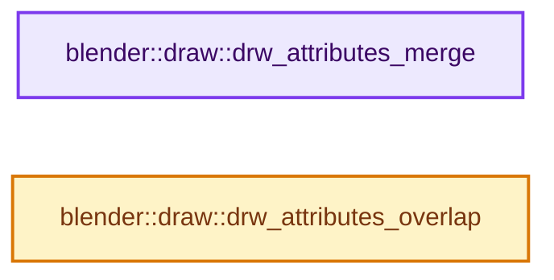

# 实现依赖专题：source/blender/draw/intern/draw_attributes.cc

[方向导航](README.md) · [符号索引](../%E7%AC%A6%E5%8F%B7%E4%BE%9D%E8%B5%96%E4%B8%8E%E5%AE%9E%E7%8E%B0%E7%B4%A2%E5%BC%95.md)

本专题从正文实际调用进入，集中保存共享实现。函数有稳定锚点，可从调用处直接跳到对应完整函数；递归与互相调用通过回链组织。

## 本文件的实现关系




## 完整成员与函数实现

<a id="f-c419948b8e7b9204"></a>

### `blender::draw::drw_attributes_merge`

实现位置：[source/blender/draw/intern/draw_attributes.cc](../../../../../source/blender/draw/intern/draw_attributes.cc) · L15—L18。

接口参数：

- `VectorSet<std::string> *dst`
- `const VectorSet<std::string> *src`

**教学注释版**

<!-- annotated:2ec9e235bfa151 -->

```cpp
void drw_attributes_merge(VectorSet<std::string> *dst, const VectorSet<std::string> *src)
{
  dst->add_multiple(src->as_span());
}
```

<details>
<summary>核对原始源码：source/blender/draw/intern/draw_attributes.cc · L15—L18</summary>

<!-- original:2ec9e235bfa151:source/blender/draw/intern/draw_attributes.cc:15:18 -->

```cpp
void drw_attributes_merge(VectorSet<std::string> *dst, const VectorSet<std::string> *src)
{
  dst->add_multiple(src->as_span());
}
```

</details>

**继续追踪实现**

- `dst->add_multiple` → [blender::VectorSet::add_multiple · L394](../01-%E5%9F%BA%E7%A1%80%E5%AE%B9%E5%99%A8%E4%B8%8E%E7%8E%B0%E4%BB%A3CPP/14-VectorSet%E7%A8%B3%E5%AE%9A%E7%B4%A2%E5%BC%95%E4%B8%8E%E5%8E%BB%E9%87%8D.md#f-911e364c3013b35e)。
- `src->as_span` → [blender::VectorSet::as_span · L326](../01-%E5%9F%BA%E7%A1%80%E5%AE%B9%E5%99%A8%E4%B8%8E%E7%8E%B0%E4%BB%A3CPP/14-VectorSet%E7%A8%B3%E5%AE%9A%E7%B4%A2%E5%BC%95%E4%B8%8E%E5%8E%BB%E9%87%8D.md#f-76ed81b1cfbe99ad)。

<a id="f-0ac041605c55bcc3"></a>

### `blender::draw::drw_attributes_overlap`

实现位置：[source/blender/draw/intern/draw_attributes.cc](../../../../../source/blender/draw/intern/draw_attributes.cc) · L20—L29。

接口参数：

- `const VectorSet<std::string> *a`
- `const VectorSet<std::string> *b`

**教学注释版**

<!-- annotated:844fcbf58e88bc -->

```cpp
bool drw_attributes_overlap(const VectorSet<std::string> *a, const VectorSet<std::string> *b)
{
  for (const std::string &req : b->as_span()) {
    // [讲解] a->contains：查询活项数量或键是否存在。
    if (!a->contains(req)) {
      return false;
    }
  }

  return true;
}
```

<details>
<summary>核对原始源码：source/blender/draw/intern/draw_attributes.cc · L20—L29</summary>

<!-- original:844fcbf58e88bc:source/blender/draw/intern/draw_attributes.cc:20:29 -->

```cpp
bool drw_attributes_overlap(const VectorSet<std::string> *a, const VectorSet<std::string> *b)
{
  for (const std::string &req : b->as_span()) {
    if (!a->contains(req)) {
      return false;
    }
  }

  return true;
}
```

</details>

**结果出口**

- `return false;`
- `return true;`

**继续追踪实现**

- `b->as_span` → [blender::VectorSet::as_span · L326](../01-%E5%9F%BA%E7%A1%80%E5%AE%B9%E5%99%A8%E4%B8%8E%E7%8E%B0%E4%BB%A3CPP/14-VectorSet%E7%A8%B3%E5%AE%9A%E7%B4%A2%E5%BC%95%E4%B8%8E%E5%8E%BB%E9%87%8D.md#f-76ed81b1cfbe99ad)。
- `a->contains` → [blender::VectorSet::contains · L406](../01-%E5%9F%BA%E7%A1%80%E5%AE%B9%E5%99%A8%E4%B8%8E%E7%8E%B0%E4%BB%A3CPP/14-VectorSet%E7%A8%B3%E5%AE%9A%E7%B4%A2%E5%BC%95%E4%B8%8E%E5%8E%BB%E9%87%8D.md#f-c940dd79693ca442)。
