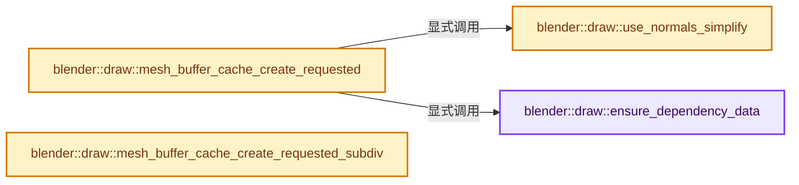
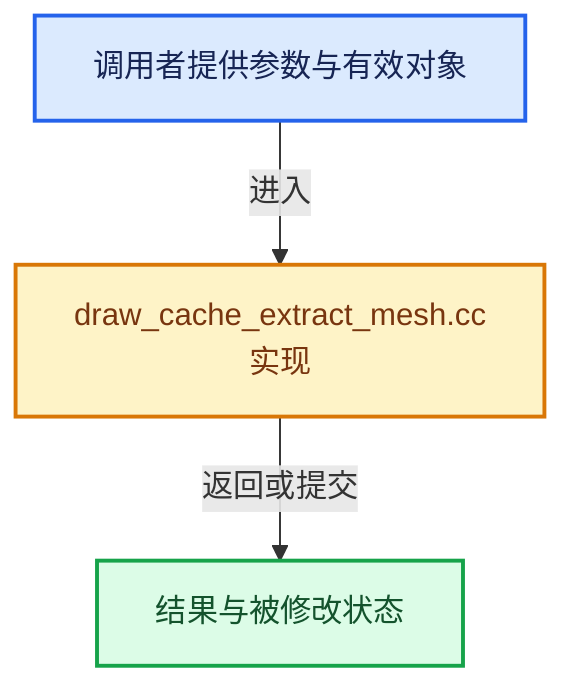

# 实现依赖专题：source/blender/draw/intern/draw_cache_extract_mesh.cc

[方向导航](README.md) · [符号索引](../%E7%AC%A6%E5%8F%B7%E4%BE%9D%E8%B5%96%E4%B8%8E%E5%AE%9E%E7%8E%B0%E7%B4%A2%E5%BC%95.md)

本专题从正文实际调用进入，集中保存共享实现。函数有稳定锚点，可从调用处直接跳到对应完整函数；递归与互相调用通过回链组织。

## 本文件的实现关系






## 完整成员与函数实现

<a id="f-2b9175714b63229d"></a>

### `blender::draw::ensure_dependency_data`

实现位置：[source/blender/draw/intern/draw_cache_extract_mesh.cc](../../../../../source/blender/draw/intern/draw_cache_extract_mesh.cc) · L40—L75。

接口参数：

- `MeshRenderData &mr`
- `Span<IBOType> ibo_requests`
- `Span<VBOType> vbo_requests`
- `MeshBufferCache &cache`

**教学注释版**

<!-- annotated:6fa96a10819e35 -->

```cpp
static void ensure_dependency_data(MeshRenderData &mr,
                                   Span<IBOType> ibo_requests,
                                   Span<VBOType> vbo_requests,
                                   MeshBufferCache &cache)
{
  const bool request_face_normals = vbo_requests.contains(VBOType::CornerNormal) ||
                                    vbo_requests.contains(VBOType::FaceDotNormal) ||
                                    vbo_requests.contains(VBOType::EdgeFactor) ||
                                    vbo_requests.contains(VBOType::MeshAnalysis);
  const bool request_corner_normals = vbo_requests.contains(VBOType::CornerNormal);
  const bool force_corner_normals = vbo_requests.contains(VBOType::Tangents);

  if (request_face_normals) {
    mesh_render_data_update_face_normals(mr);
  }
  if ((request_corner_normals && mr.normals_domain == bke::MeshNormalDomain::Corner &&
       !mr.use_simplify_normals) ||
      force_corner_normals)
  {
    mesh_render_data_update_corner_normals(mr);
  }

  const bool calc_loose_geom = ibo_requests.contains(IBOType::Lines) ||
                               ibo_requests.contains(IBOType::LinesLoose) ||
                               ibo_requests.contains(IBOType::Points) ||
                               vbo_requests.contains(VBOType::Position) ||
                               vbo_requests.contains(VBOType::EditData) ||
                               vbo_requests.contains(VBOType::VertexNormal) ||
                               vbo_requests.contains(VBOType::IndexVert) ||
                               vbo_requests.contains(VBOType::IndexEdge) ||
                               vbo_requests.contains(VBOType::EdgeFactor);

  if (calc_loose_geom) {
    mesh_render_data_update_loose_geom(mr, cache);
  }
}
```

<details>
<summary>核对原始源码：source/blender/draw/intern/draw_cache_extract_mesh.cc · L40—L75</summary>

<!-- original:6fa96a10819e35:source/blender/draw/intern/draw_cache_extract_mesh.cc:40:75 -->

```cpp
static void ensure_dependency_data(MeshRenderData &mr,
                                   Span<IBOType> ibo_requests,
                                   Span<VBOType> vbo_requests,
                                   MeshBufferCache &cache)
{
  const bool request_face_normals = vbo_requests.contains(VBOType::CornerNormal) ||
                                    vbo_requests.contains(VBOType::FaceDotNormal) ||
                                    vbo_requests.contains(VBOType::EdgeFactor) ||
                                    vbo_requests.contains(VBOType::MeshAnalysis);
  const bool request_corner_normals = vbo_requests.contains(VBOType::CornerNormal);
  const bool force_corner_normals = vbo_requests.contains(VBOType::Tangents);

  if (request_face_normals) {
    mesh_render_data_update_face_normals(mr);
  }
  if ((request_corner_normals && mr.normals_domain == bke::MeshNormalDomain::Corner &&
       !mr.use_simplify_normals) ||
      force_corner_normals)
  {
    mesh_render_data_update_corner_normals(mr);
  }

  const bool calc_loose_geom = ibo_requests.contains(IBOType::Lines) ||
                               ibo_requests.contains(IBOType::LinesLoose) ||
                               ibo_requests.contains(IBOType::Points) ||
                               vbo_requests.contains(VBOType::Position) ||
                               vbo_requests.contains(VBOType::EditData) ||
                               vbo_requests.contains(VBOType::VertexNormal) ||
                               vbo_requests.contains(VBOType::IndexVert) ||
                               vbo_requests.contains(VBOType::IndexEdge) ||
                               vbo_requests.contains(VBOType::EdgeFactor);

  if (calc_loose_geom) {
    mesh_render_data_update_loose_geom(mr, cache);
  }
}
```

</details>

**继续追踪实现**

- `vbo_requests.contains` → [blender::Span::contains · L281](../01-%E5%9F%BA%E7%A1%80%E5%AE%B9%E5%99%A8%E4%B8%8E%E7%8E%B0%E4%BB%A3CPP/05-Span%E5%8F%AA%E8%AF%BB%E8%BF%9E%E7%BB%AD%E8%A7%86%E5%9B%BE.md#f-7caee498c984f2c0)。
- `mesh_render_data_update_face_normals` → [blender::draw::mesh_render_data_update_face_normals · L377](%E4%BE%9D%E8%B5%96-draw_cache_extract_mesh_render_data-4dc6bc.md#f-f42e5759e9ccd3dd)。
- `mesh_render_data_update_corner_normals` → [blender::draw::mesh_render_data_update_corner_normals · L348](%E4%BE%9D%E8%B5%96-draw_cache_extract_mesh_render_data-4dc6bc.md#f-115a375d0e9d91f8)。
- `ibo_requests.contains` → [blender::Span::contains · L281](../01-%E5%9F%BA%E7%A1%80%E5%AE%B9%E5%99%A8%E4%B8%8E%E7%8E%B0%E4%BB%A3CPP/05-Span%E5%8F%AA%E8%AF%BB%E8%BF%9E%E7%BB%AD%E8%A7%86%E5%9B%BE.md#f-7caee498c984f2c0)。
- `mesh_render_data_update_loose_geom` → [blender::draw::mesh_render_data_update_loose_geom · L69](%E4%BE%9D%E8%B5%96-draw_cache_extract_mesh_render_data-4dc6bc.md#f-1d7a1b07420f3053)。

<a id="f-74eb235c63992163"></a>

### `blender::draw::use_normals_simplify`

实现位置：[source/blender/draw/intern/draw_cache_extract_mesh.cc](../../../../../source/blender/draw/intern/draw_cache_extract_mesh.cc) · L88—L108。

接口参数：

- `const Scene &scene`
- `const MeshRenderData &mr`

**教学注释版**

<!-- annotated:4e1cb332606911 -->

```cpp
static bool use_normals_simplify(const Scene &scene, const MeshRenderData &mr)
{
  if (!(scene.r.mode & R_SIMPLIFY) || !(scene.r.mode & R_SIMPLIFY_NORMALS)) {
    return false;
  }
  if (!mr.mesh) {
    return true;
  }
  const Mesh &mesh = *mr.mesh;
  const std::optional<bke::AttributeMetaData> meta_data = mesh.attributes().lookup_meta_data(
      "custom_normal");
  if (!meta_data) {
    return false;
  }
  if (meta_data->domain == bke::AttrDomain::Corner &&
      meta_data->data_type == bke::AttrType::Int16_2D)
  {
    return true;
  }
  return false;
}
```

<details>
<summary>核对原始源码：source/blender/draw/intern/draw_cache_extract_mesh.cc · L88—L108</summary>

<!-- original:4e1cb332606911:source/blender/draw/intern/draw_cache_extract_mesh.cc:88:108 -->

```cpp
static bool use_normals_simplify(const Scene &scene, const MeshRenderData &mr)
{
  if (!(scene.r.mode & R_SIMPLIFY) || !(scene.r.mode & R_SIMPLIFY_NORMALS)) {
    return false;
  }
  if (!mr.mesh) {
    return true;
  }
  const Mesh &mesh = *mr.mesh;
  const std::optional<bke::AttributeMetaData> meta_data = mesh.attributes().lookup_meta_data(
      "custom_normal");
  if (!meta_data) {
    return false;
  }
  if (meta_data->domain == bke::AttrDomain::Corner &&
      meta_data->data_type == bke::AttrType::Int16_2D)
  {
    return true;
  }
  return false;
}
```

</details>

**结果出口**

- `return false;`
- `return true;`

**继续追踪实现**

- `mesh.attributes().lookup_meta_data` → [调用协议](../%E6%A8%A1%E6%9D%BF%E5%AE%8F%E4%B8%8E%E5%8A%A8%E6%80%81%E5%88%86%E6%B4%BE%E5%8D%8F%E8%AE%AE.md)：接收对象类型依赖auto、返回值或模板实例；不按同名猜测目标。调用位置L97。
- `mesh.attributes` → [Mesh::attributes · L1298](03-MPoly%E8%BF%81%E7%A7%BB%E4%B8%8E%E5%85%BC%E5%AE%B9.md#f-607bbfe3e57cfc7f)。

<a id="f-89bca36760b44fc3"></a>

### `blender::draw::mesh_buffer_cache_create_requested`

实现位置：[source/blender/draw/intern/draw_cache_extract_mesh.cc](../../../../../source/blender/draw/intern/draw_cache_extract_mesh.cc) · L110—L344。

接口参数：

- `TaskGraph &`
- `const Scene &scene`
- `MeshBatchCache &cache`
- `MeshBufferCache &mbc`
- `const Span<IBOType> ibo_requests`
- `const Span<VBOType> vbo_requests`
- `Object &object`
- `Mesh &mesh`
- `const bool is_editmode`
- `const bool is_paint_mode`
- `const bool do_final`
- `const bool do_uvedit`
- `const bool use_hide`

**教学注释版**

<!-- annotated:0b7e8f8869ad52 -->

```cpp
void mesh_buffer_cache_create_requested(TaskGraph & /*task_graph*/,
                                        const Scene &scene,
                                        MeshBatchCache &cache,
                                        MeshBufferCache &mbc,
                                        const Span<IBOType> ibo_requests,
                                        const Span<VBOType> vbo_requests,
                                        Object &object,
                                        Mesh &mesh,
                                        const bool is_editmode,
                                        const bool is_paint_mode,
                                        const bool do_final,
                                        const bool do_uvedit,
                                        const bool use_hide)
{
  // [讲解] ibo_requests.is_empty：查询视图长度或生成对应有效索引区间。
  if (ibo_requests.is_empty() && vbo_requests.is_empty()) {
    return;
  }

  MeshBufferList &buffers = mbc.buff;

  Vector<IBOType, 16> ibos_to_create;
  for (const IBOType request : ibo_requests) {
    if (!buffers.ibos.contains(request)) {
      // [讲解] ibos_to_create.append：在尾部建立新元素，必要时先扩大存储。
      ibos_to_create.append(request);
    }
  }

  Vector<VBOType, 16> vbos_to_create;
  for (const VBOType request : vbo_requests) {
    if (!buffers.vbos.contains(request)) {
      vbos_to_create.append(request);
    }
  }

  if (ibos_to_create.is_empty() && vbos_to_create.is_empty()) {
    return;
  }

#ifdef DEBUG_TIME
  SCOPED_TIMER(__func__);
#endif

  MeshRenderData mr = mesh_render_data_create(
      object, mesh, is_editmode, is_paint_mode, do_final, do_uvedit, use_hide, scene.toolsettings);

  mr.use_subsurf_fdots = mr.mesh && !mr.mesh->runtime->subsurf_face_dot_tags.is_empty();
  mr.use_simplify_normals = use_normals_simplify(scene, mr);

  ensure_dependency_data(mr, ibo_requests, vbo_requests, mbc);

  // [讲解] ibos_to_create.size：用end_减begin_得到活元素数量。
  Array<gpu::IndexBufPtr, 16> created_ibos(ibos_to_create.size());

  {
    /* Because lines and loose lines are stored in the same buffer, they're handled separately
     * rather than from potentially multiple threads in the parallel_for_each loop below. */
    // [讲解] ibos_to_create.as_span：构造对当前有效元素区间的借用视图。
    const int lines_index = ibos_to_create.as_span().first_index_try(IBOType::Lines);
    const int loose_lines_index = ibos_to_create.as_span().first_index_try(IBOType::LinesLoose);
    if (lines_index != -1 || loose_lines_index != -1) {
      extract_lines(mr,
                    lines_index == -1 ? nullptr : &created_ibos[lines_index],
                    loose_lines_index == -1 ? nullptr : &created_ibos[loose_lines_index],
                    cache.no_loose_wire);
    }
  }

  threading::parallel_for_each(ibos_to_create.index_range(), [&](const int i) {
    switch (ibos_to_create[i]) {
      case IBOType::Tris:
        created_ibos[i] = extract_tris(mr, mesh_render_data_faces_sorted_ensure(mr, mbc));
        break;
      case IBOType::Lines:
      case IBOType::LinesLoose:
        /* Handled as a special case above. */
        break;
      case IBOType::Points:
        created_ibos[i] = extract_points(mr);
        break;
      case IBOType::FaceDots:
        created_ibos[i] = extract_face_dots(mr);
        break;
      case IBOType::LinesPaintMask:
        created_ibos[i] = extract_lines_paint_mask(mr);
        break;
      case IBOType::LinesAdjacency:
        created_ibos[i] = extract_lines_adjacency(mr, cache.is_manifold);
        break;
      case IBOType::UVTris:
        created_ibos[i] = extract_edituv_tris(mr, false);
        break;
      case IBOType::EditUVTris:
        created_ibos[i] = extract_edituv_tris(mr, true);
        break;
      case IBOType::AllUVLines:
        created_ibos[i] = extract_edituv_lines(mr, UvExtractionMode::All);
        break;
      case IBOType::UVLines:
        created_ibos[i] = extract_edituv_lines(mr, UvExtractionMode::Selection);
        break;
      case IBOType::EditUVLines:
        created_ibos[i] = extract_edituv_lines(mr, UvExtractionMode::Edit);
        break;
      case IBOType::EditUVPoints:
        created_ibos[i] = extract_edituv_points(mr);
        break;
      case IBOType::EditUVFaceDots:
        created_ibos[i] = extract_edituv_face_dots(mr);
        break;
    }
  });

  Array<gpu::VertBufPtr, 16> created_vbos(vbos_to_create.size());

  const bool do_hq_normals = (scene.r.perf_flag & SCE_PERF_HQ_NORMALS) != 0 ||
                             GPU_use_hq_normals_workaround();

  /* These buffers are copied to face corners on the GPU, which is only possible from this thread
   * rather than from the worker threads in the parallel_for_each loop below. */
  for (const int i : vbos_to_create.index_range()) {
    const VBOType type = vbos_to_create[i];
    if (type == VBOType::Position) {
      created_vbos[i] = extract_positions(mr, mbc);
    }
    else if (type == VBOType::CornerNormal) {
      created_vbos[i] = extract_normals(mr, mbc, do_hq_normals);
    }
    else if (type == VBOType::VertexNormal) {
      created_vbos[i] = extract_vert_normals(mr, mbc);
    }
    else if (type == VBOType::VertexGroupWeight) {
      created_vbos[i] = extract_weights(mr, cache, mbc);
    }
    else if (type == VBOType::Orco) {
      created_vbos[i] = extract_orco(mr, mbc);
    }
    else if (type == VBOType::AttrViewer) {
      created_vbos[i] = extract_attr_viewer(mr, mbc);
    }
    else if (type >= VBOType::Attr0 && type <= VBOType::Attr15) {
      const int8_t attr_index = int8_t(type) - int8_t(VBOType::Attr0);
      created_vbos[i] = extract_attribute(mr, mbc, cache.attr_used[attr_index]);
    }
  }

  threading::parallel_for_each(vbos_to_create.index_range(), [&](const int i) {
    switch (vbos_to_create[i]) {
      case VBOType::Position:
      case VBOType::CornerNormal:
      case VBOType::VertexGroupWeight:
      case VBOType::VertexNormal:
      case VBOType::Orco:
      case VBOType::AttrViewer:
      case VBOType::Attr0:
      case VBOType::Attr1:
      case VBOType::Attr2:
      case VBOType::Attr3:
      case VBOType::Attr5:
      case VBOType::Attr6:
      case VBOType::Attr7:
      case VBOType::Attr8:
      case VBOType::Attr9:
      case VBOType::Attr10:
      case VBOType::Attr11:
      case VBOType::Attr12:
      case VBOType::Attr13:
      case VBOType::Attr14:
      case VBOType::Attr15:
        break;
      case VBOType::EdgeFactor:
        created_vbos[i] = extract_edge_factor(mr);
        break;
        break;
      case VBOType::UVs:
        created_vbos[i] = extract_uv_maps(mr, cache);
        break;
      case VBOType::Tangents:
        created_vbos[i] = extract_tangents(mr, cache, do_hq_normals);
        break;
      case VBOType::SculptData:
        created_vbos[i] = extract_sculpt_data(mr);
        break;
      case VBOType::EditData:
        created_vbos[i] = extract_edit_data(mr);
        break;
      case VBOType::EditUVData:
        created_vbos[i] = extract_edituv_data(mr);
        break;
      case VBOType::EditUVStretchArea:
        created_vbos[i] = extract_edituv_stretch_area(mr, cache.tot_area, cache.tot_uv_area);
        break;
      case VBOType::EditUVStretchAngle:
        created_vbos[i] = extract_edituv_stretch_angle(mr);
        break;
      case VBOType::MeshAnalysis:
        created_vbos[i] = extract_mesh_analysis(mr, object.object_to_world());
        break;
      case VBOType::FaceDotPosition:
        created_vbos[i] = extract_face_dots_position(mr);
        break;
      case VBOType::FaceDotNormal:
        created_vbos[i] = extract_face_dot_normals(mr, do_hq_normals);
        break;
      case VBOType::FaceDotUV:
        created_vbos[i] = extract_face_dots_uv(mr);
        break;
      case VBOType::FaceDotEditUVData:
        created_vbos[i] = extract_face_dots_edituv_data(mr);
        break;
      case VBOType::SkinRoots:
        created_vbos[i] = extract_skin_roots(mr);
        break;
      case VBOType::IndexVert:
        created_vbos[i] = extract_vert_index(mr);
        break;
      case VBOType::IndexEdge:
        created_vbos[i] = extract_edge_index(mr);
        break;
      case VBOType::IndexFace:
        created_vbos[i] = extract_face_index(mr);
        break;
      case VBOType::IndexFaceDot:
        created_vbos[i] = extract_face_dot_index(mr);
        break;
      case VBOType::PaintOverlayFlag:
        created_vbos[i] = extract_paint_overlay_flags(mr);
        break;
    }
  });

  for (const int i : ibos_to_create.index_range()) {
    // [讲解] std::move：把表达式转换成可供移动重载选择的值类别；不保证真的移动，不结束源对象寿命，对const值可能选择复制。
    buffers.ibos.add_new(ibos_to_create[i], std::move(created_ibos[i]));
  }
  for (const int i : vbos_to_create.index_range()) {
    buffers.vbos.add_new(vbos_to_create[i], std::move(created_vbos[i]));
  }
}
```

<details>
<summary>核对原始源码：source/blender/draw/intern/draw_cache_extract_mesh.cc · L110—L344</summary>

<!-- original:0b7e8f8869ad52:source/blender/draw/intern/draw_cache_extract_mesh.cc:110:344 -->

```cpp
void mesh_buffer_cache_create_requested(TaskGraph & /*task_graph*/,
                                        const Scene &scene,
                                        MeshBatchCache &cache,
                                        MeshBufferCache &mbc,
                                        const Span<IBOType> ibo_requests,
                                        const Span<VBOType> vbo_requests,
                                        Object &object,
                                        Mesh &mesh,
                                        const bool is_editmode,
                                        const bool is_paint_mode,
                                        const bool do_final,
                                        const bool do_uvedit,
                                        const bool use_hide)
{
  if (ibo_requests.is_empty() && vbo_requests.is_empty()) {
    return;
  }

  MeshBufferList &buffers = mbc.buff;

  Vector<IBOType, 16> ibos_to_create;
  for (const IBOType request : ibo_requests) {
    if (!buffers.ibos.contains(request)) {
      ibos_to_create.append(request);
    }
  }

  Vector<VBOType, 16> vbos_to_create;
  for (const VBOType request : vbo_requests) {
    if (!buffers.vbos.contains(request)) {
      vbos_to_create.append(request);
    }
  }

  if (ibos_to_create.is_empty() && vbos_to_create.is_empty()) {
    return;
  }

#ifdef DEBUG_TIME
  SCOPED_TIMER(__func__);
#endif

  MeshRenderData mr = mesh_render_data_create(
      object, mesh, is_editmode, is_paint_mode, do_final, do_uvedit, use_hide, scene.toolsettings);

  mr.use_subsurf_fdots = mr.mesh && !mr.mesh->runtime->subsurf_face_dot_tags.is_empty();
  mr.use_simplify_normals = use_normals_simplify(scene, mr);

  ensure_dependency_data(mr, ibo_requests, vbo_requests, mbc);

  Array<gpu::IndexBufPtr, 16> created_ibos(ibos_to_create.size());

  {
    /* Because lines and loose lines are stored in the same buffer, they're handled separately
     * rather than from potentially multiple threads in the parallel_for_each loop below. */
    const int lines_index = ibos_to_create.as_span().first_index_try(IBOType::Lines);
    const int loose_lines_index = ibos_to_create.as_span().first_index_try(IBOType::LinesLoose);
    if (lines_index != -1 || loose_lines_index != -1) {
      extract_lines(mr,
                    lines_index == -1 ? nullptr : &created_ibos[lines_index],
                    loose_lines_index == -1 ? nullptr : &created_ibos[loose_lines_index],
                    cache.no_loose_wire);
    }
  }

  threading::parallel_for_each(ibos_to_create.index_range(), [&](const int i) {
    switch (ibos_to_create[i]) {
      case IBOType::Tris:
        created_ibos[i] = extract_tris(mr, mesh_render_data_faces_sorted_ensure(mr, mbc));
        break;
      case IBOType::Lines:
      case IBOType::LinesLoose:
        /* Handled as a special case above. */
        break;
      case IBOType::Points:
        created_ibos[i] = extract_points(mr);
        break;
      case IBOType::FaceDots:
        created_ibos[i] = extract_face_dots(mr);
        break;
      case IBOType::LinesPaintMask:
        created_ibos[i] = extract_lines_paint_mask(mr);
        break;
      case IBOType::LinesAdjacency:
        created_ibos[i] = extract_lines_adjacency(mr, cache.is_manifold);
        break;
      case IBOType::UVTris:
        created_ibos[i] = extract_edituv_tris(mr, false);
        break;
      case IBOType::EditUVTris:
        created_ibos[i] = extract_edituv_tris(mr, true);
        break;
      case IBOType::AllUVLines:
        created_ibos[i] = extract_edituv_lines(mr, UvExtractionMode::All);
        break;
      case IBOType::UVLines:
        created_ibos[i] = extract_edituv_lines(mr, UvExtractionMode::Selection);
        break;
      case IBOType::EditUVLines:
        created_ibos[i] = extract_edituv_lines(mr, UvExtractionMode::Edit);
        break;
      case IBOType::EditUVPoints:
        created_ibos[i] = extract_edituv_points(mr);
        break;
      case IBOType::EditUVFaceDots:
        created_ibos[i] = extract_edituv_face_dots(mr);
        break;
    }
  });

  Array<gpu::VertBufPtr, 16> created_vbos(vbos_to_create.size());

  const bool do_hq_normals = (scene.r.perf_flag & SCE_PERF_HQ_NORMALS) != 0 ||
                             GPU_use_hq_normals_workaround();

  /* These buffers are copied to face corners on the GPU, which is only possible from this thread
   * rather than from the worker threads in the parallel_for_each loop below. */
  for (const int i : vbos_to_create.index_range()) {
    const VBOType type = vbos_to_create[i];
    if (type == VBOType::Position) {
      created_vbos[i] = extract_positions(mr, mbc);
    }
    else if (type == VBOType::CornerNormal) {
      created_vbos[i] = extract_normals(mr, mbc, do_hq_normals);
    }
    else if (type == VBOType::VertexNormal) {
      created_vbos[i] = extract_vert_normals(mr, mbc);
    }
    else if (type == VBOType::VertexGroupWeight) {
      created_vbos[i] = extract_weights(mr, cache, mbc);
    }
    else if (type == VBOType::Orco) {
      created_vbos[i] = extract_orco(mr, mbc);
    }
    else if (type == VBOType::AttrViewer) {
      created_vbos[i] = extract_attr_viewer(mr, mbc);
    }
    else if (type >= VBOType::Attr0 && type <= VBOType::Attr15) {
      const int8_t attr_index = int8_t(type) - int8_t(VBOType::Attr0);
      created_vbos[i] = extract_attribute(mr, mbc, cache.attr_used[attr_index]);
    }
  }

  threading::parallel_for_each(vbos_to_create.index_range(), [&](const int i) {
    switch (vbos_to_create[i]) {
      case VBOType::Position:
      case VBOType::CornerNormal:
      case VBOType::VertexGroupWeight:
      case VBOType::VertexNormal:
      case VBOType::Orco:
      case VBOType::AttrViewer:
      case VBOType::Attr0:
      case VBOType::Attr1:
      case VBOType::Attr2:
      case VBOType::Attr3:
      case VBOType::Attr5:
      case VBOType::Attr6:
      case VBOType::Attr7:
      case VBOType::Attr8:
      case VBOType::Attr9:
      case VBOType::Attr10:
      case VBOType::Attr11:
      case VBOType::Attr12:
      case VBOType::Attr13:
      case VBOType::Attr14:
      case VBOType::Attr15:
        break;
      case VBOType::EdgeFactor:
        created_vbos[i] = extract_edge_factor(mr);
        break;
        break;
      case VBOType::UVs:
        created_vbos[i] = extract_uv_maps(mr, cache);
        break;
      case VBOType::Tangents:
        created_vbos[i] = extract_tangents(mr, cache, do_hq_normals);
        break;
      case VBOType::SculptData:
        created_vbos[i] = extract_sculpt_data(mr);
        break;
      case VBOType::EditData:
        created_vbos[i] = extract_edit_data(mr);
        break;
      case VBOType::EditUVData:
        created_vbos[i] = extract_edituv_data(mr);
        break;
      case VBOType::EditUVStretchArea:
        created_vbos[i] = extract_edituv_stretch_area(mr, cache.tot_area, cache.tot_uv_area);
        break;
      case VBOType::EditUVStretchAngle:
        created_vbos[i] = extract_edituv_stretch_angle(mr);
        break;
      case VBOType::MeshAnalysis:
        created_vbos[i] = extract_mesh_analysis(mr, object.object_to_world());
        break;
      case VBOType::FaceDotPosition:
        created_vbos[i] = extract_face_dots_position(mr);
        break;
      case VBOType::FaceDotNormal:
        created_vbos[i] = extract_face_dot_normals(mr, do_hq_normals);
        break;
      case VBOType::FaceDotUV:
        created_vbos[i] = extract_face_dots_uv(mr);
        break;
      case VBOType::FaceDotEditUVData:
        created_vbos[i] = extract_face_dots_edituv_data(mr);
        break;
      case VBOType::SkinRoots:
        created_vbos[i] = extract_skin_roots(mr);
        break;
      case VBOType::IndexVert:
        created_vbos[i] = extract_vert_index(mr);
        break;
      case VBOType::IndexEdge:
        created_vbos[i] = extract_edge_index(mr);
        break;
      case VBOType::IndexFace:
        created_vbos[i] = extract_face_index(mr);
        break;
      case VBOType::IndexFaceDot:
        created_vbos[i] = extract_face_dot_index(mr);
        break;
      case VBOType::PaintOverlayFlag:
        created_vbos[i] = extract_paint_overlay_flags(mr);
        break;
    }
  });

  for (const int i : ibos_to_create.index_range()) {
    buffers.ibos.add_new(ibos_to_create[i], std::move(created_ibos[i]));
  }
  for (const int i : vbos_to_create.index_range()) {
    buffers.vbos.add_new(vbos_to_create[i], std::move(created_vbos[i]));
  }
}
```

</details>

**沿实际写入检查状态**

- `mr.use_subsurf_fdots = mr.mesh && !mr.mesh->runtime->subsurf_face_dot_tags.is_empty();`
- `mr.use_simplify_normals = use_normals_simplify(scene, mr);`
- `created_ibos[i] = extract_tris(mr, mesh_render_data_faces_sorted_ensure(mr, mbc));`
- `created_ibos[i] = extract_points(mr);`
- `created_ibos[i] = extract_face_dots(mr);`
- `created_ibos[i] = extract_lines_paint_mask(mr);`
- `created_ibos[i] = extract_lines_adjacency(mr, cache.is_manifold);`
- `created_ibos[i] = extract_edituv_tris(mr, false);`
- `created_ibos[i] = extract_edituv_tris(mr, true);`
- `created_ibos[i] = extract_edituv_lines(mr, UvExtractionMode::All);`
- `created_ibos[i] = extract_edituv_lines(mr, UvExtractionMode::Selection);`
- `created_ibos[i] = extract_edituv_lines(mr, UvExtractionMode::Edit);`
- `created_ibos[i] = extract_edituv_points(mr);`
- `created_ibos[i] = extract_edituv_face_dots(mr);`
- `created_vbos[i] = extract_positions(mr, mbc);`
- `created_vbos[i] = extract_normals(mr, mbc, do_hq_normals);`
- `created_vbos[i] = extract_vert_normals(mr, mbc);`
- `created_vbos[i] = extract_weights(mr, cache, mbc);`
- `created_vbos[i] = extract_orco(mr, mbc);`
- `created_vbos[i] = extract_attr_viewer(mr, mbc);`
- `created_vbos[i] = extract_attribute(mr, mbc, cache.attr_used[attr_index]);`
- `created_vbos[i] = extract_edge_factor(mr);`
- `created_vbos[i] = extract_uv_maps(mr, cache);`
- `created_vbos[i] = extract_tangents(mr, cache, do_hq_normals);`
- `created_vbos[i] = extract_sculpt_data(mr);`
- `created_vbos[i] = extract_edit_data(mr);`
- `created_vbos[i] = extract_edituv_data(mr);`
- `created_vbos[i] = extract_edituv_stretch_area(mr, cache.tot_area, cache.tot_uv_area);`
- `created_vbos[i] = extract_edituv_stretch_angle(mr);`
- `created_vbos[i] = extract_mesh_analysis(mr, object.object_to_world());`
- `created_vbos[i] = extract_face_dots_position(mr);`
- `created_vbos[i] = extract_face_dot_normals(mr, do_hq_normals);`
- `created_vbos[i] = extract_face_dots_uv(mr);`
- `created_vbos[i] = extract_face_dots_edituv_data(mr);`
- `created_vbos[i] = extract_skin_roots(mr);`
- `created_vbos[i] = extract_vert_index(mr);`
- `created_vbos[i] = extract_edge_index(mr);`
- `created_vbos[i] = extract_face_index(mr);`
- `created_vbos[i] = extract_face_dot_index(mr);`
- `created_vbos[i] = extract_paint_overlay_flags(mr);`

**继续追踪实现**

- `ibo_requests.is_empty` → [blender::Span::is_empty · L264](../01-%E5%9F%BA%E7%A1%80%E5%AE%B9%E5%99%A8%E4%B8%8E%E7%8E%B0%E4%BB%A3CPP/05-Span%E5%8F%AA%E8%AF%BB%E8%BF%9E%E7%BB%AD%E8%A7%86%E5%9B%BE.md#f-8cc1d7ba8feb50e6)。
- `vbo_requests.is_empty` → [blender::Span::is_empty · L264](../01-%E5%9F%BA%E7%A1%80%E5%AE%B9%E5%99%A8%E4%B8%8E%E7%8E%B0%E4%BB%A3CPP/05-Span%E5%8F%AA%E8%AF%BB%E8%BF%9E%E7%BB%AD%E8%A7%86%E5%9B%BE.md#f-8cc1d7ba8feb50e6)。
- `buffers.ibos.contains` → [调用协议](../%E6%A8%A1%E6%9D%BF%E5%AE%8F%E4%B8%8E%E5%8A%A8%E6%80%81%E5%88%86%E6%B4%BE%E5%8D%8F%E8%AE%AE.md)：接收对象类型依赖auto、返回值或模板实例；不按同名猜测目标。调用位置L132。
- `ibos_to_create.append` → [blender::Vector::append · L498](../01-%E5%9F%BA%E7%A1%80%E5%AE%B9%E5%99%A8%E4%B8%8E%E7%8E%B0%E4%BB%A3CPP/11-Vector%E6%8F%92%E5%85%A5%E5%88%A0%E9%99%A4%E4%B8%8E%E9%87%8D%E6%8E%92.md#f-5bde268a69e443ec)；[blender::Vector::append · L502](../01-%E5%9F%BA%E7%A1%80%E5%AE%B9%E5%99%A8%E4%B8%8E%E7%8E%B0%E4%BB%A3CPP/11-Vector%E6%8F%92%E5%85%A5%E5%88%A0%E9%99%A4%E4%B8%8E%E9%87%8D%E6%8E%92.md#f-591e0b15e6308532)。同名重载需按实参类型选择。
- `buffers.vbos.contains` → [调用协议](../%E6%A8%A1%E6%9D%BF%E5%AE%8F%E4%B8%8E%E5%8A%A8%E6%80%81%E5%88%86%E6%B4%BE%E5%8D%8F%E8%AE%AE.md)：接收对象类型依赖auto、返回值或模板实例；不按同名猜测目标。调用位置L139。
- `vbos_to_create.append` → [blender::Vector::append · L498](../01-%E5%9F%BA%E7%A1%80%E5%AE%B9%E5%99%A8%E4%B8%8E%E7%8E%B0%E4%BB%A3CPP/11-Vector%E6%8F%92%E5%85%A5%E5%88%A0%E9%99%A4%E4%B8%8E%E9%87%8D%E6%8E%92.md#f-5bde268a69e443ec)；[blender::Vector::append · L502](../01-%E5%9F%BA%E7%A1%80%E5%AE%B9%E5%99%A8%E4%B8%8E%E7%8E%B0%E4%BB%A3CPP/11-Vector%E6%8F%92%E5%85%A5%E5%88%A0%E9%99%A4%E4%B8%8E%E9%87%8D%E6%8E%92.md#f-591e0b15e6308532)。同名重载需按实参类型选择。
- `ibos_to_create.is_empty` → [blender::Vector::is_empty · L792](../01-%E5%9F%BA%E7%A1%80%E5%AE%B9%E5%99%A8%E4%B8%8E%E7%8E%B0%E4%BB%A3CPP/11-Vector%E6%8F%92%E5%85%A5%E5%88%A0%E9%99%A4%E4%B8%8E%E9%87%8D%E6%8E%92.md#f-937bbd9cb80bdcc8)。
- `vbos_to_create.is_empty` → [blender::Vector::is_empty · L792](../01-%E5%9F%BA%E7%A1%80%E5%AE%B9%E5%99%A8%E4%B8%8E%E7%8E%B0%E4%BB%A3CPP/11-Vector%E6%8F%92%E5%85%A5%E5%88%A0%E9%99%A4%E4%B8%8E%E9%87%8D%E6%8E%92.md#f-937bbd9cb80bdcc8)。
- `SCOPED_TIMER` → [SCOPED_TIMER · L64](../01-%E5%9F%BA%E7%A1%80%E5%AE%B9%E5%99%A8%E4%B8%8E%E7%8E%B0%E4%BB%A3CPP/%E4%BE%9D%E8%B5%96-BLI_timeit-5eb48e.md#m-583d4ad21fbe)。宏定义由构建条件选择。
- `mesh_render_data_create` → [blender::draw::mesh_render_data_create · L409](%E4%BE%9D%E8%B5%96-draw_cache_extract_mesh_render_data-4dc6bc.md#f-81ba025bcdba66d9)。
- `mr.mesh->runtime->subsurf_face_dot_tags.is_empty` → [调用协议](../%E6%A8%A1%E6%9D%BF%E5%AE%8F%E4%B8%8E%E5%8A%A8%E6%80%81%E5%88%86%E6%B4%BE%E5%8D%8F%E8%AE%AE.md)：接收对象类型依赖auto、返回值或模板实例；不按同名猜测目标。调用位置L155。
- `use_normals_simplify` → [blender::draw::use_normals_simplify · L88](%E4%BE%9D%E8%B5%96-draw_cache_extract_mesh-504d29.md#f-74eb235c63992163)。
- `ensure_dependency_data` → [blender::draw::ensure_dependency_data · L40](%E4%BE%9D%E8%B5%96-draw_cache_extract_mesh-504d29.md#f-2b9175714b63229d)。
- `ibos_to_create.size` → [blender::Vector::size · L780](../01-%E5%9F%BA%E7%A1%80%E5%AE%B9%E5%99%A8%E4%B8%8E%E7%8E%B0%E4%BB%A3CPP/11-Vector%E6%8F%92%E5%85%A5%E5%88%A0%E9%99%A4%E4%B8%8E%E9%87%8D%E6%8E%92.md#f-714773731767349c)。
- `ibos_to_create.as_span().first_index_try` → [调用协议](../%E6%A8%A1%E6%9D%BF%E5%AE%8F%E4%B8%8E%E5%8A%A8%E6%80%81%E5%88%86%E6%B4%BE%E5%8D%8F%E8%AE%AE.md)：接收对象类型依赖auto、返回值或模板实例；不按同名猜测目标。调用位置L165。
- `ibos_to_create.as_span` → [blender::Vector::as_span · L390](../01-%E5%9F%BA%E7%A1%80%E5%AE%B9%E5%99%A8%E4%B8%8E%E7%8E%B0%E4%BB%A3CPP/10-Vector%E6%89%A9%E5%AE%B9%E4%B8%8E%E5%A2%9E%E9%95%BF.md#f-e2eed03cefcdd2ff)。
- `extract_lines` → [blender::draw::extract_lines · L234](%E4%BE%9D%E8%B5%96-extract_mesh_ibo_lines-07d02a.md#f-ab6d441e7afa8309)。
- `threading::parallel_for_each` → [blender::threading::parallel_for_each · L30](../11-Depsgraph%E4%B8%8E%E5%B9%B6%E8%A1%8C%E4%BB%BB%E5%8A%A1%E7%B3%BB%E7%BB%9F/07-%E4%BB%BB%E5%8A%A1%E6%B1%A0%E4%B8%8ETBB%E6%8E%A5%E5%85%A5.md#f-d5604027445ef0f5)。
- `ibos_to_create.index_range` → [blender::Vector::index_range · L1026](../01-%E5%9F%BA%E7%A1%80%E5%AE%B9%E5%99%A8%E4%B8%8E%E7%8E%B0%E4%BB%A3CPP/12-Vector%E5%BC%82%E5%B8%B8%E5%AE%89%E5%85%A8%E4%B8%8E%E8%BE%B9%E7%95%8C.md#f-ac29cf36ef185ab9)。
- `extract_tris` → [blender::draw::extract_tris · L111](%E4%BE%9D%E8%B5%96-extract_mesh_ibo_tris-ddd9e4.md#f-a59e1858db6e548b)。
- `mesh_render_data_faces_sorted_ensure` → [blender::draw::mesh_render_data_faces_sorted_ensure · L273](%E4%BE%9D%E8%B5%96-draw_cache_extract_mesh_render_data-4dc6bc.md#f-d0c1fc4fd8e71230)。
- `extract_points` → [blender::draw::extract_points · L183](%E4%BE%9D%E8%B5%96-extract_mesh_ibo_points-c428dd.md#f-0d4495b7b941850e)。
- `extract_face_dots` → [blender::draw::extract_face_dots · L63](%E4%BE%9D%E8%B5%96-extract_mesh_ibo_fdots-c719cf.md#f-28c1c09a95f5f3ed)。
- `extract_lines_paint_mask` → [blender::draw::extract_lines_paint_mask · L21](%E4%BE%9D%E8%B5%96-extract_mesh_ibo_lines_paint_mask-21c13e.md#f-e3a70089d3ed9c76)。
- `extract_lines_adjacency` → [blender::draw::extract_lines_adjacency · L187](%E4%BE%9D%E8%B5%96-extract_mesh_ibo_lines_adjacency-b62d63.md#f-4be16ee52edd348f)。
- `extract_edituv_tris` → [blender::draw::extract_edituv_tris · L168](%E4%BE%9D%E8%B5%96-extract_mesh_ibo_edituv-ad34dc.md#f-175b261698699661)。
- `extract_edituv_lines` → [blender::draw::extract_edituv_lines · L364](%E4%BE%9D%E8%B5%96-extract_mesh_ibo_edituv-ad34dc.md#f-182a582865ad8ae8)。
- `extract_edituv_points` → [blender::draw::extract_edituv_points · L552](%E4%BE%9D%E8%B5%96-extract_mesh_ibo_edituv-ad34dc.md#f-30334855a1492219)。
- `extract_edituv_face_dots` → [blender::draw::extract_edituv_face_dots · L692](%E4%BE%9D%E8%B5%96-extract_mesh_ibo_edituv-ad34dc.md#f-22e44165a678589c)。
- `vbos_to_create.size` → [blender::Vector::size · L780](../01-%E5%9F%BA%E7%A1%80%E5%AE%B9%E5%99%A8%E4%B8%8E%E7%8E%B0%E4%BB%A3CPP/11-Vector%E6%8F%92%E5%85%A5%E5%88%A0%E9%99%A4%E4%B8%8E%E9%87%8D%E6%8E%92.md#f-714773731767349c)。
- `GPU_use_hq_normals_workaround` → [blender::GPU_use_hq_normals_workaround · L147](%E4%BE%9D%E8%B5%96-gpu_capabilities-508ffd.md#f-41b0c45a9f3667a7)。
- `vbos_to_create.index_range` → [blender::Vector::index_range · L1026](../01-%E5%9F%BA%E7%A1%80%E5%AE%B9%E5%99%A8%E4%B8%8E%E7%8E%B0%E4%BB%A3CPP/12-Vector%E5%BC%82%E5%B8%B8%E5%AE%89%E5%85%A8%E4%B8%8E%E8%BE%B9%E7%95%8C.md#f-ac29cf36ef185ab9)。
- `extract_positions` → [blender::draw::extract_positions · L62](%E4%BE%9D%E8%B5%96-extract_mesh_vbo_pos-9f6624.md#f-b064590b631fe95e)。
- `extract_normals` → [blender::draw::extract_normals · L127](%E4%BE%9D%E8%B5%96-extract_mesh_vbo_lnor-ac7238.md#f-33f41666c740861f)；[blender::draw::extract_normals · L183](%E4%BE%9D%E8%B5%96-extract_mesh_vbo_lnor-ac7238.md#f-8e0d715988bd87f2)。同名重载需按实参类型选择。
- `extract_vert_normals` → [blender::draw::extract_vert_normals · L58](%E4%BE%9D%E8%B5%96-extract_mesh_vbo_vnor-78ba9a.md#f-b026b31a02833ec7)。
- `extract_weights` → [blender::draw::extract_weights · L108](%E4%BE%9D%E8%B5%96-extract_mesh_vbo_weights-3f65ae.md#f-8b4662e5a7d35d83)。
- `extract_orco` → [blender::draw::extract_orco · L13](%E4%BE%9D%E8%B5%96-extract_mesh_vbo_orco-425b5c.md#f-b742b7d7a80fc539)。
- `extract_attr_viewer` → [blender::draw::extract_attr_viewer · L262](%E4%BE%9D%E8%B5%96-extract_mesh_vbo_attributes-512b4a.md#f-98baf309c6ca730f)。
- `extract_attribute` → [blender::draw::extract_attribute · L195](%E4%BE%9D%E8%B5%96-extract_mesh_vbo_attributes-512b4a.md#f-4fe6fa23e07621b1)。
- `extract_edge_factor` → [blender::draw::extract_edge_factor · L119](%E4%BE%9D%E8%B5%96-extract_mesh_vbo_edge_fac-6dad61.md#f-360fa26a59003f68)。
- `extract_uv_maps` → [blender::draw::extract_uv_maps · L78](%E4%BE%9D%E8%B5%96-extract_mesh_vbo_uv-5b7e3e.md#f-177af9379cb51576)。
- `extract_tangents` → [blender::draw::extract_tangents · L149](%E4%BE%9D%E8%B5%96-extract_mesh_vbo_tan-163203.md#f-689aaad7bde1fafc)。
- `extract_sculpt_data` → [blender::draw::extract_sculpt_data · L32](%E4%BE%9D%E8%B5%96-extract_mesh_vbo_sculpt_data-a2023f.md#f-b0ed6732d6b6f6f8)。
- `extract_edit_data` → [blender::draw::extract_edit_data · L224](%E4%BE%9D%E8%B5%96-draw_cache_impl_curves-1de700.md#f-2c9c476775d40d68)。
- `extract_edituv_data` → [blender::draw::extract_edituv_data · L101](%E4%BE%9D%E8%B5%96-extract_mesh_vbo_edituv_data-6bda0e.md#f-a6cb4e07c749d492)。
- `extract_edituv_stretch_area` → [blender::draw::extract_edituv_stretch_area · L94](%E4%BE%9D%E8%B5%96-extract_mesh_vbo_edituv_stretch_area-964778.md#f-15d681f3e7b6b184)。
- `extract_edituv_stretch_angle` → [blender::draw::extract_edituv_stretch_angle · L189](%E4%BE%9D%E8%B5%96-extract_mesh_vbo_edituv_stretch_angle-8dc512.md#f-fae08aae1ad33278)。
- `extract_mesh_analysis` → [blender::draw::extract_mesh_analysis · L565](%E4%BE%9D%E8%B5%96-extract_mesh_vbo_mesh_analysis-c10902.md#f-77341d1bdc396314)。
- `object.object_to_world` → [blender::Object::object_to_world · L5761](%E4%BE%9D%E8%B5%96-object-843689.md#f-12fc20026327d50c)。
- `extract_face_dots_position` → [blender::draw::extract_face_dots_position · L78](%E4%BE%9D%E8%B5%96-extract_mesh_vbo_fdots_pos-836f42.md#f-cb47eb2b2020f0c6)。
- `extract_face_dot_normals` → [blender::draw::extract_face_dot_normals · L60](%E4%BE%9D%E8%B5%96-extract_mesh_vbo_fdots_nor-ec1b6a.md#f-a480779dec322f3a)。
- `extract_face_dots_uv` → [blender::draw::extract_face_dots_uv · L66](%E4%BE%9D%E8%B5%96-extract_mesh_vbo_fdots_uv-648ff8.md#f-6dcbba737f32f7e1)。
- `extract_face_dots_edituv_data` → [blender::draw::extract_face_dots_edituv_data · L15](%E4%BE%9D%E8%B5%96-extract_mesh_vbo_fdots_edituv_data-9e90ee.md#f-d0f47388d275b201)。
- `extract_skin_roots` → [blender::draw::extract_skin_roots · L20](%E4%BE%9D%E8%B5%96-extract_mesh_vbo_skin_roots-ab8712.md#f-47476b2dbf525d00)。
- `extract_vert_index` → [blender::draw::extract_vert_index · L84](%E4%BE%9D%E8%B5%96-extract_mesh_vbo_select_idx-598ba4.md#f-d8f5dcf4374d0472)。
- `extract_edge_index` → [blender::draw::extract_edge_index · L148](%E4%BE%9D%E8%B5%96-extract_mesh_vbo_select_idx-598ba4.md#f-fa1d773f0ad46c60)。
- `extract_face_index` → [blender::draw::extract_face_index · L188](%E4%BE%9D%E8%B5%96-extract_mesh_vbo_select_idx-598ba4.md#f-628d593c000ca433)。
- `extract_face_dot_index` → [blender::draw::extract_face_dot_index · L306](%E4%BE%9D%E8%B5%96-extract_mesh_vbo_select_idx-598ba4.md#f-b4534cbe73bdaa34)。
- `extract_paint_overlay_flags` → [blender::draw::extract_paint_overlay_flags · L15](%E4%BE%9D%E8%B5%96-extract_mesh_vbo_paint_overlay_flag-8972d1.md#f-b9daa80c1d6fa380)；[blender::draw::extract_paint_overlay_flags · L93](%E4%BE%9D%E8%B5%96-extract_mesh_vbo_paint_overlay_flag-8972d1.md#f-c09d8fb6e1badfc6)。同名重载需按实参类型选择。
- `buffers.ibos.add_new` → [调用协议](../%E6%A8%A1%E6%9D%BF%E5%AE%8F%E4%B8%8E%E5%8A%A8%E6%80%81%E5%88%86%E6%B4%BE%E5%8D%8F%E8%AE%AE.md)：接收对象类型依赖auto、返回值或模板实例；不按同名猜测目标。调用位置L339。
- `std::move` → [外部契约](https://eel.is/c++draft/utility.forward)：把表达式转换成可供移动重载选择的值类别；不保证真的移动，不结束源对象寿命，对const值可能选择复制。
- `buffers.vbos.add_new` → [调用协议](../%E6%A8%A1%E6%9D%BF%E5%AE%8F%E4%B8%8E%E5%8A%A8%E6%80%81%E5%88%86%E6%B4%BE%E5%8D%8F%E8%AE%AE.md)：接收对象类型依赖auto、返回值或模板实例；不按同名猜测目标。调用位置L342。

<a id="f-b71b6b056280194b"></a>

### `blender::draw::mesh_buffer_cache_create_requested_subdiv`

实现位置：[source/blender/draw/intern/draw_cache_extract_mesh.cc](../../../../../source/blender/draw/intern/draw_cache_extract_mesh.cc) · L352—L534。

接口参数：

- `MeshBatchCache &cache`
- `MeshBufferCache &mbc`
- `const Span<IBOType> ibo_requests`
- `const Span<VBOType> vbo_requests`
- `DRWSubdivCache &subdiv_cache`
- `MeshRenderData &mr`

**教学注释版**

<!-- annotated:c6c631f1564fb4 -->

```cpp
void mesh_buffer_cache_create_requested_subdiv(MeshBatchCache &cache,
                                               MeshBufferCache &mbc,
                                               const Span<IBOType> ibo_requests,
                                               const Span<VBOType> vbo_requests,
                                               DRWSubdivCache &subdiv_cache,
                                               MeshRenderData &mr)
{
  // [讲解] ibo_requests.is_empty：查询视图长度或生成对应有效索引区间。
  if (ibo_requests.is_empty() && vbo_requests.is_empty()) {
    return;
  }
  MeshBufferList &buffers = mbc.buff;

  mesh_render_data_update_corner_normals(mr);
  mesh_render_data_update_loose_geom(mr, mbc);
  DRW_subdivide_loose_geom(subdiv_cache, mbc);

  Set<IBOType, 16> ibos_to_create;
  for (const IBOType request : ibo_requests) {
    if (!buffers.ibos.contains(request)) {
      // [讲解] ibos_to_create.add_new：按哈希与相等关系加入键或键值。
      ibos_to_create.add_new(request);
    }
  }

  Set<VBOType, 16> vbos_to_create;
  for (const VBOType request : vbo_requests) {
    if (!buffers.vbos.contains(request)) {
      vbos_to_create.add_new(request);
    }
  }

  if (ibos_to_create.is_empty() && vbos_to_create.is_empty()) {
    return;
  }

  static gpu::DebugScope subdiv_extract_scope = {"SubdivExtraction"};
  auto capture = subdiv_extract_scope.scoped_capture();

  // [讲解] vbos_to_create.contains：查询活项数量或键是否存在。
  if (vbos_to_create.contains(VBOType::Position) || vbos_to_create.contains(VBOType::Orco)) {
    gpu::VertBufPtr orco_vbo;
    /* Don't use `add_new` because #VBOType::Orco might be requested after #VBOType::Position
     * already exists. It's inefficient to build the position VBO a second time but that's the API
     * that GPU subdivision provides. */
    buffers.vbos.add(
        VBOType::Position,
        extract_positions_subdiv(
            subdiv_cache, mr, vbos_to_create.contains(VBOType::Orco) ? &orco_vbo : nullptr));
    if (orco_vbo) {
      // [讲解] std::move：把表达式转换成可供移动重载选择的值类别；不保证真的移动，不结束源对象寿命，对const值可能选择复制。
      buffers.vbos.add_new(VBOType::Orco, std::move(orco_vbo));
    }
  }
  if (vbos_to_create.contains(VBOType::CornerNormal)) {
    /* The corner normals calculation uses positions and normals stored in the `pos` VBO. */
    buffers.vbos.add_new(
        VBOType::CornerNormal,
        extract_normals_subdiv(mr, subdiv_cache, *buffers.vbos.lookup(VBOType::Position)));
  }
  if (vbos_to_create.contains(VBOType::EdgeFactor)) {
    buffers.vbos.add_new(
        VBOType::EdgeFactor,
        extract_edge_factor_subdiv(subdiv_cache, mr, *buffers.vbos.lookup(VBOType::Position)));
  }
  if (ibos_to_create.contains(IBOType::Lines) || ibos_to_create.contains(IBOType::LinesLoose)) {
    gpu::IndexBufPtr lines_ibo;
    gpu::IndexBufPtr lines_loose_ibo;
    extract_lines_subdiv(subdiv_cache,
                         mr,
                         ibos_to_create.contains(IBOType::Lines) ? &lines_ibo : nullptr,
                         ibos_to_create.contains(IBOType::LinesLoose) ? &lines_loose_ibo : nullptr,
                         cache.no_loose_wire);
    if (lines_ibo) {
      buffers.ibos.add_new(IBOType::Lines, std::move(lines_ibo));
    }
    if (lines_loose_ibo) {
      buffers.ibos.add_new(IBOType::LinesLoose, std::move(lines_loose_ibo));
    }
  }
  if (ibos_to_create.contains(IBOType::Tris)) {
    buffers.ibos.add_new(IBOType::Tris, extract_tris_subdiv(subdiv_cache, cache));
  }
  if (ibos_to_create.contains(IBOType::Points)) {
    buffers.ibos.add_new(IBOType::Points, extract_points_subdiv(mr, subdiv_cache));
  }
  if (vbos_to_create.contains(VBOType::EditData)) {
    buffers.vbos.add_new(VBOType::EditData, extract_edit_data_subdiv(mr, subdiv_cache));
  }
  if (vbos_to_create.contains(VBOType::Tangents)) {
    buffers.vbos.add_new(VBOType::Tangents, extract_tangents_subdiv(mr, subdiv_cache, cache));
  }
  if (vbos_to_create.contains(VBOType::IndexVert)) {
    buffers.vbos.add_new(VBOType::IndexVert, extract_vert_index_subdiv(subdiv_cache, mr));
  }
  if (vbos_to_create.contains(VBOType::IndexEdge)) {
    buffers.vbos.add_new(VBOType::IndexEdge, extract_edge_index_subdiv(subdiv_cache, mr));
  }
  if (vbos_to_create.contains(VBOType::IndexFace)) {
    buffers.vbos.add_new(VBOType::IndexFace, extract_face_index_subdiv(subdiv_cache, mr));
  }
  if (vbos_to_create.contains(VBOType::VertexGroupWeight)) {
    buffers.vbos.add_new(VBOType::VertexGroupWeight,
                         extract_weights_subdiv(mr, subdiv_cache, cache, mbc));
  }
  if (vbos_to_create.contains(VBOType::FaceDotNormal) ||
      vbos_to_create.contains(VBOType::FaceDotPosition) ||
      ibos_to_create.contains(IBOType::FaceDots))
  {
    gpu::VertBufPtr face_dot_position_vbo;
    gpu::VertBufPtr face_dot_normal_vbo;
    gpu::IndexBufPtr face_dot_ibo;

    /* We use only one extractor for face dots, as the work is done in a single compute shader. */
    extract_face_dots_subdiv(
        subdiv_cache,
        face_dot_position_vbo,
        vbos_to_create.contains(VBOType::FaceDotNormal) ? &face_dot_normal_vbo : nullptr,
        face_dot_ibo);
    if (vbos_to_create.contains(VBOType::FaceDotPosition)) {
      buffers.vbos.add_new(VBOType::FaceDotPosition, std::move(face_dot_position_vbo));
    }
    if (face_dot_normal_vbo) {
      buffers.vbos.add_new(VBOType::FaceDotNormal, std::move(face_dot_normal_vbo));
    }
    if (ibos_to_create.contains(IBOType::FaceDots)) {
      buffers.ibos.add_new(IBOType::FaceDots, std::move(face_dot_ibo));
    }
  }
  if (vbos_to_create.contains(VBOType::PaintOverlayFlag)) {
    buffers.vbos.add_new(VBOType::PaintOverlayFlag,
                         extract_paint_overlay_flags_subdiv(mr, subdiv_cache));
  }
  if (ibos_to_create.contains(IBOType::LinesPaintMask)) {
    buffers.ibos.add_new(IBOType::LinesPaintMask,
                         extract_lines_paint_mask_subdiv(mr, subdiv_cache));
  }
  if (ibos_to_create.contains(IBOType::LinesAdjacency)) {
    buffers.ibos.add_new(IBOType::LinesAdjacency,
                         extract_lines_adjacency_subdiv(subdiv_cache, cache.is_manifold));
  }
  if (vbos_to_create.contains(VBOType::SculptData)) {
    buffers.vbos.add_new(VBOType::SculptData, extract_sculpt_data_subdiv(mr, subdiv_cache));
  }
  if (vbos_to_create.contains(VBOType::UVs)) {
    /* Make sure UVs are computed before edituv stuffs. */
    buffers.vbos.add_new(VBOType::UVs, extract_uv_maps_subdiv(subdiv_cache, cache));
  }
  if (ibos_to_create.contains(IBOType::AllUVLines)) {
    buffers.ibos.add_new(IBOType::AllUVLines,
                         extract_edituv_lines_subdiv(mr, subdiv_cache, UvExtractionMode::All));
  }
  if (ibos_to_create.contains(IBOType::UVLines)) {
    buffers.ibos.add_new(
        IBOType::UVLines,
        extract_edituv_lines_subdiv(mr, subdiv_cache, UvExtractionMode::Selection));
  }
  if (vbos_to_create.contains(VBOType::EditUVStretchArea)) {
    buffers.vbos.add_new(
        VBOType::EditUVStretchArea,
        extract_edituv_stretch_area_subdiv(mr, subdiv_cache, cache.tot_area, cache.tot_uv_area));
  }
  if (vbos_to_create.contains(VBOType::EditUVStretchAngle)) {
    buffers.vbos.add_new(VBOType::EditUVStretchAngle,
                         extract_edituv_stretch_angle_subdiv(mr, subdiv_cache, cache));
  }
  if (vbos_to_create.contains(VBOType::EditUVData)) {
    buffers.vbos.add_new(VBOType::EditUVData, extract_edituv_data_subdiv(mr, subdiv_cache));
  }
  if (ibos_to_create.contains(IBOType::EditUVTris)) {
    buffers.ibos.add_new(IBOType::EditUVTris, extract_edituv_tris_subdiv(mr, subdiv_cache));
  }
  if (ibos_to_create.contains(IBOType::EditUVLines)) {
    buffers.ibos.add_new(IBOType::EditUVLines,
                         extract_edituv_lines_subdiv(mr, subdiv_cache, UvExtractionMode::Edit));
  }
  if (ibos_to_create.contains(IBOType::EditUVPoints)) {
    buffers.ibos.add_new(IBOType::EditUVPoints, extract_edituv_points_subdiv(mr, subdiv_cache));
  }
  for (const int8_t i : IndexRange(GPU_MAX_ATTR)) {
    const VBOType request = VBOType(int8_t(VBOType::Attr0) + i);
    if (vbos_to_create.contains(request)) {
      buffers.vbos.add_new(request,
                           extract_attribute_subdiv(mr, mbc, subdiv_cache, cache.attr_used[i]));
    }
  }
}
```

<details>
<summary>核对原始源码：source/blender/draw/intern/draw_cache_extract_mesh.cc · L352—L534</summary>

<!-- original:c6c631f1564fb4:source/blender/draw/intern/draw_cache_extract_mesh.cc:352:534 -->

```cpp
void mesh_buffer_cache_create_requested_subdiv(MeshBatchCache &cache,
                                               MeshBufferCache &mbc,
                                               const Span<IBOType> ibo_requests,
                                               const Span<VBOType> vbo_requests,
                                               DRWSubdivCache &subdiv_cache,
                                               MeshRenderData &mr)
{
  if (ibo_requests.is_empty() && vbo_requests.is_empty()) {
    return;
  }
  MeshBufferList &buffers = mbc.buff;

  mesh_render_data_update_corner_normals(mr);
  mesh_render_data_update_loose_geom(mr, mbc);
  DRW_subdivide_loose_geom(subdiv_cache, mbc);

  Set<IBOType, 16> ibos_to_create;
  for (const IBOType request : ibo_requests) {
    if (!buffers.ibos.contains(request)) {
      ibos_to_create.add_new(request);
    }
  }

  Set<VBOType, 16> vbos_to_create;
  for (const VBOType request : vbo_requests) {
    if (!buffers.vbos.contains(request)) {
      vbos_to_create.add_new(request);
    }
  }

  if (ibos_to_create.is_empty() && vbos_to_create.is_empty()) {
    return;
  }

  static gpu::DebugScope subdiv_extract_scope = {"SubdivExtraction"};
  auto capture = subdiv_extract_scope.scoped_capture();

  if (vbos_to_create.contains(VBOType::Position) || vbos_to_create.contains(VBOType::Orco)) {
    gpu::VertBufPtr orco_vbo;
    /* Don't use `add_new` because #VBOType::Orco might be requested after #VBOType::Position
     * already exists. It's inefficient to build the position VBO a second time but that's the API
     * that GPU subdivision provides. */
    buffers.vbos.add(
        VBOType::Position,
        extract_positions_subdiv(
            subdiv_cache, mr, vbos_to_create.contains(VBOType::Orco) ? &orco_vbo : nullptr));
    if (orco_vbo) {
      buffers.vbos.add_new(VBOType::Orco, std::move(orco_vbo));
    }
  }
  if (vbos_to_create.contains(VBOType::CornerNormal)) {
    /* The corner normals calculation uses positions and normals stored in the `pos` VBO. */
    buffers.vbos.add_new(
        VBOType::CornerNormal,
        extract_normals_subdiv(mr, subdiv_cache, *buffers.vbos.lookup(VBOType::Position)));
  }
  if (vbos_to_create.contains(VBOType::EdgeFactor)) {
    buffers.vbos.add_new(
        VBOType::EdgeFactor,
        extract_edge_factor_subdiv(subdiv_cache, mr, *buffers.vbos.lookup(VBOType::Position)));
  }
  if (ibos_to_create.contains(IBOType::Lines) || ibos_to_create.contains(IBOType::LinesLoose)) {
    gpu::IndexBufPtr lines_ibo;
    gpu::IndexBufPtr lines_loose_ibo;
    extract_lines_subdiv(subdiv_cache,
                         mr,
                         ibos_to_create.contains(IBOType::Lines) ? &lines_ibo : nullptr,
                         ibos_to_create.contains(IBOType::LinesLoose) ? &lines_loose_ibo : nullptr,
                         cache.no_loose_wire);
    if (lines_ibo) {
      buffers.ibos.add_new(IBOType::Lines, std::move(lines_ibo));
    }
    if (lines_loose_ibo) {
      buffers.ibos.add_new(IBOType::LinesLoose, std::move(lines_loose_ibo));
    }
  }
  if (ibos_to_create.contains(IBOType::Tris)) {
    buffers.ibos.add_new(IBOType::Tris, extract_tris_subdiv(subdiv_cache, cache));
  }
  if (ibos_to_create.contains(IBOType::Points)) {
    buffers.ibos.add_new(IBOType::Points, extract_points_subdiv(mr, subdiv_cache));
  }
  if (vbos_to_create.contains(VBOType::EditData)) {
    buffers.vbos.add_new(VBOType::EditData, extract_edit_data_subdiv(mr, subdiv_cache));
  }
  if (vbos_to_create.contains(VBOType::Tangents)) {
    buffers.vbos.add_new(VBOType::Tangents, extract_tangents_subdiv(mr, subdiv_cache, cache));
  }
  if (vbos_to_create.contains(VBOType::IndexVert)) {
    buffers.vbos.add_new(VBOType::IndexVert, extract_vert_index_subdiv(subdiv_cache, mr));
  }
  if (vbos_to_create.contains(VBOType::IndexEdge)) {
    buffers.vbos.add_new(VBOType::IndexEdge, extract_edge_index_subdiv(subdiv_cache, mr));
  }
  if (vbos_to_create.contains(VBOType::IndexFace)) {
    buffers.vbos.add_new(VBOType::IndexFace, extract_face_index_subdiv(subdiv_cache, mr));
  }
  if (vbos_to_create.contains(VBOType::VertexGroupWeight)) {
    buffers.vbos.add_new(VBOType::VertexGroupWeight,
                         extract_weights_subdiv(mr, subdiv_cache, cache, mbc));
  }
  if (vbos_to_create.contains(VBOType::FaceDotNormal) ||
      vbos_to_create.contains(VBOType::FaceDotPosition) ||
      ibos_to_create.contains(IBOType::FaceDots))
  {
    gpu::VertBufPtr face_dot_position_vbo;
    gpu::VertBufPtr face_dot_normal_vbo;
    gpu::IndexBufPtr face_dot_ibo;

    /* We use only one extractor for face dots, as the work is done in a single compute shader. */
    extract_face_dots_subdiv(
        subdiv_cache,
        face_dot_position_vbo,
        vbos_to_create.contains(VBOType::FaceDotNormal) ? &face_dot_normal_vbo : nullptr,
        face_dot_ibo);
    if (vbos_to_create.contains(VBOType::FaceDotPosition)) {
      buffers.vbos.add_new(VBOType::FaceDotPosition, std::move(face_dot_position_vbo));
    }
    if (face_dot_normal_vbo) {
      buffers.vbos.add_new(VBOType::FaceDotNormal, std::move(face_dot_normal_vbo));
    }
    if (ibos_to_create.contains(IBOType::FaceDots)) {
      buffers.ibos.add_new(IBOType::FaceDots, std::move(face_dot_ibo));
    }
  }
  if (vbos_to_create.contains(VBOType::PaintOverlayFlag)) {
    buffers.vbos.add_new(VBOType::PaintOverlayFlag,
                         extract_paint_overlay_flags_subdiv(mr, subdiv_cache));
  }
  if (ibos_to_create.contains(IBOType::LinesPaintMask)) {
    buffers.ibos.add_new(IBOType::LinesPaintMask,
                         extract_lines_paint_mask_subdiv(mr, subdiv_cache));
  }
  if (ibos_to_create.contains(IBOType::LinesAdjacency)) {
    buffers.ibos.add_new(IBOType::LinesAdjacency,
                         extract_lines_adjacency_subdiv(subdiv_cache, cache.is_manifold));
  }
  if (vbos_to_create.contains(VBOType::SculptData)) {
    buffers.vbos.add_new(VBOType::SculptData, extract_sculpt_data_subdiv(mr, subdiv_cache));
  }
  if (vbos_to_create.contains(VBOType::UVs)) {
    /* Make sure UVs are computed before edituv stuffs. */
    buffers.vbos.add_new(VBOType::UVs, extract_uv_maps_subdiv(subdiv_cache, cache));
  }
  if (ibos_to_create.contains(IBOType::AllUVLines)) {
    buffers.ibos.add_new(IBOType::AllUVLines,
                         extract_edituv_lines_subdiv(mr, subdiv_cache, UvExtractionMode::All));
  }
  if (ibos_to_create.contains(IBOType::UVLines)) {
    buffers.ibos.add_new(
        IBOType::UVLines,
        extract_edituv_lines_subdiv(mr, subdiv_cache, UvExtractionMode::Selection));
  }
  if (vbos_to_create.contains(VBOType::EditUVStretchArea)) {
    buffers.vbos.add_new(
        VBOType::EditUVStretchArea,
        extract_edituv_stretch_area_subdiv(mr, subdiv_cache, cache.tot_area, cache.tot_uv_area));
  }
  if (vbos_to_create.contains(VBOType::EditUVStretchAngle)) {
    buffers.vbos.add_new(VBOType::EditUVStretchAngle,
                         extract_edituv_stretch_angle_subdiv(mr, subdiv_cache, cache));
  }
  if (vbos_to_create.contains(VBOType::EditUVData)) {
    buffers.vbos.add_new(VBOType::EditUVData, extract_edituv_data_subdiv(mr, subdiv_cache));
  }
  if (ibos_to_create.contains(IBOType::EditUVTris)) {
    buffers.ibos.add_new(IBOType::EditUVTris, extract_edituv_tris_subdiv(mr, subdiv_cache));
  }
  if (ibos_to_create.contains(IBOType::EditUVLines)) {
    buffers.ibos.add_new(IBOType::EditUVLines,
                         extract_edituv_lines_subdiv(mr, subdiv_cache, UvExtractionMode::Edit));
  }
  if (ibos_to_create.contains(IBOType::EditUVPoints)) {
    buffers.ibos.add_new(IBOType::EditUVPoints, extract_edituv_points_subdiv(mr, subdiv_cache));
  }
  for (const int8_t i : IndexRange(GPU_MAX_ATTR)) {
    const VBOType request = VBOType(int8_t(VBOType::Attr0) + i);
    if (vbos_to_create.contains(request)) {
      buffers.vbos.add_new(request,
                           extract_attribute_subdiv(mr, mbc, subdiv_cache, cache.attr_used[i]));
    }
  }
}
```

</details>

**继续追踪实现**

- `ibo_requests.is_empty` → [blender::Span::is_empty · L264](../01-%E5%9F%BA%E7%A1%80%E5%AE%B9%E5%99%A8%E4%B8%8E%E7%8E%B0%E4%BB%A3CPP/05-Span%E5%8F%AA%E8%AF%BB%E8%BF%9E%E7%BB%AD%E8%A7%86%E5%9B%BE.md#f-8cc1d7ba8feb50e6)。
- `vbo_requests.is_empty` → [blender::Span::is_empty · L264](../01-%E5%9F%BA%E7%A1%80%E5%AE%B9%E5%99%A8%E4%B8%8E%E7%8E%B0%E4%BB%A3CPP/05-Span%E5%8F%AA%E8%AF%BB%E8%BF%9E%E7%BB%AD%E8%A7%86%E5%9B%BE.md#f-8cc1d7ba8feb50e6)。
- `mesh_render_data_update_corner_normals` → [blender::draw::mesh_render_data_update_corner_normals · L348](%E4%BE%9D%E8%B5%96-draw_cache_extract_mesh_render_data-4dc6bc.md#f-115a375d0e9d91f8)。
- `mesh_render_data_update_loose_geom` → [blender::draw::mesh_render_data_update_loose_geom · L69](%E4%BE%9D%E8%B5%96-draw_cache_extract_mesh_render_data-4dc6bc.md#f-1d7a1b07420f3053)。
- `DRW_subdivide_loose_geom` → [blender::draw::DRW_subdivide_loose_geom · L1713](%E4%BE%9D%E8%B5%96-draw_cache_impl_subdivision-33125a.md#f-ad8f0b2e45c566fc)。
- `buffers.ibos.contains` → [调用协议](../%E6%A8%A1%E6%9D%BF%E5%AE%8F%E4%B8%8E%E5%8A%A8%E6%80%81%E5%88%86%E6%B4%BE%E5%8D%8F%E8%AE%AE.md)：接收对象类型依赖auto、返回值或模板实例；不按同名猜测目标。调用位置L370。
- `ibos_to_create.add_new` → [blender::Set::add_new · L233](../02-%E5%93%88%E5%B8%8C%E8%A1%A8%E4%B8%8E%E5%85%B3%E8%81%94%E6%95%B0%E6%8D%AE%E7%BB%93%E6%9E%84/08-Set%E4%B8%8E%E9%9B%86%E5%90%88%E8%AF%AD%E4%B9%89.md#f-12f4dd65a3abaaac)；[blender::Set::add_new · L237](../02-%E5%93%88%E5%B8%8C%E8%A1%A8%E4%B8%8E%E5%85%B3%E8%81%94%E6%95%B0%E6%8D%AE%E7%BB%93%E6%9E%84/08-Set%E4%B8%8E%E9%9B%86%E5%90%88%E8%AF%AD%E4%B9%89.md#f-9c46c167cdd9bb73)。同名重载需按实参类型选择。
- `buffers.vbos.contains` → [调用协议](../%E6%A8%A1%E6%9D%BF%E5%AE%8F%E4%B8%8E%E5%8A%A8%E6%80%81%E5%88%86%E6%B4%BE%E5%8D%8F%E8%AE%AE.md)：接收对象类型依赖auto、返回值或模板实例；不按同名猜测目标。调用位置L377。
- `vbos_to_create.add_new` → [blender::Set::add_new · L233](../02-%E5%93%88%E5%B8%8C%E8%A1%A8%E4%B8%8E%E5%85%B3%E8%81%94%E6%95%B0%E6%8D%AE%E7%BB%93%E6%9E%84/08-Set%E4%B8%8E%E9%9B%86%E5%90%88%E8%AF%AD%E4%B9%89.md#f-12f4dd65a3abaaac)；[blender::Set::add_new · L237](../02-%E5%93%88%E5%B8%8C%E8%A1%A8%E4%B8%8E%E5%85%B3%E8%81%94%E6%95%B0%E6%8D%AE%E7%BB%93%E6%9E%84/08-Set%E4%B8%8E%E9%9B%86%E5%90%88%E8%AF%AD%E4%B9%89.md#f-9c46c167cdd9bb73)。同名重载需按实参类型选择。
- `ibos_to_create.is_empty` → [blender::Set::is_empty · L614](../02-%E5%93%88%E5%B8%8C%E8%A1%A8%E4%B8%8E%E5%85%B3%E8%81%94%E6%95%B0%E6%8D%AE%E7%BB%93%E6%9E%84/08-Set%E4%B8%8E%E9%9B%86%E5%90%88%E8%AF%AD%E4%B9%89.md#f-5f91040461f7120c)。
- `vbos_to_create.is_empty` → [blender::Set::is_empty · L614](../02-%E5%93%88%E5%B8%8C%E8%A1%A8%E4%B8%8E%E5%85%B3%E8%81%94%E6%95%B0%E6%8D%AE%E7%BB%93%E6%9E%84/08-Set%E4%B8%8E%E9%9B%86%E5%90%88%E8%AF%AD%E4%B9%89.md#f-5f91040461f7120c)。
- `subdiv_extract_scope.scoped_capture` → [blender::gpu::DebugScope::scoped_capture · L156](%E4%BE%9D%E8%B5%96-GPU_debug-4a1247.md#f-9e1af92799d133a7)。
- `vbos_to_create.contains` → [blender::Set::contains · L310](../02-%E5%93%88%E5%B8%8C%E8%A1%A8%E4%B8%8E%E5%85%B3%E8%81%94%E6%95%B0%E6%8D%AE%E7%BB%93%E6%9E%84/08-Set%E4%B8%8E%E9%9B%86%E5%90%88%E8%AF%AD%E4%B9%89.md#f-af7099799494350e)。
- `buffers.vbos.add` → [调用协议](../%E6%A8%A1%E6%9D%BF%E5%AE%8F%E4%B8%8E%E5%8A%A8%E6%80%81%E5%88%86%E6%B4%BE%E5%8D%8F%E8%AE%AE.md)：接收对象类型依赖auto、返回值或模板实例；不按同名猜测目标。调用位置L394。
- `extract_positions_subdiv` → [blender::draw::extract_positions_subdiv · L124](%E4%BE%9D%E8%B5%96-extract_mesh_vbo_pos-9f6624.md#f-11f77ea3724e2813)。
- `buffers.vbos.add_new` → [调用协议](../%E6%A8%A1%E6%9D%BF%E5%AE%8F%E4%B8%8E%E5%8A%A8%E6%80%81%E5%88%86%E6%B4%BE%E5%8D%8F%E8%AE%AE.md)：接收对象类型依赖auto、返回值或模板实例；不按同名猜测目标。调用位置L399。
- `std::move` → [外部契约](https://eel.is/c++draft/utility.forward)：把表达式转换成可供移动重载选择的值类别；不保证真的移动，不结束源对象寿命，对const值可能选择复制。
- `extract_normals_subdiv` → [blender::draw::extract_normals_subdiv · L239](%E4%BE%9D%E8%B5%96-extract_mesh_vbo_lnor-ac7238.md#f-822e6debc7566584)。
- `buffers.vbos.lookup` → [调用协议](../%E6%A8%A1%E6%9D%BF%E5%AE%8F%E4%B8%8E%E5%8A%A8%E6%80%81%E5%88%86%E6%B4%BE%E5%8D%8F%E8%AE%AE.md)：接收对象类型依赖auto、返回值或模板实例；不按同名猜测目标。调用位置L406。
- `extract_edge_factor_subdiv` → [blender::draw::extract_edge_factor_subdiv · L179](%E4%BE%9D%E8%B5%96-extract_mesh_vbo_edge_fac-6dad61.md#f-35cf147b3ee27d97)。
- `ibos_to_create.contains` → [blender::Set::contains · L310](../02-%E5%93%88%E5%B8%8C%E8%A1%A8%E4%B8%8E%E5%85%B3%E8%81%94%E6%95%B0%E6%8D%AE%E7%BB%93%E6%9E%84/08-Set%E4%B8%8E%E9%9B%86%E5%90%88%E8%AF%AD%E4%B9%89.md#f-af7099799494350e)。
- `extract_lines_subdiv` → [blender::draw::extract_lines_subdiv · L328](%E4%BE%9D%E8%B5%96-extract_mesh_ibo_lines-07d02a.md#f-035f144636a549ab)。
- `buffers.ibos.add_new` → [调用协议](../%E6%A8%A1%E6%9D%BF%E5%AE%8F%E4%B8%8E%E5%8A%A8%E6%80%81%E5%88%86%E6%B4%BE%E5%8D%8F%E8%AE%AE.md)：接收对象类型依赖auto、返回值或模板实例；不按同名猜测目标。调用位置L422。
- `extract_tris_subdiv` → [blender::draw::extract_tris_subdiv · L119](%E4%BE%9D%E8%B5%96-extract_mesh_ibo_tris-ddd9e4.md#f-157b64209bab247d)。
- `extract_points_subdiv` → [blender::draw::extract_points_subdiv · L321](%E4%BE%9D%E8%B5%96-extract_mesh_ibo_points-c428dd.md#f-3562ab3228f8ff1d)。
- `extract_edit_data_subdiv` → [blender::draw::extract_edit_data_subdiv · L383](%E4%BE%9D%E8%B5%96-extract_mesh_vbo_edit_data-a69196.md#f-a8e44bef70851ece)。
- `extract_tangents_subdiv` → [blender::draw::extract_tangents_subdiv · L199](%E4%BE%9D%E8%B5%96-extract_mesh_vbo_tan-163203.md#f-239861aa4dfcad1d)。
- `extract_vert_index_subdiv` → [blender::draw::extract_vert_index_subdiv · L230](%E4%BE%9D%E8%B5%96-extract_mesh_vbo_select_idx-598ba4.md#f-bd1004a15ddff127)。
- `extract_edge_index_subdiv` → [blender::draw::extract_edge_index_subdiv · L275](%E4%BE%9D%E8%B5%96-extract_mesh_vbo_select_idx-598ba4.md#f-b7d9a7e6190d0272)。
- `extract_face_index_subdiv` → [blender::draw::extract_face_index_subdiv · L286](%E4%BE%9D%E8%B5%96-extract_mesh_vbo_select_idx-598ba4.md#f-6befc2f7c0bc2d4a)。
- `extract_weights_subdiv` → [blender::draw::extract_weights_subdiv · L139](%E4%BE%9D%E8%B5%96-extract_mesh_vbo_weights-3f65ae.md#f-8c1de6cc67c1bc67)。
- `extract_face_dots_subdiv` → [blender::draw::extract_face_dots_subdiv · L92](%E4%BE%9D%E8%B5%96-extract_mesh_vbo_fdots_pos-836f42.md#f-c5740533a53688db)。
- `extract_paint_overlay_flags_subdiv` → [blender::draw::extract_paint_overlay_flags_subdiv · L134](%E4%BE%9D%E8%B5%96-extract_mesh_vbo_paint_overlay_flag-8972d1.md#f-ec4bcd3315c5e572)。
- `extract_lines_paint_mask_subdiv` → [blender::draw::extract_lines_paint_mask_subdiv · L74](%E4%BE%9D%E8%B5%96-extract_mesh_ibo_lines_paint_mask-21c13e.md#f-8094bc5bbf122e2f)。
- `extract_lines_adjacency_subdiv` → [blender::draw::extract_lines_adjacency_subdiv · L215](%E4%BE%9D%E8%B5%96-extract_mesh_ibo_lines_adjacency-b62d63.md#f-980afb65312f5067)。
- `extract_sculpt_data_subdiv` → [blender::draw::extract_sculpt_data_subdiv · L106](%E4%BE%9D%E8%B5%96-extract_mesh_vbo_sculpt_data-a2023f.md#f-7d41573d2bf828cc)。
- `extract_uv_maps_subdiv` → [blender::draw::extract_uv_maps_subdiv · L137](%E4%BE%9D%E8%B5%96-extract_mesh_vbo_uv-5b7e3e.md#f-c32b1f6163d23184)。
- `extract_edituv_lines_subdiv` → [blender::draw::extract_edituv_lines_subdiv · L477](%E4%BE%9D%E8%B5%96-extract_mesh_ibo_edituv-ad34dc.md#f-d005ab7f8c8f950f)。
- `extract_edituv_stretch_area_subdiv` → [blender::draw::extract_edituv_stretch_area_subdiv · L134](%E4%BE%9D%E8%B5%96-extract_mesh_vbo_edituv_stretch_area-964778.md#f-518b48740fc9e582)。
- `extract_edituv_stretch_angle_subdiv` → [blender::draw::extract_edituv_stretch_angle_subdiv · L224](%E4%BE%9D%E8%B5%96-extract_mesh_vbo_edituv_stretch_angle-8dc512.md#f-a18557083ce375b2)。
- `extract_edituv_data_subdiv` → [blender::draw::extract_edituv_data_subdiv · L210](%E4%BE%9D%E8%B5%96-extract_mesh_vbo_edituv_data-6bda0e.md#f-ba6c058f49dc7e99)。
- `extract_edituv_tris_subdiv` → [blender::draw::extract_edituv_tris_subdiv · L244](%E4%BE%9D%E8%B5%96-extract_mesh_ibo_edituv-ad34dc.md#f-7748775925ddba3c)。
- `extract_edituv_points_subdiv` → [blender::draw::extract_edituv_points_subdiv · L621](%E4%BE%9D%E8%B5%96-extract_mesh_ibo_edituv-ad34dc.md#f-79ea0c0265cba7da)。
- `IndexRange` → [blender::IndexRange](../01-%E5%9F%BA%E7%A1%80%E5%AE%B9%E5%99%A8%E4%B8%8E%E7%8E%B0%E4%BB%A3CPP/%E4%BE%9D%E8%B5%96-BLI_index_range-7d7cc5.md#t-caa3466d6776)；[blender::gpu::shader::parser::IndexRange](%E4%BE%9D%E8%B5%96-utils-06433d.md#t-82d2bd4ea71c)；[blender::IndexRange](%E4%BE%9D%E8%B5%96-DNA_node_types-6708b9.md#t-0448cc889d39)。
- `VBOType` → [blender::draw::VBOType](%E4%BE%9D%E8%B5%96-draw_cache_extract-2d4f40.md#t-10d0af769649)。
- `extract_attribute_subdiv` → [blender::draw::extract_attribute_subdiv · L215](%E4%BE%9D%E8%B5%96-extract_mesh_vbo_attributes-512b4a.md#f-54bfe2eef0e77ebd)。
