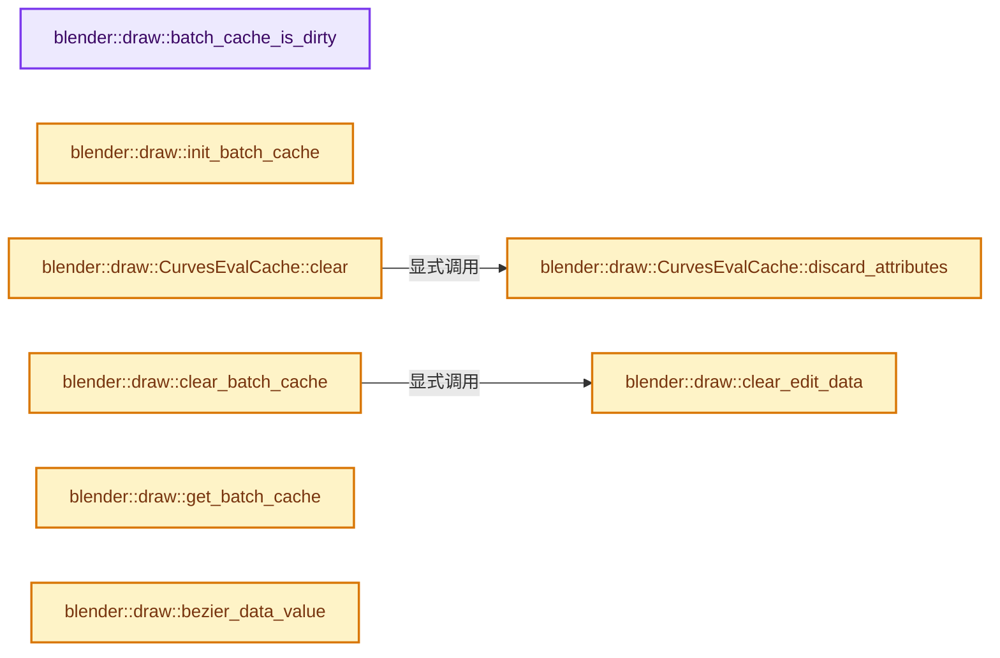
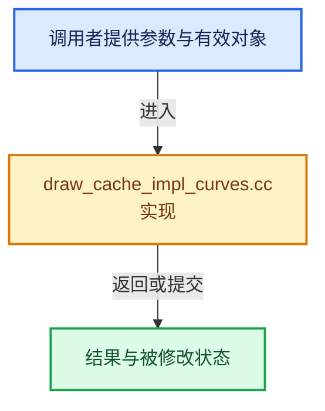

# 实现依赖专题：source/blender/draw/intern/draw_cache_impl_curves.cc

[方向导航](README.md) · [符号索引](../%E7%AC%A6%E5%8F%B7%E4%BE%9D%E8%B5%96%E4%B8%8E%E5%AE%9E%E7%8E%B0%E7%B4%A2%E5%BC%95.md)

本专题从正文实际调用进入，集中保存共享实现。函数有稳定锚点，可从调用处直接跳到对应完整函数；递归与互相调用通过回链组织。

## 本文件的实现关系






## 完整成员与函数实现

<a id="f-e0053698af261f46"></a>

### `blender::draw::batch_cache_is_dirty`

实现位置：[source/blender/draw/intern/draw_cache_impl_curves.cc](../../../../../source/blender/draw/intern/draw_cache_impl_curves.cc) · L102—L106。

接口参数：

- `const Curves &curves`

**教学注释版**

<!-- annotated:dd02f1cfef2244 -->

```cpp
static bool batch_cache_is_dirty(const Curves &curves)
{
  const CurvesBatchCache *cache = curves.batch_cache;
  return (cache && cache->is_dirty == false);
}
```

<details>
<summary>核对原始源码：source/blender/draw/intern/draw_cache_impl_curves.cc · L102—L106</summary>

<!-- original:dd02f1cfef2244:source/blender/draw/intern/draw_cache_impl_curves.cc:102:106 -->

```cpp
static bool batch_cache_is_dirty(const Curves &curves)
{
  const CurvesBatchCache *cache = curves.batch_cache;
  return (cache && cache->is_dirty == false);
}
```

</details>

**结果出口**

- `return (cache && cache->is_dirty == false);`

**继续追踪实现**

本实现没有需要继续展开的显式调用；检查返回表达式、对象转换和调用者前置条件。

<a id="f-1cc16636b7eef52d"></a>

### `blender::draw::init_batch_cache`

实现位置：[source/blender/draw/intern/draw_cache_impl_curves.cc](../../../../../source/blender/draw/intern/draw_cache_impl_curves.cc) · L108—L121。

接口参数：

- `Curves &curves`

**教学注释版**

<!-- annotated:73509e4a825986 -->

```cpp
static void init_batch_cache(Curves &curves)
{
  CurvesBatchCache *cache = curves.batch_cache;

  if (!cache) {
    cache = MEM_new<CurvesBatchCache>(__func__);
    curves.batch_cache = cache;
  }
  else {
    cache->eval_cache = {};
  }

  cache->is_dirty = false;
}
```

<details>
<summary>核对原始源码：source/blender/draw/intern/draw_cache_impl_curves.cc · L108—L121</summary>

<!-- original:73509e4a825986:source/blender/draw/intern/draw_cache_impl_curves.cc:108:121 -->

```cpp
static void init_batch_cache(Curves &curves)
{
  CurvesBatchCache *cache = curves.batch_cache;

  if (!cache) {
    cache = MEM_new<CurvesBatchCache>(__func__);
    curves.batch_cache = cache;
  }
  else {
    cache->eval_cache = {};
  }

  cache->is_dirty = false;
}
```

</details>

**沿实际写入检查状态**

- `cache = MEM_new<CurvesBatchCache>(__func__);`
- `curves.batch_cache = cache;`
- `cache->eval_cache = {};`
- `cache->is_dirty = false;`

**继续追踪实现**

- `MEM_new<CurvesBatchCache>` → [MEM_new · L351](../03-%E5%86%85%E5%AD%98%E5%88%86%E9%85%8D%E4%B8%8E%E8%BF%90%E8%A1%8C%E6%97%B6%E7%B1%BB%E5%9E%8B/%E4%BE%9D%E8%B5%96-MEM_guardedalloc-b54eca.md#f-115f9b6784f89912)。

<a id="f-b9d8426a3b67d380"></a>

### `blender::draw::clear_edit_data`

实现位置：[source/blender/draw/intern/draw_cache_impl_curves.cc](../../../../../source/blender/draw/intern/draw_cache_impl_curves.cc) · L123—L141。

接口参数：

- `CurvesBatchCache *cache`

**教学注释版**

<!-- annotated:44fe8fb2175954 -->

```cpp
static void clear_edit_data(CurvesBatchCache *cache)
{
  /* TODO: more granular update tagging. */
  GPU_VERTBUF_DISCARD_SAFE(cache->edit_points_pos);
  GPU_VERTBUF_DISCARD_SAFE(cache->edit_points_rad);
  GPU_VERTBUF_DISCARD_SAFE(cache->edit_points_data);
  GPU_VERTBUF_DISCARD_SAFE(cache->edit_points_selection);
  GPU_INDEXBUF_DISCARD_SAFE(cache->edit_handles_ibo);

  GPU_BATCH_DISCARD_SAFE(cache->edit_points);
  GPU_BATCH_DISCARD_SAFE(cache->edit_handles);

  GPU_INDEXBUF_DISCARD_SAFE(cache->sculpt_cage_ibo);
  GPU_BATCH_DISCARD_SAFE(cache->sculpt_cage);

  GPU_VERTBUF_DISCARD_SAFE(cache->edit_curves_lines_pos);
  GPU_INDEXBUF_DISCARD_SAFE(cache->edit_curves_lines_ibo);
  GPU_BATCH_DISCARD_SAFE(cache->edit_curves_lines);
}
```

<details>
<summary>核对原始源码：source/blender/draw/intern/draw_cache_impl_curves.cc · L123—L141</summary>

<!-- original:44fe8fb2175954:source/blender/draw/intern/draw_cache_impl_curves.cc:123:141 -->

```cpp
static void clear_edit_data(CurvesBatchCache *cache)
{
  /* TODO: more granular update tagging. */
  GPU_VERTBUF_DISCARD_SAFE(cache->edit_points_pos);
  GPU_VERTBUF_DISCARD_SAFE(cache->edit_points_rad);
  GPU_VERTBUF_DISCARD_SAFE(cache->edit_points_data);
  GPU_VERTBUF_DISCARD_SAFE(cache->edit_points_selection);
  GPU_INDEXBUF_DISCARD_SAFE(cache->edit_handles_ibo);

  GPU_BATCH_DISCARD_SAFE(cache->edit_points);
  GPU_BATCH_DISCARD_SAFE(cache->edit_handles);

  GPU_INDEXBUF_DISCARD_SAFE(cache->sculpt_cage_ibo);
  GPU_BATCH_DISCARD_SAFE(cache->sculpt_cage);

  GPU_VERTBUF_DISCARD_SAFE(cache->edit_curves_lines_pos);
  GPU_INDEXBUF_DISCARD_SAFE(cache->edit_curves_lines_ibo);
  GPU_BATCH_DISCARD_SAFE(cache->edit_curves_lines);
}
```

</details>

**继续追踪实现**

- `GPU_VERTBUF_DISCARD_SAFE` → [GPU_VERTBUF_DISCARD_SAFE · L372](%E4%BE%9D%E8%B5%96-GPU_vertex_buffer-d7610b.md#m-6427e4c6901c)。宏定义由构建条件选择。
- `GPU_INDEXBUF_DISCARD_SAFE` → [GPU_INDEXBUF_DISCARD_SAFE · L299](%E4%BE%9D%E8%B5%96-GPU_index_buffer-093835.md#m-f3c9c7333ad4)。宏定义由构建条件选择。
- `GPU_BATCH_DISCARD_SAFE` → [GPU_BATCH_DISCARD_SAFE · L199](%E4%BE%9D%E8%B5%96-GPU_batch-98c422.md#m-167d477926a1)。宏定义由构建条件选择。

<a id="f-51b0904db43fd4d8"></a>

### `blender::draw::CurvesEvalCache::discard_attributes`

实现位置：[source/blender/draw/intern/draw_cache_impl_curves.cc](../../../../../source/blender/draw/intern/draw_cache_impl_curves.cc) · L143—L152。

**教学注释版**

<!-- annotated:d8ee1269dcbb11 -->

```cpp
void CurvesEvalCache::discard_attributes()
{
  for (const int i : IndexRange(GPU_MAX_ATTR)) {
    this->evaluated_attributes_buf[i].reset();
  }
  for (const int i : IndexRange(GPU_MAX_ATTR)) {
    this->curve_attributes_buf[i].reset();
  }
  this->attr_used.clear();
}
```

<details>
<summary>核对原始源码：source/blender/draw/intern/draw_cache_impl_curves.cc · L143—L152</summary>

<!-- original:d8ee1269dcbb11:source/blender/draw/intern/draw_cache_impl_curves.cc:143:152 -->

```cpp
void CurvesEvalCache::discard_attributes()
{
  for (const int i : IndexRange(GPU_MAX_ATTR)) {
    this->evaluated_attributes_buf[i].reset();
  }
  for (const int i : IndexRange(GPU_MAX_ATTR)) {
    this->curve_attributes_buf[i].reset();
  }
  this->attr_used.clear();
}
```

</details>

**继续追踪实现**

- `IndexRange` → [blender::IndexRange](../01-%E5%9F%BA%E7%A1%80%E5%AE%B9%E5%99%A8%E4%B8%8E%E7%8E%B0%E4%BB%A3CPP/%E4%BE%9D%E8%B5%96-BLI_index_range-7d7cc5.md#t-caa3466d6776)；[blender::gpu::shader::parser::IndexRange](%E4%BE%9D%E8%B5%96-utils-06433d.md#t-82d2bd4ea71c)；[blender::IndexRange](%E4%BE%9D%E8%B5%96-DNA_node_types-6708b9.md#t-0448cc889d39)。
- `this->evaluated_attributes_buf[i].reset` → [调用协议](../%E6%A8%A1%E6%9D%BF%E5%AE%8F%E4%B8%8E%E5%8A%A8%E6%80%81%E5%88%86%E6%B4%BE%E5%8D%8F%E8%AE%AE.md)：接收对象类型依赖auto、返回值或模板实例；不按同名猜测目标。调用位置L146。
- `this->curve_attributes_buf[i].reset` → [调用协议](../%E6%A8%A1%E6%9D%BF%E5%AE%8F%E4%B8%8E%E5%8A%A8%E6%80%81%E5%88%86%E6%B4%BE%E5%8D%8F%E8%AE%AE.md)：接收对象类型依赖auto、返回值或模板实例；不按同名猜测目标。调用位置L149。
- `this->attr_used.clear` → [调用协议](../%E6%A8%A1%E6%9D%BF%E5%AE%8F%E4%B8%8E%E5%8A%A8%E6%80%81%E5%88%86%E6%B4%BE%E5%8D%8F%E8%AE%AE.md)：接收对象类型依赖auto、返回值或模板实例；不按同名猜测目标。调用位置L151。

<a id="f-c0ee2bcacbd8a97e"></a>

### `blender::draw::CurvesEvalCache::clear`

实现位置：[source/blender/draw/intern/draw_cache_impl_curves.cc](../../../../../source/blender/draw/intern/draw_cache_impl_curves.cc) · L154—L184。

**教学注释版**

<!-- annotated:1831b313cfb4e1 -->

```cpp
void CurvesEvalCache::clear()
{
  /* TODO: more granular update tagging. */
  this->evaluated_pos_rad_buf.reset();
  this->evaluated_time_buf.reset();
  this->curves_length_buf.reset();

  this->points_by_curve_buf.reset();
  this->evaluated_points_by_curve_buf.reset();
  this->curves_type_buf.reset();
  this->curves_resolution_buf.reset();
  this->curves_cyclic_buf.reset();

  this->handles_positions_left_buf.reset();
  this->handles_positions_right_buf.reset();
  this->bezier_offsets_buf.reset();

  this->curves_order_buf.reset();
  this->control_weights_buf.reset();
  this->basis_cache_buf.reset();
  this->basis_cache_offset_buf.reset();

  this->indirection_cylinder_buf.reset();
  this->indirection_ribbon_buf.reset();

  for (gpu::Batch *&batch : this->batch) {
    GPU_BATCH_DISCARD_SAFE(batch);
  }

  this->discard_attributes();
}
```

<details>
<summary>核对原始源码：source/blender/draw/intern/draw_cache_impl_curves.cc · L154—L184</summary>

<!-- original:1831b313cfb4e1:source/blender/draw/intern/draw_cache_impl_curves.cc:154:184 -->

```cpp
void CurvesEvalCache::clear()
{
  /* TODO: more granular update tagging. */
  this->evaluated_pos_rad_buf.reset();
  this->evaluated_time_buf.reset();
  this->curves_length_buf.reset();

  this->points_by_curve_buf.reset();
  this->evaluated_points_by_curve_buf.reset();
  this->curves_type_buf.reset();
  this->curves_resolution_buf.reset();
  this->curves_cyclic_buf.reset();

  this->handles_positions_left_buf.reset();
  this->handles_positions_right_buf.reset();
  this->bezier_offsets_buf.reset();

  this->curves_order_buf.reset();
  this->control_weights_buf.reset();
  this->basis_cache_buf.reset();
  this->basis_cache_offset_buf.reset();

  this->indirection_cylinder_buf.reset();
  this->indirection_ribbon_buf.reset();

  for (gpu::Batch *&batch : this->batch) {
    GPU_BATCH_DISCARD_SAFE(batch);
  }

  this->discard_attributes();
}
```

</details>

**继续追踪实现**

- `this->evaluated_pos_rad_buf.reset` → [调用协议](../%E6%A8%A1%E6%9D%BF%E5%AE%8F%E4%B8%8E%E5%8A%A8%E6%80%81%E5%88%86%E6%B4%BE%E5%8D%8F%E8%AE%AE.md)：接收对象类型依赖auto、返回值或模板实例；不按同名猜测目标。调用位置L157。
- `this->evaluated_time_buf.reset` → [调用协议](../%E6%A8%A1%E6%9D%BF%E5%AE%8F%E4%B8%8E%E5%8A%A8%E6%80%81%E5%88%86%E6%B4%BE%E5%8D%8F%E8%AE%AE.md)：接收对象类型依赖auto、返回值或模板实例；不按同名猜测目标。调用位置L158。
- `this->curves_length_buf.reset` → [调用协议](../%E6%A8%A1%E6%9D%BF%E5%AE%8F%E4%B8%8E%E5%8A%A8%E6%80%81%E5%88%86%E6%B4%BE%E5%8D%8F%E8%AE%AE.md)：接收对象类型依赖auto、返回值或模板实例；不按同名猜测目标。调用位置L159。
- `this->points_by_curve_buf.reset` → [调用协议](../%E6%A8%A1%E6%9D%BF%E5%AE%8F%E4%B8%8E%E5%8A%A8%E6%80%81%E5%88%86%E6%B4%BE%E5%8D%8F%E8%AE%AE.md)：接收对象类型依赖auto、返回值或模板实例；不按同名猜测目标。调用位置L161。
- `this->evaluated_points_by_curve_buf.reset` → [调用协议](../%E6%A8%A1%E6%9D%BF%E5%AE%8F%E4%B8%8E%E5%8A%A8%E6%80%81%E5%88%86%E6%B4%BE%E5%8D%8F%E8%AE%AE.md)：接收对象类型依赖auto、返回值或模板实例；不按同名猜测目标。调用位置L162。
- `this->curves_type_buf.reset` → [调用协议](../%E6%A8%A1%E6%9D%BF%E5%AE%8F%E4%B8%8E%E5%8A%A8%E6%80%81%E5%88%86%E6%B4%BE%E5%8D%8F%E8%AE%AE.md)：接收对象类型依赖auto、返回值或模板实例；不按同名猜测目标。调用位置L163。
- `this->curves_resolution_buf.reset` → [调用协议](../%E6%A8%A1%E6%9D%BF%E5%AE%8F%E4%B8%8E%E5%8A%A8%E6%80%81%E5%88%86%E6%B4%BE%E5%8D%8F%E8%AE%AE.md)：接收对象类型依赖auto、返回值或模板实例；不按同名猜测目标。调用位置L164。
- `this->curves_cyclic_buf.reset` → [调用协议](../%E6%A8%A1%E6%9D%BF%E5%AE%8F%E4%B8%8E%E5%8A%A8%E6%80%81%E5%88%86%E6%B4%BE%E5%8D%8F%E8%AE%AE.md)：接收对象类型依赖auto、返回值或模板实例；不按同名猜测目标。调用位置L165。
- `this->handles_positions_left_buf.reset` → [调用协议](../%E6%A8%A1%E6%9D%BF%E5%AE%8F%E4%B8%8E%E5%8A%A8%E6%80%81%E5%88%86%E6%B4%BE%E5%8D%8F%E8%AE%AE.md)：接收对象类型依赖auto、返回值或模板实例；不按同名猜测目标。调用位置L167。
- `this->handles_positions_right_buf.reset` → [调用协议](../%E6%A8%A1%E6%9D%BF%E5%AE%8F%E4%B8%8E%E5%8A%A8%E6%80%81%E5%88%86%E6%B4%BE%E5%8D%8F%E8%AE%AE.md)：接收对象类型依赖auto、返回值或模板实例；不按同名猜测目标。调用位置L168。
- `this->bezier_offsets_buf.reset` → [调用协议](../%E6%A8%A1%E6%9D%BF%E5%AE%8F%E4%B8%8E%E5%8A%A8%E6%80%81%E5%88%86%E6%B4%BE%E5%8D%8F%E8%AE%AE.md)：接收对象类型依赖auto、返回值或模板实例；不按同名猜测目标。调用位置L169。
- `this->curves_order_buf.reset` → [调用协议](../%E6%A8%A1%E6%9D%BF%E5%AE%8F%E4%B8%8E%E5%8A%A8%E6%80%81%E5%88%86%E6%B4%BE%E5%8D%8F%E8%AE%AE.md)：接收对象类型依赖auto、返回值或模板实例；不按同名猜测目标。调用位置L171。
- `this->control_weights_buf.reset` → [调用协议](../%E6%A8%A1%E6%9D%BF%E5%AE%8F%E4%B8%8E%E5%8A%A8%E6%80%81%E5%88%86%E6%B4%BE%E5%8D%8F%E8%AE%AE.md)：接收对象类型依赖auto、返回值或模板实例；不按同名猜测目标。调用位置L172。
- `this->basis_cache_buf.reset` → [调用协议](../%E6%A8%A1%E6%9D%BF%E5%AE%8F%E4%B8%8E%E5%8A%A8%E6%80%81%E5%88%86%E6%B4%BE%E5%8D%8F%E8%AE%AE.md)：接收对象类型依赖auto、返回值或模板实例；不按同名猜测目标。调用位置L173。
- `this->basis_cache_offset_buf.reset` → [调用协议](../%E6%A8%A1%E6%9D%BF%E5%AE%8F%E4%B8%8E%E5%8A%A8%E6%80%81%E5%88%86%E6%B4%BE%E5%8D%8F%E8%AE%AE.md)：接收对象类型依赖auto、返回值或模板实例；不按同名猜测目标。调用位置L174。
- `this->indirection_cylinder_buf.reset` → [调用协议](../%E6%A8%A1%E6%9D%BF%E5%AE%8F%E4%B8%8E%E5%8A%A8%E6%80%81%E5%88%86%E6%B4%BE%E5%8D%8F%E8%AE%AE.md)：接收对象类型依赖auto、返回值或模板实例；不按同名猜测目标。调用位置L176。
- `this->indirection_ribbon_buf.reset` → [调用协议](../%E6%A8%A1%E6%9D%BF%E5%AE%8F%E4%B8%8E%E5%8A%A8%E6%80%81%E5%88%86%E6%B4%BE%E5%8D%8F%E8%AE%AE.md)：接收对象类型依赖auto、返回值或模板实例；不按同名猜测目标。调用位置L177。
- `GPU_BATCH_DISCARD_SAFE` → [GPU_BATCH_DISCARD_SAFE · L199](%E4%BE%9D%E8%B5%96-GPU_batch-98c422.md#m-167d477926a1)。宏定义由构建条件选择。
- `this->discard_attributes` → [blender::draw::CurvesEvalCache::discard_attributes · L143](%E4%BE%9D%E8%B5%96-draw_cache_impl_curves-1de700.md#f-51b0904db43fd4d8)。

<a id="f-f0c91d79036f5f10"></a>

### `blender::draw::clear_batch_cache`

实现位置：[source/blender/draw/intern/draw_cache_impl_curves.cc](../../../../../source/blender/draw/intern/draw_cache_impl_curves.cc) · L186—L195。

接口参数：

- `Curves &curves`

**教学注释版**

<!-- annotated:4e0fd1c024c26b -->

```cpp
static void clear_batch_cache(Curves &curves)
{
  CurvesBatchCache *cache = curves.batch_cache;
  if (!cache) {
    return;
  }

  cache->eval_cache.clear();
  clear_edit_data(cache);
}
```

<details>
<summary>核对原始源码：source/blender/draw/intern/draw_cache_impl_curves.cc · L186—L195</summary>

<!-- original:4e0fd1c024c26b:source/blender/draw/intern/draw_cache_impl_curves.cc:186:195 -->

```cpp
static void clear_batch_cache(Curves &curves)
{
  CurvesBatchCache *cache = curves.batch_cache;
  if (!cache) {
    return;
  }

  cache->eval_cache.clear();
  clear_edit_data(cache);
}
```

</details>

**继续追踪实现**

- `cache->eval_cache.clear` → [调用协议](../%E6%A8%A1%E6%9D%BF%E5%AE%8F%E4%B8%8E%E5%8A%A8%E6%80%81%E5%88%86%E6%B4%BE%E5%8D%8F%E8%AE%AE.md)：接收对象类型依赖auto、返回值或模板实例；不按同名猜测目标。调用位置L193。
- `clear_edit_data` → [blender::draw::clear_edit_data · L123](%E4%BE%9D%E8%B5%96-draw_cache_impl_curves-1de700.md#f-b9d8426a3b67d380)。

<a id="f-34968a262468eb3c"></a>

### `blender::draw::get_batch_cache`

实现位置：[source/blender/draw/intern/draw_cache_impl_curves.cc](../../../../../source/blender/draw/intern/draw_cache_impl_curves.cc) · L197—L201。

接口参数：

- `Curves &curves`

**教学注释版**

<!-- annotated:cb9e3934193b68 -->

```cpp
static CurvesBatchCache &get_batch_cache(Curves &curves)
{
  DRW_curves_batch_cache_validate(&curves);
  return *curves.batch_cache;
}
```

<details>
<summary>核对原始源码：source/blender/draw/intern/draw_cache_impl_curves.cc · L197—L201</summary>

<!-- original:cb9e3934193b68:source/blender/draw/intern/draw_cache_impl_curves.cc:197:201 -->

```cpp
static CurvesBatchCache &get_batch_cache(Curves &curves)
{
  DRW_curves_batch_cache_validate(&curves);
  return *curves.batch_cache;
}
```

</details>

**结果出口**

- `return *curves.batch_cache;`

**继续追踪实现**

- `DRW_curves_batch_cache_validate` → [blender::draw::DRW_curves_batch_cache_validate · L965](%E4%BE%9D%E8%B5%96-draw_cache_impl_curves-1de700.md#f-7547ef50cea9e650)。

<a id="f-17dafb1155d74a6e"></a>

### `blender::draw::bezier_data_value`

实现位置：[source/blender/draw/intern/draw_cache_impl_curves.cc](../../../../../source/blender/draw/intern/draw_cache_impl_curves.cc) · L203—L207。

接口参数：

- `int8_t handle_type`
- `bool is_active`

**教学注释版**

<!-- annotated:1a4ac24781c493 -->

```cpp
static uint32_t bezier_data_value(int8_t handle_type, bool is_active)
{
  return (handle_type << EDIT_CURVES_HANDLE_TYPES_SHIFT) | EDIT_CURVES_BEZIER_HANDLE |
         (is_active ? EDIT_CURVES_ACTIVE_HANDLE : 0);
}
```

<details>
<summary>核对原始源码：source/blender/draw/intern/draw_cache_impl_curves.cc · L203—L207</summary>

<!-- original:1a4ac24781c493:source/blender/draw/intern/draw_cache_impl_curves.cc:203:207 -->

```cpp
static uint32_t bezier_data_value(int8_t handle_type, bool is_active)
{
  return (handle_type << EDIT_CURVES_HANDLE_TYPES_SHIFT) | EDIT_CURVES_BEZIER_HANDLE |
         (is_active ? EDIT_CURVES_ACTIVE_HANDLE : 0);
}
```

</details>

**结果出口**

- `return (handle_type << EDIT_CURVES_HANDLE_TYPES_SHIFT) | EDIT_CURVES_BEZIER_HANDLE |`

**继续追踪实现**

本实现没有需要继续展开的显式调用；检查返回表达式、对象转换和调用者前置条件。

<a id="f-14f91a1b37bcd485"></a>

### `blender::draw::handles_and_points_num`

实现位置：[source/blender/draw/intern/draw_cache_impl_curves.cc](../../../../../source/blender/draw/intern/draw_cache_impl_curves.cc) · L209—L212。

接口参数：

- `const int points_num`
- `const OffsetIndices<int> bezier_offsets`

**教学注释版**

<!-- annotated:ce555f2b19927c -->

```cpp
static int handles_and_points_num(const int points_num, const OffsetIndices<int> bezier_offsets)
{
  return points_num + bezier_offsets.total_size() * 2;
}
```

<details>
<summary>核对原始源码：source/blender/draw/intern/draw_cache_impl_curves.cc · L209—L212</summary>

<!-- original:ce555f2b19927c:source/blender/draw/intern/draw_cache_impl_curves.cc:209:212 -->

```cpp
static int handles_and_points_num(const int points_num, const OffsetIndices<int> bezier_offsets)
{
  return points_num + bezier_offsets.total_size() * 2;
}
```

</details>

**结果出口**

- `return points_num + bezier_offsets.total_size() * 2;`

**继续追踪实现**

- `bezier_offsets.total_size` → [blender::offset_indices::OffsetIndices::total_size · L58](02-OffsetIndices%E5%AE%8C%E6%95%B4%E6%8E%A5%E5%8F%A3.md#f-c111ffdac7a19248)。

<a id="f-6ca6f3f6f927472b"></a>

### `blender::draw::handle_range_left`

实现位置：[source/blender/draw/intern/draw_cache_impl_curves.cc](../../../../../source/blender/draw/intern/draw_cache_impl_curves.cc) · L214—L217。

接口参数：

- `const int points_num`
- `const OffsetIndices<int> bezier_offsets`

**教学注释版**

<!-- annotated:6f73f8bdbb667d -->

```cpp
static IndexRange handle_range_left(const int points_num, const OffsetIndices<int> bezier_offsets)
{
  return IndexRange(points_num, bezier_offsets.total_size());
}
```

<details>
<summary>核对原始源码：source/blender/draw/intern/draw_cache_impl_curves.cc · L214—L217</summary>

<!-- original:6f73f8bdbb667d:source/blender/draw/intern/draw_cache_impl_curves.cc:214:217 -->

```cpp
static IndexRange handle_range_left(const int points_num, const OffsetIndices<int> bezier_offsets)
{
  return IndexRange(points_num, bezier_offsets.total_size());
}
```

</details>

**结果出口**

- `return IndexRange(points_num, bezier_offsets.total_size());`

**继续追踪实现**

- `IndexRange` → [blender::IndexRange](../01-%E5%9F%BA%E7%A1%80%E5%AE%B9%E5%99%A8%E4%B8%8E%E7%8E%B0%E4%BB%A3CPP/%E4%BE%9D%E8%B5%96-BLI_index_range-7d7cc5.md#t-caa3466d6776)；[blender::gpu::shader::parser::IndexRange](%E4%BE%9D%E8%B5%96-utils-06433d.md#t-82d2bd4ea71c)；[blender::IndexRange](%E4%BE%9D%E8%B5%96-DNA_node_types-6708b9.md#t-0448cc889d39)。
- `bezier_offsets.total_size` → [blender::offset_indices::OffsetIndices::total_size · L58](02-OffsetIndices%E5%AE%8C%E6%95%B4%E6%8E%A5%E5%8F%A3.md#f-c111ffdac7a19248)。

<a id="f-130dc20daf506856"></a>

### `blender::draw::handle_range_right`

实现位置：[source/blender/draw/intern/draw_cache_impl_curves.cc](../../../../../source/blender/draw/intern/draw_cache_impl_curves.cc) · L219—L222。

接口参数：

- `const int points_num`
- `const OffsetIndices<int> bezier_offsets`

**教学注释版**

<!-- annotated:2c6434f34611c4 -->

```cpp
static IndexRange handle_range_right(const int points_num, const OffsetIndices<int> bezier_offsets)
{
  return IndexRange(points_num + bezier_offsets.total_size(), bezier_offsets.total_size());
}
```

<details>
<summary>核对原始源码：source/blender/draw/intern/draw_cache_impl_curves.cc · L219—L222</summary>

<!-- original:2c6434f34611c4:source/blender/draw/intern/draw_cache_impl_curves.cc:219:222 -->

```cpp
static IndexRange handle_range_right(const int points_num, const OffsetIndices<int> bezier_offsets)
{
  return IndexRange(points_num + bezier_offsets.total_size(), bezier_offsets.total_size());
}
```

</details>

**结果出口**

- `return IndexRange(points_num + bezier_offsets.total_size(), bezier_offsets.total_size());`

**继续追踪实现**

- `IndexRange` → [blender::IndexRange](../01-%E5%9F%BA%E7%A1%80%E5%AE%B9%E5%99%A8%E4%B8%8E%E7%8E%B0%E4%BB%A3CPP/%E4%BE%9D%E8%B5%96-BLI_index_range-7d7cc5.md#t-caa3466d6776)；[blender::gpu::shader::parser::IndexRange](%E4%BE%9D%E8%B5%96-utils-06433d.md#t-82d2bd4ea71c)；[blender::IndexRange](%E4%BE%9D%E8%B5%96-DNA_node_types-6708b9.md#t-0448cc889d39)。
- `bezier_offsets.total_size` → [blender::offset_indices::OffsetIndices::total_size · L58](02-OffsetIndices%E5%AE%8C%E6%95%B4%E6%8E%A5%E5%8F%A3.md#f-c111ffdac7a19248)。

<a id="f-2c9c476775d40d68"></a>

### `blender::draw::extract_edit_data`

实现位置：[source/blender/draw/intern/draw_cache_impl_curves.cc](../../../../../source/blender/draw/intern/draw_cache_impl_curves.cc) · L224—L242。

接口参数：

- `const OffsetIndices<int> points_by_curve`
- `const IndexMask &curve_selection`
- `const VArray<bool> &selection_attr`
- `const bool mark_active`
- `const uint32_t fill_value`
- `MutableSpan<uint32_t> data`

**教学注释版**

<!-- annotated:9f426b4e5d5919 -->

```cpp
static void extract_edit_data(const OffsetIndices<int> points_by_curve,
                              const IndexMask &curve_selection,
                              const VArray<bool> &selection_attr,
                              const bool mark_active,
                              const uint32_t fill_value,
                              MutableSpan<uint32_t> data)
{
  curve_selection.foreach_index(
      [&](const int curve) {
        const IndexRange points = points_by_curve[curve];
        bool is_active = false;
        if (mark_active) {
          is_active = array_utils::count_booleans(selection_attr, points) > 0;
        }
        uint32_t data_value = fill_value | (is_active ? EDIT_CURVES_ACTIVE_HANDLE : 0u);
        // [讲解] data.slice：建立原连续范围的子视图。
        data.slice(points).fill(data_value);
      },
      exec_mode::grain_size(256));
}
```

<details>
<summary>核对原始源码：source/blender/draw/intern/draw_cache_impl_curves.cc · L224—L242</summary>

<!-- original:9f426b4e5d5919:source/blender/draw/intern/draw_cache_impl_curves.cc:224:242 -->

```cpp
static void extract_edit_data(const OffsetIndices<int> points_by_curve,
                              const IndexMask &curve_selection,
                              const VArray<bool> &selection_attr,
                              const bool mark_active,
                              const uint32_t fill_value,
                              MutableSpan<uint32_t> data)
{
  curve_selection.foreach_index(
      [&](const int curve) {
        const IndexRange points = points_by_curve[curve];
        bool is_active = false;
        if (mark_active) {
          is_active = array_utils::count_booleans(selection_attr, points) > 0;
        }
        uint32_t data_value = fill_value | (is_active ? EDIT_CURVES_ACTIVE_HANDLE : 0u);
        data.slice(points).fill(data_value);
      },
      exec_mode::grain_size(256));
}
```

</details>

**沿实际写入检查状态**

- `is_active = array_utils::count_booleans(selection_attr, points) > 0;`

**继续追踪实现**

- `curve_selection.foreach_index` → [blender::index_mask::IndexMask::foreach_index · L855](../04-%E8%99%9A%E6%8B%9F%E6%95%B0%E7%BB%84%E4%B8%8E%E7%B4%A2%E5%BC%95%E9%80%89%E6%8B%A9/09-%E5%88%86%E6%AE%B5%E5%AD%98%E5%82%A8%E4%B8%8E%E9%81%8D%E5%8E%86.md#f-cd6cd317e2e2812c)。
- `array_utils::count_booleans` → [blender::array_utils::count_booleans · L345](../01-%E5%9F%BA%E7%A1%80%E5%AE%B9%E5%99%A8%E4%B8%8E%E7%8E%B0%E4%BB%A3CPP/%E4%BE%9D%E8%B5%96-array_utils-cbb70f.md#f-1640c4115bd9bbf5)；[blender::array_utils::count_booleans · L477](../01-%E5%9F%BA%E7%A1%80%E5%AE%B9%E5%99%A8%E4%B8%8E%E7%8E%B0%E4%BB%A3CPP/%E4%BE%9D%E8%B5%96-array_utils-cbb70f.md#f-25e7ff6bc3c5eedf)。同名重载需按实参类型选择。
- `data.slice(points).fill` → [调用协议](../%E6%A8%A1%E6%9D%BF%E5%AE%8F%E4%B8%8E%E5%8A%A8%E6%80%81%E5%88%86%E6%B4%BE%E5%8D%8F%E8%AE%AE.md)：接收对象类型依赖auto、返回值或模板实例；不按同名猜测目标。调用位置L239。
- `data.slice` → [blender::MutableSpan::slice · L579](../01-%E5%9F%BA%E7%A1%80%E5%AE%B9%E5%99%A8%E4%B8%8E%E7%8E%B0%E4%BB%A3CPP/06-MutableSpan%E5%8F%AF%E5%86%99%E8%A7%86%E5%9B%BE.md#f-6808b4aefbf58808)；[blender::MutableSpan::slice · L587](../01-%E5%9F%BA%E7%A1%80%E5%AE%B9%E5%99%A8%E4%B8%8E%E7%8E%B0%E4%BB%A3CPP/06-MutableSpan%E5%8F%AF%E5%86%99%E8%A7%86%E5%9B%BE.md#f-c05b010821861e4f)。同名重载需按实参类型选择。
- `exec_mode::grain_size` → [blender::exec_mode::grain_size · L79](../01-%E5%9F%BA%E7%A1%80%E5%AE%B9%E5%99%A8%E4%B8%8E%E7%8E%B0%E4%BB%A3CPP/%E4%BE%9D%E8%B5%96-BLI_execution_mode-1528fb.md#f-0b4fc2f9fa6e66e7)。

<a id="f-e9d782bf486a8356"></a>

### `blender::draw::create_edit_points_data`

实现位置：[source/blender/draw/intern/draw_cache_impl_curves.cc](../../../../../source/blender/draw/intern/draw_cache_impl_curves.cc) · L244—L299。

接口参数：

- `const OffsetIndices<int> points_by_curve`
- `const IndexMask &catmull_rom_curves`
- `const IndexMask &poly_curves`
- `const IndexMask &bezier_curves`
- `const IndexMask &nurbs_curves`
- `const OffsetIndices<int> bezier_offsets`
- `const bke::CurvesGeometry &curves`
- `gpu::VertBuf &vbo`

**教学注释版**

<!-- annotated:04cc78153b34cf -->

```cpp
static void create_edit_points_data(const OffsetIndices<int> points_by_curve,
                                    const IndexMask &catmull_rom_curves,
                                    const IndexMask &poly_curves,
                                    const IndexMask &bezier_curves,
                                    const IndexMask &nurbs_curves,
                                    const OffsetIndices<int> bezier_offsets,
                                    const bke::CurvesGeometry &curves,
                                    gpu::VertBuf &vbo)
{
  const int points_num = points_by_curve.total_size();
  const bke::AttributeAccessor attributes = curves.attributes();
  const VArray selection = *attributes.lookup_or_default<bool>(
      ".selection", bke::AttrDomain::Point, true);

  static const GPUVertFormat format = GPU_vertformat_from_attribute("data",
                                                                    gpu::VertAttrType::UINT_32);
  GPU_vertbuf_init_with_format(vbo, format);
  GPU_vertbuf_data_alloc(vbo, handles_and_points_num(points_num, bezier_offsets));
  MutableSpan<uint32_t> data = vbo.data<uint32_t>();

  extract_edit_data(points_by_curve, catmull_rom_curves, selection, false, 0, data);

  extract_edit_data(points_by_curve, poly_curves, selection, false, 0, data);

  if (!bezier_curves.is_empty()) {
    const VArray<int8_t> type_right = curves.handle_types_left();
    const VArray<int8_t> types_left = curves.handle_types_right();
    const VArray selection_left = *attributes.lookup_or_default<bool>(
        ".selection_handle_left", bke::AttrDomain::Point, true);
    const VArray selection_right = *attributes.lookup_or_default<bool>(
        ".selection_handle_right", bke::AttrDomain::Point, true);

    // [讲解] data.slice：建立原连续范围的子视图。
    MutableSpan data_left = data.slice(handle_range_left(points_num, bezier_offsets));
    MutableSpan data_right = data.slice(handle_range_right(points_num, bezier_offsets));

    bezier_curves.foreach_index(
        [&](const int curve, const int64_t pos) {
          const IndexRange points = points_by_curve[curve];
          const IndexRange bezier_range = bezier_offsets[pos];
          for (const int i : points.index_range()) {
            const int point = points[i];
            data[point] = EDIT_CURVES_BEZIER_KNOT;

            const bool selected = selection[point] || selection_left[point] ||
                                  selection_right[point];
            const int bezier_point = bezier_range[i];
            data_left[bezier_point] = bezier_data_value(type_right[point], selected);
            data_right[bezier_point] = bezier_data_value(types_left[point], selected);
          }
        },
        exec_mode::grain_size(256));
  }

  extract_edit_data(
      points_by_curve, nurbs_curves, selection, true, EDIT_CURVES_NURBS_CONTROL_POINT, data);
}
```

<details>
<summary>核对原始源码：source/blender/draw/intern/draw_cache_impl_curves.cc · L244—L299</summary>

<!-- original:04cc78153b34cf:source/blender/draw/intern/draw_cache_impl_curves.cc:244:299 -->

```cpp
static void create_edit_points_data(const OffsetIndices<int> points_by_curve,
                                    const IndexMask &catmull_rom_curves,
                                    const IndexMask &poly_curves,
                                    const IndexMask &bezier_curves,
                                    const IndexMask &nurbs_curves,
                                    const OffsetIndices<int> bezier_offsets,
                                    const bke::CurvesGeometry &curves,
                                    gpu::VertBuf &vbo)
{
  const int points_num = points_by_curve.total_size();
  const bke::AttributeAccessor attributes = curves.attributes();
  const VArray selection = *attributes.lookup_or_default<bool>(
      ".selection", bke::AttrDomain::Point, true);

  static const GPUVertFormat format = GPU_vertformat_from_attribute("data",
                                                                    gpu::VertAttrType::UINT_32);
  GPU_vertbuf_init_with_format(vbo, format);
  GPU_vertbuf_data_alloc(vbo, handles_and_points_num(points_num, bezier_offsets));
  MutableSpan<uint32_t> data = vbo.data<uint32_t>();

  extract_edit_data(points_by_curve, catmull_rom_curves, selection, false, 0, data);

  extract_edit_data(points_by_curve, poly_curves, selection, false, 0, data);

  if (!bezier_curves.is_empty()) {
    const VArray<int8_t> type_right = curves.handle_types_left();
    const VArray<int8_t> types_left = curves.handle_types_right();
    const VArray selection_left = *attributes.lookup_or_default<bool>(
        ".selection_handle_left", bke::AttrDomain::Point, true);
    const VArray selection_right = *attributes.lookup_or_default<bool>(
        ".selection_handle_right", bke::AttrDomain::Point, true);

    MutableSpan data_left = data.slice(handle_range_left(points_num, bezier_offsets));
    MutableSpan data_right = data.slice(handle_range_right(points_num, bezier_offsets));

    bezier_curves.foreach_index(
        [&](const int curve, const int64_t pos) {
          const IndexRange points = points_by_curve[curve];
          const IndexRange bezier_range = bezier_offsets[pos];
          for (const int i : points.index_range()) {
            const int point = points[i];
            data[point] = EDIT_CURVES_BEZIER_KNOT;

            const bool selected = selection[point] || selection_left[point] ||
                                  selection_right[point];
            const int bezier_point = bezier_range[i];
            data_left[bezier_point] = bezier_data_value(type_right[point], selected);
            data_right[bezier_point] = bezier_data_value(types_left[point], selected);
          }
        },
        exec_mode::grain_size(256));
  }

  extract_edit_data(
      points_by_curve, nurbs_curves, selection, true, EDIT_CURVES_NURBS_CONTROL_POINT, data);
}
```

</details>

**沿实际写入检查状态**

- `data[point] = EDIT_CURVES_BEZIER_KNOT;`
- `data_left[bezier_point] = bezier_data_value(type_right[point], selected);`
- `data_right[bezier_point] = bezier_data_value(types_left[point], selected);`

**继续追踪实现**

- `points_by_curve.total_size` → [blender::offset_indices::OffsetIndices::total_size · L58](02-OffsetIndices%E5%AE%8C%E6%95%B4%E6%8E%A5%E5%8F%A3.md#f-c111ffdac7a19248)。
- `curves.attributes` → [blender::bke::CurvesGeometry::attributes · L1908](%E4%BE%9D%E8%B5%96-curves_geometry-ad7f9f.md#f-8e24fbf758862a22)。
- `attributes.lookup_or_default<bool>` → [blender::bke::AttributeAccessor::lookup_or_default · L415](%E4%BE%9D%E8%B5%96-attribute_access-bceef3.md#f-a0cc3e316f1da4bd)；[blender::bke::AttributeAccessor::lookup_or_default · L643](08-AttributeAccessor%E6%8E%A5%E5%8F%A3.md#f-e3d2ed81ebe0af61)。同名重载需按实参类型选择。
- `GPU_vertformat_from_attribute` → [blender::GPU_vertformat_from_attribute · L427](%E4%BE%9D%E8%B5%96-gpu_vertex_format-4f7148.md#f-2643d25087989f8e)。
- `GPU_vertbuf_init_with_format` → [GPU_vertbuf_init_with_format · L277](%E4%BE%9D%E8%B5%96-GPU_vertex_buffer-d7610b.md#m-7100390733f1)。宏定义由构建条件选择。
- `GPU_vertbuf_data_alloc` → [blender::GPU_vertbuf_data_alloc · L172](%E4%BE%9D%E8%B5%96-gpu_vertex_buffer-eaa662.md#f-8ee5cf106e0f2b0f)。
- `handles_and_points_num` → [blender::draw::handles_and_points_num · L209](%E4%BE%9D%E8%B5%96-draw_cache_impl_curves-1de700.md#f-14f91a1b37bcd485)。
- `vbo.data<uint32_t>` → [blender::gpu::VertBuf::data · L220](%E4%BE%9D%E8%B5%96-GPU_vertex_buffer-d7610b.md#f-e72412fdddda8bf5)。
- `extract_edit_data` → [blender::draw::extract_edit_data · L224](%E4%BE%9D%E8%B5%96-draw_cache_impl_curves-1de700.md#f-2c9c476775d40d68)。
- `bezier_curves.is_empty` → [blender::index_mask::IndexMask::is_empty · L748](../04-%E8%99%9A%E6%8B%9F%E6%95%B0%E7%BB%84%E4%B8%8E%E7%B4%A2%E5%BC%95%E9%80%89%E6%8B%A9/09-%E5%88%86%E6%AE%B5%E5%AD%98%E5%82%A8%E4%B8%8E%E9%81%8D%E5%8E%86.md#f-190ac996386064f4)。
- `curves.handle_types_left` → [blender::bke::CurvesGeometry::handle_types_left · L406](%E4%BE%9D%E8%B5%96-curves_geometry-ad7f9f.md#f-5fdabc807d199185)。
- `curves.handle_types_right` → [blender::bke::CurvesGeometry::handle_types_right · L423](%E4%BE%9D%E8%B5%96-curves_geometry-ad7f9f.md#f-b61401c7d920d8b5)。
- `data.slice` → [blender::MutableSpan::slice · L579](../01-%E5%9F%BA%E7%A1%80%E5%AE%B9%E5%99%A8%E4%B8%8E%E7%8E%B0%E4%BB%A3CPP/06-MutableSpan%E5%8F%AF%E5%86%99%E8%A7%86%E5%9B%BE.md#f-6808b4aefbf58808)；[blender::MutableSpan::slice · L587](../01-%E5%9F%BA%E7%A1%80%E5%AE%B9%E5%99%A8%E4%B8%8E%E7%8E%B0%E4%BB%A3CPP/06-MutableSpan%E5%8F%AF%E5%86%99%E8%A7%86%E5%9B%BE.md#f-c05b010821861e4f)。同名重载需按实参类型选择。
- `handle_range_left` → [blender::draw::handle_range_left · L214](%E4%BE%9D%E8%B5%96-draw_cache_impl_curves-1de700.md#f-6ca6f3f6f927472b)。
- `handle_range_right` → [blender::draw::handle_range_right · L219](%E4%BE%9D%E8%B5%96-draw_cache_impl_curves-1de700.md#f-130dc20daf506856)。
- `bezier_curves.foreach_index` → [blender::index_mask::IndexMask::foreach_index · L855](../04-%E8%99%9A%E6%8B%9F%E6%95%B0%E7%BB%84%E4%B8%8E%E7%B4%A2%E5%BC%95%E9%80%89%E6%8B%A9/09-%E5%88%86%E6%AE%B5%E5%AD%98%E5%82%A8%E4%B8%8E%E9%81%8D%E5%8E%86.md#f-cd6cd317e2e2812c)。
- `points.index_range` → [blender::IndexRange::index_range · L161](../01-%E5%9F%BA%E7%A1%80%E5%AE%B9%E5%99%A8%E4%B8%8E%E7%8E%B0%E4%BB%A3CPP/04-IndexRange%E8%BF%9E%E7%BB%AD%E6%95%B4%E6%95%B0%E5%8C%BA%E9%97%B4.md#f-fd83072b4b81bce5)。
- `bezier_data_value` → [blender::draw::bezier_data_value · L203](%E4%BE%9D%E8%B5%96-draw_cache_impl_curves-1de700.md#f-17dafb1155d74a6e)。
- `exec_mode::grain_size` → [blender::exec_mode::grain_size · L79](../01-%E5%9F%BA%E7%A1%80%E5%AE%B9%E5%99%A8%E4%B8%8E%E7%8E%B0%E4%BB%A3CPP/%E4%BE%9D%E8%B5%96-BLI_execution_mode-1528fb.md#f-0b4fc2f9fa6e66e7)。

<a id="f-b8b5e6a059bcfcc5"></a>

### `blender::draw::create_edit_points_position`

实现位置：[source/blender/draw/intern/draw_cache_impl_curves.cc](../../../../../source/blender/draw/intern/draw_cache_impl_curves.cc) · L301—L338。

接口参数：

- `const bke::CurvesGeometry &curves`
- `const OffsetIndices<int> points_by_curve`
- `const IndexMask &bezier_curves`
- `const OffsetIndices<int> bezier_offsets`
- `const bke::crazyspace::GeometryDeformation deformation`
- `gpu::VertBuf &vbo`

**教学注释版**

<!-- annotated:0a8323ba196e96 -->

```cpp
static void create_edit_points_position(const bke::CurvesGeometry &curves,
                                        const OffsetIndices<int> points_by_curve,
                                        const IndexMask &bezier_curves,
                                        const OffsetIndices<int> bezier_offsets,
                                        const bke::crazyspace::GeometryDeformation deformation,
                                        gpu::VertBuf &vbo)
{
  const Span<float3> positions = deformation.positions;
  // [讲解] positions.size：查询视图长度或生成对应有效索引区间。
  const int points_num = positions.size();

  static const GPUVertFormat format = GPU_vertformat_from_attribute(
      "pos", gpu::VertAttrType::SFLOAT_32_32_32);
  GPU_vertbuf_init_with_format(vbo, format);
  GPU_vertbuf_data_alloc(vbo, handles_and_points_num(points_num, bezier_offsets));

  MutableSpan<float3> data = vbo.data<float3>();
  // [讲解] data.take_front：从两端裁去或选取一定数量元素形成新视图。
  data.take_front(positions.size()).copy_from(positions);

  if (!bezier_curves.is_empty()) {
    /* TODO: Use deformed left_handle_positions and left_handle_positions. */
    const std::optional<Span<float3>> handles_left = curves.handle_positions_left();
    const std::optional<Span<float3>> handles_right = curves.handle_positions_right();
    if (handles_left && handles_right) {
      array_utils::gather_group_to_group(
          points_by_curve,
          bezier_offsets,
          bezier_curves,
          *handles_left,
          // [讲解] data.slice：建立原连续范围的子视图。
          data.slice(handle_range_left(points_num, bezier_offsets)));
      array_utils::gather_group_to_group(
          points_by_curve,
          bezier_offsets,
          bezier_curves,
          *handles_right,
          data.slice(handle_range_right(points_num, bezier_offsets)));
    }
  }
}
```

<details>
<summary>核对原始源码：source/blender/draw/intern/draw_cache_impl_curves.cc · L301—L338</summary>

<!-- original:0a8323ba196e96:source/blender/draw/intern/draw_cache_impl_curves.cc:301:338 -->

```cpp
static void create_edit_points_position(const bke::CurvesGeometry &curves,
                                        const OffsetIndices<int> points_by_curve,
                                        const IndexMask &bezier_curves,
                                        const OffsetIndices<int> bezier_offsets,
                                        const bke::crazyspace::GeometryDeformation deformation,
                                        gpu::VertBuf &vbo)
{
  const Span<float3> positions = deformation.positions;
  const int points_num = positions.size();

  static const GPUVertFormat format = GPU_vertformat_from_attribute(
      "pos", gpu::VertAttrType::SFLOAT_32_32_32);
  GPU_vertbuf_init_with_format(vbo, format);
  GPU_vertbuf_data_alloc(vbo, handles_and_points_num(points_num, bezier_offsets));

  MutableSpan<float3> data = vbo.data<float3>();
  data.take_front(positions.size()).copy_from(positions);

  if (!bezier_curves.is_empty()) {
    /* TODO: Use deformed left_handle_positions and left_handle_positions. */
    const std::optional<Span<float3>> handles_left = curves.handle_positions_left();
    const std::optional<Span<float3>> handles_right = curves.handle_positions_right();
    if (handles_left && handles_right) {
      array_utils::gather_group_to_group(
          points_by_curve,
          bezier_offsets,
          bezier_curves,
          *handles_left,
          data.slice(handle_range_left(points_num, bezier_offsets)));
      array_utils::gather_group_to_group(
          points_by_curve,
          bezier_offsets,
          bezier_curves,
          *handles_right,
          data.slice(handle_range_right(points_num, bezier_offsets)));
    }
  }
}
```

</details>

**继续追踪实现**

- `positions.size` → [blender::Span::size · L256](../01-%E5%9F%BA%E7%A1%80%E5%AE%B9%E5%99%A8%E4%B8%8E%E7%8E%B0%E4%BB%A3CPP/05-Span%E5%8F%AA%E8%AF%BB%E8%BF%9E%E7%BB%AD%E8%A7%86%E5%9B%BE.md#f-5f80fa006089c998)。
- `GPU_vertformat_from_attribute` → [blender::GPU_vertformat_from_attribute · L427](%E4%BE%9D%E8%B5%96-gpu_vertex_format-4f7148.md#f-2643d25087989f8e)。
- `GPU_vertbuf_init_with_format` → [GPU_vertbuf_init_with_format · L277](%E4%BE%9D%E8%B5%96-GPU_vertex_buffer-d7610b.md#m-7100390733f1)。宏定义由构建条件选择。
- `GPU_vertbuf_data_alloc` → [blender::GPU_vertbuf_data_alloc · L172](%E4%BE%9D%E8%B5%96-gpu_vertex_buffer-eaa662.md#f-8ee5cf106e0f2b0f)。
- `handles_and_points_num` → [blender::draw::handles_and_points_num · L209](%E4%BE%9D%E8%B5%96-draw_cache_impl_curves-1de700.md#f-14f91a1b37bcd485)。
- `vbo.data<float3>` → [blender::gpu::VertBuf::data · L220](%E4%BE%9D%E8%B5%96-GPU_vertex_buffer-d7610b.md#f-e72412fdddda8bf5)。
- `data.take_front(positions.size()).copy_from` → [调用协议](../%E6%A8%A1%E6%9D%BF%E5%AE%8F%E4%B8%8E%E5%8A%A8%E6%80%81%E5%88%86%E6%B4%BE%E5%8D%8F%E8%AE%AE.md)：接收对象类型依赖auto、返回值或模板实例；不按同名猜测目标。调用位置L317。
- `data.take_front` → [blender::MutableSpan::take_front · L635](../01-%E5%9F%BA%E7%A1%80%E5%AE%B9%E5%99%A8%E4%B8%8E%E7%8E%B0%E4%BB%A3CPP/06-MutableSpan%E5%8F%AF%E5%86%99%E8%A7%86%E5%9B%BE.md#f-0a0235d84ddc265d)。
- `bezier_curves.is_empty` → [blender::index_mask::IndexMask::is_empty · L748](../04-%E8%99%9A%E6%8B%9F%E6%95%B0%E7%BB%84%E4%B8%8E%E7%B4%A2%E5%BC%95%E9%80%89%E6%8B%A9/09-%E5%88%86%E6%AE%B5%E5%AD%98%E5%82%A8%E4%B8%8E%E9%81%8D%E5%8E%86.md#f-190ac996386064f4)。
- `curves.handle_positions_left` → [blender::bke::CurvesGeometry::handle_positions_left · L440](%E4%BE%9D%E8%B5%96-curves_geometry-ad7f9f.md#f-a510a652d2fffb85)。
- `curves.handle_positions_right` → [blender::bke::CurvesGeometry::handle_positions_right · L455](%E4%BE%9D%E8%B5%96-curves_geometry-ad7f9f.md#f-31f9c100753c9a94)。
- `array_utils::gather_group_to_group` → [blender::array_utils::gather_group_to_group · L277](07-%E5%88%86%E7%BB%84%E8%AE%BF%E9%97%AE%E4%B8%8E%E5%8F%8D%E5%90%91%E7%B4%A2%E5%BC%95.md#f-9a8d6622652e3b4f)；[blender::array_utils::gather_group_to_group · L291](07-%E5%88%86%E7%BB%84%E8%AE%BF%E9%97%AE%E4%B8%8E%E5%8F%8D%E5%90%91%E7%B4%A2%E5%BC%95.md#f-330167e6d0e14cf9)；[blender::array_utils::gather_group_to_group · L305](07-%E5%88%86%E7%BB%84%E8%AE%BF%E9%97%AE%E4%B8%8E%E5%8F%8D%E5%90%91%E7%B4%A2%E5%BC%95.md#f-01a9cb8bd5e4abab)。同名重载需按实参类型选择。
- `data.slice` → [blender::MutableSpan::slice · L579](../01-%E5%9F%BA%E7%A1%80%E5%AE%B9%E5%99%A8%E4%B8%8E%E7%8E%B0%E4%BB%A3CPP/06-MutableSpan%E5%8F%AF%E5%86%99%E8%A7%86%E5%9B%BE.md#f-6808b4aefbf58808)；[blender::MutableSpan::slice · L587](../01-%E5%9F%BA%E7%A1%80%E5%AE%B9%E5%99%A8%E4%B8%8E%E7%8E%B0%E4%BB%A3CPP/06-MutableSpan%E5%8F%AF%E5%86%99%E8%A7%86%E5%9B%BE.md#f-c05b010821861e4f)。同名重载需按实参类型选择。
- `handle_range_left` → [blender::draw::handle_range_left · L214](%E4%BE%9D%E8%B5%96-draw_cache_impl_curves-1de700.md#f-6ca6f3f6f927472b)。
- `handle_range_right` → [blender::draw::handle_range_right · L219](%E4%BE%9D%E8%B5%96-draw_cache_impl_curves-1de700.md#f-130dc20daf506856)。

<a id="f-2751bb3ec6d70ecc"></a>

### `blender::draw::create_edit_points_radius`

实现位置：[source/blender/draw/intern/draw_cache_impl_curves.cc](../../../../../source/blender/draw/intern/draw_cache_impl_curves.cc) · L340—L376。

接口参数：

- `const bke::CurvesGeometry &curves`
- `const OffsetIndices<int> points_by_curve`
- `const IndexMask &bezier_curves`
- `const OffsetIndices<int> bezier_offsets`
- `gpu::VertBuf &vbo`

**教学注释版**

<!-- annotated:236653bb31c9a8 -->

```cpp
static void create_edit_points_radius(const bke::CurvesGeometry &curves,
                                      const OffsetIndices<int> points_by_curve,
                                      const IndexMask &bezier_curves,
                                      const OffsetIndices<int> bezier_offsets,
                                      gpu::VertBuf &vbo)
{
  const VArraySpan<float> radii = curves.radius();
  const int points_num = radii.size();

  static const GPUVertFormat format = GPU_vertformat_from_attribute("rad",
                                                                    gpu::VertAttrType::SFLOAT_32);
  GPU_vertbuf_init_with_format(vbo, format);
  GPU_vertbuf_data_alloc(vbo, handles_and_points_num(points_num, bezier_offsets));

  MutableSpan<float> data = vbo.data<float>();
  // [讲解] data.take_front：从两端裁去或选取一定数量元素形成新视图。
  data.take_front(radii.size()).copy_from(radii);

  if (bezier_curves.is_empty()) {
    return;
  }

  // [讲解] data.slice：建立原连续范围的子视图。
  MutableSpan data_left = data.slice(handle_range_left(points_num, bezier_offsets));
  MutableSpan data_right = data.slice(handle_range_right(points_num, bezier_offsets));

  bezier_curves.foreach_index(
      [&](const int curve, const int64_t pos) {
        const IndexRange points = points_by_curve[curve];
        const IndexRange bezier_range = bezier_offsets[pos];
        for (const int i : points.index_range()) {
          const int point = points[i];
          const int bezier_point = bezier_range[i];
          data_left[bezier_point] = data[point];
          data_right[bezier_point] = data[point];
        }
      },
      exec_mode::grain_size(256));
}
```

<details>
<summary>核对原始源码：source/blender/draw/intern/draw_cache_impl_curves.cc · L340—L376</summary>

<!-- original:236653bb31c9a8:source/blender/draw/intern/draw_cache_impl_curves.cc:340:376 -->

```cpp
static void create_edit_points_radius(const bke::CurvesGeometry &curves,
                                      const OffsetIndices<int> points_by_curve,
                                      const IndexMask &bezier_curves,
                                      const OffsetIndices<int> bezier_offsets,
                                      gpu::VertBuf &vbo)
{
  const VArraySpan<float> radii = curves.radius();
  const int points_num = radii.size();

  static const GPUVertFormat format = GPU_vertformat_from_attribute("rad",
                                                                    gpu::VertAttrType::SFLOAT_32);
  GPU_vertbuf_init_with_format(vbo, format);
  GPU_vertbuf_data_alloc(vbo, handles_and_points_num(points_num, bezier_offsets));

  MutableSpan<float> data = vbo.data<float>();
  data.take_front(radii.size()).copy_from(radii);

  if (bezier_curves.is_empty()) {
    return;
  }

  MutableSpan data_left = data.slice(handle_range_left(points_num, bezier_offsets));
  MutableSpan data_right = data.slice(handle_range_right(points_num, bezier_offsets));

  bezier_curves.foreach_index(
      [&](const int curve, const int64_t pos) {
        const IndexRange points = points_by_curve[curve];
        const IndexRange bezier_range = bezier_offsets[pos];
        for (const int i : points.index_range()) {
          const int point = points[i];
          const int bezier_point = bezier_range[i];
          data_left[bezier_point] = data[point];
          data_right[bezier_point] = data[point];
        }
      },
      exec_mode::grain_size(256));
}
```

</details>

**沿实际写入检查状态**

- `data_left[bezier_point] = data[point];`
- `data_right[bezier_point] = data[point];`

**继续追踪实现**

- `curves.radius` → [blender::bke::CurvesGeometry::radius · L334](%E4%BE%9D%E8%B5%96-curves_geometry-ad7f9f.md#f-ea4a223eceef4fa3)。
- `radii.size` → [调用协议](../%E6%A8%A1%E6%9D%BF%E5%AE%8F%E4%B8%8E%E5%8A%A8%E6%80%81%E5%88%86%E6%B4%BE%E5%8D%8F%E8%AE%AE.md)：由接收对象具体类型或运行时策略提供实现。调用位置L347。
- `GPU_vertformat_from_attribute` → [blender::GPU_vertformat_from_attribute · L427](%E4%BE%9D%E8%B5%96-gpu_vertex_format-4f7148.md#f-2643d25087989f8e)。
- `GPU_vertbuf_init_with_format` → [GPU_vertbuf_init_with_format · L277](%E4%BE%9D%E8%B5%96-GPU_vertex_buffer-d7610b.md#m-7100390733f1)。宏定义由构建条件选择。
- `GPU_vertbuf_data_alloc` → [blender::GPU_vertbuf_data_alloc · L172](%E4%BE%9D%E8%B5%96-gpu_vertex_buffer-eaa662.md#f-8ee5cf106e0f2b0f)。
- `handles_and_points_num` → [blender::draw::handles_and_points_num · L209](%E4%BE%9D%E8%B5%96-draw_cache_impl_curves-1de700.md#f-14f91a1b37bcd485)。
- `vbo.data<float>` → [blender::gpu::VertBuf::data · L220](%E4%BE%9D%E8%B5%96-GPU_vertex_buffer-d7610b.md#f-e72412fdddda8bf5)。
- `data.take_front(radii.size()).copy_from` → [调用协议](../%E6%A8%A1%E6%9D%BF%E5%AE%8F%E4%B8%8E%E5%8A%A8%E6%80%81%E5%88%86%E6%B4%BE%E5%8D%8F%E8%AE%AE.md)：接收对象类型依赖auto、返回值或模板实例；不按同名猜测目标。调用位置L355。
- `data.take_front` → [blender::MutableSpan::take_front · L635](../01-%E5%9F%BA%E7%A1%80%E5%AE%B9%E5%99%A8%E4%B8%8E%E7%8E%B0%E4%BB%A3CPP/06-MutableSpan%E5%8F%AF%E5%86%99%E8%A7%86%E5%9B%BE.md#f-0a0235d84ddc265d)。
- `bezier_curves.is_empty` → [blender::index_mask::IndexMask::is_empty · L748](../04-%E8%99%9A%E6%8B%9F%E6%95%B0%E7%BB%84%E4%B8%8E%E7%B4%A2%E5%BC%95%E9%80%89%E6%8B%A9/09-%E5%88%86%E6%AE%B5%E5%AD%98%E5%82%A8%E4%B8%8E%E9%81%8D%E5%8E%86.md#f-190ac996386064f4)。
- `data.slice` → [blender::MutableSpan::slice · L579](../01-%E5%9F%BA%E7%A1%80%E5%AE%B9%E5%99%A8%E4%B8%8E%E7%8E%B0%E4%BB%A3CPP/06-MutableSpan%E5%8F%AF%E5%86%99%E8%A7%86%E5%9B%BE.md#f-6808b4aefbf58808)；[blender::MutableSpan::slice · L587](../01-%E5%9F%BA%E7%A1%80%E5%AE%B9%E5%99%A8%E4%B8%8E%E7%8E%B0%E4%BB%A3CPP/06-MutableSpan%E5%8F%AF%E5%86%99%E8%A7%86%E5%9B%BE.md#f-c05b010821861e4f)。同名重载需按实参类型选择。
- `handle_range_left` → [blender::draw::handle_range_left · L214](%E4%BE%9D%E8%B5%96-draw_cache_impl_curves-1de700.md#f-6ca6f3f6f927472b)。
- `handle_range_right` → [blender::draw::handle_range_right · L219](%E4%BE%9D%E8%B5%96-draw_cache_impl_curves-1de700.md#f-130dc20daf506856)。
- `bezier_curves.foreach_index` → [blender::index_mask::IndexMask::foreach_index · L855](../04-%E8%99%9A%E6%8B%9F%E6%95%B0%E7%BB%84%E4%B8%8E%E7%B4%A2%E5%BC%95%E9%80%89%E6%8B%A9/09-%E5%88%86%E6%AE%B5%E5%AD%98%E5%82%A8%E4%B8%8E%E9%81%8D%E5%8E%86.md#f-cd6cd317e2e2812c)。
- `points.index_range` → [blender::IndexRange::index_range · L161](../01-%E5%9F%BA%E7%A1%80%E5%AE%B9%E5%99%A8%E4%B8%8E%E7%8E%B0%E4%BB%A3CPP/04-IndexRange%E8%BF%9E%E7%BB%AD%E6%95%B4%E6%95%B0%E5%8C%BA%E9%97%B4.md#f-fd83072b4b81bce5)。
- `exec_mode::grain_size` → [blender::exec_mode::grain_size · L79](../01-%E5%9F%BA%E7%A1%80%E5%AE%B9%E5%99%A8%E4%B8%8E%E7%8E%B0%E4%BB%A3CPP/%E4%BE%9D%E8%B5%96-BLI_execution_mode-1528fb.md#f-0b4fc2f9fa6e66e7)。

<a id="f-5b07b4a63774847d"></a>

### `blender::draw::create_edit_points_selection`

实现位置：[source/blender/draw/intern/draw_cache_impl_curves.cc](../../../../../source/blender/draw/intern/draw_cache_impl_curves.cc) · L378—L413。

接口参数：

- `const OffsetIndices<int> points_by_curve`
- `const IndexMask &bezier_curves`
- `const OffsetIndices<int> bezier_offsets`
- `const bke::AttributeAccessor attributes`
- `gpu::VertBuf &vbo`

**教学注释版**

<!-- annotated:eb0174137ca573 -->

```cpp
static void create_edit_points_selection(const OffsetIndices<int> points_by_curve,
                                         const IndexMask &bezier_curves,
                                         const OffsetIndices<int> bezier_offsets,
                                         const bke::AttributeAccessor attributes,
                                         gpu::VertBuf &vbo)
{
  static const GPUVertFormat format_data = GPU_vertformat_from_attribute(
      "selection", gpu::VertAttrType::SFLOAT_32);

  const int points_num = points_by_curve.total_size();
  GPU_vertbuf_init_with_format(vbo, format_data);
  GPU_vertbuf_data_alloc(vbo, handles_and_points_num(points_num, bezier_offsets));
  MutableSpan<float> data = vbo.data<float>();

  const VArray attribute = *attributes.lookup_or_default<float>(
      ".selection", bke::AttrDomain::Point, 1.0f);
  // [讲解] data.take_front：从两端裁去或选取一定数量元素形成新视图。
  attribute.materialize(data.take_front(points_num));

  if (!bezier_curves.is_empty()) {
    const VArray selection_left = *attributes.lookup_or_default<float>(
        ".selection_handle_left", bke::AttrDomain::Point, 1.0f);
    const VArray selection_right = *attributes.lookup_or_default<float>(
        ".selection_handle_right", bke::AttrDomain::Point, 1.0f);

    array_utils::gather_group_to_group(points_by_curve,
                                       bezier_offsets,
                                       bezier_curves,
                                       selection_left,
                                       // [讲解] data.slice：建立原连续范围的子视图。
                                       data.slice(handle_range_left(points_num, bezier_offsets)));
    array_utils::gather_group_to_group(points_by_curve,
                                       bezier_offsets,
                                       bezier_curves,
                                       selection_right,
                                       data.slice(handle_range_right(points_num, bezier_offsets)));
  }
}
```

<details>
<summary>核对原始源码：source/blender/draw/intern/draw_cache_impl_curves.cc · L378—L413</summary>

<!-- original:eb0174137ca573:source/blender/draw/intern/draw_cache_impl_curves.cc:378:413 -->

```cpp
static void create_edit_points_selection(const OffsetIndices<int> points_by_curve,
                                         const IndexMask &bezier_curves,
                                         const OffsetIndices<int> bezier_offsets,
                                         const bke::AttributeAccessor attributes,
                                         gpu::VertBuf &vbo)
{
  static const GPUVertFormat format_data = GPU_vertformat_from_attribute(
      "selection", gpu::VertAttrType::SFLOAT_32);

  const int points_num = points_by_curve.total_size();
  GPU_vertbuf_init_with_format(vbo, format_data);
  GPU_vertbuf_data_alloc(vbo, handles_and_points_num(points_num, bezier_offsets));
  MutableSpan<float> data = vbo.data<float>();

  const VArray attribute = *attributes.lookup_or_default<float>(
      ".selection", bke::AttrDomain::Point, 1.0f);
  attribute.materialize(data.take_front(points_num));

  if (!bezier_curves.is_empty()) {
    const VArray selection_left = *attributes.lookup_or_default<float>(
        ".selection_handle_left", bke::AttrDomain::Point, 1.0f);
    const VArray selection_right = *attributes.lookup_or_default<float>(
        ".selection_handle_right", bke::AttrDomain::Point, 1.0f);

    array_utils::gather_group_to_group(points_by_curve,
                                       bezier_offsets,
                                       bezier_curves,
                                       selection_left,
                                       data.slice(handle_range_left(points_num, bezier_offsets)));
    array_utils::gather_group_to_group(points_by_curve,
                                       bezier_offsets,
                                       bezier_curves,
                                       selection_right,
                                       data.slice(handle_range_right(points_num, bezier_offsets)));
  }
}
```

</details>

**继续追踪实现**

- `GPU_vertformat_from_attribute` → [blender::GPU_vertformat_from_attribute · L427](%E4%BE%9D%E8%B5%96-gpu_vertex_format-4f7148.md#f-2643d25087989f8e)。
- `points_by_curve.total_size` → [blender::offset_indices::OffsetIndices::total_size · L58](02-OffsetIndices%E5%AE%8C%E6%95%B4%E6%8E%A5%E5%8F%A3.md#f-c111ffdac7a19248)。
- `GPU_vertbuf_init_with_format` → [GPU_vertbuf_init_with_format · L277](%E4%BE%9D%E8%B5%96-GPU_vertex_buffer-d7610b.md#m-7100390733f1)。宏定义由构建条件选择。
- `GPU_vertbuf_data_alloc` → [blender::GPU_vertbuf_data_alloc · L172](%E4%BE%9D%E8%B5%96-gpu_vertex_buffer-eaa662.md#f-8ee5cf106e0f2b0f)。
- `handles_and_points_num` → [blender::draw::handles_and_points_num · L209](%E4%BE%9D%E8%B5%96-draw_cache_impl_curves-1de700.md#f-14f91a1b37bcd485)。
- `vbo.data<float>` → [blender::gpu::VertBuf::data · L220](%E4%BE%9D%E8%B5%96-GPU_vertex_buffer-d7610b.md#f-e72412fdddda8bf5)。
- `attributes.lookup_or_default<float>` → [blender::bke::AttributeAccessor::lookup_or_default · L415](%E4%BE%9D%E8%B5%96-attribute_access-bceef3.md#f-a0cc3e316f1da4bd)；[blender::bke::AttributeAccessor::lookup_or_default · L643](08-AttributeAccessor%E6%8E%A5%E5%8F%A3.md#f-e3d2ed81ebe0af61)。同名重载需按实参类型选择。
- `attribute.materialize` → [调用协议](../%E6%A8%A1%E6%9D%BF%E5%AE%8F%E4%B8%8E%E5%8A%A8%E6%80%81%E5%88%86%E6%B4%BE%E5%8D%8F%E8%AE%AE.md)：由接收对象具体类型或运行时策略提供实现。调用位置L394。
- `data.take_front` → [blender::MutableSpan::take_front · L635](../01-%E5%9F%BA%E7%A1%80%E5%AE%B9%E5%99%A8%E4%B8%8E%E7%8E%B0%E4%BB%A3CPP/06-MutableSpan%E5%8F%AF%E5%86%99%E8%A7%86%E5%9B%BE.md#f-0a0235d84ddc265d)。
- `bezier_curves.is_empty` → [blender::index_mask::IndexMask::is_empty · L748](../04-%E8%99%9A%E6%8B%9F%E6%95%B0%E7%BB%84%E4%B8%8E%E7%B4%A2%E5%BC%95%E9%80%89%E6%8B%A9/09-%E5%88%86%E6%AE%B5%E5%AD%98%E5%82%A8%E4%B8%8E%E9%81%8D%E5%8E%86.md#f-190ac996386064f4)。
- `array_utils::gather_group_to_group` → [blender::array_utils::gather_group_to_group · L277](07-%E5%88%86%E7%BB%84%E8%AE%BF%E9%97%AE%E4%B8%8E%E5%8F%8D%E5%90%91%E7%B4%A2%E5%BC%95.md#f-9a8d6622652e3b4f)；[blender::array_utils::gather_group_to_group · L291](07-%E5%88%86%E7%BB%84%E8%AE%BF%E9%97%AE%E4%B8%8E%E5%8F%8D%E5%90%91%E7%B4%A2%E5%BC%95.md#f-330167e6d0e14cf9)；[blender::array_utils::gather_group_to_group · L305](07-%E5%88%86%E7%BB%84%E8%AE%BF%E9%97%AE%E4%B8%8E%E5%8F%8D%E5%90%91%E7%B4%A2%E5%BC%95.md#f-01a9cb8bd5e4abab)。同名重载需按实参类型选择。
- `data.slice` → [blender::MutableSpan::slice · L579](../01-%E5%9F%BA%E7%A1%80%E5%AE%B9%E5%99%A8%E4%B8%8E%E7%8E%B0%E4%BB%A3CPP/06-MutableSpan%E5%8F%AF%E5%86%99%E8%A7%86%E5%9B%BE.md#f-6808b4aefbf58808)；[blender::MutableSpan::slice · L587](../01-%E5%9F%BA%E7%A1%80%E5%AE%B9%E5%99%A8%E4%B8%8E%E7%8E%B0%E4%BB%A3CPP/06-MutableSpan%E5%8F%AF%E5%86%99%E8%A7%86%E5%9B%BE.md#f-c05b010821861e4f)。同名重载需按实参类型选择。
- `handle_range_left` → [blender::draw::handle_range_left · L214](%E4%BE%9D%E8%B5%96-draw_cache_impl_curves-1de700.md#f-6ca6f3f6f927472b)。
- `handle_range_right` → [blender::draw::handle_range_right · L219](%E4%BE%9D%E8%B5%96-draw_cache_impl_curves-1de700.md#f-130dc20daf506856)。

<a id="f-5f260b8414ba5a15"></a>

### `blender::draw::create_lines_ibo_no_cyclic`

实现位置：[source/blender/draw/intern/draw_cache_impl_curves.cc](../../../../../source/blender/draw/intern/draw_cache_impl_curves.cc) · L415—L435。

接口参数：

- `const OffsetIndices<int> points_by_curve`
- `gpu::IndexBuf &ibo`

**教学注释版**

<!-- annotated:bc13cf26737ad7 -->

```cpp
static void create_lines_ibo_no_cyclic(const OffsetIndices<int> points_by_curve,
                                       gpu::IndexBuf &ibo)
{
  const int points_num = points_by_curve.total_size();
  // [讲解] points_by_curve.size：读取连续区间或分组的边界信息。
  const int curves_num = points_by_curve.size();
  const int indices_num = points_num + curves_num;
  GPUIndexBufBuilder builder;
  GPU_indexbuf_init(&builder, GPU_PRIM_LINE_STRIP, indices_num, points_num);
  MutableSpan<uint> ibo_data = GPU_indexbuf_get_data(&builder);
  threading::parallel_for(IndexRange(curves_num), 1024, [&](const IndexRange range) {
    for (const int curve : range) {
      const IndexRange points = points_by_curve[curve];
      // [讲解] points.start：读取连续区间或分组的边界信息。
      const IndexRange ibo_range = IndexRange(points.start() + curve, points.size() + 1);
      for (const int i : points.index_range()) {
        ibo_data[ibo_range[i]] = points[i];
      }
      // [讲解] ibo_range.last：读取范围两端的有效索引或值。
      ibo_data[ibo_range.last()] = gpu::RESTART_INDEX;
    }
  });
  GPU_indexbuf_build_in_place_ex(&builder, 0, points_num, true, &ibo);
}
```

<details>
<summary>核对原始源码：source/blender/draw/intern/draw_cache_impl_curves.cc · L415—L435</summary>

<!-- original:bc13cf26737ad7:source/blender/draw/intern/draw_cache_impl_curves.cc:415:435 -->

```cpp
static void create_lines_ibo_no_cyclic(const OffsetIndices<int> points_by_curve,
                                       gpu::IndexBuf &ibo)
{
  const int points_num = points_by_curve.total_size();
  const int curves_num = points_by_curve.size();
  const int indices_num = points_num + curves_num;
  GPUIndexBufBuilder builder;
  GPU_indexbuf_init(&builder, GPU_PRIM_LINE_STRIP, indices_num, points_num);
  MutableSpan<uint> ibo_data = GPU_indexbuf_get_data(&builder);
  threading::parallel_for(IndexRange(curves_num), 1024, [&](const IndexRange range) {
    for (const int curve : range) {
      const IndexRange points = points_by_curve[curve];
      const IndexRange ibo_range = IndexRange(points.start() + curve, points.size() + 1);
      for (const int i : points.index_range()) {
        ibo_data[ibo_range[i]] = points[i];
      }
      ibo_data[ibo_range.last()] = gpu::RESTART_INDEX;
    }
  });
  GPU_indexbuf_build_in_place_ex(&builder, 0, points_num, true, &ibo);
}
```

</details>

**沿实际写入检查状态**

- `ibo_data[ibo_range[i]] = points[i];`

**继续追踪实现**

- `points_by_curve.total_size` → [blender::offset_indices::OffsetIndices::total_size · L58](02-OffsetIndices%E5%AE%8C%E6%95%B4%E6%8E%A5%E5%8F%A3.md#f-c111ffdac7a19248)。
- `points_by_curve.size` → [blender::offset_indices::OffsetIndices::size · L67](02-OffsetIndices%E5%AE%8C%E6%95%B4%E6%8E%A5%E5%8F%A3.md#f-e238abc62ed42abd)。
- `GPU_indexbuf_init` → [blender::GPU_indexbuf_init · L73](%E4%BE%9D%E8%B5%96-gpu_index_buffer-c3daac.md#f-adccf0f2321fb073)。
- `GPU_indexbuf_get_data` → [blender::GPU_indexbuf_get_data · L96](%E4%BE%9D%E8%B5%96-gpu_index_buffer-c3daac.md#f-a5d0d67214a893c0)。
- `threading::parallel_for` → [blender::threading::parallel_for · L68](../11-Depsgraph%E4%B8%8E%E5%B9%B6%E8%A1%8C%E4%BB%BB%E5%8A%A1%E7%B3%BB%E7%BB%9F/07-%E4%BB%BB%E5%8A%A1%E6%B1%A0%E4%B8%8ETBB%E6%8E%A5%E5%85%A5.md#f-838294754c24426c)。
- `IndexRange` → [blender::IndexRange](../01-%E5%9F%BA%E7%A1%80%E5%AE%B9%E5%99%A8%E4%B8%8E%E7%8E%B0%E4%BB%A3CPP/%E4%BE%9D%E8%B5%96-BLI_index_range-7d7cc5.md#t-caa3466d6776)；[blender::gpu::shader::parser::IndexRange](%E4%BE%9D%E8%B5%96-utils-06433d.md#t-82d2bd4ea71c)；[blender::IndexRange](%E4%BE%9D%E8%B5%96-DNA_node_types-6708b9.md#t-0448cc889d39)。
- `points.start` → [blender::IndexRange::start · L243](../01-%E5%9F%BA%E7%A1%80%E5%AE%B9%E5%99%A8%E4%B8%8E%E7%8E%B0%E4%BB%A3CPP/04-IndexRange%E8%BF%9E%E7%BB%AD%E6%95%B4%E6%95%B0%E5%8C%BA%E9%97%B4.md#f-99d2195bd9cfd1f0)。
- `points.size` → [blender::IndexRange::size · L156](../01-%E5%9F%BA%E7%A1%80%E5%AE%B9%E5%99%A8%E4%B8%8E%E7%8E%B0%E4%BB%A3CPP/04-IndexRange%E8%BF%9E%E7%BB%AD%E6%95%B4%E6%95%B0%E5%8C%BA%E9%97%B4.md#f-05f66c3ebb2fdfec)。
- `points.index_range` → [blender::IndexRange::index_range · L161](../01-%E5%9F%BA%E7%A1%80%E5%AE%B9%E5%99%A8%E4%B8%8E%E7%8E%B0%E4%BB%A3CPP/04-IndexRange%E8%BF%9E%E7%BB%AD%E6%95%B4%E6%95%B0%E5%8C%BA%E9%97%B4.md#f-fd83072b4b81bce5)。
- `ibo_range.last` → [blender::IndexRange::last · L214](../01-%E5%9F%BA%E7%A1%80%E5%AE%B9%E5%99%A8%E4%B8%8E%E7%8E%B0%E4%BB%A3CPP/04-IndexRange%E8%BF%9E%E7%BB%AD%E6%95%B4%E6%95%B0%E5%8C%BA%E9%97%B4.md#f-66896c6351a40de1)；[blender::gpu::shader::parser::IndexRange::last · L62](%E4%BE%9D%E8%B5%96-utils-06433d.md#f-373501206569c3b3)。同名重载需按实参类型选择。
- `GPU_indexbuf_build_in_place_ex` → [blender::GPU_indexbuf_build_in_place_ex · L455](%E4%BE%9D%E8%B5%96-gpu_index_buffer-c3daac.md#f-3a20aaaa573a7e30)。

<a id="f-f05cd77c3c0500dc"></a>

### `blender::draw::create_lines_ibo_with_cyclic`

实现位置：[source/blender/draw/intern/draw_cache_impl_curves.cc](../../../../../source/blender/draw/intern/draw_cache_impl_curves.cc) · L437—L459。

接口参数：

- `const OffsetIndices<int> points_by_curve`
- `const Span<bool> cyclic`
- `gpu::IndexBuf &ibo`

**教学注释版**

<!-- annotated:72614d6f4212d0 -->

```cpp
static void create_lines_ibo_with_cyclic(const OffsetIndices<int> points_by_curve,
                                         const Span<bool> cyclic,
                                         gpu::IndexBuf &ibo)
{
  const int points_num = points_by_curve.total_size();
  // [讲解] points_by_curve.size：读取连续区间或分组的边界信息。
  const int curves_num = points_by_curve.size();
  const int indices_num = points_num + curves_num * 2;
  GPUIndexBufBuilder builder;
  GPU_indexbuf_init(&builder, GPU_PRIM_LINE_STRIP, indices_num, points_num);
  MutableSpan<uint> ibo_data = GPU_indexbuf_get_data(&builder);
  threading::parallel_for(IndexRange(curves_num), 1024, [&](const IndexRange range) {
    for (const int curve : range) {
      const IndexRange points = points_by_curve[curve];
      // [讲解] points.start：读取连续区间或分组的边界信息。
      const IndexRange ibo_range = IndexRange(points.start() + curve * 2, points.size() + 2);
      for (const int i : points.index_range()) {
        ibo_data[ibo_range[i]] = points[i];
      }
      // [讲解] ibo_range.last：读取范围两端的有效索引或值。
      ibo_data[ibo_range.last(1)] = cyclic[curve] ? points.first() : gpu::RESTART_INDEX;
      ibo_data[ibo_range.last()] = gpu::RESTART_INDEX;
    }
  });
  GPU_indexbuf_build_in_place_ex(&builder, 0, points_num, true, &ibo);
}
```

<details>
<summary>核对原始源码：source/blender/draw/intern/draw_cache_impl_curves.cc · L437—L459</summary>

<!-- original:72614d6f4212d0:source/blender/draw/intern/draw_cache_impl_curves.cc:437:459 -->

```cpp
static void create_lines_ibo_with_cyclic(const OffsetIndices<int> points_by_curve,
                                         const Span<bool> cyclic,
                                         gpu::IndexBuf &ibo)
{
  const int points_num = points_by_curve.total_size();
  const int curves_num = points_by_curve.size();
  const int indices_num = points_num + curves_num * 2;
  GPUIndexBufBuilder builder;
  GPU_indexbuf_init(&builder, GPU_PRIM_LINE_STRIP, indices_num, points_num);
  MutableSpan<uint> ibo_data = GPU_indexbuf_get_data(&builder);
  threading::parallel_for(IndexRange(curves_num), 1024, [&](const IndexRange range) {
    for (const int curve : range) {
      const IndexRange points = points_by_curve[curve];
      const IndexRange ibo_range = IndexRange(points.start() + curve * 2, points.size() + 2);
      for (const int i : points.index_range()) {
        ibo_data[ibo_range[i]] = points[i];
      }
      ibo_data[ibo_range.last(1)] = cyclic[curve] ? points.first() : gpu::RESTART_INDEX;
      ibo_data[ibo_range.last()] = gpu::RESTART_INDEX;
    }
  });
  GPU_indexbuf_build_in_place_ex(&builder, 0, points_num, true, &ibo);
}
```

</details>

**沿实际写入检查状态**

- `ibo_data[ibo_range[i]] = points[i];`

**继续追踪实现**

- `points_by_curve.total_size` → [blender::offset_indices::OffsetIndices::total_size · L58](02-OffsetIndices%E5%AE%8C%E6%95%B4%E6%8E%A5%E5%8F%A3.md#f-c111ffdac7a19248)。
- `points_by_curve.size` → [blender::offset_indices::OffsetIndices::size · L67](02-OffsetIndices%E5%AE%8C%E6%95%B4%E6%8E%A5%E5%8F%A3.md#f-e238abc62ed42abd)。
- `GPU_indexbuf_init` → [blender::GPU_indexbuf_init · L73](%E4%BE%9D%E8%B5%96-gpu_index_buffer-c3daac.md#f-adccf0f2321fb073)。
- `GPU_indexbuf_get_data` → [blender::GPU_indexbuf_get_data · L96](%E4%BE%9D%E8%B5%96-gpu_index_buffer-c3daac.md#f-a5d0d67214a893c0)。
- `threading::parallel_for` → [blender::threading::parallel_for · L68](../11-Depsgraph%E4%B8%8E%E5%B9%B6%E8%A1%8C%E4%BB%BB%E5%8A%A1%E7%B3%BB%E7%BB%9F/07-%E4%BB%BB%E5%8A%A1%E6%B1%A0%E4%B8%8ETBB%E6%8E%A5%E5%85%A5.md#f-838294754c24426c)。
- `IndexRange` → [blender::IndexRange](../01-%E5%9F%BA%E7%A1%80%E5%AE%B9%E5%99%A8%E4%B8%8E%E7%8E%B0%E4%BB%A3CPP/%E4%BE%9D%E8%B5%96-BLI_index_range-7d7cc5.md#t-caa3466d6776)；[blender::gpu::shader::parser::IndexRange](%E4%BE%9D%E8%B5%96-utils-06433d.md#t-82d2bd4ea71c)；[blender::IndexRange](%E4%BE%9D%E8%B5%96-DNA_node_types-6708b9.md#t-0448cc889d39)。
- `points.start` → [blender::IndexRange::start · L243](../01-%E5%9F%BA%E7%A1%80%E5%AE%B9%E5%99%A8%E4%B8%8E%E7%8E%B0%E4%BB%A3CPP/04-IndexRange%E8%BF%9E%E7%BB%AD%E6%95%B4%E6%95%B0%E5%8C%BA%E9%97%B4.md#f-99d2195bd9cfd1f0)。
- `points.size` → [blender::IndexRange::size · L156](../01-%E5%9F%BA%E7%A1%80%E5%AE%B9%E5%99%A8%E4%B8%8E%E7%8E%B0%E4%BB%A3CPP/04-IndexRange%E8%BF%9E%E7%BB%AD%E6%95%B4%E6%95%B0%E5%8C%BA%E9%97%B4.md#f-05f66c3ebb2fdfec)。
- `points.index_range` → [blender::IndexRange::index_range · L161](../01-%E5%9F%BA%E7%A1%80%E5%AE%B9%E5%99%A8%E4%B8%8E%E7%8E%B0%E4%BB%A3CPP/04-IndexRange%E8%BF%9E%E7%BB%AD%E6%95%B4%E6%95%B0%E5%8C%BA%E9%97%B4.md#f-fd83072b4b81bce5)。
- `ibo_range.last` → [blender::IndexRange::last · L214](../01-%E5%9F%BA%E7%A1%80%E5%AE%B9%E5%99%A8%E4%B8%8E%E7%8E%B0%E4%BB%A3CPP/04-IndexRange%E8%BF%9E%E7%BB%AD%E6%95%B4%E6%95%B0%E5%8C%BA%E9%97%B4.md#f-66896c6351a40de1)；[blender::gpu::shader::parser::IndexRange::last · L62](%E4%BE%9D%E8%B5%96-utils-06433d.md#f-373501206569c3b3)。同名重载需按实参类型选择。
- `points.first` → [blender::IndexRange::first · L204](../01-%E5%9F%BA%E7%A1%80%E5%AE%B9%E5%99%A8%E4%B8%8E%E7%8E%B0%E4%BB%A3CPP/04-IndexRange%E8%BF%9E%E7%BB%AD%E6%95%B4%E6%95%B0%E5%8C%BA%E9%97%B4.md#f-ab443c94e531befa)。
- `GPU_indexbuf_build_in_place_ex` → [blender::GPU_indexbuf_build_in_place_ex · L455](%E4%BE%9D%E8%B5%96-gpu_index_buffer-c3daac.md#f-3a20aaaa573a7e30)。

<a id="f-2d981adb9cd98d66"></a>

### `blender::draw::create_lines_ibo_with_cyclic`

实现位置：[source/blender/draw/intern/draw_cache_impl_curves.cc](../../../../../source/blender/draw/intern/draw_cache_impl_curves.cc) · L461—L473。

接口参数：

- `const OffsetIndices<int> points_by_curve`
- `const VArray<bool> &cyclic`
- `gpu::IndexBuf &ibo`

**教学注释版**

<!-- annotated:758252cc0a7543 -->

```cpp
static void create_lines_ibo_with_cyclic(const OffsetIndices<int> points_by_curve,
                                         const VArray<bool> &cyclic,
                                         gpu::IndexBuf &ibo)
{
  const array_utils::BooleanMix cyclic_mix = array_utils::booleans_mix_calc(cyclic);
  if (cyclic_mix == array_utils::BooleanMix::AllFalse) {
    create_lines_ibo_no_cyclic(points_by_curve, ibo);
  }
  else {
    const VArraySpan<bool> cyclic_span(cyclic);
    create_lines_ibo_with_cyclic(points_by_curve, cyclic_span, ibo);
  }
}
```

<details>
<summary>核对原始源码：source/blender/draw/intern/draw_cache_impl_curves.cc · L461—L473</summary>

<!-- original:758252cc0a7543:source/blender/draw/intern/draw_cache_impl_curves.cc:461:473 -->

```cpp
static void create_lines_ibo_with_cyclic(const OffsetIndices<int> points_by_curve,
                                         const VArray<bool> &cyclic,
                                         gpu::IndexBuf &ibo)
{
  const array_utils::BooleanMix cyclic_mix = array_utils::booleans_mix_calc(cyclic);
  if (cyclic_mix == array_utils::BooleanMix::AllFalse) {
    create_lines_ibo_no_cyclic(points_by_curve, ibo);
  }
  else {
    const VArraySpan<bool> cyclic_span(cyclic);
    create_lines_ibo_with_cyclic(points_by_curve, cyclic_span, ibo);
  }
}
```

</details>

**继续追踪实现**

- `array_utils::booleans_mix_calc` → [blender::array_utils::booleans_mix_calc · L387](07-%E5%88%86%E7%BB%84%E8%AE%BF%E9%97%AE%E4%B8%8E%E5%8F%8D%E5%90%91%E7%B4%A2%E5%BC%95.md#f-aa790c55b250b597)；[blender::array_utils::booleans_mix_calc · L296](../01-%E5%9F%BA%E7%A1%80%E5%AE%B9%E5%99%A8%E4%B8%8E%E7%8E%B0%E4%BB%A3CPP/%E4%BE%9D%E8%B5%96-array_utils-cbb70f.md#f-3283268137451a3a)。同名重载需按实参类型选择。
- `create_lines_ibo_no_cyclic` → [blender::draw::create_lines_ibo_no_cyclic · L415](%E4%BE%9D%E8%B5%96-draw_cache_impl_curves-1de700.md#f-5f260b8414ba5a15)。
- `create_lines_ibo_with_cyclic` → [blender::draw::create_lines_ibo_with_cyclic · L437](%E4%BE%9D%E8%B5%96-draw_cache_impl_curves-1de700.md#f-f05cd77c3c0500dc)；[blender::draw::create_lines_ibo_with_cyclic · L461](%E4%BE%9D%E8%B5%96-draw_cache_impl_curves-1de700.md#f-2d981adb9cd98d66)。同名重载需按实参类型选择。

<a id="f-710120261a11b098"></a>

### `blender::draw::create_segments_with_cyclic`

实现位置：[source/blender/draw/intern/draw_cache_impl_curves.cc](../../../../../source/blender/draw/intern/draw_cache_impl_curves.cc) · L475—L495。

接口参数：

- `const OffsetIndices<int> points_by_curve`
- `const VArray<bool> &cyclic`
- `const IndexMask &selection`
- `MutableSpan<uint2> lines`

**教学注释版**

<!-- annotated:1f558add9851e9 -->

```cpp
static void create_segments_with_cyclic(const OffsetIndices<int> points_by_curve,
                                        const VArray<bool> &cyclic,
                                        const IndexMask &selection,
                                        MutableSpan<uint2> lines)
{
  selection.foreach_index(
      [&](const int curve) {
        const IndexRange points = points_by_curve[curve];
        // [讲解] lines.slice：建立原连续范围的子视图。
        MutableSpan<uint2> curve_lines = lines.slice(points);
        for (const int i : points.index_range().drop_back(1)) {
          curve_lines[i] = uint2(points[i]) + uint2(0, 1);
        }
        if (cyclic[curve]) {
          // [讲解] curve_lines.last：按视图边界访问元素。
          curve_lines.last() = uint2(points.first(), points.last());
        }
        else {
          curve_lines.last() = uint2(points.last(), points.last());
        }
      },
      exec_mode::grain_size(512));
}
```

<details>
<summary>核对原始源码：source/blender/draw/intern/draw_cache_impl_curves.cc · L475—L495</summary>

<!-- original:1f558add9851e9:source/blender/draw/intern/draw_cache_impl_curves.cc:475:495 -->

```cpp
static void create_segments_with_cyclic(const OffsetIndices<int> points_by_curve,
                                        const VArray<bool> &cyclic,
                                        const IndexMask &selection,
                                        MutableSpan<uint2> lines)
{
  selection.foreach_index(
      [&](const int curve) {
        const IndexRange points = points_by_curve[curve];
        MutableSpan<uint2> curve_lines = lines.slice(points);
        for (const int i : points.index_range().drop_back(1)) {
          curve_lines[i] = uint2(points[i]) + uint2(0, 1);
        }
        if (cyclic[curve]) {
          curve_lines.last() = uint2(points.first(), points.last());
        }
        else {
          curve_lines.last() = uint2(points.last(), points.last());
        }
      },
      exec_mode::grain_size(512));
}
```

</details>

**沿实际写入检查状态**

- `curve_lines[i] = uint2(points[i]) + uint2(0, 1);`

**继续追踪实现**

- `selection.foreach_index` → [blender::index_mask::IndexMask::foreach_index · L855](../04-%E8%99%9A%E6%8B%9F%E6%95%B0%E7%BB%84%E4%B8%8E%E7%B4%A2%E5%BC%95%E9%80%89%E6%8B%A9/09-%E5%88%86%E6%AE%B5%E5%AD%98%E5%82%A8%E4%B8%8E%E9%81%8D%E5%8E%86.md#f-cd6cd317e2e2812c)。
- `lines.slice` → [blender::MutableSpan::slice · L579](../01-%E5%9F%BA%E7%A1%80%E5%AE%B9%E5%99%A8%E4%B8%8E%E7%8E%B0%E4%BB%A3CPP/06-MutableSpan%E5%8F%AF%E5%86%99%E8%A7%86%E5%9B%BE.md#f-6808b4aefbf58808)；[blender::MutableSpan::slice · L587](../01-%E5%9F%BA%E7%A1%80%E5%AE%B9%E5%99%A8%E4%B8%8E%E7%8E%B0%E4%BB%A3CPP/06-MutableSpan%E5%8F%AF%E5%86%99%E8%A7%86%E5%9B%BE.md#f-c05b010821861e4f)。同名重载需按实参类型选择。
- `points.index_range().drop_back` → [调用协议](../%E6%A8%A1%E6%9D%BF%E5%AE%8F%E4%B8%8E%E5%8A%A8%E6%80%81%E5%88%86%E6%B4%BE%E5%8D%8F%E8%AE%AE.md)：接收对象类型依赖auto、返回值或模板实例；不按同名猜测目标。调用位置L484。
- `points.index_range` → [blender::IndexRange::index_range · L161](../01-%E5%9F%BA%E7%A1%80%E5%AE%B9%E5%99%A8%E4%B8%8E%E7%8E%B0%E4%BB%A3CPP/04-IndexRange%E8%BF%9E%E7%BB%AD%E6%95%B4%E6%95%B0%E5%8C%BA%E9%97%B4.md#f-fd83072b4b81bce5)。
- `uint2` → [uint2](%E4%BE%9D%E8%B5%96-types_uint2-d0ea06.md#t-acfae85419d8)。
- `curve_lines.last` → [blender::MutableSpan::last · L695](../01-%E5%9F%BA%E7%A1%80%E5%AE%B9%E5%99%A8%E4%B8%8E%E7%8E%B0%E4%BB%A3CPP/06-MutableSpan%E5%8F%AF%E5%86%99%E8%A7%86%E5%9B%BE.md#f-73191eeabe29aab7)。
- `points.first` → [blender::IndexRange::first · L204](../01-%E5%9F%BA%E7%A1%80%E5%AE%B9%E5%99%A8%E4%B8%8E%E7%8E%B0%E4%BB%A3CPP/04-IndexRange%E8%BF%9E%E7%BB%AD%E6%95%B4%E6%95%B0%E5%8C%BA%E9%97%B4.md#f-ab443c94e531befa)。
- `points.last` → [blender::IndexRange::last · L214](../01-%E5%9F%BA%E7%A1%80%E5%AE%B9%E5%99%A8%E4%B8%8E%E7%8E%B0%E4%BB%A3CPP/04-IndexRange%E8%BF%9E%E7%BB%AD%E6%95%B4%E6%95%B0%E5%8C%BA%E9%97%B4.md#f-66896c6351a40de1)；[blender::gpu::shader::parser::IndexRange::last · L62](%E4%BE%9D%E8%B5%96-utils-06433d.md#f-373501206569c3b3)。同名重载需按实参类型选择。
- `exec_mode::grain_size` → [blender::exec_mode::grain_size · L79](../01-%E5%9F%BA%E7%A1%80%E5%AE%B9%E5%99%A8%E4%B8%8E%E7%8E%B0%E4%BB%A3CPP/%E4%BE%9D%E8%B5%96-BLI_execution_mode-1528fb.md#f-0b4fc2f9fa6e66e7)。

<a id="f-70f90f810b7a5492"></a>

### `blender::draw::calc_edit_handles_ibo`

实现位置：[source/blender/draw/intern/draw_cache_impl_curves.cc](../../../../../source/blender/draw/intern/draw_cache_impl_curves.cc) · L497—L565。

接口参数：

- `const OffsetIndices<int> points_by_curve`
- `const IndexMask &catmull_rom_curves`
- `const IndexMask &poly_curves`
- `const IndexMask &bezier_curves`
- `const IndexMask &nurbs_curves`
- `const OffsetIndices<int> bezier_offsets`
- `const VArray<bool> &cyclic`
- `gpu::IndexBuf &ibo`

**教学注释版**

<!-- annotated:0c9c3b927710e9 -->

```cpp
static void calc_edit_handles_ibo(const OffsetIndices<int> points_by_curve,
                                  const IndexMask &catmull_rom_curves,
                                  const IndexMask &poly_curves,
                                  const IndexMask &bezier_curves,
                                  const IndexMask &nurbs_curves,
                                  const OffsetIndices<int> bezier_offsets,
                                  const VArray<bool> &cyclic,
                                  gpu::IndexBuf &ibo)
{
  /* All curve types have poly-line segments draw of original (non-evaluate) topology to connect
   * control points. Bezier have exception -- instead there is left and right handle segments. Left
   * bezier handle segments point to original and handle points and lie at index of curve segment.
   * Right bezier handle segments point to original and handle points and lie in a sequence after
   * all other segments. */
  const int points_num = points_by_curve.total_size();
  const int extra_bezier_segments = bezier_offsets.total_size();

  /* TODO: Use linestrip if there is no bezier curves. */
  GPUIndexBufBuilder builder;
  GPU_indexbuf_init(&builder,
                    GPU_PRIM_LINES,
                    points_num + extra_bezier_segments,
                    handles_and_points_num(points_num, bezier_offsets));
  MutableSpan<uint2> lines = GPU_indexbuf_get_data(&builder).cast<uint2>();
  // [讲解] lines.size：查询视图长度或生成对应有效索引区间。
  BLI_assert(lines.size() == points_num + extra_bezier_segments);
  // [讲解] lines.take_front：从两端裁去或选取一定数量元素形成新视图。
  MutableSpan<uint2> curve_or_handle_segments = lines.take_front(points_num);

#ifndef NDEBUG
  // [讲解] lines.fill：修改已有目标元素，不改变底层容器长度。
  lines.fill(uint2(std::numeric_limits<uint32_t>::max()));
#endif

  create_segments_with_cyclic(
      points_by_curve, cyclic, catmull_rom_curves, curve_or_handle_segments);
  create_segments_with_cyclic(points_by_curve, cyclic, poly_curves, curve_or_handle_segments);
  create_segments_with_cyclic(points_by_curve, cyclic, nurbs_curves, curve_or_handle_segments);

  const IndexRange handles_left = handle_range_left(points_num, bezier_offsets);
  const IndexRange handles_right = handle_range_right(points_num, bezier_offsets);

  bezier_curves.foreach_index(
      [&](const int curve, const int pos) {
        const IndexRange points = points_by_curve[curve];
        const IndexRange bezier_point_range = bezier_offsets[pos];
        for (const int i : points.index_range()) {
          const int point = points[i];
          const int bezier_point = bezier_point_range[i];
          curve_or_handle_segments[point] = uint2(handles_left[bezier_point], point);
        }
      },
      exec_mode::grain_size(512));

  // [讲解] lines.drop_front：从两端裁去或选取一定数量元素形成新视图。
  MutableSpan<uint2> right_handle_segments = lines.drop_front(points_num);
  bezier_curves.foreach_index(
      [&](const int curve, const int pos) {
        const IndexRange points = points_by_curve[curve];
        const IndexRange bezier_point_range = bezier_offsets[pos];
        for (const int i : points.index_range()) {
          const int point = points[i];
          const int bezier_point = bezier_point_range[i];
          right_handle_segments[bezier_point] = uint2(handles_right[bezier_point], point);
        }
      },
      exec_mode::grain_size(512));

  // [讲解] std::numeric_limits<uint32_t>::max：按比较关系选取较大值。本讲解中的增长公式同时满足最低请求和几何增长；若保存返回引用，还需注意实参寿命。
  BLI_assert(!lines.contains(uint2(std::numeric_limits<uint32_t>::max())));

  GPU_indexbuf_build_in_place_ex(
      &builder, 0, handles_and_points_num(points_num, bezier_offsets), false, &ibo);
}
```

<details>
<summary>核对原始源码：source/blender/draw/intern/draw_cache_impl_curves.cc · L497—L565</summary>

<!-- original:0c9c3b927710e9:source/blender/draw/intern/draw_cache_impl_curves.cc:497:565 -->

```cpp
static void calc_edit_handles_ibo(const OffsetIndices<int> points_by_curve,
                                  const IndexMask &catmull_rom_curves,
                                  const IndexMask &poly_curves,
                                  const IndexMask &bezier_curves,
                                  const IndexMask &nurbs_curves,
                                  const OffsetIndices<int> bezier_offsets,
                                  const VArray<bool> &cyclic,
                                  gpu::IndexBuf &ibo)
{
  /* All curve types have poly-line segments draw of original (non-evaluate) topology to connect
   * control points. Bezier have exception -- instead there is left and right handle segments. Left
   * bezier handle segments point to original and handle points and lie at index of curve segment.
   * Right bezier handle segments point to original and handle points and lie in a sequence after
   * all other segments. */
  const int points_num = points_by_curve.total_size();
  const int extra_bezier_segments = bezier_offsets.total_size();

  /* TODO: Use linestrip if there is no bezier curves. */
  GPUIndexBufBuilder builder;
  GPU_indexbuf_init(&builder,
                    GPU_PRIM_LINES,
                    points_num + extra_bezier_segments,
                    handles_and_points_num(points_num, bezier_offsets));
  MutableSpan<uint2> lines = GPU_indexbuf_get_data(&builder).cast<uint2>();
  BLI_assert(lines.size() == points_num + extra_bezier_segments);
  MutableSpan<uint2> curve_or_handle_segments = lines.take_front(points_num);

#ifndef NDEBUG
  lines.fill(uint2(std::numeric_limits<uint32_t>::max()));
#endif

  create_segments_with_cyclic(
      points_by_curve, cyclic, catmull_rom_curves, curve_or_handle_segments);
  create_segments_with_cyclic(points_by_curve, cyclic, poly_curves, curve_or_handle_segments);
  create_segments_with_cyclic(points_by_curve, cyclic, nurbs_curves, curve_or_handle_segments);

  const IndexRange handles_left = handle_range_left(points_num, bezier_offsets);
  const IndexRange handles_right = handle_range_right(points_num, bezier_offsets);

  bezier_curves.foreach_index(
      [&](const int curve, const int pos) {
        const IndexRange points = points_by_curve[curve];
        const IndexRange bezier_point_range = bezier_offsets[pos];
        for (const int i : points.index_range()) {
          const int point = points[i];
          const int bezier_point = bezier_point_range[i];
          curve_or_handle_segments[point] = uint2(handles_left[bezier_point], point);
        }
      },
      exec_mode::grain_size(512));

  MutableSpan<uint2> right_handle_segments = lines.drop_front(points_num);
  bezier_curves.foreach_index(
      [&](const int curve, const int pos) {
        const IndexRange points = points_by_curve[curve];
        const IndexRange bezier_point_range = bezier_offsets[pos];
        for (const int i : points.index_range()) {
          const int point = points[i];
          const int bezier_point = bezier_point_range[i];
          right_handle_segments[bezier_point] = uint2(handles_right[bezier_point], point);
        }
      },
      exec_mode::grain_size(512));

  BLI_assert(!lines.contains(uint2(std::numeric_limits<uint32_t>::max())));

  GPU_indexbuf_build_in_place_ex(
      &builder, 0, handles_and_points_num(points_num, bezier_offsets), false, &ibo);
}
```

</details>

**沿实际写入检查状态**

- `curve_or_handle_segments[point] = uint2(handles_left[bezier_point], point);`
- `right_handle_segments[bezier_point] = uint2(handles_right[bezier_point], point);`

**继续追踪实现**

- `points_by_curve.total_size` → [blender::offset_indices::OffsetIndices::total_size · L58](02-OffsetIndices%E5%AE%8C%E6%95%B4%E6%8E%A5%E5%8F%A3.md#f-c111ffdac7a19248)。
- `bezier_offsets.total_size` → [blender::offset_indices::OffsetIndices::total_size · L58](02-OffsetIndices%E5%AE%8C%E6%95%B4%E6%8E%A5%E5%8F%A3.md#f-c111ffdac7a19248)。
- `GPU_indexbuf_init` → [blender::GPU_indexbuf_init · L73](%E4%BE%9D%E8%B5%96-gpu_index_buffer-c3daac.md#f-adccf0f2321fb073)。
- `handles_and_points_num` → [blender::draw::handles_and_points_num · L209](%E4%BE%9D%E8%B5%96-draw_cache_impl_curves-1de700.md#f-14f91a1b37bcd485)。
- `GPU_indexbuf_get_data(&builder).cast<uint2>` → [调用协议](../%E6%A8%A1%E6%9D%BF%E5%AE%8F%E4%B8%8E%E5%8A%A8%E6%80%81%E5%88%86%E6%B4%BE%E5%8D%8F%E8%AE%AE.md)：接收对象类型依赖auto、返回值或模板实例；不按同名猜测目标。调用位置L520。
- `GPU_indexbuf_get_data` → [blender::GPU_indexbuf_get_data · L96](%E4%BE%9D%E8%B5%96-gpu_index_buffer-c3daac.md#f-a5d0d67214a893c0)。
- `BLI_assert` → [BLI_assert · L48](../01-%E5%9F%BA%E7%A1%80%E5%AE%B9%E5%99%A8%E4%B8%8E%E7%8E%B0%E4%BB%A3CPP/%E4%BE%9D%E8%B5%96-BLI_assert-cc98e8.md#m-57a88495704d)；[BLI_assert · L63](../01-%E5%9F%BA%E7%A1%80%E5%AE%B9%E5%99%A8%E4%B8%8E%E7%8E%B0%E4%BB%A3CPP/%E4%BE%9D%E8%B5%96-BLI_assert-cc98e8.md#m-d07050020cb5)。宏定义由构建条件选择。
- `lines.size` → [blender::MutableSpan::size · L499](../01-%E5%9F%BA%E7%A1%80%E5%AE%B9%E5%99%A8%E4%B8%8E%E7%8E%B0%E4%BB%A3CPP/06-MutableSpan%E5%8F%AF%E5%86%99%E8%A7%86%E5%9B%BE.md#f-1de6a66839c304a8)；[blender::gpu::shader::parser::MutableSpan::size · L87](%E4%BE%9D%E8%B5%96-utils-06433d.md#f-5e684af6ee7990e9)。同名重载需按实参类型选择。
- `lines.take_front` → [blender::MutableSpan::take_front · L635](../01-%E5%9F%BA%E7%A1%80%E5%AE%B9%E5%99%A8%E4%B8%8E%E7%8E%B0%E4%BB%A3CPP/06-MutableSpan%E5%8F%AF%E5%86%99%E8%A7%86%E5%9B%BE.md#f-0a0235d84ddc265d)。
- `lines.fill` → [blender::MutableSpan::fill · L523](../01-%E5%9F%BA%E7%A1%80%E5%AE%B9%E5%99%A8%E4%B8%8E%E7%8E%B0%E4%BB%A3CPP/06-MutableSpan%E5%8F%AF%E5%86%99%E8%A7%86%E5%9B%BE.md#f-8daedd52c727ec26)。
- `uint2` → [uint2](%E4%BE%9D%E8%B5%96-types_uint2-d0ea06.md#t-acfae85419d8)。
- `std::numeric_limits<uint32_t>::max` → [外部契约](https://eel.is/c++draft/alg.min.max)：按比较关系选取较大值。本讲解中的增长公式同时满足最低请求和几何增长；若保存返回引用，还需注意实参寿命。
- `create_segments_with_cyclic` → [blender::draw::create_segments_with_cyclic · L475](%E4%BE%9D%E8%B5%96-draw_cache_impl_curves-1de700.md#f-710120261a11b098)。
- `handle_range_left` → [blender::draw::handle_range_left · L214](%E4%BE%9D%E8%B5%96-draw_cache_impl_curves-1de700.md#f-6ca6f3f6f927472b)。
- `handle_range_right` → [blender::draw::handle_range_right · L219](%E4%BE%9D%E8%B5%96-draw_cache_impl_curves-1de700.md#f-130dc20daf506856)。
- `bezier_curves.foreach_index` → [blender::index_mask::IndexMask::foreach_index · L855](../04-%E8%99%9A%E6%8B%9F%E6%95%B0%E7%BB%84%E4%B8%8E%E7%B4%A2%E5%BC%95%E9%80%89%E6%8B%A9/09-%E5%88%86%E6%AE%B5%E5%AD%98%E5%82%A8%E4%B8%8E%E9%81%8D%E5%8E%86.md#f-cd6cd317e2e2812c)。
- `points.index_range` → [blender::IndexRange::index_range · L161](../01-%E5%9F%BA%E7%A1%80%E5%AE%B9%E5%99%A8%E4%B8%8E%E7%8E%B0%E4%BB%A3CPP/04-IndexRange%E8%BF%9E%E7%BB%AD%E6%95%B4%E6%95%B0%E5%8C%BA%E9%97%B4.md#f-fd83072b4b81bce5)。
- `exec_mode::grain_size` → [blender::exec_mode::grain_size · L79](../01-%E5%9F%BA%E7%A1%80%E5%AE%B9%E5%99%A8%E4%B8%8E%E7%8E%B0%E4%BB%A3CPP/%E4%BE%9D%E8%B5%96-BLI_execution_mode-1528fb.md#f-0b4fc2f9fa6e66e7)。
- `lines.drop_front` → [blender::MutableSpan::drop_front · L613](../01-%E5%9F%BA%E7%A1%80%E5%AE%B9%E5%99%A8%E4%B8%8E%E7%8E%B0%E4%BB%A3CPP/06-MutableSpan%E5%8F%AF%E5%86%99%E8%A7%86%E5%9B%BE.md#f-3ed1464d2e0d1608)。
- `lines.contains` → [blender::MutableSpan::contains · L721](../01-%E5%9F%BA%E7%A1%80%E5%AE%B9%E5%99%A8%E4%B8%8E%E7%8E%B0%E4%BB%A3CPP/06-MutableSpan%E5%8F%AF%E5%86%99%E8%A7%86%E5%9B%BE.md#f-6c4a9f3c2e01f236)。
- `GPU_indexbuf_build_in_place_ex` → [blender::GPU_indexbuf_build_in_place_ex · L455](%E4%BE%9D%E8%B5%96-gpu_index_buffer-c3daac.md#f-3a20aaaa573a7e30)。

<a id="f-7547ef50cea9e650"></a>

### `blender::draw::DRW_curves_batch_cache_validate`

实现位置：[source/blender/draw/intern/draw_cache_impl_curves.cc](../../../../../source/blender/draw/intern/draw_cache_impl_curves.cc) · L965—L971。

接口参数：

- `Curves *curves`

**教学注释版**

<!-- annotated:a246cdc3630025 -->

```cpp
void DRW_curves_batch_cache_validate(Curves *curves)
{
  if (!batch_cache_is_dirty(*curves)) {
    clear_batch_cache(*curves);
    init_batch_cache(*curves);
  }
}
```

<details>
<summary>核对原始源码：source/blender/draw/intern/draw_cache_impl_curves.cc · L965—L971</summary>

<!-- original:a246cdc3630025:source/blender/draw/intern/draw_cache_impl_curves.cc:965:971 -->

```cpp
void DRW_curves_batch_cache_validate(Curves *curves)
{
  if (!batch_cache_is_dirty(*curves)) {
    clear_batch_cache(*curves);
    init_batch_cache(*curves);
  }
}
```

</details>

**继续追踪实现**

- `batch_cache_is_dirty` → [blender::draw::batch_cache_is_dirty · L102](%E4%BE%9D%E8%B5%96-draw_cache_impl_curves-1de700.md#f-e0053698af261f46)。
- `clear_batch_cache` → [blender::draw::clear_batch_cache · L186](%E4%BE%9D%E8%B5%96-draw_cache_impl_curves-1de700.md#f-f0c91d79036f5f10)。
- `init_batch_cache` → [blender::draw::init_batch_cache · L108](%E4%BE%9D%E8%B5%96-draw_cache_impl_curves-1de700.md#f-1cc16636b7eef52d)。

<a id="f-e999d575eaf99151"></a>

### `blender::draw::create_edit_points_position_vbo`

实现位置：[source/blender/draw/intern/draw_cache_impl_curves.cc](../../../../../source/blender/draw/intern/draw_cache_impl_curves.cc) · L1066—L1079。

接口参数：

- `const bke::CurvesGeometry &curves`
- `const bke::crazyspace::GeometryDeformation &`
- `CurvesBatchCache &cache`

**教学注释版**

<!-- annotated:4850922937ba9e -->

```cpp
static void create_edit_points_position_vbo(
    const bke::CurvesGeometry &curves,
    const bke::crazyspace::GeometryDeformation & /*deformation*/,
    CurvesBatchCache &cache)
{
  static const GPUVertFormat format = GPU_vertformat_from_attribute(
      "pos", gpu::VertAttrType::SFLOAT_32_32_32);

  /* TODO: Deform curves using deformations. */
  const Span<float3> positions = curves.evaluated_positions();
  GPU_vertbuf_init_with_format(*cache.edit_curves_lines_pos, format);
  // [讲解] positions.size：查询视图长度或生成对应有效索引区间。
  GPU_vertbuf_data_alloc(*cache.edit_curves_lines_pos, positions.size());
  cache.edit_curves_lines_pos->data<float3>().copy_from(positions);
}
```

<details>
<summary>核对原始源码：source/blender/draw/intern/draw_cache_impl_curves.cc · L1066—L1079</summary>

<!-- original:4850922937ba9e:source/blender/draw/intern/draw_cache_impl_curves.cc:1066:1079 -->

```cpp
static void create_edit_points_position_vbo(
    const bke::CurvesGeometry &curves,
    const bke::crazyspace::GeometryDeformation & /*deformation*/,
    CurvesBatchCache &cache)
{
  static const GPUVertFormat format = GPU_vertformat_from_attribute(
      "pos", gpu::VertAttrType::SFLOAT_32_32_32);

  /* TODO: Deform curves using deformations. */
  const Span<float3> positions = curves.evaluated_positions();
  GPU_vertbuf_init_with_format(*cache.edit_curves_lines_pos, format);
  GPU_vertbuf_data_alloc(*cache.edit_curves_lines_pos, positions.size());
  cache.edit_curves_lines_pos->data<float3>().copy_from(positions);
}
```

</details>

**继续追踪实现**

- `GPU_vertformat_from_attribute` → [blender::GPU_vertformat_from_attribute · L427](%E4%BE%9D%E8%B5%96-gpu_vertex_format-4f7148.md#f-2643d25087989f8e)。
- `curves.evaluated_positions` → [blender::bke::CurvesGeometry::evaluated_positions · L829](%E4%BE%9D%E8%B5%96-curves_geometry-ad7f9f.md#f-57258eef953d0ea5)。
- `GPU_vertbuf_init_with_format` → [GPU_vertbuf_init_with_format · L277](%E4%BE%9D%E8%B5%96-GPU_vertex_buffer-d7610b.md#m-7100390733f1)。宏定义由构建条件选择。
- `GPU_vertbuf_data_alloc` → [blender::GPU_vertbuf_data_alloc · L172](%E4%BE%9D%E8%B5%96-gpu_vertex_buffer-eaa662.md#f-8ee5cf106e0f2b0f)。
- `positions.size` → [blender::Span::size · L256](../01-%E5%9F%BA%E7%A1%80%E5%AE%B9%E5%99%A8%E4%B8%8E%E7%8E%B0%E4%BB%A3CPP/05-Span%E5%8F%AA%E8%AF%BB%E8%BF%9E%E7%BB%AD%E8%A7%86%E5%9B%BE.md#f-5f80fa006089c998)。
- `cache.edit_curves_lines_pos->data<float3>().copy_from` → [调用协议](../%E6%A8%A1%E6%9D%BF%E5%AE%8F%E4%B8%8E%E5%8A%A8%E6%80%81%E5%88%86%E6%B4%BE%E5%8D%8F%E8%AE%AE.md)：接收对象类型依赖auto、返回值或模板实例；不按同名猜测目标。调用位置L1078。
- `cache.edit_curves_lines_pos->data<float3>` → [调用协议](../%E6%A8%A1%E6%9D%BF%E5%AE%8F%E4%B8%8E%E5%8A%A8%E6%80%81%E5%88%86%E6%B4%BE%E5%8D%8F%E8%AE%AE.md)：接收对象类型依赖auto、返回值或模板实例；不按同名猜测目标。调用位置L1078。

<a id="f-1107ba400e713eb5"></a>

### `blender::draw::DRW_curves_batch_cache_create_requested`

实现位置：[source/blender/draw/intern/draw_cache_impl_curves.cc](../../../../../source/blender/draw/intern/draw_cache_impl_curves.cc) · L1081—L1202。

接口参数：

- `Object *ob`

**教学注释版**

<!-- annotated:2a4a5e2108b5c7 -->

```cpp
void DRW_curves_batch_cache_create_requested(Object *ob)
{
  Curves &curves_id = DRW_object_get_data_for_drawing<Curves>(*ob);
  Object *ob_orig = DEG_get_original(ob);
  if (ob_orig == nullptr) {
    return;
  }
  const Curves &curves_orig_id = DRW_object_get_data_for_drawing<Curves>(*ob_orig);

  draw::CurvesBatchCache &cache = draw::get_batch_cache(curves_id);
  const bke::CurvesGeometry &curves_orig = curves_orig_id.geometry.wrap();

  bool is_edit_data_needed = false;

  if (DRW_batch_requested(cache.edit_points, GPU_PRIM_POINTS)) {
    DRW_vbo_request(cache.edit_points, &cache.edit_points_pos);
    DRW_vbo_request(cache.edit_points, &cache.edit_points_rad);
    DRW_vbo_request(cache.edit_points, &cache.edit_points_data);
    DRW_vbo_request(cache.edit_points, &cache.edit_points_selection);
    is_edit_data_needed = true;
  }
  if (DRW_batch_requested(cache.sculpt_cage, GPU_PRIM_LINE_STRIP)) {
    DRW_ibo_request(cache.sculpt_cage, &cache.sculpt_cage_ibo);
    DRW_vbo_request(cache.sculpt_cage, &cache.edit_points_pos);
    DRW_vbo_request(cache.sculpt_cage, &cache.edit_points_data);
    DRW_vbo_request(cache.sculpt_cage, &cache.edit_points_selection);
    is_edit_data_needed = true;
  }
  if (DRW_batch_requested(cache.edit_handles, GPU_PRIM_LINES)) {
    DRW_ibo_request(cache.edit_handles, &cache.edit_handles_ibo);
    DRW_vbo_request(cache.edit_handles, &cache.edit_points_pos);
    DRW_vbo_request(cache.edit_handles, &cache.edit_points_rad);
    DRW_vbo_request(cache.edit_handles, &cache.edit_points_data);
    DRW_vbo_request(cache.edit_handles, &cache.edit_points_selection);
    is_edit_data_needed = true;
  }
  if (DRW_batch_requested(cache.edit_curves_lines, GPU_PRIM_LINE_STRIP)) {
    DRW_vbo_request(cache.edit_curves_lines, &cache.edit_curves_lines_pos);
    DRW_ibo_request(cache.edit_curves_lines, &cache.edit_curves_lines_ibo);
  }

  const OffsetIndices<int> points_by_curve = curves_orig.points_by_curve();
  const VArray<bool> cyclic = curves_orig.cyclic();

  const bke::crazyspace::GeometryDeformation deformation =
      is_edit_data_needed || DRW_vbo_requested(cache.edit_curves_lines_pos) ?
          bke::crazyspace::get_evaluated_curves_deformation(ob, *ob_orig) :
          bke::crazyspace::GeometryDeformation();

  if (DRW_ibo_requested(cache.sculpt_cage_ibo)) {
    create_lines_ibo_no_cyclic(points_by_curve, *cache.sculpt_cage_ibo);
  }

  if (DRW_vbo_requested(cache.edit_curves_lines_pos)) {
    create_edit_points_position_vbo(curves_orig, deformation, cache);
  }

  if (DRW_ibo_requested(cache.edit_curves_lines_ibo)) {
    create_lines_ibo_with_cyclic(
        curves_orig.evaluated_points_by_curve(), cyclic, *cache.edit_curves_lines_ibo);
  }

  if (!is_edit_data_needed) {
    return;
  }

  const IndexRange curves_range = curves_orig.curves_range();
  const VArray<int8_t> curve_types = curves_orig.curve_types();
  const std::array<int, CURVE_TYPES_NUM> type_counts = curves_orig.curve_type_counts();
  const bke::AttributeAccessor attributes = curves_orig.attributes();

  IndexMaskMemory memory;
  const IndexMask catmull_rom_curves = bke::curves::indices_for_type(
      curve_types, type_counts, CURVE_TYPE_CATMULL_ROM, curves_range, memory);
  const IndexMask poly_curves = bke::curves::indices_for_type(
      curve_types, type_counts, CURVE_TYPE_POLY, curves_range, memory);
  const IndexMask bezier_curves = bke::curves::indices_for_type(
      curve_types, type_counts, CURVE_TYPE_BEZIER, curves_range, memory);
  const IndexMask nurbs_curves = bke::curves::indices_for_type(
      curve_types, type_counts, CURVE_TYPE_NURBS, curves_range, memory);

  Array<int> bezier_point_offset_data(bezier_curves.size() + 1);
  const OffsetIndices<int> bezier_offsets = offset_indices::gather_selected_offsets(
      points_by_curve, bezier_curves, bezier_point_offset_data);

  if (DRW_vbo_requested(cache.edit_points_pos)) {
    create_edit_points_position(curves_orig,
                                points_by_curve,
                                bezier_curves,
                                bezier_offsets,
                                deformation,
                                *cache.edit_points_pos);
  }
  if (DRW_vbo_requested(cache.edit_points_rad)) {
    create_edit_points_radius(
        curves_orig, points_by_curve, bezier_curves, bezier_offsets, *cache.edit_points_rad);
  }
  if (DRW_vbo_requested(cache.edit_points_data)) {
    create_edit_points_data(points_by_curve,
                            catmull_rom_curves,
                            poly_curves,
                            bezier_curves,
                            nurbs_curves,
                            bezier_offsets,
                            curves_orig,
                            *cache.edit_points_data);
  }
  if (DRW_vbo_requested(cache.edit_points_selection)) {
    create_edit_points_selection(
        points_by_curve, bezier_curves, bezier_offsets, attributes, *cache.edit_points_selection);
  }
  if (DRW_ibo_requested(cache.edit_handles_ibo)) {
    calc_edit_handles_ibo(points_by_curve,
                          catmull_rom_curves,
                          poly_curves,
                          bezier_curves,
                          nurbs_curves,
                          bezier_offsets,
                          cyclic,
                          *cache.edit_handles_ibo);
  }
}
```

<details>
<summary>核对原始源码：source/blender/draw/intern/draw_cache_impl_curves.cc · L1081—L1202</summary>

<!-- original:2a4a5e2108b5c7:source/blender/draw/intern/draw_cache_impl_curves.cc:1081:1202 -->

```cpp
void DRW_curves_batch_cache_create_requested(Object *ob)
{
  Curves &curves_id = DRW_object_get_data_for_drawing<Curves>(*ob);
  Object *ob_orig = DEG_get_original(ob);
  if (ob_orig == nullptr) {
    return;
  }
  const Curves &curves_orig_id = DRW_object_get_data_for_drawing<Curves>(*ob_orig);

  draw::CurvesBatchCache &cache = draw::get_batch_cache(curves_id);
  const bke::CurvesGeometry &curves_orig = curves_orig_id.geometry.wrap();

  bool is_edit_data_needed = false;

  if (DRW_batch_requested(cache.edit_points, GPU_PRIM_POINTS)) {
    DRW_vbo_request(cache.edit_points, &cache.edit_points_pos);
    DRW_vbo_request(cache.edit_points, &cache.edit_points_rad);
    DRW_vbo_request(cache.edit_points, &cache.edit_points_data);
    DRW_vbo_request(cache.edit_points, &cache.edit_points_selection);
    is_edit_data_needed = true;
  }
  if (DRW_batch_requested(cache.sculpt_cage, GPU_PRIM_LINE_STRIP)) {
    DRW_ibo_request(cache.sculpt_cage, &cache.sculpt_cage_ibo);
    DRW_vbo_request(cache.sculpt_cage, &cache.edit_points_pos);
    DRW_vbo_request(cache.sculpt_cage, &cache.edit_points_data);
    DRW_vbo_request(cache.sculpt_cage, &cache.edit_points_selection);
    is_edit_data_needed = true;
  }
  if (DRW_batch_requested(cache.edit_handles, GPU_PRIM_LINES)) {
    DRW_ibo_request(cache.edit_handles, &cache.edit_handles_ibo);
    DRW_vbo_request(cache.edit_handles, &cache.edit_points_pos);
    DRW_vbo_request(cache.edit_handles, &cache.edit_points_rad);
    DRW_vbo_request(cache.edit_handles, &cache.edit_points_data);
    DRW_vbo_request(cache.edit_handles, &cache.edit_points_selection);
    is_edit_data_needed = true;
  }
  if (DRW_batch_requested(cache.edit_curves_lines, GPU_PRIM_LINE_STRIP)) {
    DRW_vbo_request(cache.edit_curves_lines, &cache.edit_curves_lines_pos);
    DRW_ibo_request(cache.edit_curves_lines, &cache.edit_curves_lines_ibo);
  }

  const OffsetIndices<int> points_by_curve = curves_orig.points_by_curve();
  const VArray<bool> cyclic = curves_orig.cyclic();

  const bke::crazyspace::GeometryDeformation deformation =
      is_edit_data_needed || DRW_vbo_requested(cache.edit_curves_lines_pos) ?
          bke::crazyspace::get_evaluated_curves_deformation(ob, *ob_orig) :
          bke::crazyspace::GeometryDeformation();

  if (DRW_ibo_requested(cache.sculpt_cage_ibo)) {
    create_lines_ibo_no_cyclic(points_by_curve, *cache.sculpt_cage_ibo);
  }

  if (DRW_vbo_requested(cache.edit_curves_lines_pos)) {
    create_edit_points_position_vbo(curves_orig, deformation, cache);
  }

  if (DRW_ibo_requested(cache.edit_curves_lines_ibo)) {
    create_lines_ibo_with_cyclic(
        curves_orig.evaluated_points_by_curve(), cyclic, *cache.edit_curves_lines_ibo);
  }

  if (!is_edit_data_needed) {
    return;
  }

  const IndexRange curves_range = curves_orig.curves_range();
  const VArray<int8_t> curve_types = curves_orig.curve_types();
  const std::array<int, CURVE_TYPES_NUM> type_counts = curves_orig.curve_type_counts();
  const bke::AttributeAccessor attributes = curves_orig.attributes();

  IndexMaskMemory memory;
  const IndexMask catmull_rom_curves = bke::curves::indices_for_type(
      curve_types, type_counts, CURVE_TYPE_CATMULL_ROM, curves_range, memory);
  const IndexMask poly_curves = bke::curves::indices_for_type(
      curve_types, type_counts, CURVE_TYPE_POLY, curves_range, memory);
  const IndexMask bezier_curves = bke::curves::indices_for_type(
      curve_types, type_counts, CURVE_TYPE_BEZIER, curves_range, memory);
  const IndexMask nurbs_curves = bke::curves::indices_for_type(
      curve_types, type_counts, CURVE_TYPE_NURBS, curves_range, memory);

  Array<int> bezier_point_offset_data(bezier_curves.size() + 1);
  const OffsetIndices<int> bezier_offsets = offset_indices::gather_selected_offsets(
      points_by_curve, bezier_curves, bezier_point_offset_data);

  if (DRW_vbo_requested(cache.edit_points_pos)) {
    create_edit_points_position(curves_orig,
                                points_by_curve,
                                bezier_curves,
                                bezier_offsets,
                                deformation,
                                *cache.edit_points_pos);
  }
  if (DRW_vbo_requested(cache.edit_points_rad)) {
    create_edit_points_radius(
        curves_orig, points_by_curve, bezier_curves, bezier_offsets, *cache.edit_points_rad);
  }
  if (DRW_vbo_requested(cache.edit_points_data)) {
    create_edit_points_data(points_by_curve,
                            catmull_rom_curves,
                            poly_curves,
                            bezier_curves,
                            nurbs_curves,
                            bezier_offsets,
                            curves_orig,
                            *cache.edit_points_data);
  }
  if (DRW_vbo_requested(cache.edit_points_selection)) {
    create_edit_points_selection(
        points_by_curve, bezier_curves, bezier_offsets, attributes, *cache.edit_points_selection);
  }
  if (DRW_ibo_requested(cache.edit_handles_ibo)) {
    calc_edit_handles_ibo(points_by_curve,
                          catmull_rom_curves,
                          poly_curves,
                          bezier_curves,
                          nurbs_curves,
                          bezier_offsets,
                          cyclic,
                          *cache.edit_handles_ibo);
  }
}
```

</details>

**沿实际写入检查状态**

- `is_edit_data_needed = true;`

**继续追踪实现**

- `DRW_object_get_data_for_drawing<Curves>` → [blender::DRW_object_get_data_for_drawing · L203](%E4%BE%9D%E8%B5%96-DRW_render-2c5210.md#f-dad88423243c219e)；[blender::DRW_object_get_data_for_drawing · L218](%E4%BE%9D%E8%B5%96-DRW_render-2c5210.md#f-223e280efbea59b2)。同名重载需按实参类型选择。
- `DEG_get_original` → [blender::DEG_get_original · L128](../11-Depsgraph%E4%B8%8E%E5%B9%B6%E8%A1%8C%E4%BB%BB%E5%8A%A1%E7%B3%BB%E7%BB%9F/%E4%BE%9D%E8%B5%96-DEG_depsgraph_query-db0d31.md#f-79782eab82a92d86)；[blender::DEG_get_original · L134](../11-Depsgraph%E4%B8%8E%E5%B9%B6%E8%A1%8C%E4%BB%BB%E5%8A%A1%E7%B3%BB%E7%BB%9F/%E4%BE%9D%E8%B5%96-DEG_depsgraph_query-db0d31.md#f-c032f06e9ef8f0cb)。同名重载需按实参类型选择。
- `draw::get_batch_cache` → [blender::draw::get_batch_cache · L197](%E4%BE%9D%E8%B5%96-draw_cache_impl_curves-1de700.md#f-34968a262468eb3c)。
- `curves_orig_id.geometry.wrap` → [调用协议](../%E6%A8%A1%E6%9D%BF%E5%AE%8F%E4%B8%8E%E5%8A%A8%E6%80%81%E5%88%86%E6%B4%BE%E5%8D%8F%E8%AE%AE.md)：接收对象类型依赖auto、返回值或模板实例；不按同名猜测目标。调用位置L1091。
- `DRW_batch_requested` → [blender::DRW_batch_requested · L40](%E4%BE%9D%E8%B5%96-draw_cache_inline-16a910.md#f-eb6d2e4bf92a66e8)。
- `DRW_vbo_request` → [blender::DRW_vbo_request · L71](%E4%BE%9D%E8%B5%96-draw_cache_inline-16a910.md#f-7bc90150070a9339)。
- `DRW_ibo_request` → [blender::DRW_ibo_request · L54](%E4%BE%9D%E8%B5%96-draw_cache_inline-16a910.md#f-6c8bc7c8d95c7b7a)。
- `curves_orig.points_by_curve` → [blender::bke::CurvesGeometry::points_by_curve · L1058](04-CurvesGeometry%E5%AD%98%E5%82%A8.md#f-a0416697e10ec205)。
- `curves_orig.cyclic` → [blender::bke::CurvesGeometry::cyclic · L362](%E4%BE%9D%E8%B5%96-curves_geometry-ad7f9f.md#f-ec08c2a1d6f3bfea)。
- `DRW_vbo_requested` → [blender::DRW_vbo_requested · L84](%E4%BE%9D%E8%B5%96-draw_cache_inline-16a910.md#f-62874673b723297f)。
- `bke::crazyspace::get_evaluated_curves_deformation` → [blender::bke::crazyspace::get_evaluated_curves_deformation · L571](%E4%BE%9D%E8%B5%96-crazyspace-e15fef.md#f-0b90517855523771)；[blender::bke::crazyspace::get_evaluated_curves_deformation · L625](%E4%BE%9D%E8%B5%96-crazyspace-e15fef.md#f-d1de91fb7f9636f7)。同名重载需按实参类型选择。
- `bke::crazyspace::GeometryDeformation` → [blender::bke::crazyspace::GeometryDeformation](%E4%BE%9D%E8%B5%96-transform_convert-deccf2.md#t-97ad135a6f7c)；[blender::bke::crazyspace::GeometryDeformation](%E4%BE%9D%E8%B5%96-BKE_crazyspace-6fda68.md#t-dc294b682b4b)；[blender::bke::crazyspace::GeometryDeformation](%E4%BE%9D%E8%B5%96-grease_pencil_intern-f86bf8.md#t-a375d2be9527)。
- `DRW_ibo_requested` → [blender::DRW_ibo_requested · L64](%E4%BE%9D%E8%B5%96-draw_cache_inline-16a910.md#f-9026f3ea76a033e0)。
- `create_lines_ibo_no_cyclic` → [blender::draw::create_lines_ibo_no_cyclic · L415](%E4%BE%9D%E8%B5%96-draw_cache_impl_curves-1de700.md#f-5f260b8414ba5a15)。
- `create_edit_points_position_vbo` → [blender::draw::create_edit_points_position_vbo · L1066](%E4%BE%9D%E8%B5%96-draw_cache_impl_curves-1de700.md#f-e999d575eaf99151)。
- `create_lines_ibo_with_cyclic` → [blender::draw::create_lines_ibo_with_cyclic · L437](%E4%BE%9D%E8%B5%96-draw_cache_impl_curves-1de700.md#f-f05cd77c3c0500dc)；[blender::draw::create_lines_ibo_with_cyclic · L461](%E4%BE%9D%E8%B5%96-draw_cache_impl_curves-1de700.md#f-2d981adb9cd98d66)。同名重载需按实参类型选择。
- `curves_orig.evaluated_points_by_curve` → [blender::bke::CurvesGeometry::evaluated_points_by_curve · L706](%E4%BE%9D%E8%B5%96-curves_geometry-ad7f9f.md#f-50a98b54f67dd20c)。
- `curves_orig.curves_range` → [blender::bke::CurvesGeometry::curves_range · L1023](04-CurvesGeometry%E5%AD%98%E5%82%A8.md#f-9aedfb1afc5ebcfb)。
- `curves_orig.curve_types` → [blender::bke::CurvesGeometry::curve_types · L229](%E4%BE%9D%E8%B5%96-curves_geometry-ad7f9f.md#f-e3847cb390c85e93)。
- `curves_orig.curve_type_counts` → [blender::bke::CurvesGeometry::curve_type_counts · L1044](04-CurvesGeometry%E5%AD%98%E5%82%A8.md#f-c350479811891ffd)。
- `curves_orig.attributes` → [blender::bke::CurvesGeometry::attributes · L1908](%E4%BE%9D%E8%B5%96-curves_geometry-ad7f9f.md#f-8e24fbf758862a22)。
- `bke::curves::indices_for_type` → [blender::bke::curves::indices_for_type · L83](%E4%BE%9D%E8%B5%96-curves_utils-29d2f5.md#f-2224c691a1b71c86)。
- `bezier_curves.size` → [blender::index_mask::IndexMask::size · L743](../04-%E8%99%9A%E6%8B%9F%E6%95%B0%E7%BB%84%E4%B8%8E%E7%B4%A2%E5%BC%95%E9%80%89%E6%8B%A9/09-%E5%88%86%E6%AE%B5%E5%AD%98%E5%82%A8%E4%B8%8E%E9%81%8D%E5%8E%86.md#f-0163b32abc9a0d9c)。
- `offset_indices::gather_selected_offsets` → [blender::offset_indices::gather_selected_offsets · L135](05-%E9%82%BB%E6%8E%A5%E5%85%B3%E7%B3%BB%E4%B8%8E%E5%89%8D%E7%BC%80%E5%92%8C.md#f-db58dc5f33a70276)；[blender::offset_indices::gather_selected_offsets · L152](05-%E9%82%BB%E6%8E%A5%E5%85%B3%E7%B3%BB%E4%B8%8E%E5%89%8D%E7%BC%80%E5%92%8C.md#f-81774b7fe5ae69aa)；[blender::offset_indices::gather_selected_offsets · L182](02-OffsetIndices%E5%AE%8C%E6%95%B4%E6%8E%A5%E5%8F%A3.md#f-7114c46ef264d80b)；[blender::offset_indices::gather_selected_offsets · L192](02-OffsetIndices%E5%AE%8C%E6%95%B4%E6%8E%A5%E5%8F%A3.md#f-25cd4510af788ad9)。同名重载需按实参类型选择。
- `create_edit_points_position` → [blender::draw::create_edit_points_position · L301](%E4%BE%9D%E8%B5%96-draw_cache_impl_curves-1de700.md#f-b8b5e6a059bcfcc5)。
- `create_edit_points_radius` → [blender::draw::create_edit_points_radius · L340](%E4%BE%9D%E8%B5%96-draw_cache_impl_curves-1de700.md#f-2751bb3ec6d70ecc)。
- `create_edit_points_data` → [blender::draw::create_edit_points_data · L244](%E4%BE%9D%E8%B5%96-draw_cache_impl_curves-1de700.md#f-e9d782bf486a8356)。
- `create_edit_points_selection` → [blender::draw::create_edit_points_selection · L378](%E4%BE%9D%E8%B5%96-draw_cache_impl_curves-1de700.md#f-5b07b4a63774847d)。
- `calc_edit_handles_ibo` → [blender::draw::calc_edit_handles_ibo · L497](%E4%BE%9D%E8%B5%96-draw_cache_impl_curves-1de700.md#f-70f90f810b7a5492)。
