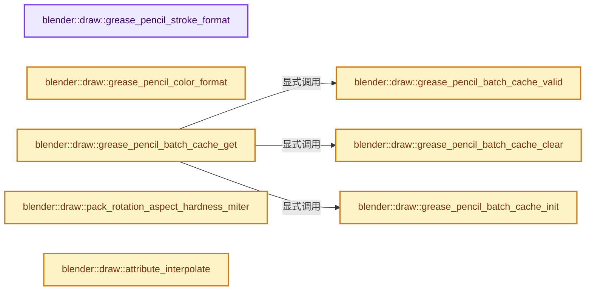
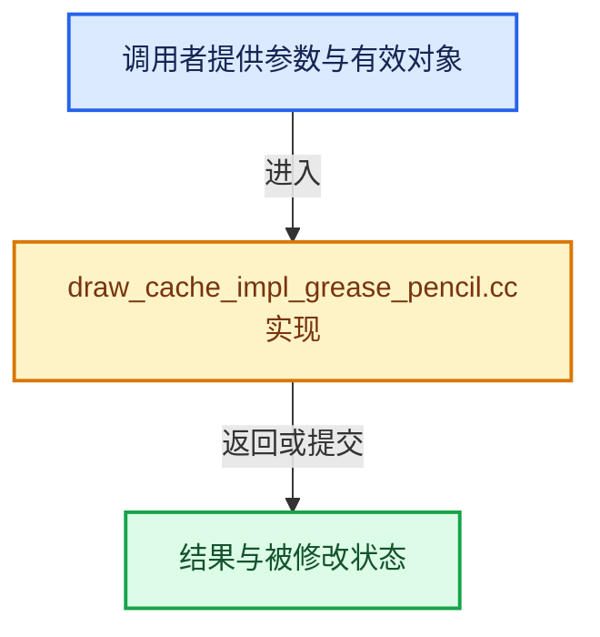

# 实现依赖专题：source/blender/draw/intern/draw_cache_impl_grease_pencil.cc

[方向导航](README.md) · [符号索引](../%E7%AC%A6%E5%8F%B7%E4%BE%9D%E8%B5%96%E4%B8%8E%E5%AE%9E%E7%8E%B0%E7%B4%A2%E5%BC%95.md)

本专题从正文实际调用进入，集中保存共享实现。函数有稳定锚点，可从调用处直接跳到对应完整函数；递归与互相调用通过回链组织。

## 本文件的实现关系






## 完整成员与函数实现

<a id="f-a6ba4ee89da03674"></a>

### `blender::draw::grease_pencil_stroke_format`

实现位置：[source/blender/draw/intern/draw_cache_impl_grease_pencil.cc](../../../../../source/blender/draw/intern/draw_cache_impl_grease_pencil.cc) · L117—L127。

**教学注释版**

<!-- annotated:b1171a68b74329 -->

```cpp
static const GPUVertFormat *grease_pencil_stroke_format()
{
  static const GPUVertFormat format = []() {
    GPUVertFormat format{};
    GPU_vertformat_attr_add(&format, "pos", gpu::VertAttrType::SFLOAT_32_32_32_32);
    GPU_vertformat_attr_add(&format, "ma", gpu::VertAttrType::SINT_32_32_32_32);
    GPU_vertformat_attr_add(&format, "uv", gpu::VertAttrType::SFLOAT_32_32_32_32);
    return format;
  }();
  return &format;
}
```

<details>
<summary>核对原始源码：source/blender/draw/intern/draw_cache_impl_grease_pencil.cc · L117—L127</summary>

<!-- original:b1171a68b74329:source/blender/draw/intern/draw_cache_impl_grease_pencil.cc:117:127 -->

```cpp
static const GPUVertFormat *grease_pencil_stroke_format()
{
  static const GPUVertFormat format = []() {
    GPUVertFormat format{};
    GPU_vertformat_attr_add(&format, "pos", gpu::VertAttrType::SFLOAT_32_32_32_32);
    GPU_vertformat_attr_add(&format, "ma", gpu::VertAttrType::SINT_32_32_32_32);
    GPU_vertformat_attr_add(&format, "uv", gpu::VertAttrType::SFLOAT_32_32_32_32);
    return format;
  }();
  return &format;
}
```

</details>

**结果出口**

- `return format;`
- `return &format;`

**继续追踪实现**

- `[]() { GPUVertFormat format{}; GPU_vertformat_attr_add(&format, "pos", gpu::VertAttrType::SFLOAT_32_32_32_32); GPU_vertformat_attr_add(&format, "ma", gpu::VertAttrType::SINT_32_32_ …（完整表达式见本函数源码）` → [调用协议](../%E6%A8%A1%E6%9D%BF%E5%AE%8F%E4%B8%8E%E5%8A%A8%E6%80%81%E5%88%86%E6%B4%BE%E5%8D%8F%E8%AE%AE.md)：函数指针、局部可调用对象或未展开的宏；必须结合调用者环境。调用位置L119。
- `GPU_vertformat_attr_add` → [blender::GPU_vertformat_attr_add · L389](%E4%BE%9D%E8%B5%96-gpu_vertex_format-4f7148.md#f-a36e23f37b97fff4)。

<a id="f-f051e9fa8db8660b"></a>

### `blender::draw::grease_pencil_color_format`

实现位置：[source/blender/draw/intern/draw_cache_impl_grease_pencil.cc](../../../../../source/blender/draw/intern/draw_cache_impl_grease_pencil.cc) · L135—L144。

**教学注释版**

<!-- annotated:5467a748b16e0e -->

```cpp
static const GPUVertFormat *grease_pencil_color_format()
{
  static const GPUVertFormat format = []() {
    GPUVertFormat format{};
    GPU_vertformat_attr_add(&format, "col", gpu::VertAttrType::SFLOAT_32_32_32_32);
    GPU_vertformat_attr_add(&format, "fcol", gpu::VertAttrType::SFLOAT_32_32_32_32);
    return format;
  }();
  return &format;
}
```

<details>
<summary>核对原始源码：source/blender/draw/intern/draw_cache_impl_grease_pencil.cc · L135—L144</summary>

<!-- original:5467a748b16e0e:source/blender/draw/intern/draw_cache_impl_grease_pencil.cc:135:144 -->

```cpp
static const GPUVertFormat *grease_pencil_color_format()
{
  static const GPUVertFormat format = []() {
    GPUVertFormat format{};
    GPU_vertformat_attr_add(&format, "col", gpu::VertAttrType::SFLOAT_32_32_32_32);
    GPU_vertformat_attr_add(&format, "fcol", gpu::VertAttrType::SFLOAT_32_32_32_32);
    return format;
  }();
  return &format;
}
```

</details>

**结果出口**

- `return format;`
- `return &format;`

**继续追踪实现**

- `[]() { GPUVertFormat format{}; GPU_vertformat_attr_add(&format, "col", gpu::VertAttrType::SFLOAT_32_32_32_32); GPU_vertformat_attr_add(&format, "fcol", gpu::VertAttrType::SFLOAT_32_32_32_32); return format; }` → [调用协议](../%E6%A8%A1%E6%9D%BF%E5%AE%8F%E4%B8%8E%E5%8A%A8%E6%80%81%E5%88%86%E6%B4%BE%E5%8D%8F%E8%AE%AE.md)：函数指针、局部可调用对象或未展开的宏；必须结合调用者环境。调用位置L137。
- `GPU_vertformat_attr_add` → [blender::GPU_vertformat_attr_add · L389](%E4%BE%9D%E8%B5%96-gpu_vertex_format-4f7148.md#f-a36e23f37b97fff4)。

<a id="f-09a29527130b6797"></a>

### `blender::draw::grease_pencil_batch_cache_valid`

实现位置：[source/blender/draw/intern/draw_cache_impl_grease_pencil.cc](../../../../../source/blender/draw/intern/draw_cache_impl_grease_pencil.cc) · L152—L158。

接口参数：

- `const GreasePencil &grease_pencil`

**教学注释版**

<!-- annotated:217661082abd98 -->

```cpp
static bool grease_pencil_batch_cache_valid(const GreasePencil &grease_pencil)
{
  BLI_assert(grease_pencil.runtime != nullptr);
  const GreasePencilBatchCache *cache = grease_pencil.runtime->batch_cache;
  return (cache && cache->is_dirty == false &&
          cache->cache_frame == grease_pencil.runtime->eval_frame);
}
```

<details>
<summary>核对原始源码：source/blender/draw/intern/draw_cache_impl_grease_pencil.cc · L152—L158</summary>

<!-- original:217661082abd98:source/blender/draw/intern/draw_cache_impl_grease_pencil.cc:152:158 -->

```cpp
static bool grease_pencil_batch_cache_valid(const GreasePencil &grease_pencil)
{
  BLI_assert(grease_pencil.runtime != nullptr);
  const GreasePencilBatchCache *cache = grease_pencil.runtime->batch_cache;
  return (cache && cache->is_dirty == false &&
          cache->cache_frame == grease_pencil.runtime->eval_frame);
}
```

</details>

**结果出口**

- `return (cache && cache->is_dirty == false &&`

**继续追踪实现**

- `BLI_assert` → [BLI_assert · L48](../01-%E5%9F%BA%E7%A1%80%E5%AE%B9%E5%99%A8%E4%B8%8E%E7%8E%B0%E4%BB%A3CPP/%E4%BE%9D%E8%B5%96-BLI_assert-cc98e8.md#m-57a88495704d)；[BLI_assert · L63](../01-%E5%9F%BA%E7%A1%80%E5%AE%B9%E5%99%A8%E4%B8%8E%E7%8E%B0%E4%BB%A3CPP/%E4%BE%9D%E8%B5%96-BLI_assert-cc98e8.md#m-d07050020cb5)。宏定义由构建条件选择。

<a id="f-7dcc6f4b35925328"></a>

### `blender::draw::grease_pencil_batch_cache_init`

实现位置：[source/blender/draw/intern/draw_cache_impl_grease_pencil.cc](../../../../../source/blender/draw/intern/draw_cache_impl_grease_pencil.cc) · L160—L176。

接口参数：

- `GreasePencil &grease_pencil`

**教学注释版**

<!-- annotated:695d54eb4356ac -->

```cpp
static GreasePencilBatchCache *grease_pencil_batch_cache_init(GreasePencil &grease_pencil)
{
  BLI_assert(grease_pencil.runtime != nullptr);
  GreasePencilBatchCache *cache = grease_pencil.runtime->batch_cache;
  if (cache == nullptr) {
    cache = MEM_new<GreasePencilBatchCache>(__func__);
    grease_pencil.runtime->batch_cache = cache;
  }
  else {
    *cache = {};
  }

  cache->is_dirty = false;
  cache->cache_frame = grease_pencil.runtime->eval_frame;

  return cache;
}
```

<details>
<summary>核对原始源码：source/blender/draw/intern/draw_cache_impl_grease_pencil.cc · L160—L176</summary>

<!-- original:695d54eb4356ac:source/blender/draw/intern/draw_cache_impl_grease_pencil.cc:160:176 -->

```cpp
static GreasePencilBatchCache *grease_pencil_batch_cache_init(GreasePencil &grease_pencil)
{
  BLI_assert(grease_pencil.runtime != nullptr);
  GreasePencilBatchCache *cache = grease_pencil.runtime->batch_cache;
  if (cache == nullptr) {
    cache = MEM_new<GreasePencilBatchCache>(__func__);
    grease_pencil.runtime->batch_cache = cache;
  }
  else {
    *cache = {};
  }

  cache->is_dirty = false;
  cache->cache_frame = grease_pencil.runtime->eval_frame;

  return cache;
}
```

</details>

**沿实际写入检查状态**

- `cache = MEM_new<GreasePencilBatchCache>(__func__);`
- `grease_pencil.runtime->batch_cache = cache;`
- `cache->is_dirty = false;`
- `cache->cache_frame = grease_pencil.runtime->eval_frame;`

**结果出口**

- `return cache;`

**继续追踪实现**

- `BLI_assert` → [BLI_assert · L48](../01-%E5%9F%BA%E7%A1%80%E5%AE%B9%E5%99%A8%E4%B8%8E%E7%8E%B0%E4%BB%A3CPP/%E4%BE%9D%E8%B5%96-BLI_assert-cc98e8.md#m-57a88495704d)；[BLI_assert · L63](../01-%E5%9F%BA%E7%A1%80%E5%AE%B9%E5%99%A8%E4%B8%8E%E7%8E%B0%E4%BB%A3CPP/%E4%BE%9D%E8%B5%96-BLI_assert-cc98e8.md#m-d07050020cb5)。宏定义由构建条件选择。
- `MEM_new<GreasePencilBatchCache>` → [MEM_new · L351](../03-%E5%86%85%E5%AD%98%E5%88%86%E9%85%8D%E4%B8%8E%E8%BF%90%E8%A1%8C%E6%97%B6%E7%B1%BB%E5%9E%8B/%E4%BE%9D%E8%B5%96-MEM_guardedalloc-b54eca.md#f-115f9b6784f89912)。

<a id="f-2372aa5473ee2376"></a>

### `blender::draw::grease_pencil_batch_cache_clear`

实现位置：[source/blender/draw/intern/draw_cache_impl_grease_pencil.cc](../../../../../source/blender/draw/intern/draw_cache_impl_grease_pencil.cc) · L178—L209。

接口参数：

- `GreasePencil &grease_pencil`

**教学注释版**

<!-- annotated:1bbbb5cbdeb7cc -->

```cpp
static void grease_pencil_batch_cache_clear(GreasePencil &grease_pencil)
{
  BLI_assert(grease_pencil.runtime != nullptr);
  GreasePencilBatchCache *cache = grease_pencil.runtime->batch_cache;
  if (cache == nullptr) {
    return;
  }

  GPU_BATCH_DISCARD_SAFE(cache->geom_batch);
  GPU_VERTBUF_DISCARD_SAFE(cache->vbo);
  GPU_VERTBUF_DISCARD_SAFE(cache->vbo_col);
  GPU_INDEXBUF_DISCARD_SAFE(cache->ibo);

  GPU_BATCH_DISCARD_SAFE(cache->lines_batch);
  GPU_BATCH_DISCARD_SAFE(cache->edit_points);
  GPU_BATCH_DISCARD_SAFE(cache->edit_lines);
  GPU_BATCH_DISCARD_SAFE(cache->edit_handles);

  GPU_VERTBUF_DISCARD_SAFE(cache->edit_points_pos);
  GPU_VERTBUF_DISCARD_SAFE(cache->edit_points_rad);
  GPU_VERTBUF_DISCARD_SAFE(cache->edit_points_selection);
  GPU_VERTBUF_DISCARD_SAFE(cache->edit_points_vflag);
  GPU_INDEXBUF_DISCARD_SAFE(cache->edit_points_indices);
  GPU_VERTBUF_DISCARD_SAFE(cache->edit_points_info);
  GPU_INDEXBUF_DISCARD_SAFE(cache->edit_handles_ibo);

  GPU_VERTBUF_DISCARD_SAFE(cache->edit_line_pos);
  GPU_VERTBUF_DISCARD_SAFE(cache->edit_line_selection);
  GPU_INDEXBUF_DISCARD_SAFE(cache->edit_line_indices);

  cache->is_dirty = true;
}
```

<details>
<summary>核对原始源码：source/blender/draw/intern/draw_cache_impl_grease_pencil.cc · L178—L209</summary>

<!-- original:1bbbb5cbdeb7cc:source/blender/draw/intern/draw_cache_impl_grease_pencil.cc:178:209 -->

```cpp
static void grease_pencil_batch_cache_clear(GreasePencil &grease_pencil)
{
  BLI_assert(grease_pencil.runtime != nullptr);
  GreasePencilBatchCache *cache = grease_pencil.runtime->batch_cache;
  if (cache == nullptr) {
    return;
  }

  GPU_BATCH_DISCARD_SAFE(cache->geom_batch);
  GPU_VERTBUF_DISCARD_SAFE(cache->vbo);
  GPU_VERTBUF_DISCARD_SAFE(cache->vbo_col);
  GPU_INDEXBUF_DISCARD_SAFE(cache->ibo);

  GPU_BATCH_DISCARD_SAFE(cache->lines_batch);
  GPU_BATCH_DISCARD_SAFE(cache->edit_points);
  GPU_BATCH_DISCARD_SAFE(cache->edit_lines);
  GPU_BATCH_DISCARD_SAFE(cache->edit_handles);

  GPU_VERTBUF_DISCARD_SAFE(cache->edit_points_pos);
  GPU_VERTBUF_DISCARD_SAFE(cache->edit_points_rad);
  GPU_VERTBUF_DISCARD_SAFE(cache->edit_points_selection);
  GPU_VERTBUF_DISCARD_SAFE(cache->edit_points_vflag);
  GPU_INDEXBUF_DISCARD_SAFE(cache->edit_points_indices);
  GPU_VERTBUF_DISCARD_SAFE(cache->edit_points_info);
  GPU_INDEXBUF_DISCARD_SAFE(cache->edit_handles_ibo);

  GPU_VERTBUF_DISCARD_SAFE(cache->edit_line_pos);
  GPU_VERTBUF_DISCARD_SAFE(cache->edit_line_selection);
  GPU_INDEXBUF_DISCARD_SAFE(cache->edit_line_indices);

  cache->is_dirty = true;
}
```

</details>

**沿实际写入检查状态**

- `cache->is_dirty = true;`

**继续追踪实现**

- `BLI_assert` → [BLI_assert · L48](../01-%E5%9F%BA%E7%A1%80%E5%AE%B9%E5%99%A8%E4%B8%8E%E7%8E%B0%E4%BB%A3CPP/%E4%BE%9D%E8%B5%96-BLI_assert-cc98e8.md#m-57a88495704d)；[BLI_assert · L63](../01-%E5%9F%BA%E7%A1%80%E5%AE%B9%E5%99%A8%E4%B8%8E%E7%8E%B0%E4%BB%A3CPP/%E4%BE%9D%E8%B5%96-BLI_assert-cc98e8.md#m-d07050020cb5)。宏定义由构建条件选择。
- `GPU_BATCH_DISCARD_SAFE` → [GPU_BATCH_DISCARD_SAFE · L199](%E4%BE%9D%E8%B5%96-GPU_batch-98c422.md#m-167d477926a1)。宏定义由构建条件选择。
- `GPU_VERTBUF_DISCARD_SAFE` → [GPU_VERTBUF_DISCARD_SAFE · L372](%E4%BE%9D%E8%B5%96-GPU_vertex_buffer-d7610b.md#m-6427e4c6901c)。宏定义由构建条件选择。
- `GPU_INDEXBUF_DISCARD_SAFE` → [GPU_INDEXBUF_DISCARD_SAFE · L299](%E4%BE%9D%E8%B5%96-GPU_index_buffer-093835.md#m-f3c9c7333ad4)。宏定义由构建条件选择。

<a id="f-2df2a108e52a9caf"></a>

### `blender::draw::grease_pencil_batch_cache_get`

实现位置：[source/blender/draw/intern/draw_cache_impl_grease_pencil.cc](../../../../../source/blender/draw/intern/draw_cache_impl_grease_pencil.cc) · L211—L221。

接口参数：

- `GreasePencil &grease_pencil`

**教学注释版**

<!-- annotated:ae7c1f8e614898 -->

```cpp
static GreasePencilBatchCache *grease_pencil_batch_cache_get(GreasePencil &grease_pencil)
{
  BLI_assert(grease_pencil.runtime != nullptr);
  GreasePencilBatchCache *cache = grease_pencil.runtime->batch_cache;
  if (!grease_pencil_batch_cache_valid(grease_pencil)) {
    grease_pencil_batch_cache_clear(grease_pencil);
    return grease_pencil_batch_cache_init(grease_pencil);
  }

  return cache;
}
```

<details>
<summary>核对原始源码：source/blender/draw/intern/draw_cache_impl_grease_pencil.cc · L211—L221</summary>

<!-- original:ae7c1f8e614898:source/blender/draw/intern/draw_cache_impl_grease_pencil.cc:211:221 -->

```cpp
static GreasePencilBatchCache *grease_pencil_batch_cache_get(GreasePencil &grease_pencil)
{
  BLI_assert(grease_pencil.runtime != nullptr);
  GreasePencilBatchCache *cache = grease_pencil.runtime->batch_cache;
  if (!grease_pencil_batch_cache_valid(grease_pencil)) {
    grease_pencil_batch_cache_clear(grease_pencil);
    return grease_pencil_batch_cache_init(grease_pencil);
  }

  return cache;
}
```

</details>

**结果出口**

- `return grease_pencil_batch_cache_init(grease_pencil);`
- `return cache;`

**继续追踪实现**

- `BLI_assert` → [BLI_assert · L48](../01-%E5%9F%BA%E7%A1%80%E5%AE%B9%E5%99%A8%E4%B8%8E%E7%8E%B0%E4%BB%A3CPP/%E4%BE%9D%E8%B5%96-BLI_assert-cc98e8.md#m-57a88495704d)；[BLI_assert · L63](../01-%E5%9F%BA%E7%A1%80%E5%AE%B9%E5%99%A8%E4%B8%8E%E7%8E%B0%E4%BB%A3CPP/%E4%BE%9D%E8%B5%96-BLI_assert-cc98e8.md#m-d07050020cb5)。宏定义由构建条件选择。
- `grease_pencil_batch_cache_valid` → [blender::draw::grease_pencil_batch_cache_valid · L152](%E4%BE%9D%E8%B5%96-draw_cache_impl_grease_pencil-ea876b.md#f-09a29527130b6797)。
- `grease_pencil_batch_cache_clear` → [blender::draw::grease_pencil_batch_cache_clear · L178](%E4%BE%9D%E8%B5%96-draw_cache_impl_grease_pencil-ea876b.md#f-2372aa5473ee2376)。
- `grease_pencil_batch_cache_init` → [blender::draw::grease_pencil_batch_cache_init · L160](%E4%BE%9D%E8%B5%96-draw_cache_impl_grease_pencil-ea876b.md#f-7dcc6f4b35925328)。

<a id="f-01137b202f62c8df"></a>

### `blender::draw::pack_rotation_aspect_hardness_miter`

实现位置：[source/blender/draw/intern/draw_cache_impl_grease_pencil.cc](../../../../../source/blender/draw/intern/draw_cache_impl_grease_pencil.cc) · L229—L272。

接口参数：

- `const float rot`
- `const float asp`
- `const float softness`
- `const float miter_angle`

**教学注释版**

<!-- annotated:a23381639ea1a0 -->

```cpp
BLI_INLINE int32_t pack_rotation_aspect_hardness_miter(const float rot,
                                                       const float asp,
                                                       const float softness,
                                                       const float miter_angle)
{
  int32_t packed = 0;
  /* Aspect uses 9 bits */
  float asp_normalized = (asp > 1.0f) ? (1.0f / asp) : asp;
  /* Use the default aspect ratio of 1 when the value is outside of the valid range. */
  if (asp_normalized <= 0.0f) {
    asp_normalized = 1.0f;
  }
  packed |= int32_t(unit_float_to_uchar_clamp(asp_normalized));
  /* Store if inverted in the 9th bit. */
  if (asp > 1.0f) {
    packed |= 1 << 8;
  }
  /* Rotation uses 9 bits */
  /* Rotation are in [-90..90] degree range, so we can encode the sign of the angle + the cosine
   * because the cosine will always be positive. */
  packed |= int32_t(unit_float_to_uchar_clamp(cosf(rot))) << 9;
  /* Store sine sign in 9th bit. */
  if (rot < 0.0f) {
    packed |= 1 << 17;
  }
  /* Hardness uses 8 bits */
  packed |= int32_t(unit_float_to_uchar_clamp(1.0f - softness)) << 18;

  /* Miter Angle uses the last 6 bits */
  if (miter_angle <= GP_STROKE_MITER_ANGLE_ROUND) {
    packed |= GP_CORNER_TYPE_ROUND_BITS << 26;
  }
  else if (miter_angle >= GP_STROKE_MITER_ANGLE_BEVEL) {
    packed |= GP_CORNER_TYPE_BEVEL_BITS << 26;
  }
  else {
    const float miter_norm = (miter_angle / M_PI);
    packed |= int32_t(clamp_i(
                  int(miter_norm * GP_CORNER_TYPE_MITER_NUMBER), 1, GP_CORNER_TYPE_MITER_NUMBER))
              << 26;
  }

  return packed;
}
```

<details>
<summary>核对原始源码：source/blender/draw/intern/draw_cache_impl_grease_pencil.cc · L229—L272</summary>

<!-- original:a23381639ea1a0:source/blender/draw/intern/draw_cache_impl_grease_pencil.cc:229:272 -->

```cpp
BLI_INLINE int32_t pack_rotation_aspect_hardness_miter(const float rot,
                                                       const float asp,
                                                       const float softness,
                                                       const float miter_angle)
{
  int32_t packed = 0;
  /* Aspect uses 9 bits */
  float asp_normalized = (asp > 1.0f) ? (1.0f / asp) : asp;
  /* Use the default aspect ratio of 1 when the value is outside of the valid range. */
  if (asp_normalized <= 0.0f) {
    asp_normalized = 1.0f;
  }
  packed |= int32_t(unit_float_to_uchar_clamp(asp_normalized));
  /* Store if inverted in the 9th bit. */
  if (asp > 1.0f) {
    packed |= 1 << 8;
  }
  /* Rotation uses 9 bits */
  /* Rotation are in [-90..90] degree range, so we can encode the sign of the angle + the cosine
   * because the cosine will always be positive. */
  packed |= int32_t(unit_float_to_uchar_clamp(cosf(rot))) << 9;
  /* Store sine sign in 9th bit. */
  if (rot < 0.0f) {
    packed |= 1 << 17;
  }
  /* Hardness uses 8 bits */
  packed |= int32_t(unit_float_to_uchar_clamp(1.0f - softness)) << 18;

  /* Miter Angle uses the last 6 bits */
  if (miter_angle <= GP_STROKE_MITER_ANGLE_ROUND) {
    packed |= GP_CORNER_TYPE_ROUND_BITS << 26;
  }
  else if (miter_angle >= GP_STROKE_MITER_ANGLE_BEVEL) {
    packed |= GP_CORNER_TYPE_BEVEL_BITS << 26;
  }
  else {
    const float miter_norm = (miter_angle / M_PI);
    packed |= int32_t(clamp_i(
                  int(miter_norm * GP_CORNER_TYPE_MITER_NUMBER), 1, GP_CORNER_TYPE_MITER_NUMBER))
              << 26;
  }

  return packed;
}
```

</details>

**沿实际写入检查状态**

- `asp_normalized = 1.0f;`
- `packed |= int32_t(unit_float_to_uchar_clamp(asp_normalized));`
- `packed |= 1 << 8;`
- `packed |= int32_t(unit_float_to_uchar_clamp(cosf(rot))) << 9;`
- `packed |= 1 << 17;`
- `packed |= int32_t(unit_float_to_uchar_clamp(1.0f - softness)) << 18;`
- `packed |= GP_CORNER_TYPE_ROUND_BITS << 26;`
- `packed |= GP_CORNER_TYPE_BEVEL_BITS << 26;`
- `packed |= int32_t(clamp_i(`

**结果出口**

- `return packed;`

**继续追踪实现**

- `unit_float_to_uchar_clamp` → [blender::unit_float_to_uchar_clamp · L579](../12-%E7%A9%BA%E9%97%B4%E6%95%B0%E6%8D%AE%E7%BB%93%E6%9E%84%E4%B8%8E%E5%87%A0%E4%BD%95%E7%AE%97%E6%B3%95/%E4%BE%9D%E8%B5%96-math_base_inline-546b00.md#f-078b5581dbbfbc81)。
- `cosf` → [cosf · L20](%E4%BE%9D%E8%B5%96-radial_tiling_shared-98abf9.md#m-cee9ebf67d86)；[cosf · L42](%E4%BE%9D%E8%B5%96-radial_tiling_shared-98abf9.md#m-346533627567)；[cosf · L73](%E4%BE%9D%E8%B5%96-radial_tiling_shared-98abf9.md#m-e01b94a43b72)；[cosf · L24](../01-%E5%9F%BA%E7%A1%80%E5%AE%B9%E5%99%A8%E4%B8%8E%E7%8E%B0%E4%BB%A3CPP/%E4%BE%9D%E8%B5%96-radial_tiling_shared-7989a4.md#m-c317cb08dec6)；[cosf · L46](../01-%E5%9F%BA%E7%A1%80%E5%AE%B9%E5%99%A8%E4%B8%8E%E7%8E%B0%E4%BB%A3CPP/%E4%BE%9D%E8%B5%96-radial_tiling_shared-7989a4.md#m-93325b515297)；[cosf · L77](../01-%E5%9F%BA%E7%A1%80%E5%AE%B9%E5%99%A8%E4%B8%8E%E7%8E%B0%E4%BB%A3CPP/%E4%BE%9D%E8%B5%96-radial_tiling_shared-7989a4.md#m-d3058af0b490)；[cosf · L20](%E4%BE%9D%E8%B5%96-node_radial_tiling_shared-b14bc2.md#m-4c6aea22a560)；[cosf · L42](%E4%BE%9D%E8%B5%96-node_radial_tiling_shared-b14bc2.md#m-1fd6a5414477)；[cosf · L73](%E4%BE%9D%E8%B5%96-node_radial_tiling_shared-b14bc2.md#m-de2402f85270)；[cosf · L186](%E4%BE%9D%E8%B5%96-compat-56205c.md#m-7fdbd99009e0)；[cosf · L288](%E4%BE%9D%E8%B5%96-compat-efe0e9.md#m-68fe984e8b68)；[cosf · L93](%E4%BE%9D%E8%B5%96-compat-9e0a25.md#m-21bb557a23f1)；[cosf · L91](%E4%BE%9D%E8%B5%96-compat-e9eab7.md#m-7721be419a49)；[cosf · L43](%E4%BE%9D%E8%B5%96-GPU_shader_shared_utils-0adda3.md#m-25d02fd11b3b)；[cosf · L64](%E4%BE%9D%E8%B5%96-GPU_shader_shared_utils-0adda3.md#m-698fc51ccda3)。宏定义由构建条件选择。
- `clamp_i` → [blender::clamp_i · L400](../12-%E7%A9%BA%E9%97%B4%E6%95%B0%E6%8D%AE%E7%BB%93%E6%9E%84%E4%B8%8E%E5%87%A0%E4%BD%95%E7%AE%97%E6%B3%95/%E4%BE%9D%E8%B5%96-math_base_inline-546b00.md#f-e9a0b16ec537d580)。

<a id="f-6687bedb63f4954d"></a>

### `blender::draw::attribute_interpolate`

实现位置：[source/blender/draw/intern/draw_cache_impl_grease_pencil.cc](../../../../../source/blender/draw/intern/draw_cache_impl_grease_pencil.cc) · L1166—L1176。

接口参数：

- `const VArray<T> &input`
- `const bke::CurvesGeometry &curves`

**教学注释版**

<!-- annotated:b956f186870c28 -->

```cpp
template<typename T>
static VArray<T> attribute_interpolate(const VArray<T> &input, const bke::CurvesGeometry &curves)
{
  if (curves.is_single_type(CURVE_TYPE_POLY)) {
    return input;
  }

  Array<T> out(curves.evaluated_points_num());
  // [讲解] out.as_mutable_span：提供数组的借用访问入口。
  curves.interpolate_to_evaluated(VArraySpan(input), out.as_mutable_span());
  // [讲解] std::move：把表达式转换成可供移动重载选择的值类别；不保证真的移动，不结束源对象寿命，对const值可能选择复制。
  return VArray<T>::from_container(std::move(out));
};
```

<details>
<summary>核对原始源码：source/blender/draw/intern/draw_cache_impl_grease_pencil.cc · L1166—L1176</summary>

<!-- original:b956f186870c28:source/blender/draw/intern/draw_cache_impl_grease_pencil.cc:1166:1176 -->

```cpp
template<typename T>
static VArray<T> attribute_interpolate(const VArray<T> &input, const bke::CurvesGeometry &curves)
{
  if (curves.is_single_type(CURVE_TYPE_POLY)) {
    return input;
  }

  Array<T> out(curves.evaluated_points_num());
  curves.interpolate_to_evaluated(VArraySpan(input), out.as_mutable_span());
  return VArray<T>::from_container(std::move(out));
};
```

</details>

**结果出口**

- `return input;`
- `return VArray<T>::from_container(std::move(out));`

**继续追踪实现**

- `curves.is_single_type` → [blender::bke::CurvesGeometry::is_single_type · L1028](04-CurvesGeometry%E5%AD%98%E5%82%A8.md#f-4a92c3c9cde2433d)。
- `curves.evaluated_points_num` → [blender::bke::CurvesGeometry::evaluated_points_num · L1064](04-CurvesGeometry%E5%AD%98%E5%82%A8.md#f-2cd4b96399d1e7d8)。
- `curves.interpolate_to_evaluated` → [blender::bke::CurvesGeometry::interpolate_to_evaluated · L1136](%E4%BE%9D%E8%B5%96-curves_geometry-ad7f9f.md#f-29af6547247c8f6a)；[blender::bke::CurvesGeometry::interpolate_to_evaluated · L1156](%E4%BE%9D%E8%B5%96-curves_geometry-ad7f9f.md#f-9bd697a878eb479d)。同名重载需按实参类型选择。
- `VArraySpan` → [blender::VArraySpan::VArraySpan · L954](../04-%E8%99%9A%E6%8B%9F%E6%95%B0%E7%BB%84%E4%B8%8E%E7%B4%A2%E5%BC%95%E9%80%89%E6%8B%A9/04-%E6%89%80%E6%9C%89%E6%9D%83%E4%B8%8E%E5%B0%8F%E5%AF%B9%E8%B1%A1%E4%BC%98%E5%8C%96.md#f-7f6b36035be3dc40)；[blender::VArraySpan::VArraySpan · L956](../04-%E8%99%9A%E6%8B%9F%E6%95%B0%E7%BB%84%E4%B8%8E%E7%B4%A2%E5%BC%95%E9%80%89%E6%8B%A9/04-%E6%89%80%E6%9C%89%E6%9D%83%E4%B8%8E%E5%B0%8F%E5%AF%B9%E8%B1%A1%E4%BC%98%E5%8C%96.md#f-40832e170cafb212)；[blender::VArraySpan::VArraySpan · L958](../04-%E8%99%9A%E6%8B%9F%E6%95%B0%E7%BB%84%E4%B8%8E%E7%B4%A2%E5%BC%95%E9%80%89%E6%8B%A9/04-%E6%89%80%E6%9C%89%E6%9D%83%E4%B8%8E%E5%B0%8F%E5%AF%B9%E8%B1%A1%E4%BC%98%E5%8C%96.md#f-3d07ad306af2ea15)；[blender::VArraySpan::VArraySpan · L976](../04-%E8%99%9A%E6%8B%9F%E6%95%B0%E7%BB%84%E4%B8%8E%E7%B4%A2%E5%BC%95%E9%80%89%E6%8B%A9/04-%E6%89%80%E6%9C%89%E6%9D%83%E4%B8%8E%E5%B0%8F%E5%AF%B9%E8%B1%A1%E4%BC%98%E5%8C%96.md#f-4ef6f24b8ef9ee54)。同名重载需按实参类型选择。
- `out.as_mutable_span` → [blender::Array::as_mutable_span · L259](../01-%E5%9F%BA%E7%A1%80%E5%AE%B9%E5%99%A8%E4%B8%8E%E7%8E%B0%E4%BB%A3CPP/08-Array%E5%A4%8D%E5%88%B6%E7%A7%BB%E5%8A%A8%E4%B8%8E%E9%94%80%E6%AF%81.md#f-4e91de9f1337c144)。
- `VArray<T>::from_container` → [blender::VArray::from_container · L809](../04-%E8%99%9A%E6%8B%9F%E6%95%B0%E7%BB%84%E4%B8%8E%E7%B4%A2%E5%BC%95%E9%80%89%E6%8B%A9/03-%E5%8D%95%E5%80%BC%E4%B8%8ESpan%E8%A1%A8%E7%A4%BA.md#f-0e0990c28b1aac89)。
- `std::move` → [外部契约](https://eel.is/c++draft/utility.forward)：把表达式转换成可供移动重载选择的值类别；不保证真的移动，不结束源对象寿命，对const值可能选择复制。

<a id="f-d8b2f64eba458316"></a>

### `blender::draw::interpolate_corners`

实现位置：[source/blender/draw/intern/draw_cache_impl_grease_pencil.cc](../../../../../source/blender/draw/intern/draw_cache_impl_grease_pencil.cc) · L1178—L1229。

接口参数：

- `const bke::CurvesGeometry &curves`

**教学注释版**

<!-- annotated:7a2faf7a1b9dd9 -->

```cpp
static VArray<float> interpolate_corners(const bke::CurvesGeometry &curves)
{
  const VArray<float> miter_angles = *curves.attributes().lookup_or_default<float>(
      "miter_angle", bke::AttrDomain::Point, GP_STROKE_MITER_ANGLE_ROUND);

  if (curves.is_single_type(CURVE_TYPE_POLY)) {
    return miter_angles;
  }

  if (miter_angles.is_single() &&
      miter_angles.get_internal_single() == GP_STROKE_MITER_ANGLE_ROUND)
  {
    return VArray<float>::from_single(GP_STROKE_MITER_ANGLE_ROUND, curves.evaluated_points_num());
  }

  /* Default all the evaluated points to be round.
   * This is done so that the added points look as smooth as possible. */
  Array<float> eval_corners(curves.evaluated_points_num(), GP_STROKE_MITER_ANGLE_ROUND);

  const VArray<int8_t> types = curves.curve_types();
  const OffsetIndices<int> points_by_curve = curves.points_by_curve();
  const OffsetIndices<int> evaluated_points_by_curve = curves.evaluated_points_by_curve();

  threading::parallel_for(curves.curves_range(), 128, [&](IndexRange range) {
    for (const int curve_i : range) {
      const IndexRange eval_points = evaluated_points_by_curve[curve_i];
      const IndexRange points = points_by_curve[curve_i];
      // [讲解] eval_corners.as_mutable_span：提供数组的借用访问入口。
      MutableSpan<float> eval_corners_range = eval_corners.as_mutable_span().slice(eval_points);

      switch (types[curve_i]) {
        case CURVE_TYPE_POLY:
          for (const int i : points.index_range()) {
            eval_corners_range[i] = miter_angles[points[i]];
          }
          break;
        case CURVE_TYPE_BEZIER: {
          const Span<int> offsets = curves.bezier_evaluated_offsets_for_curve(curve_i);
          for (const int i : points.index_range()) {
            eval_corners_range[offsets[i]] = miter_angles[points[i]];
          }
          break;
        }
        case CURVE_TYPE_NURBS:
        case CURVE_TYPE_CATMULL_ROM: {
          /* NURBS and Catmull-Rom are continuous and don't have corners. */
          break;
        }
      }
    }
  });
  // [讲解] std::move：把表达式转换成可供移动重载选择的值类别；不保证真的移动，不结束源对象寿命，对const值可能选择复制。
  return VArray<float>::from_container(std::move(eval_corners));
}
```

<details>
<summary>核对原始源码：source/blender/draw/intern/draw_cache_impl_grease_pencil.cc · L1178—L1229</summary>

<!-- original:7a2faf7a1b9dd9:source/blender/draw/intern/draw_cache_impl_grease_pencil.cc:1178:1229 -->

```cpp
static VArray<float> interpolate_corners(const bke::CurvesGeometry &curves)
{
  const VArray<float> miter_angles = *curves.attributes().lookup_or_default<float>(
      "miter_angle", bke::AttrDomain::Point, GP_STROKE_MITER_ANGLE_ROUND);

  if (curves.is_single_type(CURVE_TYPE_POLY)) {
    return miter_angles;
  }

  if (miter_angles.is_single() &&
      miter_angles.get_internal_single() == GP_STROKE_MITER_ANGLE_ROUND)
  {
    return VArray<float>::from_single(GP_STROKE_MITER_ANGLE_ROUND, curves.evaluated_points_num());
  }

  /* Default all the evaluated points to be round.
   * This is done so that the added points look as smooth as possible. */
  Array<float> eval_corners(curves.evaluated_points_num(), GP_STROKE_MITER_ANGLE_ROUND);

  const VArray<int8_t> types = curves.curve_types();
  const OffsetIndices<int> points_by_curve = curves.points_by_curve();
  const OffsetIndices<int> evaluated_points_by_curve = curves.evaluated_points_by_curve();

  threading::parallel_for(curves.curves_range(), 128, [&](IndexRange range) {
    for (const int curve_i : range) {
      const IndexRange eval_points = evaluated_points_by_curve[curve_i];
      const IndexRange points = points_by_curve[curve_i];
      MutableSpan<float> eval_corners_range = eval_corners.as_mutable_span().slice(eval_points);

      switch (types[curve_i]) {
        case CURVE_TYPE_POLY:
          for (const int i : points.index_range()) {
            eval_corners_range[i] = miter_angles[points[i]];
          }
          break;
        case CURVE_TYPE_BEZIER: {
          const Span<int> offsets = curves.bezier_evaluated_offsets_for_curve(curve_i);
          for (const int i : points.index_range()) {
            eval_corners_range[offsets[i]] = miter_angles[points[i]];
          }
          break;
        }
        case CURVE_TYPE_NURBS:
        case CURVE_TYPE_CATMULL_ROM: {
          /* NURBS and Catmull-Rom are continuous and don't have corners. */
          break;
        }
      }
    }
  });
  return VArray<float>::from_container(std::move(eval_corners));
}
```

</details>

**沿实际写入检查状态**

- `eval_corners_range[i] = miter_angles[points[i]];`
- `eval_corners_range[offsets[i]] = miter_angles[points[i]];`

**结果出口**

- `return miter_angles;`
- `return VArray<float>::from_single(GP_STROKE_MITER_ANGLE_ROUND, curves.evaluated_points_num());`
- `return VArray<float>::from_container(std::move(eval_corners));`

**继续追踪实现**

- `curves.attributes().lookup_or_default<float>` → [调用协议](../%E6%A8%A1%E6%9D%BF%E5%AE%8F%E4%B8%8E%E5%8A%A8%E6%80%81%E5%88%86%E6%B4%BE%E5%8D%8F%E8%AE%AE.md)：接收对象类型依赖auto、返回值或模板实例；不按同名猜测目标。调用位置L1180。
- `curves.attributes` → [blender::bke::CurvesGeometry::attributes · L1908](%E4%BE%9D%E8%B5%96-curves_geometry-ad7f9f.md#f-8e24fbf758862a22)。
- `curves.is_single_type` → [blender::bke::CurvesGeometry::is_single_type · L1028](04-CurvesGeometry%E5%AD%98%E5%82%A8.md#f-4a92c3c9cde2433d)。
- `miter_angles.is_single` → [调用协议](../%E6%A8%A1%E6%9D%BF%E5%AE%8F%E4%B8%8E%E5%8A%A8%E6%80%81%E5%88%86%E6%B4%BE%E5%8D%8F%E8%AE%AE.md)：由接收对象具体类型或运行时策略提供实现。调用位置L1187。
- `miter_angles.get_internal_single` → [调用协议](../%E6%A8%A1%E6%9D%BF%E5%AE%8F%E4%B8%8E%E5%8A%A8%E6%80%81%E5%88%86%E6%B4%BE%E5%8D%8F%E8%AE%AE.md)：由接收对象具体类型或运行时策略提供实现。调用位置L1188。
- `VArray<float>::from_single` → [blender::GVArray::from_single · L880](../04-%E8%99%9A%E6%8B%9F%E6%95%B0%E7%BB%84%E4%B8%8E%E7%B4%A2%E5%BC%95%E9%80%89%E6%8B%A9/05-GVArray%E8%BF%90%E8%A1%8C%E6%97%B6%E7%B1%BB%E5%9E%8B.md#f-1c85e09520e47c5a)；[blender::VArray::from_single · L759](../04-%E8%99%9A%E6%8B%9F%E6%95%B0%E7%BB%84%E4%B8%8E%E7%B4%A2%E5%BC%95%E9%80%89%E6%8B%A9/03-%E5%8D%95%E5%80%BC%E4%B8%8ESpan%E8%A1%A8%E7%A4%BA.md#f-ea0b7b864c7f4785)。同名重载需按实参类型选择。
- `curves.evaluated_points_num` → [blender::bke::CurvesGeometry::evaluated_points_num · L1064](04-CurvesGeometry%E5%AD%98%E5%82%A8.md#f-2cd4b96399d1e7d8)。
- `curves.curve_types` → [blender::bke::CurvesGeometry::curve_types · L229](%E4%BE%9D%E8%B5%96-curves_geometry-ad7f9f.md#f-e3847cb390c85e93)。
- `curves.points_by_curve` → [blender::bke::CurvesGeometry::points_by_curve · L1058](04-CurvesGeometry%E5%AD%98%E5%82%A8.md#f-a0416697e10ec205)。
- `curves.evaluated_points_by_curve` → [blender::bke::CurvesGeometry::evaluated_points_by_curve · L706](%E4%BE%9D%E8%B5%96-curves_geometry-ad7f9f.md#f-50a98b54f67dd20c)。
- `threading::parallel_for` → [blender::threading::parallel_for · L68](../11-Depsgraph%E4%B8%8E%E5%B9%B6%E8%A1%8C%E4%BB%BB%E5%8A%A1%E7%B3%BB%E7%BB%9F/07-%E4%BB%BB%E5%8A%A1%E6%B1%A0%E4%B8%8ETBB%E6%8E%A5%E5%85%A5.md#f-838294754c24426c)。
- `curves.curves_range` → [blender::bke::CurvesGeometry::curves_range · L1023](04-CurvesGeometry%E5%AD%98%E5%82%A8.md#f-9aedfb1afc5ebcfb)。
- `eval_corners.as_mutable_span().slice` → [调用协议](../%E6%A8%A1%E6%9D%BF%E5%AE%8F%E4%B8%8E%E5%8A%A8%E6%80%81%E5%88%86%E6%B4%BE%E5%8D%8F%E8%AE%AE.md)：接收对象类型依赖auto、返回值或模板实例；不按同名猜测目标。调用位置L1205。
- `eval_corners.as_mutable_span` → [blender::Array::as_mutable_span · L259](../01-%E5%9F%BA%E7%A1%80%E5%AE%B9%E5%99%A8%E4%B8%8E%E7%8E%B0%E4%BB%A3CPP/08-Array%E5%A4%8D%E5%88%B6%E7%A7%BB%E5%8A%A8%E4%B8%8E%E9%94%80%E6%AF%81.md#f-4e91de9f1337c144)。
- `points.index_range` → [blender::IndexRange::index_range · L161](../01-%E5%9F%BA%E7%A1%80%E5%AE%B9%E5%99%A8%E4%B8%8E%E7%8E%B0%E4%BB%A3CPP/04-IndexRange%E8%BF%9E%E7%BB%AD%E6%95%B4%E6%95%B0%E5%8C%BA%E9%97%B4.md#f-fd83072b4b81bce5)。
- `curves.bezier_evaluated_offsets_for_curve` → [blender::bke::CurvesGeometry::bezier_evaluated_offsets_for_curve · L1070](04-CurvesGeometry%E5%AD%98%E5%82%A8.md#f-b23f3527d5025ce2)。
- `VArray<float>::from_container` → [blender::VArray::from_container · L809](../04-%E8%99%9A%E6%8B%9F%E6%95%B0%E7%BB%84%E4%B8%8E%E7%B4%A2%E5%BC%95%E9%80%89%E6%8B%A9/03-%E5%8D%95%E5%80%BC%E4%B8%8ESpan%E8%A1%A8%E7%A4%BA.md#f-0e0990c28b1aac89)。
- `std::move` → [外部契约](https://eel.is/c++draft/utility.forward)：把表达式转换成可供移动重载选择的值类别；不保证真的移动，不结束源对象寿命，对const值可能选择复制。

<a id="f-9b9a44c920cf76d9"></a>

### `blender::draw::segment_radius_length`

实现位置：[source/blender/draw/intern/draw_cache_impl_grease_pencil.cc](../../../../../source/blender/draw/intern/draw_cache_impl_grease_pencil.cc) · L1237—L1260。

接口参数：

- `const float l`
- `const float r1`
- `const float r2`

**教学注释版**

<!-- annotated:a2efefcb243d10 -->

```cpp
static float segment_radius_length(const float l, const float r1, const float r2)
{
  const float a = r2 - r1;

  /* Avoid division by zero. */
  if (r1 <= 0.0f || l <= 0.0f || l == a) {
    return 0.0f;
  }

  /* If the two radii are close to being the same, calculate as if they were. */
  if (abs(a) < 0.001f * l) {
    return l / r1;
  }

  const float E = (l + a) / (l - a);
  const float E_i = a / r1 + 1.0f;

  /* Return zero if one dot is inside the other. */
  if (E <= 0.0f || E_i <= 0.0f) {
    return 0.0f;
  }

  return 2.0f * log(E_i) / log(E);
}
```

<details>
<summary>核对原始源码：source/blender/draw/intern/draw_cache_impl_grease_pencil.cc · L1237—L1260</summary>

<!-- original:a2efefcb243d10:source/blender/draw/intern/draw_cache_impl_grease_pencil.cc:1237:1260 -->

```cpp
static float segment_radius_length(const float l, const float r1, const float r2)
{
  const float a = r2 - r1;

  /* Avoid division by zero. */
  if (r1 <= 0.0f || l <= 0.0f || l == a) {
    return 0.0f;
  }

  /* If the two radii are close to being the same, calculate as if they were. */
  if (abs(a) < 0.001f * l) {
    return l / r1;
  }

  const float E = (l + a) / (l - a);
  const float E_i = a / r1 + 1.0f;

  /* Return zero if one dot is inside the other. */
  if (E <= 0.0f || E_i <= 0.0f) {
    return 0.0f;
  }

  return 2.0f * log(E_i) / log(E);
}
```

</details>

**结果出口**

- `return 0.0f;`
- `return l / r1;`
- `return 2.0f * log(E_i) / log(E);`

**继续追踪实现**

- `abs` → [abs · L104](%E4%BE%9D%E8%B5%96-gpu_shader_cxx_builtin-8ae191.md#m-14b5712612c4)。宏定义由构建条件选择。
- `log` → [log · L113](%E4%BE%9D%E8%B5%96-gpu_shader_cxx_builtin-8ae191.md#m-b6b82c5e925e)。宏定义由构建条件选择。

<a id="f-777b999ef046542a"></a>

### `blender::draw::get_radii_lengths`

实现位置：[source/blender/draw/intern/draw_cache_impl_grease_pencil.cc](../../../../../source/blender/draw/intern/draw_cache_impl_grease_pencil.cc) · L1262—L1278。

接口参数：

- `const Span<float> lengths`
- `const VArray<float> &radii`
- `const IndexRange &points`

**教学注释版**

<!-- annotated:9bb4ea8230f7e9 -->

```cpp
static Array<float> get_radii_lengths(const Span<float> lengths,
                                      const VArray<float> &radii,
                                      const IndexRange &points)
{
  // [讲解] lengths.size：查询视图长度或生成对应有效索引区间。
  Array<float> radii_lengths(lengths.size());

  float radii_length = 0.0f;
  // [讲解] lengths.index_range：查询视图长度或生成对应有效索引区间。
  for (const int i : lengths.index_range()) {
    const float l = lengths[i] - (i > 0 ? lengths[i - 1] : 0.0f);
    const float r1 = radii[points[i]];
    const float r2 = radii[points[(i + 1) % points.size()]];
    radii_length += segment_radius_length(l, r1, r2);
    radii_lengths[i] = radii_length;
  }

  return radii_lengths;
}
```

<details>
<summary>核对原始源码：source/blender/draw/intern/draw_cache_impl_grease_pencil.cc · L1262—L1278</summary>

<!-- original:9bb4ea8230f7e9:source/blender/draw/intern/draw_cache_impl_grease_pencil.cc:1262:1278 -->

```cpp
static Array<float> get_radii_lengths(const Span<float> lengths,
                                      const VArray<float> &radii,
                                      const IndexRange &points)
{
  Array<float> radii_lengths(lengths.size());

  float radii_length = 0.0f;
  for (const int i : lengths.index_range()) {
    const float l = lengths[i] - (i > 0 ? lengths[i - 1] : 0.0f);
    const float r1 = radii[points[i]];
    const float r2 = radii[points[(i + 1) % points.size()]];
    radii_length += segment_radius_length(l, r1, r2);
    radii_lengths[i] = radii_length;
  }

  return radii_lengths;
}
```

</details>

**沿实际写入检查状态**

- `radii_length += segment_radius_length(l, r1, r2);`
- `radii_lengths[i] = radii_length;`

**结果出口**

- `return radii_lengths;`

**继续追踪实现**

- `lengths.size` → [blender::Span::size · L256](../01-%E5%9F%BA%E7%A1%80%E5%AE%B9%E5%99%A8%E4%B8%8E%E7%8E%B0%E4%BB%A3CPP/05-Span%E5%8F%AA%E8%AF%BB%E8%BF%9E%E7%BB%AD%E8%A7%86%E5%9B%BE.md#f-5f80fa006089c998)。
- `lengths.index_range` → [blender::Span::index_range · L405](../01-%E5%9F%BA%E7%A1%80%E5%AE%B9%E5%99%A8%E4%B8%8E%E7%8E%B0%E4%BB%A3CPP/05-Span%E5%8F%AA%E8%AF%BB%E8%BF%9E%E7%BB%AD%E8%A7%86%E5%9B%BE.md#f-caaa9b06e13e53e0)。
- `points.size` → [blender::IndexRange::size · L156](../01-%E5%9F%BA%E7%A1%80%E5%AE%B9%E5%99%A8%E4%B8%8E%E7%8E%B0%E4%BB%A3CPP/04-IndexRange%E8%BF%9E%E7%BB%AD%E6%95%B4%E6%95%B0%E5%8C%BA%E9%97%B4.md#f-05f66c3ebb2fdfec)。
- `segment_radius_length` → [blender::draw::segment_radius_length · L1237](%E4%BE%9D%E8%B5%96-draw_cache_impl_grease_pencil-ea876b.md#f-9b9a44c920cf76d9)。

<a id="f-e837b29806e58d82"></a>

### `blender::draw::grease_pencil_geom_batch_ensure`

实现位置：[source/blender/draw/intern/draw_cache_impl_grease_pencil.cc](../../../../../source/blender/draw/intern/draw_cache_impl_grease_pencil.cc) · L1280—L1827。

接口参数：

- `Object &object`
- `const GreasePencil &grease_pencil`
- `const Scene &scene`

**教学注释版**

<!-- annotated:28f66ea5710d7f -->

```cpp
static void grease_pencil_geom_batch_ensure(Object &object,
                                            const GreasePencil &grease_pencil,
                                            const Scene &scene)
{
  using namespace blender::bke::greasepencil;
  BLI_assert(grease_pencil.runtime != nullptr);
  GreasePencilBatchCache *cache = grease_pencil.runtime->batch_cache;

  if (cache->vbo != nullptr) {
    return;
  }

  /* Should be discarded together. */
  BLI_assert(cache->vbo == nullptr && cache->ibo == nullptr);
  BLI_assert(cache->geom_batch == nullptr);

  /* Get the visible drawings. */
  const Vector<ed::greasepencil::DrawingInfo> drawings =
      ed::greasepencil::retrieve_visible_drawings(scene, grease_pencil, true);

  /* First, count how many vertices and triangles are needed for the whole object. Also record the
   * offsets into the curves for the vertices. */
  int total_verts_num = 0;
  int total_triangles_num = 0;
  Vector<Array<int>> verts_start_offsets_per_visible_drawing;
  for (const ed::greasepencil::DrawingInfo &info : drawings) {
    const bke::CurvesGeometry &curves = info.drawing.strokes();
    const OffsetIndices<int> points_by_curve = curves.evaluated_points_by_curve();
    const VArray<bool> cyclic = curves.cyclic();
    IndexMaskMemory memory;
    const IndexMask visible_fills = ed::greasepencil::retrieve_visible_fills(
        object, info.drawing, memory);
    const IndexMask visible_strokes = ed::greasepencil::retrieve_visible_strokes(
        object, info.drawing, memory);
    const std::optional<GroupedSpan<int3>> triangles = info.drawing.triangles();
    const GroupedSpan<float3> intersection_points = info.drawing.intersection_points();

    Array<int> verts_start_offsets(curves.curves_num() + 1, 0);

    int num_cyclic = 0;
    int num_points = 0;

    total_triangles_num += triangles ?
                               offset_indices::sum_group_sizes(triangles->offsets, visible_fills) :
                               0;

    /* Calculate the vertex offsets for all the visible curves. */
    visible_strokes.foreach_index([&](const int curve_i) {
      IndexRange points = points_by_curve[curve_i];
      // [讲解] points.size：读取连续区间或分组的边界信息。
      const bool is_cyclic = cyclic[curve_i] && (points.size() > 2);

      if (is_cyclic) {
        num_cyclic++;
      }

      verts_start_offsets[curve_i] = total_verts_num;
      /* One vertex is stored before and after as padding. */
      total_verts_num += 1 + points.size() + 1;
      /* Cyclic strokes have one extra vertex. */
      total_verts_num += (is_cyclic ? 1 : 0);
      num_points += points.size();
    });

    // [讲解] verts_start_offsets.last：按视图边界访问元素。
    verts_start_offsets.last() = total_verts_num;

    for (const int fill_index : intersection_points.index_range()) {
      const Span<float3> inter_points = intersection_points[fill_index];

      total_verts_num += inter_points.size();
    }

    total_triangles_num += (num_points + num_cyclic) * 2;

    // [讲解] verts_start_offsets_per_visible_drawing.append：在尾部建立新元素，必要时先扩大存储。
    verts_start_offsets_per_visible_drawing.append(std::move(verts_start_offsets));
  }

  GPUUsageType vbo_flag = GPU_USAGE_STATIC | GPU_USAGE_FLAG_BUFFER_TEXTURE_ONLY;
  /* Create VBOs. */
  const GPUVertFormat *format = grease_pencil_stroke_format();
  const GPUVertFormat *format_col = grease_pencil_color_format();
  cache->vbo = GPU_vertbuf_create_with_format_ex(*format, vbo_flag);
  cache->vbo_col = GPU_vertbuf_create_with_format_ex(*format_col, vbo_flag);
  /* Add extra space at the end of the buffer because of quad load. */
  GPU_vertbuf_data_alloc(*cache->vbo, total_verts_num + 2);
  GPU_vertbuf_data_alloc(*cache->vbo_col, total_verts_num + 2);

  MutableSpan<GreasePencilStrokeVert> verts = cache->vbo->data<GreasePencilStrokeVert>();
  MutableSpan<GreasePencilColorVert> cols = cache->vbo_col->data<GreasePencilColorVert>();
  /* Create IBO. */
  GPUIndexBufBuilder ibo;
  GPU_indexbuf_init(&ibo, GPU_PRIM_TRIS, total_triangles_num, INT_MAX);
  MutableSpan<uint3> triangle_ibo_data = GPU_indexbuf_get_data(&ibo).cast<uint3>();
  int triangle_ibo_index = 0;

  /* Fill buffers with data. */
  for (const int drawing_i : drawings.index_range()) {
    const ed::greasepencil::DrawingInfo &info = drawings[drawing_i];
    const Layer &layer = grease_pencil.layer(info.layer_index);
    const float4x4 layer_space_to_object_space = layer.to_object_space(object);
    const float4x4 object_space_to_layer_space = math::invert(layer_space_to_object_space);
    const bke::CurvesGeometry &curves = info.drawing.strokes();
    if (curves.evaluated_points_num() == 0) {
      continue;
    }

    const bke::AttributeAccessor attributes = curves.attributes();
    const OffsetIndices<int> points_by_curve = curves.evaluated_points_by_curve();
    const Span<float3> positions = curves.evaluated_positions();
    const VArray<bool> cyclic = curves.cyclic();

    curves.ensure_can_interpolate_to_evaluated();

    const VArray<float> radii = attribute_interpolate<float>(info.drawing.radii(), curves);
    const VArray<float> opacities = attribute_interpolate<float>(info.drawing.opacities(), curves);
    const VArray<float> rotations = attribute_interpolate<float>(
        *attributes.lookup_or_default<float>("rotation", bke::AttrDomain::Point, 0.0f), curves);
    const VArray<ColorGeometry4f> vertex_colors = attribute_interpolate<ColorGeometry4f>(
        *attributes.lookup_or_default<ColorGeometry4f>(
            "vertex_color", bke::AttrDomain::Point, ColorGeometry4f(0.0f, 0.0f, 0.0f, 0.0f)),
        curves);
    const VArray<float> miter_angles = interpolate_corners(curves);

    /* Assumes that if the ".selection" attribute does not exist, all points are selected. */
    const VArray<float> selection_float = *attributes.lookup_or_default<float>(
        ".selection", bke::AttrDomain::Point, true);
    const VArray<int8_t> start_caps = *attributes.lookup_or_default<int8_t>(
        "start_cap", bke::AttrDomain::Curve, GP_STROKE_CAP_TYPE_ROUND);
    const VArray<int8_t> end_caps = *attributes.lookup_or_default<int8_t>(
        "end_cap", bke::AttrDomain::Curve, 0);
    const VArray<float> stroke_softness = *attributes.lookup_or_default<float>(
        "softness", bke::AttrDomain::Curve, 0.0f);
    const VArray<float> stroke_point_aspect_ratios = *attributes.lookup_or_default<float>(
        "aspect_ratio", bke::AttrDomain::Curve, 1.0f);
    const VArray<ColorGeometry4f> stroke_fill_colors = info.drawing.fill_colors();
    const VArray<int> materials = *attributes.lookup_or_default<int>(
        "material_index", bke::AttrDomain::Curve, 0);
    const VArray<float> u_translations = *attributes.lookup_or_default<float>(
        "u_translation", bke::AttrDomain::Curve, 0.0f);
    const VArray<float> u_scales = *attributes.lookup_or_default<float>(
        "u_scale", bke::AttrDomain::Curve, 1.0f);
    const VArray<float> fill_opacities = *attributes.lookup_or_default<float>(
        "fill_opacity", bke::AttrDomain::Curve, 1.0f);
    const VArray<int> fill_ids = *attributes.lookup_or_default<int>(
        "fill_id", bke::AttrDomain::Curve, 0);

    const std::optional<GroupedSpan<int3>> triangles = info.drawing.triangles();
    const std::optional<GroupedSpan<int>> fills = info.drawing.fills();
    const GroupedSpan<float3> intersection_points = info.drawing.intersection_points();
    const OffsetIndices<int> intersection_offsets = intersection_points.offsets;
    const Span<float4x2> texture_matrices = info.drawing.texture_matrices();
    const Span<int> verts_start_offsets = verts_start_offsets_per_visible_drawing[drawing_i];
    IndexMaskMemory memory;
    const IndexMask visible_strokes = ed::greasepencil::retrieve_visible_strokes(
        object, info.drawing, memory);

    curves.ensure_evaluated_lengths();

    auto populate_point = [&](IndexRange verts_range,
                              int curve_i,
                              int8_t start_cap,
                              int8_t end_cap,
                              int point_i,
                              int idx,
                              float u_stroke,
                              float first_curve,
                              float first_vert,
                              bool cyclic,
                              const float4x2 &texture_matrix,
                              GreasePencilStrokeVert &s_vert,
                              GreasePencilColorVert &c_vert) {
      const float3 pos = math::transform_point(layer_space_to_object_space, positions[point_i]);
      copy_v3_v3(s_vert.pos, pos);
      /* GP data itself does not constrain radii to be positive, but drawing code expects it, and
       * use negative values as a special 'flag' to get rounded caps. */
      s_vert.radius = math::max(radii[point_i], 0.0f) *
                      ((end_cap == GP_STROKE_CAP_TYPE_ROUND) ? 1.0f : -1.0f);
      s_vert.opacity = opacities[point_i] *
                       ((start_cap == GP_STROKE_CAP_TYPE_ROUND) ? 1.0f : -1.0f);

      /* Store if the curve is cyclic in the sign of the point index. */
      s_vert.point_id = cyclic ? -verts_range[idx] : verts_range[idx];
      s_vert.stroke_id = first_vert;

      /* The material index is allowed to be negative as it's stored as a generic attribute. To
       * ensure the material used by the shader is valid this needs to be clamped to zero. */
      // [讲解] std::max：按比较关系选取较大值。本讲解中的增长公式同时满足最低请求和几何增长；若保存返回引用，还需注意实参寿命。
      s_vert.mat = std::max(materials[first_curve], 0) % GPENCIL_MATERIAL_BUFFER_LEN;

      s_vert.packed_asp_hard_rot = pack_rotation_aspect_hardness_miter(
          rotations[point_i],
          stroke_point_aspect_ratios[curve_i],
          stroke_softness[curve_i],
          miter_angles[point_i]);
      s_vert.u_stroke = u_stroke;
      copy_v2_v2(s_vert.uv_fill, texture_matrix * float4(pos, 1.0f));

      copy_v4_v4(c_vert.vcol, vertex_colors[point_i]);
      copy_v4_v4(c_vert.fcol, stroke_fill_colors[first_curve]);
      c_vert.fcol[3] = (int(c_vert.fcol[3] * 10000.0f) * 10.0f) + fill_opacities[first_curve];
    };

    auto populate_curve = [&](const int curve_i,
                              const int first_curve,
                              const int first_vert,
                              const float4x2 &texture_matrix) {
      const IndexRange points = points_by_curve[curve_i];
      const bool is_cyclic = cyclic[curve_i] && (points.size() > 2);
      const int verts_start_offset = verts_start_offsets[curve_i];
      const int num_verts = 1 + points.size() + (is_cyclic ? 1 : 0) + 1;
      const IndexRange verts_range = IndexRange(verts_start_offset, num_verts);
      // [讲解] verts.slice：建立原连续范围的子视图。
      MutableSpan<GreasePencilStrokeVert> verts_slice = verts.slice(verts_range);
      MutableSpan<GreasePencilColorVert> cols_slice = cols.slice(verts_range);

      const Span<float> lengths = curves.evaluated_lengths_for_curve(curve_i, cyclic[curve_i]);
      const float u_translation = u_translations[curve_i];
      const float u_scale = u_scales[curve_i];
      const int mat_id = materials[curve_i];

      MaterialGPencilStyle *gp_style = BKE_gpencil_material_settings(&object, mat_id + 1);

      Array<float> radii_lengths;
      const bool is_line = gp_style->mode == GP_MATERIAL_MODE_LINE;

      if (gp_style->placement_mode == GP_MATERIAL_PLACEMENT_RADIUS && !is_line) {
        radii_lengths = get_radii_lengths(lengths, radii, points);
      }

      auto get_u_stroke = [&](const int i) {
        if (is_line) {
          const float u = i > 0 ? lengths[i - 1] : 0.0f;
          return u_scale * u + u_translation;
        }
        switch (gp_style->placement_mode) {
          case GP_MATERIAL_PLACEMENT_COUNT: {
            if (gp_style->placement_count == 1) {
              return float(i + int(u_translation));
            }
            return u_scale * float(i) + u_translation;
          }
          case GP_MATERIAL_PLACEMENT_RADIUS: {
            const float u = i > 0 ? radii_lengths[i - 1] : 0.0f;
            return u + u_translation;
          }
          case GP_MATERIAL_PLACEMENT_DENSITY: {
            const float u = i > 0 ? lengths[i - 1] : 0.0f;
            return u_scale * u + u_translation;
          }
        }
        /* Fallback to single dot per point. */
        return float(i + int(u_translation));
      };

      /* First vertex is not drawn. */
      // [讲解] verts_slice.first：按视图边界访问元素。
      verts_slice.first().mat = -1;
      /* The first vertex will have the index of the last vertex. */
      verts_slice.first().stroke_id = verts_range.last();

      /* Write all the point attributes to the vertex buffers. Create a quad for each point. */
      for (const int i : IndexRange(points.size())) {
        const int idx = i + 1;
        const float u_stroke = get_u_stroke(i);
        populate_point(verts_range,
                       curve_i,
                       start_caps[curve_i],
                       end_caps[curve_i],
                       points[i],
                       idx,
                       u_stroke,
                       first_curve,
                       first_vert,
                       is_cyclic,
                       texture_matrix,
                       verts_slice[idx],
                       cols_slice[idx]);
      }

      if (is_cyclic) {
        const int idx = points.size() + 1;
        const float u_stroke = get_u_stroke(points.size());
        populate_point(verts_range,
                       curve_i,
                       start_caps[curve_i],
                       end_caps[curve_i],
                       points[0],
                       idx,
                       u_stroke,
                       first_curve,
                       first_vert,
                       is_cyclic,
                       texture_matrix,
                       verts_slice[idx],
                       cols_slice[idx]);
      }

      /* Last vertex is not drawn. */
      verts_slice.last().mat = -1;
      /* The last vertex will have the index of the first vertex. */
      verts_slice.last().stroke_id = verts_range.first();
    };

    if (fills) {
      Array<int> first_curves(curves.curves_num());
      array_utils::fill_index_range<int>(first_curves);

      int fill_index = 0;
      Array<bool> added_fill_drawcalls(curves.curves_num(), false);
      for (const int curve_i : curves.curves_range()) {
        const bool is_filled = fill_ids[curve_i] != 0;
        const bool active_filled = is_filled && !added_fill_drawcalls[curve_i];

        /* Keep track of already rendered fills. */
        if (active_filled) {
          const Span<int> fill = (*fills)[fill_index];
          const int first_curve = fill.first();
          // [讲解] fill.index_range：查询视图长度或生成对应有效索引区间。
          for (const int pos : fill.index_range()) {
            const int curve_i = fill[pos];
            added_fill_drawcalls[curve_i] = true;
            first_curves[curve_i] = first_curve;
          }

          fill_index++;
        }
      }

      threading::parallel_for(
          visible_strokes.index_range(),
          1024,
          [&](const IndexRange range) {
            visible_strokes.slice(range).foreach_index([&](const int64_t curve_i) {
              const int first_curve = first_curves[curve_i];
              const int first_vert = verts_start_offsets[first_curve];
              const float4x2 texture_matrix = texture_matrices[first_curve] *
                                              object_space_to_layer_space;

              populate_curve(curve_i, first_curve, first_vert, texture_matrix);
            });
          },
          threading::accumulated_task_sizes([&](const IndexRange range) {
            return offset_indices::sum_group_sizes(points_by_curve, visible_strokes.slice(range));
          }));

      /* Add all of the intersection points at the end. */
      for (const int fill_index : intersection_points.index_range()) {
        const Span<float3> inter_points = intersection_points[fill_index];

        // [讲解] inter_points.is_empty：查询视图长度或生成对应有效索引区间。
        if (inter_points.is_empty()) {
          continue;
        }

        const int first_curve = (*fills)[fill_index].first();

        const float4x2 texture_matrix = texture_matrices[first_curve] *
                                        object_space_to_layer_space;

        const int fill_intersect_offset = intersection_offsets[fill_index].first();

        for (const int inter_i : inter_points.index_range()) {
          const float3 &pos_3d = inter_points[inter_i];

          const int verts_start_offset = verts_start_offsets.last() + inter_i +
                                         fill_intersect_offset;

          GreasePencilStrokeVert &s_vert = verts[verts_start_offset];
          GreasePencilColorVert &c_vert = cols[verts_start_offset];

          const float3 pos = math::transform_point(layer_space_to_object_space, pos_3d);
          copy_v3_v3(s_vert.pos, pos);

          s_vert.point_id = verts_start_offset;
          s_vert.stroke_id = verts_start_offsets[first_curve];

          /* The material index is allowed to be negative as it's stored as a generic attribute. To
           * ensure the material used by the shader is valid this needs to be clamped to zero. */
          s_vert.mat = std::max(materials[first_curve], 0) % GPENCIL_MATERIAL_BUFFER_LEN;

          s_vert.u_stroke = 0.0f;
          copy_v2_v2(s_vert.uv_fill, texture_matrix * float4(pos, 1.0f));

          copy_v4_v4(c_vert.fcol, stroke_fill_colors[first_curve]);
          c_vert.fcol[3] = (int(c_vert.fcol[3] * 10000.0f) * 10.0f) + fill_opacities[first_curve];
        }
      }
    }
    else {
      threading::parallel_for(
          visible_strokes.index_range(),
          1024,
          [&](const IndexRange range) {
            visible_strokes.slice(range).foreach_index([&](const int64_t curve_i) {
              const int first_curve = curve_i;
              const int first_vert = verts_start_offsets[first_curve];
              const float4x2 texture_matrix = texture_matrices[first_curve] *
                                              object_space_to_layer_space;

              populate_curve(curve_i, first_curve, first_vert, texture_matrix);
            });
          },
          threading::accumulated_task_sizes([&](const IndexRange range) {
            return offset_indices::sum_group_sizes(points_by_curve, visible_strokes.slice(range));
          }));
    }

    /* Fill in IBO in series. */
    if (fills) {
      int fill_index = 0;

      Array<int> fill_index_by_curves(curves.curves_num(), -1);
      Array<int> first_curves(curves.curves_num());
      array_utils::fill_index_range<int>(first_curves);

      for (const int curve_i : curves.curves_range()) {
        const bool is_filled = fill_ids[curve_i] != 0;
        const bool active_filled = is_filled && (fill_index_by_curves[curve_i] == -1);

        /* Keep track of already rendered fills. */
        if (active_filled) {
          const Span<int> fill = (*fills)[fill_index];
          const int first_curve = fill.first();
          for (const int pos : fill.index_range()) {
            const int curve_i = fill[pos];
            fill_index_by_curves[curve_i] = fill_index;
            first_curves[curve_i] = first_curve;
          }

          fill_index++;
        }
      }

      visible_strokes.foreach_index([&](const int curve_i) {
        /* Will be `-1` if not a fill. */
        const int fill_index = fill_index_by_curves[curve_i];

        const bool is_filled = fill_index != -1;
        const bool active_filled = triangles && is_filled && (first_curves[curve_i] == curve_i);

        if (active_filled) {
          const int fill_index = fill_index_by_curves[curve_i];
          const Span<int3> tris_slice = (*triangles)[fill_index];
          const Span<int> fill = (*fills)[fill_index];

          IndexMaskMemory memory;
          Array<int> fill_point_offset_data(fill.size() + 1);
          OffsetIndices<int> fill_point_offset = offset_indices::gather_selected_offsets(
              points_by_curve,
              IndexMask::from_indices(fill, memory),
              // [讲解] fill_point_offset_data.as_mutable_span：提供数组的借用访问入口。
              fill_point_offset_data.as_mutable_span());

          Array<int> fill_point_to_pos_map(fill_point_offset_data.last());
          threading::parallel_for(fill.index_range(), 1024, [&](const IndexRange range) {
            for (const int i : range) {
              fill_point_to_pos_map.as_mutable_span().slice(fill_point_offset[i]).fill(i);
            }
          });

          const int fill_intersect_offset = intersection_points.is_empty() ?
                                                0 :
                                                intersection_offsets[fill_index].start();

          auto point_to_id = [&](int32_t p) {
            if (p < 0) {
              return (-(p + 1) + fill_intersect_offset + verts_start_offsets.last())
                     << GP_VERTEX_ID_SHIFT;
            }
            const int pos_ = fill_point_to_pos_map[p];
            const int curve_ = fill[pos_];
            const int fill_offset = fill_point_offset[pos_].first();
            return (1 + p - fill_offset + verts_start_offsets[curve_]) << GP_VERTEX_ID_SHIFT;
          };

          /* Add all triangle indices to the index buffer. */
          for (const int3 tri : tris_slice) {
            triangle_ibo_data[triangle_ibo_index] = uint3(
                point_to_id(tri.x), point_to_id(tri.y), point_to_id(tri.z));
            triangle_ibo_index++;
          }
        }

        const IndexRange points = points_by_curve[curve_i];
        const bool is_cyclic = cyclic[curve_i] && (points.size() > 2);
        const int verts_start_offset = verts_start_offsets[curve_i];
        const int num_verts = 1 + points.size() + (is_cyclic ? 1 : 0) + 1;
        const IndexRange verts_range = IndexRange(verts_start_offset, num_verts);

        for (const int i : points.index_range()) {
          const int idx = i + 1;
          int v_mat = (verts_range[idx] << GP_VERTEX_ID_SHIFT) | GP_IS_STROKE_VERTEX_BIT;
          triangle_ibo_data[triangle_ibo_index] = uint3(v_mat + 0, v_mat + 1, v_mat + 2);
          triangle_ibo_index++;
          triangle_ibo_data[triangle_ibo_index] = uint3(v_mat + 2, v_mat + 1, v_mat + 3);
          triangle_ibo_index++;
        }

        if (is_cyclic) {
          const int idx = points.size() + 1;

          int v_mat = (verts_range[idx] << GP_VERTEX_ID_SHIFT) | GP_IS_STROKE_VERTEX_BIT;
          triangle_ibo_data[triangle_ibo_index] = uint3(v_mat + 0, v_mat + 1, v_mat + 2);
          triangle_ibo_index++;
          triangle_ibo_data[triangle_ibo_index] = uint3(v_mat + 2, v_mat + 1, v_mat + 3);
          triangle_ibo_index++;
        }
      });
    }
    else {
      visible_strokes.foreach_index([&](const int curve_i) {
        const IndexRange points = points_by_curve[curve_i];
        const bool is_cyclic = cyclic[curve_i] && (points.size() > 2);
        const int verts_start_offset = verts_start_offsets[curve_i];
        const int num_verts = 1 + points.size() + (is_cyclic ? 1 : 0) + 1;
        const IndexRange verts_range = IndexRange(verts_start_offset, num_verts);

        for (const int i : points.index_range()) {
          const int idx = i + 1;
          int v_mat = (verts_range[idx] << GP_VERTEX_ID_SHIFT) | GP_IS_STROKE_VERTEX_BIT;
          triangle_ibo_data[triangle_ibo_index] = uint3(v_mat + 0, v_mat + 1, v_mat + 2);
          triangle_ibo_index++;
          triangle_ibo_data[triangle_ibo_index] = uint3(v_mat + 2, v_mat + 1, v_mat + 3);
          triangle_ibo_index++;
        }

        if (is_cyclic) {
          const int idx = points.size() + 1;

          int v_mat = (verts_range[idx] << GP_VERTEX_ID_SHIFT) | GP_IS_STROKE_VERTEX_BIT;
          triangle_ibo_data[triangle_ibo_index] = uint3(v_mat + 0, v_mat + 1, v_mat + 2);
          triangle_ibo_index++;
          triangle_ibo_data[triangle_ibo_index] = uint3(v_mat + 2, v_mat + 1, v_mat + 3);
          triangle_ibo_index++;
        }
      });
    }
  };

  /* Mark last 2 verts as invalid. */
  verts[total_verts_num + 0].mat = -1;
  verts[total_verts_num + 1].mat = -1;
  /* Also mark first vert as invalid. */
  verts[0].mat = -1;

  /* Finish the IBO. */
  cache->ibo = GPU_indexbuf_build_ex(&ibo, 0, INT_MAX, false);
  /* Create the batches */
  cache->geom_batch = GPU_batch_create(GPU_PRIM_TRIS, cache->vbo, cache->ibo);
  /* Allow creation of buffer texture. */
  GPU_vertbuf_use(cache->vbo);
  GPU_vertbuf_use(cache->vbo_col);

  cache->is_dirty = false;
}
```

<details>
<summary>核对原始源码：source/blender/draw/intern/draw_cache_impl_grease_pencil.cc · L1280—L1827</summary>

<!-- original:28f66ea5710d7f:source/blender/draw/intern/draw_cache_impl_grease_pencil.cc:1280:1827 -->

```cpp
static void grease_pencil_geom_batch_ensure(Object &object,
                                            const GreasePencil &grease_pencil,
                                            const Scene &scene)
{
  using namespace blender::bke::greasepencil;
  BLI_assert(grease_pencil.runtime != nullptr);
  GreasePencilBatchCache *cache = grease_pencil.runtime->batch_cache;

  if (cache->vbo != nullptr) {
    return;
  }

  /* Should be discarded together. */
  BLI_assert(cache->vbo == nullptr && cache->ibo == nullptr);
  BLI_assert(cache->geom_batch == nullptr);

  /* Get the visible drawings. */
  const Vector<ed::greasepencil::DrawingInfo> drawings =
      ed::greasepencil::retrieve_visible_drawings(scene, grease_pencil, true);

  /* First, count how many vertices and triangles are needed for the whole object. Also record the
   * offsets into the curves for the vertices. */
  int total_verts_num = 0;
  int total_triangles_num = 0;
  Vector<Array<int>> verts_start_offsets_per_visible_drawing;
  for (const ed::greasepencil::DrawingInfo &info : drawings) {
    const bke::CurvesGeometry &curves = info.drawing.strokes();
    const OffsetIndices<int> points_by_curve = curves.evaluated_points_by_curve();
    const VArray<bool> cyclic = curves.cyclic();
    IndexMaskMemory memory;
    const IndexMask visible_fills = ed::greasepencil::retrieve_visible_fills(
        object, info.drawing, memory);
    const IndexMask visible_strokes = ed::greasepencil::retrieve_visible_strokes(
        object, info.drawing, memory);
    const std::optional<GroupedSpan<int3>> triangles = info.drawing.triangles();
    const GroupedSpan<float3> intersection_points = info.drawing.intersection_points();

    Array<int> verts_start_offsets(curves.curves_num() + 1, 0);

    int num_cyclic = 0;
    int num_points = 0;

    total_triangles_num += triangles ?
                               offset_indices::sum_group_sizes(triangles->offsets, visible_fills) :
                               0;

    /* Calculate the vertex offsets for all the visible curves. */
    visible_strokes.foreach_index([&](const int curve_i) {
      IndexRange points = points_by_curve[curve_i];
      const bool is_cyclic = cyclic[curve_i] && (points.size() > 2);

      if (is_cyclic) {
        num_cyclic++;
      }

      verts_start_offsets[curve_i] = total_verts_num;
      /* One vertex is stored before and after as padding. */
      total_verts_num += 1 + points.size() + 1;
      /* Cyclic strokes have one extra vertex. */
      total_verts_num += (is_cyclic ? 1 : 0);
      num_points += points.size();
    });

    verts_start_offsets.last() = total_verts_num;

    for (const int fill_index : intersection_points.index_range()) {
      const Span<float3> inter_points = intersection_points[fill_index];

      total_verts_num += inter_points.size();
    }

    total_triangles_num += (num_points + num_cyclic) * 2;

    verts_start_offsets_per_visible_drawing.append(std::move(verts_start_offsets));
  }

  GPUUsageType vbo_flag = GPU_USAGE_STATIC | GPU_USAGE_FLAG_BUFFER_TEXTURE_ONLY;
  /* Create VBOs. */
  const GPUVertFormat *format = grease_pencil_stroke_format();
  const GPUVertFormat *format_col = grease_pencil_color_format();
  cache->vbo = GPU_vertbuf_create_with_format_ex(*format, vbo_flag);
  cache->vbo_col = GPU_vertbuf_create_with_format_ex(*format_col, vbo_flag);
  /* Add extra space at the end of the buffer because of quad load. */
  GPU_vertbuf_data_alloc(*cache->vbo, total_verts_num + 2);
  GPU_vertbuf_data_alloc(*cache->vbo_col, total_verts_num + 2);

  MutableSpan<GreasePencilStrokeVert> verts = cache->vbo->data<GreasePencilStrokeVert>();
  MutableSpan<GreasePencilColorVert> cols = cache->vbo_col->data<GreasePencilColorVert>();
  /* Create IBO. */
  GPUIndexBufBuilder ibo;
  GPU_indexbuf_init(&ibo, GPU_PRIM_TRIS, total_triangles_num, INT_MAX);
  MutableSpan<uint3> triangle_ibo_data = GPU_indexbuf_get_data(&ibo).cast<uint3>();
  int triangle_ibo_index = 0;

  /* Fill buffers with data. */
  for (const int drawing_i : drawings.index_range()) {
    const ed::greasepencil::DrawingInfo &info = drawings[drawing_i];
    const Layer &layer = grease_pencil.layer(info.layer_index);
    const float4x4 layer_space_to_object_space = layer.to_object_space(object);
    const float4x4 object_space_to_layer_space = math::invert(layer_space_to_object_space);
    const bke::CurvesGeometry &curves = info.drawing.strokes();
    if (curves.evaluated_points_num() == 0) {
      continue;
    }

    const bke::AttributeAccessor attributes = curves.attributes();
    const OffsetIndices<int> points_by_curve = curves.evaluated_points_by_curve();
    const Span<float3> positions = curves.evaluated_positions();
    const VArray<bool> cyclic = curves.cyclic();

    curves.ensure_can_interpolate_to_evaluated();

    const VArray<float> radii = attribute_interpolate<float>(info.drawing.radii(), curves);
    const VArray<float> opacities = attribute_interpolate<float>(info.drawing.opacities(), curves);
    const VArray<float> rotations = attribute_interpolate<float>(
        *attributes.lookup_or_default<float>("rotation", bke::AttrDomain::Point, 0.0f), curves);
    const VArray<ColorGeometry4f> vertex_colors = attribute_interpolate<ColorGeometry4f>(
        *attributes.lookup_or_default<ColorGeometry4f>(
            "vertex_color", bke::AttrDomain::Point, ColorGeometry4f(0.0f, 0.0f, 0.0f, 0.0f)),
        curves);
    const VArray<float> miter_angles = interpolate_corners(curves);

    /* Assumes that if the ".selection" attribute does not exist, all points are selected. */
    const VArray<float> selection_float = *attributes.lookup_or_default<float>(
        ".selection", bke::AttrDomain::Point, true);
    const VArray<int8_t> start_caps = *attributes.lookup_or_default<int8_t>(
        "start_cap", bke::AttrDomain::Curve, GP_STROKE_CAP_TYPE_ROUND);
    const VArray<int8_t> end_caps = *attributes.lookup_or_default<int8_t>(
        "end_cap", bke::AttrDomain::Curve, 0);
    const VArray<float> stroke_softness = *attributes.lookup_or_default<float>(
        "softness", bke::AttrDomain::Curve, 0.0f);
    const VArray<float> stroke_point_aspect_ratios = *attributes.lookup_or_default<float>(
        "aspect_ratio", bke::AttrDomain::Curve, 1.0f);
    const VArray<ColorGeometry4f> stroke_fill_colors = info.drawing.fill_colors();
    const VArray<int> materials = *attributes.lookup_or_default<int>(
        "material_index", bke::AttrDomain::Curve, 0);
    const VArray<float> u_translations = *attributes.lookup_or_default<float>(
        "u_translation", bke::AttrDomain::Curve, 0.0f);
    const VArray<float> u_scales = *attributes.lookup_or_default<float>(
        "u_scale", bke::AttrDomain::Curve, 1.0f);
    const VArray<float> fill_opacities = *attributes.lookup_or_default<float>(
        "fill_opacity", bke::AttrDomain::Curve, 1.0f);
    const VArray<int> fill_ids = *attributes.lookup_or_default<int>(
        "fill_id", bke::AttrDomain::Curve, 0);

    const std::optional<GroupedSpan<int3>> triangles = info.drawing.triangles();
    const std::optional<GroupedSpan<int>> fills = info.drawing.fills();
    const GroupedSpan<float3> intersection_points = info.drawing.intersection_points();
    const OffsetIndices<int> intersection_offsets = intersection_points.offsets;
    const Span<float4x2> texture_matrices = info.drawing.texture_matrices();
    const Span<int> verts_start_offsets = verts_start_offsets_per_visible_drawing[drawing_i];
    IndexMaskMemory memory;
    const IndexMask visible_strokes = ed::greasepencil::retrieve_visible_strokes(
        object, info.drawing, memory);

    curves.ensure_evaluated_lengths();

    auto populate_point = [&](IndexRange verts_range,
                              int curve_i,
                              int8_t start_cap,
                              int8_t end_cap,
                              int point_i,
                              int idx,
                              float u_stroke,
                              float first_curve,
                              float first_vert,
                              bool cyclic,
                              const float4x2 &texture_matrix,
                              GreasePencilStrokeVert &s_vert,
                              GreasePencilColorVert &c_vert) {
      const float3 pos = math::transform_point(layer_space_to_object_space, positions[point_i]);
      copy_v3_v3(s_vert.pos, pos);
      /* GP data itself does not constrain radii to be positive, but drawing code expects it, and
       * use negative values as a special 'flag' to get rounded caps. */
      s_vert.radius = math::max(radii[point_i], 0.0f) *
                      ((end_cap == GP_STROKE_CAP_TYPE_ROUND) ? 1.0f : -1.0f);
      s_vert.opacity = opacities[point_i] *
                       ((start_cap == GP_STROKE_CAP_TYPE_ROUND) ? 1.0f : -1.0f);

      /* Store if the curve is cyclic in the sign of the point index. */
      s_vert.point_id = cyclic ? -verts_range[idx] : verts_range[idx];
      s_vert.stroke_id = first_vert;

      /* The material index is allowed to be negative as it's stored as a generic attribute. To
       * ensure the material used by the shader is valid this needs to be clamped to zero. */
      s_vert.mat = std::max(materials[first_curve], 0) % GPENCIL_MATERIAL_BUFFER_LEN;

      s_vert.packed_asp_hard_rot = pack_rotation_aspect_hardness_miter(
          rotations[point_i],
          stroke_point_aspect_ratios[curve_i],
          stroke_softness[curve_i],
          miter_angles[point_i]);
      s_vert.u_stroke = u_stroke;
      copy_v2_v2(s_vert.uv_fill, texture_matrix * float4(pos, 1.0f));

      copy_v4_v4(c_vert.vcol, vertex_colors[point_i]);
      copy_v4_v4(c_vert.fcol, stroke_fill_colors[first_curve]);
      c_vert.fcol[3] = (int(c_vert.fcol[3] * 10000.0f) * 10.0f) + fill_opacities[first_curve];
    };

    auto populate_curve = [&](const int curve_i,
                              const int first_curve,
                              const int first_vert,
                              const float4x2 &texture_matrix) {
      const IndexRange points = points_by_curve[curve_i];
      const bool is_cyclic = cyclic[curve_i] && (points.size() > 2);
      const int verts_start_offset = verts_start_offsets[curve_i];
      const int num_verts = 1 + points.size() + (is_cyclic ? 1 : 0) + 1;
      const IndexRange verts_range = IndexRange(verts_start_offset, num_verts);
      MutableSpan<GreasePencilStrokeVert> verts_slice = verts.slice(verts_range);
      MutableSpan<GreasePencilColorVert> cols_slice = cols.slice(verts_range);

      const Span<float> lengths = curves.evaluated_lengths_for_curve(curve_i, cyclic[curve_i]);
      const float u_translation = u_translations[curve_i];
      const float u_scale = u_scales[curve_i];
      const int mat_id = materials[curve_i];

      MaterialGPencilStyle *gp_style = BKE_gpencil_material_settings(&object, mat_id + 1);

      Array<float> radii_lengths;
      const bool is_line = gp_style->mode == GP_MATERIAL_MODE_LINE;

      if (gp_style->placement_mode == GP_MATERIAL_PLACEMENT_RADIUS && !is_line) {
        radii_lengths = get_radii_lengths(lengths, radii, points);
      }

      auto get_u_stroke = [&](const int i) {
        if (is_line) {
          const float u = i > 0 ? lengths[i - 1] : 0.0f;
          return u_scale * u + u_translation;
        }
        switch (gp_style->placement_mode) {
          case GP_MATERIAL_PLACEMENT_COUNT: {
            if (gp_style->placement_count == 1) {
              return float(i + int(u_translation));
            }
            return u_scale * float(i) + u_translation;
          }
          case GP_MATERIAL_PLACEMENT_RADIUS: {
            const float u = i > 0 ? radii_lengths[i - 1] : 0.0f;
            return u + u_translation;
          }
          case GP_MATERIAL_PLACEMENT_DENSITY: {
            const float u = i > 0 ? lengths[i - 1] : 0.0f;
            return u_scale * u + u_translation;
          }
        }
        /* Fallback to single dot per point. */
        return float(i + int(u_translation));
      };

      /* First vertex is not drawn. */
      verts_slice.first().mat = -1;
      /* The first vertex will have the index of the last vertex. */
      verts_slice.first().stroke_id = verts_range.last();

      /* Write all the point attributes to the vertex buffers. Create a quad for each point. */
      for (const int i : IndexRange(points.size())) {
        const int idx = i + 1;
        const float u_stroke = get_u_stroke(i);
        populate_point(verts_range,
                       curve_i,
                       start_caps[curve_i],
                       end_caps[curve_i],
                       points[i],
                       idx,
                       u_stroke,
                       first_curve,
                       first_vert,
                       is_cyclic,
                       texture_matrix,
                       verts_slice[idx],
                       cols_slice[idx]);
      }

      if (is_cyclic) {
        const int idx = points.size() + 1;
        const float u_stroke = get_u_stroke(points.size());
        populate_point(verts_range,
                       curve_i,
                       start_caps[curve_i],
                       end_caps[curve_i],
                       points[0],
                       idx,
                       u_stroke,
                       first_curve,
                       first_vert,
                       is_cyclic,
                       texture_matrix,
                       verts_slice[idx],
                       cols_slice[idx]);
      }

      /* Last vertex is not drawn. */
      verts_slice.last().mat = -1;
      /* The last vertex will have the index of the first vertex. */
      verts_slice.last().stroke_id = verts_range.first();
    };

    if (fills) {
      Array<int> first_curves(curves.curves_num());
      array_utils::fill_index_range<int>(first_curves);

      int fill_index = 0;
      Array<bool> added_fill_drawcalls(curves.curves_num(), false);
      for (const int curve_i : curves.curves_range()) {
        const bool is_filled = fill_ids[curve_i] != 0;
        const bool active_filled = is_filled && !added_fill_drawcalls[curve_i];

        /* Keep track of already rendered fills. */
        if (active_filled) {
          const Span<int> fill = (*fills)[fill_index];
          const int first_curve = fill.first();
          for (const int pos : fill.index_range()) {
            const int curve_i = fill[pos];
            added_fill_drawcalls[curve_i] = true;
            first_curves[curve_i] = first_curve;
          }

          fill_index++;
        }
      }

      threading::parallel_for(
          visible_strokes.index_range(),
          1024,
          [&](const IndexRange range) {
            visible_strokes.slice(range).foreach_index([&](const int64_t curve_i) {
              const int first_curve = first_curves[curve_i];
              const int first_vert = verts_start_offsets[first_curve];
              const float4x2 texture_matrix = texture_matrices[first_curve] *
                                              object_space_to_layer_space;

              populate_curve(curve_i, first_curve, first_vert, texture_matrix);
            });
          },
          threading::accumulated_task_sizes([&](const IndexRange range) {
            return offset_indices::sum_group_sizes(points_by_curve, visible_strokes.slice(range));
          }));

      /* Add all of the intersection points at the end. */
      for (const int fill_index : intersection_points.index_range()) {
        const Span<float3> inter_points = intersection_points[fill_index];

        if (inter_points.is_empty()) {
          continue;
        }

        const int first_curve = (*fills)[fill_index].first();

        const float4x2 texture_matrix = texture_matrices[first_curve] *
                                        object_space_to_layer_space;

        const int fill_intersect_offset = intersection_offsets[fill_index].first();

        for (const int inter_i : inter_points.index_range()) {
          const float3 &pos_3d = inter_points[inter_i];

          const int verts_start_offset = verts_start_offsets.last() + inter_i +
                                         fill_intersect_offset;

          GreasePencilStrokeVert &s_vert = verts[verts_start_offset];
          GreasePencilColorVert &c_vert = cols[verts_start_offset];

          const float3 pos = math::transform_point(layer_space_to_object_space, pos_3d);
          copy_v3_v3(s_vert.pos, pos);

          s_vert.point_id = verts_start_offset;
          s_vert.stroke_id = verts_start_offsets[first_curve];

          /* The material index is allowed to be negative as it's stored as a generic attribute. To
           * ensure the material used by the shader is valid this needs to be clamped to zero. */
          s_vert.mat = std::max(materials[first_curve], 0) % GPENCIL_MATERIAL_BUFFER_LEN;

          s_vert.u_stroke = 0.0f;
          copy_v2_v2(s_vert.uv_fill, texture_matrix * float4(pos, 1.0f));

          copy_v4_v4(c_vert.fcol, stroke_fill_colors[first_curve]);
          c_vert.fcol[3] = (int(c_vert.fcol[3] * 10000.0f) * 10.0f) + fill_opacities[first_curve];
        }
      }
    }
    else {
      threading::parallel_for(
          visible_strokes.index_range(),
          1024,
          [&](const IndexRange range) {
            visible_strokes.slice(range).foreach_index([&](const int64_t curve_i) {
              const int first_curve = curve_i;
              const int first_vert = verts_start_offsets[first_curve];
              const float4x2 texture_matrix = texture_matrices[first_curve] *
                                              object_space_to_layer_space;

              populate_curve(curve_i, first_curve, first_vert, texture_matrix);
            });
          },
          threading::accumulated_task_sizes([&](const IndexRange range) {
            return offset_indices::sum_group_sizes(points_by_curve, visible_strokes.slice(range));
          }));
    }

    /* Fill in IBO in series. */
    if (fills) {
      int fill_index = 0;

      Array<int> fill_index_by_curves(curves.curves_num(), -1);
      Array<int> first_curves(curves.curves_num());
      array_utils::fill_index_range<int>(first_curves);

      for (const int curve_i : curves.curves_range()) {
        const bool is_filled = fill_ids[curve_i] != 0;
        const bool active_filled = is_filled && (fill_index_by_curves[curve_i] == -1);

        /* Keep track of already rendered fills. */
        if (active_filled) {
          const Span<int> fill = (*fills)[fill_index];
          const int first_curve = fill.first();
          for (const int pos : fill.index_range()) {
            const int curve_i = fill[pos];
            fill_index_by_curves[curve_i] = fill_index;
            first_curves[curve_i] = first_curve;
          }

          fill_index++;
        }
      }

      visible_strokes.foreach_index([&](const int curve_i) {
        /* Will be `-1` if not a fill. */
        const int fill_index = fill_index_by_curves[curve_i];

        const bool is_filled = fill_index != -1;
        const bool active_filled = triangles && is_filled && (first_curves[curve_i] == curve_i);

        if (active_filled) {
          const int fill_index = fill_index_by_curves[curve_i];
          const Span<int3> tris_slice = (*triangles)[fill_index];
          const Span<int> fill = (*fills)[fill_index];

          IndexMaskMemory memory;
          Array<int> fill_point_offset_data(fill.size() + 1);
          OffsetIndices<int> fill_point_offset = offset_indices::gather_selected_offsets(
              points_by_curve,
              IndexMask::from_indices(fill, memory),
              fill_point_offset_data.as_mutable_span());

          Array<int> fill_point_to_pos_map(fill_point_offset_data.last());
          threading::parallel_for(fill.index_range(), 1024, [&](const IndexRange range) {
            for (const int i : range) {
              fill_point_to_pos_map.as_mutable_span().slice(fill_point_offset[i]).fill(i);
            }
          });

          const int fill_intersect_offset = intersection_points.is_empty() ?
                                                0 :
                                                intersection_offsets[fill_index].start();

          auto point_to_id = [&](int32_t p) {
            if (p < 0) {
              return (-(p + 1) + fill_intersect_offset + verts_start_offsets.last())
                     << GP_VERTEX_ID_SHIFT;
            }
            const int pos_ = fill_point_to_pos_map[p];
            const int curve_ = fill[pos_];
            const int fill_offset = fill_point_offset[pos_].first();
            return (1 + p - fill_offset + verts_start_offsets[curve_]) << GP_VERTEX_ID_SHIFT;
          };

          /* Add all triangle indices to the index buffer. */
          for (const int3 tri : tris_slice) {
            triangle_ibo_data[triangle_ibo_index] = uint3(
                point_to_id(tri.x), point_to_id(tri.y), point_to_id(tri.z));
            triangle_ibo_index++;
          }
        }

        const IndexRange points = points_by_curve[curve_i];
        const bool is_cyclic = cyclic[curve_i] && (points.size() > 2);
        const int verts_start_offset = verts_start_offsets[curve_i];
        const int num_verts = 1 + points.size() + (is_cyclic ? 1 : 0) + 1;
        const IndexRange verts_range = IndexRange(verts_start_offset, num_verts);

        for (const int i : points.index_range()) {
          const int idx = i + 1;
          int v_mat = (verts_range[idx] << GP_VERTEX_ID_SHIFT) | GP_IS_STROKE_VERTEX_BIT;
          triangle_ibo_data[triangle_ibo_index] = uint3(v_mat + 0, v_mat + 1, v_mat + 2);
          triangle_ibo_index++;
          triangle_ibo_data[triangle_ibo_index] = uint3(v_mat + 2, v_mat + 1, v_mat + 3);
          triangle_ibo_index++;
        }

        if (is_cyclic) {
          const int idx = points.size() + 1;

          int v_mat = (verts_range[idx] << GP_VERTEX_ID_SHIFT) | GP_IS_STROKE_VERTEX_BIT;
          triangle_ibo_data[triangle_ibo_index] = uint3(v_mat + 0, v_mat + 1, v_mat + 2);
          triangle_ibo_index++;
          triangle_ibo_data[triangle_ibo_index] = uint3(v_mat + 2, v_mat + 1, v_mat + 3);
          triangle_ibo_index++;
        }
      });
    }
    else {
      visible_strokes.foreach_index([&](const int curve_i) {
        const IndexRange points = points_by_curve[curve_i];
        const bool is_cyclic = cyclic[curve_i] && (points.size() > 2);
        const int verts_start_offset = verts_start_offsets[curve_i];
        const int num_verts = 1 + points.size() + (is_cyclic ? 1 : 0) + 1;
        const IndexRange verts_range = IndexRange(verts_start_offset, num_verts);

        for (const int i : points.index_range()) {
          const int idx = i + 1;
          int v_mat = (verts_range[idx] << GP_VERTEX_ID_SHIFT) | GP_IS_STROKE_VERTEX_BIT;
          triangle_ibo_data[triangle_ibo_index] = uint3(v_mat + 0, v_mat + 1, v_mat + 2);
          triangle_ibo_index++;
          triangle_ibo_data[triangle_ibo_index] = uint3(v_mat + 2, v_mat + 1, v_mat + 3);
          triangle_ibo_index++;
        }

        if (is_cyclic) {
          const int idx = points.size() + 1;

          int v_mat = (verts_range[idx] << GP_VERTEX_ID_SHIFT) | GP_IS_STROKE_VERTEX_BIT;
          triangle_ibo_data[triangle_ibo_index] = uint3(v_mat + 0, v_mat + 1, v_mat + 2);
          triangle_ibo_index++;
          triangle_ibo_data[triangle_ibo_index] = uint3(v_mat + 2, v_mat + 1, v_mat + 3);
          triangle_ibo_index++;
        }
      });
    }
  };

  /* Mark last 2 verts as invalid. */
  verts[total_verts_num + 0].mat = -1;
  verts[total_verts_num + 1].mat = -1;
  /* Also mark first vert as invalid. */
  verts[0].mat = -1;

  /* Finish the IBO. */
  cache->ibo = GPU_indexbuf_build_ex(&ibo, 0, INT_MAX, false);
  /* Create the batches */
  cache->geom_batch = GPU_batch_create(GPU_PRIM_TRIS, cache->vbo, cache->ibo);
  /* Allow creation of buffer texture. */
  GPU_vertbuf_use(cache->vbo);
  GPU_vertbuf_use(cache->vbo_col);

  cache->is_dirty = false;
}
```

</details>

**沿实际写入检查状态**

- `total_triangles_num += triangles ?`
- `verts_start_offsets[curve_i] = total_verts_num;`
- `total_verts_num += 1 + points.size() + 1;`
- `total_verts_num += (is_cyclic ? 1 : 0);`
- `num_points += points.size();`
- `total_verts_num += inter_points.size();`
- `total_triangles_num += (num_points + num_cyclic) * 2;`
- `cache->vbo = GPU_vertbuf_create_with_format_ex(*format, vbo_flag);`
- `cache->vbo_col = GPU_vertbuf_create_with_format_ex(*format_col, vbo_flag);`
- `s_vert.radius = math::max(radii[point_i], 0.0f) *`
- `s_vert.opacity = opacities[point_i] *`
- `s_vert.point_id = cyclic ? -verts_range[idx] : verts_range[idx];`
- `s_vert.stroke_id = first_vert;`
- `s_vert.mat = std::max(materials[first_curve], 0) % GPENCIL_MATERIAL_BUFFER_LEN;`
- `s_vert.packed_asp_hard_rot = pack_rotation_aspect_hardness_miter(`
- `s_vert.u_stroke = u_stroke;`
- `c_vert.fcol[3] = (int(c_vert.fcol[3] * 10000.0f) * 10.0f) + fill_opacities[first_curve];`
- `radii_lengths = get_radii_lengths(lengths, radii, points);`
- `added_fill_drawcalls[curve_i] = true;`
- `first_curves[curve_i] = first_curve;`
- `s_vert.point_id = verts_start_offset;`
- `s_vert.stroke_id = verts_start_offsets[first_curve];`
- `s_vert.u_stroke = 0.0f;`
- `fill_index_by_curves[curve_i] = fill_index;`
- `triangle_ibo_data[triangle_ibo_index] = uint3(`
- `triangle_ibo_data[triangle_ibo_index] = uint3(v_mat + 0, v_mat + 1, v_mat + 2);`
- `triangle_ibo_data[triangle_ibo_index] = uint3(v_mat + 2, v_mat + 1, v_mat + 3);`
- `verts[0].mat = -1;`
- `cache->ibo = GPU_indexbuf_build_ex(&ibo, 0, INT_MAX, false);`
- `cache->geom_batch = GPU_batch_create(GPU_PRIM_TRIS, cache->vbo, cache->ibo);`
- `cache->is_dirty = false;`

**结果出口**

- `return u_scale * u + u_translation;`
- `return float(i + int(u_translation));`
- `return u_scale * float(i) + u_translation;`
- `return u + u_translation;`
- `return offset_indices::sum_group_sizes(points_by_curve, visible_strokes.slice(range));`
- `return (-(p + 1) + fill_intersect_offset + verts_start_offsets.last())`
- `return (1 + p - fill_offset + verts_start_offsets[curve_]) << GP_VERTEX_ID_SHIFT;`

**继续追踪实现**

- `BLI_assert` → [BLI_assert · L48](../01-%E5%9F%BA%E7%A1%80%E5%AE%B9%E5%99%A8%E4%B8%8E%E7%8E%B0%E4%BB%A3CPP/%E4%BE%9D%E8%B5%96-BLI_assert-cc98e8.md#m-57a88495704d)；[BLI_assert · L63](../01-%E5%9F%BA%E7%A1%80%E5%AE%B9%E5%99%A8%E4%B8%8E%E7%8E%B0%E4%BB%A3CPP/%E4%BE%9D%E8%B5%96-BLI_assert-cc98e8.md#m-d07050020cb5)。宏定义由构建条件选择。
- `ed::greasepencil::retrieve_visible_drawings` → [blender::ed::greasepencil::retrieve_visible_drawings · L890](%E4%BE%9D%E8%B5%96-grease_pencil_utils-c9d820.md#f-9a0d684a08cda427)。
- `info.drawing.strokes` → [调用协议](../%E6%A8%A1%E6%9D%BF%E5%AE%8F%E4%B8%8E%E5%8A%A8%E6%80%81%E5%88%86%E6%B4%BE%E5%8D%8F%E8%AE%AE.md)：接收对象类型依赖auto、返回值或模板实例；不按同名猜测目标。调用位置L1306。
- `curves.evaluated_points_by_curve` → [blender::bke::CurvesGeometry::evaluated_points_by_curve · L706](%E4%BE%9D%E8%B5%96-curves_geometry-ad7f9f.md#f-50a98b54f67dd20c)。
- `curves.cyclic` → [blender::bke::CurvesGeometry::cyclic · L362](%E4%BE%9D%E8%B5%96-curves_geometry-ad7f9f.md#f-ec08c2a1d6f3bfea)。
- `ed::greasepencil::retrieve_visible_fills` → [blender::ed::greasepencil::retrieve_visible_fills · L1236](%E4%BE%9D%E8%B5%96-grease_pencil_utils-c9d820.md#f-9e0ff78f51cf60c0)。
- `ed::greasepencil::retrieve_visible_strokes` → [blender::ed::greasepencil::retrieve_visible_strokes · L1109](%E4%BE%9D%E8%B5%96-grease_pencil_utils-c9d820.md#f-97a04ce613cbc6c6)。
- `info.drawing.triangles` → [调用协议](../%E6%A8%A1%E6%9D%BF%E5%AE%8F%E4%B8%8E%E5%8A%A8%E6%80%81%E5%88%86%E6%B4%BE%E5%8D%8F%E8%AE%AE.md)：接收对象类型依赖auto、返回值或模板实例；不按同名猜测目标。调用位置L1314。
- `info.drawing.intersection_points` → [调用协议](../%E6%A8%A1%E6%9D%BF%E5%AE%8F%E4%B8%8E%E5%8A%A8%E6%80%81%E5%88%86%E6%B4%BE%E5%8D%8F%E8%AE%AE.md)：接收对象类型依赖auto、返回值或模板实例；不按同名猜测目标。调用位置L1315。
- `curves.curves_num` → [blender::bke::CurvesGeometry::curves_num · L1005](04-CurvesGeometry%E5%AD%98%E5%82%A8.md#f-eabb3f0e5d3c57be)。
- `offset_indices::sum_group_sizes` → [blender::offset_indices::sum_group_sizes · L110](05-%E9%82%BB%E6%8E%A5%E5%85%B3%E7%B3%BB%E4%B8%8E%E5%89%8D%E7%BC%80%E5%92%8C.md#f-89e81645a99e1102)；[blender::offset_indices::sum_group_sizes · L119](05-%E9%82%BB%E6%8E%A5%E5%85%B3%E7%B3%BB%E4%B8%8E%E5%89%8D%E7%BC%80%E5%92%8C.md#f-2d8c42ca6d454833)。同名重载需按实参类型选择。
- `visible_strokes.foreach_index` → [blender::index_mask::IndexMask::foreach_index · L855](../04-%E8%99%9A%E6%8B%9F%E6%95%B0%E7%BB%84%E4%B8%8E%E7%B4%A2%E5%BC%95%E9%80%89%E6%8B%A9/09-%E5%88%86%E6%AE%B5%E5%AD%98%E5%82%A8%E4%B8%8E%E9%81%8D%E5%8E%86.md#f-cd6cd317e2e2812c)。
- `points.size` → [blender::IndexRange::size · L156](../01-%E5%9F%BA%E7%A1%80%E5%AE%B9%E5%99%A8%E4%B8%8E%E7%8E%B0%E4%BB%A3CPP/04-IndexRange%E8%BF%9E%E7%BB%AD%E6%95%B4%E6%95%B0%E5%8C%BA%E9%97%B4.md#f-05f66c3ebb2fdfec)。
- `verts_start_offsets.last` → [blender::Span::last · L329](../01-%E5%9F%BA%E7%A1%80%E5%AE%B9%E5%99%A8%E4%B8%8E%E7%8E%B0%E4%BB%A3CPP/05-Span%E5%8F%AA%E8%AF%BB%E8%BF%9E%E7%BB%AD%E8%A7%86%E5%9B%BE.md#f-a92146c285596891)。
- `intersection_points.index_range` → [blender::offset_indices::GroupedSpan::index_range · L143](02-OffsetIndices%E5%AE%8C%E6%95%B4%E6%8E%A5%E5%8F%A3.md#f-b8ff7336d5914412)。
- `inter_points.size` → [blender::Span::size · L256](../01-%E5%9F%BA%E7%A1%80%E5%AE%B9%E5%99%A8%E4%B8%8E%E7%8E%B0%E4%BB%A3CPP/05-Span%E5%8F%AA%E8%AF%BB%E8%BF%9E%E7%BB%AD%E8%A7%86%E5%9B%BE.md#f-5f80fa006089c998)。
- `verts_start_offsets_per_visible_drawing.append` → [blender::Vector::append · L498](../01-%E5%9F%BA%E7%A1%80%E5%AE%B9%E5%99%A8%E4%B8%8E%E7%8E%B0%E4%BB%A3CPP/11-Vector%E6%8F%92%E5%85%A5%E5%88%A0%E9%99%A4%E4%B8%8E%E9%87%8D%E6%8E%92.md#f-5bde268a69e443ec)；[blender::Vector::append · L502](../01-%E5%9F%BA%E7%A1%80%E5%AE%B9%E5%99%A8%E4%B8%8E%E7%8E%B0%E4%BB%A3CPP/11-Vector%E6%8F%92%E5%85%A5%E5%88%A0%E9%99%A4%E4%B8%8E%E9%87%8D%E6%8E%92.md#f-591e0b15e6308532)。同名重载需按实参类型选择。
- `std::move` → [外部契约](https://eel.is/c++draft/utility.forward)：把表达式转换成可供移动重载选择的值类别；不保证真的移动，不结束源对象寿命，对const值可能选择复制。
- `grease_pencil_stroke_format` → [blender::draw::grease_pencil_stroke_format · L117](%E4%BE%9D%E8%B5%96-draw_cache_impl_grease_pencil-ea876b.md#f-a6ba4ee89da03674)。
- `grease_pencil_color_format` → [blender::draw::grease_pencil_color_format · L135](%E4%BE%9D%E8%B5%96-draw_cache_impl_grease_pencil-ea876b.md#f-f051e9fa8db8660b)。
- `GPU_vertbuf_create_with_format_ex` → [blender::GPU_vertbuf_create_with_format_ex · L117](%E4%BE%9D%E8%B5%96-gpu_vertex_buffer-eaa662.md#f-3c102ab38514393a)。
- `GPU_vertbuf_data_alloc` → [blender::GPU_vertbuf_data_alloc · L172](%E4%BE%9D%E8%B5%96-gpu_vertex_buffer-eaa662.md#f-8ee5cf106e0f2b0f)。
- `cache->vbo->data<GreasePencilStrokeVert>` → [调用协议](../%E6%A8%A1%E6%9D%BF%E5%AE%8F%E4%B8%8E%E5%8A%A8%E6%80%81%E5%88%86%E6%B4%BE%E5%8D%8F%E8%AE%AE.md)：接收对象类型依赖auto、返回值或模板实例；不按同名猜测目标。调用位置L1366。
- `cache->vbo_col->data<GreasePencilColorVert>` → [调用协议](../%E6%A8%A1%E6%9D%BF%E5%AE%8F%E4%B8%8E%E5%8A%A8%E6%80%81%E5%88%86%E6%B4%BE%E5%8D%8F%E8%AE%AE.md)：接收对象类型依赖auto、返回值或模板实例；不按同名猜测目标。调用位置L1367。
- `GPU_indexbuf_init` → [blender::GPU_indexbuf_init · L73](%E4%BE%9D%E8%B5%96-gpu_index_buffer-c3daac.md#f-adccf0f2321fb073)。
- `GPU_indexbuf_get_data(&ibo).cast<uint3>` → [调用协议](../%E6%A8%A1%E6%9D%BF%E5%AE%8F%E4%B8%8E%E5%8A%A8%E6%80%81%E5%88%86%E6%B4%BE%E5%8D%8F%E8%AE%AE.md)：接收对象类型依赖auto、返回值或模板实例；不按同名猜测目标。调用位置L1371。
- `GPU_indexbuf_get_data` → [blender::GPU_indexbuf_get_data · L96](%E4%BE%9D%E8%B5%96-gpu_index_buffer-c3daac.md#f-a5d0d67214a893c0)。
- `drawings.index_range` → [blender::Vector::index_range · L1026](../01-%E5%9F%BA%E7%A1%80%E5%AE%B9%E5%99%A8%E4%B8%8E%E7%8E%B0%E4%BB%A3CPP/12-Vector%E5%BC%82%E5%B8%B8%E5%AE%89%E5%85%A8%E4%B8%8E%E8%BE%B9%E7%95%8C.md#f-ac29cf36ef185ab9)。
- `grease_pencil.layer` → [blender::GreasePencil::layer · L1144](%E4%BE%9D%E8%B5%96-BKE_grease_pencil-42a7a1.md#f-7196ac6431650af5)；[blender::GreasePencil::layer · L1148](%E4%BE%9D%E8%B5%96-BKE_grease_pencil-42a7a1.md#f-82f7eddc62fb11fe)。同名重载需按实参类型选择。
- `layer.to_object_space` → [blender::bke::greasepencil::Layer::to_object_space · L1938](%E4%BE%9D%E8%B5%96-grease_pencil-f750d6.md#f-9db834dec9eb5a6b)。
- `math::invert` → [blender::math::invert · L202](../12-%E7%A9%BA%E9%97%B4%E6%95%B0%E6%8D%AE%E7%BB%93%E6%9E%84%E4%B8%8E%E5%87%A0%E4%BD%95%E7%AE%97%E6%B3%95/%E4%BE%9D%E8%B5%96-math_matrix-d7d8ee.md#f-222be9a4cab433f5)；[blender::math::invert · L234](../12-%E7%A9%BA%E9%97%B4%E6%95%B0%E6%8D%AE%E7%BB%93%E6%9E%84%E4%B8%8E%E5%87%A0%E4%BD%95%E7%AE%97%E6%B3%95/%E4%BE%9D%E8%B5%96-BLI_math_quaternion-cf105d.md#f-7ba965075f461895)；[blender::math::invert · L648](../12-%E7%A9%BA%E9%97%B4%E6%95%B0%E6%8D%AE%E7%BB%93%E6%9E%84%E4%B8%8E%E5%87%A0%E4%BD%95%E7%AE%97%E6%B3%95/%E4%BE%9D%E8%B5%96-BLI_math_matrix-b7b2b4.md#f-2b50b5262b2a9121)；[blender::math::invert · L460](../12-%E7%A9%BA%E9%97%B4%E6%95%B0%E6%8D%AE%E7%BB%93%E6%9E%84%E4%B8%8E%E5%87%A0%E4%BD%95%E7%AE%97%E6%B3%95/%E4%BE%9D%E8%B5%96-BLI_math_basis_types-fc7090.md#f-76b56b37f151208d)。同名重载需按实参类型选择。
- `curves.evaluated_points_num` → [blender::bke::CurvesGeometry::evaluated_points_num · L1064](04-CurvesGeometry%E5%AD%98%E5%82%A8.md#f-2cd4b96399d1e7d8)。
- `curves.attributes` → [blender::bke::CurvesGeometry::attributes · L1908](%E4%BE%9D%E8%B5%96-curves_geometry-ad7f9f.md#f-8e24fbf758862a22)。
- `curves.evaluated_positions` → [blender::bke::CurvesGeometry::evaluated_positions · L829](%E4%BE%9D%E8%B5%96-curves_geometry-ad7f9f.md#f-57258eef953d0ea5)。
- `curves.ensure_can_interpolate_to_evaluated` → [blender::bke::CurvesGeometry::ensure_can_interpolate_to_evaluated · L1211](%E4%BE%9D%E8%B5%96-curves_geometry-ad7f9f.md#f-30313267c1e11391)。
- `attribute_interpolate<float>` → [blender::draw::attribute_interpolate · L1166](%E4%BE%9D%E8%B5%96-draw_cache_impl_grease_pencil-ea876b.md#f-6687bedb63f4954d)。
- `info.drawing.radii` → [调用协议](../%E6%A8%A1%E6%9D%BF%E5%AE%8F%E4%B8%8E%E5%8A%A8%E6%80%81%E5%88%86%E6%B4%BE%E5%8D%8F%E8%AE%AE.md)：接收对象类型依赖auto、返回值或模板实例；不按同名猜测目标。调用位置L1392。
- `info.drawing.opacities` → [调用协议](../%E6%A8%A1%E6%9D%BF%E5%AE%8F%E4%B8%8E%E5%8A%A8%E6%80%81%E5%88%86%E6%B4%BE%E5%8D%8F%E8%AE%AE.md)：接收对象类型依赖auto、返回值或模板实例；不按同名猜测目标。调用位置L1393。
- `attributes.lookup_or_default<float>` → [blender::bke::AttributeAccessor::lookup_or_default · L415](%E4%BE%9D%E8%B5%96-attribute_access-bceef3.md#f-a0cc3e316f1da4bd)；[blender::bke::AttributeAccessor::lookup_or_default · L643](08-AttributeAccessor%E6%8E%A5%E5%8F%A3.md#f-e3d2ed81ebe0af61)。同名重载需按实参类型选择。
- `attribute_interpolate<ColorGeometry4f>` → [blender::draw::attribute_interpolate · L1166](%E4%BE%9D%E8%B5%96-draw_cache_impl_grease_pencil-ea876b.md#f-6687bedb63f4954d)。
- `attributes.lookup_or_default<ColorGeometry4f>` → [blender::bke::AttributeAccessor::lookup_or_default · L415](%E4%BE%9D%E8%B5%96-attribute_access-bceef3.md#f-a0cc3e316f1da4bd)；[blender::bke::AttributeAccessor::lookup_or_default · L643](08-AttributeAccessor%E6%8E%A5%E5%8F%A3.md#f-e3d2ed81ebe0af61)。同名重载需按实参类型选择。
- `ColorGeometry4f` → [调用协议](../%E6%A8%A1%E6%9D%BF%E5%AE%8F%E4%B8%8E%E5%8A%A8%E6%80%81%E5%88%86%E6%B4%BE%E5%8D%8F%E8%AE%AE.md)：函数指针、局部可调用对象或未展开的宏；必须结合调用者环境。调用位置L1398。
- `interpolate_corners` → [blender::draw::interpolate_corners · L1178](%E4%BE%9D%E8%B5%96-draw_cache_impl_grease_pencil-ea876b.md#f-d8b2f64eba458316)。
- `attributes.lookup_or_default<int8_t>` → [blender::bke::AttributeAccessor::lookup_or_default · L415](%E4%BE%9D%E8%B5%96-attribute_access-bceef3.md#f-a0cc3e316f1da4bd)；[blender::bke::AttributeAccessor::lookup_or_default · L643](08-AttributeAccessor%E6%8E%A5%E5%8F%A3.md#f-e3d2ed81ebe0af61)。同名重载需按实参类型选择。
- `info.drawing.fill_colors` → [调用协议](../%E6%A8%A1%E6%9D%BF%E5%AE%8F%E4%B8%8E%E5%8A%A8%E6%80%81%E5%88%86%E6%B4%BE%E5%8D%8F%E8%AE%AE.md)：接收对象类型依赖auto、返回值或模板实例；不按同名猜测目标。调用位置L1413。
- `attributes.lookup_or_default<int>` → [blender::bke::AttributeAccessor::lookup_or_default · L415](%E4%BE%9D%E8%B5%96-attribute_access-bceef3.md#f-a0cc3e316f1da4bd)；[blender::bke::AttributeAccessor::lookup_or_default · L643](08-AttributeAccessor%E6%8E%A5%E5%8F%A3.md#f-e3d2ed81ebe0af61)。同名重载需按实参类型选择。
- `info.drawing.fills` → [调用协议](../%E6%A8%A1%E6%9D%BF%E5%AE%8F%E4%B8%8E%E5%8A%A8%E6%80%81%E5%88%86%E6%B4%BE%E5%8D%8F%E8%AE%AE.md)：接收对象类型依赖auto、返回值或模板实例；不按同名猜测目标。调用位置L1426。
- `info.drawing.texture_matrices` → [调用协议](../%E6%A8%A1%E6%9D%BF%E5%AE%8F%E4%B8%8E%E5%8A%A8%E6%80%81%E5%88%86%E6%B4%BE%E5%8D%8F%E8%AE%AE.md)：接收对象类型依赖auto、返回值或模板实例；不按同名猜测目标。调用位置L1429。
- `curves.ensure_evaluated_lengths` → [blender::bke::CurvesGeometry::ensure_evaluated_lengths · L1183](%E4%BE%9D%E8%B5%96-curves_geometry-ad7f9f.md#f-2e6e98abd3c59b14)。
- `math::transform_point` → [blender::math::transform_point · L318](../12-%E7%A9%BA%E9%97%B4%E6%95%B0%E6%8D%AE%E7%BB%93%E6%9E%84%E4%B8%8E%E5%87%A0%E4%BD%95%E7%AE%97%E6%B3%95/%E4%BE%9D%E8%B5%96-BLI_math_quaternion-cf105d.md#f-e52a2e8c12e32657)；[blender::math::transform_point · L491](../12-%E7%A9%BA%E9%97%B4%E6%95%B0%E6%8D%AE%E7%BB%93%E6%9E%84%E4%B8%8E%E5%87%A0%E4%BD%95%E7%AE%97%E6%B3%95/%E4%BE%9D%E8%B5%96-BLI_math_quaternion-cf105d.md#f-6c9f8362c60efe6c)；[blender::math::transform_point · L445](../12-%E7%A9%BA%E9%97%B4%E6%95%B0%E6%8D%AE%E7%BB%93%E6%9E%84%E4%B8%8E%E5%87%A0%E4%BD%95%E7%AE%97%E6%B3%95/%E4%BE%9D%E8%B5%96-BLI_math_basis_types-fc7090.md#f-a151fd44ae743502)。同名重载需按实参类型选择。
- `copy_v3_v3` → [调用协议](../%E6%A8%A1%E6%9D%BF%E5%AE%8F%E4%B8%8E%E5%8A%A8%E6%80%81%E5%88%86%E6%B4%BE%E5%8D%8F%E8%AE%AE.md)：函数指针、局部可调用对象或未展开的宏；必须结合调用者环境。调用位置L1451。
- `math::max` → [blender::math::max · L87](../12-%E7%A9%BA%E9%97%B4%E6%95%B0%E6%8D%AE%E7%BB%93%E6%9E%84%E4%B8%8E%E5%87%A0%E4%BD%95%E7%AE%97%E6%B3%95/%E4%BE%9D%E8%B5%96-BLI_math_vector-906a87.md#f-9be564a293777d6b)；[blender::math::max · L96](../12-%E7%A9%BA%E9%97%B4%E6%95%B0%E6%8D%AE%E7%BB%93%E6%9E%84%E4%B8%8E%E5%87%A0%E4%BD%95%E7%AE%97%E6%B3%95/%E4%BE%9D%E8%B5%96-BLI_math_vector-906a87.md#f-ce32dff37d0af3bc)；[blender::math::max · L112](../12-%E7%A9%BA%E9%97%B4%E6%95%B0%E6%8D%AE%E7%BB%93%E6%9E%84%E4%B8%8E%E5%87%A0%E4%BD%95%E7%AE%97%E6%B3%95/%E4%BE%9D%E8%B5%96-BLI_math_vector-906a87.md#f-668eb1fcf1fa8292)；[blender::math::max · L49](../12-%E7%A9%BA%E9%97%B4%E6%95%B0%E6%8D%AE%E7%BB%93%E6%9E%84%E4%B8%8E%E5%87%A0%E4%BD%95%E7%AE%97%E6%B3%95/%E4%BE%9D%E8%B5%96-BLI_math_base-0728eb.md#f-a6991ca3d12937e1)。同名重载需按实参类型选择。
- `std::max` → [外部契约](https://eel.is/c++draft/alg.min.max)：按比较关系选取较大值。本讲解中的增长公式同时满足最低请求和几何增长；若保存返回引用，还需注意实参寿命。
- `pack_rotation_aspect_hardness_miter` → [blender::draw::pack_rotation_aspect_hardness_miter · L229](%E4%BE%9D%E8%B5%96-draw_cache_impl_grease_pencil-ea876b.md#f-01137b202f62c8df)。
- `copy_v2_v2` → [blender::copy_v2_v2 · L41](../12-%E7%A9%BA%E9%97%B4%E6%95%B0%E6%8D%AE%E7%BB%93%E6%9E%84%E4%B8%8E%E5%87%A0%E4%BD%95%E7%AE%97%E6%B3%95/%E4%BE%9D%E8%B5%96-math_vector_inline-0c8541.md#f-e736ee2dd71cd821)。
- `float4` → [float4 · L56](%E4%BE%9D%E8%B5%96-radial_tiling_shared-98abf9.md#m-f0908e385c5b)；[float4 · L60](../01-%E5%9F%BA%E7%A1%80%E5%AE%B9%E5%99%A8%E4%B8%8E%E7%8E%B0%E4%BB%A3CPP/%E4%BE%9D%E8%B5%96-radial_tiling_shared-7989a4.md#m-7962dcdc288b)；[float4 · L56](%E4%BE%9D%E8%B5%96-node_radial_tiling_shared-b14bc2.md#m-adb8e9e87775)；[float4 · L642](%E4%BE%9D%E8%B5%96-smaa-b67bc2.md#m-9362daaa821c)。宏定义由构建条件选择。
- `copy_v4_v4` → [调用协议](../%E6%A8%A1%E6%9D%BF%E5%AE%8F%E4%B8%8E%E5%8A%A8%E6%80%81%E5%88%86%E6%B4%BE%E5%8D%8F%E8%AE%AE.md)：函数指针、局部可调用对象或未展开的宏；必须结合调用者环境。调用位置L1475。
- `IndexRange` → [blender::IndexRange](../01-%E5%9F%BA%E7%A1%80%E5%AE%B9%E5%99%A8%E4%B8%8E%E7%8E%B0%E4%BB%A3CPP/%E4%BE%9D%E8%B5%96-BLI_index_range-7d7cc5.md#t-caa3466d6776)；[blender::gpu::shader::parser::IndexRange](%E4%BE%9D%E8%B5%96-utils-06433d.md#t-82d2bd4ea71c)；[blender::IndexRange](%E4%BE%9D%E8%B5%96-DNA_node_types-6708b9.md#t-0448cc889d39)。
- `verts.slice` → [blender::MutableSpan::slice · L579](../01-%E5%9F%BA%E7%A1%80%E5%AE%B9%E5%99%A8%E4%B8%8E%E7%8E%B0%E4%BB%A3CPP/06-MutableSpan%E5%8F%AF%E5%86%99%E8%A7%86%E5%9B%BE.md#f-6808b4aefbf58808)；[blender::MutableSpan::slice · L587](../01-%E5%9F%BA%E7%A1%80%E5%AE%B9%E5%99%A8%E4%B8%8E%E7%8E%B0%E4%BB%A3CPP/06-MutableSpan%E5%8F%AF%E5%86%99%E8%A7%86%E5%9B%BE.md#f-c05b010821861e4f)。同名重载需按实参类型选择。
- `cols.slice` → [blender::MutableSpan::slice · L579](../01-%E5%9F%BA%E7%A1%80%E5%AE%B9%E5%99%A8%E4%B8%8E%E7%8E%B0%E4%BB%A3CPP/06-MutableSpan%E5%8F%AF%E5%86%99%E8%A7%86%E5%9B%BE.md#f-6808b4aefbf58808)；[blender::MutableSpan::slice · L587](../01-%E5%9F%BA%E7%A1%80%E5%AE%B9%E5%99%A8%E4%B8%8E%E7%8E%B0%E4%BB%A3CPP/06-MutableSpan%E5%8F%AF%E5%86%99%E8%A7%86%E5%9B%BE.md#f-c05b010821861e4f)。同名重载需按实参类型选择。
- `curves.evaluated_lengths_for_curve` → [blender::bke::CurvesGeometry::evaluated_lengths_for_curve · L1088](04-CurvesGeometry%E5%AD%98%E5%82%A8.md#f-d88b56fe4968987d)。
- `BKE_gpencil_material_settings` → [blender::BKE_gpencil_material_settings · L991](%E4%BE%9D%E8%B5%96-material-aea8ec.md#f-e93d4158a7af41c3)。
- `get_radii_lengths` → [blender::draw::get_radii_lengths · L1262](%E4%BE%9D%E8%B5%96-draw_cache_impl_grease_pencil-ea876b.md#f-777b999ef046542a)。
- `verts_slice.first` → [blender::MutableSpan::first · L685](../01-%E5%9F%BA%E7%A1%80%E5%AE%B9%E5%99%A8%E4%B8%8E%E7%8E%B0%E4%BB%A3CPP/06-MutableSpan%E5%8F%AF%E5%86%99%E8%A7%86%E5%9B%BE.md#f-3126bab9f43cee1c)。
- `verts_range.last` → [blender::IndexRange::last · L214](../01-%E5%9F%BA%E7%A1%80%E5%AE%B9%E5%99%A8%E4%B8%8E%E7%8E%B0%E4%BB%A3CPP/04-IndexRange%E8%BF%9E%E7%BB%AD%E6%95%B4%E6%95%B0%E5%8C%BA%E9%97%B4.md#f-66896c6351a40de1)；[blender::gpu::shader::parser::IndexRange::last · L62](%E4%BE%9D%E8%B5%96-utils-06433d.md#f-373501206569c3b3)。同名重载需按实参类型选择。
- `get_u_stroke` → [调用协议](../%E6%A8%A1%E6%9D%BF%E5%AE%8F%E4%B8%8E%E5%8A%A8%E6%80%81%E5%88%86%E6%B4%BE%E5%8D%8F%E8%AE%AE.md)：局部可调用对象，须结合其初始化与捕获环境。调用位置L1539。
- `populate_point` → [调用协议](../%E6%A8%A1%E6%9D%BF%E5%AE%8F%E4%B8%8E%E5%8A%A8%E6%80%81%E5%88%86%E6%B4%BE%E5%8D%8F%E8%AE%AE.md)：局部可调用对象，须结合其初始化与捕获环境。调用位置L1540。
- `verts_slice.last` → [blender::MutableSpan::last · L695](../01-%E5%9F%BA%E7%A1%80%E5%AE%B9%E5%99%A8%E4%B8%8E%E7%8E%B0%E4%BB%A3CPP/06-MutableSpan%E5%8F%AF%E5%86%99%E8%A7%86%E5%9B%BE.md#f-73191eeabe29aab7)。
- `verts_range.first` → [blender::IndexRange::first · L204](../01-%E5%9F%BA%E7%A1%80%E5%AE%B9%E5%99%A8%E4%B8%8E%E7%8E%B0%E4%BB%A3CPP/04-IndexRange%E8%BF%9E%E7%BB%AD%E6%95%B4%E6%95%B0%E5%8C%BA%E9%97%B4.md#f-ab443c94e531befa)。
- `array_utils::fill_index_range<int>` → [blender::array_utils::fill_index_range · L434](07-%E5%88%86%E7%BB%84%E8%AE%BF%E9%97%AE%E4%B8%8E%E5%8F%8D%E5%90%91%E7%B4%A2%E5%BC%95.md#f-f8128b104d76df0f)；[blender::array_utils::fill_index_range · L439](07-%E5%88%86%E7%BB%84%E8%AE%BF%E9%97%AE%E4%B8%8E%E5%8F%8D%E5%90%91%E7%B4%A2%E5%BC%95.md#f-95ca84458bfc7e7e)；[blender::array_utils::fill_index_range · L445](07-%E5%88%86%E7%BB%84%E8%AE%BF%E9%97%AE%E4%B8%8E%E5%8F%8D%E5%90%91%E7%B4%A2%E5%BC%95.md#f-c11b114c213cd61a)。同名重载需按实参类型选择。
- `curves.curves_range` → [blender::bke::CurvesGeometry::curves_range · L1023](04-CurvesGeometry%E5%AD%98%E5%82%A8.md#f-9aedfb1afc5ebcfb)。
- `fill.first` → [blender::Span::first · L319](../01-%E5%9F%BA%E7%A1%80%E5%AE%B9%E5%99%A8%E4%B8%8E%E7%8E%B0%E4%BB%A3CPP/05-Span%E5%8F%AA%E8%AF%BB%E8%BF%9E%E7%BB%AD%E8%A7%86%E5%9B%BE.md#f-d8c9bcc3e9757248)。
- `fill.index_range` → [blender::Span::index_range · L405](../01-%E5%9F%BA%E7%A1%80%E5%AE%B9%E5%99%A8%E4%B8%8E%E7%8E%B0%E4%BB%A3CPP/05-Span%E5%8F%AA%E8%AF%BB%E8%BF%9E%E7%BB%AD%E8%A7%86%E5%9B%BE.md#f-caaa9b06e13e53e0)。
- `threading::parallel_for` → [blender::threading::parallel_for · L68](../11-Depsgraph%E4%B8%8E%E5%B9%B6%E8%A1%8C%E4%BB%BB%E5%8A%A1%E7%B3%BB%E7%BB%9F/07-%E4%BB%BB%E5%8A%A1%E6%B1%A0%E4%B8%8ETBB%E6%8E%A5%E5%85%A5.md#f-838294754c24426c)。
- `visible_strokes.index_range` → [blender::index_mask::IndexMask::index_range · L753](../04-%E8%99%9A%E6%8B%9F%E6%95%B0%E7%BB%84%E4%B8%8E%E7%B4%A2%E5%BC%95%E9%80%89%E6%8B%A9/09-%E5%88%86%E6%AE%B5%E5%AD%98%E5%82%A8%E4%B8%8E%E9%81%8D%E5%8E%86.md#f-749c399cf5bc4035)。
- `visible_strokes.slice(range).foreach_index` → [调用协议](../%E6%A8%A1%E6%9D%BF%E5%AE%8F%E4%B8%8E%E5%8A%A8%E6%80%81%E5%88%86%E6%B4%BE%E5%8D%8F%E8%AE%AE.md)：接收对象类型依赖auto、返回值或模板实例；不按同名猜测目标。调用位置L1607。
- `visible_strokes.slice` → [blender::index_mask::IndexMask::slice · L845](../04-%E8%99%9A%E6%8B%9F%E6%95%B0%E7%BB%84%E4%B8%8E%E7%B4%A2%E5%BC%95%E9%80%89%E6%8B%A9/09-%E5%88%86%E6%AE%B5%E5%AD%98%E5%82%A8%E4%B8%8E%E9%81%8D%E5%8E%86.md#f-8c3ef56b66c5f123)；[blender::index_mask::IndexMask::slice · L125](../04-%E8%99%9A%E6%8B%9F%E6%95%B0%E7%BB%84%E4%B8%8E%E7%B4%A2%E5%BC%95%E9%80%89%E6%8B%A9/10-IndexMask%E6%9E%84%E5%BB%BA%E4%B8%8E%E5%B9%B6%E8%A1%8C.md#f-ff79fd755a945991)；[blender::index_mask::IndexMask::slice · L144](../04-%E8%99%9A%E6%8B%9F%E6%95%B0%E7%BB%84%E4%B8%8E%E7%B4%A2%E5%BC%95%E9%80%89%E6%8B%A9/10-IndexMask%E6%9E%84%E5%BB%BA%E4%B8%8E%E5%B9%B6%E8%A1%8C.md#f-c8b1c9029be81481)。同名重载需按实参类型选择。
- `populate_curve` → [调用协议](../%E6%A8%A1%E6%9D%BF%E5%AE%8F%E4%B8%8E%E5%8A%A8%E6%80%81%E5%88%86%E6%B4%BE%E5%8D%8F%E8%AE%AE.md)：局部可调用对象，须结合其初始化与捕获环境。调用位置L1613。
- `threading::accumulated_task_sizes` → [blender::threading::accumulated_task_sizes · L177](../01-%E5%9F%BA%E7%A1%80%E5%AE%B9%E5%99%A8%E4%B8%8E%E7%8E%B0%E4%BB%A3CPP/%E4%BE%9D%E8%B5%96-BLI_task_size_hints-5d752d.md#f-6cdaf1aaed56993c)。
- `inter_points.is_empty` → [blender::Span::is_empty · L264](../01-%E5%9F%BA%E7%A1%80%E5%AE%B9%E5%99%A8%E4%B8%8E%E7%8E%B0%E4%BB%A3CPP/05-Span%E5%8F%AA%E8%AF%BB%E8%BF%9E%E7%BB%AD%E8%A7%86%E5%9B%BE.md#f-8cc1d7ba8feb50e6)。
- `(*fills)[fill_index].first` → [调用协议](../%E6%A8%A1%E6%9D%BF%E5%AE%8F%E4%B8%8E%E5%8A%A8%E6%80%81%E5%88%86%E6%B4%BE%E5%8D%8F%E8%AE%AE.md)：接收对象类型依赖auto、返回值或模板实例；不按同名猜测目标。调用位置L1628。
- `intersection_offsets[fill_index].first` → [调用协议](../%E6%A8%A1%E6%9D%BF%E5%AE%8F%E4%B8%8E%E5%8A%A8%E6%80%81%E5%88%86%E6%B4%BE%E5%8D%8F%E8%AE%AE.md)：接收对象类型依赖auto、返回值或模板实例；不按同名猜测目标。调用位置L1633。
- `inter_points.index_range` → [blender::Span::index_range · L405](../01-%E5%9F%BA%E7%A1%80%E5%AE%B9%E5%99%A8%E4%B8%8E%E7%8E%B0%E4%BB%A3CPP/05-Span%E5%8F%AA%E8%AF%BB%E8%BF%9E%E7%BB%AD%E8%A7%86%E5%9B%BE.md#f-caaa9b06e13e53e0)。
- `fill.size` → [blender::Span::size · L256](../01-%E5%9F%BA%E7%A1%80%E5%AE%B9%E5%99%A8%E4%B8%8E%E7%8E%B0%E4%BB%A3CPP/05-Span%E5%8F%AA%E8%AF%BB%E8%BF%9E%E7%BB%AD%E8%A7%86%E5%9B%BE.md#f-5f80fa006089c998)。
- `offset_indices::gather_selected_offsets` → [blender::offset_indices::gather_selected_offsets · L135](05-%E9%82%BB%E6%8E%A5%E5%85%B3%E7%B3%BB%E4%B8%8E%E5%89%8D%E7%BC%80%E5%92%8C.md#f-db58dc5f33a70276)；[blender::offset_indices::gather_selected_offsets · L152](05-%E9%82%BB%E6%8E%A5%E5%85%B3%E7%B3%BB%E4%B8%8E%E5%89%8D%E7%BC%80%E5%92%8C.md#f-81774b7fe5ae69aa)；[blender::offset_indices::gather_selected_offsets · L182](02-OffsetIndices%E5%AE%8C%E6%95%B4%E6%8E%A5%E5%8F%A3.md#f-7114c46ef264d80b)；[blender::offset_indices::gather_selected_offsets · L192](02-OffsetIndices%E5%AE%8C%E6%95%B4%E6%8E%A5%E5%8F%A3.md#f-25cd4510af788ad9)。同名重载需按实参类型选择。
- `IndexMask::from_indices` → [blender::index_mask::IndexMask::from_indices · L414](../04-%E8%99%9A%E6%8B%9F%E6%95%B0%E7%BB%84%E4%B8%8E%E7%B4%A2%E5%BC%95%E9%80%89%E6%8B%A9/10-IndexMask%E6%9E%84%E5%BB%BA%E4%B8%8E%E5%B9%B6%E8%A1%8C.md#f-85c4cb3a40ba9bbe)。
- `fill_point_offset_data.as_mutable_span` → [blender::Array::as_mutable_span · L259](../01-%E5%9F%BA%E7%A1%80%E5%AE%B9%E5%99%A8%E4%B8%8E%E7%8E%B0%E4%BB%A3CPP/08-Array%E5%A4%8D%E5%88%B6%E7%A7%BB%E5%8A%A8%E4%B8%8E%E9%94%80%E6%AF%81.md#f-4e91de9f1337c144)。
- `fill_point_offset_data.last` → [blender::Array::last · L307](../01-%E5%9F%BA%E7%A1%80%E5%AE%B9%E5%99%A8%E4%B8%8E%E7%8E%B0%E4%BB%A3CPP/08-Array%E5%A4%8D%E5%88%B6%E7%A7%BB%E5%8A%A8%E4%B8%8E%E9%94%80%E6%AF%81.md#f-022e4eec5e52edfe)；[blender::Array::last · L313](../01-%E5%9F%BA%E7%A1%80%E5%AE%B9%E5%99%A8%E4%B8%8E%E7%8E%B0%E4%BB%A3CPP/08-Array%E5%A4%8D%E5%88%B6%E7%A7%BB%E5%8A%A8%E4%B8%8E%E9%94%80%E6%AF%81.md#f-5026b1478e15b195)。同名重载需按实参类型选择。
- `fill_point_to_pos_map.as_mutable_span().slice(fill_point_offset[i]).fill` → [调用协议](../%E6%A8%A1%E6%9D%BF%E5%AE%8F%E4%B8%8E%E5%8A%A8%E6%80%81%E5%88%86%E6%B4%BE%E5%8D%8F%E8%AE%AE.md)：接收对象类型依赖auto、返回值或模板实例；不按同名猜测目标。调用位置L1729。
- `fill_point_to_pos_map.as_mutable_span().slice` → [调用协议](../%E6%A8%A1%E6%9D%BF%E5%AE%8F%E4%B8%8E%E5%8A%A8%E6%80%81%E5%88%86%E6%B4%BE%E5%8D%8F%E8%AE%AE.md)：接收对象类型依赖auto、返回值或模板实例；不按同名猜测目标。调用位置L1729。
- `fill_point_to_pos_map.as_mutable_span` → [blender::Array::as_mutable_span · L259](../01-%E5%9F%BA%E7%A1%80%E5%AE%B9%E5%99%A8%E4%B8%8E%E7%8E%B0%E4%BB%A3CPP/08-Array%E5%A4%8D%E5%88%B6%E7%A7%BB%E5%8A%A8%E4%B8%8E%E9%94%80%E6%AF%81.md#f-4e91de9f1337c144)。
- `intersection_points.is_empty` → [blender::offset_indices::GroupedSpan::is_empty · L148](02-OffsetIndices%E5%AE%8C%E6%95%B4%E6%8E%A5%E5%8F%A3.md#f-fbf8831b9c376155)。
- `intersection_offsets[fill_index].start` → [调用协议](../%E6%A8%A1%E6%9D%BF%E5%AE%8F%E4%B8%8E%E5%8A%A8%E6%80%81%E5%88%86%E6%B4%BE%E5%8D%8F%E8%AE%AE.md)：接收对象类型依赖auto、返回值或模板实例；不按同名猜测目标。调用位置L1735。
- `fill_point_offset[pos_].first` → [调用协议](../%E6%A8%A1%E6%9D%BF%E5%AE%8F%E4%B8%8E%E5%8A%A8%E6%80%81%E5%88%86%E6%B4%BE%E5%8D%8F%E8%AE%AE.md)：接收对象类型依赖auto、返回值或模板实例；不按同名猜测目标。调用位置L1744。
- `uint3` → [packed_uint3::uint3 · L54](%E4%BE%9D%E8%B5%96-types_uint3-654ef1.md#f-54e21cc96f356e94)。
- `point_to_id` → [调用协议](../%E6%A8%A1%E6%9D%BF%E5%AE%8F%E4%B8%8E%E5%8A%A8%E6%80%81%E5%88%86%E6%B4%BE%E5%8D%8F%E8%AE%AE.md)：局部可调用对象，须结合其初始化与捕获环境。调用位置L1751。
- `points.index_range` → [blender::IndexRange::index_range · L161](../01-%E5%9F%BA%E7%A1%80%E5%AE%B9%E5%99%A8%E4%B8%8E%E7%8E%B0%E4%BB%A3CPP/04-IndexRange%E8%BF%9E%E7%BB%AD%E6%95%B4%E6%95%B0%E5%8C%BA%E9%97%B4.md#f-fd83072b4b81bce5)。
- `GPU_indexbuf_build_ex` → [blender::GPU_indexbuf_build_ex · L473](%E4%BE%9D%E8%B5%96-gpu_index_buffer-c3daac.md#f-99e8b36d94dd0581)。
- `GPU_batch_create` → [GPU_batch_create · L143](%E4%BE%9D%E8%B5%96-GPU_batch-98c422.md#m-b63ee847b9c3)。宏定义由构建条件选择。
- `GPU_vertbuf_use` → [blender::GPU_vertbuf_use · L295](%E4%BE%9D%E8%B5%96-gpu_vertex_buffer-eaa662.md#f-f2ce61da8df3615a)。

<a id="f-cfc0fc20015f6e89"></a>

### `blender::draw::DRW_grease_pencil_batch_cache_validate`

实现位置：[source/blender/draw/intern/draw_cache_impl_grease_pencil.cc](../../../../../source/blender/draw/intern/draw_cache_impl_grease_pencil.cc) · L1936—L1943。

接口参数：

- `GreasePencil *grease_pencil`

**教学注释版**

<!-- annotated:26863ac59496cc -->

```cpp
void DRW_grease_pencil_batch_cache_validate(GreasePencil *grease_pencil)
{
  BLI_assert(grease_pencil->runtime != nullptr);
  if (!grease_pencil_batch_cache_valid(*grease_pencil)) {
    grease_pencil_batch_cache_clear(*grease_pencil);
    grease_pencil_batch_cache_init(*grease_pencil);
  }
}
```

<details>
<summary>核对原始源码：source/blender/draw/intern/draw_cache_impl_grease_pencil.cc · L1936—L1943</summary>

<!-- original:26863ac59496cc:source/blender/draw/intern/draw_cache_impl_grease_pencil.cc:1936:1943 -->

```cpp
void DRW_grease_pencil_batch_cache_validate(GreasePencil *grease_pencil)
{
  BLI_assert(grease_pencil->runtime != nullptr);
  if (!grease_pencil_batch_cache_valid(*grease_pencil)) {
    grease_pencil_batch_cache_clear(*grease_pencil);
    grease_pencil_batch_cache_init(*grease_pencil);
  }
}
```

</details>

**继续追踪实现**

- `BLI_assert` → [BLI_assert · L48](../01-%E5%9F%BA%E7%A1%80%E5%AE%B9%E5%99%A8%E4%B8%8E%E7%8E%B0%E4%BB%A3CPP/%E4%BE%9D%E8%B5%96-BLI_assert-cc98e8.md#m-57a88495704d)；[BLI_assert · L63](../01-%E5%9F%BA%E7%A1%80%E5%AE%B9%E5%99%A8%E4%B8%8E%E7%8E%B0%E4%BB%A3CPP/%E4%BE%9D%E8%B5%96-BLI_assert-cc98e8.md#m-d07050020cb5)。宏定义由构建条件选择。
- `grease_pencil_batch_cache_valid` → [blender::draw::grease_pencil_batch_cache_valid · L152](%E4%BE%9D%E8%B5%96-draw_cache_impl_grease_pencil-ea876b.md#f-09a29527130b6797)。
- `grease_pencil_batch_cache_clear` → [blender::draw::grease_pencil_batch_cache_clear · L178](%E4%BE%9D%E8%B5%96-draw_cache_impl_grease_pencil-ea876b.md#f-2372aa5473ee2376)。
- `grease_pencil_batch_cache_init` → [blender::draw::grease_pencil_batch_cache_init · L160](%E4%BE%9D%E8%B5%96-draw_cache_impl_grease_pencil-ea876b.md#f-7dcc6f4b35925328)。

<a id="f-625f46de295ba0bf"></a>

### `blender::draw::DRW_cache_grease_pencil_get`

实现位置：[source/blender/draw/intern/draw_cache_impl_grease_pencil.cc](../../../../../source/blender/draw/intern/draw_cache_impl_grease_pencil.cc) · L1952—L1959。

接口参数：

- `const Scene *scene`
- `Object *ob`

**教学注释版**

<!-- annotated:7d151d36e88f95 -->

```cpp
gpu::Batch *DRW_cache_grease_pencil_get(const Scene *scene, Object *ob)
{
  GreasePencil &grease_pencil = DRW_object_get_data_for_drawing<GreasePencil>(*ob);
  GreasePencilBatchCache *cache = grease_pencil_batch_cache_get(grease_pencil);
  grease_pencil_geom_batch_ensure(*ob, grease_pencil, *scene);

  return cache->geom_batch;
}
```

<details>
<summary>核对原始源码：source/blender/draw/intern/draw_cache_impl_grease_pencil.cc · L1952—L1959</summary>

<!-- original:7d151d36e88f95:source/blender/draw/intern/draw_cache_impl_grease_pencil.cc:1952:1959 -->

```cpp
gpu::Batch *DRW_cache_grease_pencil_get(const Scene *scene, Object *ob)
{
  GreasePencil &grease_pencil = DRW_object_get_data_for_drawing<GreasePencil>(*ob);
  GreasePencilBatchCache *cache = grease_pencil_batch_cache_get(grease_pencil);
  grease_pencil_geom_batch_ensure(*ob, grease_pencil, *scene);

  return cache->geom_batch;
}
```

</details>

**结果出口**

- `return cache->geom_batch;`

**继续追踪实现**

- `DRW_object_get_data_for_drawing<GreasePencil>` → [blender::DRW_object_get_data_for_drawing · L203](%E4%BE%9D%E8%B5%96-DRW_render-2c5210.md#f-dad88423243c219e)；[blender::DRW_object_get_data_for_drawing · L218](%E4%BE%9D%E8%B5%96-DRW_render-2c5210.md#f-223e280efbea59b2)。同名重载需按实参类型选择。
- `grease_pencil_batch_cache_get` → [blender::draw::grease_pencil_batch_cache_get · L211](%E4%BE%9D%E8%B5%96-draw_cache_impl_grease_pencil-ea876b.md#f-2df2a108e52a9caf)。
- `grease_pencil_geom_batch_ensure` → [blender::draw::grease_pencil_geom_batch_ensure · L1280](%E4%BE%9D%E8%B5%96-draw_cache_impl_grease_pencil-ea876b.md#f-e837b29806e58d82)。

<a id="f-3d7129798bfd422e"></a>

### `blender::draw::DRW_cache_grease_pencil_position_buffer_get`

实现位置：[source/blender/draw/intern/draw_cache_impl_grease_pencil.cc](../../../../../source/blender/draw/intern/draw_cache_impl_grease_pencil.cc) · L1991—L1998。

接口参数：

- `const Scene *scene`
- `Object *ob`

**教学注释版**

<!-- annotated:2a85508ca2ea60 -->

```cpp
gpu::VertBuf *DRW_cache_grease_pencil_position_buffer_get(const Scene *scene, Object *ob)
{
  GreasePencil &grease_pencil = DRW_object_get_data_for_drawing<GreasePencil>(*ob);
  GreasePencilBatchCache *cache = grease_pencil_batch_cache_get(grease_pencil);
  grease_pencil_geom_batch_ensure(*ob, grease_pencil, *scene);

  return cache->vbo;
}
```

<details>
<summary>核对原始源码：source/blender/draw/intern/draw_cache_impl_grease_pencil.cc · L1991—L1998</summary>

<!-- original:2a85508ca2ea60:source/blender/draw/intern/draw_cache_impl_grease_pencil.cc:1991:1998 -->

```cpp
gpu::VertBuf *DRW_cache_grease_pencil_position_buffer_get(const Scene *scene, Object *ob)
{
  GreasePencil &grease_pencil = DRW_object_get_data_for_drawing<GreasePencil>(*ob);
  GreasePencilBatchCache *cache = grease_pencil_batch_cache_get(grease_pencil);
  grease_pencil_geom_batch_ensure(*ob, grease_pencil, *scene);

  return cache->vbo;
}
```

</details>

**结果出口**

- `return cache->vbo;`

**继续追踪实现**

- `DRW_object_get_data_for_drawing<GreasePencil>` → [blender::DRW_object_get_data_for_drawing · L203](%E4%BE%9D%E8%B5%96-DRW_render-2c5210.md#f-dad88423243c219e)；[blender::DRW_object_get_data_for_drawing · L218](%E4%BE%9D%E8%B5%96-DRW_render-2c5210.md#f-223e280efbea59b2)。同名重载需按实参类型选择。
- `grease_pencil_batch_cache_get` → [blender::draw::grease_pencil_batch_cache_get · L211](%E4%BE%9D%E8%B5%96-draw_cache_impl_grease_pencil-ea876b.md#f-2df2a108e52a9caf)。
- `grease_pencil_geom_batch_ensure` → [blender::draw::grease_pencil_geom_batch_ensure · L1280](%E4%BE%9D%E8%B5%96-draw_cache_impl_grease_pencil-ea876b.md#f-e837b29806e58d82)。

<a id="f-dcdf6f632595adb5"></a>

### `blender::draw::DRW_cache_grease_pencil_color_buffer_get`

实现位置：[source/blender/draw/intern/draw_cache_impl_grease_pencil.cc](../../../../../source/blender/draw/intern/draw_cache_impl_grease_pencil.cc) · L2000—L2007。

接口参数：

- `const Scene *scene`
- `Object *ob`

**教学注释版**

<!-- annotated:fbd55d374cd1b8 -->

```cpp
gpu::VertBuf *DRW_cache_grease_pencil_color_buffer_get(const Scene *scene, Object *ob)
{
  GreasePencil &grease_pencil = DRW_object_get_data_for_drawing<GreasePencil>(*ob);
  GreasePencilBatchCache *cache = grease_pencil_batch_cache_get(grease_pencil);
  grease_pencil_geom_batch_ensure(*ob, grease_pencil, *scene);

  return cache->vbo_col;
}
```

<details>
<summary>核对原始源码：source/blender/draw/intern/draw_cache_impl_grease_pencil.cc · L2000—L2007</summary>

<!-- original:fbd55d374cd1b8:source/blender/draw/intern/draw_cache_impl_grease_pencil.cc:2000:2007 -->

```cpp
gpu::VertBuf *DRW_cache_grease_pencil_color_buffer_get(const Scene *scene, Object *ob)
{
  GreasePencil &grease_pencil = DRW_object_get_data_for_drawing<GreasePencil>(*ob);
  GreasePencilBatchCache *cache = grease_pencil_batch_cache_get(grease_pencil);
  grease_pencil_geom_batch_ensure(*ob, grease_pencil, *scene);

  return cache->vbo_col;
}
```

</details>

**结果出口**

- `return cache->vbo_col;`

**继续追踪实现**

- `DRW_object_get_data_for_drawing<GreasePencil>` → [blender::DRW_object_get_data_for_drawing · L203](%E4%BE%9D%E8%B5%96-DRW_render-2c5210.md#f-dad88423243c219e)；[blender::DRW_object_get_data_for_drawing · L218](%E4%BE%9D%E8%B5%96-DRW_render-2c5210.md#f-223e280efbea59b2)。同名重载需按实参类型选择。
- `grease_pencil_batch_cache_get` → [blender::draw::grease_pencil_batch_cache_get · L211](%E4%BE%9D%E8%B5%96-draw_cache_impl_grease_pencil-ea876b.md#f-2df2a108e52a9caf)。
- `grease_pencil_geom_batch_ensure` → [blender::draw::grease_pencil_geom_batch_ensure · L1280](%E4%BE%9D%E8%B5%96-draw_cache_impl_grease_pencil-ea876b.md#f-e837b29806e58d82)。
