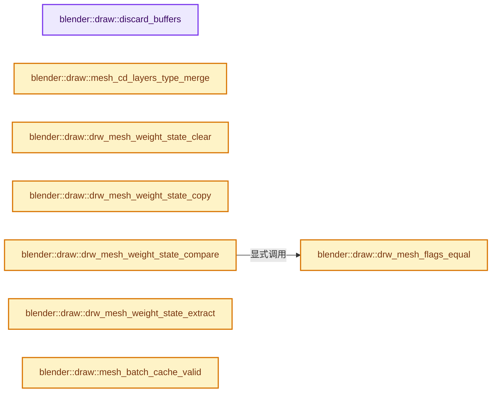
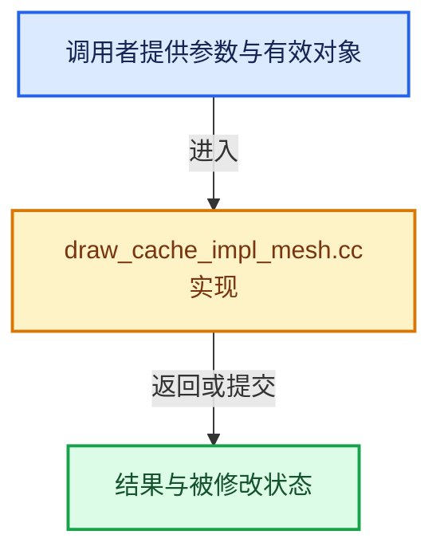

# 实现依赖专题：source/blender/draw/intern/draw_cache_impl_mesh.cc

[方向导航](README.md) · [符号索引](../%E7%AC%A6%E5%8F%B7%E4%BE%9D%E8%B5%96%E4%B8%8E%E5%AE%9E%E7%8E%B0%E7%B4%A2%E5%BC%95.md)

本专题从正文实际调用进入，集中保存共享实现。函数有稳定锚点，可从调用处直接跳到对应完整函数；递归与互相调用通过回链组织。

## 本文件的实现关系






## 完整成员与函数实现

<a id="f-d9042c3f4cbdc135"></a>

### `blender::draw::discard_buffers`

实现位置：[source/blender/draw/intern/draw_cache_impl_mesh.cc](../../../../../source/blender/draw/intern/draw_cache_impl_mesh.cc) · L61—L123。

接口参数：

- `MeshBatchCache &cache`
- `const Span<VBOType> vbos`
- `const Span<IBOType> ibos`

**教学注释版**

<!-- annotated:1bfb83662c14df -->

```cpp
static void discard_buffers(MeshBatchCache &cache,
                            const Span<VBOType> vbos,
                            const Span<IBOType> ibos)
{
  Set<const void *, 16> buffer_ptrs;
  // [讲解] buffer_ptrs.reserve：重新组织槽位或准备容量。
  buffer_ptrs.reserve(vbos.size() + ibos.size());
  FOREACH_MESH_BUFFER_CACHE (cache, mbc) {
    for (const VBOType vbo : vbos) {
      if (const auto *buffer = mbc->buff.vbos.lookup_ptr(vbo)) {
        // [讲解] buffer_ptrs.add：按哈希与相等关系加入键或键值。
        buffer_ptrs.add(buffer->get());
      }
    }
  }
  FOREACH_MESH_BUFFER_CACHE (cache, mbc) {
    for (const IBOType ibo : ibos) {
      if (const auto *buffer = mbc->buff.ibos.lookup_ptr(ibo)) {
        buffer_ptrs.add(buffer->get());
      }
    }
  }

  const auto batch_contains_data = [&](gpu::Batch &batch) {
    // [讲解] buffer_ptrs.contains：查询活项数量或键是否存在。
    if (buffer_ptrs.contains(batch.elem)) {
      return true;
    }
    if (std::any_of(batch.verts,
                    batch.verts + ARRAY_SIZE(batch.verts),
                    [&](gpu::VertBuf *vbo) { return vbo && buffer_ptrs.contains(vbo); }))
    {
      return true;
    }
    return false;
  };

  for (const int i : IndexRange(MBC_BATCH_LEN)) {
    gpu::Batch *batch = (reinterpret_cast<gpu::Batch **>(&cache.batch))[i];
    if (batch && batch_contains_data(*batch)) {
      GPU_BATCH_DISCARD_SAFE(((gpu::Batch **)&cache.batch)[i]);
      cache.batch_ready &= ~DRWBatchFlag(uint64_t(1u) << i);
    }
  }

  if (!cache.surface_per_mat.is_empty()) {
    if (cache.surface_per_mat.first() && batch_contains_data(*cache.surface_per_mat.first())) {
      /* The format for all `surface_per_mat` batches is the same, discard them all. */
      for (const int i : cache.surface_per_mat.index_range()) {
        GPU_BATCH_DISCARD_SAFE(cache.surface_per_mat[i]);
      }
      cache.batch_ready &= ~(MBC_SURFACE | MBC_SURFACE_PER_MAT);
    }
  }

  for (const VBOType vbo : vbos) {
    cache.final.buff.vbos.remove(vbo);
    cache.cage.buff.vbos.remove(vbo);
    cache.uv_cage.buff.vbos.remove(vbo);
  }
  for (const IBOType ibo : ibos) {
    cache.final.buff.ibos.remove(ibo);
    cache.cage.buff.ibos.remove(ibo);
    cache.uv_cage.buff.ibos.remove(ibo);
  }
}
```

<details>
<summary>核对原始源码：source/blender/draw/intern/draw_cache_impl_mesh.cc · L61—L123</summary>

<!-- original:1bfb83662c14df:source/blender/draw/intern/draw_cache_impl_mesh.cc:61:123 -->

```cpp
static void discard_buffers(MeshBatchCache &cache,
                            const Span<VBOType> vbos,
                            const Span<IBOType> ibos)
{
  Set<const void *, 16> buffer_ptrs;
  buffer_ptrs.reserve(vbos.size() + ibos.size());
  FOREACH_MESH_BUFFER_CACHE (cache, mbc) {
    for (const VBOType vbo : vbos) {
      if (const auto *buffer = mbc->buff.vbos.lookup_ptr(vbo)) {
        buffer_ptrs.add(buffer->get());
      }
    }
  }
  FOREACH_MESH_BUFFER_CACHE (cache, mbc) {
    for (const IBOType ibo : ibos) {
      if (const auto *buffer = mbc->buff.ibos.lookup_ptr(ibo)) {
        buffer_ptrs.add(buffer->get());
      }
    }
  }

  const auto batch_contains_data = [&](gpu::Batch &batch) {
    if (buffer_ptrs.contains(batch.elem)) {
      return true;
    }
    if (std::any_of(batch.verts,
                    batch.verts + ARRAY_SIZE(batch.verts),
                    [&](gpu::VertBuf *vbo) { return vbo && buffer_ptrs.contains(vbo); }))
    {
      return true;
    }
    return false;
  };

  for (const int i : IndexRange(MBC_BATCH_LEN)) {
    gpu::Batch *batch = (reinterpret_cast<gpu::Batch **>(&cache.batch))[i];
    if (batch && batch_contains_data(*batch)) {
      GPU_BATCH_DISCARD_SAFE(((gpu::Batch **)&cache.batch)[i]);
      cache.batch_ready &= ~DRWBatchFlag(uint64_t(1u) << i);
    }
  }

  if (!cache.surface_per_mat.is_empty()) {
    if (cache.surface_per_mat.first() && batch_contains_data(*cache.surface_per_mat.first())) {
      /* The format for all `surface_per_mat` batches is the same, discard them all. */
      for (const int i : cache.surface_per_mat.index_range()) {
        GPU_BATCH_DISCARD_SAFE(cache.surface_per_mat[i]);
      }
      cache.batch_ready &= ~(MBC_SURFACE | MBC_SURFACE_PER_MAT);
    }
  }

  for (const VBOType vbo : vbos) {
    cache.final.buff.vbos.remove(vbo);
    cache.cage.buff.vbos.remove(vbo);
    cache.uv_cage.buff.vbos.remove(vbo);
  }
  for (const IBOType ibo : ibos) {
    cache.final.buff.ibos.remove(ibo);
    cache.cage.buff.ibos.remove(ibo);
    cache.uv_cage.buff.ibos.remove(ibo);
  }
}
```

</details>

**沿实际写入检查状态**

- `cache.batch_ready &= ~DRWBatchFlag(uint64_t(1u) << i);`
- `cache.batch_ready &= ~(MBC_SURFACE | MBC_SURFACE_PER_MAT);`

**结果出口**

- `return true;`
- `return false;`

**继续追踪实现**

- `buffer_ptrs.reserve` → [blender::Set::reserve · L656](../02-%E5%93%88%E5%B8%8C%E8%A1%A8%E4%B8%8E%E5%85%B3%E8%81%94%E6%95%B0%E6%8D%AE%E7%BB%93%E6%9E%84/08-Set%E4%B8%8E%E9%9B%86%E5%90%88%E8%AF%AD%E4%B9%89.md#f-95bdc8ebdf9331d4)。
- `vbos.size` → [blender::Span::size · L256](../01-%E5%9F%BA%E7%A1%80%E5%AE%B9%E5%99%A8%E4%B8%8E%E7%8E%B0%E4%BB%A3CPP/05-Span%E5%8F%AA%E8%AF%BB%E8%BF%9E%E7%BB%AD%E8%A7%86%E5%9B%BE.md#f-5f80fa006089c998)。
- `ibos.size` → [blender::Span::size · L256](../01-%E5%9F%BA%E7%A1%80%E5%AE%B9%E5%99%A8%E4%B8%8E%E7%8E%B0%E4%BB%A3CPP/05-Span%E5%8F%AA%E8%AF%BB%E8%BF%9E%E7%BB%AD%E8%A7%86%E5%9B%BE.md#f-5f80fa006089c998)。
- `mbc->buff.vbos.lookup_ptr` → [调用协议](../%E6%A8%A1%E6%9D%BF%E5%AE%8F%E4%B8%8E%E5%8A%A8%E6%80%81%E5%88%86%E6%B4%BE%E5%8D%8F%E8%AE%AE.md)：接收对象类型依赖auto、返回值或模板实例；不按同名猜测目标。调用位置L69。
- `buffer_ptrs.add` → [blender::Set::add · L248](../02-%E5%93%88%E5%B8%8C%E8%A1%A8%E4%B8%8E%E5%85%B3%E8%81%94%E6%95%B0%E6%8D%AE%E7%BB%93%E6%9E%84/08-Set%E4%B8%8E%E9%9B%86%E5%90%88%E8%AF%AD%E4%B9%89.md#f-c7498809c2327fba)；[blender::Set::add · L252](../02-%E5%93%88%E5%B8%8C%E8%A1%A8%E4%B8%8E%E5%85%B3%E8%81%94%E6%95%B0%E6%8D%AE%E7%BB%93%E6%9E%84/08-Set%E4%B8%8E%E9%9B%86%E5%90%88%E8%AF%AD%E4%B9%89.md#f-e3ac8d1c52c03c2b)。同名重载需按实参类型选择。
- `buffer->get` → [调用协议](../%E6%A8%A1%E6%9D%BF%E5%AE%8F%E4%B8%8E%E5%8A%A8%E6%80%81%E5%88%86%E6%B4%BE%E5%8D%8F%E8%AE%AE.md)：接收对象类型依赖auto、返回值或模板实例；不按同名猜测目标。调用位置L70。
- `mbc->buff.ibos.lookup_ptr` → [调用协议](../%E6%A8%A1%E6%9D%BF%E5%AE%8F%E4%B8%8E%E5%8A%A8%E6%80%81%E5%88%86%E6%B4%BE%E5%8D%8F%E8%AE%AE.md)：接收对象类型依赖auto、返回值或模板实例；不按同名猜测目标。调用位置L76。
- `buffer_ptrs.contains` → [blender::Set::contains · L310](../02-%E5%93%88%E5%B8%8C%E8%A1%A8%E4%B8%8E%E5%85%B3%E8%81%94%E6%95%B0%E6%8D%AE%E7%BB%93%E6%9E%84/08-Set%E4%B8%8E%E9%9B%86%E5%90%88%E8%AF%AD%E4%B9%89.md#f-af7099799494350e)。
- `std::any_of` → [外部契约](https://eel.is/c++draft/)：这个边界按实际表达式及所属类型核对参数、返回值、寿命与失败行为。这里提供接口入口，不声称已解释该第三方版本的内部实现。
- `ARRAY_SIZE` → [ARRAY_SIZE · L24](%E4%BE%9D%E8%B5%96-rna_test-e441db.md#m-4f7358f7629e)。宏定义由构建条件选择。
- `IndexRange` → [blender::IndexRange](../01-%E5%9F%BA%E7%A1%80%E5%AE%B9%E5%99%A8%E4%B8%8E%E7%8E%B0%E4%BB%A3CPP/%E4%BE%9D%E8%B5%96-BLI_index_range-7d7cc5.md#t-caa3466d6776)；[blender::gpu::shader::parser::IndexRange](%E4%BE%9D%E8%B5%96-utils-06433d.md#t-82d2bd4ea71c)；[blender::IndexRange](%E4%BE%9D%E8%B5%96-DNA_node_types-6708b9.md#t-0448cc889d39)。
- `batch_contains_data` → [调用协议](../%E6%A8%A1%E6%9D%BF%E5%AE%8F%E4%B8%8E%E5%8A%A8%E6%80%81%E5%88%86%E6%B4%BE%E5%8D%8F%E8%AE%AE.md)：局部可调用对象，须结合其初始化与捕获环境。调用位置L97。
- `GPU_BATCH_DISCARD_SAFE` → [GPU_BATCH_DISCARD_SAFE · L199](%E4%BE%9D%E8%B5%96-GPU_batch-98c422.md#m-167d477926a1)。宏定义由构建条件选择。
- `DRWBatchFlag` → [blender::draw::DRWBatchFlag](%E4%BE%9D%E8%B5%96-draw_cache_extract-2d4f40.md#t-0b6fb9d8bce5)。
- `cache.surface_per_mat.is_empty` → [调用协议](../%E6%A8%A1%E6%9D%BF%E5%AE%8F%E4%B8%8E%E5%8A%A8%E6%80%81%E5%88%86%E6%B4%BE%E5%8D%8F%E8%AE%AE.md)：接收对象类型依赖auto、返回值或模板实例；不按同名猜测目标。调用位置L103。
- `cache.surface_per_mat.first` → [调用协议](../%E6%A8%A1%E6%9D%BF%E5%AE%8F%E4%B8%8E%E5%8A%A8%E6%80%81%E5%88%86%E6%B4%BE%E5%8D%8F%E8%AE%AE.md)：接收对象类型依赖auto、返回值或模板实例；不按同名猜测目标。调用位置L104。
- `cache.surface_per_mat.index_range` → [调用协议](../%E6%A8%A1%E6%9D%BF%E5%AE%8F%E4%B8%8E%E5%8A%A8%E6%80%81%E5%88%86%E6%B4%BE%E5%8D%8F%E8%AE%AE.md)：接收对象类型依赖auto、返回值或模板实例；不按同名猜测目标。调用位置L106。
- `cache.final.buff.vbos.remove` → [调用协议](../%E6%A8%A1%E6%9D%BF%E5%AE%8F%E4%B8%8E%E5%8A%A8%E6%80%81%E5%88%86%E6%B4%BE%E5%8D%8F%E8%AE%AE.md)：接收对象类型依赖auto、返回值或模板实例；不按同名猜测目标。调用位置L114。
- `cache.cage.buff.vbos.remove` → [调用协议](../%E6%A8%A1%E6%9D%BF%E5%AE%8F%E4%B8%8E%E5%8A%A8%E6%80%81%E5%88%86%E6%B4%BE%E5%8D%8F%E8%AE%AE.md)：接收对象类型依赖auto、返回值或模板实例；不按同名猜测目标。调用位置L115。
- `cache.uv_cage.buff.vbos.remove` → [调用协议](../%E6%A8%A1%E6%9D%BF%E5%AE%8F%E4%B8%8E%E5%8A%A8%E6%80%81%E5%88%86%E6%B4%BE%E5%8D%8F%E8%AE%AE.md)：接收对象类型依赖auto、返回值或模板实例；不按同名猜测目标。调用位置L116。
- `cache.final.buff.ibos.remove` → [调用协议](../%E6%A8%A1%E6%9D%BF%E5%AE%8F%E4%B8%8E%E5%8A%A8%E6%80%81%E5%88%86%E6%B4%BE%E5%8D%8F%E8%AE%AE.md)：接收对象类型依赖auto、返回值或模板实例；不按同名猜测目标。调用位置L119。
- `cache.cage.buff.ibos.remove` → [调用协议](../%E6%A8%A1%E6%9D%BF%E5%AE%8F%E4%B8%8E%E5%8A%A8%E6%80%81%E5%88%86%E6%B4%BE%E5%8D%8F%E8%AE%AE.md)：接收对象类型依赖auto、返回值或模板实例；不按同名猜测目标。调用位置L120。
- `cache.uv_cage.buff.ibos.remove` → [调用协议](../%E6%A8%A1%E6%9D%BF%E5%AE%8F%E4%B8%8E%E5%8A%A8%E6%80%81%E5%88%86%E6%B4%BE%E5%8D%8F%E8%AE%AE.md)：接收对象类型依赖auto、返回值或模板实例；不按同名猜测目标。调用位置L121。

<a id="f-8e13a89984ff562e"></a>

### `blender::draw::mesh_cd_layers_type_merge`

实现位置：[source/blender/draw/intern/draw_cache_impl_mesh.cc](../../../../../source/blender/draw/intern/draw_cache_impl_mesh.cc) · L125—L133。

接口参数：

- `DRW_MeshCDMask *a`
- `const DRW_MeshCDMask &b`

**教学注释版**

<!-- annotated:7edc0c6471b7ff -->

```cpp
BLI_INLINE void mesh_cd_layers_type_merge(DRW_MeshCDMask *a, const DRW_MeshCDMask &b)
{
  drw_attributes_merge(&a->uv, &b.uv);
  drw_attributes_merge(&a->tan, &b.tan);
  a->orco |= b.orco;
  a->tan_orco |= b.tan_orco;
  a->sculpt_overlays |= b.sculpt_overlays;
  a->edit_uv |= b.edit_uv;
}
```

<details>
<summary>核对原始源码：source/blender/draw/intern/draw_cache_impl_mesh.cc · L125—L133</summary>

<!-- original:7edc0c6471b7ff:source/blender/draw/intern/draw_cache_impl_mesh.cc:125:133 -->

```cpp
BLI_INLINE void mesh_cd_layers_type_merge(DRW_MeshCDMask *a, const DRW_MeshCDMask &b)
{
  drw_attributes_merge(&a->uv, &b.uv);
  drw_attributes_merge(&a->tan, &b.tan);
  a->orco |= b.orco;
  a->tan_orco |= b.tan_orco;
  a->sculpt_overlays |= b.sculpt_overlays;
  a->edit_uv |= b.edit_uv;
}
```

</details>

**沿实际写入检查状态**

- `a->orco |= b.orco;`
- `a->tan_orco |= b.tan_orco;`
- `a->sculpt_overlays |= b.sculpt_overlays;`
- `a->edit_uv |= b.edit_uv;`

**继续追踪实现**

- `drw_attributes_merge` → [blender::draw::drw_attributes_merge · L15](%E4%BE%9D%E8%B5%96-draw_attributes-bfed74.md#f-c419948b8e7b9204)。

<a id="f-68d9bf41ebaa5d49"></a>

### `blender::draw::drw_mesh_weight_state_clear`

实现位置：[source/blender/draw/intern/draw_cache_impl_mesh.cc](../../../../../source/blender/draw/intern/draw_cache_impl_mesh.cc) · L266—L275。

接口参数：

- `DRW_MeshWeightState *wstate`

**教学注释版**

<!-- annotated:59c984585945dc -->

```cpp
static void drw_mesh_weight_state_clear(DRW_MeshWeightState *wstate)
{
  MEM_SAFE_DELETE(wstate->defgroup_sel);
  MEM_SAFE_DELETE(wstate->defgroup_locked);
  MEM_SAFE_DELETE(wstate->defgroup_unlocked);

  // [讲解] memset：填充字节，不调用T构造函数，也不保证任意类型的全零表示是合法或期望值。
  memset(wstate, 0, sizeof(*wstate));

  wstate->defgroup_active = -1;
}
```

<details>
<summary>核对原始源码：source/blender/draw/intern/draw_cache_impl_mesh.cc · L266—L275</summary>

<!-- original:59c984585945dc:source/blender/draw/intern/draw_cache_impl_mesh.cc:266:275 -->

```cpp
static void drw_mesh_weight_state_clear(DRW_MeshWeightState *wstate)
{
  MEM_SAFE_DELETE(wstate->defgroup_sel);
  MEM_SAFE_DELETE(wstate->defgroup_locked);
  MEM_SAFE_DELETE(wstate->defgroup_unlocked);

  memset(wstate, 0, sizeof(*wstate));

  wstate->defgroup_active = -1;
}
```

</details>

**沿实际写入检查状态**

- `wstate->defgroup_active = -1;`

**继续追踪实现**

- `MEM_SAFE_DELETE` → [MEM_SAFE_DELETE · L436](../03-%E5%86%85%E5%AD%98%E5%88%86%E9%85%8D%E4%B8%8E%E8%BF%90%E8%A1%8C%E6%97%B6%E7%B1%BB%E5%9E%8B/%E4%BE%9D%E8%B5%96-MEM_guardedalloc-b54eca.md#m-eadb3bc5b902)。宏定义由构建条件选择。
- `memset` → [外部契约](https://eel.is/c++draft/cstring.syn)：填充字节，不调用T构造函数，也不保证任意类型的全零表示是合法或期望值。

<a id="f-1829f63ea58980f3"></a>

### `blender::draw::drw_mesh_weight_state_copy`

实现位置：[source/blender/draw/intern/draw_cache_impl_mesh.cc](../../../../../source/blender/draw/intern/draw_cache_impl_mesh.cc) · L278—L297。

接口参数：

- `DRW_MeshWeightState *wstate_dst`
- `const DRW_MeshWeightState *wstate_src`

**教学注释版**

<!-- annotated:0b391391c4f015 -->

```cpp
static void drw_mesh_weight_state_copy(DRW_MeshWeightState *wstate_dst,
                                       const DRW_MeshWeightState *wstate_src)
{
  MEM_SAFE_DELETE(wstate_dst->defgroup_sel);
  MEM_SAFE_DELETE(wstate_dst->defgroup_locked);
  MEM_SAFE_DELETE(wstate_dst->defgroup_unlocked);

  // [讲解] memcpy：复制字节，源与目标不应重叠。类型生命周期、对齐和可复制表示须由调用者证明，不是任意对象的复制构造。
  memcpy(wstate_dst, wstate_src, sizeof(*wstate_dst));

  if (wstate_src->defgroup_sel) {
    wstate_dst->defgroup_sel = MEM_dupalloc(wstate_src->defgroup_sel);
  }
  if (wstate_src->defgroup_locked) {
    wstate_dst->defgroup_locked = MEM_dupalloc(wstate_src->defgroup_locked);
  }
  if (wstate_src->defgroup_unlocked) {
    wstate_dst->defgroup_unlocked = static_cast<bool *>(
        MEM_dupalloc(wstate_src->defgroup_unlocked));
  }
}
```

<details>
<summary>核对原始源码：source/blender/draw/intern/draw_cache_impl_mesh.cc · L278—L297</summary>

<!-- original:0b391391c4f015:source/blender/draw/intern/draw_cache_impl_mesh.cc:278:297 -->

```cpp
static void drw_mesh_weight_state_copy(DRW_MeshWeightState *wstate_dst,
                                       const DRW_MeshWeightState *wstate_src)
{
  MEM_SAFE_DELETE(wstate_dst->defgroup_sel);
  MEM_SAFE_DELETE(wstate_dst->defgroup_locked);
  MEM_SAFE_DELETE(wstate_dst->defgroup_unlocked);

  memcpy(wstate_dst, wstate_src, sizeof(*wstate_dst));

  if (wstate_src->defgroup_sel) {
    wstate_dst->defgroup_sel = MEM_dupalloc(wstate_src->defgroup_sel);
  }
  if (wstate_src->defgroup_locked) {
    wstate_dst->defgroup_locked = MEM_dupalloc(wstate_src->defgroup_locked);
  }
  if (wstate_src->defgroup_unlocked) {
    wstate_dst->defgroup_unlocked = static_cast<bool *>(
        MEM_dupalloc(wstate_src->defgroup_unlocked));
  }
}
```

</details>

**沿实际写入检查状态**

- `wstate_dst->defgroup_sel = MEM_dupalloc(wstate_src->defgroup_sel);`
- `wstate_dst->defgroup_locked = MEM_dupalloc(wstate_src->defgroup_locked);`
- `wstate_dst->defgroup_unlocked = static_cast<bool *>(`

**继续追踪实现**

- `MEM_SAFE_DELETE` → [MEM_SAFE_DELETE · L436](../03-%E5%86%85%E5%AD%98%E5%88%86%E9%85%8D%E4%B8%8E%E8%BF%90%E8%A1%8C%E6%97%B6%E7%B1%BB%E5%9E%8B/%E4%BE%9D%E8%B5%96-MEM_guardedalloc-b54eca.md#m-eadb3bc5b902)。宏定义由构建条件选择。
- `memcpy` → [外部契约](https://eel.is/c++draft/cstring.syn)：复制字节，源与目标不应重叠。类型生命周期、对齐和可复制表示须由调用者证明，不是任意对象的复制构造。
- `MEM_dupalloc` → [MEM_dupalloc · L627](../03-%E5%86%85%E5%AD%98%E5%88%86%E9%85%8D%E4%B8%8E%E8%BF%90%E8%A1%8C%E6%97%B6%E7%B1%BB%E5%9E%8B/%E4%BE%9D%E8%B5%96-MEM_guardedalloc-b54eca.md#f-78a72b71e3c57010)。

<a id="f-abb08e8ba4832180"></a>

### `blender::draw::drw_mesh_flags_equal`

实现位置：[source/blender/draw/intern/draw_cache_impl_mesh.cc](../../../../../source/blender/draw/intern/draw_cache_impl_mesh.cc) · L299—L303。

接口参数：

- `const bool *array1`
- `const bool *array2`
- `int size`

**教学注释版**

<!-- annotated:64d7656cba27ac -->

```cpp
static bool drw_mesh_flags_equal(const bool *array1, const bool *array2, int size)
{
  return ((!array1 && !array2) ||
          (array1 && array2 && memcmp(array1, array2, size * sizeof(bool)) == 0));
}
```

<details>
<summary>核对原始源码：source/blender/draw/intern/draw_cache_impl_mesh.cc · L299—L303</summary>

<!-- original:64d7656cba27ac:source/blender/draw/intern/draw_cache_impl_mesh.cc:299:303 -->

```cpp
static bool drw_mesh_flags_equal(const bool *array1, const bool *array2, int size)
{
  return ((!array1 && !array2) ||
          (array1 && array2 && memcmp(array1, array2, size * sizeof(bool)) == 0));
}
```

</details>

**结果出口**

- `return ((!array1 && !array2) ||`

**继续追踪实现**

- `memcmp` → [外部契约](https://eel.is/c++draft/)：这个边界按实际表达式及所属类型核对参数、返回值、寿命与失败行为。这里提供接口入口，不声称已解释该第三方版本的内部实现。

<a id="f-be9c59ea799c3ed2"></a>

### `blender::draw::drw_mesh_weight_state_compare`

实现位置：[source/blender/draw/intern/draw_cache_impl_mesh.cc](../../../../../source/blender/draw/intern/draw_cache_impl_mesh.cc) · L306—L315。

接口参数：

- `const DRW_MeshWeightState *a`
- `const DRW_MeshWeightState *b`

**教学注释版**

<!-- annotated:054c83c5b36744 -->

```cpp
static bool drw_mesh_weight_state_compare(const DRW_MeshWeightState *a,
                                          const DRW_MeshWeightState *b)
{
  return a->defgroup_active == b->defgroup_active && a->defgroup_len == b->defgroup_len &&
         a->flags == b->flags && a->alert_mode == b->alert_mode &&
         a->defgroup_sel_count == b->defgroup_sel_count &&
         drw_mesh_flags_equal(a->defgroup_sel, b->defgroup_sel, a->defgroup_len) &&
         drw_mesh_flags_equal(a->defgroup_locked, b->defgroup_locked, a->defgroup_len) &&
         drw_mesh_flags_equal(a->defgroup_unlocked, b->defgroup_unlocked, a->defgroup_len);
}
```

<details>
<summary>核对原始源码：source/blender/draw/intern/draw_cache_impl_mesh.cc · L306—L315</summary>

<!-- original:054c83c5b36744:source/blender/draw/intern/draw_cache_impl_mesh.cc:306:315 -->

```cpp
static bool drw_mesh_weight_state_compare(const DRW_MeshWeightState *a,
                                          const DRW_MeshWeightState *b)
{
  return a->defgroup_active == b->defgroup_active && a->defgroup_len == b->defgroup_len &&
         a->flags == b->flags && a->alert_mode == b->alert_mode &&
         a->defgroup_sel_count == b->defgroup_sel_count &&
         drw_mesh_flags_equal(a->defgroup_sel, b->defgroup_sel, a->defgroup_len) &&
         drw_mesh_flags_equal(a->defgroup_locked, b->defgroup_locked, a->defgroup_len) &&
         drw_mesh_flags_equal(a->defgroup_unlocked, b->defgroup_unlocked, a->defgroup_len);
}
```

</details>

**结果出口**

- `return a->defgroup_active == b->defgroup_active && a->defgroup_len == b->defgroup_len &&`

**继续追踪实现**

- `drw_mesh_flags_equal` → [blender::draw::drw_mesh_flags_equal · L299](%E4%BE%9D%E8%B5%96-draw_cache_impl_mesh-9e7b5a.md#f-abb08e8ba4832180)。

<a id="f-782c1ec32f475d70"></a>

### `blender::draw::drw_mesh_weight_state_extract`

实现位置：[source/blender/draw/intern/draw_cache_impl_mesh.cc](../../../../../source/blender/draw/intern/draw_cache_impl_mesh.cc) · L317—L380。

接口参数：

- `Object &ob`
- `Mesh &mesh`
- `const ToolSettings &ts`
- `bool paint_mode`
- `DRW_MeshWeightState *wstate`

**教学注释版**

<!-- annotated:9450700f999a4d -->

```cpp
static void drw_mesh_weight_state_extract(
    Object &ob, Mesh &mesh, const ToolSettings &ts, bool paint_mode, DRW_MeshWeightState *wstate)
{
  /* Extract complete vertex weight group selection state and mode flags. */
  // [讲解] memset：填充字节，不调用T构造函数，也不保证任意类型的全零表示是合法或期望值。
  memset(wstate, 0, sizeof(*wstate));

  wstate->defgroup_active = mesh.vertex_group_active_index - 1;
  wstate->defgroup_len = mesh.vertex_group_names.count();

  wstate->alert_mode = ts.weightuser;

  if (paint_mode && ts.multipaint) {
    /* Multi-paint needs to know all selected bones, not just the active group.
     * This is actually a relatively expensive operation, but caching would be difficult. */
    wstate->defgroup_sel = BKE_object_defgroup_selected_get(
        &ob, wstate->defgroup_len, &wstate->defgroup_sel_count);

    if (wstate->defgroup_sel_count > 1) {
      wstate->flags |= DRW_MESH_WEIGHT_STATE_MULTIPAINT |
                       (ts.auto_normalize ? DRW_MESH_WEIGHT_STATE_AUTO_NORMALIZE : 0);

      if (ME_USING_MIRROR_X_VERTEX_GROUPS(&mesh)) {
        BKE_object_defgroup_mirror_selection(&ob,
                                             wstate->defgroup_len,
                                             wstate->defgroup_sel,
                                             wstate->defgroup_sel,
                                             &wstate->defgroup_sel_count);
      }
    }
    /* With only one selected bone Multi-paint reverts to regular mode. */
    else {
      wstate->defgroup_sel_count = 0;
      MEM_SAFE_DELETE(wstate->defgroup_sel);
    }
  }

  if (paint_mode && ts.wpaint_lock_relative) {
    /* Set of locked vertex groups for the lock relative mode. */
    wstate->defgroup_locked = BKE_object_defgroup_lock_flags_get(&ob, wstate->defgroup_len);
    wstate->defgroup_unlocked = BKE_object_defgroup_validmap_get(&ob, wstate->defgroup_len);

    /* Check that a deform group is active, and none of selected groups are locked. */
    if (BKE_object_defgroup_check_lock_relative(
            wstate->defgroup_locked, wstate->defgroup_unlocked, wstate->defgroup_active) &&
        BKE_object_defgroup_check_lock_relative_multi(wstate->defgroup_len,
                                                      wstate->defgroup_locked,
                                                      wstate->defgroup_sel,
                                                      wstate->defgroup_sel_count))
    {
      wstate->flags |= DRW_MESH_WEIGHT_STATE_LOCK_RELATIVE;

      /* Compute the set of locked and unlocked deform vertex groups. */
      BKE_object_defgroup_split_locked_validmap(wstate->defgroup_len,
                                                wstate->defgroup_locked,
                                                wstate->defgroup_unlocked,
                                                wstate->defgroup_locked, /* out */
                                                wstate->defgroup_unlocked);
    }
    else {
      MEM_SAFE_DELETE(wstate->defgroup_unlocked);
      MEM_SAFE_DELETE(wstate->defgroup_locked);
    }
  }
}
```

<details>
<summary>核对原始源码：source/blender/draw/intern/draw_cache_impl_mesh.cc · L317—L380</summary>

<!-- original:9450700f999a4d:source/blender/draw/intern/draw_cache_impl_mesh.cc:317:380 -->

```cpp
static void drw_mesh_weight_state_extract(
    Object &ob, Mesh &mesh, const ToolSettings &ts, bool paint_mode, DRW_MeshWeightState *wstate)
{
  /* Extract complete vertex weight group selection state and mode flags. */
  memset(wstate, 0, sizeof(*wstate));

  wstate->defgroup_active = mesh.vertex_group_active_index - 1;
  wstate->defgroup_len = mesh.vertex_group_names.count();

  wstate->alert_mode = ts.weightuser;

  if (paint_mode && ts.multipaint) {
    /* Multi-paint needs to know all selected bones, not just the active group.
     * This is actually a relatively expensive operation, but caching would be difficult. */
    wstate->defgroup_sel = BKE_object_defgroup_selected_get(
        &ob, wstate->defgroup_len, &wstate->defgroup_sel_count);

    if (wstate->defgroup_sel_count > 1) {
      wstate->flags |= DRW_MESH_WEIGHT_STATE_MULTIPAINT |
                       (ts.auto_normalize ? DRW_MESH_WEIGHT_STATE_AUTO_NORMALIZE : 0);

      if (ME_USING_MIRROR_X_VERTEX_GROUPS(&mesh)) {
        BKE_object_defgroup_mirror_selection(&ob,
                                             wstate->defgroup_len,
                                             wstate->defgroup_sel,
                                             wstate->defgroup_sel,
                                             &wstate->defgroup_sel_count);
      }
    }
    /* With only one selected bone Multi-paint reverts to regular mode. */
    else {
      wstate->defgroup_sel_count = 0;
      MEM_SAFE_DELETE(wstate->defgroup_sel);
    }
  }

  if (paint_mode && ts.wpaint_lock_relative) {
    /* Set of locked vertex groups for the lock relative mode. */
    wstate->defgroup_locked = BKE_object_defgroup_lock_flags_get(&ob, wstate->defgroup_len);
    wstate->defgroup_unlocked = BKE_object_defgroup_validmap_get(&ob, wstate->defgroup_len);

    /* Check that a deform group is active, and none of selected groups are locked. */
    if (BKE_object_defgroup_check_lock_relative(
            wstate->defgroup_locked, wstate->defgroup_unlocked, wstate->defgroup_active) &&
        BKE_object_defgroup_check_lock_relative_multi(wstate->defgroup_len,
                                                      wstate->defgroup_locked,
                                                      wstate->defgroup_sel,
                                                      wstate->defgroup_sel_count))
    {
      wstate->flags |= DRW_MESH_WEIGHT_STATE_LOCK_RELATIVE;

      /* Compute the set of locked and unlocked deform vertex groups. */
      BKE_object_defgroup_split_locked_validmap(wstate->defgroup_len,
                                                wstate->defgroup_locked,
                                                wstate->defgroup_unlocked,
                                                wstate->defgroup_locked, /* out */
                                                wstate->defgroup_unlocked);
    }
    else {
      MEM_SAFE_DELETE(wstate->defgroup_unlocked);
      MEM_SAFE_DELETE(wstate->defgroup_locked);
    }
  }
}
```

</details>

**沿实际写入检查状态**

- `wstate->defgroup_active = mesh.vertex_group_active_index - 1;`
- `wstate->defgroup_len = mesh.vertex_group_names.count();`
- `wstate->alert_mode = ts.weightuser;`
- `wstate->defgroup_sel = BKE_object_defgroup_selected_get(`
- `wstate->flags |= DRW_MESH_WEIGHT_STATE_MULTIPAINT |`
- `wstate->defgroup_sel_count = 0;`
- `wstate->defgroup_locked = BKE_object_defgroup_lock_flags_get(&ob, wstate->defgroup_len);`
- `wstate->defgroup_unlocked = BKE_object_defgroup_validmap_get(&ob, wstate->defgroup_len);`
- `wstate->flags |= DRW_MESH_WEIGHT_STATE_LOCK_RELATIVE;`

**继续追踪实现**

- `memset` → [外部契约](https://eel.is/c++draft/cstring.syn)：填充字节，不调用T构造函数，也不保证任意类型的全零表示是合法或期望值。
- `mesh.vertex_group_names.count` → [调用协议](../%E6%A8%A1%E6%9D%BF%E5%AE%8F%E4%B8%8E%E5%8A%A8%E6%80%81%E5%88%86%E6%B4%BE%E5%8D%8F%E8%AE%AE.md)：接收对象类型依赖auto、返回值或模板实例；不按同名猜测目标。调用位置L324。
- `BKE_object_defgroup_selected_get` → [blender::BKE_object_defgroup_selected_get · L634](%E4%BE%9D%E8%B5%96-object_deform-506d0f.md#f-e7217f53b5006733)。
- `ME_USING_MIRROR_X_VERTEX_GROUPS` → [ME_USING_MIRROR_X_VERTEX_GROUPS · L76](%E4%BE%9D%E8%B5%96-DNA_mesh_types-81f02e.md#m-f3b4f303ccb7)。宏定义由构建条件选择。
- `BKE_object_defgroup_mirror_selection` → [blender::BKE_object_defgroup_mirror_selection · L737](%E4%BE%9D%E8%B5%96-object_deform-506d0f.md#f-77ba3016f24e95a5)。
- `MEM_SAFE_DELETE` → [MEM_SAFE_DELETE · L436](../03-%E5%86%85%E5%AD%98%E5%88%86%E9%85%8D%E4%B8%8E%E8%BF%90%E8%A1%8C%E6%97%B6%E7%B1%BB%E5%9E%8B/%E4%BE%9D%E8%B5%96-MEM_guardedalloc-b54eca.md#m-eadb3bc5b902)。宏定义由构建条件选择。
- `BKE_object_defgroup_lock_flags_get` → [blender::BKE_object_defgroup_lock_flags_get · L543](%E4%BE%9D%E8%B5%96-object_deform-506d0f.md#f-b5ded32c590732ab)。
- `BKE_object_defgroup_validmap_get` → [blender::BKE_object_defgroup_validmap_get · L565](%E4%BE%9D%E8%B5%96-object_deform-506d0f.md#f-fe1ab0f8c63fa02e)。
- `BKE_object_defgroup_check_lock_relative` → [blender::BKE_object_defgroup_check_lock_relative · L666](%E4%BE%9D%E8%B5%96-object_deform-506d0f.md#f-0fd2a788ebdad254)。
- `BKE_object_defgroup_check_lock_relative_multi` → [blender::BKE_object_defgroup_check_lock_relative_multi · L673](%E4%BE%9D%E8%B5%96-object_deform-506d0f.md#f-943ade424162e947)。
- `BKE_object_defgroup_split_locked_validmap` → [blender::BKE_object_defgroup_split_locked_validmap · L715](%E4%BE%9D%E8%B5%96-object_deform-506d0f.md#f-e2273002af553934)。

<a id="f-c4cb7b21cd1b1de7"></a>

### `blender::draw::mesh_batch_cache_valid`

实现位置：[source/blender/draw/intern/draw_cache_impl_mesh.cc](../../../../../source/blender/draw/intern/draw_cache_impl_mesh.cc) · L390—L413。

接口参数：

- `Mesh &mesh`

**教学注释版**

<!-- annotated:1bf7b96dd0dd42 -->

```cpp
static bool mesh_batch_cache_valid(Mesh &mesh)
{
  MeshBatchCache *cache = mesh.runtime->batch_cache;

  if (cache == nullptr) {
    return false;
  }

  /* NOTE: bke::pbvh::Tree draw data should not be checked here. */

  if (cache->is_editmode != (mesh.runtime->edit_mesh != nullptr)) {
    return false;
  }

  if (cache->is_dirty) {
    return false;
  }

  if (cache->mat_len != BKE_id_material_used_with_fallback_eval(mesh.id)) {
    return false;
  }

  return true;
}
```

<details>
<summary>核对原始源码：source/blender/draw/intern/draw_cache_impl_mesh.cc · L390—L413</summary>

<!-- original:1bf7b96dd0dd42:source/blender/draw/intern/draw_cache_impl_mesh.cc:390:413 -->

```cpp
static bool mesh_batch_cache_valid(Mesh &mesh)
{
  MeshBatchCache *cache = mesh.runtime->batch_cache;

  if (cache == nullptr) {
    return false;
  }

  /* NOTE: bke::pbvh::Tree draw data should not be checked here. */

  if (cache->is_editmode != (mesh.runtime->edit_mesh != nullptr)) {
    return false;
  }

  if (cache->is_dirty) {
    return false;
  }

  if (cache->mat_len != BKE_id_material_used_with_fallback_eval(mesh.id)) {
    return false;
  }

  return true;
}
```

</details>

**结果出口**

- `return false;`
- `return true;`

**继续追踪实现**

- `BKE_id_material_used_with_fallback_eval` → [blender::BKE_id_material_used_with_fallback_eval · L891](%E4%BE%9D%E8%B5%96-material-aea8ec.md#f-54149818112236cb)。

<a id="f-a1849c3780bb12b7"></a>

### `blender::draw::mesh_batch_cache_init`

实现位置：[source/blender/draw/intern/draw_cache_impl_mesh.cc](../../../../../source/blender/draw/intern/draw_cache_impl_mesh.cc) · L415—L443。

接口参数：

- `Mesh &mesh`

**教学注释版**

<!-- annotated:656aeaf893ae82 -->

```cpp
static void mesh_batch_cache_init(Mesh &mesh)
{
  if (!mesh.runtime->batch_cache) {
    mesh.runtime->batch_cache = MEM_new<MeshBatchCache>(__func__);
  }
  else {
    *mesh.runtime->batch_cache = {};
  }
  MeshBatchCache *cache = mesh.runtime->batch_cache;

  cache->is_editmode = mesh.runtime->edit_mesh != nullptr;

  if (cache->is_editmode == false) {
    // cache->edge_len = mesh_render_edges_len_get(mesh);
    // cache->tri_len = mesh_render_corner_tris_len_get(mesh);
    // cache->face_len = mesh_render_faces_len_get(mesh);
    // cache->vert_len = mesh_render_verts_len_get(mesh);
  }

  cache->mat_len = BKE_id_material_used_with_fallback_eval(mesh.id);
  cache->surface_per_mat = Array<gpu::Batch *>(cache->mat_len, nullptr);
  cache->tris_per_mat.reinitialize(cache->mat_len);

  cache->is_dirty = false;
  cache->batch_ready = DRWBatchFlag(0);
  cache->batch_requested = DRWBatchFlag(0);

  drw_mesh_weight_state_clear(&cache->weight_state);
}
```

<details>
<summary>核对原始源码：source/blender/draw/intern/draw_cache_impl_mesh.cc · L415—L443</summary>

<!-- original:656aeaf893ae82:source/blender/draw/intern/draw_cache_impl_mesh.cc:415:443 -->

```cpp
static void mesh_batch_cache_init(Mesh &mesh)
{
  if (!mesh.runtime->batch_cache) {
    mesh.runtime->batch_cache = MEM_new<MeshBatchCache>(__func__);
  }
  else {
    *mesh.runtime->batch_cache = {};
  }
  MeshBatchCache *cache = mesh.runtime->batch_cache;

  cache->is_editmode = mesh.runtime->edit_mesh != nullptr;

  if (cache->is_editmode == false) {
    // cache->edge_len = mesh_render_edges_len_get(mesh);
    // cache->tri_len = mesh_render_corner_tris_len_get(mesh);
    // cache->face_len = mesh_render_faces_len_get(mesh);
    // cache->vert_len = mesh_render_verts_len_get(mesh);
  }

  cache->mat_len = BKE_id_material_used_with_fallback_eval(mesh.id);
  cache->surface_per_mat = Array<gpu::Batch *>(cache->mat_len, nullptr);
  cache->tris_per_mat.reinitialize(cache->mat_len);

  cache->is_dirty = false;
  cache->batch_ready = DRWBatchFlag(0);
  cache->batch_requested = DRWBatchFlag(0);

  drw_mesh_weight_state_clear(&cache->weight_state);
}
```

</details>

**沿实际写入检查状态**

- `mesh.runtime->batch_cache = MEM_new<MeshBatchCache>(__func__);`
- `cache->is_editmode = mesh.runtime->edit_mesh != nullptr;`
- `cache->mat_len = BKE_id_material_used_with_fallback_eval(mesh.id);`
- `cache->surface_per_mat = Array<gpu::Batch *>(cache->mat_len, nullptr);`
- `cache->is_dirty = false;`
- `cache->batch_ready = DRWBatchFlag(0);`
- `cache->batch_requested = DRWBatchFlag(0);`

**继续追踪实现**

- `MEM_new<MeshBatchCache>` → [MEM_new · L351](../03-%E5%86%85%E5%AD%98%E5%88%86%E9%85%8D%E4%B8%8E%E8%BF%90%E8%A1%8C%E6%97%B6%E7%B1%BB%E5%9E%8B/%E4%BE%9D%E8%B5%96-MEM_guardedalloc-b54eca.md#f-115f9b6784f89912)。
- `BKE_id_material_used_with_fallback_eval` → [blender::BKE_id_material_used_with_fallback_eval · L891](%E4%BE%9D%E8%B5%96-material-aea8ec.md#f-54149818112236cb)。
- `Array<gpu::Batch *>` → [blender::Array::Array · L78](../01-%E5%9F%BA%E7%A1%80%E5%AE%B9%E5%99%A8%E4%B8%8E%E7%8E%B0%E4%BB%A3CPP/07-Array%E6%9E%84%E9%80%A0%E4%B8%8E%E5%AD%98%E5%82%A8.md#f-001fd5eb3c658238)；[blender::Array::Array · L84](../01-%E5%9F%BA%E7%A1%80%E5%AE%B9%E5%99%A8%E4%B8%8E%E7%8E%B0%E4%BB%A3CPP/07-Array%E6%9E%84%E9%80%A0%E4%B8%8E%E5%AD%98%E5%82%A8.md#f-674e2f10361a462b)；[blender::Array::Array · L89](../01-%E5%9F%BA%E7%A1%80%E5%AE%B9%E5%99%A8%E4%B8%8E%E7%8E%B0%E4%BB%A3CPP/07-Array%E6%9E%84%E9%80%A0%E4%B8%8E%E5%AD%98%E5%82%A8.md#f-aa1e5908a9b67557)；[blender::Array::Array · L103](../01-%E5%9F%BA%E7%A1%80%E5%AE%B9%E5%99%A8%E4%B8%8E%E7%8E%B0%E4%BB%A3CPP/07-Array%E6%9E%84%E9%80%A0%E4%B8%8E%E5%AD%98%E5%82%A8.md#f-b141be39084346f3)；[blender::Array::Array · L110](../01-%E5%9F%BA%E7%A1%80%E5%AE%B9%E5%99%A8%E4%B8%8E%E7%8E%B0%E4%BB%A3CPP/07-Array%E6%9E%84%E9%80%A0%E4%B8%8E%E5%AD%98%E5%82%A8.md#f-452e276f39e81a2a)；[blender::Array::Array · L123](../01-%E5%9F%BA%E7%A1%80%E5%AE%B9%E5%99%A8%E4%B8%8E%E7%8E%B0%E4%BB%A3CPP/07-Array%E6%9E%84%E9%80%A0%E4%B8%8E%E5%AD%98%E5%82%A8.md#f-646aa58152ec44f6)；[blender::Array::Array · L135](../01-%E5%9F%BA%E7%A1%80%E5%AE%B9%E5%99%A8%E4%B8%8E%E7%8E%B0%E4%BB%A3CPP/07-Array%E6%9E%84%E9%80%A0%E4%B8%8E%E5%AD%98%E5%82%A8.md#f-0a9de4a549125f99)；[blender::Array::Array · L168](../01-%E5%9F%BA%E7%A1%80%E5%AE%B9%E5%99%A8%E4%B8%8E%E7%8E%B0%E4%BB%A3CPP/07-Array%E6%9E%84%E9%80%A0%E4%B8%8E%E5%AD%98%E5%82%A8.md#f-31f001eb92069e9d)；[blender::Array::Array · L176](../01-%E5%9F%BA%E7%A1%80%E5%AE%B9%E5%99%A8%E4%B8%8E%E7%8E%B0%E4%BB%A3CPP/07-Array%E6%9E%84%E9%80%A0%E4%B8%8E%E5%AD%98%E5%82%A8.md#f-cf8148f06fc6747a)；[blender::Array::Array · L178](../01-%E5%9F%BA%E7%A1%80%E5%AE%B9%E5%99%A8%E4%B8%8E%E7%8E%B0%E4%BB%A3CPP/07-Array%E6%9E%84%E9%80%A0%E4%B8%8E%E5%AD%98%E5%82%A8.md#f-2ddca2fb9dd964b3)。同名重载需按实参类型选择。
- `cache->tris_per_mat.reinitialize` → [调用协议](../%E6%A8%A1%E6%9D%BF%E5%AE%8F%E4%B8%8E%E5%8A%A8%E6%80%81%E5%88%86%E6%B4%BE%E5%8D%8F%E8%AE%AE.md)：接收对象类型依赖auto、返回值或模板实例；不按同名猜测目标。调用位置L436。
- `DRWBatchFlag` → [blender::draw::DRWBatchFlag](%E4%BE%9D%E8%B5%96-draw_cache_extract-2d4f40.md#t-0b6fb9d8bce5)。
- `drw_mesh_weight_state_clear` → [blender::draw::drw_mesh_weight_state_clear · L266](%E4%BE%9D%E8%B5%96-draw_cache_impl_mesh-9e7b5a.md#f-68d9bf41ebaa5d49)。

<a id="f-ad8b5318051b3b97"></a>

### `blender::draw::DRW_mesh_batch_cache_validate`

实现位置：[source/blender/draw/intern/draw_cache_impl_mesh.cc](../../../../../source/blender/draw/intern/draw_cache_impl_mesh.cc) · L445—L453。

接口参数：

- `Mesh &mesh`

**教学注释版**

<!-- annotated:326c8e1304ee5f -->

```cpp
void DRW_mesh_batch_cache_validate(Mesh &mesh)
{
  if (!mesh_batch_cache_valid(mesh)) {
    if (mesh.runtime->batch_cache) {
      mesh_batch_cache_clear(*mesh.runtime->batch_cache);
    }
    mesh_batch_cache_init(mesh);
  }
}
```

<details>
<summary>核对原始源码：source/blender/draw/intern/draw_cache_impl_mesh.cc · L445—L453</summary>

<!-- original:326c8e1304ee5f:source/blender/draw/intern/draw_cache_impl_mesh.cc:445:453 -->

```cpp
void DRW_mesh_batch_cache_validate(Mesh &mesh)
{
  if (!mesh_batch_cache_valid(mesh)) {
    if (mesh.runtime->batch_cache) {
      mesh_batch_cache_clear(*mesh.runtime->batch_cache);
    }
    mesh_batch_cache_init(mesh);
  }
}
```

</details>

**继续追踪实现**

- `mesh_batch_cache_valid` → [blender::draw::mesh_batch_cache_valid · L390](%E4%BE%9D%E8%B5%96-draw_cache_impl_mesh-9e7b5a.md#f-c4cb7b21cd1b1de7)。
- `mesh_batch_cache_clear` → [blender::draw::mesh_batch_cache_clear · L604](%E4%BE%9D%E8%B5%96-draw_cache_impl_mesh-9e7b5a.md#f-d37d9972842d1bcc)。
- `mesh_batch_cache_init` → [blender::draw::mesh_batch_cache_init · L415](%E4%BE%9D%E8%B5%96-draw_cache_impl_mesh-9e7b5a.md#f-a1849c3780bb12b7)。

<a id="f-a233c57a20abbef6"></a>

### `blender::draw::mesh_batch_cache_get`

实现位置：[source/blender/draw/intern/draw_cache_impl_mesh.cc](../../../../../source/blender/draw/intern/draw_cache_impl_mesh.cc) · L455—L458。

接口参数：

- `Mesh &mesh`

**教学注释版**

<!-- annotated:d817953294f6d1 -->

```cpp
static MeshBatchCache *mesh_batch_cache_get(Mesh &mesh)
{
  return mesh.runtime->batch_cache;
}
```

<details>
<summary>核对原始源码：source/blender/draw/intern/draw_cache_impl_mesh.cc · L455—L458</summary>

<!-- original:d817953294f6d1:source/blender/draw/intern/draw_cache_impl_mesh.cc:455:458 -->

```cpp
static MeshBatchCache *mesh_batch_cache_get(Mesh &mesh)
{
  return mesh.runtime->batch_cache;
}
```

</details>

**结果出口**

- `return mesh.runtime->batch_cache;`

**继续追踪实现**

本实现没有需要继续展开的显式调用；检查返回表达式、对象转换和调用者前置条件。

<a id="f-f7e54026f8fad071"></a>

### `blender::draw::mesh_batch_cache_check_vertex_group`

实现位置：[source/blender/draw/intern/draw_cache_impl_mesh.cc](../../../../../source/blender/draw/intern/draw_cache_impl_mesh.cc) · L460—L473。

接口参数：

- `MeshBatchCache &cache`
- `const DRW_MeshWeightState *wstate`

**教学注释版**

<!-- annotated:c1b6af74336efb -->

```cpp
static void mesh_batch_cache_check_vertex_group(MeshBatchCache &cache,
                                                const DRW_MeshWeightState *wstate)
{
  if (!drw_mesh_weight_state_compare(&cache.weight_state, wstate)) {
    FOREACH_MESH_BUFFER_CACHE (cache, mbc) {
      mbc->buff.vbos.remove(VBOType::VertexGroupWeight);
    }
    GPU_BATCH_CLEAR_SAFE(cache.batch.surface_weights);

    cache.batch_ready &= ~MBC_SURFACE_WEIGHTS;

    drw_mesh_weight_state_clear(&cache.weight_state);
  }
}
```

<details>
<summary>核对原始源码：source/blender/draw/intern/draw_cache_impl_mesh.cc · L460—L473</summary>

<!-- original:c1b6af74336efb:source/blender/draw/intern/draw_cache_impl_mesh.cc:460:473 -->

```cpp
static void mesh_batch_cache_check_vertex_group(MeshBatchCache &cache,
                                                const DRW_MeshWeightState *wstate)
{
  if (!drw_mesh_weight_state_compare(&cache.weight_state, wstate)) {
    FOREACH_MESH_BUFFER_CACHE (cache, mbc) {
      mbc->buff.vbos.remove(VBOType::VertexGroupWeight);
    }
    GPU_BATCH_CLEAR_SAFE(cache.batch.surface_weights);

    cache.batch_ready &= ~MBC_SURFACE_WEIGHTS;

    drw_mesh_weight_state_clear(&cache.weight_state);
  }
}
```

</details>

**沿实际写入检查状态**

- `cache.batch_ready &= ~MBC_SURFACE_WEIGHTS;`

**继续追踪实现**

- `drw_mesh_weight_state_compare` → [blender::draw::drw_mesh_weight_state_compare · L306](%E4%BE%9D%E8%B5%96-draw_cache_impl_mesh-9e7b5a.md#f-be9c59ea799c3ed2)。
- `mbc->buff.vbos.remove` → [调用协议](../%E6%A8%A1%E6%9D%BF%E5%AE%8F%E4%B8%8E%E5%8A%A8%E6%80%81%E5%88%86%E6%B4%BE%E5%8D%8F%E8%AE%AE.md)：接收对象类型依赖auto、返回值或模板实例；不按同名猜测目标。调用位置L465。
- `GPU_BATCH_CLEAR_SAFE` → [GPU_BATCH_CLEAR_SAFE · L185](%E4%BE%9D%E8%B5%96-GPU_batch-98c422.md#m-cfd466eaf4c6)。宏定义由构建条件选择。
- `drw_mesh_weight_state_clear` → [blender::draw::drw_mesh_weight_state_clear · L266](%E4%BE%9D%E8%B5%96-draw_cache_impl_mesh-9e7b5a.md#f-68d9bf41ebaa5d49)。

<a id="f-773eb983648779fd"></a>

### `blender::draw::mesh_batch_cache_discard_shaded_tri`

实现位置：[source/blender/draw/intern/draw_cache_impl_mesh.cc](../../../../../source/blender/draw/intern/draw_cache_impl_mesh.cc) · L502—L511。

接口参数：

- `MeshBatchCache &cache`

**教学注释版**

<!-- annotated:4d363168a777c6 -->

```cpp
static void mesh_batch_cache_discard_shaded_tri(MeshBatchCache &cache)
{
  discard_buffers(cache, {VBOType::UVs, VBOType::Tangents, VBOType::Orco}, {});

  if (cache.surface_blas) {
    GPU_ray_tracing_blas_discard(cache.surface_blas);
    cache.surface_blas = nullptr;
    cache.surface_blas_ready = false;
  }
}
```

<details>
<summary>核对原始源码：source/blender/draw/intern/draw_cache_impl_mesh.cc · L502—L511</summary>

<!-- original:4d363168a777c6:source/blender/draw/intern/draw_cache_impl_mesh.cc:502:511 -->

```cpp
static void mesh_batch_cache_discard_shaded_tri(MeshBatchCache &cache)
{
  discard_buffers(cache, {VBOType::UVs, VBOType::Tangents, VBOType::Orco}, {});

  if (cache.surface_blas) {
    GPU_ray_tracing_blas_discard(cache.surface_blas);
    cache.surface_blas = nullptr;
    cache.surface_blas_ready = false;
  }
}
```

</details>

**沿实际写入检查状态**

- `cache.surface_blas = nullptr;`
- `cache.surface_blas_ready = false;`

**继续追踪实现**

- `discard_buffers` → [blender::draw::discard_buffers · L61](%E4%BE%9D%E8%B5%96-draw_cache_impl_mesh-9e7b5a.md#f-d9042c3f4cbdc135)。
- `GPU_ray_tracing_blas_discard` → [GPU_ray_tracing_blas_discard · L36](%E4%BE%9D%E8%B5%96-gpu_ray_tracing-4fda66.md#f-43ca41b72b72f0a3)。

<a id="f-62e4652f7299b703"></a>

### `blender::draw::mesh_batch_cache_discard_uvedit`

实现位置：[source/blender/draw/intern/draw_cache_impl_mesh.cc](../../../../../source/blender/draw/intern/draw_cache_impl_mesh.cc) · L513—L535。

接口参数：

- `MeshBatchCache &cache`

**教学注释版**

<!-- annotated:95812ab03bc5db -->

```cpp
static void mesh_batch_cache_discard_uvedit(MeshBatchCache &cache)
{
  discard_buffers(cache,
                  {VBOType::EditUVStretchAngle,
                   VBOType::EditUVStretchArea,
                   VBOType::UVs,
                   VBOType::EditUVData,
                   VBOType::FaceDotUV,
                   VBOType::FaceDotEditUVData},
                  {IBOType::EditUVTris,
                   IBOType::EditUVLines,
                   IBOType::EditUVPoints,
                   IBOType::EditUVFaceDots,
                   IBOType::UVLines,
                   IBOType::UVTris});

  cache.tot_area = 0.0f;
  cache.tot_uv_area = 0.0f;

  /* We discarded the vbo.uv so we need to reset the cd_used flag. */
  cache.cd_used.uv.clear();
  cache.cd_used.edit_uv = false;
}
```

<details>
<summary>核对原始源码：source/blender/draw/intern/draw_cache_impl_mesh.cc · L513—L535</summary>

<!-- original:95812ab03bc5db:source/blender/draw/intern/draw_cache_impl_mesh.cc:513:535 -->

```cpp
static void mesh_batch_cache_discard_uvedit(MeshBatchCache &cache)
{
  discard_buffers(cache,
                  {VBOType::EditUVStretchAngle,
                   VBOType::EditUVStretchArea,
                   VBOType::UVs,
                   VBOType::EditUVData,
                   VBOType::FaceDotUV,
                   VBOType::FaceDotEditUVData},
                  {IBOType::EditUVTris,
                   IBOType::EditUVLines,
                   IBOType::EditUVPoints,
                   IBOType::EditUVFaceDots,
                   IBOType::UVLines,
                   IBOType::UVTris});

  cache.tot_area = 0.0f;
  cache.tot_uv_area = 0.0f;

  /* We discarded the vbo.uv so we need to reset the cd_used flag. */
  cache.cd_used.uv.clear();
  cache.cd_used.edit_uv = false;
}
```

</details>

**沿实际写入检查状态**

- `cache.tot_area = 0.0f;`
- `cache.tot_uv_area = 0.0f;`
- `cache.cd_used.edit_uv = false;`

**继续追踪实现**

- `discard_buffers` → [blender::draw::discard_buffers · L61](%E4%BE%9D%E8%B5%96-draw_cache_impl_mesh-9e7b5a.md#f-d9042c3f4cbdc135)。
- `cache.cd_used.uv.clear` → [调用协议](../%E6%A8%A1%E6%9D%BF%E5%AE%8F%E4%B8%8E%E5%8A%A8%E6%80%81%E5%88%86%E6%B4%BE%E5%8D%8F%E8%AE%AE.md)：接收对象类型依赖auto、返回值或模板实例；不按同名猜测目标。调用位置L533。

<a id="f-f9a7b51f4e9ac7ff"></a>

### `blender::draw::mesh_buffer_cache_clear`

实现位置：[source/blender/draw/intern/draw_cache_impl_mesh.cc](../../../../../source/blender/draw/intern/draw_cache_impl_mesh.cc) · L583—L593。

接口参数：

- `MeshBufferCache *mbc`

**教学注释版**

<!-- annotated:e008047671da07 -->

```cpp
static void mesh_buffer_cache_clear(MeshBufferCache *mbc)
{
  mbc->buff.ibos.clear();
  mbc->buff.vbos.clear();

  mbc->loose_geom = {};
  mbc->face_sorted = {};
  mbc->corner_verts.reset();
  mbc->corner_edges.reset();
  mbc->face_offsets.reset();
}
```

<details>
<summary>核对原始源码：source/blender/draw/intern/draw_cache_impl_mesh.cc · L583—L593</summary>

<!-- original:e008047671da07:source/blender/draw/intern/draw_cache_impl_mesh.cc:583:593 -->

```cpp
static void mesh_buffer_cache_clear(MeshBufferCache *mbc)
{
  mbc->buff.ibos.clear();
  mbc->buff.vbos.clear();

  mbc->loose_geom = {};
  mbc->face_sorted = {};
  mbc->corner_verts.reset();
  mbc->corner_edges.reset();
  mbc->face_offsets.reset();
}
```

</details>

**沿实际写入检查状态**

- `mbc->loose_geom = {};`
- `mbc->face_sorted = {};`

**继续追踪实现**

- `mbc->buff.ibos.clear` → [调用协议](../%E6%A8%A1%E6%9D%BF%E5%AE%8F%E4%B8%8E%E5%8A%A8%E6%80%81%E5%88%86%E6%B4%BE%E5%8D%8F%E8%AE%AE.md)：接收对象类型依赖auto、返回值或模板实例；不按同名猜测目标。调用位置L585。
- `mbc->buff.vbos.clear` → [调用协议](../%E6%A8%A1%E6%9D%BF%E5%AE%8F%E4%B8%8E%E5%8A%A8%E6%80%81%E5%88%86%E6%B4%BE%E5%8D%8F%E8%AE%AE.md)：接收对象类型依赖auto、返回值或模板实例；不按同名猜测目标。调用位置L586。
- `mbc->corner_verts.reset` → [调用协议](../%E6%A8%A1%E6%9D%BF%E5%AE%8F%E4%B8%8E%E5%8A%A8%E6%80%81%E5%88%86%E6%B4%BE%E5%8D%8F%E8%AE%AE.md)：接收对象类型依赖auto、返回值或模板实例；不按同名猜测目标。调用位置L590。
- `mbc->corner_edges.reset` → [调用协议](../%E6%A8%A1%E6%9D%BF%E5%AE%8F%E4%B8%8E%E5%8A%A8%E6%80%81%E5%88%86%E6%B4%BE%E5%8D%8F%E8%AE%AE.md)：接收对象类型依赖auto、返回值或模板实例；不按同名猜测目标。调用位置L591。
- `mbc->face_offsets.reset` → [调用协议](../%E6%A8%A1%E6%9D%BF%E5%AE%8F%E4%B8%8E%E5%8A%A8%E6%80%81%E5%88%86%E6%B4%BE%E5%8D%8F%E8%AE%AE.md)：接收对象类型依赖auto、返回值或模板实例；不按同名猜测目标。调用位置L592。

<a id="f-51ac05f326f2a28d"></a>

### `blender::draw::mesh_batch_cache_free_subdiv_cache`

实现位置：[source/blender/draw/intern/draw_cache_impl_mesh.cc](../../../../../source/blender/draw/intern/draw_cache_impl_mesh.cc) · L595—L602。

接口参数：

- `MeshBatchCache &cache`

**教学注释版**

<!-- annotated:f32723ba1ea935 -->

```cpp
static void mesh_batch_cache_free_subdiv_cache(MeshBatchCache &cache)
{
  if (cache.subdiv_cache) {
    draw_subdiv_cache_free(*cache.subdiv_cache);
    MEM_delete(cache.subdiv_cache);
    cache.subdiv_cache = nullptr;
  }
}
```

<details>
<summary>核对原始源码：source/blender/draw/intern/draw_cache_impl_mesh.cc · L595—L602</summary>

<!-- original:f32723ba1ea935:source/blender/draw/intern/draw_cache_impl_mesh.cc:595:602 -->

```cpp
static void mesh_batch_cache_free_subdiv_cache(MeshBatchCache &cache)
{
  if (cache.subdiv_cache) {
    draw_subdiv_cache_free(*cache.subdiv_cache);
    MEM_delete(cache.subdiv_cache);
    cache.subdiv_cache = nullptr;
  }
}
```

</details>

**沿实际写入检查状态**

- `cache.subdiv_cache = nullptr;`

**继续追踪实现**

- `draw_subdiv_cache_free` → [blender::draw::draw_subdiv_cache_free · L250](%E4%BE%9D%E8%B5%96-draw_cache_impl_subdivision-33125a.md#f-641116e408f22799)。
- `MEM_delete` → [MEM_delete · L400](../03-%E5%86%85%E5%AD%98%E5%88%86%E9%85%8D%E4%B8%8E%E8%BF%90%E8%A1%8C%E6%97%B6%E7%B1%BB%E5%9E%8B/%E4%BE%9D%E8%B5%96-MEM_guardedalloc-b54eca.md#f-9049ffdd1682887c)。

<a id="f-d37d9972842d1bcc"></a>

### `blender::draw::mesh_batch_cache_clear`

实现位置：[source/blender/draw/intern/draw_cache_impl_mesh.cc](../../../../../source/blender/draw/intern/draw_cache_impl_mesh.cc) · L604—L635。

接口参数：

- `MeshBatchCache &cache`

**教学注释版**

<!-- annotated:bc8f5a8256ef9c -->

```cpp
static void mesh_batch_cache_clear(MeshBatchCache &cache)
{
  FOREACH_MESH_BUFFER_CACHE (cache, mbc) {
    mesh_buffer_cache_clear(mbc);
  }

  cache.tris_per_mat = {};

  for (int i = 0; i < sizeof(cache.batch) / sizeof(void *); i++) {
    gpu::Batch **batch = reinterpret_cast<gpu::Batch **>(&cache.batch);
    GPU_BATCH_DISCARD_SAFE(batch[i]);
  }
  for (const int i : cache.surface_per_mat.index_range()) {
    GPU_BATCH_DISCARD_SAFE(cache.surface_per_mat[i]);
  }

  mesh_batch_cache_discard_shaded_tri(cache);
  mesh_batch_cache_discard_uvedit(cache);
  cache.surface_per_mat = {};
  cache.mat_len = 0;

  cache.batch_ready = DRWBatchFlag(0);
  drw_mesh_weight_state_clear(&cache.weight_state);

  mesh_batch_cache_free_subdiv_cache(cache);

  if (cache.surface_blas) {
    GPU_ray_tracing_blas_discard(cache.surface_blas);
    cache.surface_blas = nullptr;
    cache.surface_blas_ready = false;
  }
}
```

<details>
<summary>核对原始源码：source/blender/draw/intern/draw_cache_impl_mesh.cc · L604—L635</summary>

<!-- original:bc8f5a8256ef9c:source/blender/draw/intern/draw_cache_impl_mesh.cc:604:635 -->

```cpp
static void mesh_batch_cache_clear(MeshBatchCache &cache)
{
  FOREACH_MESH_BUFFER_CACHE (cache, mbc) {
    mesh_buffer_cache_clear(mbc);
  }

  cache.tris_per_mat = {};

  for (int i = 0; i < sizeof(cache.batch) / sizeof(void *); i++) {
    gpu::Batch **batch = reinterpret_cast<gpu::Batch **>(&cache.batch);
    GPU_BATCH_DISCARD_SAFE(batch[i]);
  }
  for (const int i : cache.surface_per_mat.index_range()) {
    GPU_BATCH_DISCARD_SAFE(cache.surface_per_mat[i]);
  }

  mesh_batch_cache_discard_shaded_tri(cache);
  mesh_batch_cache_discard_uvedit(cache);
  cache.surface_per_mat = {};
  cache.mat_len = 0;

  cache.batch_ready = DRWBatchFlag(0);
  drw_mesh_weight_state_clear(&cache.weight_state);

  mesh_batch_cache_free_subdiv_cache(cache);

  if (cache.surface_blas) {
    GPU_ray_tracing_blas_discard(cache.surface_blas);
    cache.surface_blas = nullptr;
    cache.surface_blas_ready = false;
  }
}
```

</details>

**沿实际写入检查状态**

- `cache.tris_per_mat = {};`
- `cache.surface_per_mat = {};`
- `cache.mat_len = 0;`
- `cache.batch_ready = DRWBatchFlag(0);`
- `cache.surface_blas = nullptr;`
- `cache.surface_blas_ready = false;`

**继续追踪实现**

- `mesh_buffer_cache_clear` → [blender::draw::mesh_buffer_cache_clear · L583](%E4%BE%9D%E8%B5%96-draw_cache_impl_mesh-9e7b5a.md#f-f9a7b51f4e9ac7ff)。
- `GPU_BATCH_DISCARD_SAFE` → [GPU_BATCH_DISCARD_SAFE · L199](%E4%BE%9D%E8%B5%96-GPU_batch-98c422.md#m-167d477926a1)。宏定义由构建条件选择。
- `cache.surface_per_mat.index_range` → [调用协议](../%E6%A8%A1%E6%9D%BF%E5%AE%8F%E4%B8%8E%E5%8A%A8%E6%80%81%E5%88%86%E6%B4%BE%E5%8D%8F%E8%AE%AE.md)：接收对象类型依赖auto、返回值或模板实例；不按同名猜测目标。调用位置L616。
- `mesh_batch_cache_discard_shaded_tri` → [blender::draw::mesh_batch_cache_discard_shaded_tri · L502](%E4%BE%9D%E8%B5%96-draw_cache_impl_mesh-9e7b5a.md#f-773eb983648779fd)。
- `mesh_batch_cache_discard_uvedit` → [blender::draw::mesh_batch_cache_discard_uvedit · L513](%E4%BE%9D%E8%B5%96-draw_cache_impl_mesh-9e7b5a.md#f-62e4652f7299b703)。
- `DRWBatchFlag` → [blender::draw::DRWBatchFlag](%E4%BE%9D%E8%B5%96-draw_cache_extract-2d4f40.md#t-0b6fb9d8bce5)。
- `drw_mesh_weight_state_clear` → [blender::draw::drw_mesh_weight_state_clear · L266](%E4%BE%9D%E8%B5%96-draw_cache_impl_mesh-9e7b5a.md#f-68d9bf41ebaa5d49)。
- `mesh_batch_cache_free_subdiv_cache` → [blender::draw::mesh_batch_cache_free_subdiv_cache · L595](%E4%BE%9D%E8%B5%96-draw_cache_impl_mesh-9e7b5a.md#f-51ac05f326f2a28d)。
- `GPU_ray_tracing_blas_discard` → [GPU_ray_tracing_blas_discard · L36](%E4%BE%9D%E8%B5%96-gpu_ray_tracing-4fda66.md#f-43ca41b72b72f0a3)。

<a id="f-1542f26a07bdaf3c"></a>

### `blender::draw::init_empty_dummy_batch`

实现位置：[source/blender/draw/intern/draw_cache_impl_mesh.cc](../../../../../source/blender/draw/intern/draw_cache_impl_mesh.cc) · L1078—L1090。

接口参数：

- `gpu::Batch &batch`

**教学注释版**

<!-- annotated:56b15ea1685a76 -->

```cpp
static void init_empty_dummy_batch(gpu::Batch &batch)
{
  /* The dummy batch is only used in cases with invalid edit mode mapping, so the overhead of
   * creating a vertex buffer shouldn't matter. */
  GPUVertFormat format{};
  GPU_vertformat_attr_add(&format, "dummy", gpu::VertAttrType::SFLOAT_32);
  gpu::VertBuf *vbo = GPU_vertbuf_create_with_format(format);
  GPU_vertbuf_data_alloc(*vbo, 1);
  /* Avoid the batch being rendered at all. */
  GPU_vertbuf_data_len_set(*vbo, 0);

  GPU_batch_vertbuf_add(&batch, vbo, true);
}
```

<details>
<summary>核对原始源码：source/blender/draw/intern/draw_cache_impl_mesh.cc · L1078—L1090</summary>

<!-- original:56b15ea1685a76:source/blender/draw/intern/draw_cache_impl_mesh.cc:1078:1090 -->

```cpp
static void init_empty_dummy_batch(gpu::Batch &batch)
{
  /* The dummy batch is only used in cases with invalid edit mode mapping, so the overhead of
   * creating a vertex buffer shouldn't matter. */
  GPUVertFormat format{};
  GPU_vertformat_attr_add(&format, "dummy", gpu::VertAttrType::SFLOAT_32);
  gpu::VertBuf *vbo = GPU_vertbuf_create_with_format(format);
  GPU_vertbuf_data_alloc(*vbo, 1);
  /* Avoid the batch being rendered at all. */
  GPU_vertbuf_data_len_set(*vbo, 0);

  GPU_batch_vertbuf_add(&batch, vbo, true);
}
```

</details>

**继续追踪实现**

- `GPU_vertformat_attr_add` → [blender::GPU_vertformat_attr_add · L389](%E4%BE%9D%E8%B5%96-gpu_vertex_format-4f7148.md#f-a36e23f37b97fff4)。
- `GPU_vertbuf_create_with_format` → [blender::GPU_vertbuf_create_with_format · L71](%E4%BE%9D%E8%B5%96-GPU_vertex_buffer-d7610b.md#f-bd43fe034e852138)。
- `GPU_vertbuf_data_alloc` → [blender::GPU_vertbuf_data_alloc · L172](%E4%BE%9D%E8%B5%96-gpu_vertex_buffer-eaa662.md#f-8ee5cf106e0f2b0f)。
- `GPU_vertbuf_data_len_set` → [blender::GPU_vertbuf_data_len_set · L182](%E4%BE%9D%E8%B5%96-gpu_vertex_buffer-eaa662.md#f-287714dbd5ac8d57)。
- `GPU_batch_vertbuf_add` → [blender::GPU_batch_vertbuf_add · L154](%E4%BE%9D%E8%B5%96-gpu_batch-25aed8.md#f-60321cb8e3743844)。

<a id="f-9394ee482497f33f"></a>

### `blender::draw::DRW_mesh_batch_cache_create_requested`

实现位置：[source/blender/draw/intern/draw_cache_impl_mesh.cc](../../../../../source/blender/draw/intern/draw_cache_impl_mesh.cc) · L1092—L1794。

接口参数：

- `TaskGraph &task_graph`
- `Object &ob`
- `Mesh &mesh`
- `const Scene &scene`
- `const bool is_paint_mode`
- `const bool use_hide`

**教学注释版**

<!-- annotated:56b82f56f7ab3f -->

```cpp
void DRW_mesh_batch_cache_create_requested(TaskGraph &task_graph,
                                           Object &ob,
                                           Mesh &mesh,
                                           const Scene &scene,
                                           const bool is_paint_mode,
                                           const bool use_hide)
{
  const ToolSettings *ts = scene.toolsettings;

  MeshBatchCache &cache = *mesh_batch_cache_get(mesh);
  bool cd_uv_update = false;

  /* Early out */
  if (cache.batch_requested == 0 && !cache.surface_blas_requested) {
    return;
  }

  /* Sanity check. */
  if ((mesh.runtime->edit_mesh != nullptr) && (ob.mode & OB_MODE_EDIT)) {
    BLI_assert(BKE_object_get_editmesh_eval_final(&ob) != nullptr);
  }

  const bool is_editmode = ob.mode == OB_MODE_EDIT;

  DRWBatchFlag batch_requested = cache.batch_requested;
  cache.batch_requested = DRWBatchFlag(0);

  if (batch_requested & MBC_SURFACE_WEIGHTS) {
    /* Check vertex weights. */
    if ((cache.batch.surface_weights != nullptr) && (ts != nullptr)) {
      DRW_MeshWeightState wstate;
      BLI_assert(ob.type == OB_MESH);
      drw_mesh_weight_state_extract(ob, mesh, *ts, is_paint_mode, &wstate);
      mesh_batch_cache_check_vertex_group(cache, &wstate);
      drw_mesh_weight_state_copy(&cache.weight_state, &wstate);
      drw_mesh_weight_state_clear(&wstate);
    }
  }

  if (batch_requested &
      (MBC_SURFACE | MBC_SURFACE_PER_MAT | MBC_WIRE_LOOPS_ALL_UVS | MBC_WIRE_LOOPS_UVS |
       MBC_WIRE_LOOPS_EDITUVS | MBC_UV_FACES | MBC_EDITUV_FACES_STRETCH_AREA |
       MBC_EDITUV_FACES_STRETCH_ANGLE | MBC_EDITUV_FACES | MBC_EDITUV_EDGES | MBC_EDITUV_VERTS))
  {
    /* Modifiers will only generate an orco layer if the mesh is deformed. */
    if (cache.cd_needed.orco != 0) {
      /* Orco is always extracted from final mesh. */
      const Mesh *me_final = (mesh.runtime->edit_mesh) ? BKE_object_get_editmesh_eval_final(&ob) :
                                                         &mesh;
      if (CustomData_get_layer(&me_final->vert_data, CD_ORCO) == nullptr) {
        /* Skip orco calculation */
        cache.cd_needed.orco = false;
      }
    }

    /* Verify that all surface batches have needed attribute layers, i.e. that none of the shaders
     * need vertex buffers that aren't currently cached. */
    /* TODO(fclem): We could be a bit smarter here and only do it per
     * material. */
    const bool uvs_overlap = drw_attributes_overlap(&cache.cd_used.uv, &cache.cd_needed.uv);
    const bool tan_overlap = drw_attributes_overlap(&cache.cd_used.tan, &cache.cd_needed.tan);
    const bool attr_overlap = drw_attributes_overlap(&cache.attr_used, &cache.attr_needed);
    if (!uvs_overlap || !tan_overlap || !attr_overlap ||
        (cache.cd_needed.orco && !cache.cd_used.orco) ||
        (cache.cd_needed.tan_orco && !cache.cd_used.tan_orco) ||
        (cache.cd_needed.sculpt_overlays && !cache.cd_used.sculpt_overlays))
    {
      FOREACH_MESH_BUFFER_CACHE (cache, mbc) {
        if (!uvs_overlap) {
          mbc->buff.vbos.remove(VBOType::UVs);
          cd_uv_update = true;
        }
        if (!tan_overlap || cache.cd_used.tan_orco != cache.cd_needed.tan_orco) {
          mbc->buff.vbos.remove(VBOType::Tangents);
        }
        if (cache.cd_used.orco != cache.cd_needed.orco) {
          mbc->buff.vbos.remove(VBOType::Orco);
        }
        if (cache.cd_used.sculpt_overlays != cache.cd_needed.sculpt_overlays) {
          mbc->buff.vbos.remove(VBOType::SculptData);
        }
        if (!attr_overlap) {
          for (int i = 0; i < GPU_MAX_ATTR; i++) {
            mbc->buff.vbos.remove(VBOType(int8_t(VBOType::Attr0) + i));
          }
        }
      }
      /* We can't discard batches at this point as they have been
       * referenced for drawing. Just clear them in place. */
      for (int i = 0; i < cache.mat_len; i++) {
        GPU_BATCH_CLEAR_SAFE(cache.surface_per_mat[i]);
      }
      GPU_BATCH_CLEAR_SAFE(cache.batch.surface);
      GPU_BATCH_CLEAR_SAFE(cache.batch.sculpt_overlays);
      cache.batch_ready &= ~(MBC_SURFACE | MBC_SURFACE_PER_MAT | MBC_SCULPT_OVERLAYS);

      mesh_cd_layers_type_merge(&cache.cd_used, cache.cd_needed);
      drw_attributes_merge(&cache.attr_used, &cache.attr_needed);
    }
    mesh_cd_layers_type_merge(&cache.cd_used_over_time, cache.cd_needed);
    cache.cd_needed.clear();

    drw_attributes_merge(&cache.attr_used_over_time, &cache.attr_needed);
    cache.attr_needed.clear();
  }

  if ((batch_requested & MBC_EDITUV) || cd_uv_update) {
    /* Discard UV batches if sync_selection changes */
    const bool is_uvsyncsel = ts && (ts->uv_flag & UV_FLAG_SELECT_SYNC);
    if (cd_uv_update || (cache.is_uvsyncsel != is_uvsyncsel)) {
      cache.is_uvsyncsel = is_uvsyncsel;
      FOREACH_MESH_BUFFER_CACHE (cache, mbc) {
        mbc->buff.vbos.remove(VBOType::EditUVData);
        mbc->buff.vbos.remove(VBOType::FaceDotUV);
        mbc->buff.vbos.remove(VBOType::FaceDotEditUVData);
        mbc->buff.ibos.remove(IBOType::EditUVTris);
        mbc->buff.ibos.remove(IBOType::EditUVLines);
        mbc->buff.ibos.remove(IBOType::EditUVPoints);
        mbc->buff.ibos.remove(IBOType::EditUVFaceDots);
      }
      /* We only clear the batches as they may already have been
       * referenced. */
      GPU_BATCH_CLEAR_SAFE(cache.batch.uv_faces);
      GPU_BATCH_CLEAR_SAFE(cache.batch.wire_loops_all_uvs);
      GPU_BATCH_CLEAR_SAFE(cache.batch.wire_loops_uvs);
      GPU_BATCH_CLEAR_SAFE(cache.batch.wire_loops_edituvs);
      GPU_BATCH_CLEAR_SAFE(cache.batch.edituv_faces_stretch_area);
      GPU_BATCH_CLEAR_SAFE(cache.batch.edituv_faces_stretch_angle);
      GPU_BATCH_CLEAR_SAFE(cache.batch.edituv_faces);
      GPU_BATCH_CLEAR_SAFE(cache.batch.edituv_edges);
      GPU_BATCH_CLEAR_SAFE(cache.batch.edituv_verts);
      GPU_BATCH_CLEAR_SAFE(cache.batch.edituv_fdots);
      cache.batch_ready &= ~MBC_EDITUV;
    }
  }

  /* Second chance to early out */
  if ((batch_requested & ~cache.batch_ready) == 0 && !cache.surface_blas_requested) {
    return;
  }

  /* TODO(pablodp606): This always updates the sculpt normals for regular drawing (non-pbvh::Tree).
   * This makes tools that sample the surface per step get wrong normals until a redraw happens.
   * Normal updates should be part of the brush loop and only run during the stroke when the
   * brush needs to sample the surface. The drawing code should only update the normals
   * per redraw when smooth shading is enabled. */
  if (bke::pbvh::Tree *pbvh = bke::object::pbvh_get(ob)) {
    bke::pbvh::update_normals_from_eval(ob, *pbvh);
  }

  /* This is the mesh before modifier evaluation, used to test how the mesh changed during
   * evaluation to decide which data is valid to extract. */
  const Mesh *orig_edit_mesh = is_editmode ? BKE_object_get_pre_modified_mesh(&ob) : nullptr;

  bool do_cage = false;
  const Mesh *edit_data_mesh = nullptr;
  if (is_editmode) {
    const Mesh *eval_cage = DRW_object_get_editmesh_cage_for_drawing(ob);
    if (eval_cage && eval_cage != &mesh) {
      /* Extract "cage" data separately when it exists and it's not just the same mesh as the
       * regular evaluated mesh. Otherwise edit data will be extracted from the final evaluated
       * mesh. */
      do_cage = true;
      edit_data_mesh = eval_cage;
    }
    else {
      edit_data_mesh = &mesh;
    }
  }

  bool do_uvcage = false;
  if (is_editmode) {
    /* Currently we don't extract UV data from the evaluated mesh unless it's the same mesh as the
     * original edit mesh. */
    do_uvcage = !(mesh.runtime->is_original_bmesh &&
                  mesh.runtime->wrapper_type == ME_WRAPPER_TYPE_BMESH);
  }

  const DRWBatchFlag batches_to_create = batch_requested & ~cache.batch_ready;

  const bool do_subdivision = BKE_subsurf_modifier_has_gpu_subdiv(&mesh);

  enum class BufferList : int8_t { Final, Cage, UVCage };

  struct BatchCreateData {
    gpu::Batch &batch;
    GPUPrimType prim_type;
    BufferList list;
    std::optional<IBOType> ibo;
    Vector<VBOType> vbos;
  };
  Vector<BatchCreateData> batch_info;

  {
    const BufferList list = BufferList::Final;
    if (batches_to_create & MBC_SURFACE) {
      BatchCreateData batch{*cache.batch.surface,
                            GPU_PRIM_TRIS,
                            list,
                            IBOType::Tris,
                            {VBOType::CornerNormal, VBOType::Position}};
      if (!cache.cd_used.uv.is_empty()) {
        batch.vbos.append(VBOType::UVs);
      }
      for (const int i : cache.attr_used.index_range()) {
        batch.vbos.append(VBOType(int8_t(VBOType::Attr0) + i));
      }
      // [讲解] batch_info.append：在尾部建立新元素，必要时先扩大存储。
      batch_info.append(std::move(batch));
    }
    if (batches_to_create & MBC_PAINT_OVERLAY_SURFACE) {
      BatchCreateData batch{*cache.batch.paint_overlay_surface,
                            GPU_PRIM_TRIS,
                            list,
                            IBOType::Tris,
                            {VBOType::Position, VBOType::PaintOverlayFlag}};
      // [讲解] std::move：把表达式转换成可供移动重载选择的值类别；不保证真的移动，不结束源对象寿命，对const值可能选择复制。
      batch_info.append(std::move(batch));
    }
    if (batches_to_create & MBC_VIEWER_ATTRIBUTE_OVERLAY) {
      batch_info.append({*cache.batch.surface_viewer_attribute,
                         GPU_PRIM_TRIS,
                         list,
                         IBOType::Tris,
                         {VBOType::Position, VBOType::AttrViewer}});
    }
    if (batches_to_create & MBC_ALL_VERTS) {
      batch_info.append(
          {*cache.batch.all_verts, GPU_PRIM_POINTS, list, std::nullopt, {VBOType::Position}});
    }
    if (batches_to_create & MBC_PAINT_OVERLAY_VERTS) {
      batch_info.append({*cache.batch.paint_overlay_verts,
                         GPU_PRIM_POINTS,
                         list,
                         std::nullopt,
                         {VBOType::Position, VBOType::PaintOverlayFlag}});
    }
    if (batches_to_create & MBC_SCULPT_OVERLAYS) {
      batch_info.append({*cache.batch.sculpt_overlays,
                         GPU_PRIM_TRIS,
                         list,
                         IBOType::Tris,
                         {VBOType::Position, VBOType::SculptData}});
    }
    if (batches_to_create & MBC_ALL_EDGES) {
      batch_info.append(
          {*cache.batch.all_edges, GPU_PRIM_LINES, list, IBOType::Lines, {VBOType::Position}});
    }
    if (batches_to_create & MBC_LOOSE_EDGES) {
      batch_info.append({*cache.batch.loose_edges,
                         GPU_PRIM_LINES,
                         list,
                         IBOType::LinesLoose,
                         {VBOType::Position}});
    }
    if (batches_to_create & MBC_EDGE_DETECTION) {
      batch_info.append({*cache.batch.edge_detection,
                         GPU_PRIM_LINES_ADJ,
                         list,
                         IBOType::LinesAdjacency,
                         {VBOType::Position}});
    }
    if (batches_to_create & MBC_SURFACE_WEIGHTS) {
      batch_info.append({*cache.batch.surface_weights,
                         GPU_PRIM_TRIS,
                         list,
                         IBOType::Tris,
                         {VBOType::Position, VBOType::CornerNormal, VBOType::VertexGroupWeight}});
    }
    if (batches_to_create & MBC_PAINT_OVERLAY_WIRE_LOOPS) {
      batch_info.append({*cache.batch.paint_overlay_wire_loops,
                         GPU_PRIM_LINES,
                         list,
                         IBOType::LinesPaintMask,
                         {VBOType::Position, VBOType::PaintOverlayFlag}});
    }
    if (batches_to_create & MBC_WIRE_EDGES) {
      batch_info.append({*cache.batch.wire_edges,
                         GPU_PRIM_LINES,
                         list,
                         IBOType::Lines,
                         {VBOType::Position, VBOType::CornerNormal, VBOType::EdgeFactor}});
    }
    if (batches_to_create & MBC_WIRE_LOOPS_ALL_UVS) {
      BatchCreateData batch{
          *cache.batch.wire_loops_all_uvs, GPU_PRIM_LINES, list, IBOType::AllUVLines, {}};
      if (!cache.cd_used.uv.is_empty()) {
        batch.vbos.append(VBOType::UVs);
      }
      batch_info.append(std::move(batch));
    }
    if (batches_to_create & MBC_WIRE_LOOPS_UVS) {
      BatchCreateData batch{
          *cache.batch.wire_loops_uvs, GPU_PRIM_LINES, list, IBOType::UVLines, {}};
      if (!cache.cd_used.uv.is_empty()) {
        batch.vbos.append(VBOType::UVs);
      }
      batch_info.append(std::move(batch));
    }
    if (batches_to_create & MBC_WIRE_LOOPS_EDITUVS) {
      BatchCreateData batch{
          *cache.batch.wire_loops_edituvs, GPU_PRIM_LINES, list, IBOType::EditUVLines, {}};
      if (!cache.cd_used.uv.is_empty()) {
        batch.vbos.append(VBOType::UVs);
      }
      batch_info.append(std::move(batch));
    }
    if (batches_to_create & MBC_UV_FACES) {
      const bool use_face_selection = (mesh.editflag & ME_EDIT_PAINT_FACE_SEL);
      /* Sculpt mode does not support selection, therefore the generic `is_paint_mode` check cannot
       * be used */
      const bool is_face_selectable =
          ELEM(ob.mode, OB_MODE_VERTEX_PAINT, OB_MODE_WEIGHT_PAINT, OB_MODE_TEXTURE_PAINT) &&
          use_face_selection;

      const IBOType ibo = is_face_selectable || is_editmode ? IBOType::UVTris : IBOType::Tris;
      BatchCreateData batch{*cache.batch.uv_faces, GPU_PRIM_TRIS, list, ibo, {}};
      if (!cache.cd_used.uv.is_empty()) {
        batch.vbos.append(VBOType::UVs);
      }
      batch_info.append(std::move(batch));
    }
    if (batches_to_create & MBC_EDIT_MESH_ANALYSIS) {
      batch_info.append({*cache.batch.edit_mesh_analysis,
                         GPU_PRIM_TRIS,
                         list,
                         IBOType::Tris,
                         {VBOType::Position, VBOType::MeshAnalysis}});
    }
  }

  /* When the mesh doesn't correspond to the object's original mesh (i.e. the mesh was replaced by
   * another with the object info node during evaluation), don't extract edit mode data for it.
   * That data can be invalid because any original indices (#CD_ORIGINDEX) on the evaluated mesh
   * won't correspond to the correct mesh. */
  const bool edit_mapping_valid = is_editmode && BKE_editmesh_eval_orig_map_available(
                                                     *edit_data_mesh, orig_edit_mesh);

  {
    const BufferList list = do_cage ? BufferList::Cage : BufferList::Final;
    if (batches_to_create & MBC_EDIT_TRIANGLES) {
      if (edit_mapping_valid) {
        batch_info.append({*cache.batch.edit_triangles,
                           GPU_PRIM_TRIS,
                           list,
                           IBOType::Tris,
                           {VBOType::Position, VBOType::EditData}});
      }
      else {
        init_empty_dummy_batch(*cache.batch.edit_triangles);
      }
    }
    if (batches_to_create & MBC_EDIT_VERTICES) {
      if (edit_mapping_valid) {
        BatchCreateData batch{*cache.batch.edit_vertices,
                              GPU_PRIM_POINTS,
                              list,
                              IBOType::Points,
                              {VBOType::Position, VBOType::EditData}};
        if (!do_subdivision || do_cage) {
          batch.vbos.append(VBOType::CornerNormal);
        }
        batch_info.append(std::move(batch));
      }
      else {
        init_empty_dummy_batch(*cache.batch.edit_vertices);
      }
    }
    if (batches_to_create & MBC_EDIT_EDGES) {
      if (edit_mapping_valid) {
        BatchCreateData batch{*cache.batch.edit_edges,
                              GPU_PRIM_LINES,
                              list,
                              IBOType::Lines,
                              {VBOType::CornerNormal, VBOType::Position, VBOType::EditData}};
        batch_info.append(std::move(batch));
      }
      else {
        init_empty_dummy_batch(*cache.batch.edit_edges);
      }
    }
    if (batches_to_create & MBC_EDIT_VNOR) {
      if (edit_mapping_valid) {
        batch_info.append({*cache.batch.edit_vnor,
                           GPU_PRIM_POINTS,
                           list,
                           IBOType::Points,
                           {VBOType::Position, VBOType::VertexNormal}});
      }
      else {
        init_empty_dummy_batch(*cache.batch.edit_vnor);
      }
    }
    if (batches_to_create & MBC_EDIT_LNOR) {
      if (edit_mapping_valid) {
        batch_info.append({*cache.batch.edit_lnor,
                           GPU_PRIM_POINTS,
                           list,
                           IBOType::Tris,
                           {VBOType::Position, VBOType::CornerNormal}});
      }
      else {
        init_empty_dummy_batch(*cache.batch.edit_lnor);
      }
    }
    if (batches_to_create & MBC_EDIT_FACEDOTS) {
      if (edit_mapping_valid) {
        batch_info.append({*cache.batch.edit_fdots,
                           GPU_PRIM_POINTS,
                           list,
                           IBOType::FaceDots,
                           {VBOType::FaceDotPosition, VBOType::FaceDotNormal}});
      }
      else {
        init_empty_dummy_batch(*cache.batch.edit_fdots);
      }
    }
    if (batches_to_create & MBC_SKIN_ROOTS) {
      if (edit_mapping_valid) {
        batch_info.append({*cache.batch.edit_skin_roots,
                           GPU_PRIM_POINTS,
                           list,
                           std::nullopt,
                           {VBOType::SkinRoots}});
      }
      else {
        init_empty_dummy_batch(*cache.batch.edit_skin_roots);
      }
    }
    if (batches_to_create & MBC_EDIT_SELECTION_VERTS) {
      if (is_editmode && !edit_mapping_valid) {
        init_empty_dummy_batch(*cache.batch.edit_selection_verts);
      }
      else {
        batch_info.append({*cache.batch.edit_selection_verts,
                           GPU_PRIM_POINTS,
                           list,
                           IBOType::Points,
                           {VBOType::Position, VBOType::IndexVert}});
      }
    }
    if (batches_to_create & MBC_EDIT_SELECTION_EDGES) {
      if (is_editmode && !edit_mapping_valid) {
        init_empty_dummy_batch(*cache.batch.edit_selection_edges);
      }
      else {
        batch_info.append({*cache.batch.edit_selection_edges,
                           GPU_PRIM_LINES,
                           list,
                           IBOType::Lines,
                           {VBOType::Position, VBOType::IndexEdge}});
      }
    }
    if (batches_to_create & MBC_EDIT_SELECTION_FACES) {
      if (is_editmode && !edit_mapping_valid) {
        init_empty_dummy_batch(*cache.batch.edit_selection_faces);
      }
      else {
        batch_info.append({*cache.batch.edit_selection_faces,
                           GPU_PRIM_TRIS,
                           list,
                           IBOType::Tris,
                           {VBOType::Position, VBOType::IndexFace}});
      }
    }
    if (batches_to_create & MBC_EDIT_SELECTION_FACEDOTS) {
      if (is_editmode && !edit_mapping_valid) {
        init_empty_dummy_batch(*cache.batch.edit_selection_fdots);
      }
      else {
        batch_info.append({*cache.batch.edit_selection_fdots,
                           GPU_PRIM_POINTS,
                           list,
                           IBOType::FaceDots,
                           {VBOType::FaceDotPosition, VBOType::IndexFaceDot}});
      }
    }
  }

  {
    /**
     * TODO: The code and data structure is ready to support modified UV display
     * but the selection code for UVs needs to support it first. So for now, only
     * display the cage in all cases.
     */
    const BufferList list = do_uvcage ? BufferList::UVCage : BufferList::Final;

    if (batches_to_create & MBC_EDITUV_FACES) {
      if (edit_mapping_valid) {
        batch_info.append({*cache.batch.edituv_faces,
                           GPU_PRIM_TRIS,
                           list,
                           IBOType::EditUVTris,
                           {VBOType::UVs, VBOType::EditUVData}});
      }
      else {
        init_empty_dummy_batch(*cache.batch.edituv_faces);
      }
    }
    if (batches_to_create & MBC_EDITUV_FACES_STRETCH_AREA) {
      if (edit_mapping_valid) {
        batch_info.append({*cache.batch.edituv_faces_stretch_area,
                           GPU_PRIM_TRIS,
                           list,
                           IBOType::EditUVTris,
                           {VBOType::UVs, VBOType::EditUVData, VBOType::EditUVStretchArea}});
      }
      else {
        init_empty_dummy_batch(*cache.batch.edituv_faces_stretch_area);
      }
    }
    if (batches_to_create & MBC_EDITUV_FACES_STRETCH_ANGLE) {
      if (edit_mapping_valid) {
        batch_info.append({*cache.batch.edituv_faces_stretch_angle,
                           GPU_PRIM_TRIS,
                           list,
                           IBOType::EditUVTris,
                           {VBOType::UVs, VBOType::EditUVData, VBOType::EditUVStretchAngle}});
      }
      else {
        init_empty_dummy_batch(*cache.batch.edituv_faces_stretch_angle);
      }
    }
    if (batches_to_create & MBC_EDITUV_EDGES) {
      if (edit_mapping_valid) {
        batch_info.append({*cache.batch.edituv_edges,
                           GPU_PRIM_LINES,
                           list,
                           IBOType::EditUVLines,
                           {VBOType::UVs, VBOType::EditUVData}});
      }
      else {
        init_empty_dummy_batch(*cache.batch.edituv_edges);
      }
    }
    if (batches_to_create & MBC_EDITUV_VERTS) {
      if (edit_mapping_valid) {
        batch_info.append({*cache.batch.edituv_verts,
                           GPU_PRIM_POINTS,
                           list,
                           IBOType::EditUVPoints,
                           {VBOType::UVs, VBOType::EditUVData}});
      }
      else {
        init_empty_dummy_batch(*cache.batch.edituv_verts);
      }
    }
    if (batches_to_create & MBC_EDITUV_FACEDOTS) {
      if (edit_mapping_valid) {
        batch_info.append({*cache.batch.edituv_fdots,
                           GPU_PRIM_POINTS,
                           list,
                           IBOType::EditUVFaceDots,
                           {VBOType::FaceDotUV, VBOType::FaceDotEditUVData}});
      }
      else {
        init_empty_dummy_batch(*cache.batch.edituv_fdots);
      }
    }
  }

  std::array<VectorSet<IBOType>, 3> ibo_requests;
  std::array<VectorSet<VBOType>, 3> vbo_requests;
  for (const BatchCreateData &batch : batch_info) {
    if (batch.ibo) {
      ibo_requests[int(batch.list)].add(*batch.ibo);
    }
    vbo_requests[int(batch.list)].add_multiple(batch.vbos);
  }

  if (batches_to_create & MBC_SURFACE_PER_MAT) {
    ibo_requests[int(BufferList::Final)].add(IBOType::Tris);
    vbo_requests[int(BufferList::Final)].add(VBOType::CornerNormal);
    vbo_requests[int(BufferList::Final)].add(VBOType::Position);
    for (const int i : cache.attr_used.index_range()) {
      vbo_requests[int(BufferList::Final)].add(VBOType(int8_t(VBOType::Attr0) + i));
    }
    if (!cache.cd_used.uv.is_empty()) {
      vbo_requests[int(BufferList::Final)].add(VBOType::UVs);
    }
    if (!cache.cd_used.tan.is_empty() || cache.cd_used.tan_orco) {
      vbo_requests[int(BufferList::Final)].add(VBOType::Tangents);
    }
    if (cache.cd_used.orco) {
      vbo_requests[int(BufferList::Final)].add(VBOType::Orco);
    }
  }

  if (do_uvcage) {
    mesh_buffer_cache_create_requested(task_graph,
                                       scene,
                                       cache,
                                       cache.uv_cage,
                                       ibo_requests[int(BufferList::UVCage)],
                                       vbo_requests[int(BufferList::UVCage)],
                                       ob,
                                       mesh,
                                       is_editmode,
                                       is_paint_mode,
                                       false,
                                       true,
                                       true);
  }

  if (do_cage) {
    mesh_buffer_cache_create_requested(task_graph,
                                       scene,
                                       cache,
                                       cache.cage,
                                       ibo_requests[int(BufferList::Cage)],
                                       vbo_requests[int(BufferList::Cage)],
                                       ob,
                                       mesh,
                                       is_editmode,
                                       is_paint_mode,
                                       false,
                                       false,
                                       true);
  }

  if (do_subdivision) {
    DRW_create_subdivision(ob,
                           mesh,
                           cache,
                           cache.final,
                           ibo_requests[int(BufferList::Final)],
                           vbo_requests[int(BufferList::Final)],
                           is_editmode,
                           is_paint_mode,
                           true,
                           false,
                           do_cage,
                           ts,
                           use_hide);
  }
  else {
    /* The subsurf modifier may have been recently removed, or another modifier was added after it,
     * so free any potential subdivision cache as it is not needed anymore. */
    mesh_batch_cache_free_subdiv_cache(cache);
  }

  mesh_buffer_cache_create_requested(task_graph,
                                     scene,
                                     cache,
                                     cache.final,
                                     ibo_requests[int(BufferList::Final)],
                                     vbo_requests[int(BufferList::Final)],
                                     ob,
                                     mesh,
                                     is_editmode,
                                     is_paint_mode,
                                     true,
                                     false,
                                     use_hide);

  std::array<MeshBufferCache *, 3> caches{&cache.final, &cache.cage, &cache.uv_cage};
  for (const BatchCreateData &batch : batch_info) {
    MeshBufferCache &cache_for_batch = *caches[int(batch.list)];
    gpu::IndexBuf *ibo = batch.ibo ? caches[int(batch.list)]->buff.ibos.lookup(*batch.ibo).get() :
                                     nullptr;
    GPU_batch_init(&batch.batch, batch.prim_type, nullptr, ibo);
    for (const VBOType vbo_request : batch.vbos) {
      GPU_batch_vertbuf_add(
          &batch.batch, cache_for_batch.buff.vbos.lookup(vbo_request).get(), false);
    }
  }

  if (batches_to_create & MBC_SURFACE_PER_MAT) {
    MeshBufferList &buffers = cache.final.buff;
    gpu::IndexBuf &tris_ibo = *buffers.ibos.lookup(IBOType::Tris);
    create_material_subranges(cache.final.face_sorted, tris_ibo, cache.tris_per_mat);
    for (const int material : IndexRange(cache.mat_len)) {
      gpu::Batch *batch = cache.surface_per_mat[material];
      if (!batch) {
        continue;
      }
      GPU_batch_init(batch, GPU_PRIM_TRIS, nullptr, cache.tris_per_mat[material].get());
      GPU_batch_vertbuf_add(batch, buffers.vbos.lookup(VBOType::CornerNormal).get(), false);
      GPU_batch_vertbuf_add(batch, buffers.vbos.lookup(VBOType::Position).get(), false);
      if (!cache.cd_used.uv.is_empty()) {
        GPU_batch_vertbuf_add(batch, buffers.vbos.lookup(VBOType::UVs).get(), false);
      }
      if (!cache.cd_used.tan.is_empty() || cache.cd_used.tan_orco) {
        GPU_batch_vertbuf_add(batch, buffers.vbos.lookup(VBOType::Tangents).get(), false);
      }
      if (cache.cd_used.orco) {
        GPU_batch_vertbuf_add(batch, buffers.vbos.lookup(VBOType::Orco).get(), false);
      }
      for (const int i : cache.attr_used.index_range()) {
        GPU_batch_vertbuf_add(
            batch, buffers.vbos.lookup(VBOType(int8_t(VBOType::Attr0) + i)).get(), false);
      }
    }
  }

  cache.batch_ready |= batch_requested;

  if (cache.surface_blas_requested && !cache.surface_blas_ready) {
    cache.surface_blas->add_geometry(*cache.final.buff.ibos.lookup(IBOType::Tris),
                                     *cache.final.buff.vbos.lookup(VBOType::Position));
    cache.surface_blas->build();
    cache.surface_blas_ready = true;
  }
  cache.surface_blas_requested = false;
}
```

<details>
<summary>核对原始源码：source/blender/draw/intern/draw_cache_impl_mesh.cc · L1092—L1794</summary>

<!-- original:56b82f56f7ab3f:source/blender/draw/intern/draw_cache_impl_mesh.cc:1092:1794 -->

```cpp
void DRW_mesh_batch_cache_create_requested(TaskGraph &task_graph,
                                           Object &ob,
                                           Mesh &mesh,
                                           const Scene &scene,
                                           const bool is_paint_mode,
                                           const bool use_hide)
{
  const ToolSettings *ts = scene.toolsettings;

  MeshBatchCache &cache = *mesh_batch_cache_get(mesh);
  bool cd_uv_update = false;

  /* Early out */
  if (cache.batch_requested == 0 && !cache.surface_blas_requested) {
    return;
  }

  /* Sanity check. */
  if ((mesh.runtime->edit_mesh != nullptr) && (ob.mode & OB_MODE_EDIT)) {
    BLI_assert(BKE_object_get_editmesh_eval_final(&ob) != nullptr);
  }

  const bool is_editmode = ob.mode == OB_MODE_EDIT;

  DRWBatchFlag batch_requested = cache.batch_requested;
  cache.batch_requested = DRWBatchFlag(0);

  if (batch_requested & MBC_SURFACE_WEIGHTS) {
    /* Check vertex weights. */
    if ((cache.batch.surface_weights != nullptr) && (ts != nullptr)) {
      DRW_MeshWeightState wstate;
      BLI_assert(ob.type == OB_MESH);
      drw_mesh_weight_state_extract(ob, mesh, *ts, is_paint_mode, &wstate);
      mesh_batch_cache_check_vertex_group(cache, &wstate);
      drw_mesh_weight_state_copy(&cache.weight_state, &wstate);
      drw_mesh_weight_state_clear(&wstate);
    }
  }

  if (batch_requested &
      (MBC_SURFACE | MBC_SURFACE_PER_MAT | MBC_WIRE_LOOPS_ALL_UVS | MBC_WIRE_LOOPS_UVS |
       MBC_WIRE_LOOPS_EDITUVS | MBC_UV_FACES | MBC_EDITUV_FACES_STRETCH_AREA |
       MBC_EDITUV_FACES_STRETCH_ANGLE | MBC_EDITUV_FACES | MBC_EDITUV_EDGES | MBC_EDITUV_VERTS))
  {
    /* Modifiers will only generate an orco layer if the mesh is deformed. */
    if (cache.cd_needed.orco != 0) {
      /* Orco is always extracted from final mesh. */
      const Mesh *me_final = (mesh.runtime->edit_mesh) ? BKE_object_get_editmesh_eval_final(&ob) :
                                                         &mesh;
      if (CustomData_get_layer(&me_final->vert_data, CD_ORCO) == nullptr) {
        /* Skip orco calculation */
        cache.cd_needed.orco = false;
      }
    }

    /* Verify that all surface batches have needed attribute layers, i.e. that none of the shaders
     * need vertex buffers that aren't currently cached. */
    /* TODO(fclem): We could be a bit smarter here and only do it per
     * material. */
    const bool uvs_overlap = drw_attributes_overlap(&cache.cd_used.uv, &cache.cd_needed.uv);
    const bool tan_overlap = drw_attributes_overlap(&cache.cd_used.tan, &cache.cd_needed.tan);
    const bool attr_overlap = drw_attributes_overlap(&cache.attr_used, &cache.attr_needed);
    if (!uvs_overlap || !tan_overlap || !attr_overlap ||
        (cache.cd_needed.orco && !cache.cd_used.orco) ||
        (cache.cd_needed.tan_orco && !cache.cd_used.tan_orco) ||
        (cache.cd_needed.sculpt_overlays && !cache.cd_used.sculpt_overlays))
    {
      FOREACH_MESH_BUFFER_CACHE (cache, mbc) {
        if (!uvs_overlap) {
          mbc->buff.vbos.remove(VBOType::UVs);
          cd_uv_update = true;
        }
        if (!tan_overlap || cache.cd_used.tan_orco != cache.cd_needed.tan_orco) {
          mbc->buff.vbos.remove(VBOType::Tangents);
        }
        if (cache.cd_used.orco != cache.cd_needed.orco) {
          mbc->buff.vbos.remove(VBOType::Orco);
        }
        if (cache.cd_used.sculpt_overlays != cache.cd_needed.sculpt_overlays) {
          mbc->buff.vbos.remove(VBOType::SculptData);
        }
        if (!attr_overlap) {
          for (int i = 0; i < GPU_MAX_ATTR; i++) {
            mbc->buff.vbos.remove(VBOType(int8_t(VBOType::Attr0) + i));
          }
        }
      }
      /* We can't discard batches at this point as they have been
       * referenced for drawing. Just clear them in place. */
      for (int i = 0; i < cache.mat_len; i++) {
        GPU_BATCH_CLEAR_SAFE(cache.surface_per_mat[i]);
      }
      GPU_BATCH_CLEAR_SAFE(cache.batch.surface);
      GPU_BATCH_CLEAR_SAFE(cache.batch.sculpt_overlays);
      cache.batch_ready &= ~(MBC_SURFACE | MBC_SURFACE_PER_MAT | MBC_SCULPT_OVERLAYS);

      mesh_cd_layers_type_merge(&cache.cd_used, cache.cd_needed);
      drw_attributes_merge(&cache.attr_used, &cache.attr_needed);
    }
    mesh_cd_layers_type_merge(&cache.cd_used_over_time, cache.cd_needed);
    cache.cd_needed.clear();

    drw_attributes_merge(&cache.attr_used_over_time, &cache.attr_needed);
    cache.attr_needed.clear();
  }

  if ((batch_requested & MBC_EDITUV) || cd_uv_update) {
    /* Discard UV batches if sync_selection changes */
    const bool is_uvsyncsel = ts && (ts->uv_flag & UV_FLAG_SELECT_SYNC);
    if (cd_uv_update || (cache.is_uvsyncsel != is_uvsyncsel)) {
      cache.is_uvsyncsel = is_uvsyncsel;
      FOREACH_MESH_BUFFER_CACHE (cache, mbc) {
        mbc->buff.vbos.remove(VBOType::EditUVData);
        mbc->buff.vbos.remove(VBOType::FaceDotUV);
        mbc->buff.vbos.remove(VBOType::FaceDotEditUVData);
        mbc->buff.ibos.remove(IBOType::EditUVTris);
        mbc->buff.ibos.remove(IBOType::EditUVLines);
        mbc->buff.ibos.remove(IBOType::EditUVPoints);
        mbc->buff.ibos.remove(IBOType::EditUVFaceDots);
      }
      /* We only clear the batches as they may already have been
       * referenced. */
      GPU_BATCH_CLEAR_SAFE(cache.batch.uv_faces);
      GPU_BATCH_CLEAR_SAFE(cache.batch.wire_loops_all_uvs);
      GPU_BATCH_CLEAR_SAFE(cache.batch.wire_loops_uvs);
      GPU_BATCH_CLEAR_SAFE(cache.batch.wire_loops_edituvs);
      GPU_BATCH_CLEAR_SAFE(cache.batch.edituv_faces_stretch_area);
      GPU_BATCH_CLEAR_SAFE(cache.batch.edituv_faces_stretch_angle);
      GPU_BATCH_CLEAR_SAFE(cache.batch.edituv_faces);
      GPU_BATCH_CLEAR_SAFE(cache.batch.edituv_edges);
      GPU_BATCH_CLEAR_SAFE(cache.batch.edituv_verts);
      GPU_BATCH_CLEAR_SAFE(cache.batch.edituv_fdots);
      cache.batch_ready &= ~MBC_EDITUV;
    }
  }

  /* Second chance to early out */
  if ((batch_requested & ~cache.batch_ready) == 0 && !cache.surface_blas_requested) {
    return;
  }

  /* TODO(pablodp606): This always updates the sculpt normals for regular drawing (non-pbvh::Tree).
   * This makes tools that sample the surface per step get wrong normals until a redraw happens.
   * Normal updates should be part of the brush loop and only run during the stroke when the
   * brush needs to sample the surface. The drawing code should only update the normals
   * per redraw when smooth shading is enabled. */
  if (bke::pbvh::Tree *pbvh = bke::object::pbvh_get(ob)) {
    bke::pbvh::update_normals_from_eval(ob, *pbvh);
  }

  /* This is the mesh before modifier evaluation, used to test how the mesh changed during
   * evaluation to decide which data is valid to extract. */
  const Mesh *orig_edit_mesh = is_editmode ? BKE_object_get_pre_modified_mesh(&ob) : nullptr;

  bool do_cage = false;
  const Mesh *edit_data_mesh = nullptr;
  if (is_editmode) {
    const Mesh *eval_cage = DRW_object_get_editmesh_cage_for_drawing(ob);
    if (eval_cage && eval_cage != &mesh) {
      /* Extract "cage" data separately when it exists and it's not just the same mesh as the
       * regular evaluated mesh. Otherwise edit data will be extracted from the final evaluated
       * mesh. */
      do_cage = true;
      edit_data_mesh = eval_cage;
    }
    else {
      edit_data_mesh = &mesh;
    }
  }

  bool do_uvcage = false;
  if (is_editmode) {
    /* Currently we don't extract UV data from the evaluated mesh unless it's the same mesh as the
     * original edit mesh. */
    do_uvcage = !(mesh.runtime->is_original_bmesh &&
                  mesh.runtime->wrapper_type == ME_WRAPPER_TYPE_BMESH);
  }

  const DRWBatchFlag batches_to_create = batch_requested & ~cache.batch_ready;

  const bool do_subdivision = BKE_subsurf_modifier_has_gpu_subdiv(&mesh);

  enum class BufferList : int8_t { Final, Cage, UVCage };

  struct BatchCreateData {
    gpu::Batch &batch;
    GPUPrimType prim_type;
    BufferList list;
    std::optional<IBOType> ibo;
    Vector<VBOType> vbos;
  };
  Vector<BatchCreateData> batch_info;

  {
    const BufferList list = BufferList::Final;
    if (batches_to_create & MBC_SURFACE) {
      BatchCreateData batch{*cache.batch.surface,
                            GPU_PRIM_TRIS,
                            list,
                            IBOType::Tris,
                            {VBOType::CornerNormal, VBOType::Position}};
      if (!cache.cd_used.uv.is_empty()) {
        batch.vbos.append(VBOType::UVs);
      }
      for (const int i : cache.attr_used.index_range()) {
        batch.vbos.append(VBOType(int8_t(VBOType::Attr0) + i));
      }
      batch_info.append(std::move(batch));
    }
    if (batches_to_create & MBC_PAINT_OVERLAY_SURFACE) {
      BatchCreateData batch{*cache.batch.paint_overlay_surface,
                            GPU_PRIM_TRIS,
                            list,
                            IBOType::Tris,
                            {VBOType::Position, VBOType::PaintOverlayFlag}};
      batch_info.append(std::move(batch));
    }
    if (batches_to_create & MBC_VIEWER_ATTRIBUTE_OVERLAY) {
      batch_info.append({*cache.batch.surface_viewer_attribute,
                         GPU_PRIM_TRIS,
                         list,
                         IBOType::Tris,
                         {VBOType::Position, VBOType::AttrViewer}});
    }
    if (batches_to_create & MBC_ALL_VERTS) {
      batch_info.append(
          {*cache.batch.all_verts, GPU_PRIM_POINTS, list, std::nullopt, {VBOType::Position}});
    }
    if (batches_to_create & MBC_PAINT_OVERLAY_VERTS) {
      batch_info.append({*cache.batch.paint_overlay_verts,
                         GPU_PRIM_POINTS,
                         list,
                         std::nullopt,
                         {VBOType::Position, VBOType::PaintOverlayFlag}});
    }
    if (batches_to_create & MBC_SCULPT_OVERLAYS) {
      batch_info.append({*cache.batch.sculpt_overlays,
                         GPU_PRIM_TRIS,
                         list,
                         IBOType::Tris,
                         {VBOType::Position, VBOType::SculptData}});
    }
    if (batches_to_create & MBC_ALL_EDGES) {
      batch_info.append(
          {*cache.batch.all_edges, GPU_PRIM_LINES, list, IBOType::Lines, {VBOType::Position}});
    }
    if (batches_to_create & MBC_LOOSE_EDGES) {
      batch_info.append({*cache.batch.loose_edges,
                         GPU_PRIM_LINES,
                         list,
                         IBOType::LinesLoose,
                         {VBOType::Position}});
    }
    if (batches_to_create & MBC_EDGE_DETECTION) {
      batch_info.append({*cache.batch.edge_detection,
                         GPU_PRIM_LINES_ADJ,
                         list,
                         IBOType::LinesAdjacency,
                         {VBOType::Position}});
    }
    if (batches_to_create & MBC_SURFACE_WEIGHTS) {
      batch_info.append({*cache.batch.surface_weights,
                         GPU_PRIM_TRIS,
                         list,
                         IBOType::Tris,
                         {VBOType::Position, VBOType::CornerNormal, VBOType::VertexGroupWeight}});
    }
    if (batches_to_create & MBC_PAINT_OVERLAY_WIRE_LOOPS) {
      batch_info.append({*cache.batch.paint_overlay_wire_loops,
                         GPU_PRIM_LINES,
                         list,
                         IBOType::LinesPaintMask,
                         {VBOType::Position, VBOType::PaintOverlayFlag}});
    }
    if (batches_to_create & MBC_WIRE_EDGES) {
      batch_info.append({*cache.batch.wire_edges,
                         GPU_PRIM_LINES,
                         list,
                         IBOType::Lines,
                         {VBOType::Position, VBOType::CornerNormal, VBOType::EdgeFactor}});
    }
    if (batches_to_create & MBC_WIRE_LOOPS_ALL_UVS) {
      BatchCreateData batch{
          *cache.batch.wire_loops_all_uvs, GPU_PRIM_LINES, list, IBOType::AllUVLines, {}};
      if (!cache.cd_used.uv.is_empty()) {
        batch.vbos.append(VBOType::UVs);
      }
      batch_info.append(std::move(batch));
    }
    if (batches_to_create & MBC_WIRE_LOOPS_UVS) {
      BatchCreateData batch{
          *cache.batch.wire_loops_uvs, GPU_PRIM_LINES, list, IBOType::UVLines, {}};
      if (!cache.cd_used.uv.is_empty()) {
        batch.vbos.append(VBOType::UVs);
      }
      batch_info.append(std::move(batch));
    }
    if (batches_to_create & MBC_WIRE_LOOPS_EDITUVS) {
      BatchCreateData batch{
          *cache.batch.wire_loops_edituvs, GPU_PRIM_LINES, list, IBOType::EditUVLines, {}};
      if (!cache.cd_used.uv.is_empty()) {
        batch.vbos.append(VBOType::UVs);
      }
      batch_info.append(std::move(batch));
    }
    if (batches_to_create & MBC_UV_FACES) {
      const bool use_face_selection = (mesh.editflag & ME_EDIT_PAINT_FACE_SEL);
      /* Sculpt mode does not support selection, therefore the generic `is_paint_mode` check cannot
       * be used */
      const bool is_face_selectable =
          ELEM(ob.mode, OB_MODE_VERTEX_PAINT, OB_MODE_WEIGHT_PAINT, OB_MODE_TEXTURE_PAINT) &&
          use_face_selection;

      const IBOType ibo = is_face_selectable || is_editmode ? IBOType::UVTris : IBOType::Tris;
      BatchCreateData batch{*cache.batch.uv_faces, GPU_PRIM_TRIS, list, ibo, {}};
      if (!cache.cd_used.uv.is_empty()) {
        batch.vbos.append(VBOType::UVs);
      }
      batch_info.append(std::move(batch));
    }
    if (batches_to_create & MBC_EDIT_MESH_ANALYSIS) {
      batch_info.append({*cache.batch.edit_mesh_analysis,
                         GPU_PRIM_TRIS,
                         list,
                         IBOType::Tris,
                         {VBOType::Position, VBOType::MeshAnalysis}});
    }
  }

  /* When the mesh doesn't correspond to the object's original mesh (i.e. the mesh was replaced by
   * another with the object info node during evaluation), don't extract edit mode data for it.
   * That data can be invalid because any original indices (#CD_ORIGINDEX) on the evaluated mesh
   * won't correspond to the correct mesh. */
  const bool edit_mapping_valid = is_editmode && BKE_editmesh_eval_orig_map_available(
                                                     *edit_data_mesh, orig_edit_mesh);

  {
    const BufferList list = do_cage ? BufferList::Cage : BufferList::Final;
    if (batches_to_create & MBC_EDIT_TRIANGLES) {
      if (edit_mapping_valid) {
        batch_info.append({*cache.batch.edit_triangles,
                           GPU_PRIM_TRIS,
                           list,
                           IBOType::Tris,
                           {VBOType::Position, VBOType::EditData}});
      }
      else {
        init_empty_dummy_batch(*cache.batch.edit_triangles);
      }
    }
    if (batches_to_create & MBC_EDIT_VERTICES) {
      if (edit_mapping_valid) {
        BatchCreateData batch{*cache.batch.edit_vertices,
                              GPU_PRIM_POINTS,
                              list,
                              IBOType::Points,
                              {VBOType::Position, VBOType::EditData}};
        if (!do_subdivision || do_cage) {
          batch.vbos.append(VBOType::CornerNormal);
        }
        batch_info.append(std::move(batch));
      }
      else {
        init_empty_dummy_batch(*cache.batch.edit_vertices);
      }
    }
    if (batches_to_create & MBC_EDIT_EDGES) {
      if (edit_mapping_valid) {
        BatchCreateData batch{*cache.batch.edit_edges,
                              GPU_PRIM_LINES,
                              list,
                              IBOType::Lines,
                              {VBOType::CornerNormal, VBOType::Position, VBOType::EditData}};
        batch_info.append(std::move(batch));
      }
      else {
        init_empty_dummy_batch(*cache.batch.edit_edges);
      }
    }
    if (batches_to_create & MBC_EDIT_VNOR) {
      if (edit_mapping_valid) {
        batch_info.append({*cache.batch.edit_vnor,
                           GPU_PRIM_POINTS,
                           list,
                           IBOType::Points,
                           {VBOType::Position, VBOType::VertexNormal}});
      }
      else {
        init_empty_dummy_batch(*cache.batch.edit_vnor);
      }
    }
    if (batches_to_create & MBC_EDIT_LNOR) {
      if (edit_mapping_valid) {
        batch_info.append({*cache.batch.edit_lnor,
                           GPU_PRIM_POINTS,
                           list,
                           IBOType::Tris,
                           {VBOType::Position, VBOType::CornerNormal}});
      }
      else {
        init_empty_dummy_batch(*cache.batch.edit_lnor);
      }
    }
    if (batches_to_create & MBC_EDIT_FACEDOTS) {
      if (edit_mapping_valid) {
        batch_info.append({*cache.batch.edit_fdots,
                           GPU_PRIM_POINTS,
                           list,
                           IBOType::FaceDots,
                           {VBOType::FaceDotPosition, VBOType::FaceDotNormal}});
      }
      else {
        init_empty_dummy_batch(*cache.batch.edit_fdots);
      }
    }
    if (batches_to_create & MBC_SKIN_ROOTS) {
      if (edit_mapping_valid) {
        batch_info.append({*cache.batch.edit_skin_roots,
                           GPU_PRIM_POINTS,
                           list,
                           std::nullopt,
                           {VBOType::SkinRoots}});
      }
      else {
        init_empty_dummy_batch(*cache.batch.edit_skin_roots);
      }
    }
    if (batches_to_create & MBC_EDIT_SELECTION_VERTS) {
      if (is_editmode && !edit_mapping_valid) {
        init_empty_dummy_batch(*cache.batch.edit_selection_verts);
      }
      else {
        batch_info.append({*cache.batch.edit_selection_verts,
                           GPU_PRIM_POINTS,
                           list,
                           IBOType::Points,
                           {VBOType::Position, VBOType::IndexVert}});
      }
    }
    if (batches_to_create & MBC_EDIT_SELECTION_EDGES) {
      if (is_editmode && !edit_mapping_valid) {
        init_empty_dummy_batch(*cache.batch.edit_selection_edges);
      }
      else {
        batch_info.append({*cache.batch.edit_selection_edges,
                           GPU_PRIM_LINES,
                           list,
                           IBOType::Lines,
                           {VBOType::Position, VBOType::IndexEdge}});
      }
    }
    if (batches_to_create & MBC_EDIT_SELECTION_FACES) {
      if (is_editmode && !edit_mapping_valid) {
        init_empty_dummy_batch(*cache.batch.edit_selection_faces);
      }
      else {
        batch_info.append({*cache.batch.edit_selection_faces,
                           GPU_PRIM_TRIS,
                           list,
                           IBOType::Tris,
                           {VBOType::Position, VBOType::IndexFace}});
      }
    }
    if (batches_to_create & MBC_EDIT_SELECTION_FACEDOTS) {
      if (is_editmode && !edit_mapping_valid) {
        init_empty_dummy_batch(*cache.batch.edit_selection_fdots);
      }
      else {
        batch_info.append({*cache.batch.edit_selection_fdots,
                           GPU_PRIM_POINTS,
                           list,
                           IBOType::FaceDots,
                           {VBOType::FaceDotPosition, VBOType::IndexFaceDot}});
      }
    }
  }

  {
    /**
     * TODO: The code and data structure is ready to support modified UV display
     * but the selection code for UVs needs to support it first. So for now, only
     * display the cage in all cases.
     */
    const BufferList list = do_uvcage ? BufferList::UVCage : BufferList::Final;

    if (batches_to_create & MBC_EDITUV_FACES) {
      if (edit_mapping_valid) {
        batch_info.append({*cache.batch.edituv_faces,
                           GPU_PRIM_TRIS,
                           list,
                           IBOType::EditUVTris,
                           {VBOType::UVs, VBOType::EditUVData}});
      }
      else {
        init_empty_dummy_batch(*cache.batch.edituv_faces);
      }
    }
    if (batches_to_create & MBC_EDITUV_FACES_STRETCH_AREA) {
      if (edit_mapping_valid) {
        batch_info.append({*cache.batch.edituv_faces_stretch_area,
                           GPU_PRIM_TRIS,
                           list,
                           IBOType::EditUVTris,
                           {VBOType::UVs, VBOType::EditUVData, VBOType::EditUVStretchArea}});
      }
      else {
        init_empty_dummy_batch(*cache.batch.edituv_faces_stretch_area);
      }
    }
    if (batches_to_create & MBC_EDITUV_FACES_STRETCH_ANGLE) {
      if (edit_mapping_valid) {
        batch_info.append({*cache.batch.edituv_faces_stretch_angle,
                           GPU_PRIM_TRIS,
                           list,
                           IBOType::EditUVTris,
                           {VBOType::UVs, VBOType::EditUVData, VBOType::EditUVStretchAngle}});
      }
      else {
        init_empty_dummy_batch(*cache.batch.edituv_faces_stretch_angle);
      }
    }
    if (batches_to_create & MBC_EDITUV_EDGES) {
      if (edit_mapping_valid) {
        batch_info.append({*cache.batch.edituv_edges,
                           GPU_PRIM_LINES,
                           list,
                           IBOType::EditUVLines,
                           {VBOType::UVs, VBOType::EditUVData}});
      }
      else {
        init_empty_dummy_batch(*cache.batch.edituv_edges);
      }
    }
    if (batches_to_create & MBC_EDITUV_VERTS) {
      if (edit_mapping_valid) {
        batch_info.append({*cache.batch.edituv_verts,
                           GPU_PRIM_POINTS,
                           list,
                           IBOType::EditUVPoints,
                           {VBOType::UVs, VBOType::EditUVData}});
      }
      else {
        init_empty_dummy_batch(*cache.batch.edituv_verts);
      }
    }
    if (batches_to_create & MBC_EDITUV_FACEDOTS) {
      if (edit_mapping_valid) {
        batch_info.append({*cache.batch.edituv_fdots,
                           GPU_PRIM_POINTS,
                           list,
                           IBOType::EditUVFaceDots,
                           {VBOType::FaceDotUV, VBOType::FaceDotEditUVData}});
      }
      else {
        init_empty_dummy_batch(*cache.batch.edituv_fdots);
      }
    }
  }

  std::array<VectorSet<IBOType>, 3> ibo_requests;
  std::array<VectorSet<VBOType>, 3> vbo_requests;
  for (const BatchCreateData &batch : batch_info) {
    if (batch.ibo) {
      ibo_requests[int(batch.list)].add(*batch.ibo);
    }
    vbo_requests[int(batch.list)].add_multiple(batch.vbos);
  }

  if (batches_to_create & MBC_SURFACE_PER_MAT) {
    ibo_requests[int(BufferList::Final)].add(IBOType::Tris);
    vbo_requests[int(BufferList::Final)].add(VBOType::CornerNormal);
    vbo_requests[int(BufferList::Final)].add(VBOType::Position);
    for (const int i : cache.attr_used.index_range()) {
      vbo_requests[int(BufferList::Final)].add(VBOType(int8_t(VBOType::Attr0) + i));
    }
    if (!cache.cd_used.uv.is_empty()) {
      vbo_requests[int(BufferList::Final)].add(VBOType::UVs);
    }
    if (!cache.cd_used.tan.is_empty() || cache.cd_used.tan_orco) {
      vbo_requests[int(BufferList::Final)].add(VBOType::Tangents);
    }
    if (cache.cd_used.orco) {
      vbo_requests[int(BufferList::Final)].add(VBOType::Orco);
    }
  }

  if (do_uvcage) {
    mesh_buffer_cache_create_requested(task_graph,
                                       scene,
                                       cache,
                                       cache.uv_cage,
                                       ibo_requests[int(BufferList::UVCage)],
                                       vbo_requests[int(BufferList::UVCage)],
                                       ob,
                                       mesh,
                                       is_editmode,
                                       is_paint_mode,
                                       false,
                                       true,
                                       true);
  }

  if (do_cage) {
    mesh_buffer_cache_create_requested(task_graph,
                                       scene,
                                       cache,
                                       cache.cage,
                                       ibo_requests[int(BufferList::Cage)],
                                       vbo_requests[int(BufferList::Cage)],
                                       ob,
                                       mesh,
                                       is_editmode,
                                       is_paint_mode,
                                       false,
                                       false,
                                       true);
  }

  if (do_subdivision) {
    DRW_create_subdivision(ob,
                           mesh,
                           cache,
                           cache.final,
                           ibo_requests[int(BufferList::Final)],
                           vbo_requests[int(BufferList::Final)],
                           is_editmode,
                           is_paint_mode,
                           true,
                           false,
                           do_cage,
                           ts,
                           use_hide);
  }
  else {
    /* The subsurf modifier may have been recently removed, or another modifier was added after it,
     * so free any potential subdivision cache as it is not needed anymore. */
    mesh_batch_cache_free_subdiv_cache(cache);
  }

  mesh_buffer_cache_create_requested(task_graph,
                                     scene,
                                     cache,
                                     cache.final,
                                     ibo_requests[int(BufferList::Final)],
                                     vbo_requests[int(BufferList::Final)],
                                     ob,
                                     mesh,
                                     is_editmode,
                                     is_paint_mode,
                                     true,
                                     false,
                                     use_hide);

  std::array<MeshBufferCache *, 3> caches{&cache.final, &cache.cage, &cache.uv_cage};
  for (const BatchCreateData &batch : batch_info) {
    MeshBufferCache &cache_for_batch = *caches[int(batch.list)];
    gpu::IndexBuf *ibo = batch.ibo ? caches[int(batch.list)]->buff.ibos.lookup(*batch.ibo).get() :
                                     nullptr;
    GPU_batch_init(&batch.batch, batch.prim_type, nullptr, ibo);
    for (const VBOType vbo_request : batch.vbos) {
      GPU_batch_vertbuf_add(
          &batch.batch, cache_for_batch.buff.vbos.lookup(vbo_request).get(), false);
    }
  }

  if (batches_to_create & MBC_SURFACE_PER_MAT) {
    MeshBufferList &buffers = cache.final.buff;
    gpu::IndexBuf &tris_ibo = *buffers.ibos.lookup(IBOType::Tris);
    create_material_subranges(cache.final.face_sorted, tris_ibo, cache.tris_per_mat);
    for (const int material : IndexRange(cache.mat_len)) {
      gpu::Batch *batch = cache.surface_per_mat[material];
      if (!batch) {
        continue;
      }
      GPU_batch_init(batch, GPU_PRIM_TRIS, nullptr, cache.tris_per_mat[material].get());
      GPU_batch_vertbuf_add(batch, buffers.vbos.lookup(VBOType::CornerNormal).get(), false);
      GPU_batch_vertbuf_add(batch, buffers.vbos.lookup(VBOType::Position).get(), false);
      if (!cache.cd_used.uv.is_empty()) {
        GPU_batch_vertbuf_add(batch, buffers.vbos.lookup(VBOType::UVs).get(), false);
      }
      if (!cache.cd_used.tan.is_empty() || cache.cd_used.tan_orco) {
        GPU_batch_vertbuf_add(batch, buffers.vbos.lookup(VBOType::Tangents).get(), false);
      }
      if (cache.cd_used.orco) {
        GPU_batch_vertbuf_add(batch, buffers.vbos.lookup(VBOType::Orco).get(), false);
      }
      for (const int i : cache.attr_used.index_range()) {
        GPU_batch_vertbuf_add(
            batch, buffers.vbos.lookup(VBOType(int8_t(VBOType::Attr0) + i)).get(), false);
      }
    }
  }

  cache.batch_ready |= batch_requested;

  if (cache.surface_blas_requested && !cache.surface_blas_ready) {
    cache.surface_blas->add_geometry(*cache.final.buff.ibos.lookup(IBOType::Tris),
                                     *cache.final.buff.vbos.lookup(VBOType::Position));
    cache.surface_blas->build();
    cache.surface_blas_ready = true;
  }
  cache.surface_blas_requested = false;
}
```

</details>

**沿实际写入检查状态**

- `cache.batch_requested = DRWBatchFlag(0);`
- `cache.cd_needed.orco = false;`
- `cd_uv_update = true;`
- `cache.batch_ready &= ~(MBC_SURFACE | MBC_SURFACE_PER_MAT | MBC_SCULPT_OVERLAYS);`
- `cache.is_uvsyncsel = is_uvsyncsel;`
- `cache.batch_ready &= ~MBC_EDITUV;`
- `do_cage = true;`
- `edit_data_mesh = eval_cage;`
- `edit_data_mesh = &mesh;`
- `do_uvcage = !(mesh.runtime->is_original_bmesh &&`
- `cache.batch_ready |= batch_requested;`
- `cache.surface_blas_ready = true;`
- `cache.surface_blas_requested = false;`

**继续追踪实现**

- `mesh_batch_cache_get` → [blender::draw::mesh_batch_cache_get · L455](%E4%BE%9D%E8%B5%96-draw_cache_impl_mesh-9e7b5a.md#f-a233c57a20abbef6)。
- `BLI_assert` → [BLI_assert · L48](../01-%E5%9F%BA%E7%A1%80%E5%AE%B9%E5%99%A8%E4%B8%8E%E7%8E%B0%E4%BB%A3CPP/%E4%BE%9D%E8%B5%96-BLI_assert-cc98e8.md#m-57a88495704d)；[BLI_assert · L63](../01-%E5%9F%BA%E7%A1%80%E5%AE%B9%E5%99%A8%E4%B8%8E%E7%8E%B0%E4%BB%A3CPP/%E4%BE%9D%E8%B5%96-BLI_assert-cc98e8.md#m-d07050020cb5)。宏定义由构建条件选择。
- `BKE_object_get_editmesh_eval_final` → [blender::BKE_object_get_editmesh_eval_final · L4477](%E4%BE%9D%E8%B5%96-object-843689.md#f-1788f7ea6bf8faec)。
- `DRWBatchFlag` → [blender::draw::DRWBatchFlag](%E4%BE%9D%E8%B5%96-draw_cache_extract-2d4f40.md#t-0b6fb9d8bce5)。
- `drw_mesh_weight_state_extract` → [blender::draw::drw_mesh_weight_state_extract · L317](%E4%BE%9D%E8%B5%96-draw_cache_impl_mesh-9e7b5a.md#f-782c1ec32f475d70)。
- `mesh_batch_cache_check_vertex_group` → [blender::draw::mesh_batch_cache_check_vertex_group · L460](%E4%BE%9D%E8%B5%96-draw_cache_impl_mesh-9e7b5a.md#f-f7e54026f8fad071)。
- `drw_mesh_weight_state_copy` → [blender::draw::drw_mesh_weight_state_copy · L278](%E4%BE%9D%E8%B5%96-draw_cache_impl_mesh-9e7b5a.md#f-1829f63ea58980f3)。
- `drw_mesh_weight_state_clear` → [blender::draw::drw_mesh_weight_state_clear · L266](%E4%BE%9D%E8%B5%96-draw_cache_impl_mesh-9e7b5a.md#f-68d9bf41ebaa5d49)。
- `CustomData_get_layer` → [blender::CustomData_get_layer · L3308](%E4%BE%9D%E8%B5%96-customdata-2eef81.md#f-add1273f3ef3e57b)。
- `drw_attributes_overlap` → [blender::draw::drw_attributes_overlap · L20](%E4%BE%9D%E8%B5%96-draw_attributes-bfed74.md#f-0ac041605c55bcc3)。
- `mbc->buff.vbos.remove` → [调用协议](../%E6%A8%A1%E6%9D%BF%E5%AE%8F%E4%B8%8E%E5%8A%A8%E6%80%81%E5%88%86%E6%B4%BE%E5%8D%8F%E8%AE%AE.md)：接收对象类型依赖auto、返回值或模板实例；不按同名猜测目标。调用位置L1161。
- `VBOType` → [blender::draw::VBOType](%E4%BE%9D%E8%B5%96-draw_cache_extract-2d4f40.md#t-10d0af769649)。
- `GPU_BATCH_CLEAR_SAFE` → [GPU_BATCH_CLEAR_SAFE · L185](%E4%BE%9D%E8%B5%96-GPU_batch-98c422.md#m-cfd466eaf4c6)。宏定义由构建条件选择。
- `mesh_cd_layers_type_merge` → [blender::draw::mesh_cd_layers_type_merge · L125](%E4%BE%9D%E8%B5%96-draw_cache_impl_mesh-9e7b5a.md#f-8e13a89984ff562e)。
- `drw_attributes_merge` → [blender::draw::drw_attributes_merge · L15](%E4%BE%9D%E8%B5%96-draw_attributes-bfed74.md#f-c419948b8e7b9204)。
- `cache.cd_needed.clear` → [调用协议](../%E6%A8%A1%E6%9D%BF%E5%AE%8F%E4%B8%8E%E5%8A%A8%E6%80%81%E5%88%86%E6%B4%BE%E5%8D%8F%E8%AE%AE.md)：接收对象类型依赖auto、返回值或模板实例；不按同名猜测目标。调用位置L1192。
- `cache.attr_needed.clear` → [调用协议](../%E6%A8%A1%E6%9D%BF%E5%AE%8F%E4%B8%8E%E5%8A%A8%E6%80%81%E5%88%86%E6%B4%BE%E5%8D%8F%E8%AE%AE.md)：接收对象类型依赖auto、返回值或模板实例；不按同名猜测目标。调用位置L1195。
- `mbc->buff.ibos.remove` → [调用协议](../%E6%A8%A1%E6%9D%BF%E5%AE%8F%E4%B8%8E%E5%8A%A8%E6%80%81%E5%88%86%E6%B4%BE%E5%8D%8F%E8%AE%AE.md)：接收对象类型依赖auto、返回值或模板实例；不按同名猜测目标。调用位置L1207。
- `bke::object::pbvh_get` → [blender::bke::object::pbvh_get · L2727](%E4%BE%9D%E8%B5%96-paint-dbafe0.md#f-39f0e75a118b3d6a)；[blender::bke::object::pbvh_get · L2735](%E4%BE%9D%E8%B5%96-paint-dbafe0.md#f-bf5e56d6c516443a)。同名重载需按实参类型选择。
- `bke::pbvh::update_normals_from_eval` → [blender::bke::pbvh::update_normals_from_eval · L1186](%E4%BE%9D%E8%B5%96-pbvh-41a537.md#f-a037a9ea0440f339)。
- `BKE_object_get_pre_modified_mesh` → [blender::BKE_object_get_pre_modified_mesh · L4444](%E4%BE%9D%E8%B5%96-object-843689.md#f-709704bec68e5150)。
- `DRW_object_get_editmesh_cage_for_drawing` → [blender::DRW_object_get_editmesh_cage_for_drawing · L365](%E4%BE%9D%E8%B5%96-draw_context-58a534.md#f-538d674f4f5ecc4f)。
- `BKE_subsurf_modifier_has_gpu_subdiv` → [blender::BKE_subsurf_modifier_has_gpu_subdiv · L86](%E4%BE%9D%E8%B5%96-BKE_subdiv_modifier-8fccac.md#f-15e677020968596a)。
- `cache.cd_used.uv.is_empty` → [调用协议](../%E6%A8%A1%E6%9D%BF%E5%AE%8F%E4%B8%8E%E5%8A%A8%E6%80%81%E5%88%86%E6%B4%BE%E5%8D%8F%E8%AE%AE.md)：接收对象类型依赖auto、返回值或模板实例；不按同名猜测目标。调用位置L1293。
- `batch.vbos.append` → [调用协议](../%E6%A8%A1%E6%9D%BF%E5%AE%8F%E4%B8%8E%E5%8A%A8%E6%80%81%E5%88%86%E6%B4%BE%E5%8D%8F%E8%AE%AE.md)：接收对象类型依赖auto、返回值或模板实例；不按同名猜测目标。调用位置L1294。
- `cache.attr_used.index_range` → [调用协议](../%E6%A8%A1%E6%9D%BF%E5%AE%8F%E4%B8%8E%E5%8A%A8%E6%80%81%E5%88%86%E6%B4%BE%E5%8D%8F%E8%AE%AE.md)：接收对象类型依赖auto、返回值或模板实例；不按同名猜测目标。调用位置L1296。
- `batch_info.append` → [blender::Vector::append · L498](../01-%E5%9F%BA%E7%A1%80%E5%AE%B9%E5%99%A8%E4%B8%8E%E7%8E%B0%E4%BB%A3CPP/11-Vector%E6%8F%92%E5%85%A5%E5%88%A0%E9%99%A4%E4%B8%8E%E9%87%8D%E6%8E%92.md#f-5bde268a69e443ec)；[blender::Vector::append · L502](../01-%E5%9F%BA%E7%A1%80%E5%AE%B9%E5%99%A8%E4%B8%8E%E7%8E%B0%E4%BB%A3CPP/11-Vector%E6%8F%92%E5%85%A5%E5%88%A0%E9%99%A4%E4%B8%8E%E9%87%8D%E6%8E%92.md#f-591e0b15e6308532)。同名重载需按实参类型选择。
- `std::move` → [外部契约](https://eel.is/c++draft/utility.forward)：把表达式转换成可供移动重载选择的值类别；不保证真的移动，不结束源对象寿命，对const值可能选择复制。
- `ELEM` → [ELEM · L88](%E4%BE%9D%E8%B5%96-GHOST_utildefines-34b996.md#m-d28724a15928)；[ELEM · L135](../01-%E5%9F%BA%E7%A1%80%E5%AE%B9%E5%99%A8%E4%B8%8E%E7%8E%B0%E4%BB%A3CPP/%E4%BE%9D%E8%B5%96-BLI_utildefines-293a0a.md#m-d6572de7cae0)。宏定义由构建条件选择。
- `BKE_editmesh_eval_orig_map_available` → [blender::BKE_editmesh_eval_orig_map_available · L93](%E4%BE%9D%E8%B5%96-editmesh-1ee56f.md#f-a2fcec2dc3dfc12f)。
- `init_empty_dummy_batch` → [blender::draw::init_empty_dummy_batch · L1078](%E4%BE%9D%E8%B5%96-draw_cache_impl_mesh-9e7b5a.md#f-1542f26a07bdaf3c)。
- `ibo_requests[int(batch.list)].add` → [调用协议](../%E6%A8%A1%E6%9D%BF%E5%AE%8F%E4%B8%8E%E5%8A%A8%E6%80%81%E5%88%86%E6%B4%BE%E5%8D%8F%E8%AE%AE.md)：接收对象类型依赖auto、返回值或模板实例；不按同名猜测目标。调用位置L1655。
- `vbo_requests[int(batch.list)].add_multiple` → [调用协议](../%E6%A8%A1%E6%9D%BF%E5%AE%8F%E4%B8%8E%E5%8A%A8%E6%80%81%E5%88%86%E6%B4%BE%E5%8D%8F%E8%AE%AE.md)：接收对象类型依赖auto、返回值或模板实例；不按同名猜测目标。调用位置L1657。
- `ibo_requests[int(BufferList::Final)].add` → [调用协议](../%E6%A8%A1%E6%9D%BF%E5%AE%8F%E4%B8%8E%E5%8A%A8%E6%80%81%E5%88%86%E6%B4%BE%E5%8D%8F%E8%AE%AE.md)：接收对象类型依赖auto、返回值或模板实例；不按同名猜测目标。调用位置L1661。
- `vbo_requests[int(BufferList::Final)].add` → [调用协议](../%E6%A8%A1%E6%9D%BF%E5%AE%8F%E4%B8%8E%E5%8A%A8%E6%80%81%E5%88%86%E6%B4%BE%E5%8D%8F%E8%AE%AE.md)：接收对象类型依赖auto、返回值或模板实例；不按同名猜测目标。调用位置L1662。
- `cache.cd_used.tan.is_empty` → [调用协议](../%E6%A8%A1%E6%9D%BF%E5%AE%8F%E4%B8%8E%E5%8A%A8%E6%80%81%E5%88%86%E6%B4%BE%E5%8D%8F%E8%AE%AE.md)：接收对象类型依赖auto、返回值或模板实例；不按同名猜测目标。调用位置L1670。
- `mesh_buffer_cache_create_requested` → [blender::draw::mesh_buffer_cache_create_requested · L110](%E4%BE%9D%E8%B5%96-draw_cache_extract_mesh-504d29.md#f-89bca36760b44fc3)。
- `DRW_create_subdivision` → [blender::draw::DRW_create_subdivision · L1766](%E4%BE%9D%E8%B5%96-draw_cache_impl_subdivision-33125a.md#f-1a75fb661aee0993)。
- `mesh_batch_cache_free_subdiv_cache` → [blender::draw::mesh_batch_cache_free_subdiv_cache · L595](%E4%BE%9D%E8%B5%96-draw_cache_impl_mesh-9e7b5a.md#f-51ac05f326f2a28d)。
- `caches[int(batch.list)]->buff.ibos.lookup(*batch.ibo).get` → [调用协议](../%E6%A8%A1%E6%9D%BF%E5%AE%8F%E4%B8%8E%E5%8A%A8%E6%80%81%E5%88%86%E6%B4%BE%E5%8D%8F%E8%AE%AE.md)：接收对象类型依赖auto、返回值或模板实例；不按同名猜测目标。调用位置L1748。
- `caches[int(batch.list)]->buff.ibos.lookup` → [调用协议](../%E6%A8%A1%E6%9D%BF%E5%AE%8F%E4%B8%8E%E5%8A%A8%E6%80%81%E5%88%86%E6%B4%BE%E5%8D%8F%E8%AE%AE.md)：接收对象类型依赖auto、返回值或模板实例；不按同名猜测目标。调用位置L1748。
- `GPU_batch_init` → [GPU_batch_init · L161](%E4%BE%9D%E8%B5%96-GPU_batch-98c422.md#m-04fad60448ed)。宏定义由构建条件选择。
- `GPU_batch_vertbuf_add` → [blender::GPU_batch_vertbuf_add · L154](%E4%BE%9D%E8%B5%96-gpu_batch-25aed8.md#f-60321cb8e3743844)。
- `cache_for_batch.buff.vbos.lookup(vbo_request).get` → [调用协议](../%E6%A8%A1%E6%9D%BF%E5%AE%8F%E4%B8%8E%E5%8A%A8%E6%80%81%E5%88%86%E6%B4%BE%E5%8D%8F%E8%AE%AE.md)：接收对象类型依赖auto、返回值或模板实例；不按同名猜测目标。调用位置L1753。
- `cache_for_batch.buff.vbos.lookup` → [调用协议](../%E6%A8%A1%E6%9D%BF%E5%AE%8F%E4%B8%8E%E5%8A%A8%E6%80%81%E5%88%86%E6%B4%BE%E5%8D%8F%E8%AE%AE.md)：接收对象类型依赖auto、返回值或模板实例；不按同名猜测目标。调用位置L1753。
- `buffers.ibos.lookup` → [调用协议](../%E6%A8%A1%E6%9D%BF%E5%AE%8F%E4%B8%8E%E5%8A%A8%E6%80%81%E5%88%86%E6%B4%BE%E5%8D%8F%E8%AE%AE.md)：接收对象类型依赖auto、返回值或模板实例；不按同名猜测目标。调用位置L1759。
- `create_material_subranges` → [blender::draw::create_material_subranges · L91](%E4%BE%9D%E8%B5%96-extract_mesh_ibo_tris-ddd9e4.md#f-3e83ddd5477e5d5b)。
- `IndexRange` → [blender::IndexRange](../01-%E5%9F%BA%E7%A1%80%E5%AE%B9%E5%99%A8%E4%B8%8E%E7%8E%B0%E4%BB%A3CPP/%E4%BE%9D%E8%B5%96-BLI_index_range-7d7cc5.md#t-caa3466d6776)；[blender::gpu::shader::parser::IndexRange](%E4%BE%9D%E8%B5%96-utils-06433d.md#t-82d2bd4ea71c)；[blender::IndexRange](%E4%BE%9D%E8%B5%96-DNA_node_types-6708b9.md#t-0448cc889d39)。
- `cache.tris_per_mat[material].get` → [调用协议](../%E6%A8%A1%E6%9D%BF%E5%AE%8F%E4%B8%8E%E5%8A%A8%E6%80%81%E5%88%86%E6%B4%BE%E5%8D%8F%E8%AE%AE.md)：接收对象类型依赖auto、返回值或模板实例；不按同名猜测目标。调用位置L1766。
- `buffers.vbos.lookup(VBOType::CornerNormal).get` → [调用协议](../%E6%A8%A1%E6%9D%BF%E5%AE%8F%E4%B8%8E%E5%8A%A8%E6%80%81%E5%88%86%E6%B4%BE%E5%8D%8F%E8%AE%AE.md)：接收对象类型依赖auto、返回值或模板实例；不按同名猜测目标。调用位置L1767。
- `buffers.vbos.lookup` → [调用协议](../%E6%A8%A1%E6%9D%BF%E5%AE%8F%E4%B8%8E%E5%8A%A8%E6%80%81%E5%88%86%E6%B4%BE%E5%8D%8F%E8%AE%AE.md)：接收对象类型依赖auto、返回值或模板实例；不按同名猜测目标。调用位置L1767。
- `buffers.vbos.lookup(VBOType::Position).get` → [调用协议](../%E6%A8%A1%E6%9D%BF%E5%AE%8F%E4%B8%8E%E5%8A%A8%E6%80%81%E5%88%86%E6%B4%BE%E5%8D%8F%E8%AE%AE.md)：接收对象类型依赖auto、返回值或模板实例；不按同名猜测目标。调用位置L1768。
- `buffers.vbos.lookup(VBOType::UVs).get` → [调用协议](../%E6%A8%A1%E6%9D%BF%E5%AE%8F%E4%B8%8E%E5%8A%A8%E6%80%81%E5%88%86%E6%B4%BE%E5%8D%8F%E8%AE%AE.md)：接收对象类型依赖auto、返回值或模板实例；不按同名猜测目标。调用位置L1770。
- `buffers.vbos.lookup(VBOType::Tangents).get` → [调用协议](../%E6%A8%A1%E6%9D%BF%E5%AE%8F%E4%B8%8E%E5%8A%A8%E6%80%81%E5%88%86%E6%B4%BE%E5%8D%8F%E8%AE%AE.md)：接收对象类型依赖auto、返回值或模板实例；不按同名猜测目标。调用位置L1773。
- `buffers.vbos.lookup(VBOType::Orco).get` → [调用协议](../%E6%A8%A1%E6%9D%BF%E5%AE%8F%E4%B8%8E%E5%8A%A8%E6%80%81%E5%88%86%E6%B4%BE%E5%8D%8F%E8%AE%AE.md)：接收对象类型依赖auto、返回值或模板实例；不按同名猜测目标。调用位置L1776。
- `buffers.vbos.lookup(VBOType(int8_t(VBOType::Attr0) + i)).get` → [调用协议](../%E6%A8%A1%E6%9D%BF%E5%AE%8F%E4%B8%8E%E5%8A%A8%E6%80%81%E5%88%86%E6%B4%BE%E5%8D%8F%E8%AE%AE.md)：接收对象类型依赖auto、返回值或模板实例；不按同名猜测目标。调用位置L1780。
- `cache.surface_blas->add_geometry` → [调用协议](../%E6%A8%A1%E6%9D%BF%E5%AE%8F%E4%B8%8E%E5%8A%A8%E6%80%81%E5%88%86%E6%B4%BE%E5%8D%8F%E8%AE%AE.md)：接收对象类型依赖auto、返回值或模板实例；不按同名猜测目标。调用位置L1788。
- `cache.final.buff.ibos.lookup` → [调用协议](../%E6%A8%A1%E6%9D%BF%E5%AE%8F%E4%B8%8E%E5%8A%A8%E6%80%81%E5%88%86%E6%B4%BE%E5%8D%8F%E8%AE%AE.md)：接收对象类型依赖auto、返回值或模板实例；不按同名猜测目标。调用位置L1788。
- `cache.final.buff.vbos.lookup` → [调用协议](../%E6%A8%A1%E6%9D%BF%E5%AE%8F%E4%B8%8E%E5%8A%A8%E6%80%81%E5%88%86%E6%B4%BE%E5%8D%8F%E8%AE%AE.md)：接收对象类型依赖auto、返回值或模板实例；不按同名猜测目标。调用位置L1789。
- `cache.surface_blas->build` → [调用协议](../%E6%A8%A1%E6%9D%BF%E5%AE%8F%E4%B8%8E%E5%8A%A8%E6%80%81%E5%88%86%E6%B4%BE%E5%8D%8F%E8%AE%AE.md)：接收对象类型依赖auto、返回值或模板实例；不按同名猜测目标。调用位置L1790。
