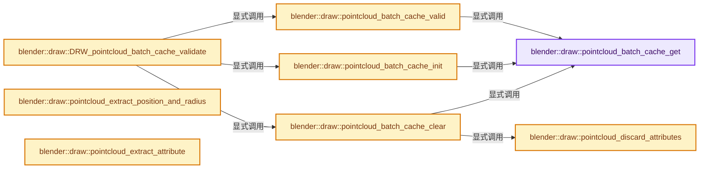
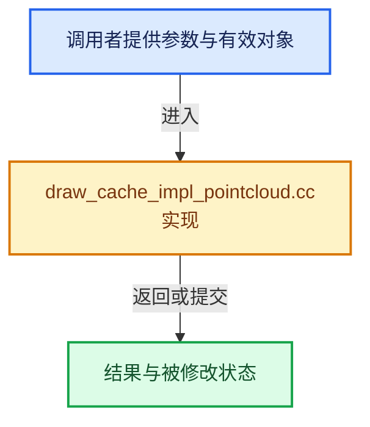

# 实现依赖专题：source/blender/draw/intern/draw_cache_impl_pointcloud.cc

[方向导航](README.md) · [符号索引](../%E7%AC%A6%E5%8F%B7%E4%BE%9D%E8%B5%96%E4%B8%8E%E5%AE%9E%E7%8E%B0%E7%B4%A2%E5%BC%95.md)

本专题从正文实际调用进入，集中保存共享实现。函数有稳定锚点，可从调用处直接跳到对应完整函数；递归与互相调用通过回链组织。

## 本文件的实现关系






## 完整成员与函数实现

<a id="f-c31c3310b8bb212e"></a>

### `blender::draw::pointcloud_batch_cache_get`

实现位置：[source/blender/draw/intern/draw_cache_impl_pointcloud.cc](../../../../../source/blender/draw/intern/draw_cache_impl_pointcloud.cc) · L89—L92。

接口参数：

- `PointCloud &pointcloud`

**教学注释版**

<!-- annotated:424d0d73a6a336 -->

```cpp
static PointCloudBatchCache *pointcloud_batch_cache_get(PointCloud &pointcloud)
{
  return pointcloud.pointcloud_batch_cache;
}
```

<details>
<summary>核对原始源码：source/blender/draw/intern/draw_cache_impl_pointcloud.cc · L89—L92</summary>

<!-- original:424d0d73a6a336:source/blender/draw/intern/draw_cache_impl_pointcloud.cc:89:92 -->

```cpp
static PointCloudBatchCache *pointcloud_batch_cache_get(PointCloud &pointcloud)
{
  return pointcloud.pointcloud_batch_cache;
}
```

</details>

**结果出口**

- `return pointcloud.pointcloud_batch_cache;`

**继续追踪实现**

本实现没有需要继续展开的显式调用；检查返回表达式、对象转换和调用者前置条件。

<a id="f-b7f9bb262a27372a"></a>

### `blender::draw::pointcloud_batch_cache_valid`

实现位置：[source/blender/draw/intern/draw_cache_impl_pointcloud.cc](../../../../../source/blender/draw/intern/draw_cache_impl_pointcloud.cc) · L94—L105。

接口参数：

- `PointCloud &pointcloud`

**教学注释版**

<!-- annotated:f080b217a36116 -->

```cpp
static bool pointcloud_batch_cache_valid(PointCloud &pointcloud)
{
  PointCloudBatchCache *cache = pointcloud_batch_cache_get(pointcloud);

  if (cache == nullptr) {
    return false;
  }
  if (cache->eval_cache.mat_len != BKE_id_material_used_with_fallback_eval(pointcloud.id)) {
    return false;
  }
  return cache->is_dirty == false;
}
```

<details>
<summary>核对原始源码：source/blender/draw/intern/draw_cache_impl_pointcloud.cc · L94—L105</summary>

<!-- original:f080b217a36116:source/blender/draw/intern/draw_cache_impl_pointcloud.cc:94:105 -->

```cpp
static bool pointcloud_batch_cache_valid(PointCloud &pointcloud)
{
  PointCloudBatchCache *cache = pointcloud_batch_cache_get(pointcloud);

  if (cache == nullptr) {
    return false;
  }
  if (cache->eval_cache.mat_len != BKE_id_material_used_with_fallback_eval(pointcloud.id)) {
    return false;
  }
  return cache->is_dirty == false;
}
```

</details>

**结果出口**

- `return false;`
- `return cache->is_dirty == false;`

**继续追踪实现**

- `pointcloud_batch_cache_get` → [blender::draw::pointcloud_batch_cache_get · L89](%E4%BE%9D%E8%B5%96-draw_cache_impl_pointcloud-c6a7ae.md#f-c31c3310b8bb212e)。
- `BKE_id_material_used_with_fallback_eval` → [blender::BKE_id_material_used_with_fallback_eval · L891](%E4%BE%9D%E8%B5%96-material-aea8ec.md#f-54149818112236cb)。

<a id="f-7163d9a6c221692e"></a>

### `blender::draw::pointcloud_batch_cache_init`

实现位置：[source/blender/draw/intern/draw_cache_impl_pointcloud.cc](../../../../../source/blender/draw/intern/draw_cache_impl_pointcloud.cc) · L107—L126。

接口参数：

- `PointCloud &pointcloud`

**教学注释版**

<!-- annotated:e4c341631890e7 -->

```cpp
static void pointcloud_batch_cache_init(PointCloud &pointcloud)
{
  PointCloudBatchCache *cache = pointcloud_batch_cache_get(pointcloud);

  if (!cache) {
    cache = MEM_new<PointCloudBatchCache>(__func__);
    pointcloud.pointcloud_batch_cache = cache;
  }
  else {
    cache->eval_cache = {};
    cache->edit_selection = nullptr;
    cache->edit_selection_indices = nullptr;
  }

  cache->eval_cache.mat_len = BKE_id_material_used_with_fallback_eval(pointcloud.id);
  cache->eval_cache.surface_per_mat = MEM_new_array_zeroed<gpu::Batch *>(cache->eval_cache.mat_len,
                                                                         __func__);

  cache->is_dirty = false;
}
```

<details>
<summary>核对原始源码：source/blender/draw/intern/draw_cache_impl_pointcloud.cc · L107—L126</summary>

<!-- original:e4c341631890e7:source/blender/draw/intern/draw_cache_impl_pointcloud.cc:107:126 -->

```cpp
static void pointcloud_batch_cache_init(PointCloud &pointcloud)
{
  PointCloudBatchCache *cache = pointcloud_batch_cache_get(pointcloud);

  if (!cache) {
    cache = MEM_new<PointCloudBatchCache>(__func__);
    pointcloud.pointcloud_batch_cache = cache;
  }
  else {
    cache->eval_cache = {};
    cache->edit_selection = nullptr;
    cache->edit_selection_indices = nullptr;
  }

  cache->eval_cache.mat_len = BKE_id_material_used_with_fallback_eval(pointcloud.id);
  cache->eval_cache.surface_per_mat = MEM_new_array_zeroed<gpu::Batch *>(cache->eval_cache.mat_len,
                                                                         __func__);

  cache->is_dirty = false;
}
```

</details>

**沿实际写入检查状态**

- `cache = MEM_new<PointCloudBatchCache>(__func__);`
- `pointcloud.pointcloud_batch_cache = cache;`
- `cache->eval_cache = {};`
- `cache->edit_selection = nullptr;`
- `cache->edit_selection_indices = nullptr;`
- `cache->eval_cache.mat_len = BKE_id_material_used_with_fallback_eval(pointcloud.id);`
- `cache->eval_cache.surface_per_mat = MEM_new_array_zeroed<gpu::Batch *>(cache->eval_cache.mat_len,`
- `cache->is_dirty = false;`

**继续追踪实现**

- `pointcloud_batch_cache_get` → [blender::draw::pointcloud_batch_cache_get · L89](%E4%BE%9D%E8%B5%96-draw_cache_impl_pointcloud-c6a7ae.md#f-c31c3310b8bb212e)。
- `MEM_new<PointCloudBatchCache>` → [MEM_new · L351](../03-%E5%86%85%E5%AD%98%E5%88%86%E9%85%8D%E4%B8%8E%E8%BF%90%E8%A1%8C%E6%97%B6%E7%B1%BB%E5%9E%8B/%E4%BE%9D%E8%B5%96-MEM_guardedalloc-b54eca.md#f-115f9b6784f89912)。
- `BKE_id_material_used_with_fallback_eval` → [blender::BKE_id_material_used_with_fallback_eval · L891](%E4%BE%9D%E8%B5%96-material-aea8ec.md#f-54149818112236cb)。
- `MEM_new_array_zeroed<gpu::Batch *>` → [MEM_new_array_zeroed · L566](../03-%E5%86%85%E5%AD%98%E5%88%86%E9%85%8D%E4%B8%8E%E8%BF%90%E8%A1%8C%E6%97%B6%E7%B1%BB%E5%9E%8B/%E4%BE%9D%E8%B5%96-MEM_guardedalloc-b54eca.md#f-3a0cf63fb5216500)；[MEM_new_array_zeroed · L119](../03-%E5%86%85%E5%AD%98%E5%88%86%E9%85%8D%E4%B8%8E%E8%BF%90%E8%A1%8C%E6%97%B6%E7%B1%BB%E5%9E%8B/%E4%BE%9D%E8%B5%96-mallocn-afdcd4.md#f-6825557da566fdbe)。同名重载需按实参类型选择。

<a id="f-93f192174a9d37a4"></a>

### `blender::draw::pointcloud_discard_attributes`

实现位置：[source/blender/draw/intern/draw_cache_impl_pointcloud.cc](../../../../../source/blender/draw/intern/draw_cache_impl_pointcloud.cc) · L143—L150。

接口参数：

- `PointCloudBatchCache &cache`

**教学注释版**

<!-- annotated:59744482e818ef -->

```cpp
static void pointcloud_discard_attributes(PointCloudBatchCache &cache)
{
  for (const int j : IndexRange(GPU_MAX_ATTR)) {
    GPU_VERTBUF_DISCARD_SAFE(cache.eval_cache.attributes_buf[j]);
  }

  cache.eval_cache.attr_used.clear();
}
```

<details>
<summary>核对原始源码：source/blender/draw/intern/draw_cache_impl_pointcloud.cc · L143—L150</summary>

<!-- original:59744482e818ef:source/blender/draw/intern/draw_cache_impl_pointcloud.cc:143:150 -->

```cpp
static void pointcloud_discard_attributes(PointCloudBatchCache &cache)
{
  for (const int j : IndexRange(GPU_MAX_ATTR)) {
    GPU_VERTBUF_DISCARD_SAFE(cache.eval_cache.attributes_buf[j]);
  }

  cache.eval_cache.attr_used.clear();
}
```

</details>

**继续追踪实现**

- `IndexRange` → [blender::IndexRange](../01-%E5%9F%BA%E7%A1%80%E5%AE%B9%E5%99%A8%E4%B8%8E%E7%8E%B0%E4%BB%A3CPP/%E4%BE%9D%E8%B5%96-BLI_index_range-7d7cc5.md#t-caa3466d6776)；[blender::gpu::shader::parser::IndexRange](%E4%BE%9D%E8%B5%96-utils-06433d.md#t-82d2bd4ea71c)；[blender::IndexRange](%E4%BE%9D%E8%B5%96-DNA_node_types-6708b9.md#t-0448cc889d39)。
- `GPU_VERTBUF_DISCARD_SAFE` → [GPU_VERTBUF_DISCARD_SAFE · L372](%E4%BE%9D%E8%B5%96-GPU_vertex_buffer-d7610b.md#m-6427e4c6901c)。宏定义由构建条件选择。
- `cache.eval_cache.attr_used.clear` → [调用协议](../%E6%A8%A1%E6%9D%BF%E5%AE%8F%E4%B8%8E%E5%8A%A8%E6%80%81%E5%88%86%E6%B4%BE%E5%8D%8F%E8%AE%AE.md)：接收对象类型依赖auto、返回值或模板实例；不按同名猜测目标。调用位置L149。

<a id="f-b31cdd2f03edf5da"></a>

### `blender::draw::pointcloud_batch_cache_clear`

实现位置：[source/blender/draw/intern/draw_cache_impl_pointcloud.cc](../../../../../source/blender/draw/intern/draw_cache_impl_pointcloud.cc) · L152—L175。

接口参数：

- `PointCloud &pointcloud`

**教学注释版**

<!-- annotated:6ef59d792aa97a -->

```cpp
static void pointcloud_batch_cache_clear(PointCloud &pointcloud)
{
  PointCloudBatchCache *cache = pointcloud_batch_cache_get(pointcloud);
  if (!cache) {
    return;
  }

  GPU_BATCH_DISCARD_SAFE(cache->eval_cache.dots);
  GPU_BATCH_DISCARD_SAFE(cache->eval_cache.surface);
  GPU_VERTBUF_DISCARD_SAFE(cache->eval_cache.pos_rad);
  GPU_VERTBUF_DISCARD_SAFE(cache->eval_cache.attr_viewer);

  GPU_INDEXBUF_DISCARD_SAFE(cache->edit_selection_indices);
  GPU_BATCH_DISCARD_SAFE(cache->edit_selection);

  if (cache->eval_cache.surface_per_mat) {
    for (int i = 0; i < cache->eval_cache.mat_len; i++) {
      GPU_BATCH_DISCARD_SAFE(cache->eval_cache.surface_per_mat[i]);
    }
  }
  MEM_SAFE_DELETE(cache->eval_cache.surface_per_mat);

  pointcloud_discard_attributes(*cache);
}
```

<details>
<summary>核对原始源码：source/blender/draw/intern/draw_cache_impl_pointcloud.cc · L152—L175</summary>

<!-- original:6ef59d792aa97a:source/blender/draw/intern/draw_cache_impl_pointcloud.cc:152:175 -->

```cpp
static void pointcloud_batch_cache_clear(PointCloud &pointcloud)
{
  PointCloudBatchCache *cache = pointcloud_batch_cache_get(pointcloud);
  if (!cache) {
    return;
  }

  GPU_BATCH_DISCARD_SAFE(cache->eval_cache.dots);
  GPU_BATCH_DISCARD_SAFE(cache->eval_cache.surface);
  GPU_VERTBUF_DISCARD_SAFE(cache->eval_cache.pos_rad);
  GPU_VERTBUF_DISCARD_SAFE(cache->eval_cache.attr_viewer);

  GPU_INDEXBUF_DISCARD_SAFE(cache->edit_selection_indices);
  GPU_BATCH_DISCARD_SAFE(cache->edit_selection);

  if (cache->eval_cache.surface_per_mat) {
    for (int i = 0; i < cache->eval_cache.mat_len; i++) {
      GPU_BATCH_DISCARD_SAFE(cache->eval_cache.surface_per_mat[i]);
    }
  }
  MEM_SAFE_DELETE(cache->eval_cache.surface_per_mat);

  pointcloud_discard_attributes(*cache);
}
```

</details>

**继续追踪实现**

- `pointcloud_batch_cache_get` → [blender::draw::pointcloud_batch_cache_get · L89](%E4%BE%9D%E8%B5%96-draw_cache_impl_pointcloud-c6a7ae.md#f-c31c3310b8bb212e)。
- `GPU_BATCH_DISCARD_SAFE` → [GPU_BATCH_DISCARD_SAFE · L199](%E4%BE%9D%E8%B5%96-GPU_batch-98c422.md#m-167d477926a1)。宏定义由构建条件选择。
- `GPU_VERTBUF_DISCARD_SAFE` → [GPU_VERTBUF_DISCARD_SAFE · L372](%E4%BE%9D%E8%B5%96-GPU_vertex_buffer-d7610b.md#m-6427e4c6901c)。宏定义由构建条件选择。
- `GPU_INDEXBUF_DISCARD_SAFE` → [GPU_INDEXBUF_DISCARD_SAFE · L299](%E4%BE%9D%E8%B5%96-GPU_index_buffer-093835.md#m-f3c9c7333ad4)。宏定义由构建条件选择。
- `MEM_SAFE_DELETE` → [MEM_SAFE_DELETE · L436](../03-%E5%86%85%E5%AD%98%E5%88%86%E9%85%8D%E4%B8%8E%E8%BF%90%E8%A1%8C%E6%97%B6%E7%B1%BB%E5%9E%8B/%E4%BE%9D%E8%B5%96-MEM_guardedalloc-b54eca.md#m-eadb3bc5b902)。宏定义由构建条件选择。
- `pointcloud_discard_attributes` → [blender::draw::pointcloud_discard_attributes · L143](%E4%BE%9D%E8%B5%96-draw_cache_impl_pointcloud-c6a7ae.md#f-93f192174a9d37a4)。

<a id="f-febdf7fabe4289ca"></a>

### `blender::draw::DRW_pointcloud_batch_cache_validate`

实现位置：[source/blender/draw/intern/draw_cache_impl_pointcloud.cc](../../../../../source/blender/draw/intern/draw_cache_impl_pointcloud.cc) · L177—L183。

接口参数：

- `PointCloud *pointcloud`

**教学注释版**

<!-- annotated:e5042a15387de5 -->

```cpp
void DRW_pointcloud_batch_cache_validate(PointCloud *pointcloud)
{
  if (!pointcloud_batch_cache_valid(*pointcloud)) {
    pointcloud_batch_cache_clear(*pointcloud);
    pointcloud_batch_cache_init(*pointcloud);
  }
}
```

<details>
<summary>核对原始源码：source/blender/draw/intern/draw_cache_impl_pointcloud.cc · L177—L183</summary>

<!-- original:e5042a15387de5:source/blender/draw/intern/draw_cache_impl_pointcloud.cc:177:183 -->

```cpp
void DRW_pointcloud_batch_cache_validate(PointCloud *pointcloud)
{
  if (!pointcloud_batch_cache_valid(*pointcloud)) {
    pointcloud_batch_cache_clear(*pointcloud);
    pointcloud_batch_cache_init(*pointcloud);
  }
}
```

</details>

**继续追踪实现**

- `pointcloud_batch_cache_valid` → [blender::draw::pointcloud_batch_cache_valid · L94](%E4%BE%9D%E8%B5%96-draw_cache_impl_pointcloud-c6a7ae.md#f-b7f9bb262a27372a)。
- `pointcloud_batch_cache_clear` → [blender::draw::pointcloud_batch_cache_clear · L152](%E4%BE%9D%E8%B5%96-draw_cache_impl_pointcloud-c6a7ae.md#f-b31cdd2f03edf5da)。
- `pointcloud_batch_cache_init` → [blender::draw::pointcloud_batch_cache_init · L107](%E4%BE%9D%E8%B5%96-draw_cache_impl_pointcloud-c6a7ae.md#f-7163d9a6c221692e)。

<a id="f-47d81ac8c4ecb60d"></a>

### `blender::draw::pointcloud_extract_position_and_radius`

实现位置：[source/blender/draw/intern/draw_cache_impl_pointcloud.cc](../../../../../source/blender/draw/intern/draw_cache_impl_pointcloud.cc) · L223—L262。

接口参数：

- `const PointCloud &pointcloud`
- `PointCloudBatchCache &cache`

**教学注释版**

<!-- annotated:a9d7cd11bf9a65 -->

```cpp
static void pointcloud_extract_position_and_radius(const PointCloud &pointcloud,
                                                   PointCloudBatchCache &cache)
{
  const bke::AttributeAccessor attributes = pointcloud.attributes();
  const Span<float3> positions = pointcloud.positions();
  const VArray<float> radii = *attributes.lookup<float>("radius");
  static const GPUVertFormat format = [&]() {
    GPUVertFormat format{};
    GPU_vertformat_attr_add(&format, "pos", gpu::VertAttrType::SFLOAT_32_32_32_32);
    GPU_vertformat_alias_add(&format, "pos_rad");
    return format;
  }();

  GPUUsageType usage_flag = GPU_USAGE_STATIC | GPU_USAGE_FLAG_BUFFER_TEXTURE_ONLY;
  GPU_vertbuf_init_with_format_ex(*cache.eval_cache.pos_rad, format, usage_flag);

  // [讲解] positions.size：查询视图长度或生成对应有效索引区间。
  GPU_vertbuf_data_alloc(*cache.eval_cache.pos_rad, positions.size());
  MutableSpan<float4> vbo_data = cache.eval_cache.pos_rad->data<float4>();
  if (radii) {
    const VArraySpan<float> radii_span(std::move(radii));
    // [讲解] vbo_data.index_range：查询视图长度或生成对应有效索引区间。
    threading::parallel_for(vbo_data.index_range(), 4096, [&](IndexRange range) {
      for (const int i : range) {
        vbo_data[i].x = positions[i].x;
        vbo_data[i].y = positions[i].y;
        vbo_data[i].z = positions[i].z;
        vbo_data[i].w = radii_span[i];
      }
    });
  }
  else {
    threading::parallel_for(vbo_data.index_range(), 4096, [&](IndexRange range) {
      for (const int i : range) {
        vbo_data[i].x = positions[i].x;
        vbo_data[i].y = positions[i].y;
        vbo_data[i].z = positions[i].z;
        vbo_data[i].w = 0.01f;
      }
    });
  }
}
```

<details>
<summary>核对原始源码：source/blender/draw/intern/draw_cache_impl_pointcloud.cc · L223—L262</summary>

<!-- original:a9d7cd11bf9a65:source/blender/draw/intern/draw_cache_impl_pointcloud.cc:223:262 -->

```cpp
static void pointcloud_extract_position_and_radius(const PointCloud &pointcloud,
                                                   PointCloudBatchCache &cache)
{
  const bke::AttributeAccessor attributes = pointcloud.attributes();
  const Span<float3> positions = pointcloud.positions();
  const VArray<float> radii = *attributes.lookup<float>("radius");
  static const GPUVertFormat format = [&]() {
    GPUVertFormat format{};
    GPU_vertformat_attr_add(&format, "pos", gpu::VertAttrType::SFLOAT_32_32_32_32);
    GPU_vertformat_alias_add(&format, "pos_rad");
    return format;
  }();

  GPUUsageType usage_flag = GPU_USAGE_STATIC | GPU_USAGE_FLAG_BUFFER_TEXTURE_ONLY;
  GPU_vertbuf_init_with_format_ex(*cache.eval_cache.pos_rad, format, usage_flag);

  GPU_vertbuf_data_alloc(*cache.eval_cache.pos_rad, positions.size());
  MutableSpan<float4> vbo_data = cache.eval_cache.pos_rad->data<float4>();
  if (radii) {
    const VArraySpan<float> radii_span(std::move(radii));
    threading::parallel_for(vbo_data.index_range(), 4096, [&](IndexRange range) {
      for (const int i : range) {
        vbo_data[i].x = positions[i].x;
        vbo_data[i].y = positions[i].y;
        vbo_data[i].z = positions[i].z;
        vbo_data[i].w = radii_span[i];
      }
    });
  }
  else {
    threading::parallel_for(vbo_data.index_range(), 4096, [&](IndexRange range) {
      for (const int i : range) {
        vbo_data[i].x = positions[i].x;
        vbo_data[i].y = positions[i].y;
        vbo_data[i].z = positions[i].z;
        vbo_data[i].w = 0.01f;
      }
    });
  }
}
```

</details>

**沿实际写入检查状态**

- `vbo_data[i].x = positions[i].x;`
- `vbo_data[i].y = positions[i].y;`
- `vbo_data[i].z = positions[i].z;`
- `vbo_data[i].w = radii_span[i];`
- `vbo_data[i].w = 0.01f;`

**结果出口**

- `return format;`

**继续追踪实现**

- `pointcloud.attributes` → [blender::PointCloud::attributes · L307](%E4%BE%9D%E8%B5%96-pointcloud-49a366.md#f-bf2e5928a63a6e15)。
- `pointcloud.positions` → [blender::PointCloud::positions · L198](%E4%BE%9D%E8%B5%96-pointcloud-49a366.md#f-f02364be34f558ea)。
- `attributes.lookup<float>` → [blender::bke::AttributeAccessor::lookup · L401](%E4%BE%9D%E8%B5%96-attribute_access-bceef3.md#f-4673351b7bb3b651)；[blender::bke::AttributeAccessor::lookup · L585](08-AttributeAccessor%E6%8E%A5%E5%8F%A3.md#f-432b90c796a80893)；[blender::bke::AttributeAccessor::lookup · L602](08-AttributeAccessor%E6%8E%A5%E5%8F%A3.md#f-a60c1a45b85155d9)；[blender::bke::AttributeAccessor::lookup · L611](08-AttributeAccessor%E6%8E%A5%E5%8F%A3.md#f-16ca459803fc30a6)；[blender::bke::AttributeAccessor::lookup · L620](08-AttributeAccessor%E6%8E%A5%E5%8F%A3.md#f-403fd8a9d1a16c6d)。同名重载需按实参类型选择。
- `[&]() { GPUVertFormat format{}; GPU_vertformat_attr_add(&format, "pos", gpu::VertAttrType::SFLOAT_32_32_32_32); GPU_vertformat_alias_add(&format, "pos_rad"); return format; }` → [调用协议](../%E6%A8%A1%E6%9D%BF%E5%AE%8F%E4%B8%8E%E5%8A%A8%E6%80%81%E5%88%86%E6%B4%BE%E5%8D%8F%E8%AE%AE.md)：函数指针、局部可调用对象或未展开的宏；必须结合调用者环境。调用位置L229。
- `GPU_vertformat_attr_add` → [blender::GPU_vertformat_attr_add · L389](%E4%BE%9D%E8%B5%96-gpu_vertex_format-4f7148.md#f-a36e23f37b97fff4)。
- `GPU_vertformat_alias_add` → [blender::GPU_vertformat_alias_add · L418](%E4%BE%9D%E8%B5%96-gpu_vertex_format-4f7148.md#f-5b19cd8281d0191e)。
- `GPU_vertbuf_init_with_format_ex` → [blender::GPU_vertbuf_init_with_format_ex · L124](%E4%BE%9D%E8%B5%96-gpu_vertex_buffer-eaa662.md#f-3e5da22fa9f3e3b7)。
- `GPU_vertbuf_data_alloc` → [blender::GPU_vertbuf_data_alloc · L172](%E4%BE%9D%E8%B5%96-gpu_vertex_buffer-eaa662.md#f-8ee5cf106e0f2b0f)。
- `positions.size` → [blender::Span::size · L256](../01-%E5%9F%BA%E7%A1%80%E5%AE%B9%E5%99%A8%E4%B8%8E%E7%8E%B0%E4%BB%A3CPP/05-Span%E5%8F%AA%E8%AF%BB%E8%BF%9E%E7%BB%AD%E8%A7%86%E5%9B%BE.md#f-5f80fa006089c998)。
- `cache.eval_cache.pos_rad->data<float4>` → [调用协议](../%E6%A8%A1%E6%9D%BF%E5%AE%8F%E4%B8%8E%E5%8A%A8%E6%80%81%E5%88%86%E6%B4%BE%E5%8D%8F%E8%AE%AE.md)：接收对象类型依赖auto、返回值或模板实例；不按同名猜测目标。调用位置L240。
- `threading::parallel_for` → [blender::threading::parallel_for · L68](../11-Depsgraph%E4%B8%8E%E5%B9%B6%E8%A1%8C%E4%BB%BB%E5%8A%A1%E7%B3%BB%E7%BB%9F/07-%E4%BB%BB%E5%8A%A1%E6%B1%A0%E4%B8%8ETBB%E6%8E%A5%E5%85%A5.md#f-838294754c24426c)。
- `vbo_data.index_range` → [blender::MutableSpan::index_range · L676](../01-%E5%9F%BA%E7%A1%80%E5%AE%B9%E5%99%A8%E4%B8%8E%E7%8E%B0%E4%BB%A3CPP/06-MutableSpan%E5%8F%AF%E5%86%99%E8%A7%86%E5%9B%BE.md#f-f9a9d59a69ca64b5)。

<a id="f-91b946a6210f17b2"></a>

### `blender::draw::pointcloud_extract_attribute`

实现位置：[source/blender/draw/intern/draw_cache_impl_pointcloud.cc](../../../../../source/blender/draw/intern/draw_cache_impl_pointcloud.cc) · L264—L291。

接口参数：

- `const PointCloud &pointcloud`
- `PointCloudBatchCache &cache`
- `const StringRef name`
- `int index`

**教学注释版**

<!-- annotated:91bde5bc99e35d -->

```cpp
static void pointcloud_extract_attribute(const PointCloud &pointcloud,
                                         PointCloudBatchCache &cache,
                                         const StringRef name,
                                         int index)
{
  gpu::VertBuf &attr_buf = *cache.eval_cache.attributes_buf[index];

  const bke::AttributeAccessor attributes = pointcloud.attributes();

  /* TODO(@kevindietrich): float4 is used for scalar attributes as the implicit conversion done
   * by OpenGL to float4 for a scalar `s` will produce a `float4(s, 0, 0, 1)`. However, following
   * the Blender convention, it should be `float4(s, s, s, 1)`. This could be resolved using a
   * similar texture state swizzle to map the attribute correctly as for volume attributes, so we
   * can control the conversion ourselves. */
  bke::AttributeReader<ColorGeometry4f> attribute = attributes.lookup_or_default<ColorGeometry4f>(
      name, bke::AttrDomain::Point, {0.0f, 0.0f, 0.0f, 1.0f});

  static const GPUVertFormat format = [&]() {
    GPUVertFormat format{};
    GPU_vertformat_attr_add(&format, "attr", gpu::VertAttrType::SFLOAT_32_32_32_32);
    return format;
  }();
  GPUUsageType usage_flag = GPU_USAGE_STATIC | GPU_USAGE_FLAG_BUFFER_TEXTURE_ONLY;
  GPU_vertbuf_init_with_format_ex(attr_buf, format, usage_flag);
  GPU_vertbuf_data_alloc(attr_buf, pointcloud.totpoint);

  array_utils::copy(attribute.varray, attr_buf.data<ColorGeometry4f>());
}
```

<details>
<summary>核对原始源码：source/blender/draw/intern/draw_cache_impl_pointcloud.cc · L264—L291</summary>

<!-- original:91bde5bc99e35d:source/blender/draw/intern/draw_cache_impl_pointcloud.cc:264:291 -->

```cpp
static void pointcloud_extract_attribute(const PointCloud &pointcloud,
                                         PointCloudBatchCache &cache,
                                         const StringRef name,
                                         int index)
{
  gpu::VertBuf &attr_buf = *cache.eval_cache.attributes_buf[index];

  const bke::AttributeAccessor attributes = pointcloud.attributes();

  /* TODO(@kevindietrich): float4 is used for scalar attributes as the implicit conversion done
   * by OpenGL to float4 for a scalar `s` will produce a `float4(s, 0, 0, 1)`. However, following
   * the Blender convention, it should be `float4(s, s, s, 1)`. This could be resolved using a
   * similar texture state swizzle to map the attribute correctly as for volume attributes, so we
   * can control the conversion ourselves. */
  bke::AttributeReader<ColorGeometry4f> attribute = attributes.lookup_or_default<ColorGeometry4f>(
      name, bke::AttrDomain::Point, {0.0f, 0.0f, 0.0f, 1.0f});

  static const GPUVertFormat format = [&]() {
    GPUVertFormat format{};
    GPU_vertformat_attr_add(&format, "attr", gpu::VertAttrType::SFLOAT_32_32_32_32);
    return format;
  }();
  GPUUsageType usage_flag = GPU_USAGE_STATIC | GPU_USAGE_FLAG_BUFFER_TEXTURE_ONLY;
  GPU_vertbuf_init_with_format_ex(attr_buf, format, usage_flag);
  GPU_vertbuf_data_alloc(attr_buf, pointcloud.totpoint);

  array_utils::copy(attribute.varray, attr_buf.data<ColorGeometry4f>());
}
```

</details>

**结果出口**

- `return format;`

**继续追踪实现**

- `pointcloud.attributes` → [blender::PointCloud::attributes · L307](%E4%BE%9D%E8%B5%96-pointcloud-49a366.md#f-bf2e5928a63a6e15)。
- `attributes.lookup_or_default<ColorGeometry4f>` → [blender::bke::AttributeAccessor::lookup_or_default · L415](%E4%BE%9D%E8%B5%96-attribute_access-bceef3.md#f-a0cc3e316f1da4bd)；[blender::bke::AttributeAccessor::lookup_or_default · L643](08-AttributeAccessor%E6%8E%A5%E5%8F%A3.md#f-e3d2ed81ebe0af61)。同名重载需按实参类型选择。
- `[&]() { GPUVertFormat format{}; GPU_vertformat_attr_add(&format, "attr", gpu::VertAttrType::SFLOAT_32_32_32_32); return format; }` → [调用协议](../%E6%A8%A1%E6%9D%BF%E5%AE%8F%E4%B8%8E%E5%8A%A8%E6%80%81%E5%88%86%E6%B4%BE%E5%8D%8F%E8%AE%AE.md)：函数指针、局部可调用对象或未展开的宏；必须结合调用者环境。调用位置L281。
- `GPU_vertformat_attr_add` → [blender::GPU_vertformat_attr_add · L389](%E4%BE%9D%E8%B5%96-gpu_vertex_format-4f7148.md#f-a36e23f37b97fff4)。
- `GPU_vertbuf_init_with_format_ex` → [blender::GPU_vertbuf_init_with_format_ex · L124](%E4%BE%9D%E8%B5%96-gpu_vertex_buffer-eaa662.md#f-3e5da22fa9f3e3b7)。
- `GPU_vertbuf_data_alloc` → [blender::GPU_vertbuf_data_alloc · L172](%E4%BE%9D%E8%B5%96-gpu_vertex_buffer-eaa662.md#f-8ee5cf106e0f2b0f)。
- `array_utils::copy` → [blender::array_utils::copy · L54](../01-%E5%9F%BA%E7%A1%80%E5%AE%B9%E5%99%A8%E4%B8%8E%E7%8E%B0%E4%BB%A3CPP/20-%E5%AE%B9%E5%99%A8%E9%80%89%E6%8B%A9%E4%B8%8E%E7%8B%AC%E7%AB%8B%E5%AE%9E%E7%8E%B0.md#f-82e21acdac93f91c)；[blender::array_utils::copy · L72](../01-%E5%9F%BA%E7%A1%80%E5%AE%B9%E5%99%A8%E4%B8%8E%E7%8E%B0%E4%BB%A3CPP/20-%E5%AE%B9%E5%99%A8%E9%80%89%E6%8B%A9%E4%B8%8E%E7%8B%AC%E7%AB%8B%E5%AE%9E%E7%8E%B0.md#f-ee9c17de026a6c9a)；[blender::array_utils::copy · L98](../01-%E5%9F%BA%E7%A1%80%E5%AE%B9%E5%99%A8%E4%B8%8E%E7%8E%B0%E4%BB%A3CPP/20-%E5%AE%B9%E5%99%A8%E9%80%89%E6%8B%A9%E4%B8%8E%E7%8B%AC%E7%AB%8B%E5%AE%9E%E7%8E%B0.md#f-ec9fd099c7280717)；[blender::array_utils::copy · L27](../01-%E5%9F%BA%E7%A1%80%E5%AE%B9%E5%99%A8%E4%B8%8E%E7%8E%B0%E4%BB%A3CPP/%E4%BE%9D%E8%B5%96-array_utils-cbb70f.md#f-245f7c23437cf35f)；[blender::array_utils::copy · L43](../01-%E5%9F%BA%E7%A1%80%E5%AE%B9%E5%99%A8%E4%B8%8E%E7%8E%B0%E4%BB%A3CPP/%E4%BE%9D%E8%B5%96-array_utils-cbb70f.md#f-6170524934215b36)。同名重载需按实参类型选择。
- `attr_buf.data<ColorGeometry4f>` → [blender::gpu::VertBuf::data · L220](%E4%BE%9D%E8%B5%96-GPU_vertex_buffer-d7610b.md#f-e72412fdddda8bf5)。

<a id="f-9d92b31e97de6556"></a>

### `blender::draw::index_mask_to_ibo`

实现位置：[source/blender/draw/intern/draw_cache_impl_pointcloud.cc](../../../../../source/blender/draw/intern/draw_cache_impl_pointcloud.cc) · L400—L408。

接口参数：

- `const IndexMask &mask`
- `gpu::IndexBuf &ibo`

**教学注释版**

<!-- annotated:b9fb19238267c7 -->

```cpp
static void index_mask_to_ibo(const IndexMask &mask, gpu::IndexBuf &ibo)
{
  const int max_index = mask.min_array_size();
  GPUIndexBufBuilder builder;
  GPU_indexbuf_init(&builder, GPU_PRIM_POINTS, mask.size(), max_index);
  MutableSpan<uint> data = GPU_indexbuf_get_data(&builder);
  // [讲解] data.cast<int>：按类型与布局约束重新解释视图。
  mask.to_indices<int>(data.cast<int>());
  GPU_indexbuf_build_in_place_ex(&builder, 0, max_index, false, &ibo);
}
```

<details>
<summary>核对原始源码：source/blender/draw/intern/draw_cache_impl_pointcloud.cc · L400—L408</summary>

<!-- original:b9fb19238267c7:source/blender/draw/intern/draw_cache_impl_pointcloud.cc:400:408 -->

```cpp
static void index_mask_to_ibo(const IndexMask &mask, gpu::IndexBuf &ibo)
{
  const int max_index = mask.min_array_size();
  GPUIndexBufBuilder builder;
  GPU_indexbuf_init(&builder, GPU_PRIM_POINTS, mask.size(), max_index);
  MutableSpan<uint> data = GPU_indexbuf_get_data(&builder);
  mask.to_indices<int>(data.cast<int>());
  GPU_indexbuf_build_in_place_ex(&builder, 0, max_index, false, &ibo);
}
```

</details>

**继续追踪实现**

- `mask.min_array_size` → [blender::index_mask::IndexMask::min_array_size · L782](../04-%E8%99%9A%E6%8B%9F%E6%95%B0%E7%BB%84%E4%B8%8E%E7%B4%A2%E5%BC%95%E9%80%89%E6%8B%A9/09-%E5%88%86%E6%AE%B5%E5%AD%98%E5%82%A8%E4%B8%8E%E9%81%8D%E5%8E%86.md#f-f3a460d74b4fc7d6)。
- `GPU_indexbuf_init` → [blender::GPU_indexbuf_init · L73](%E4%BE%9D%E8%B5%96-gpu_index_buffer-c3daac.md#f-adccf0f2321fb073)。
- `mask.size` → [blender::index_mask::IndexMask::size · L743](../04-%E8%99%9A%E6%8B%9F%E6%95%B0%E7%BB%84%E4%B8%8E%E7%B4%A2%E5%BC%95%E9%80%89%E6%8B%A9/09-%E5%88%86%E6%AE%B5%E5%AD%98%E5%82%A8%E4%B8%8E%E9%81%8D%E5%8E%86.md#f-0163b32abc9a0d9c)。
- `GPU_indexbuf_get_data` → [blender::GPU_indexbuf_get_data · L96](%E4%BE%9D%E8%B5%96-gpu_index_buffer-c3daac.md#f-a5d0d67214a893c0)。
- `mask.to_indices<int>` → [blender::index_mask::IndexMask::to_indices · L1129](../04-%E8%99%9A%E6%8B%9F%E6%95%B0%E7%BB%84%E4%B8%8E%E7%B4%A2%E5%BC%95%E9%80%89%E6%8B%A9/12-%E9%87%8D%E6%9E%84%E5%8E%86%E5%8F%B2%E4%B8%8E%E5%9F%BA%E5%87%86%E7%BB%83%E4%B9%A0.md#f-9821e0729f14f866)；[blender::index_mask::IndexMask::to_indices · L766](../04-%E8%99%9A%E6%8B%9F%E6%95%B0%E7%BB%84%E4%B8%8E%E7%B4%A2%E5%BC%95%E9%80%89%E6%8B%A9/10-IndexMask%E6%9E%84%E5%BB%BA%E4%B8%8E%E5%B9%B6%E8%A1%8C.md#f-7d2f4148b6937424)。同名重载需按实参类型选择。
- `data.cast<int>` → [blender::MutableSpan::cast · L755](../01-%E5%9F%BA%E7%A1%80%E5%AE%B9%E5%99%A8%E4%B8%8E%E7%8E%B0%E4%BB%A3CPP/06-MutableSpan%E5%8F%AF%E5%86%99%E8%A7%86%E5%9B%BE.md#f-360354e608371779)。
- `GPU_indexbuf_build_in_place_ex` → [blender::GPU_indexbuf_build_in_place_ex · L455](%E4%BE%9D%E8%B5%96-gpu_index_buffer-c3daac.md#f-3a20aaaa573a7e30)。

<a id="f-88bc6ac48957bc77"></a>

### `blender::draw::build_edit_selection_indices`

实现位置：[source/blender/draw/intern/draw_cache_impl_pointcloud.cc](../../../../../source/blender/draw/intern/draw_cache_impl_pointcloud.cc) · L410—L420。

接口参数：

- `const PointCloud &pointcloud`
- `gpu::IndexBuf &ibo`

**教学注释版**

<!-- annotated:e7026a1fb03c28 -->

```cpp
static void build_edit_selection_indices(const PointCloud &pointcloud, gpu::IndexBuf &ibo)
{
  const VArray selection = *pointcloud.attributes().lookup_or_default<bool>(
      ".selection", bke::AttrDomain::Point, true);
  IndexMaskMemory memory;
  const IndexMask mask = IndexMask::from_bools(selection, memory);
  if (mask.is_empty()) {
    return;
  }
  index_mask_to_ibo(mask, ibo);
}
```

<details>
<summary>核对原始源码：source/blender/draw/intern/draw_cache_impl_pointcloud.cc · L410—L420</summary>

<!-- original:e7026a1fb03c28:source/blender/draw/intern/draw_cache_impl_pointcloud.cc:410:420 -->

```cpp
static void build_edit_selection_indices(const PointCloud &pointcloud, gpu::IndexBuf &ibo)
{
  const VArray selection = *pointcloud.attributes().lookup_or_default<bool>(
      ".selection", bke::AttrDomain::Point, true);
  IndexMaskMemory memory;
  const IndexMask mask = IndexMask::from_bools(selection, memory);
  if (mask.is_empty()) {
    return;
  }
  index_mask_to_ibo(mask, ibo);
}
```

</details>

**继续追踪实现**

- `pointcloud.attributes().lookup_or_default<bool>` → [调用协议](../%E6%A8%A1%E6%9D%BF%E5%AE%8F%E4%B8%8E%E5%8A%A8%E6%80%81%E5%88%86%E6%B4%BE%E5%8D%8F%E8%AE%AE.md)：接收对象类型依赖auto、返回值或模板实例；不按同名猜测目标。调用位置L412。
- `pointcloud.attributes` → [blender::PointCloud::attributes · L307](%E4%BE%9D%E8%B5%96-pointcloud-49a366.md#f-bf2e5928a63a6e15)。
- `IndexMask::from_bools` → [blender::index_mask::IndexMask::from_bools · L593](../04-%E8%99%9A%E6%8B%9F%E6%95%B0%E7%BB%84%E4%B8%8E%E7%B4%A2%E5%BC%95%E9%80%89%E6%8B%A9/10-IndexMask%E6%9E%84%E5%BB%BA%E4%B8%8E%E5%B9%B6%E8%A1%8C.md#f-1eccbfd39b11c6bc)；[blender::index_mask::IndexMask::from_bools · L598](../04-%E8%99%9A%E6%8B%9F%E6%95%B0%E7%BB%84%E4%B8%8E%E7%B4%A2%E5%BC%95%E9%80%89%E6%8B%A9/10-IndexMask%E6%9E%84%E5%BB%BA%E4%B8%8E%E5%B9%B6%E8%A1%8C.md#f-3962fd5fd5aee616)；[blender::index_mask::IndexMask::from_bools · L613](../04-%E8%99%9A%E6%8B%9F%E6%95%B0%E7%BB%84%E4%B8%8E%E7%B4%A2%E5%BC%95%E9%80%89%E6%8B%A9/10-IndexMask%E6%9E%84%E5%BB%BA%E4%B8%8E%E5%B9%B6%E8%A1%8C.md#f-5f32581e6bbdca9e)；[blender::index_mask::IndexMask::from_bools · L649](../04-%E8%99%9A%E6%8B%9F%E6%95%B0%E7%BB%84%E4%B8%8E%E7%B4%A2%E5%BC%95%E9%80%89%E6%8B%A9/10-IndexMask%E6%9E%84%E5%BB%BA%E4%B8%8E%E5%B9%B6%E8%A1%8C.md#f-89ee3d007144c267)。同名重载需按实参类型选择。
- `mask.is_empty` → [blender::index_mask::IndexMask::is_empty · L748](../04-%E8%99%9A%E6%8B%9F%E6%95%B0%E7%BB%84%E4%B8%8E%E7%B4%A2%E5%BC%95%E9%80%89%E6%8B%A9/09-%E5%88%86%E6%AE%B5%E5%AD%98%E5%82%A8%E4%B8%8E%E9%81%8D%E5%8E%86.md#f-190ac996386064f4)。
- `index_mask_to_ibo` → [blender::draw::index_mask_to_ibo · L400](%E4%BE%9D%E8%B5%96-draw_cache_impl_pointcloud-c6a7ae.md#f-9d92b31e97de6556)。

<a id="f-99e1d0424a81ef60"></a>

### `blender::draw::DRW_pointcloud_batch_cache_create_requested`

实现位置：[source/blender/draw/intern/draw_cache_impl_pointcloud.cc](../../../../../source/blender/draw/intern/draw_cache_impl_pointcloud.cc) · L422—L456。

接口参数：

- `Object *ob`

**教学注释版**

<!-- annotated:0d7647d9640806 -->

```cpp
void DRW_pointcloud_batch_cache_create_requested(Object *ob)
{
  PointCloud &pointcloud = DRW_object_get_data_for_drawing<PointCloud>(*ob);
  PointCloudBatchCache &cache = *pointcloud_batch_cache_get(pointcloud);

  if (DRW_batch_requested(cache.eval_cache.dots, GPU_PRIM_POINTS)) {
    DRW_vbo_request(cache.eval_cache.dots, &cache.eval_cache.pos_rad);
  }

  if (DRW_batch_requested(cache.edit_selection, GPU_PRIM_POINTS)) {
    DRW_ibo_request(cache.edit_selection, &cache.edit_selection_indices);
    DRW_vbo_request(cache.edit_selection, &cache.eval_cache.pos_rad);
  }

  for (int i = 0; i < cache.eval_cache.mat_len; i++) {
    if (DRW_batch_requested(cache.eval_cache.surface_per_mat[i], GPU_PRIM_TRIS)) {
      /* TODO(fclem): Per material ranges. */
    }
  }
  for (const int j : cache.eval_cache.attr_used.index_range()) {
    DRW_vbo_request(nullptr, &cache.eval_cache.attributes_buf[j]);

    if (DRW_vbo_requested(cache.eval_cache.attributes_buf[j])) {
      pointcloud_extract_attribute(pointcloud, cache, cache.eval_cache.attr_used[j], j);
    }
  }

  if (DRW_ibo_requested(cache.edit_selection_indices)) {
    build_edit_selection_indices(pointcloud, *cache.edit_selection_indices);
  }

  if (DRW_vbo_requested(cache.eval_cache.pos_rad)) {
    pointcloud_extract_position_and_radius(pointcloud, cache);
  }
}
```

<details>
<summary>核对原始源码：source/blender/draw/intern/draw_cache_impl_pointcloud.cc · L422—L456</summary>

<!-- original:0d7647d9640806:source/blender/draw/intern/draw_cache_impl_pointcloud.cc:422:456 -->

```cpp
void DRW_pointcloud_batch_cache_create_requested(Object *ob)
{
  PointCloud &pointcloud = DRW_object_get_data_for_drawing<PointCloud>(*ob);
  PointCloudBatchCache &cache = *pointcloud_batch_cache_get(pointcloud);

  if (DRW_batch_requested(cache.eval_cache.dots, GPU_PRIM_POINTS)) {
    DRW_vbo_request(cache.eval_cache.dots, &cache.eval_cache.pos_rad);
  }

  if (DRW_batch_requested(cache.edit_selection, GPU_PRIM_POINTS)) {
    DRW_ibo_request(cache.edit_selection, &cache.edit_selection_indices);
    DRW_vbo_request(cache.edit_selection, &cache.eval_cache.pos_rad);
  }

  for (int i = 0; i < cache.eval_cache.mat_len; i++) {
    if (DRW_batch_requested(cache.eval_cache.surface_per_mat[i], GPU_PRIM_TRIS)) {
      /* TODO(fclem): Per material ranges. */
    }
  }
  for (const int j : cache.eval_cache.attr_used.index_range()) {
    DRW_vbo_request(nullptr, &cache.eval_cache.attributes_buf[j]);

    if (DRW_vbo_requested(cache.eval_cache.attributes_buf[j])) {
      pointcloud_extract_attribute(pointcloud, cache, cache.eval_cache.attr_used[j], j);
    }
  }

  if (DRW_ibo_requested(cache.edit_selection_indices)) {
    build_edit_selection_indices(pointcloud, *cache.edit_selection_indices);
  }

  if (DRW_vbo_requested(cache.eval_cache.pos_rad)) {
    pointcloud_extract_position_and_radius(pointcloud, cache);
  }
}
```

</details>

**继续追踪实现**

- `DRW_object_get_data_for_drawing<PointCloud>` → [blender::DRW_object_get_data_for_drawing · L203](%E4%BE%9D%E8%B5%96-DRW_render-2c5210.md#f-dad88423243c219e)；[blender::DRW_object_get_data_for_drawing · L218](%E4%BE%9D%E8%B5%96-DRW_render-2c5210.md#f-223e280efbea59b2)。同名重载需按实参类型选择。
- `pointcloud_batch_cache_get` → [blender::draw::pointcloud_batch_cache_get · L89](%E4%BE%9D%E8%B5%96-draw_cache_impl_pointcloud-c6a7ae.md#f-c31c3310b8bb212e)。
- `DRW_batch_requested` → [blender::DRW_batch_requested · L40](%E4%BE%9D%E8%B5%96-draw_cache_inline-16a910.md#f-eb6d2e4bf92a66e8)。
- `DRW_vbo_request` → [blender::DRW_vbo_request · L71](%E4%BE%9D%E8%B5%96-draw_cache_inline-16a910.md#f-7bc90150070a9339)。
- `DRW_ibo_request` → [blender::DRW_ibo_request · L54](%E4%BE%9D%E8%B5%96-draw_cache_inline-16a910.md#f-6c8bc7c8d95c7b7a)。
- `cache.eval_cache.attr_used.index_range` → [调用协议](../%E6%A8%A1%E6%9D%BF%E5%AE%8F%E4%B8%8E%E5%8A%A8%E6%80%81%E5%88%86%E6%B4%BE%E5%8D%8F%E8%AE%AE.md)：接收对象类型依赖auto、返回值或模板实例；不按同名猜测目标。调用位置L441。
- `DRW_vbo_requested` → [blender::DRW_vbo_requested · L84](%E4%BE%9D%E8%B5%96-draw_cache_inline-16a910.md#f-62874673b723297f)。
- `pointcloud_extract_attribute` → [blender::draw::pointcloud_extract_attribute · L264](%E4%BE%9D%E8%B5%96-draw_cache_impl_pointcloud-c6a7ae.md#f-91b946a6210f17b2)。
- `DRW_ibo_requested` → [blender::DRW_ibo_requested · L64](%E4%BE%9D%E8%B5%96-draw_cache_inline-16a910.md#f-9026f3ea76a033e0)。
- `build_edit_selection_indices` → [blender::draw::build_edit_selection_indices · L410](%E4%BE%9D%E8%B5%96-draw_cache_impl_pointcloud-c6a7ae.md#f-88bc6ac48957bc77)。
- `pointcloud_extract_position_and_radius` → [blender::draw::pointcloud_extract_position_and_radius · L223](%E4%BE%9D%E8%B5%96-draw_cache_impl_pointcloud-c6a7ae.md#f-47d81ac8c4ecb60d)。
