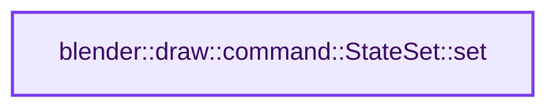

# 实现依赖专题：source/blender/draw/intern/draw_command.cc

[方向导航](README.md) · [符号索引](../%E7%AC%A6%E5%8F%B7%E4%BE%9D%E8%B5%96%E4%B8%8E%E5%AE%9E%E7%8E%B0%E7%B4%A2%E5%BC%95.md)

本专题从正文实际调用进入，集中保存共享实现。函数有稳定锚点，可从调用处直接跳到对应完整函数；递归与互相调用通过回链组织。

## 本文件的实现关系




## 完整成员与函数实现

<a id="f-3ac2c436b018fdaf"></a>

### `blender::draw::command::StateSet::set`

实现位置：[source/blender/draw/intern/draw_command.cc](../../../../../source/blender/draw/intern/draw_command.cc) · L335—L351。

接口参数：

- `DRWState state`

**教学注释版**

<!-- annotated:c55a4ddf7bd450 -->

```cpp
void StateSet::set(DRWState state)
{
  RecordingState recording_state;
  StateSet{state, 0}.execute(recording_state);

  /* This function is used for cleaning the state for the viewport drawing.
   * Make sure to reset textures resources to avoid feedback loop when rendering (see #131652). */
  GPU_texture_unbind_all();
  GPU_texture_image_unbind_all();
  GPU_uniformbuf_debug_unbind_all();
  GPU_storagebuf_debug_unbind_all();

  /* Remained of legacy draw manager. Kept it to avoid regression, but might become unneeded. */
  GPU_point_size(5);
  GPU_line_smooth(false);
  GPU_line_width(0.0f);
}
```

<details>
<summary>核对原始源码：source/blender/draw/intern/draw_command.cc · L335—L351</summary>

<!-- original:c55a4ddf7bd450:source/blender/draw/intern/draw_command.cc:335:351 -->

```cpp
void StateSet::set(DRWState state)
{
  RecordingState recording_state;
  StateSet{state, 0}.execute(recording_state);

  /* This function is used for cleaning the state for the viewport drawing.
   * Make sure to reset textures resources to avoid feedback loop when rendering (see #131652). */
  GPU_texture_unbind_all();
  GPU_texture_image_unbind_all();
  GPU_uniformbuf_debug_unbind_all();
  GPU_storagebuf_debug_unbind_all();

  /* Remained of legacy draw manager. Kept it to avoid regression, but might become unneeded. */
  GPU_point_size(5);
  GPU_line_smooth(false);
  GPU_line_width(0.0f);
}
```

</details>

**继续追踪实现**

- `StateSet{state, 0}.execute` → [调用协议](../%E6%A8%A1%E6%9D%BF%E5%AE%8F%E4%B8%8E%E5%8A%A8%E6%80%81%E5%88%86%E6%B4%BE%E5%8D%8F%E8%AE%AE.md)：接收对象类型依赖auto、返回值或模板实例；不按同名猜测目标。调用位置L338。
- `GPU_texture_unbind_all` → [blender::GPU_texture_unbind_all · L645](%E4%BE%9D%E8%B5%96-gpu_texture-234bda.md#f-a0b95d1cf219374e)。
- `GPU_texture_image_unbind_all` → [blender::GPU_texture_image_unbind_all · L660](%E4%BE%9D%E8%B5%96-gpu_texture-234bda.md#f-46511d00aeb97cd2)。
- `GPU_uniformbuf_debug_unbind_all` → [blender::GPU_uniformbuf_debug_unbind_all · L364](%E4%BE%9D%E8%B5%96-gpu_uniform_buffer-ef4877.md#f-f085c3d5621ec231)。
- `GPU_storagebuf_debug_unbind_all` → [blender::GPU_storagebuf_debug_unbind_all · L104](%E4%BE%9D%E8%B5%96-gpu_storage_buffer-1706c5.md#f-a89be9cc20c6d67e)。
- `GPU_point_size` → [blender::GPU_point_size · L157](%E4%BE%9D%E8%B5%96-gpu_state-82c525.md#f-3af311dd9716b12d)。
- `GPU_line_smooth` → [blender::GPU_line_smooth · L80](%E4%BE%9D%E8%B5%96-gpu_state-82c525.md#f-8b145981bbc8915e)。
- `GPU_line_width` → [blender::GPU_line_width · L151](%E4%BE%9D%E8%B5%96-gpu_state-82c525.md#f-9aa9b164f4d6ec7e)。
