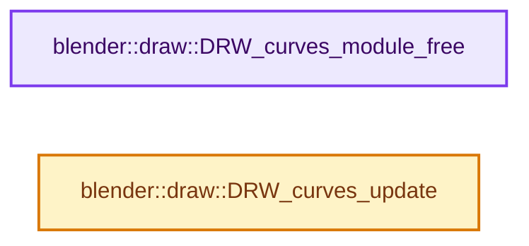
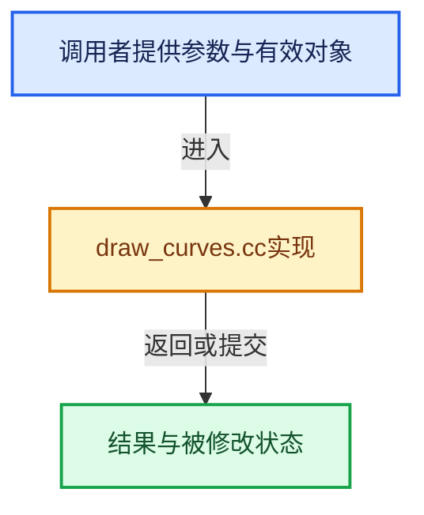

# 实现依赖专题：source/blender/draw/intern/draw_curves.cc

[方向导航](README.md) · [符号索引](../%E7%AC%A6%E5%8F%B7%E4%BE%9D%E8%B5%96%E4%B8%8E%E5%AE%9E%E7%8E%B0%E7%B4%A2%E5%BC%95.md)

本专题从正文实际调用进入，集中保存共享实现。函数有稳定锚点，可从调用处直接跳到对应完整函数；递归与互相调用通过回链组织。

## 本文件的实现关系






## 完整成员与函数实现

<a id="f-cab751298199a2dc"></a>

### `blender::draw::DRW_curves_module_free`

实现位置：[source/blender/draw/intern/draw_curves.cc](../../../../../source/blender/draw/intern/draw_curves.cc) · L87—L90。

接口参数：

- `CurvesModule *curves_module`

**教学注释版**

<!-- annotated:aa48c42b80e260 -->

```cpp
void DRW_curves_module_free(CurvesModule *curves_module)
{
  MEM_delete(curves_module);
}
```

<details>
<summary>核对原始源码：source/blender/draw/intern/draw_curves.cc · L87—L90</summary>

<!-- original:aa48c42b80e260:source/blender/draw/intern/draw_curves.cc:87:90 -->

```cpp
void DRW_curves_module_free(CurvesModule *curves_module)
{
  MEM_delete(curves_module);
}
```

</details>

**继续追踪实现**

- `MEM_delete` → [MEM_delete · L400](../03-%E5%86%85%E5%AD%98%E5%88%86%E9%85%8D%E4%B8%8E%E8%BF%90%E8%A1%8C%E6%97%B6%E7%B1%BB%E5%9E%8B/%E4%BE%9D%E8%B5%96-MEM_guardedalloc-b54eca.md#f-9049ffdd1682887c)。

<a id="f-b30cee21c13f709b"></a>

### `blender::draw::DRW_curves_update`

实现位置：[source/blender/draw/intern/draw_curves.cc](../../../../../source/blender/draw/intern/draw_curves.cc) · L322—L339。

接口参数：

- `draw::Manager &manager`

**教学注释版**

<!-- annotated:e9c4b9891272ea -->

```cpp
void DRW_curves_update(draw::Manager &manager)
{
  DRW_submission_start();

  /* TODO(fclem): Remove Global access. */
  CurvesModule &module = *drw_get().data->curves_module;

  /* NOTE: This also update legacy hairs too as they populate the same pass. */
  manager.submit(module.refine);
  GPU_memory_barrier(GPU_BARRIER_SHADER_STORAGE);

  module.transient_buffers.clear();

  /* Make sure calling this function again will not subdivide the same data. */
  module.refine.init();

  DRW_submission_end();
}
```

<details>
<summary>核对原始源码：source/blender/draw/intern/draw_curves.cc · L322—L339</summary>

<!-- original:e9c4b9891272ea:source/blender/draw/intern/draw_curves.cc:322:339 -->

```cpp
void DRW_curves_update(draw::Manager &manager)
{
  DRW_submission_start();

  /* TODO(fclem): Remove Global access. */
  CurvesModule &module = *drw_get().data->curves_module;

  /* NOTE: This also update legacy hairs too as they populate the same pass. */
  manager.submit(module.refine);
  GPU_memory_barrier(GPU_BARRIER_SHADER_STORAGE);

  module.transient_buffers.clear();

  /* Make sure calling this function again will not subdivide the same data. */
  module.refine.init();

  DRW_submission_end();
}
```

</details>

**继续追踪实现**

- `DRW_submission_start` → [blender::DRW_submission_start · L60](%E4%BE%9D%E8%B5%96-draw_gpu_context-25fcfe.md#f-57273afd566a69bb)。
- `drw_get` → [blender::drw_get · L81](%E4%BE%9D%E8%B5%96-draw_context_private-b45cc2.md#f-8fd959a68d9e8cf0)。
- `manager.submit` → [blender::draw::Manager::submit · L358](%E4%BE%9D%E8%B5%96-draw_manager-3065ec.md#f-958bd41ad5c7e105)；[blender::draw::Manager::submit · L377](%E4%BE%9D%E8%B5%96-draw_manager-3065ec.md#f-cee9c3109323befa)；[blender::draw::Manager::submit · L388](%E4%BE%9D%E8%B5%96-draw_manager-3065ec.md#f-b3167b29791fe895)；[blender::draw::Manager::submit · L412](%E4%BE%9D%E8%B5%96-draw_manager-3065ec.md#f-9bc48ed8603f6ea9)。同名重载需按实参类型选择。
- `GPU_memory_barrier` → [blender::GPU_memory_barrier · L305](%E4%BE%9D%E8%B5%96-gpu_state-82c525.md#f-5a91f15b51991eb7)。
- `module.transient_buffers.clear` → [调用协议](../%E6%A8%A1%E6%9D%BF%E5%AE%8F%E4%B8%8E%E5%8A%A8%E6%80%81%E5%88%86%E6%B4%BE%E5%8D%8F%E8%AE%AE.md)：接收对象类型依赖auto、返回值或模板实例；不按同名猜测目标。调用位置L333。
- `module.refine.init` → [调用协议](../%E6%A8%A1%E6%9D%BF%E5%AE%8F%E4%B8%8E%E5%8A%A8%E6%80%81%E5%88%86%E6%B4%BE%E5%8D%8F%E8%AE%AE.md)：接收对象类型依赖auto、返回值或模板实例；不按同名猜测目标。调用位置L336。
- `DRW_submission_end` → [blender::DRW_submission_end · L68](%E4%BE%9D%E8%B5%96-draw_gpu_context-25fcfe.md#f-6cc549be55e77d77)。
