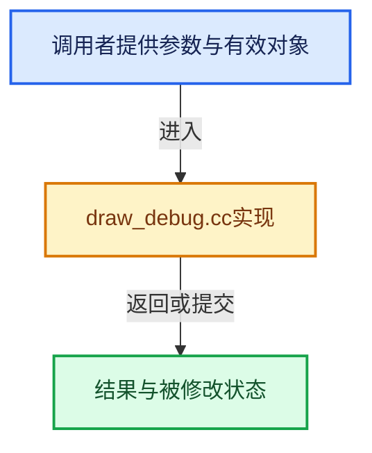

# 实现依赖专题：source/blender/draw/intern/draw_debug.cc

[方向导航](README.md) · [符号索引](../%E7%AC%A6%E5%8F%B7%E4%BE%9D%E8%B5%96%E4%B8%8E%E5%AE%9E%E7%8E%B0%E7%B4%A2%E5%BC%95.md)

本专题从正文实际调用进入，集中保存共享实现。函数有稳定锚点，可从调用处直接跳到对应完整函数；递归与互相调用通过回链组织。

## 本文件的实现关系





## 完整成员与函数实现

<a id="f-daa25fc0e0f7966a"></a>

### `blender::draw::drw_debug_bbox`

实现位置：[source/blender/draw/intern/draw_debug.cc](../../../../../source/blender/draw/intern/draw_debug.cc) · L110—L128。

接口参数：

- `const BoundBox &bbox`
- `const float4 color`
- `const uint lifetime`

**教学注释版**

<!-- annotated:dbd77872c305b8 -->

```cpp
void drw_debug_bbox(const BoundBox &bbox, const float4 color, const uint lifetime)
{
  DebugDraw &dd = DebugDraw::get();
  uint col = debug_color_pack(color);
  dd.draw_line(bbox.vec[0], bbox.vec[1], col, lifetime);
  dd.draw_line(bbox.vec[1], bbox.vec[2], col, lifetime);
  dd.draw_line(bbox.vec[2], bbox.vec[3], col, lifetime);
  dd.draw_line(bbox.vec[3], bbox.vec[0], col, lifetime);

  dd.draw_line(bbox.vec[4], bbox.vec[5], col, lifetime);
  dd.draw_line(bbox.vec[5], bbox.vec[6], col, lifetime);
  dd.draw_line(bbox.vec[6], bbox.vec[7], col, lifetime);
  dd.draw_line(bbox.vec[7], bbox.vec[4], col, lifetime);

  dd.draw_line(bbox.vec[0], bbox.vec[4], col, lifetime);
  dd.draw_line(bbox.vec[1], bbox.vec[5], col, lifetime);
  dd.draw_line(bbox.vec[2], bbox.vec[6], col, lifetime);
  dd.draw_line(bbox.vec[3], bbox.vec[7], col, lifetime);
}
```

<details>
<summary>核对原始源码：source/blender/draw/intern/draw_debug.cc · L110—L128</summary>

<!-- original:dbd77872c305b8:source/blender/draw/intern/draw_debug.cc:110:128 -->

```cpp
void drw_debug_bbox(const BoundBox &bbox, const float4 color, const uint lifetime)
{
  DebugDraw &dd = DebugDraw::get();
  uint col = debug_color_pack(color);
  dd.draw_line(bbox.vec[0], bbox.vec[1], col, lifetime);
  dd.draw_line(bbox.vec[1], bbox.vec[2], col, lifetime);
  dd.draw_line(bbox.vec[2], bbox.vec[3], col, lifetime);
  dd.draw_line(bbox.vec[3], bbox.vec[0], col, lifetime);

  dd.draw_line(bbox.vec[4], bbox.vec[5], col, lifetime);
  dd.draw_line(bbox.vec[5], bbox.vec[6], col, lifetime);
  dd.draw_line(bbox.vec[6], bbox.vec[7], col, lifetime);
  dd.draw_line(bbox.vec[7], bbox.vec[4], col, lifetime);

  dd.draw_line(bbox.vec[0], bbox.vec[4], col, lifetime);
  dd.draw_line(bbox.vec[1], bbox.vec[5], col, lifetime);
  dd.draw_line(bbox.vec[2], bbox.vec[6], col, lifetime);
  dd.draw_line(bbox.vec[3], bbox.vec[7], col, lifetime);
}
```

</details>

**继续追踪实现**

- `DebugDraw::get` → [blender::draw::DebugDraw::get · L129](%E4%BE%9D%E8%B5%96-draw_debug-61b32f.md#f-da2078559abe6f41)。
- `debug_color_pack` → [blender::debug_color_pack · L63](%E4%BE%9D%E8%B5%96-draw_debug_shared-97e73c.md#f-eb858292d56a8204)。
- `dd.draw_line` → [blender::draw::DebugDraw::draw_line · L202](%E4%BE%9D%E8%B5%96-draw_debug-33d6c9.md#f-4b4f6e83bea9cdf6)。

<a id="f-2b3f938ee8316e72"></a>

### `blender::draw::drw_debug_matrix_as_bbox`

实现位置：[source/blender/draw/intern/draw_debug.cc](../../../../../source/blender/draw/intern/draw_debug.cc) · L185—L193。

接口参数：

- `const float4x4 &mat`
- `const float4 color`
- `const uint lifetime`

**教学注释版**

<!-- annotated:a68b66ce25af33 -->

```cpp
void drw_debug_matrix_as_bbox(const float4x4 &mat, const float4 color, const uint lifetime)
{
  BoundBox bb;
  std::array<float3, 8> corners = bounds::corners(Bounds<float3>(float3(-1), float3(1)));
  for (auto i : IndexRange(8)) {
    mul_project_m4_v3(mat.ptr(), corners[i]);
  }
  drw_debug_bbox(bb, color, lifetime);
}
```

<details>
<summary>核对原始源码：source/blender/draw/intern/draw_debug.cc · L185—L193</summary>

<!-- original:a68b66ce25af33:source/blender/draw/intern/draw_debug.cc:185:193 -->

```cpp
void drw_debug_matrix_as_bbox(const float4x4 &mat, const float4 color, const uint lifetime)
{
  BoundBox bb;
  std::array<float3, 8> corners = bounds::corners(Bounds<float3>(float3(-1), float3(1)));
  for (auto i : IndexRange(8)) {
    mul_project_m4_v3(mat.ptr(), corners[i]);
  }
  drw_debug_bbox(bb, color, lifetime);
}
```

</details>

**继续追踪实现**

- `bounds::corners` → [调用协议](../%E6%A8%A1%E6%9D%BF%E5%AE%8F%E4%B8%8E%E5%8A%A8%E6%80%81%E5%88%86%E6%B4%BE%E5%8D%8F%E8%AE%AE.md)：局部可调用对象，须结合其初始化与捕获环境。调用位置L188。
- `Bounds<float3>` → [blender::Bounds](../12-%E7%A9%BA%E9%97%B4%E6%95%B0%E6%8D%AE%E7%BB%93%E6%9E%84%E4%B8%8E%E5%87%A0%E4%BD%95%E7%AE%97%E6%B3%95/%E4%BE%9D%E8%B5%96-BLI_bounds_types-fbc701.md#t-034e001bc6d9)；[blender::Bounds](%E4%BE%9D%E8%B5%96-usd_writer_abstract-2d4373.md#t-c611d2724544)；[blender::Bounds](%E4%BE%9D%E8%B5%96-DNA_mesh_types-81f02e.md#t-3124dc634817)；[blender::draw::overlay::Bounds](%E4%BE%9D%E8%B5%96-overlay_bounds-5e4545.md#t-1e10f8dc8848)。
- `float3` → [float3 · L641](%E4%BE%9D%E8%B5%96-smaa-b67bc2.md#m-0ea8254cfdb4)。宏定义由构建条件选择。
- `IndexRange` → [blender::IndexRange](../01-%E5%9F%BA%E7%A1%80%E5%AE%B9%E5%99%A8%E4%B8%8E%E7%8E%B0%E4%BB%A3CPP/%E4%BE%9D%E8%B5%96-BLI_index_range-7d7cc5.md#t-caa3466d6776)；[blender::gpu::shader::parser::IndexRange](%E4%BE%9D%E8%B5%96-utils-06433d.md#t-82d2bd4ea71c)；[blender::IndexRange](%E4%BE%9D%E8%B5%96-DNA_node_types-6708b9.md#t-0448cc889d39)。
- `mul_project_m4_v3` → [blender::mul_project_m4_v3 · L768](../12-%E7%A9%BA%E9%97%B4%E6%95%B0%E6%8D%AE%E7%BB%93%E6%9E%84%E4%B8%8E%E5%87%A0%E4%BD%95%E7%AE%97%E6%B3%95/%E4%BE%9D%E8%B5%96-math_matrix_c-004123.md#f-6c5495b92b2424d9)。
- `mat.ptr` → [调用协议](../%E6%A8%A1%E6%9D%BF%E5%AE%8F%E4%B8%8E%E5%8A%A8%E6%80%81%E5%88%86%E6%B4%BE%E5%8D%8F%E8%AE%AE.md)：由接收对象具体类型或运行时策略提供实现。调用位置L190。
- `drw_debug_bbox` → [blender::draw::drw_debug_bbox · L110](%E4%BE%9D%E8%B5%96-draw_debug-33d6c9.md#f-daa25fc0e0f7966a)。

<a id="f-4b4f6e83bea9cdf6"></a>

### `blender::draw::DebugDraw::draw_line`

实现位置：[source/blender/draw/intern/draw_debug.cc](../../../../../source/blender/draw/intern/draw_debug.cc) · L202—L220。

接口参数：

- `float3 v1`
- `float3 v2`
- `uint color`
- `const uint lifetime`

**教学注释版**

<!-- annotated:06b816b0cb5a8a -->

```cpp
void DebugDraw::draw_line(float3 v1, float3 v2, uint color, const uint lifetime)
{
  if (!GPU_vertex_pipeline_stores_and_atomics_support()) {
    return;
  }
  DebugDrawBuf &buf = *cpu_draw_buf_.current();
  uint index = vertex_len_.fetch_add(2);
  if (index + 2 < DRW_DEBUG_DRAW_VERT_MAX) {
    buf.verts[index / 2] = debug_line_make(float_as_uint(v1.x),
                                           float_as_uint(v1.y),
                                           float_as_uint(v1.z),
                                           float_as_uint(v2.x),
                                           float_as_uint(v2.y),
                                           float_as_uint(v2.z),
                                           color,
                                           lifetime);
    buf.command.array.vertex_len += 2;
  }
}
```

<details>
<summary>核对原始源码：source/blender/draw/intern/draw_debug.cc · L202—L220</summary>

<!-- original:06b816b0cb5a8a:source/blender/draw/intern/draw_debug.cc:202:220 -->

```cpp
void DebugDraw::draw_line(float3 v1, float3 v2, uint color, const uint lifetime)
{
  if (!GPU_vertex_pipeline_stores_and_atomics_support()) {
    return;
  }
  DebugDrawBuf &buf = *cpu_draw_buf_.current();
  uint index = vertex_len_.fetch_add(2);
  if (index + 2 < DRW_DEBUG_DRAW_VERT_MAX) {
    buf.verts[index / 2] = debug_line_make(float_as_uint(v1.x),
                                           float_as_uint(v1.y),
                                           float_as_uint(v1.z),
                                           float_as_uint(v2.x),
                                           float_as_uint(v2.y),
                                           float_as_uint(v2.z),
                                           color,
                                           lifetime);
    buf.command.array.vertex_len += 2;
  }
}
```

</details>

**沿实际写入检查状态**

- `buf.command.array.vertex_len += 2;`

**继续追踪实现**

- `GPU_vertex_pipeline_stores_and_atomics_support` → [blender::GPU_vertex_pipeline_stores_and_atomics_support · L182](%E4%BE%9D%E8%B5%96-gpu_capabilities-508ffd.md#f-c484ed43ab51c49f)。
- `cpu_draw_buf_.current` → [调用协议](../%E6%A8%A1%E6%9D%BF%E5%AE%8F%E4%B8%8E%E5%8A%A8%E6%80%81%E5%88%86%E6%B4%BE%E5%8D%8F%E8%AE%AE.md)：接收对象类型依赖auto、返回值或模板实例；不按同名猜测目标。调用位置L207。
- `vertex_len_.fetch_add` → [调用协议](../%E6%A8%A1%E6%9D%BF%E5%AE%8F%E4%B8%8E%E5%8A%A8%E6%80%81%E5%88%86%E6%B4%BE%E5%8D%8F%E8%AE%AE.md)：接收对象类型依赖auto、返回值或模板实例；不按同名猜测目标。调用位置L208。
- `debug_line_make` → [blender::debug_line_make · L42](%E4%BE%9D%E8%B5%96-draw_debug_shared-97e73c.md#f-01eb16f2cc97d904)。
- `float_as_uint` → [调用协议](../%E6%A8%A1%E6%9D%BF%E5%AE%8F%E4%B8%8E%E5%8A%A8%E6%80%81%E5%88%86%E6%B4%BE%E5%8D%8F%E8%AE%AE.md)：函数指针、局部可调用对象或未展开的宏；必须结合调用者环境。调用位置L210。
