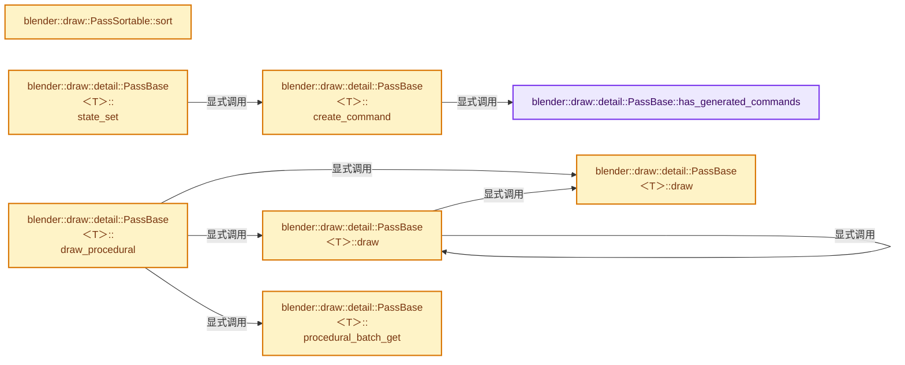
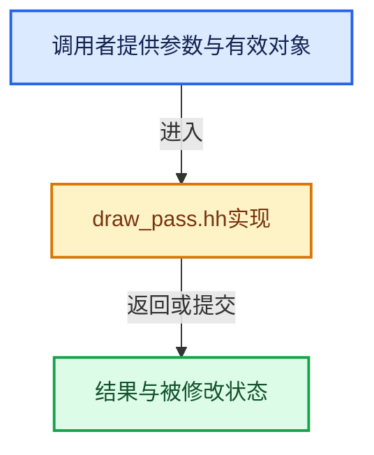

# 实现依赖专题：source/blender/draw/intern/draw_pass.hh

[方向导航](README.md) · [符号索引](../%E7%AC%A6%E5%8F%B7%E4%BE%9D%E8%B5%96%E4%B8%8E%E5%AE%9E%E7%8E%B0%E7%B4%A2%E5%BC%95.md)

本专题从正文实际调用进入，集中保存共享实现。函数有稳定锚点，可从调用处直接跳到对应完整函数；递归与互相调用通过回链组织。

## 本文件的实现关系






## 完整成员与函数实现

<a id="f-79ba7bc286db0068"></a>

### `blender::draw::detail::PassBase::has_generated_commands`

实现位置：[source/blender/draw/intern/draw_pass.hh](../../../../../source/blender/draw/intern/draw_pass.hh) · L498—L504。

**教学注释版**

<!-- annotated:081f0b1a3eddcb -->

```cpp
  bool has_generated_commands() const
  {
    /* NOTE: Even though manager fingerprint is not enough to check for update, it is still
     * guaranteed to not be 0. So we can check weather or not this pass has generated commands
     * after sync. Asserts will catch invalid usage . */
    return manager_fingerprint_ != 0;
  }
```

<details>
<summary>核对原始源码：source/blender/draw/intern/draw_pass.hh · L498—L504</summary>

<!-- original:081f0b1a3eddcb:source/blender/draw/intern/draw_pass.hh:498:504 -->

```cpp
  bool has_generated_commands() const
  {
    /* NOTE: Even though manager fingerprint is not enough to check for update, it is still
     * guaranteed to not be 0. So we can check weather or not this pass has generated commands
     * after sync. Asserts will catch invalid usage . */
    return manager_fingerprint_ != 0;
  }
```

</details>

**结果出口**

- `return manager_fingerprint_ != 0;`

**继续追踪实现**

本实现没有需要继续展开的显式调用；检查返回表达式、对象转换和调用者前置条件。

<a id="f-66fbd18ee8076b64"></a>

### `blender::draw::PassSortable::sort`

实现位置：[source/blender/draw/intern/draw_pass.hh](../../../../../source/blender/draw/intern/draw_pass.hh) · L604—L615。

**教学注释版**

<!-- annotated:d86dcae0310f17 -->

```cpp
  void sort()
  {
    if (sorted_ == false) {
      std::ranges::sort(headers_, [&](Header &a, Header &b) {
        BLI_assert(a.type == Type::SubPass && b.type == Type::SubPass);
        float a_val = sorting_values_[a.index];
        float b_val = sorting_values_[b.index];
        return a_val < b_val || (a_val == b_val && a.index < b.index);
      });
      sorted_ = true;
    }
  }
```

<details>
<summary>核对原始源码：source/blender/draw/intern/draw_pass.hh · L604—L615</summary>

<!-- original:d86dcae0310f17:source/blender/draw/intern/draw_pass.hh:604:615 -->

```cpp
  void sort()
  {
    if (sorted_ == false) {
      std::ranges::sort(headers_, [&](Header &a, Header &b) {
        BLI_assert(a.type == Type::SubPass && b.type == Type::SubPass);
        float a_val = sorting_values_[a.index];
        float b_val = sorting_values_[b.index];
        return a_val < b_val || (a_val == b_val && a.index < b.index);
      });
      sorted_ = true;
    }
  }
```

</details>

**沿实际写入检查状态**

- `sorted_ = true;`

**结果出口**

- `return a_val < b_val || (a_val == b_val && a.index < b.index);`

**继续追踪实现**

- `std::ranges::sort` → [外部契约](https://eel.is/c++draft/)：这个边界按实际表达式及所属类型核对参数、返回值、寿命与失败行为。这里提供接口入口，不声称已解释该第三方版本的内部实现。
- `BLI_assert` → [BLI_assert · L48](../01-%E5%9F%BA%E7%A1%80%E5%AE%B9%E5%99%A8%E4%B8%8E%E7%8E%B0%E4%BB%A3CPP/%E4%BE%9D%E8%B5%96-BLI_assert-cc98e8.md#m-57a88495704d)；[BLI_assert · L63](../01-%E5%9F%BA%E7%A1%80%E5%AE%B9%E5%99%A8%E4%B8%8E%E7%8E%B0%E4%BB%A3CPP/%E4%BE%9D%E8%B5%96-BLI_assert-cc98e8.md#m-d07050020cb5)。宏定义由构建条件选择。

<a id="f-fb7a4bb9dbaff6a7"></a>

### `blender::draw::detail::PassBase<T>::create_command`

实现位置：[source/blender/draw/intern/draw_pass.hh](../../../../../source/blender/draw/intern/draw_pass.hh) · L644—L666。

接口参数：

- `command::Type type`

**教学注释版**

<!-- annotated:ab4a58eb3536b2 -->

```cpp
template<class T> inline command::Undetermined &PassBase<T>::create_command(command::Type type)
{
  /* After render commands have been generated, the pass is read only.
   * Call `init()` to be able modify it again. */
  BLI_assert_msg(this->has_generated_commands() == false, "Command added after submission");
  // [讲解] commands_.append_and_get_index：在尾部建立新元素，必要时先扩大存储。
  int64_t index = commands_.append_and_get_index({});
  // [讲解] headers_.append：在尾部建立新元素，必要时先扩大存储。
  headers_.append({type, uint(index)});

  if (ELEM(type,
           Type::Barrier,
           Type::Clear,
           Type::ClearMulti,
           Type::Dispatch,
           Type::DispatchIndirect,
           Type::Draw,
           Type::DrawIndirect,
           Type::TextureCopy))
  {
    is_empty_ = false;
  }

  return commands_[index];
}
```

<details>
<summary>核对原始源码：source/blender/draw/intern/draw_pass.hh · L644—L666</summary>

<!-- original:ab4a58eb3536b2:source/blender/draw/intern/draw_pass.hh:644:666 -->

```cpp
template<class T> inline command::Undetermined &PassBase<T>::create_command(command::Type type)
{
  /* After render commands have been generated, the pass is read only.
   * Call `init()` to be able modify it again. */
  BLI_assert_msg(this->has_generated_commands() == false, "Command added after submission");
  int64_t index = commands_.append_and_get_index({});
  headers_.append({type, uint(index)});

  if (ELEM(type,
           Type::Barrier,
           Type::Clear,
           Type::ClearMulti,
           Type::Dispatch,
           Type::DispatchIndirect,
           Type::Draw,
           Type::DrawIndirect,
           Type::TextureCopy))
  {
    is_empty_ = false;
  }

  return commands_[index];
}
```

</details>

**沿实际写入检查状态**

- `is_empty_ = false;`

**结果出口**

- `return commands_[index];`

**继续追踪实现**

- `BLI_assert_msg` → [BLI_assert_msg · L55](../01-%E5%9F%BA%E7%A1%80%E5%AE%B9%E5%99%A8%E4%B8%8E%E7%8E%B0%E4%BB%A3CPP/%E4%BE%9D%E8%B5%96-BLI_assert-cc98e8.md#m-695eed20dceb)；[BLI_assert_msg · L64](../01-%E5%9F%BA%E7%A1%80%E5%AE%B9%E5%99%A8%E4%B8%8E%E7%8E%B0%E4%BB%A3CPP/%E4%BE%9D%E8%B5%96-BLI_assert-cc98e8.md#m-7de5563de4db)。宏定义由构建条件选择。
- `this->has_generated_commands` → [blender::draw::detail::PassBase::has_generated_commands · L498](%E4%BE%9D%E8%B5%96-draw_pass-5d652c.md#f-79ba7bc286db0068)。
- `commands_.append_and_get_index` → [blender::Vector::append_and_get_index · L517](../01-%E5%9F%BA%E7%A1%80%E5%AE%B9%E5%99%A8%E4%B8%8E%E7%8E%B0%E4%BB%A3CPP/11-Vector%E6%8F%92%E5%85%A5%E5%88%A0%E9%99%A4%E4%B8%8E%E9%87%8D%E6%8E%92.md#f-1de78b06c3aa90cd)；[blender::Vector::append_and_get_index · L521](../01-%E5%9F%BA%E7%A1%80%E5%AE%B9%E5%99%A8%E4%B8%8E%E7%8E%B0%E4%BB%A3CPP/11-Vector%E6%8F%92%E5%85%A5%E5%88%A0%E9%99%A4%E4%B8%8E%E9%87%8D%E6%8E%92.md#f-91413faf22574850)。同名重载需按实参类型选择。
- `headers_.append` → [blender::Vector::append · L498](../01-%E5%9F%BA%E7%A1%80%E5%AE%B9%E5%99%A8%E4%B8%8E%E7%8E%B0%E4%BB%A3CPP/11-Vector%E6%8F%92%E5%85%A5%E5%88%A0%E9%99%A4%E4%B8%8E%E9%87%8D%E6%8E%92.md#f-5bde268a69e443ec)；[blender::Vector::append · L502](../01-%E5%9F%BA%E7%A1%80%E5%AE%B9%E5%99%A8%E4%B8%8E%E7%8E%B0%E4%BB%A3CPP/11-Vector%E6%8F%92%E5%85%A5%E5%88%A0%E9%99%A4%E4%B8%8E%E9%87%8D%E6%8E%92.md#f-591e0b15e6308532)。同名重载需按实参类型选择。
- `ELEM` → [ELEM · L88](%E4%BE%9D%E8%B5%96-GHOST_utildefines-34b996.md#m-d28724a15928)；[ELEM · L135](../01-%E5%9F%BA%E7%A1%80%E5%AE%B9%E5%99%A8%E4%B8%8E%E7%8E%B0%E4%BB%A3CPP/%E4%BE%9D%E8%B5%96-BLI_utildefines-293a0a.md#m-d6572de7cae0)。宏定义由构建条件选择。

<a id="f-5c0b2abaa019f140"></a>

### `blender::draw::detail::PassBase<T>::procedural_batch_get`

实现位置：[source/blender/draw/intern/draw_pass.hh](../../../../../source/blender/draw/intern/draw_pass.hh) · L683—L699。

接口参数：

- `GPUPrimType primitive`

**教学注释版**

<!-- annotated:b73557ffbdfb38 -->

```cpp
template<class T> inline gpu::Batch *PassBase<T>::procedural_batch_get(GPUPrimType primitive)
{
  switch (primitive) {
    case GPU_PRIM_POINTS:
      return GPU_batch_procedural_points_get();
    case GPU_PRIM_LINES:
      return GPU_batch_procedural_lines_get();
    case GPU_PRIM_TRIS:
      return GPU_batch_procedural_triangles_get();
    case GPU_PRIM_TRI_STRIP:
      return GPU_batch_procedural_triangle_strips_get();
    default:
      /* Add new one as needed. */
      BLI_assert_unreachable();
      return nullptr;
  }
}
```

<details>
<summary>核对原始源码：source/blender/draw/intern/draw_pass.hh · L683—L699</summary>

<!-- original:b73557ffbdfb38:source/blender/draw/intern/draw_pass.hh:683:699 -->

```cpp
template<class T> inline gpu::Batch *PassBase<T>::procedural_batch_get(GPUPrimType primitive)
{
  switch (primitive) {
    case GPU_PRIM_POINTS:
      return GPU_batch_procedural_points_get();
    case GPU_PRIM_LINES:
      return GPU_batch_procedural_lines_get();
    case GPU_PRIM_TRIS:
      return GPU_batch_procedural_triangles_get();
    case GPU_PRIM_TRI_STRIP:
      return GPU_batch_procedural_triangle_strips_get();
    default:
      /* Add new one as needed. */
      BLI_assert_unreachable();
      return nullptr;
  }
}
```

</details>

**结果出口**

- `return GPU_batch_procedural_points_get();`
- `return GPU_batch_procedural_lines_get();`
- `return GPU_batch_procedural_triangles_get();`
- `return GPU_batch_procedural_triangle_strips_get();`
- `return nullptr;`

**继续追踪实现**

- `GPU_batch_procedural_points_get` → [blender::GPU_batch_procedural_points_get · L513](%E4%BE%9D%E8%B5%96-gpu_batch-25aed8.md#f-f9c2138ead82cd55)。
- `GPU_batch_procedural_lines_get` → [blender::GPU_batch_procedural_lines_get · L518](%E4%BE%9D%E8%B5%96-gpu_batch-25aed8.md#f-6e63e8159b2471aa)。
- `GPU_batch_procedural_triangles_get` → [blender::GPU_batch_procedural_triangles_get · L523](%E4%BE%9D%E8%B5%96-gpu_batch-25aed8.md#f-d65e752da398cebe)。
- `GPU_batch_procedural_triangle_strips_get` → [blender::GPU_batch_procedural_triangle_strips_get · L528](%E4%BE%9D%E8%B5%96-gpu_batch-25aed8.md#f-6268de4430a06532)。
- `BLI_assert_unreachable` → [BLI_assert_unreachable · L77](../01-%E5%9F%BA%E7%A1%80%E5%AE%B9%E5%99%A8%E4%B8%8E%E7%8E%B0%E4%BB%A3CPP/%E4%BE%9D%E8%B5%96-BLI_assert-cc98e8.md#m-7a2d91a67d8e)。宏定义由构建条件选择。

<a id="f-8122c8001e3be3a3"></a>

### `blender::draw::detail::PassBase<T>::draw`

实现位置：[source/blender/draw/intern/draw_pass.hh](../../../../../source/blender/draw/intern/draw_pass.hh) · L905—L929。

接口参数：

- `gpu::Batch *batch`
- `uint instance_len`
- `uint vertex_len`
- `uint vertex_first`
- `ResourceIDRange res_id`
- `uint custom_id`

**教学注释版**

<!-- annotated:a2d5c07f4ec79c -->

```cpp
template<class T>
inline void PassBase<T>::draw(gpu::Batch *batch,
                              uint instance_len,
                              uint vertex_len,
                              uint vertex_first,
                              ResourceIDRange res_id,
                              uint custom_id)
{
  if (instance_len == 0 || vertex_len == 0) {
    return;
  }
  BLI_assert(batch);
  BLI_assert(shader_);
  draw_commands_buf_.append_draw(headers_,
                                 commands_,
                                 batch,
                                 instance_len,
                                 vertex_len,
                                 vertex_first,
                                 res_id,
                                 custom_id,
                                 GPU_PRIM_NONE,
                                 0);
  is_empty_ = false;
}
```

<details>
<summary>核对原始源码：source/blender/draw/intern/draw_pass.hh · L905—L929</summary>

<!-- original:a2d5c07f4ec79c:source/blender/draw/intern/draw_pass.hh:905:929 -->

```cpp
template<class T>
inline void PassBase<T>::draw(gpu::Batch *batch,
                              uint instance_len,
                              uint vertex_len,
                              uint vertex_first,
                              ResourceIDRange res_id,
                              uint custom_id)
{
  if (instance_len == 0 || vertex_len == 0) {
    return;
  }
  BLI_assert(batch);
  BLI_assert(shader_);
  draw_commands_buf_.append_draw(headers_,
                                 commands_,
                                 batch,
                                 instance_len,
                                 vertex_len,
                                 vertex_first,
                                 res_id,
                                 custom_id,
                                 GPU_PRIM_NONE,
                                 0);
  is_empty_ = false;
}
```

</details>

**沿实际写入检查状态**

- `is_empty_ = false;`

**继续追踪实现**

- `BLI_assert` → [BLI_assert · L48](../01-%E5%9F%BA%E7%A1%80%E5%AE%B9%E5%99%A8%E4%B8%8E%E7%8E%B0%E4%BB%A3CPP/%E4%BE%9D%E8%B5%96-BLI_assert-cc98e8.md#m-57a88495704d)；[BLI_assert · L63](../01-%E5%9F%BA%E7%A1%80%E5%AE%B9%E5%99%A8%E4%B8%8E%E7%8E%B0%E4%BB%A3CPP/%E4%BE%9D%E8%B5%96-BLI_assert-cc98e8.md#m-d07050020cb5)。宏定义由构建条件选择。
- `draw_commands_buf_.append_draw` → [调用协议](../%E6%A8%A1%E6%9D%BF%E5%AE%8F%E4%B8%8E%E5%8A%A8%E6%80%81%E5%88%86%E6%B4%BE%E5%8D%8F%E8%AE%AE.md)：由接收对象具体类型或运行时策略提供实现。调用位置L918。

<a id="f-43971c697bf3cdb4"></a>

### `blender::draw::detail::PassBase<T>::draw`

实现位置：[source/blender/draw/intern/draw_pass.hh](../../../../../source/blender/draw/intern/draw_pass.hh) · L931—L935。

接口参数：

- `gpu::Batch *batch`
- `ResourceIDRange res_id`
- `uint custom_id`

**教学注释版**

<!-- annotated:bfd538314f995f -->

```cpp
template<class T>
inline void PassBase<T>::draw(gpu::Batch *batch, ResourceIDRange res_id, uint custom_id)
{
  this->draw(batch, -1, -1, -1, res_id, custom_id);
}
```

<details>
<summary>核对原始源码：source/blender/draw/intern/draw_pass.hh · L931—L935</summary>

<!-- original:bfd538314f995f:source/blender/draw/intern/draw_pass.hh:931:935 -->

```cpp
template<class T>
inline void PassBase<T>::draw(gpu::Batch *batch, ResourceIDRange res_id, uint custom_id)
{
  this->draw(batch, -1, -1, -1, res_id, custom_id);
}
```

</details>

**继续追踪实现**

- `this->draw` → [blender::draw::detail::PassBase<T>::draw · L905](%E4%BE%9D%E8%B5%96-draw_pass-5d652c.md#f-8122c8001e3be3a3)；[blender::draw::detail::PassBase<T>::draw · L931](%E4%BE%9D%E8%B5%96-draw_pass-5d652c.md#f-43971c697bf3cdb4)。同名重载需按实参类型选择。

<a id="f-e3f268cdbf09d46d"></a>

### `blender::draw::detail::PassBase<T>::draw_procedural`

实现位置：[source/blender/draw/intern/draw_pass.hh](../../../../../source/blender/draw/intern/draw_pass.hh) · L975—L985。

接口参数：

- `GPUPrimType primitive`
- `uint instance_len`
- `uint vertex_len`
- `uint vertex_first`
- `ResourceIDRange res_id`
- `uint custom_id`

**教学注释版**

<!-- annotated:0b09f27699188a -->

```cpp
template<class T>
inline void PassBase<T>::draw_procedural(GPUPrimType primitive,
                                         uint instance_len,
                                         uint vertex_len,
                                         uint vertex_first,
                                         ResourceIDRange res_id,
                                         uint custom_id)
{
  this->draw(
      procedural_batch_get(primitive), instance_len, vertex_len, vertex_first, res_id, custom_id);
}
```

<details>
<summary>核对原始源码：source/blender/draw/intern/draw_pass.hh · L975—L985</summary>

<!-- original:0b09f27699188a:source/blender/draw/intern/draw_pass.hh:975:985 -->

```cpp
template<class T>
inline void PassBase<T>::draw_procedural(GPUPrimType primitive,
                                         uint instance_len,
                                         uint vertex_len,
                                         uint vertex_first,
                                         ResourceIDRange res_id,
                                         uint custom_id)
{
  this->draw(
      procedural_batch_get(primitive), instance_len, vertex_len, vertex_first, res_id, custom_id);
}
```

</details>

**继续追踪实现**

- `this->draw` → [blender::draw::detail::PassBase<T>::draw · L905](%E4%BE%9D%E8%B5%96-draw_pass-5d652c.md#f-8122c8001e3be3a3)；[blender::draw::detail::PassBase<T>::draw · L931](%E4%BE%9D%E8%B5%96-draw_pass-5d652c.md#f-43971c697bf3cdb4)。同名重载需按实参类型选择。
- `procedural_batch_get` → [blender::draw::detail::PassBase<T>::procedural_batch_get · L683](%E4%BE%9D%E8%B5%96-draw_pass-5d652c.md#f-5c0b2abaa019f140)。

<a id="f-97589d4da1cbc8b0"></a>

### `blender::draw::detail::PassBase<T>::state_set`

实现位置：[source/blender/draw/intern/draw_pass.hh](../../../../../source/blender/draw/intern/draw_pass.hh) · L1095—L1104。

接口参数：

- `DRWState state`
- `int clip_plane_count`

**教学注释版**

<!-- annotated:fab2bc7f3a2df2 -->

```cpp
template<class T> inline void PassBase<T>::state_set(DRWState state, int clip_plane_count)
{
  /** \note This is for compatibility with the old clip plane API. */
  if (clip_plane_count > 0) {
    state |= DRW_STATE_CLIP_PLANES;
  }
  /* Assumed to always be enabled. */
  state |= DRW_STATE_PROGRAM_POINT_SIZE;
  create_command(Type::StateSet).state_set = {state, clip_plane_count};
}
```

<details>
<summary>核对原始源码：source/blender/draw/intern/draw_pass.hh · L1095—L1104</summary>

<!-- original:fab2bc7f3a2df2:source/blender/draw/intern/draw_pass.hh:1095:1104 -->

```cpp
template<class T> inline void PassBase<T>::state_set(DRWState state, int clip_plane_count)
{
  /** \note This is for compatibility with the old clip plane API. */
  if (clip_plane_count > 0) {
    state |= DRW_STATE_CLIP_PLANES;
  }
  /* Assumed to always be enabled. */
  state |= DRW_STATE_PROGRAM_POINT_SIZE;
  create_command(Type::StateSet).state_set = {state, clip_plane_count};
}
```

</details>

**沿实际写入检查状态**

- `state |= DRW_STATE_CLIP_PLANES;`
- `state |= DRW_STATE_PROGRAM_POINT_SIZE;`

**继续追踪实现**

- `create_command` → [blender::draw::detail::PassBase<T>::create_command · L644](%E4%BE%9D%E8%B5%96-draw_pass-5d652c.md#f-fb7a4bb9dbaff6a7)。

<a id="f-b3bb3b9d7496f350"></a>

### `blender::draw::detail::PassBase<T>::state_stencil`

实现位置：[source/blender/draw/intern/draw_pass.hh](../../../../../source/blender/draw/intern/draw_pass.hh) · L1106—L1110。

接口参数：

- `uint8_t write_mask`
- `uint8_t reference`
- `uint8_t compare_mask`

**教学注释版**

<!-- annotated:6e46eaa153f22d -->

```cpp
template<class T>
inline void PassBase<T>::state_stencil(uint8_t write_mask, uint8_t reference, uint8_t compare_mask)
{
  create_command(Type::StencilSet).stencil_set = {write_mask, compare_mask, reference};
}
```

<details>
<summary>核对原始源码：source/blender/draw/intern/draw_pass.hh · L1106—L1110</summary>

<!-- original:6e46eaa153f22d:source/blender/draw/intern/draw_pass.hh:1106:1110 -->

```cpp
template<class T>
inline void PassBase<T>::state_stencil(uint8_t write_mask, uint8_t reference, uint8_t compare_mask)
{
  create_command(Type::StencilSet).stencil_set = {write_mask, compare_mask, reference};
}
```

</details>

**继续追踪实现**

- `create_command` → [blender::draw::detail::PassBase<T>::create_command · L644](%E4%BE%9D%E8%B5%96-draw_pass-5d652c.md#f-fb7a4bb9dbaff6a7)。

<a id="f-666f9d02755edac8"></a>

### `blender::draw::detail::PassBase<T>::shader_set`

实现位置：[source/blender/draw/intern/draw_pass.hh](../../../../../source/blender/draw/intern/draw_pass.hh) · L1112—L1116。

接口参数：

- `gpu::Shader *shader`

**教学注释版**

<!-- annotated:14c21b60bb579e -->

```cpp
template<class T> inline void PassBase<T>::shader_set(gpu::Shader *shader)
{
  shader_ = shader;
  create_command(Type::ShaderBind).shader_bind = {shader};
}
```

<details>
<summary>核对原始源码：source/blender/draw/intern/draw_pass.hh · L1112—L1116</summary>

<!-- original:14c21b60bb579e:source/blender/draw/intern/draw_pass.hh:1112:1116 -->

```cpp
template<class T> inline void PassBase<T>::shader_set(gpu::Shader *shader)
{
  shader_ = shader;
  create_command(Type::ShaderBind).shader_bind = {shader};
}
```

</details>

**沿实际写入检查状态**

- `shader_ = shader;`

**继续追踪实现**

- `create_command` → [blender::draw::detail::PassBase<T>::create_command · L644](%E4%BE%9D%E8%B5%96-draw_pass-5d652c.md#f-fb7a4bb9dbaff6a7)。

<a id="f-2ff33a6b723e476e"></a>

### `blender::draw::detail::PassBase<T>::bind_ubo`

实现位置：[source/blender/draw/intern/draw_pass.hh](../../../../../source/blender/draw/intern/draw_pass.hh) · L1273—L1277。

接口参数：

- `const char *name`
- `gpu::UniformBuf *buffer`

**教学注释版**

<!-- annotated:0549235c713cdb -->

```cpp
template<class T> inline void PassBase<T>::bind_ubo(const char *name, gpu::UniformBuf *buffer)
{
  BLI_assert(buffer != nullptr);
  this->bind_ubo(GPU_shader_get_ubo_binding(shader_, name), buffer);
}
```

<details>
<summary>核对原始源码：source/blender/draw/intern/draw_pass.hh · L1273—L1277</summary>

<!-- original:0549235c713cdb:source/blender/draw/intern/draw_pass.hh:1273:1277 -->

```cpp
template<class T> inline void PassBase<T>::bind_ubo(const char *name, gpu::UniformBuf *buffer)
{
  BLI_assert(buffer != nullptr);
  this->bind_ubo(GPU_shader_get_ubo_binding(shader_, name), buffer);
}
```

</details>

**继续追踪实现**

- `BLI_assert` → [BLI_assert · L48](../01-%E5%9F%BA%E7%A1%80%E5%AE%B9%E5%99%A8%E4%B8%8E%E7%8E%B0%E4%BB%A3CPP/%E4%BE%9D%E8%B5%96-BLI_assert-cc98e8.md#m-57a88495704d)；[BLI_assert · L63](../01-%E5%9F%BA%E7%A1%80%E5%AE%B9%E5%99%A8%E4%B8%8E%E7%8E%B0%E4%BB%A3CPP/%E4%BE%9D%E8%B5%96-BLI_assert-cc98e8.md#m-d07050020cb5)。宏定义由构建条件选择。
- `this->bind_ubo` → [blender::draw::detail::PassBase<T>::bind_ubo · L1273](%E4%BE%9D%E8%B5%96-draw_pass-5d652c.md#f-2ff33a6b723e476e)；[blender::draw::detail::PassBase<T>::bind_ubo · L1373](%E4%BE%9D%E8%B5%96-draw_pass-5d652c.md#f-a15d6a10dbc63f67)；[blender::draw::detail::PassBase<T>::bind_ubo · L1416](%E4%BE%9D%E8%B5%96-draw_pass-5d652c.md#f-72ed3eafe1d22591)；[blender::draw::detail::PassBase<T>::bind_ubo · L1444](%E4%BE%9D%E8%B5%96-draw_pass-5d652c.md#f-13d371c544cb15af)。同名重载需按实参类型选择。
- `GPU_shader_get_ubo_binding` → [blender::GPU_shader_get_ubo_binding · L558](%E4%BE%9D%E8%B5%96-gpu_shader-141cc9.md#f-640a2aa8e79fb49f)。

<a id="f-a15d6a10dbc63f67"></a>

### `blender::draw::detail::PassBase<T>::bind_ubo`

实现位置：[source/blender/draw/intern/draw_pass.hh](../../../../../source/blender/draw/intern/draw_pass.hh) · L1373—L1377。

接口参数：

- `int slot`
- `gpu::UniformBuf *buffer`

**教学注释版**

<!-- annotated:a285660e6deb04 -->

```cpp
template<class T> inline void PassBase<T>::bind_ubo(int slot, gpu::UniformBuf *buffer)
{
  BLI_assert(buffer != nullptr);
  create_command(Type::ResourceBind).resource_bind = {slot, buffer};
}
```

<details>
<summary>核对原始源码：source/blender/draw/intern/draw_pass.hh · L1373—L1377</summary>

<!-- original:a285660e6deb04:source/blender/draw/intern/draw_pass.hh:1373:1377 -->

```cpp
template<class T> inline void PassBase<T>::bind_ubo(int slot, gpu::UniformBuf *buffer)
{
  BLI_assert(buffer != nullptr);
  create_command(Type::ResourceBind).resource_bind = {slot, buffer};
}
```

</details>

**继续追踪实现**

- `BLI_assert` → [BLI_assert · L48](../01-%E5%9F%BA%E7%A1%80%E5%AE%B9%E5%99%A8%E4%B8%8E%E7%8E%B0%E4%BB%A3CPP/%E4%BE%9D%E8%B5%96-BLI_assert-cc98e8.md#m-57a88495704d)；[BLI_assert · L63](../01-%E5%9F%BA%E7%A1%80%E5%AE%B9%E5%99%A8%E4%B8%8E%E7%8E%B0%E4%BB%A3CPP/%E4%BE%9D%E8%B5%96-BLI_assert-cc98e8.md#m-d07050020cb5)。宏定义由构建条件选择。
- `create_command` → [blender::draw::detail::PassBase<T>::create_command · L644](%E4%BE%9D%E8%B5%96-draw_pass-5d652c.md#f-fb7a4bb9dbaff6a7)。

<a id="f-72ed3eafe1d22591"></a>

### `blender::draw::detail::PassBase<T>::bind_ubo`

实现位置：[source/blender/draw/intern/draw_pass.hh](../../../../../source/blender/draw/intern/draw_pass.hh) · L1416—L1420。

接口参数：

- `const char *name`
- `gpu::UniformBuf **buffer`

**教学注释版**

<!-- annotated:c3c34379295f4c -->

```cpp
template<class T> inline void PassBase<T>::bind_ubo(const char *name, gpu::UniformBuf **buffer)
{
  BLI_assert(buffer != nullptr);
  this->bind_ubo(GPU_shader_get_ubo_binding(shader_, name), buffer);
}
```

<details>
<summary>核对原始源码：source/blender/draw/intern/draw_pass.hh · L1416—L1420</summary>

<!-- original:c3c34379295f4c:source/blender/draw/intern/draw_pass.hh:1416:1420 -->

```cpp
template<class T> inline void PassBase<T>::bind_ubo(const char *name, gpu::UniformBuf **buffer)
{
  BLI_assert(buffer != nullptr);
  this->bind_ubo(GPU_shader_get_ubo_binding(shader_, name), buffer);
}
```

</details>

**继续追踪实现**

- `BLI_assert` → [BLI_assert · L48](../01-%E5%9F%BA%E7%A1%80%E5%AE%B9%E5%99%A8%E4%B8%8E%E7%8E%B0%E4%BB%A3CPP/%E4%BE%9D%E8%B5%96-BLI_assert-cc98e8.md#m-57a88495704d)；[BLI_assert · L63](../01-%E5%9F%BA%E7%A1%80%E5%AE%B9%E5%99%A8%E4%B8%8E%E7%8E%B0%E4%BB%A3CPP/%E4%BE%9D%E8%B5%96-BLI_assert-cc98e8.md#m-d07050020cb5)。宏定义由构建条件选择。
- `this->bind_ubo` → [blender::draw::detail::PassBase<T>::bind_ubo · L1273](%E4%BE%9D%E8%B5%96-draw_pass-5d652c.md#f-2ff33a6b723e476e)；[blender::draw::detail::PassBase<T>::bind_ubo · L1373](%E4%BE%9D%E8%B5%96-draw_pass-5d652c.md#f-a15d6a10dbc63f67)；[blender::draw::detail::PassBase<T>::bind_ubo · L1416](%E4%BE%9D%E8%B5%96-draw_pass-5d652c.md#f-72ed3eafe1d22591)；[blender::draw::detail::PassBase<T>::bind_ubo · L1444](%E4%BE%9D%E8%B5%96-draw_pass-5d652c.md#f-13d371c544cb15af)。同名重载需按实参类型选择。
- `GPU_shader_get_ubo_binding` → [blender::GPU_shader_get_ubo_binding · L558](%E4%BE%9D%E8%B5%96-gpu_shader-141cc9.md#f-640a2aa8e79fb49f)。

<a id="f-13d371c544cb15af"></a>

### `blender::draw::detail::PassBase<T>::bind_ubo`

实现位置：[source/blender/draw/intern/draw_pass.hh](../../../../../source/blender/draw/intern/draw_pass.hh) · L1444—L1448。

接口参数：

- `int slot`
- `gpu::UniformBuf **buffer`

**教学注释版**

<!-- annotated:67cd6463328bfb -->

```cpp
template<class T> inline void PassBase<T>::bind_ubo(int slot, gpu::UniformBuf **buffer)
{
  BLI_assert(buffer != nullptr);
  create_command(Type::ResourceBind).resource_bind = {slot, buffer};
}
```

<details>
<summary>核对原始源码：source/blender/draw/intern/draw_pass.hh · L1444—L1448</summary>

<!-- original:67cd6463328bfb:source/blender/draw/intern/draw_pass.hh:1444:1448 -->

```cpp
template<class T> inline void PassBase<T>::bind_ubo(int slot, gpu::UniformBuf **buffer)
{
  BLI_assert(buffer != nullptr);
  create_command(Type::ResourceBind).resource_bind = {slot, buffer};
}
```

</details>

**继续追踪实现**

- `BLI_assert` → [BLI_assert · L48](../01-%E5%9F%BA%E7%A1%80%E5%AE%B9%E5%99%A8%E4%B8%8E%E7%8E%B0%E4%BB%A3CPP/%E4%BE%9D%E8%B5%96-BLI_assert-cc98e8.md#m-57a88495704d)；[BLI_assert · L63](../01-%E5%9F%BA%E7%A1%80%E5%AE%B9%E5%99%A8%E4%B8%8E%E7%8E%B0%E4%BB%A3CPP/%E4%BE%9D%E8%B5%96-BLI_assert-cc98e8.md#m-d07050020cb5)。宏定义由构建条件选择。
- `create_command` → [blender::draw::detail::PassBase<T>::create_command · L644](%E4%BE%9D%E8%B5%96-draw_pass-5d652c.md#f-fb7a4bb9dbaff6a7)。
