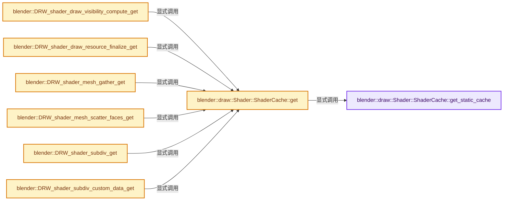
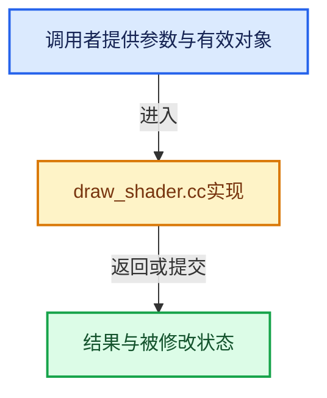

# 实现依赖专题：source/blender/draw/intern/draw_shader.cc

[方向导航](README.md) · [符号索引](../%E7%AC%A6%E5%8F%B7%E4%BE%9D%E8%B5%96%E4%B8%8E%E5%AE%9E%E7%8E%B0%E7%B4%A2%E5%BC%95.md)

本专题从正文实际调用进入，集中保存共享实现。函数有稳定锚点，可从调用处直接跳到对应完整函数；递归与互相调用通过回链组织。

## 本文件的实现关系






## 完整成员与函数实现

<a id="f-ce2262bdbe400d07"></a>

### `blender::draw::Shader::ShaderCache::get_static_cache`

实现位置：[source/blender/draw/intern/draw_shader.cc](../../../../../source/blender/draw/intern/draw_shader.cc) · L87—L91。

**教学注释版**

<!-- annotated:045aabb17e04a6 -->

```cpp
  static gpu::StaticShaderCache<ShaderCache> &get_static_cache()
  {
    static gpu::StaticShaderCache<ShaderCache> static_cache;
    return static_cache;
  }
```

<details>
<summary>核对原始源码：source/blender/draw/intern/draw_shader.cc · L87—L91</summary>

<!-- original:045aabb17e04a6:source/blender/draw/intern/draw_shader.cc:87:91 -->

```cpp
  static gpu::StaticShaderCache<ShaderCache> &get_static_cache()
  {
    static gpu::StaticShaderCache<ShaderCache> static_cache;
    return static_cache;
  }
```

</details>

**结果出口**

- `return static_cache;`

**继续追踪实现**

本实现没有需要继续展开的显式调用；检查返回表达式、对象转换和调用者前置条件。

<a id="f-1f8e185e2455cebe"></a>

### `blender::draw::Shader::ShaderCache::get`

实现位置：[source/blender/draw/intern/draw_shader.cc](../../../../../source/blender/draw/intern/draw_shader.cc) · L94—L97。

**教学注释版**

<!-- annotated:e3ae786b194d6b -->

```cpp
  static ShaderCache &get()
  {
    return get_static_cache().get();
  }
```

<details>
<summary>核对原始源码：source/blender/draw/intern/draw_shader.cc · L94—L97</summary>

<!-- original:e3ae786b194d6b:source/blender/draw/intern/draw_shader.cc:94:97 -->

```cpp
  static ShaderCache &get()
  {
    return get_static_cache().get();
  }
```

</details>

**结果出口**

- `return get_static_cache().get();`

**继续追踪实现**

- `get_static_cache().get` → [调用协议](../%E6%A8%A1%E6%9D%BF%E5%AE%8F%E4%B8%8E%E5%8A%A8%E6%80%81%E5%88%86%E6%B4%BE%E5%8D%8F%E8%AE%AE.md)：接收对象类型依赖auto、返回值或模板实例；不按同名猜测目标。调用位置L96。
- `get_static_cache` → [blender::draw::Shader::ShaderCache::get_static_cache · L87](%E4%BE%9D%E8%B5%96-draw_shader-7ef611.md#f-ce2262bdbe400d07)。

<a id="f-d6cb53daf12b2619"></a>

### `blender::DRW_shader_draw_visibility_compute_get`

实现位置：[source/blender/draw/intern/draw_shader.cc](../../../../../source/blender/draw/intern/draw_shader.cc) · L219—L222。

**教学注释版**

<!-- annotated:778b55aeeea788 -->

```cpp
gpu::Shader *DRW_shader_draw_visibility_compute_get()
{
  return ShaderCache::get().draw_visibility_compute.get();
}
```

<details>
<summary>核对原始源码：source/blender/draw/intern/draw_shader.cc · L219—L222</summary>

<!-- original:778b55aeeea788:source/blender/draw/intern/draw_shader.cc:219:222 -->

```cpp
gpu::Shader *DRW_shader_draw_visibility_compute_get()
{
  return ShaderCache::get().draw_visibility_compute.get();
}
```

</details>

**结果出口**

- `return ShaderCache::get().draw_visibility_compute.get();`

**继续追踪实现**

- `ShaderCache::get().draw_visibility_compute.get` → [调用协议](../%E6%A8%A1%E6%9D%BF%E5%AE%8F%E4%B8%8E%E5%8A%A8%E6%80%81%E5%88%86%E6%B4%BE%E5%8D%8F%E8%AE%AE.md)：接收对象类型依赖auto、返回值或模板实例；不按同名猜测目标。调用位置L221。
- `ShaderCache::get` → [blender::draw::Shader::ShaderCache::get · L94](%E4%BE%9D%E8%B5%96-draw_shader-7ef611.md#f-1f8e185e2455cebe)。

<a id="f-11a13b3024751c86"></a>

### `blender::DRW_shader_draw_resource_finalize_get`

实现位置：[source/blender/draw/intern/draw_shader.cc](../../../../../source/blender/draw/intern/draw_shader.cc) · L229—L232。

**教学注释版**

<!-- annotated:bf5148dd0b5e71 -->

```cpp
gpu::Shader *DRW_shader_draw_resource_finalize_get()
{
  return ShaderCache::get().draw_resource_finalize.get();
}
```

<details>
<summary>核对原始源码：source/blender/draw/intern/draw_shader.cc · L229—L232</summary>

<!-- original:bf5148dd0b5e71:source/blender/draw/intern/draw_shader.cc:229:232 -->

```cpp
gpu::Shader *DRW_shader_draw_resource_finalize_get()
{
  return ShaderCache::get().draw_resource_finalize.get();
}
```

</details>

**结果出口**

- `return ShaderCache::get().draw_resource_finalize.get();`

**继续追踪实现**

- `ShaderCache::get().draw_resource_finalize.get` → [调用协议](../%E6%A8%A1%E6%9D%BF%E5%AE%8F%E4%B8%8E%E5%8A%A8%E6%80%81%E5%88%86%E6%B4%BE%E5%8D%8F%E8%AE%AE.md)：接收对象类型依赖auto、返回值或模板实例；不按同名猜测目标。调用位置L231。
- `ShaderCache::get` → [blender::draw::Shader::ShaderCache::get · L94](%E4%BE%9D%E8%B5%96-draw_shader-7ef611.md#f-1f8e185e2455cebe)。

<a id="f-73c5e17fb8c8b0ff"></a>

### `blender::DRW_shader_mesh_gather_get`

实现位置：[source/blender/draw/intern/draw_shader.cc](../../../../../source/blender/draw/intern/draw_shader.cc) · L239—L243。

接口参数：

- `const int element_size`

**教学注释版**

<!-- annotated:27c6539f7d4feb -->

```cpp
gpu::Shader *DRW_shader_mesh_gather_get(const int element_size)
{
  BLI_assert(ELEM(element_size, 4, 8, 12, 16));
  return ShaderCache::get().mesh_gather[element_size / 4 - 1].get();
}
```

<details>
<summary>核对原始源码：source/blender/draw/intern/draw_shader.cc · L239—L243</summary>

<!-- original:27c6539f7d4feb:source/blender/draw/intern/draw_shader.cc:239:243 -->

```cpp
gpu::Shader *DRW_shader_mesh_gather_get(const int element_size)
{
  BLI_assert(ELEM(element_size, 4, 8, 12, 16));
  return ShaderCache::get().mesh_gather[element_size / 4 - 1].get();
}
```

</details>

**结果出口**

- `return ShaderCache::get().mesh_gather[element_size / 4 - 1].get();`

**继续追踪实现**

- `BLI_assert` → [BLI_assert · L48](../01-%E5%9F%BA%E7%A1%80%E5%AE%B9%E5%99%A8%E4%B8%8E%E7%8E%B0%E4%BB%A3CPP/%E4%BE%9D%E8%B5%96-BLI_assert-cc98e8.md#m-57a88495704d)；[BLI_assert · L63](../01-%E5%9F%BA%E7%A1%80%E5%AE%B9%E5%99%A8%E4%B8%8E%E7%8E%B0%E4%BB%A3CPP/%E4%BE%9D%E8%B5%96-BLI_assert-cc98e8.md#m-d07050020cb5)。宏定义由构建条件选择。
- `ELEM` → [ELEM · L88](%E4%BE%9D%E8%B5%96-GHOST_utildefines-34b996.md#m-d28724a15928)；[ELEM · L135](../01-%E5%9F%BA%E7%A1%80%E5%AE%B9%E5%99%A8%E4%B8%8E%E7%8E%B0%E4%BB%A3CPP/%E4%BE%9D%E8%B5%96-BLI_utildefines-293a0a.md#m-d6572de7cae0)。宏定义由构建条件选择。
- `ShaderCache::get().mesh_gather[element_size / 4 - 1].get` → [调用协议](../%E6%A8%A1%E6%9D%BF%E5%AE%8F%E4%B8%8E%E5%8A%A8%E6%80%81%E5%88%86%E6%B4%BE%E5%8D%8F%E8%AE%AE.md)：接收对象类型依赖auto、返回值或模板实例；不按同名猜测目标。调用位置L242。
- `ShaderCache::get` → [blender::draw::Shader::ShaderCache::get · L94](%E4%BE%9D%E8%B5%96-draw_shader-7ef611.md#f-1f8e185e2455cebe)。

<a id="f-205d73f7d14e8410"></a>

### `blender::DRW_shader_mesh_scatter_faces_get`

实现位置：[source/blender/draw/intern/draw_shader.cc](../../../../../source/blender/draw/intern/draw_shader.cc) · L245—L249。

接口参数：

- `const int element_size`

**教学注释版**

<!-- annotated:1504fc3eb1fba9 -->

```cpp
gpu::Shader *DRW_shader_mesh_scatter_faces_get(const int element_size)
{
  BLI_assert(ELEM(element_size, 4, 8, 12, 16));
  return ShaderCache::get().mesh_scatter_faces[element_size / 4 - 1].get();
}
```

<details>
<summary>核对原始源码：source/blender/draw/intern/draw_shader.cc · L245—L249</summary>

<!-- original:1504fc3eb1fba9:source/blender/draw/intern/draw_shader.cc:245:249 -->

```cpp
gpu::Shader *DRW_shader_mesh_scatter_faces_get(const int element_size)
{
  BLI_assert(ELEM(element_size, 4, 8, 12, 16));
  return ShaderCache::get().mesh_scatter_faces[element_size / 4 - 1].get();
}
```

</details>

**结果出口**

- `return ShaderCache::get().mesh_scatter_faces[element_size / 4 - 1].get();`

**继续追踪实现**

- `BLI_assert` → [BLI_assert · L48](../01-%E5%9F%BA%E7%A1%80%E5%AE%B9%E5%99%A8%E4%B8%8E%E7%8E%B0%E4%BB%A3CPP/%E4%BE%9D%E8%B5%96-BLI_assert-cc98e8.md#m-57a88495704d)；[BLI_assert · L63](../01-%E5%9F%BA%E7%A1%80%E5%AE%B9%E5%99%A8%E4%B8%8E%E7%8E%B0%E4%BB%A3CPP/%E4%BE%9D%E8%B5%96-BLI_assert-cc98e8.md#m-d07050020cb5)。宏定义由构建条件选择。
- `ELEM` → [ELEM · L88](%E4%BE%9D%E8%B5%96-GHOST_utildefines-34b996.md#m-d28724a15928)；[ELEM · L135](../01-%E5%9F%BA%E7%A1%80%E5%AE%B9%E5%99%A8%E4%B8%8E%E7%8E%B0%E4%BB%A3CPP/%E4%BE%9D%E8%B5%96-BLI_utildefines-293a0a.md#m-d6572de7cae0)。宏定义由构建条件选择。
- `ShaderCache::get().mesh_scatter_faces[element_size / 4 - 1].get` → [调用协议](../%E6%A8%A1%E6%9D%BF%E5%AE%8F%E4%B8%8E%E5%8A%A8%E6%80%81%E5%88%86%E6%B4%BE%E5%8D%8F%E8%AE%AE.md)：接收对象类型依赖auto、返回值或模板实例；不按同名猜测目标。调用位置L248。
- `ShaderCache::get` → [blender::draw::Shader::ShaderCache::get · L94](%E4%BE%9D%E8%B5%96-draw_shader-7ef611.md#f-1f8e185e2455cebe)。

<a id="f-c3fa7b57751662a7"></a>

### `blender::DRW_shader_subdiv_get`

实现位置：[source/blender/draw/intern/draw_shader.cc](../../../../../source/blender/draw/intern/draw_shader.cc) · L251—L255。

接口参数：

- `SubdivShaderType shader_type`

**教学注释版**

<!-- annotated:9de82063e997ba -->

```cpp
gpu::Shader *DRW_shader_subdiv_get(SubdivShaderType shader_type)
{
  BLI_assert(!ELEM(shader_type, SubdivShaderType::COMP_CUSTOM_DATA_INTERP));
  return ShaderCache::get().subdiv_sh[uint(shader_type)].get();
}
```

<details>
<summary>核对原始源码：source/blender/draw/intern/draw_shader.cc · L251—L255</summary>

<!-- original:9de82063e997ba:source/blender/draw/intern/draw_shader.cc:251:255 -->

```cpp
gpu::Shader *DRW_shader_subdiv_get(SubdivShaderType shader_type)
{
  BLI_assert(!ELEM(shader_type, SubdivShaderType::COMP_CUSTOM_DATA_INTERP));
  return ShaderCache::get().subdiv_sh[uint(shader_type)].get();
}
```

</details>

**结果出口**

- `return ShaderCache::get().subdiv_sh[uint(shader_type)].get();`

**继续追踪实现**

- `BLI_assert` → [BLI_assert · L48](../01-%E5%9F%BA%E7%A1%80%E5%AE%B9%E5%99%A8%E4%B8%8E%E7%8E%B0%E4%BB%A3CPP/%E4%BE%9D%E8%B5%96-BLI_assert-cc98e8.md#m-57a88495704d)；[BLI_assert · L63](../01-%E5%9F%BA%E7%A1%80%E5%AE%B9%E5%99%A8%E4%B8%8E%E7%8E%B0%E4%BB%A3CPP/%E4%BE%9D%E8%B5%96-BLI_assert-cc98e8.md#m-d07050020cb5)。宏定义由构建条件选择。
- `ELEM` → [ELEM · L88](%E4%BE%9D%E8%B5%96-GHOST_utildefines-34b996.md#m-d28724a15928)；[ELEM · L135](../01-%E5%9F%BA%E7%A1%80%E5%AE%B9%E5%99%A8%E4%B8%8E%E7%8E%B0%E4%BB%A3CPP/%E4%BE%9D%E8%B5%96-BLI_utildefines-293a0a.md#m-d6572de7cae0)。宏定义由构建条件选择。
- `ShaderCache::get().subdiv_sh[uint(shader_type)].get` → [调用协议](../%E6%A8%A1%E6%9D%BF%E5%AE%8F%E4%B8%8E%E5%8A%A8%E6%80%81%E5%88%86%E6%B4%BE%E5%8D%8F%E8%AE%AE.md)：接收对象类型依赖auto、返回值或模板实例；不按同名猜测目标。调用位置L254。
- `ShaderCache::get` → [blender::draw::Shader::ShaderCache::get · L94](%E4%BE%9D%E8%B5%96-draw_shader-7ef611.md#f-1f8e185e2455cebe)。

<a id="f-d9916a5f3d62d263"></a>

### `blender::DRW_shader_subdiv_custom_data_get`

实现位置：[source/blender/draw/intern/draw_shader.cc](../../../../../source/blender/draw/intern/draw_shader.cc) · L257—L266。

接口参数：

- `GPUVertCompType comp_type`
- `int dimensions`

**教学注释版**

<!-- annotated:17c5eebb618dba -->

```cpp
gpu::Shader *DRW_shader_subdiv_custom_data_get(GPUVertCompType comp_type, int dimensions)
{
  BLI_assert(dimensions >= 1 && dimensions <= SHADER_CUSTOM_DATA_INTERP_MAX_DIMENSIONS);
  if (comp_type == GPU_COMP_U16) {
    BLI_assert(dimensions == 4);
  }
  BLI_assert(ELEM(comp_type, GPU_COMP_U16, GPU_COMP_I32, GPU_COMP_F32));

  return ShaderCache::get().subdiv_custom_data_sh[dimensions - 1][comp_type].get();
}
```

<details>
<summary>核对原始源码：source/blender/draw/intern/draw_shader.cc · L257—L266</summary>

<!-- original:17c5eebb618dba:source/blender/draw/intern/draw_shader.cc:257:266 -->

```cpp
gpu::Shader *DRW_shader_subdiv_custom_data_get(GPUVertCompType comp_type, int dimensions)
{
  BLI_assert(dimensions >= 1 && dimensions <= SHADER_CUSTOM_DATA_INTERP_MAX_DIMENSIONS);
  if (comp_type == GPU_COMP_U16) {
    BLI_assert(dimensions == 4);
  }
  BLI_assert(ELEM(comp_type, GPU_COMP_U16, GPU_COMP_I32, GPU_COMP_F32));

  return ShaderCache::get().subdiv_custom_data_sh[dimensions - 1][comp_type].get();
}
```

</details>

**结果出口**

- `return ShaderCache::get().subdiv_custom_data_sh[dimensions - 1][comp_type].get();`

**继续追踪实现**

- `BLI_assert` → [BLI_assert · L48](../01-%E5%9F%BA%E7%A1%80%E5%AE%B9%E5%99%A8%E4%B8%8E%E7%8E%B0%E4%BB%A3CPP/%E4%BE%9D%E8%B5%96-BLI_assert-cc98e8.md#m-57a88495704d)；[BLI_assert · L63](../01-%E5%9F%BA%E7%A1%80%E5%AE%B9%E5%99%A8%E4%B8%8E%E7%8E%B0%E4%BB%A3CPP/%E4%BE%9D%E8%B5%96-BLI_assert-cc98e8.md#m-d07050020cb5)。宏定义由构建条件选择。
- `ELEM` → [ELEM · L88](%E4%BE%9D%E8%B5%96-GHOST_utildefines-34b996.md#m-d28724a15928)；[ELEM · L135](../01-%E5%9F%BA%E7%A1%80%E5%AE%B9%E5%99%A8%E4%B8%8E%E7%8E%B0%E4%BB%A3CPP/%E4%BE%9D%E8%B5%96-BLI_utildefines-293a0a.md#m-d6572de7cae0)。宏定义由构建条件选择。
- `ShaderCache::get().subdiv_custom_data_sh[dimensions - 1][comp_type].get` → [调用协议](../%E6%A8%A1%E6%9D%BF%E5%AE%8F%E4%B8%8E%E5%8A%A8%E6%80%81%E5%88%86%E6%B4%BE%E5%8D%8F%E8%AE%AE.md)：接收对象类型依赖auto、返回值或模板实例；不按同名猜测目标。调用位置L265。
- `ShaderCache::get` → [blender::draw::Shader::ShaderCache::get · L94](%E4%BE%9D%E8%B5%96-draw_shader-7ef611.md#f-1f8e185e2455cebe)。

<a id="f-96773434198ab4ae"></a>

### `blender::DRW_shader_subdiv_interp_corner_normals_get`

实现位置：[source/blender/draw/intern/draw_shader.cc](../../../../../source/blender/draw/intern/draw_shader.cc) · L268—L271。

**教学注释版**

<!-- annotated:204a31cb321029 -->

```cpp
gpu::Shader *DRW_shader_subdiv_interp_corner_normals_get()
{
  return ShaderCache::get().subdiv_interp_corner_normals_sh.get();
}
```

<details>
<summary>核对原始源码：source/blender/draw/intern/draw_shader.cc · L268—L271</summary>

<!-- original:204a31cb321029:source/blender/draw/intern/draw_shader.cc:268:271 -->

```cpp
gpu::Shader *DRW_shader_subdiv_interp_corner_normals_get()
{
  return ShaderCache::get().subdiv_interp_corner_normals_sh.get();
}
```

</details>

**结果出口**

- `return ShaderCache::get().subdiv_interp_corner_normals_sh.get();`

**继续追踪实现**

- `ShaderCache::get().subdiv_interp_corner_normals_sh.get` → [调用协议](../%E6%A8%A1%E6%9D%BF%E5%AE%8F%E4%B8%8E%E5%8A%A8%E6%80%81%E5%88%86%E6%B4%BE%E5%8D%8F%E8%AE%AE.md)：接收对象类型依赖auto、返回值或模板实例；不按同名猜测目标。调用位置L270。
- `ShaderCache::get` → [blender::draw::Shader::ShaderCache::get · L94](%E4%BE%9D%E8%B5%96-draw_shader-7ef611.md#f-1f8e185e2455cebe)。
