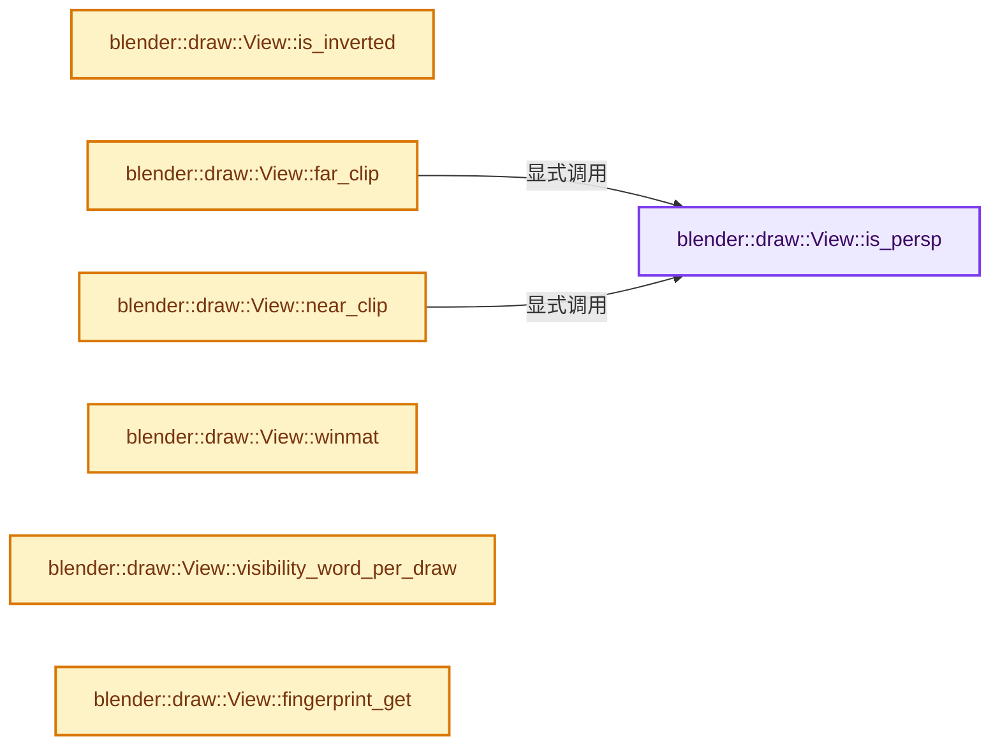
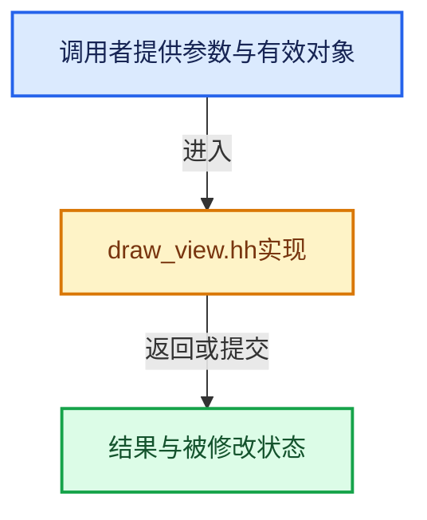

# 实现依赖专题：source/blender/draw/intern/draw_view.hh

[方向导航](README.md) · [符号索引](../%E7%AC%A6%E5%8F%B7%E4%BE%9D%E8%B5%96%E4%B8%8E%E5%AE%9E%E7%8E%B0%E7%B4%A2%E5%BC%95.md)

本专题从正文实际调用进入，集中保存共享实现。函数有稳定锚点，可从调用处直接跳到对应完整函数；递归与互相调用通过回链组织。

## 本文件的实现关系






## 完整成员与函数实现

<a id="f-d831deec5dae84cd"></a>

### `blender::draw::View::is_persp`

实现位置：[source/blender/draw/intern/draw_view.hh](../../../../../source/blender/draw/intern/draw_view.hh) · L93—L97。

接口参数：

- `int view_id = 0`

**教学注释版**

<!-- annotated:a8d872df6467b0 -->

```cpp
  bool is_persp(int view_id = 0) const
  {
    BLI_assert(view_id < view_len_);
    return data_[view_id].winmat[3][3] == 0.0f;
  }
```

<details>
<summary>核对原始源码：source/blender/draw/intern/draw_view.hh · L93—L97</summary>

<!-- original:a8d872df6467b0:source/blender/draw/intern/draw_view.hh:93:97 -->

```cpp
  bool is_persp(int view_id = 0) const
  {
    BLI_assert(view_id < view_len_);
    return data_[view_id].winmat[3][3] == 0.0f;
  }
```

</details>

**结果出口**

- `return data_[view_id].winmat[3][3] == 0.0f;`

**继续追踪实现**

- `BLI_assert` → [BLI_assert · L48](../01-%E5%9F%BA%E7%A1%80%E5%AE%B9%E5%99%A8%E4%B8%8E%E7%8E%B0%E4%BB%A3CPP/%E4%BE%9D%E8%B5%96-BLI_assert-cc98e8.md#m-57a88495704d)；[BLI_assert · L63](../01-%E5%9F%BA%E7%A1%80%E5%AE%B9%E5%99%A8%E4%B8%8E%E7%8E%B0%E4%BB%A3CPP/%E4%BE%9D%E8%B5%96-BLI_assert-cc98e8.md#m-d07050020cb5)。宏定义由构建条件选择。

<a id="f-d4ecde3808479f9e"></a>

### `blender::draw::View::is_inverted`

实现位置：[source/blender/draw/intern/draw_view.hh](../../../../../source/blender/draw/intern/draw_view.hh) · L99—L104。

接口参数：

- `int view_id = 0`

**教学注释版**

<!-- annotated:4fb5c54fba2ad7 -->

```cpp
  bool is_inverted(int view_id = 0) const
  {
    BLI_assert(view_id < view_len_);
    UNUSED_VARS_NDEBUG(view_id);
    return is_inverted_;
  }
```

<details>
<summary>核对原始源码：source/blender/draw/intern/draw_view.hh · L99—L104</summary>

<!-- original:4fb5c54fba2ad7:source/blender/draw/intern/draw_view.hh:99:104 -->

```cpp
  bool is_inverted(int view_id = 0) const
  {
    BLI_assert(view_id < view_len_);
    UNUSED_VARS_NDEBUG(view_id);
    return is_inverted_;
  }
```

</details>

**结果出口**

- `return is_inverted_;`

**继续追踪实现**

- `BLI_assert` → [BLI_assert · L48](../01-%E5%9F%BA%E7%A1%80%E5%AE%B9%E5%99%A8%E4%B8%8E%E7%8E%B0%E4%BB%A3CPP/%E4%BE%9D%E8%B5%96-BLI_assert-cc98e8.md#m-57a88495704d)；[BLI_assert · L63](../01-%E5%9F%BA%E7%A1%80%E5%AE%B9%E5%99%A8%E4%B8%8E%E7%8E%B0%E4%BB%A3CPP/%E4%BE%9D%E8%B5%96-BLI_assert-cc98e8.md#m-d07050020cb5)。宏定义由构建条件选择。
- `UNUSED_VARS_NDEBUG` → [UNUSED_VARS_NDEBUG · L526](../01-%E5%9F%BA%E7%A1%80%E5%AE%B9%E5%99%A8%E4%B8%8E%E7%8E%B0%E4%BB%A3CPP/%E4%BE%9D%E8%B5%96-BLI_utildefines-293a0a.md#m-fea439f7d366)；[UNUSED_VARS_NDEBUG · L528](../01-%E5%9F%BA%E7%A1%80%E5%AE%B9%E5%99%A8%E4%B8%8E%E7%8E%B0%E4%BB%A3CPP/%E4%BE%9D%E8%B5%96-BLI_utildefines-293a0a.md#m-a8f8cfac06c0)。宏定义由构建条件选择。

<a id="f-a13e310948ecbe01"></a>

### `blender::draw::View::far_clip`

实现位置：[source/blender/draw/intern/draw_view.hh](../../../../../source/blender/draw/intern/draw_view.hh) · L106—L113。

接口参数：

- `int view_id = 0`

**教学注释版**

<!-- annotated:7dcaec6238c21f -->

```cpp
  float far_clip(int view_id = 0) const
  {
    BLI_assert(view_id < view_len_);
    if (is_persp(view_id)) {
      return -data_[view_id].winmat[3][2] / (data_[view_id].winmat[2][2] + 1.0f);
    }
    return -(data_[view_id].winmat[3][2] - 1.0f) / data_[view_id].winmat[2][2];
  }
```

<details>
<summary>核对原始源码：source/blender/draw/intern/draw_view.hh · L106—L113</summary>

<!-- original:7dcaec6238c21f:source/blender/draw/intern/draw_view.hh:106:113 -->

```cpp
  float far_clip(int view_id = 0) const
  {
    BLI_assert(view_id < view_len_);
    if (is_persp(view_id)) {
      return -data_[view_id].winmat[3][2] / (data_[view_id].winmat[2][2] + 1.0f);
    }
    return -(data_[view_id].winmat[3][2] - 1.0f) / data_[view_id].winmat[2][2];
  }
```

</details>

**结果出口**

- `return -data_[view_id].winmat[3][2] / (data_[view_id].winmat[2][2] + 1.0f);`
- `return -(data_[view_id].winmat[3][2] - 1.0f) / data_[view_id].winmat[2][2];`

**继续追踪实现**

- `BLI_assert` → [BLI_assert · L48](../01-%E5%9F%BA%E7%A1%80%E5%AE%B9%E5%99%A8%E4%B8%8E%E7%8E%B0%E4%BB%A3CPP/%E4%BE%9D%E8%B5%96-BLI_assert-cc98e8.md#m-57a88495704d)；[BLI_assert · L63](../01-%E5%9F%BA%E7%A1%80%E5%AE%B9%E5%99%A8%E4%B8%8E%E7%8E%B0%E4%BB%A3CPP/%E4%BE%9D%E8%B5%96-BLI_assert-cc98e8.md#m-d07050020cb5)。宏定义由构建条件选择。
- `is_persp` → [blender::draw::View::is_persp · L93](%E4%BE%9D%E8%B5%96-draw_view-94a480.md#f-d831deec5dae84cd)。

<a id="f-c0049dde1c431ade"></a>

### `blender::draw::View::near_clip`

实现位置：[source/blender/draw/intern/draw_view.hh](../../../../../source/blender/draw/intern/draw_view.hh) · L115—L122。

接口参数：

- `int view_id = 0`

**教学注释版**

<!-- annotated:cc201f2c27dc0f -->

```cpp
  float near_clip(int view_id = 0) const
  {
    BLI_assert(view_id < view_len_);
    if (is_persp(view_id)) {
      return -data_[view_id].winmat[3][2] / (data_[view_id].winmat[2][2] - 1.0f);
    }
    return -(data_[view_id].winmat[3][2] + 1.0f) / data_[view_id].winmat[2][2];
  }
```

<details>
<summary>核对原始源码：source/blender/draw/intern/draw_view.hh · L115—L122</summary>

<!-- original:cc201f2c27dc0f:source/blender/draw/intern/draw_view.hh:115:122 -->

```cpp
  float near_clip(int view_id = 0) const
  {
    BLI_assert(view_id < view_len_);
    if (is_persp(view_id)) {
      return -data_[view_id].winmat[3][2] / (data_[view_id].winmat[2][2] - 1.0f);
    }
    return -(data_[view_id].winmat[3][2] + 1.0f) / data_[view_id].winmat[2][2];
  }
```

</details>

**结果出口**

- `return -data_[view_id].winmat[3][2] / (data_[view_id].winmat[2][2] - 1.0f);`
- `return -(data_[view_id].winmat[3][2] + 1.0f) / data_[view_id].winmat[2][2];`

**继续追踪实现**

- `BLI_assert` → [BLI_assert · L48](../01-%E5%9F%BA%E7%A1%80%E5%AE%B9%E5%99%A8%E4%B8%8E%E7%8E%B0%E4%BB%A3CPP/%E4%BE%9D%E8%B5%96-BLI_assert-cc98e8.md#m-57a88495704d)；[BLI_assert · L63](../01-%E5%9F%BA%E7%A1%80%E5%AE%B9%E5%99%A8%E4%B8%8E%E7%8E%B0%E4%BB%A3CPP/%E4%BE%9D%E8%B5%96-BLI_assert-cc98e8.md#m-d07050020cb5)。宏定义由构建条件选择。
- `is_persp` → [blender::draw::View::is_persp · L93](%E4%BE%9D%E8%B5%96-draw_view-94a480.md#f-d831deec5dae84cd)。

<a id="f-b9242a355f7e37dd"></a>

### `blender::draw::View::winmat`

实现位置：[source/blender/draw/intern/draw_view.hh](../../../../../source/blender/draw/intern/draw_view.hh) · L148—L152。

接口参数：

- `int view_id = 0`

**教学注释版**

<!-- annotated:2465cbc7d6d387 -->

```cpp
  const float4x4 &winmat(int view_id = 0) const
  {
    BLI_assert(view_id < view_len_);
    return data_[view_id].winmat;
  }
```

<details>
<summary>核对原始源码：source/blender/draw/intern/draw_view.hh · L148—L152</summary>

<!-- original:2465cbc7d6d387:source/blender/draw/intern/draw_view.hh:148:152 -->

```cpp
  const float4x4 &winmat(int view_id = 0) const
  {
    BLI_assert(view_id < view_len_);
    return data_[view_id].winmat;
  }
```

</details>

**结果出口**

- `return data_[view_id].winmat;`

**继续追踪实现**

- `BLI_assert` → [BLI_assert · L48](../01-%E5%9F%BA%E7%A1%80%E5%AE%B9%E5%99%A8%E4%B8%8E%E7%8E%B0%E4%BB%A3CPP/%E4%BE%9D%E8%B5%96-BLI_assert-cc98e8.md#m-57a88495704d)；[BLI_assert · L63](../01-%E5%9F%BA%E7%A1%80%E5%AE%B9%E5%99%A8%E4%B8%8E%E7%8E%B0%E4%BB%A3CPP/%E4%BE%9D%E8%B5%96-BLI_assert-cc98e8.md#m-d07050020cb5)。宏定义由构建条件选择。

<a id="f-48a8d3b058f349df"></a>

### `blender::draw::View::visibility_word_per_draw`

实现位置：[source/blender/draw/intern/draw_view.hh](../../../../../source/blender/draw/intern/draw_view.hh) · L178—L181。

**教学注释版**

<!-- annotated:4a59dfa8928c46 -->

```cpp
  int visibility_word_per_draw() const
  {
    return (view_len_ == 1) ? 0 : divide_ceil_u(view_len_, 32);
  }
```

<details>
<summary>核对原始源码：source/blender/draw/intern/draw_view.hh · L178—L181</summary>

<!-- original:4a59dfa8928c46:source/blender/draw/intern/draw_view.hh:178:181 -->

```cpp
  int visibility_word_per_draw() const
  {
    return (view_len_ == 1) ? 0 : divide_ceil_u(view_len_, 32);
  }
```

</details>

**结果出口**

- `return (view_len_ == 1) ? 0 : divide_ceil_u(view_len_, 32);`

**继续追踪实现**

- `divide_ceil_u` → [blender::divide_ceil_u · L235](../12-%E7%A9%BA%E9%97%B4%E6%95%B0%E6%8D%AE%E7%BB%93%E6%9E%84%E4%B8%8E%E5%87%A0%E4%BD%95%E7%AE%97%E6%B3%95/%E4%BE%9D%E8%B5%96-math_base_inline-546b00.md#f-9bfe95d830410fdd)。

<a id="f-7084b0f63c9a7162"></a>

### `blender::draw::View::fingerprint_get`

实现位置：[source/blender/draw/intern/draw_view.hh](../../../../../source/blender/draw/intern/draw_view.hh) · L261—L265。

**教学注释版**

<!-- annotated:12accb585d5736 -->

```cpp
  uint64_t fingerprint_get() const
  {
    BLI_assert_msg(sync_counter_ != 0, "View should be synced at least once before use");
    return sync_counter_;
  }
```

<details>
<summary>核对原始源码：source/blender/draw/intern/draw_view.hh · L261—L265</summary>

<!-- original:12accb585d5736:source/blender/draw/intern/draw_view.hh:261:265 -->

```cpp
  uint64_t fingerprint_get() const
  {
    BLI_assert_msg(sync_counter_ != 0, "View should be synced at least once before use");
    return sync_counter_;
  }
```

</details>

**结果出口**

- `return sync_counter_;`

**继续追踪实现**

- `BLI_assert_msg` → [BLI_assert_msg · L55](../01-%E5%9F%BA%E7%A1%80%E5%AE%B9%E5%99%A8%E4%B8%8E%E7%8E%B0%E4%BB%A3CPP/%E4%BE%9D%E8%B5%96-BLI_assert-cc98e8.md#m-695eed20dceb)；[BLI_assert_msg · L64](../01-%E5%9F%BA%E7%A1%80%E5%AE%B9%E5%99%A8%E4%B8%8E%E7%8E%B0%E4%BB%A3CPP/%E4%BE%9D%E8%B5%96-BLI_assert-cc98e8.md#m-7de5563de4db)。宏定义由构建条件选择。
