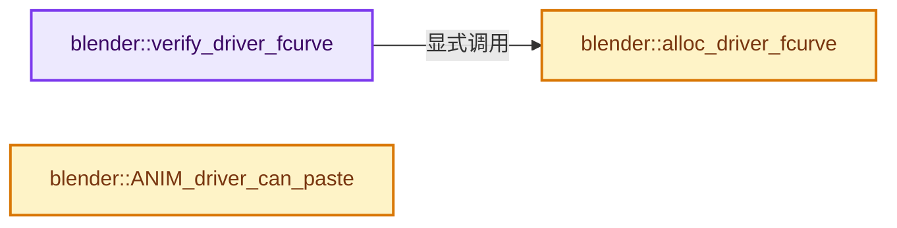
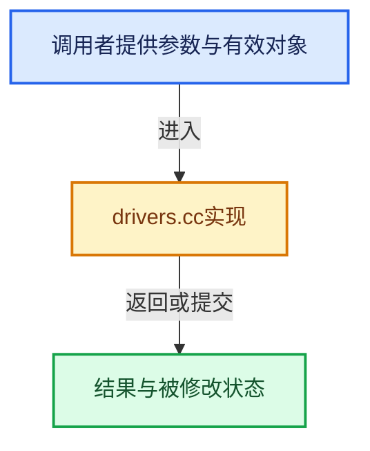

# 实现依赖专题：source/blender/editors/animation/drivers.cc

[方向导航](README.md) · [符号索引](../%E7%AC%A6%E5%8F%B7%E4%BE%9D%E8%B5%96%E4%B8%8E%E5%AE%9E%E7%8E%B0%E7%B4%A2%E5%BC%95.md)

本专题从正文实际调用进入，集中保存共享实现。函数有稳定锚点，可从调用处直接跳到对应完整函数；递归与互相调用通过回链组织。

## 本文件的实现关系






## 完整成员与函数实现

<a id="f-51ddebb3aff3cbd6"></a>

### `blender::verify_driver_fcurve`

实现位置：[source/blender/editors/animation/drivers.cc](../../../../../source/blender/editors/animation/drivers.cc) · L53—L92。

接口参数：

- `ID *id`
- `const char rna_path[]`
- `const int array_index`
- `eDriverFCurveCreationMode creation_mode`

**教学注释版**

<!-- annotated:314d09828211b8 -->

```cpp
FCurve *verify_driver_fcurve(ID *id,
                             const char rna_path[],
                             const int array_index,
                             eDriverFCurveCreationMode creation_mode)
{
  AnimData *adt;
  FCurve *fcu;

  /* sanity checks */
  if (ELEM(nullptr, id, rna_path)) {
    return nullptr;
  }

  /* init animdata if none available yet */
  adt = BKE_animdata_from_id(id);
  if (adt == nullptr && creation_mode != DRIVER_FCURVE_LOOKUP_ONLY) {
    adt = BKE_animdata_ensure_id(id);
  }
  if (adt == nullptr) {
    /* if still none (as not allowed to add, or ID doesn't have animdata for some reason) */
    return nullptr;
  }

  /* try to find f-curve matching for this setting
   * - add if not found and allowed to add one
   * TODO: add auto-grouping support? how this works will need to be resolved
   */
  fcu = BKE_fcurve_find(&adt->drivers, rna_path, array_index);

  if (fcu == nullptr && creation_mode != DRIVER_FCURVE_LOOKUP_ONLY) {
    /* use default settings to make a F-Curve */
    fcu = alloc_driver_fcurve(rna_path, array_index, creation_mode);

    /* just add F-Curve to end of driver list */
    BLI_addtail(&adt->drivers, fcu);
  }

  /* return the F-Curve */
  return fcu;
}
```

<details>
<summary>核对原始源码：source/blender/editors/animation/drivers.cc · L53—L92</summary>

<!-- original:314d09828211b8:source/blender/editors/animation/drivers.cc:53:92 -->

```cpp
FCurve *verify_driver_fcurve(ID *id,
                             const char rna_path[],
                             const int array_index,
                             eDriverFCurveCreationMode creation_mode)
{
  AnimData *adt;
  FCurve *fcu;

  /* sanity checks */
  if (ELEM(nullptr, id, rna_path)) {
    return nullptr;
  }

  /* init animdata if none available yet */
  adt = BKE_animdata_from_id(id);
  if (adt == nullptr && creation_mode != DRIVER_FCURVE_LOOKUP_ONLY) {
    adt = BKE_animdata_ensure_id(id);
  }
  if (adt == nullptr) {
    /* if still none (as not allowed to add, or ID doesn't have animdata for some reason) */
    return nullptr;
  }

  /* try to find f-curve matching for this setting
   * - add if not found and allowed to add one
   * TODO: add auto-grouping support? how this works will need to be resolved
   */
  fcu = BKE_fcurve_find(&adt->drivers, rna_path, array_index);

  if (fcu == nullptr && creation_mode != DRIVER_FCURVE_LOOKUP_ONLY) {
    /* use default settings to make a F-Curve */
    fcu = alloc_driver_fcurve(rna_path, array_index, creation_mode);

    /* just add F-Curve to end of driver list */
    BLI_addtail(&adt->drivers, fcu);
  }

  /* return the F-Curve */
  return fcu;
}
```

</details>

**沿实际写入检查状态**

- `adt = BKE_animdata_from_id(id);`
- `adt = BKE_animdata_ensure_id(id);`
- `fcu = BKE_fcurve_find(&adt->drivers, rna_path, array_index);`
- `fcu = alloc_driver_fcurve(rna_path, array_index, creation_mode);`

**结果出口**

- `return nullptr;`
- `return fcu;`

**继续追踪实现**

- `ELEM` → [ELEM · L88](%E4%BE%9D%E8%B5%96-GHOST_utildefines-34b996.md#m-d28724a15928)；[ELEM · L135](../01-%E5%9F%BA%E7%A1%80%E5%AE%B9%E5%99%A8%E4%B8%8E%E7%8E%B0%E4%BB%A3CPP/%E4%BE%9D%E8%B5%96-BLI_utildefines-293a0a.md#m-d6572de7cae0)。宏定义由构建条件选择。
- `BKE_animdata_from_id` → [blender::BKE_animdata_from_id · L93](%E4%BE%9D%E8%B5%96-anim_data-56c81c.md#f-354e5421ff0a6c96)。
- `BKE_animdata_ensure_id` → [blender::BKE_animdata_ensure_id · L107](%E4%BE%9D%E8%B5%96-anim_data-56c81c.md#f-03c23566cd3e0251)。
- `BKE_fcurve_find` → [blender::BKE_fcurve_find · L290](%E4%BE%9D%E8%B5%96-fcurve-593e2e.md#f-8ed9925a0e597e12)。
- `alloc_driver_fcurve` → [blender::alloc_driver_fcurve · L94](%E4%BE%9D%E8%B5%96-drivers-fb92e9.md#f-5cb39003c3fc4821)。
- `BLI_addtail` → [blender::BLI_addtail · L118](../01-%E5%9F%BA%E7%A1%80%E5%AE%B9%E5%99%A8%E4%B8%8E%E7%8E%B0%E4%BB%A3CPP/%E4%BE%9D%E8%B5%96-listbase-2816d9.md#f-4fb027713fa3115b)。

<a id="f-5cb39003c3fc4821"></a>

### `blender::alloc_driver_fcurve`

实现位置：[source/blender/editors/animation/drivers.cc](../../../../../source/blender/editors/animation/drivers.cc) · L94—L126。

接口参数：

- `const char rna_path[]`
- `const int array_index`
- `eDriverFCurveCreationMode creation_mode`

**教学注释版**

<!-- annotated:becf58f9df1446 -->

```cpp
FCurve *alloc_driver_fcurve(const char rna_path[],
                            const int array_index,
                            eDriverFCurveCreationMode creation_mode)
{
  using namespace blender::animrig;
  FCurve *fcu = BKE_fcurve_create();

  fcu->flag = (FCURVE_VISIBLE | FCURVE_SELECTED);
  fcu->auto_smoothing = U.auto_smoothing_new;

  /* store path - make copy, and store that */
  if (rna_path) {
    fcu->rna_path_set(rna_path);
  }
  fcu->array_index = array_index;

  if (!ELEM(creation_mode, DRIVER_FCURVE_LOOKUP_ONLY, DRIVER_FCURVE_EMPTY)) {
    /* add some new driver data */
    fcu->driver = MEM_new<ChannelDriver>("ChannelDriver");

    /* Add 2 keyframes so that user has something to work with
     * - These are configured to 0,0 and 1,1 to give a 1-1 mapping
     *   which can be easily tweaked from there.
     */
    const KeyframeSettings settings = get_keyframe_settings(false);
    insert_vert_fcurve(fcu, {0.0f, 0.0f}, settings, INSERTKEY_FAST);
    insert_vert_fcurve(fcu, {1.0f, 1.0f}, settings, INSERTKEY_FAST);
    fcu->extend = FCURVE_EXTRAPOLATE_LINEAR;
    BKE_fcurve_handles_recalc(*fcu);
  }

  return fcu;
}
```

<details>
<summary>核对原始源码：source/blender/editors/animation/drivers.cc · L94—L126</summary>

<!-- original:becf58f9df1446:source/blender/editors/animation/drivers.cc:94:126 -->

```cpp
FCurve *alloc_driver_fcurve(const char rna_path[],
                            const int array_index,
                            eDriverFCurveCreationMode creation_mode)
{
  using namespace blender::animrig;
  FCurve *fcu = BKE_fcurve_create();

  fcu->flag = (FCURVE_VISIBLE | FCURVE_SELECTED);
  fcu->auto_smoothing = U.auto_smoothing_new;

  /* store path - make copy, and store that */
  if (rna_path) {
    fcu->rna_path_set(rna_path);
  }
  fcu->array_index = array_index;

  if (!ELEM(creation_mode, DRIVER_FCURVE_LOOKUP_ONLY, DRIVER_FCURVE_EMPTY)) {
    /* add some new driver data */
    fcu->driver = MEM_new<ChannelDriver>("ChannelDriver");

    /* Add 2 keyframes so that user has something to work with
     * - These are configured to 0,0 and 1,1 to give a 1-1 mapping
     *   which can be easily tweaked from there.
     */
    const KeyframeSettings settings = get_keyframe_settings(false);
    insert_vert_fcurve(fcu, {0.0f, 0.0f}, settings, INSERTKEY_FAST);
    insert_vert_fcurve(fcu, {1.0f, 1.0f}, settings, INSERTKEY_FAST);
    fcu->extend = FCURVE_EXTRAPOLATE_LINEAR;
    BKE_fcurve_handles_recalc(*fcu);
  }

  return fcu;
}
```

</details>

**沿实际写入检查状态**

- `fcu->flag = (FCURVE_VISIBLE | FCURVE_SELECTED);`
- `fcu->auto_smoothing = U.auto_smoothing_new;`
- `fcu->array_index = array_index;`
- `fcu->driver = MEM_new<ChannelDriver>("ChannelDriver");`
- `fcu->extend = FCURVE_EXTRAPOLATE_LINEAR;`

**结果出口**

- `return fcu;`

**继续追踪实现**

- `BKE_fcurve_create` → [blender::BKE_fcurve_create · L66](%E4%BE%9D%E8%B5%96-fcurve-593e2e.md#f-bbb58c4e165bc0b9)。
- `fcu->rna_path_set` → [blender::FCurve::rna_path_set · L174](%E4%BE%9D%E8%B5%96-fcurve-593e2e.md#f-3809806ab92b7a0f)。
- `ELEM` → [ELEM · L88](%E4%BE%9D%E8%B5%96-GHOST_utildefines-34b996.md#m-d28724a15928)；[ELEM · L135](../01-%E5%9F%BA%E7%A1%80%E5%AE%B9%E5%99%A8%E4%B8%8E%E7%8E%B0%E4%BB%A3CPP/%E4%BE%9D%E8%B5%96-BLI_utildefines-293a0a.md#m-d6572de7cae0)。宏定义由构建条件选择。
- `MEM_new<ChannelDriver>` → [MEM_new · L351](../03-%E5%86%85%E5%AD%98%E5%88%86%E9%85%8D%E4%B8%8E%E8%BF%90%E8%A1%8C%E6%97%B6%E7%B1%BB%E5%9E%8B/%E4%BE%9D%E8%B5%96-MEM_guardedalloc-b54eca.md#f-115f9b6784f89912)。
- `get_keyframe_settings` → [调用协议](../%E6%A8%A1%E6%9D%BF%E5%AE%8F%E4%B8%8E%E5%8A%A8%E6%80%81%E5%88%86%E6%B4%BE%E5%8D%8F%E8%AE%AE.md)：函数指针、局部可调用对象或未展开的宏；必须结合调用者环境。调用位置L118。
- `insert_vert_fcurve` → [blender::animrig::insert_vert_fcurve · L429](%E4%BE%9D%E8%B5%96-fcurve-53c215.md#f-a351350fc31f7517)。
- `BKE_fcurve_handles_recalc` → [blender::BKE_fcurve_handles_recalc · L1298](%E4%BE%9D%E8%B5%96-fcurve-593e2e.md#f-0673929c9eae7450)。

<a id="f-7201b197e1c0abba"></a>

### `blender::ANIM_driver_can_paste`

实现位置：[source/blender/editors/animation/drivers.cc](../../../../../source/blender/editors/animation/drivers.cc) · L561—L564。

**教学注释版**

<!-- annotated:489e6c2bcb3cce -->

```cpp
bool ANIM_driver_can_paste()
{
  return (channeldriver_copypaste_buf != nullptr);
}
```

<details>
<summary>核对原始源码：source/blender/editors/animation/drivers.cc · L561—L564</summary>

<!-- original:489e6c2bcb3cce:source/blender/editors/animation/drivers.cc:561:564 -->

```cpp
bool ANIM_driver_can_paste()
{
  return (channeldriver_copypaste_buf != nullptr);
}
```

</details>

**结果出口**

- `return (channeldriver_copypaste_buf != nullptr);`

**继续追踪实现**

本实现没有需要继续展开的显式调用；检查返回表达式、对象转换和调用者前置条件。
