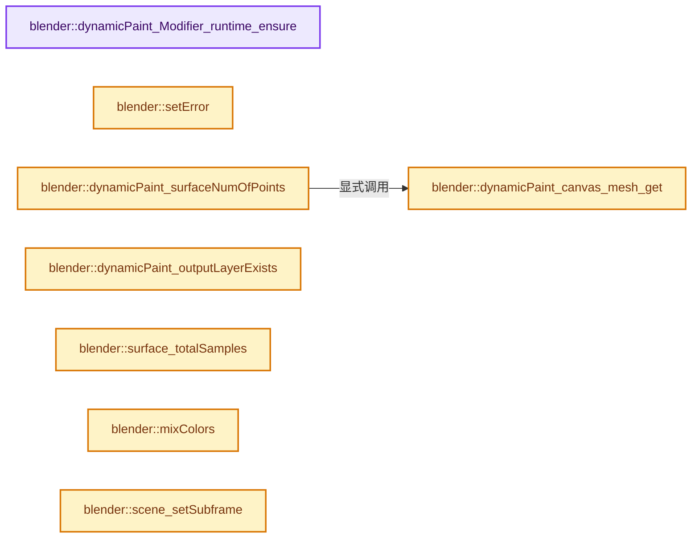
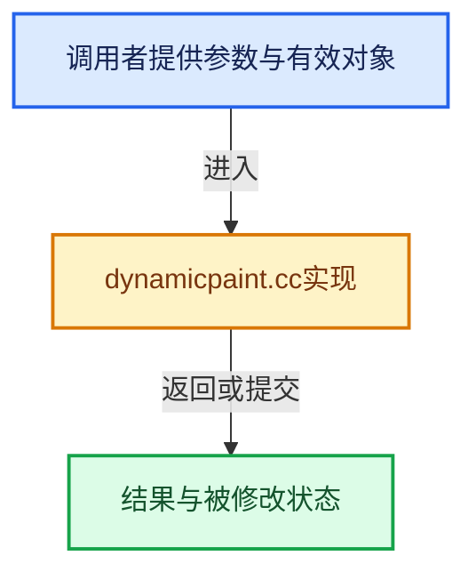

# 实现依赖专题：source/blender/blenkernel/intern/dynamicpaint.cc

[方向导航](README.md) · [符号索引](../%E7%AC%A6%E5%8F%B7%E4%BE%9D%E8%B5%96%E4%B8%8E%E5%AE%9E%E7%8E%B0%E7%B4%A2%E5%BC%95.md)

本专题从正文实际调用进入，集中保存共享实现。函数有稳定锚点，可从调用处直接跳到对应完整函数；递归与互相调用通过回链组织。

## 本文件的实现关系






## 完整成员与函数实现

<a id="f-9e7724f6b807dfc8"></a>

### `blender::dynamicPaint_Modifier_runtime_ensure`

实现位置：[source/blender/blenkernel/intern/dynamicpaint.cc](../../../../../source/blender/blenkernel/intern/dynamicpaint.cc) · L290—L296。

接口参数：

- `DynamicPaintModifierData *pmd`

**教学注释版**

<!-- annotated:70a5a1c817ce09 -->

```cpp
static DynamicPaintRuntime *dynamicPaint_Modifier_runtime_ensure(DynamicPaintModifierData *pmd)
{
  if (pmd->modifier.runtime == nullptr) {
    pmd->modifier.runtime = MEM_new<DynamicPaintRuntime>("dynamic paint runtime");
  }
  return static_cast<DynamicPaintRuntime *>(pmd->modifier.runtime);
}
```

<details>
<summary>核对原始源码：source/blender/blenkernel/intern/dynamicpaint.cc · L290—L296</summary>

<!-- original:70a5a1c817ce09:source/blender/blenkernel/intern/dynamicpaint.cc:290:296 -->

```cpp
static DynamicPaintRuntime *dynamicPaint_Modifier_runtime_ensure(DynamicPaintModifierData *pmd)
{
  if (pmd->modifier.runtime == nullptr) {
    pmd->modifier.runtime = MEM_new<DynamicPaintRuntime>("dynamic paint runtime");
  }
  return static_cast<DynamicPaintRuntime *>(pmd->modifier.runtime);
}
```

</details>

**沿实际写入检查状态**

- `pmd->modifier.runtime = MEM_new<DynamicPaintRuntime>("dynamic paint runtime");`

**结果出口**

- `return static_cast<DynamicPaintRuntime *>(pmd->modifier.runtime);`

**继续追踪实现**

- `MEM_new<DynamicPaintRuntime>` → [MEM_new · L351](../03-%E5%86%85%E5%AD%98%E5%88%86%E9%85%8D%E4%B8%8E%E8%BF%90%E8%A1%8C%E6%97%B6%E7%B1%BB%E5%9E%8B/%E4%BE%9D%E8%B5%96-MEM_guardedalloc-b54eca.md#f-115f9b6784f89912)。

<a id="f-2cdcd919f9e1abce"></a>

### `blender::dynamicPaint_canvas_mesh_get`

实现位置：[source/blender/blenkernel/intern/dynamicpaint.cc](../../../../../source/blender/blenkernel/intern/dynamicpaint.cc) · L298—L306。

接口参数：

- `DynamicPaintCanvasSettings *canvas`

**教学注释版**

<!-- annotated:0b48d9208b2fd5 -->

```cpp
static Mesh *dynamicPaint_canvas_mesh_get(DynamicPaintCanvasSettings *canvas)
{
  if (canvas->pmd->modifier.runtime == nullptr) {
    return nullptr;
  }
  DynamicPaintRuntime *runtime_data = static_cast<DynamicPaintRuntime *>(
      canvas->pmd->modifier.runtime);
  return runtime_data->canvas_mesh;
}
```

<details>
<summary>核对原始源码：source/blender/blenkernel/intern/dynamicpaint.cc · L298—L306</summary>

<!-- original:0b48d9208b2fd5:source/blender/blenkernel/intern/dynamicpaint.cc:298:306 -->

```cpp
static Mesh *dynamicPaint_canvas_mesh_get(DynamicPaintCanvasSettings *canvas)
{
  if (canvas->pmd->modifier.runtime == nullptr) {
    return nullptr;
  }
  DynamicPaintRuntime *runtime_data = static_cast<DynamicPaintRuntime *>(
      canvas->pmd->modifier.runtime);
  return runtime_data->canvas_mesh;
}
```

</details>

**结果出口**

- `return nullptr;`
- `return runtime_data->canvas_mesh;`

**继续追踪实现**

本实现没有需要继续展开的显式调用；检查返回表达式、对象转换和调用者前置条件。

<a id="f-20dba63ad91a72f3"></a>

### `blender::setError`

实现位置：[source/blender/blenkernel/intern/dynamicpaint.cc](../../../../../source/blender/blenkernel/intern/dynamicpaint.cc) · L311—L317。

接口参数：

- `DynamicPaintCanvasSettings *canvas`
- `const char *string`

**教学注释版**

<!-- annotated:bd9bf88bc22b0f -->

```cpp
static bool setError(DynamicPaintCanvasSettings *canvas, const char *string)
{
  /* Add error to canvas ui info label */
  STRNCPY(canvas->error, string);
  CLOG_STR_ERROR(&LOG, string);
  return false;
}
```

<details>
<summary>核对原始源码：source/blender/blenkernel/intern/dynamicpaint.cc · L311—L317</summary>

<!-- original:bd9bf88bc22b0f:source/blender/blenkernel/intern/dynamicpaint.cc:311:317 -->

```cpp
static bool setError(DynamicPaintCanvasSettings *canvas, const char *string)
{
  /* Add error to canvas ui info label */
  STRNCPY(canvas->error, string);
  CLOG_STR_ERROR(&LOG, string);
  return false;
}
```

</details>

**结果出口**

- `return false;`

**继续追踪实现**

- `STRNCPY` → [blender::STRNCPY · L690](../01-%E5%9F%BA%E7%A1%80%E5%AE%B9%E5%99%A8%E4%B8%8E%E7%8E%B0%E4%BB%A3CPP/%E4%BE%9D%E8%B5%96-BLI_string-b43058.md#f-6b2d861724026be6)。
- `CLOG_STR_ERROR` → [CLOG_STR_ERROR · L196](%E4%BE%9D%E8%B5%96-CLG_log-e9051b.md#m-dcd74e148724)。宏定义由构建条件选择。

<a id="f-20bd19ad8333f285"></a>

### `blender::dynamicPaint_surfaceNumOfPoints`

实现位置：[source/blender/blenkernel/intern/dynamicpaint.cc](../../../../../source/blender/blenkernel/intern/dynamicpaint.cc) · L320—L331。

接口参数：

- `DynamicPaintSurface *surface`

**教学注释版**

<!-- annotated:7b5a3a586570b2 -->

```cpp
static int dynamicPaint_surfaceNumOfPoints(DynamicPaintSurface *surface)
{
  if (surface->format == MOD_DPAINT_SURFACE_F_PTEX) {
    return 0; /* Not supported at the moment. */
  }
  if (surface->format == MOD_DPAINT_SURFACE_F_VERTEX) {
    const Mesh *canvas_mesh = dynamicPaint_canvas_mesh_get(surface->canvas);
    return (canvas_mesh) ? canvas_mesh->verts_num : 0;
  }

  return 0;
}
```

<details>
<summary>核对原始源码：source/blender/blenkernel/intern/dynamicpaint.cc · L320—L331</summary>

<!-- original:7b5a3a586570b2:source/blender/blenkernel/intern/dynamicpaint.cc:320:331 -->

```cpp
static int dynamicPaint_surfaceNumOfPoints(DynamicPaintSurface *surface)
{
  if (surface->format == MOD_DPAINT_SURFACE_F_PTEX) {
    return 0; /* Not supported at the moment. */
  }
  if (surface->format == MOD_DPAINT_SURFACE_F_VERTEX) {
    const Mesh *canvas_mesh = dynamicPaint_canvas_mesh_get(surface->canvas);
    return (canvas_mesh) ? canvas_mesh->verts_num : 0;
  }

  return 0;
}
```

</details>

**结果出口**

- `return 0; /* Not supported at the moment. */`
- `return (canvas_mesh) ? canvas_mesh->verts_num : 0;`
- `return 0;`

**继续追踪实现**

- `dynamicPaint_canvas_mesh_get` → [blender::dynamicPaint_canvas_mesh_get · L298](%E4%BE%9D%E8%B5%96-dynamicpaint-bdf7e4.md#f-2cdcd919f9e1abce)。

<a id="f-17210a1eeb46a91e"></a>

### `blender::dynamicPaint_outputLayerExists`

实现位置：[source/blender/blenkernel/intern/dynamicpaint.cc](../../../../../source/blender/blenkernel/intern/dynamicpaint.cc) · L338—L366。

接口参数：

- `DynamicPaintSurface *surface`
- `Object *ob`
- `int output`

**教学注释版**

<!-- annotated:c5d818a1c6073a -->

```cpp
bool dynamicPaint_outputLayerExists(DynamicPaintSurface *surface, Object *ob, int output)
{
  using namespace blender::bke;
  const char *name;

  if (output == 0) {
    name = surface->output_name;
  }
  else if (output == 1) {
    name = surface->output_name2;
  }
  else {
    return false;
  }

  if (surface->format == MOD_DPAINT_SURFACE_F_VERTEX) {
    if (surface->type == MOD_DPAINT_SURFACE_T_PAINT) {
      Mesh *mesh = id_cast<Mesh *>(ob->data);
      const AttributeAccessor attributes = mesh->attributes();
      const std::optional<AttributeMetaData> meta_data = attributes.lookup_meta_data(name);
      return meta_data == AttributeMetaData{AttrDomain::Corner, AttrType::ColorByte};
    }
    if (surface->type == MOD_DPAINT_SURFACE_T_WEIGHT) {
      return (BKE_object_defgroup_name_index(ob, name) != -1);
    }
  }

  return false;
}
```

<details>
<summary>核对原始源码：source/blender/blenkernel/intern/dynamicpaint.cc · L338—L366</summary>

<!-- original:c5d818a1c6073a:source/blender/blenkernel/intern/dynamicpaint.cc:338:366 -->

```cpp
bool dynamicPaint_outputLayerExists(DynamicPaintSurface *surface, Object *ob, int output)
{
  using namespace blender::bke;
  const char *name;

  if (output == 0) {
    name = surface->output_name;
  }
  else if (output == 1) {
    name = surface->output_name2;
  }
  else {
    return false;
  }

  if (surface->format == MOD_DPAINT_SURFACE_F_VERTEX) {
    if (surface->type == MOD_DPAINT_SURFACE_T_PAINT) {
      Mesh *mesh = id_cast<Mesh *>(ob->data);
      const AttributeAccessor attributes = mesh->attributes();
      const std::optional<AttributeMetaData> meta_data = attributes.lookup_meta_data(name);
      return meta_data == AttributeMetaData{AttrDomain::Corner, AttrType::ColorByte};
    }
    if (surface->type == MOD_DPAINT_SURFACE_T_WEIGHT) {
      return (BKE_object_defgroup_name_index(ob, name) != -1);
    }
  }

  return false;
}
```

</details>

**沿实际写入检查状态**

- `name = surface->output_name;`
- `name = surface->output_name2;`

**结果出口**

- `return false;`
- `return meta_data == AttributeMetaData{AttrDomain::Corner, AttrType::ColorByte};`
- `return (BKE_object_defgroup_name_index(ob, name) != -1);`

**继续追踪实现**

- `id_cast<Mesh *>` → [blender::id_cast · L1417](%E4%BE%9D%E8%B5%96-DNA_ID-3eb091.md#f-6c8ac6412850ac5a)。
- `mesh->attributes` → [Mesh::attributes · L1298](03-MPoly%E8%BF%81%E7%A7%BB%E4%B8%8E%E5%85%BC%E5%AE%B9.md#f-607bbfe3e57cfc7f)。
- `attributes.lookup_meta_data` → [blender::bke::AttributeAccessor::lookup_meta_data · L533](08-AttributeAccessor%E6%8E%A5%E5%8F%A3.md#f-8e846cee4b51f075)。
- `BKE_object_defgroup_name_index` → [blender::BKE_object_defgroup_name_index · L597](%E4%BE%9D%E8%B5%96-deform-6949f4.md#f-ad856e5bba5cd758)。

<a id="f-3cc3701238dd8e06"></a>

### `blender::surface_totalSamples`

实现位置：[source/blender/blenkernel/intern/dynamicpaint.cc](../../../../../source/blender/blenkernel/intern/dynamicpaint.cc) · L473—L485。

接口参数：

- `DynamicPaintSurface *surface`

**教学注释版**

<!-- annotated:9b00481c375a66 -->

```cpp
static int surface_totalSamples(DynamicPaintSurface *surface)
{
  if (surface->format == MOD_DPAINT_SURFACE_F_IMAGESEQ && surface->flags & MOD_DPAINT_ANTIALIAS) {
    return (surface->data->total_points * 5);
  }
  if (surface->format == MOD_DPAINT_SURFACE_F_VERTEX && surface->flags & MOD_DPAINT_ANTIALIAS &&
      surface->data->adj_data)
  {
    return (surface->data->total_points + surface->data->adj_data->total_targets);
  }

  return surface->data->total_points;
}
```

<details>
<summary>核对原始源码：source/blender/blenkernel/intern/dynamicpaint.cc · L473—L485</summary>

<!-- original:9b00481c375a66:source/blender/blenkernel/intern/dynamicpaint.cc:473:485 -->

```cpp
static int surface_totalSamples(DynamicPaintSurface *surface)
{
  if (surface->format == MOD_DPAINT_SURFACE_F_IMAGESEQ && surface->flags & MOD_DPAINT_ANTIALIAS) {
    return (surface->data->total_points * 5);
  }
  if (surface->format == MOD_DPAINT_SURFACE_F_VERTEX && surface->flags & MOD_DPAINT_ANTIALIAS &&
      surface->data->adj_data)
  {
    return (surface->data->total_points + surface->data->adj_data->total_targets);
  }

  return surface->data->total_points;
}
```

</details>

**结果出口**

- `return (surface->data->total_points * 5);`
- `return (surface->data->total_points + surface->data->adj_data->total_targets);`
- `return surface->data->total_points;`

**继续追踪实现**

本实现没有需要继续展开的显式调用；检查返回表达式、对象转换和调用者前置条件。

<a id="f-03f73366646f3671"></a>

### `blender::mixColors`

实现位置：[source/blender/blenkernel/intern/dynamicpaint.cc](../../../../../source/blender/blenkernel/intern/dynamicpaint.cc) · L511—L538。

接口参数：

- `float a_color[3]`
- `float a_weight`
- `const float b_color[3]`
- `float b_weight`
- `float ratio`

**教学注释版**

<!-- annotated:7150782ada29c0 -->

```cpp
static float mixColors(
    float a_color[3], float a_weight, const float b_color[3], float b_weight, float ratio)
{
  float weight_ratio, factor;
  if (b_weight) {
    /* if first value has no weight just use b_color */
    if (!a_weight) {
      copy_v3_v3(a_color, b_color);
      return b_weight * ratio;
    }
    weight_ratio = b_weight / (a_weight + b_weight);
  }
  else {
    return a_weight * (1.0f - ratio);
  }

  /* calculate final interpolation factor */
  if (ratio <= 0.5f) {
    factor = weight_ratio * (ratio * 2.0f);
  }
  else {
    ratio = (ratio * 2.0f - 1.0f);
    factor = weight_ratio * (1.0f - ratio) + ratio;
  }
  /* mix final color */
  interp_v3_v3v3(a_color, a_color, b_color, factor);
  return (1.0f - factor) * a_weight + factor * b_weight;
}
```

<details>
<summary>核对原始源码：source/blender/blenkernel/intern/dynamicpaint.cc · L511—L538</summary>

<!-- original:7150782ada29c0:source/blender/blenkernel/intern/dynamicpaint.cc:511:538 -->

```cpp
static float mixColors(
    float a_color[3], float a_weight, const float b_color[3], float b_weight, float ratio)
{
  float weight_ratio, factor;
  if (b_weight) {
    /* if first value has no weight just use b_color */
    if (!a_weight) {
      copy_v3_v3(a_color, b_color);
      return b_weight * ratio;
    }
    weight_ratio = b_weight / (a_weight + b_weight);
  }
  else {
    return a_weight * (1.0f - ratio);
  }

  /* calculate final interpolation factor */
  if (ratio <= 0.5f) {
    factor = weight_ratio * (ratio * 2.0f);
  }
  else {
    ratio = (ratio * 2.0f - 1.0f);
    factor = weight_ratio * (1.0f - ratio) + ratio;
  }
  /* mix final color */
  interp_v3_v3v3(a_color, a_color, b_color, factor);
  return (1.0f - factor) * a_weight + factor * b_weight;
}
```

</details>

**沿实际写入检查状态**

- `weight_ratio = b_weight / (a_weight + b_weight);`
- `factor = weight_ratio * (ratio * 2.0f);`
- `ratio = (ratio * 2.0f - 1.0f);`
- `factor = weight_ratio * (1.0f - ratio) + ratio;`

**结果出口**

- `return b_weight * ratio;`
- `return a_weight * (1.0f - ratio);`
- `return (1.0f - factor) * a_weight + factor * b_weight;`

**继续追踪实现**

- `copy_v3_v3` → [blender::copy_v3_v3 · L47](../12-%E7%A9%BA%E9%97%B4%E6%95%B0%E6%8D%AE%E7%BB%93%E6%9E%84%E4%B8%8E%E5%87%A0%E4%BD%95%E7%AE%97%E6%B3%95/%E4%BE%9D%E8%B5%96-math_vector_inline-0c8541.md#f-037a0d5fa5060bd6)。
- `interp_v3_v3v3` → [blender::interp_v3_v3v3 · L41](../12-%E7%A9%BA%E9%97%B4%E6%95%B0%E6%8D%AE%E7%BB%93%E6%9E%84%E4%B8%8E%E5%87%A0%E4%BD%95%E7%AE%97%E6%B3%95/%E4%BE%9D%E8%B5%96-math_vector-5f35fa.md#f-18251c70c00824d7)。

<a id="f-0a4bbc4731a68722"></a>

### `blender::scene_setSubframe`

实现位置：[source/blender/blenkernel/intern/dynamicpaint.cc](../../../../../source/blender/blenkernel/intern/dynamicpaint.cc) · L540—L545。

接口参数：

- `Scene *scene`
- `float subframe`

**教学注释版**

<!-- annotated:b1dcd029252c3a -->

```cpp
static void scene_setSubframe(Scene *scene, float subframe)
{
  /* Dynamic paint sub-frames must be done on previous frame. */
  scene->r.cfra -= 1;
  scene->r.subframe = subframe;
}
```

<details>
<summary>核对原始源码：source/blender/blenkernel/intern/dynamicpaint.cc · L540—L545</summary>

<!-- original:b1dcd029252c3a:source/blender/blenkernel/intern/dynamicpaint.cc:540:545 -->

```cpp
static void scene_setSubframe(Scene *scene, float subframe)
{
  /* Dynamic paint sub-frames must be done on previous frame. */
  scene->r.cfra -= 1;
  scene->r.subframe = subframe;
}
```

</details>

**沿实际写入检查状态**

- `scene->r.cfra -= 1;`
- `scene->r.subframe = subframe;`

**继续追踪实现**

本实现没有需要继续展开的显式调用；检查返回表达式、对象转换和调用者前置条件。

<a id="f-c73cfb75e114ac45"></a>

### `blender::surface_getBrushFlags`

实现位置：[source/blender/blenkernel/intern/dynamicpaint.cc](../../../../../source/blender/blenkernel/intern/dynamicpaint.cc) · L547—L575。

接口参数：

- `DynamicPaintSurface *surface`
- `Depsgraph *depsgraph`

**教学注释版**

<!-- annotated:e5b17f4ec3fcbc -->

```cpp
static int surface_getBrushFlags(DynamicPaintSurface *surface, Depsgraph *depsgraph)
{
  uint numobjects;
  Object **objects = BKE_collision_objects_create(
      depsgraph, nullptr, surface->brush_group, &numobjects, eModifierType_DynamicPaint);

  int flags = 0;

  for (int i = 0; i < numobjects; i++) {
    Object *brushObj = objects[i];

    ModifierData *md = BKE_modifiers_findby_type(brushObj, eModifierType_DynamicPaint);
    if (md && md->mode & (eModifierMode_Realtime | eModifierMode_Render)) {
      DynamicPaintModifierData *pmd2 = reinterpret_cast<DynamicPaintModifierData *>(md);

      if (pmd2->brush) {
        DynamicPaintBrushSettings *brush = pmd2->brush;

        if (brush->flags & MOD_DPAINT_USES_VELOCITY) {
          flags |= BRUSH_USES_VELOCITY;
        }
      }
    }
  }

  BKE_collision_objects_free(objects);

  return flags;
}
```

<details>
<summary>核对原始源码：source/blender/blenkernel/intern/dynamicpaint.cc · L547—L575</summary>

<!-- original:e5b17f4ec3fcbc:source/blender/blenkernel/intern/dynamicpaint.cc:547:575 -->

```cpp
static int surface_getBrushFlags(DynamicPaintSurface *surface, Depsgraph *depsgraph)
{
  uint numobjects;
  Object **objects = BKE_collision_objects_create(
      depsgraph, nullptr, surface->brush_group, &numobjects, eModifierType_DynamicPaint);

  int flags = 0;

  for (int i = 0; i < numobjects; i++) {
    Object *brushObj = objects[i];

    ModifierData *md = BKE_modifiers_findby_type(brushObj, eModifierType_DynamicPaint);
    if (md && md->mode & (eModifierMode_Realtime | eModifierMode_Render)) {
      DynamicPaintModifierData *pmd2 = reinterpret_cast<DynamicPaintModifierData *>(md);

      if (pmd2->brush) {
        DynamicPaintBrushSettings *brush = pmd2->brush;

        if (brush->flags & MOD_DPAINT_USES_VELOCITY) {
          flags |= BRUSH_USES_VELOCITY;
        }
      }
    }
  }

  BKE_collision_objects_free(objects);

  return flags;
}
```

</details>

**沿实际写入检查状态**

- `flags |= BRUSH_USES_VELOCITY;`

**结果出口**

- `return flags;`

**继续追踪实现**

- `BKE_collision_objects_create` → [blender::BKE_collision_objects_create · L1283](%E4%BE%9D%E8%B5%96-collision-f2e5c0.md#f-a9a726065f99b5ff)。
- `BKE_modifiers_findby_type` → [blender::BKE_modifiers_findby_type · L256](%E4%BE%9D%E8%B5%96-modifier-ab0273.md#f-9f6b6b9b4343d30f)。
- `BKE_collision_objects_free` → [blender::BKE_collision_objects_free · L1324](%E4%BE%9D%E8%B5%96-collision-f2e5c0.md#f-d843032e685656ce)。

<a id="f-4cf8078923f189c2"></a>

### `blender::boundsIntersect`

实现位置：[source/blender/blenkernel/intern/dynamicpaint.cc](../../../../../source/blender/blenkernel/intern/dynamicpaint.cc) · L578—L589。

接口参数：

- `Bounds3D *b1`
- `Bounds3D *b2`

**教学注释版**

<!-- annotated:fa64fbf581c6eb -->

```cpp
static bool boundsIntersect(Bounds3D *b1, Bounds3D *b2)
{
  if (!b1->valid || !b2->valid) {
    return false;
  }
  for (int i = 2; i--;) {
    if (!(b1->min[i] <= b2->max[i] && b1->max[i] >= b2->min[i])) {
      return false;
    }
  }
  return true;
}
```

<details>
<summary>核对原始源码：source/blender/blenkernel/intern/dynamicpaint.cc · L578—L589</summary>

<!-- original:fa64fbf581c6eb:source/blender/blenkernel/intern/dynamicpaint.cc:578:589 -->

```cpp
static bool boundsIntersect(Bounds3D *b1, Bounds3D *b2)
{
  if (!b1->valid || !b2->valid) {
    return false;
  }
  for (int i = 2; i--;) {
    if (!(b1->min[i] <= b2->max[i] && b1->max[i] >= b2->min[i])) {
      return false;
    }
  }
  return true;
}
```

</details>

**结果出口**

- `return false;`
- `return true;`

**继续追踪实现**

本实现没有需要继续展开的显式调用；检查返回表达式、对象转换和调用者前置条件。

<a id="f-61c6b24b0de7ec79"></a>

### `blender::boundsIntersectDist`

实现位置：[source/blender/blenkernel/intern/dynamicpaint.cc](../../../../../source/blender/blenkernel/intern/dynamicpaint.cc) · L592—L603。

接口参数：

- `Bounds3D *b1`
- `Bounds3D *b2`
- `const float dist`

**教学注释版**

<!-- annotated:c87d4178f3c13b -->

```cpp
static bool boundsIntersectDist(Bounds3D *b1, Bounds3D *b2, const float dist)
{
  if (!b1->valid || !b2->valid) {
    return false;
  }
  for (int i = 2; i--;) {
    if (!(b1->min[i] <= (b2->max[i] + dist) && b1->max[i] >= (b2->min[i] - dist))) {
      return false;
    }
  }
  return true;
}
```

<details>
<summary>核对原始源码：source/blender/blenkernel/intern/dynamicpaint.cc · L592—L603</summary>

<!-- original:c87d4178f3c13b:source/blender/blenkernel/intern/dynamicpaint.cc:592:603 -->

```cpp
static bool boundsIntersectDist(Bounds3D *b1, Bounds3D *b2, const float dist)
{
  if (!b1->valid || !b2->valid) {
    return false;
  }
  for (int i = 2; i--;) {
    if (!(b1->min[i] <= (b2->max[i] + dist) && b1->max[i] >= (b2->min[i] - dist))) {
      return false;
    }
  }
  return true;
}
```

</details>

**结果出口**

- `return false;`
- `return true;`

**继续追踪实现**

本实现没有需要继续展开的显式调用；检查返回表达式、对象转换和调用者前置条件。

<a id="f-bca9ec2170f09921"></a>

### `blender::boundIntersectPoint`

实现位置：[source/blender/blenkernel/intern/dynamicpaint.cc](../../../../../source/blender/blenkernel/intern/dynamicpaint.cc) · L606—L617。

接口参数：

- `Bounds3D *b`
- `const float point[3]`
- `const float radius`

**教学注释版**

<!-- annotated:5e0b31caaab895 -->

```cpp
static bool boundIntersectPoint(Bounds3D *b, const float point[3], const float radius)
{
  if (!b->valid) {
    return false;
  }
  for (int i = 2; i--;) {
    if (!(b->min[i] <= (point[i] + radius) && b->max[i] >= (point[i] - radius))) {
      return false;
    }
  }
  return true;
}
```

<details>
<summary>核对原始源码：source/blender/blenkernel/intern/dynamicpaint.cc · L606—L617</summary>

<!-- original:5e0b31caaab895:source/blender/blenkernel/intern/dynamicpaint.cc:606:617 -->

```cpp
static bool boundIntersectPoint(Bounds3D *b, const float point[3], const float radius)
{
  if (!b->valid) {
    return false;
  }
  for (int i = 2; i--;) {
    if (!(b->min[i] <= (point[i] + radius) && b->max[i] >= (point[i] - radius))) {
      return false;
    }
  }
  return true;
}
```

</details>

**结果出口**

- `return false;`
- `return true;`

**继续追踪实现**

本实现没有需要继续展开的显式调用；检查返回表达式、对象转换和调用者前置条件。

<a id="f-250d7069c33704b7"></a>

### `blender::boundInsert`

实现位置：[source/blender/blenkernel/intern/dynamicpaint.cc](../../../../../source/blender/blenkernel/intern/dynamicpaint.cc) · L620—L630。

接口参数：

- `Bounds3D *b`
- `const float point[3]`

**教学注释版**

<!-- annotated:fec8b8611e44b0 -->

```cpp
static void boundInsert(Bounds3D *b, const float point[3])
{
  if (!b->valid) {
    copy_v3_v3(b->min, point);
    copy_v3_v3(b->max, point);
    b->valid = true;
    return;
  }

  minmax_v3v3_v3(b->min, b->max, point);
}
```

<details>
<summary>核对原始源码：source/blender/blenkernel/intern/dynamicpaint.cc · L620—L630</summary>

<!-- original:fec8b8611e44b0:source/blender/blenkernel/intern/dynamicpaint.cc:620:630 -->

```cpp
static void boundInsert(Bounds3D *b, const float point[3])
{
  if (!b->valid) {
    copy_v3_v3(b->min, point);
    copy_v3_v3(b->max, point);
    b->valid = true;
    return;
  }

  minmax_v3v3_v3(b->min, b->max, point);
}
```

</details>

**沿实际写入检查状态**

- `b->valid = true;`

**继续追踪实现**

- `copy_v3_v3` → [blender::copy_v3_v3 · L47](../12-%E7%A9%BA%E9%97%B4%E6%95%B0%E6%8D%AE%E7%BB%93%E6%9E%84%E4%B8%8E%E5%87%A0%E4%BD%95%E7%AE%97%E6%B3%95/%E4%BE%9D%E8%B5%96-math_vector_inline-0c8541.md#f-037a0d5fa5060bd6)。
- `minmax_v3v3_v3` → [blender::minmax_v3v3_v3 · L716](../12-%E7%A9%BA%E9%97%B4%E6%95%B0%E6%8D%AE%E7%BB%93%E6%9E%84%E4%B8%8E%E5%87%A0%E4%BD%95%E7%AE%97%E6%B3%95/%E4%BE%9D%E8%B5%96-math_vector-5f35fa.md#f-9d9c3397f2360838)。

<a id="f-8a34dfe96a5fca10"></a>

### `blender::getSurfaceDimension`

实现位置：[source/blender/blenkernel/intern/dynamicpaint.cc](../../../../../source/blender/blenkernel/intern/dynamicpaint.cc) · L632—L637。

接口参数：

- `PaintSurfaceData *sData`

**教学注释版**

<!-- annotated:1c7eceb4216a16 -->

```cpp
static float getSurfaceDimension(PaintSurfaceData *sData)
{
  Bounds3D *mb = &sData->bData->mesh_bounds;
  // [讲解] std::max：按比较关系选取较大值。本讲解中的增长公式同时满足最低请求和几何增长；若保存返回引用，还需注意实参寿命。
  return std::max(
      {(mb->max[0] - mb->min[0]), (mb->max[1] - mb->min[1]), (mb->max[2] - mb->min[2])});
}
```

<details>
<summary>核对原始源码：source/blender/blenkernel/intern/dynamicpaint.cc · L632—L637</summary>

<!-- original:1c7eceb4216a16:source/blender/blenkernel/intern/dynamicpaint.cc:632:637 -->

```cpp
static float getSurfaceDimension(PaintSurfaceData *sData)
{
  Bounds3D *mb = &sData->bData->mesh_bounds;
  return std::max(
      {(mb->max[0] - mb->min[0]), (mb->max[1] - mb->min[1]), (mb->max[2] - mb->min[2])});
}
```

</details>

**结果出口**

- `return std::max(`

**继续追踪实现**

- `std::max` → [外部契约](https://eel.is/c++draft/alg.min.max)：按比较关系选取较大值。本讲解中的增长公式同时满足最低请求和几何增长；若保存返回引用，还需注意实参寿命。

<a id="f-a6be7ebd731f7552"></a>

### `blender::freeGrid`

实现位置：[source/blender/blenkernel/intern/dynamicpaint.cc](../../../../../source/blender/blenkernel/intern/dynamicpaint.cc) · L639—L659。

接口参数：

- `PaintSurfaceData *data`

**教学注释版**

<!-- annotated:d14736021c76f1 -->

```cpp
static void freeGrid(PaintSurfaceData *data)
{
  PaintBakeData *bData = data->bData;
  DynamicPaintVolumeGrid *grid = bData->grid;

  if (grid->bounds) {
    MEM_delete(grid->bounds);
  }
  if (grid->s_pos) {
    MEM_delete(grid->s_pos);
  }
  if (grid->s_num) {
    MEM_delete(grid->s_num);
  }
  if (grid->t_index) {
    MEM_delete(grid->t_index);
  }

  MEM_delete(bData->grid);
  bData->grid = nullptr;
}
```

<details>
<summary>核对原始源码：source/blender/blenkernel/intern/dynamicpaint.cc · L639—L659</summary>

<!-- original:d14736021c76f1:source/blender/blenkernel/intern/dynamicpaint.cc:639:659 -->

```cpp
static void freeGrid(PaintSurfaceData *data)
{
  PaintBakeData *bData = data->bData;
  DynamicPaintVolumeGrid *grid = bData->grid;

  if (grid->bounds) {
    MEM_delete(grid->bounds);
  }
  if (grid->s_pos) {
    MEM_delete(grid->s_pos);
  }
  if (grid->s_num) {
    MEM_delete(grid->s_num);
  }
  if (grid->t_index) {
    MEM_delete(grid->t_index);
  }

  MEM_delete(bData->grid);
  bData->grid = nullptr;
}
```

</details>

**沿实际写入检查状态**

- `bData->grid = nullptr;`

**继续追踪实现**

- `MEM_delete` → [MEM_delete · L400](../03-%E5%86%85%E5%AD%98%E5%88%86%E9%85%8D%E4%B8%8E%E8%BF%90%E8%A1%8C%E6%97%B6%E7%B1%BB%E5%9E%8B/%E4%BE%9D%E8%B5%96-MEM_guardedalloc-b54eca.md#f-9049ffdd1682887c)。

<a id="f-653e6388318c6635"></a>

### `blender::surfaceGenerateGrid`

实现位置：[source/blender/blenkernel/intern/dynamicpaint.cc](../../../../../source/blender/blenkernel/intern/dynamicpaint.cc) · L744—L873。

接口参数：

- `DynamicPaintSurface *surface`

**教学注释版**

<!-- annotated:3d7401b8de6eb9 -->

```cpp
static void surfaceGenerateGrid(DynamicPaintSurface *surface)
{
  PaintSurfaceData *sData = surface->data;
  PaintBakeData *bData = sData->bData;
  DynamicPaintVolumeGrid *grid;
  int grid_cells, axis = 3;
  int *temp_t_index = nullptr;
  int *temp_s_num = nullptr;

  if (bData->grid) {
    freeGrid(sData);
  }

  bData->grid = MEM_new_zeroed<DynamicPaintVolumeGrid>(__func__);
  grid = bData->grid;

  {
    int i, error = 0;
    float dim_factor, volume, dim[3];
    float td[3];
    float min_dim;

    /* calculate canvas dimensions */
    /* Important to init correctly our ref grid_bound... */
    boundInsert(&grid->grid_bounds, bData->realCoord[bData->s_pos[0]].v);
    {
      TaskParallelSettings settings;
      BLI_parallel_range_settings_defaults(&settings);
      settings.use_threading = (sData->total_points > 1000);
      settings.userdata_chunk = &grid->grid_bounds;
      settings.userdata_chunk_size = sizeof(grid->grid_bounds);
      settings.func_reduce = grid_bound_insert_reduce;
      BLI_task_parallel_range(0, sData->total_points, bData, grid_bound_insert_cb_ex, &settings);
    }
    /* get dimensions */
    sub_v3_v3v3(dim, grid->grid_bounds.max, grid->grid_bounds.min);
    copy_v3_v3(td, dim);
    copy_v3_v3(bData->dim, dim);
    // [讲解] std::max：按比较关系选取较大值。本讲解中的增长公式同时满足最低请求和几何增长；若保存返回引用，还需注意实参寿命。
    min_dim = std::max({td[0], td[1], td[2]}) / 1000.0f;

    /* deactivate zero axes */
    for (i = 0; i < 3; i++) {
      if (td[i] < min_dim) {
        td[i] = 1.0f;
        axis--;
      }
    }

    if (axis == 0 || std::max({td[0], td[1], td[2]}) < 0.0001f) {
      MEM_delete(bData->grid);
      bData->grid = nullptr;
      return;
    }

    /* now calculate grid volume/area/width depending on num of active axis */
    volume = td[0] * td[1] * td[2];

    /* determine final grid size by trying to fit average 10.000 points per grid cell */
    dim_factor = float(
        pow(double(volume) / (double(sData->total_points) / 10000.0), 1.0 / double(axis)));

    /* define final grid size using dim_factor, use min 3 for active axes */
    for (i = 0; i < 3; i++) {
      grid->dim[i] = int(floor(td[i] / dim_factor));
      CLAMP(grid->dim[i], (dim[i] >= min_dim) ? 3 : 1, 100);
    }
    grid_cells = grid->dim[0] * grid->dim[1] * grid->dim[2];

    /* allocate memory for grids */
    grid->bounds = MEM_new_array_zeroed<Bounds3D>(grid_cells, "Surface Grid Bounds");
    grid->s_pos = MEM_new_array_zeroed<int>(grid_cells, "Surface Grid Position");

    grid->s_num = MEM_new_array_zeroed<int>(grid_cells, "Surface Grid Points");
    temp_s_num = MEM_new_array_zeroed<int>(grid_cells, "Temp Surface Grid Points");
    grid->t_index = MEM_new_array_zeroed<int>(sData->total_points, "Surface Grid Target Ids");
    grid->temp_t_index = temp_t_index = MEM_new_array_zeroed<int>(sData->total_points,
                                                                  "Temp Surface Grid Target Ids");

    /* in case of an allocation failure abort here */
    if (!grid->bounds || !grid->s_pos || !grid->s_num || !grid->t_index || !temp_s_num ||
        !temp_t_index)
    {
      error = 1;
    }

    if (!error) {
      /* calculate number of points within each cell */
      {
        TaskParallelSettings settings;
        BLI_parallel_range_settings_defaults(&settings);
        settings.use_threading = (sData->total_points > 1000);
        settings.userdata_chunk = grid->s_num;
        settings.userdata_chunk_size = sizeof(*grid->s_num) * grid_cells;
        settings.func_reduce = grid_cell_points_reduce;
        BLI_task_parallel_range(0, sData->total_points, bData, grid_cell_points_cb_ex, &settings);
      }

      /* calculate grid indexes (not needed for first cell, which is zero). */
      for (i = 1; i < grid_cells; i++) {
        grid->s_pos[i] = grid->s_pos[i - 1] + grid->s_num[i - 1];
      }

      /* save point indexes to final array */
      for (i = 0; i < sData->total_points; i++) {
        int pos = grid->s_pos[temp_t_index[i]] + temp_s_num[temp_t_index[i]];
        grid->t_index[pos] = i;

        temp_s_num[temp_t_index[i]]++;
      }

      /* calculate cell bounds */
      {
        TaskParallelSettings settings;
        BLI_parallel_range_settings_defaults(&settings);
        settings.use_threading = (grid_cells > 1000);
        BLI_task_parallel_range(0, grid->dim[0], bData, grid_cell_bounds_cb, &settings);
      }
    }

    if (temp_s_num) {
      MEM_delete(temp_s_num);
    }
    MEM_SAFE_DELETE(temp_t_index);

    if (error || !grid->s_num) {
      setError(surface->canvas, N_("Not enough free memory"));
      freeGrid(sData);
    }
  }
}
```

<details>
<summary>核对原始源码：source/blender/blenkernel/intern/dynamicpaint.cc · L744—L873</summary>

<!-- original:3d7401b8de6eb9:source/blender/blenkernel/intern/dynamicpaint.cc:744:873 -->

```cpp
static void surfaceGenerateGrid(DynamicPaintSurface *surface)
{
  PaintSurfaceData *sData = surface->data;
  PaintBakeData *bData = sData->bData;
  DynamicPaintVolumeGrid *grid;
  int grid_cells, axis = 3;
  int *temp_t_index = nullptr;
  int *temp_s_num = nullptr;

  if (bData->grid) {
    freeGrid(sData);
  }

  bData->grid = MEM_new_zeroed<DynamicPaintVolumeGrid>(__func__);
  grid = bData->grid;

  {
    int i, error = 0;
    float dim_factor, volume, dim[3];
    float td[3];
    float min_dim;

    /* calculate canvas dimensions */
    /* Important to init correctly our ref grid_bound... */
    boundInsert(&grid->grid_bounds, bData->realCoord[bData->s_pos[0]].v);
    {
      TaskParallelSettings settings;
      BLI_parallel_range_settings_defaults(&settings);
      settings.use_threading = (sData->total_points > 1000);
      settings.userdata_chunk = &grid->grid_bounds;
      settings.userdata_chunk_size = sizeof(grid->grid_bounds);
      settings.func_reduce = grid_bound_insert_reduce;
      BLI_task_parallel_range(0, sData->total_points, bData, grid_bound_insert_cb_ex, &settings);
    }
    /* get dimensions */
    sub_v3_v3v3(dim, grid->grid_bounds.max, grid->grid_bounds.min);
    copy_v3_v3(td, dim);
    copy_v3_v3(bData->dim, dim);
    min_dim = std::max({td[0], td[1], td[2]}) / 1000.0f;

    /* deactivate zero axes */
    for (i = 0; i < 3; i++) {
      if (td[i] < min_dim) {
        td[i] = 1.0f;
        axis--;
      }
    }

    if (axis == 0 || std::max({td[0], td[1], td[2]}) < 0.0001f) {
      MEM_delete(bData->grid);
      bData->grid = nullptr;
      return;
    }

    /* now calculate grid volume/area/width depending on num of active axis */
    volume = td[0] * td[1] * td[2];

    /* determine final grid size by trying to fit average 10.000 points per grid cell */
    dim_factor = float(
        pow(double(volume) / (double(sData->total_points) / 10000.0), 1.0 / double(axis)));

    /* define final grid size using dim_factor, use min 3 for active axes */
    for (i = 0; i < 3; i++) {
      grid->dim[i] = int(floor(td[i] / dim_factor));
      CLAMP(grid->dim[i], (dim[i] >= min_dim) ? 3 : 1, 100);
    }
    grid_cells = grid->dim[0] * grid->dim[1] * grid->dim[2];

    /* allocate memory for grids */
    grid->bounds = MEM_new_array_zeroed<Bounds3D>(grid_cells, "Surface Grid Bounds");
    grid->s_pos = MEM_new_array_zeroed<int>(grid_cells, "Surface Grid Position");

    grid->s_num = MEM_new_array_zeroed<int>(grid_cells, "Surface Grid Points");
    temp_s_num = MEM_new_array_zeroed<int>(grid_cells, "Temp Surface Grid Points");
    grid->t_index = MEM_new_array_zeroed<int>(sData->total_points, "Surface Grid Target Ids");
    grid->temp_t_index = temp_t_index = MEM_new_array_zeroed<int>(sData->total_points,
                                                                  "Temp Surface Grid Target Ids");

    /* in case of an allocation failure abort here */
    if (!grid->bounds || !grid->s_pos || !grid->s_num || !grid->t_index || !temp_s_num ||
        !temp_t_index)
    {
      error = 1;
    }

    if (!error) {
      /* calculate number of points within each cell */
      {
        TaskParallelSettings settings;
        BLI_parallel_range_settings_defaults(&settings);
        settings.use_threading = (sData->total_points > 1000);
        settings.userdata_chunk = grid->s_num;
        settings.userdata_chunk_size = sizeof(*grid->s_num) * grid_cells;
        settings.func_reduce = grid_cell_points_reduce;
        BLI_task_parallel_range(0, sData->total_points, bData, grid_cell_points_cb_ex, &settings);
      }

      /* calculate grid indexes (not needed for first cell, which is zero). */
      for (i = 1; i < grid_cells; i++) {
        grid->s_pos[i] = grid->s_pos[i - 1] + grid->s_num[i - 1];
      }

      /* save point indexes to final array */
      for (i = 0; i < sData->total_points; i++) {
        int pos = grid->s_pos[temp_t_index[i]] + temp_s_num[temp_t_index[i]];
        grid->t_index[pos] = i;

        temp_s_num[temp_t_index[i]]++;
      }

      /* calculate cell bounds */
      {
        TaskParallelSettings settings;
        BLI_parallel_range_settings_defaults(&settings);
        settings.use_threading = (grid_cells > 1000);
        BLI_task_parallel_range(0, grid->dim[0], bData, grid_cell_bounds_cb, &settings);
      }
    }

    if (temp_s_num) {
      MEM_delete(temp_s_num);
    }
    MEM_SAFE_DELETE(temp_t_index);

    if (error || !grid->s_num) {
      setError(surface->canvas, N_("Not enough free memory"));
      freeGrid(sData);
    }
  }
}
```

</details>

**沿实际写入检查状态**

- `bData->grid = MEM_new_zeroed<DynamicPaintVolumeGrid>(__func__);`
- `grid = bData->grid;`
- `settings.use_threading = (sData->total_points > 1000);`
- `settings.userdata_chunk = &grid->grid_bounds;`
- `settings.userdata_chunk_size = sizeof(grid->grid_bounds);`
- `settings.func_reduce = grid_bound_insert_reduce;`
- `min_dim = std::max({td[0], td[1], td[2]}) / 1000.0f;`
- `td[i] = 1.0f;`
- `bData->grid = nullptr;`
- `volume = td[0] * td[1] * td[2];`
- `dim_factor = float(`
- `grid->dim[i] = int(floor(td[i] / dim_factor));`
- `grid_cells = grid->dim[0] * grid->dim[1] * grid->dim[2];`
- `grid->bounds = MEM_new_array_zeroed<Bounds3D>(grid_cells, "Surface Grid Bounds");`
- `grid->s_pos = MEM_new_array_zeroed<int>(grid_cells, "Surface Grid Position");`
- `grid->s_num = MEM_new_array_zeroed<int>(grid_cells, "Surface Grid Points");`
- `temp_s_num = MEM_new_array_zeroed<int>(grid_cells, "Temp Surface Grid Points");`
- `grid->t_index = MEM_new_array_zeroed<int>(sData->total_points, "Surface Grid Target Ids");`
- `grid->temp_t_index = temp_t_index = MEM_new_array_zeroed<int>(sData->total_points,`
- `error = 1;`
- `settings.userdata_chunk = grid->s_num;`
- `settings.userdata_chunk_size = sizeof(*grid->s_num) * grid_cells;`
- `settings.func_reduce = grid_cell_points_reduce;`
- `grid->s_pos[i] = grid->s_pos[i - 1] + grid->s_num[i - 1];`
- `grid->t_index[pos] = i;`
- `settings.use_threading = (grid_cells > 1000);`

**继续追踪实现**

- `freeGrid` → [blender::freeGrid · L639](%E4%BE%9D%E8%B5%96-dynamicpaint-bdf7e4.md#f-a6be7ebd731f7552)。
- `MEM_new_zeroed<DynamicPaintVolumeGrid>` → [MEM_new_zeroed · L550](../03-%E5%86%85%E5%AD%98%E5%88%86%E9%85%8D%E4%B8%8E%E8%BF%90%E8%A1%8C%E6%97%B6%E7%B1%BB%E5%9E%8B/%E4%BE%9D%E8%B5%96-MEM_guardedalloc-b54eca.md#f-eeb1e2a7f57dd231)；[MEM_new_zeroed · L114](../03-%E5%86%85%E5%AD%98%E5%88%86%E9%85%8D%E4%B8%8E%E8%BF%90%E8%A1%8C%E6%97%B6%E7%B1%BB%E5%9E%8B/%E4%BE%9D%E8%B5%96-mallocn-afdcd4.md#f-e04cf01c64c8b180)。同名重载需按实参类型选择。
- `boundInsert` → [blender::boundInsert · L620](%E4%BE%9D%E8%B5%96-dynamicpaint-bdf7e4.md#f-250d7069c33704b7)。
- `BLI_parallel_range_settings_defaults` → [blender::BLI_parallel_range_settings_defaults · L218](../01-%E5%9F%BA%E7%A1%80%E5%AE%B9%E5%99%A8%E4%B8%8E%E7%8E%B0%E4%BB%A3CPP/%E4%BE%9D%E8%B5%96-BLI_task_c-917a71.md#f-3858ad801a98e123)。
- `BLI_task_parallel_range` → [blender::BLI_task_parallel_range · L101](../11-Depsgraph%E4%B8%8E%E5%B9%B6%E8%A1%8C%E4%BB%BB%E5%8A%A1%E7%B3%BB%E7%BB%9F/08-%E4%BB%BB%E5%8A%A1%E9%9A%94%E7%A6%BB%E6%AD%BB%E9%94%81%E4%B8%8E%E5%AE%9E%E6%88%98.md#f-9d237d7e4e78d7e2)。
- `sub_v3_v3v3` → [blender::sub_v3_v3v3 · L360](../12-%E7%A9%BA%E9%97%B4%E6%95%B0%E6%8D%AE%E7%BB%93%E6%9E%84%E4%B8%8E%E5%87%A0%E4%BD%95%E7%AE%97%E6%B3%95/%E4%BE%9D%E8%B5%96-math_vector_inline-0c8541.md#f-23781c252db8b30c)。
- `copy_v3_v3` → [blender::copy_v3_v3 · L47](../12-%E7%A9%BA%E9%97%B4%E6%95%B0%E6%8D%AE%E7%BB%93%E6%9E%84%E4%B8%8E%E5%87%A0%E4%BD%95%E7%AE%97%E6%B3%95/%E4%BE%9D%E8%B5%96-math_vector_inline-0c8541.md#f-037a0d5fa5060bd6)。
- `std::max` → [外部契约](https://eel.is/c++draft/alg.min.max)：按比较关系选取较大值。本讲解中的增长公式同时满足最低请求和几何增长；若保存返回引用，还需注意实参寿命。
- `MEM_delete` → [MEM_delete · L400](../03-%E5%86%85%E5%AD%98%E5%88%86%E9%85%8D%E4%B8%8E%E8%BF%90%E8%A1%8C%E6%97%B6%E7%B1%BB%E5%9E%8B/%E4%BE%9D%E8%B5%96-MEM_guardedalloc-b54eca.md#f-9049ffdd1682887c)。
- `pow` → [外部契约](https://eel.is/c++draft/)：这个边界按实际表达式及所属类型核对参数、返回值、寿命与失败行为。这里提供接口入口，不声称已解释该第三方版本的内部实现。
- `floor` → [外部契约](https://eel.is/c++draft/)：这个边界按实际表达式及所属类型核对参数、返回值、寿命与失败行为。这里提供接口入口，不声称已解释该第三方版本的内部实现。
- `CLAMP` → [CLAMP · L200](../01-%E5%9F%BA%E7%A1%80%E5%AE%B9%E5%99%A8%E4%B8%8E%E7%8E%B0%E4%BB%A3CPP/%E4%BE%9D%E8%B5%96-BLI_utildefines-293a0a.md#m-69703e497120)。宏定义由构建条件选择。
- `MEM_new_array_zeroed<Bounds3D>` → [MEM_new_array_zeroed · L566](../03-%E5%86%85%E5%AD%98%E5%88%86%E9%85%8D%E4%B8%8E%E8%BF%90%E8%A1%8C%E6%97%B6%E7%B1%BB%E5%9E%8B/%E4%BE%9D%E8%B5%96-MEM_guardedalloc-b54eca.md#f-3a0cf63fb5216500)；[MEM_new_array_zeroed · L119](../03-%E5%86%85%E5%AD%98%E5%88%86%E9%85%8D%E4%B8%8E%E8%BF%90%E8%A1%8C%E6%97%B6%E7%B1%BB%E5%9E%8B/%E4%BE%9D%E8%B5%96-mallocn-afdcd4.md#f-6825557da566fdbe)。同名重载需按实参类型选择。
- `MEM_new_array_zeroed<int>` → [MEM_new_array_zeroed · L566](../03-%E5%86%85%E5%AD%98%E5%88%86%E9%85%8D%E4%B8%8E%E8%BF%90%E8%A1%8C%E6%97%B6%E7%B1%BB%E5%9E%8B/%E4%BE%9D%E8%B5%96-MEM_guardedalloc-b54eca.md#f-3a0cf63fb5216500)；[MEM_new_array_zeroed · L119](../03-%E5%86%85%E5%AD%98%E5%88%86%E9%85%8D%E4%B8%8E%E8%BF%90%E8%A1%8C%E6%97%B6%E7%B1%BB%E5%9E%8B/%E4%BE%9D%E8%B5%96-mallocn-afdcd4.md#f-6825557da566fdbe)。同名重载需按实参类型选择。
- `MEM_SAFE_DELETE` → [MEM_SAFE_DELETE · L436](../03-%E5%86%85%E5%AD%98%E5%88%86%E9%85%8D%E4%B8%8E%E8%BF%90%E8%A1%8C%E6%97%B6%E7%B1%BB%E5%9E%8B/%E4%BE%9D%E8%B5%96-MEM_guardedalloc-b54eca.md#m-eadb3bc5b902)。宏定义由构建条件选择。
- `setError` → [blender::setError · L311](%E4%BE%9D%E8%B5%96-dynamicpaint-bdf7e4.md#f-20dba63ad91a72f3)。
- `N_` → [N_ · L65](%E4%BE%9D%E8%B5%96-versioning_userdef-fdee9b.md#m-7c11c8200907)；[N_ · L44](%E4%BE%9D%E8%B5%96-BLT_translation-c89e58.md#m-e686781e2b24)。宏定义由构建条件选择。

<a id="f-fb16b8aacd18be2c"></a>

### `blender::dynamicPaint_freeAdjData`

实现位置：[source/blender/blenkernel/intern/dynamicpaint.cc](../../../../../source/blender/blenkernel/intern/dynamicpaint.cc) · L892—L913。

接口参数：

- `PaintSurfaceData *data`

**教学注释版**

<!-- annotated:9173ebdffa6ffd -->

```cpp
static void dynamicPaint_freeAdjData(PaintSurfaceData *data)
{
  if (data->adj_data) {
    if (data->adj_data->n_index) {
      MEM_delete(data->adj_data->n_index);
    }
    if (data->adj_data->n_num) {
      MEM_delete(data->adj_data->n_num);
    }
    if (data->adj_data->n_target) {
      MEM_delete(data->adj_data->n_target);
    }
    if (data->adj_data->flags) {
      MEM_delete(data->adj_data->flags);
    }
    if (data->adj_data->border) {
      MEM_delete(data->adj_data->border);
    }
    MEM_delete(data->adj_data);
    data->adj_data = nullptr;
  }
}
```

<details>
<summary>核对原始源码：source/blender/blenkernel/intern/dynamicpaint.cc · L892—L913</summary>

<!-- original:9173ebdffa6ffd:source/blender/blenkernel/intern/dynamicpaint.cc:892:913 -->

```cpp
static void dynamicPaint_freeAdjData(PaintSurfaceData *data)
{
  if (data->adj_data) {
    if (data->adj_data->n_index) {
      MEM_delete(data->adj_data->n_index);
    }
    if (data->adj_data->n_num) {
      MEM_delete(data->adj_data->n_num);
    }
    if (data->adj_data->n_target) {
      MEM_delete(data->adj_data->n_target);
    }
    if (data->adj_data->flags) {
      MEM_delete(data->adj_data->flags);
    }
    if (data->adj_data->border) {
      MEM_delete(data->adj_data->border);
    }
    MEM_delete(data->adj_data);
    data->adj_data = nullptr;
  }
}
```

</details>

**沿实际写入检查状态**

- `data->adj_data = nullptr;`

**继续追踪实现**

- `MEM_delete` → [MEM_delete · L400](../03-%E5%86%85%E5%AD%98%E5%88%86%E9%85%8D%E4%B8%8E%E8%BF%90%E8%A1%8C%E6%97%B6%E7%B1%BB%E5%9E%8B/%E4%BE%9D%E8%B5%96-MEM_guardedalloc-b54eca.md#f-9049ffdd1682887c)。

<a id="f-4265355b6be770a9"></a>

### `blender::free_bakeData`

实现位置：[source/blender/blenkernel/intern/dynamicpaint.cc](../../../../../source/blender/blenkernel/intern/dynamicpaint.cc) · L915—L950。

接口参数：

- `PaintSurfaceData *data`

**教学注释版**

<!-- annotated:6c5bad07b19576 -->

```cpp
static void free_bakeData(PaintSurfaceData *data)
{
  PaintBakeData *bData = data->bData;
  if (bData) {
    if (bData->bNormal) {
      MEM_delete(bData->bNormal);
    }
    if (bData->s_pos) {
      MEM_delete(bData->s_pos);
    }
    if (bData->s_num) {
      MEM_delete(bData->s_num);
    }
    if (bData->realCoord) {
      MEM_delete(bData->realCoord);
    }
    if (bData->bNeighs) {
      MEM_delete(bData->bNeighs);
    }
    if (bData->grid) {
      freeGrid(data);
    }
    if (bData->prev_positions) {
      MEM_delete(bData->prev_positions);
    }
    if (bData->velocity) {
      MEM_delete(bData->velocity);
    }
    if (bData->prev_velocity) {
      MEM_delete(bData->prev_velocity);
    }

    MEM_delete(data->bData);
    data->bData = nullptr;
  }
}
```

<details>
<summary>核对原始源码：source/blender/blenkernel/intern/dynamicpaint.cc · L915—L950</summary>

<!-- original:6c5bad07b19576:source/blender/blenkernel/intern/dynamicpaint.cc:915:950 -->

```cpp
static void free_bakeData(PaintSurfaceData *data)
{
  PaintBakeData *bData = data->bData;
  if (bData) {
    if (bData->bNormal) {
      MEM_delete(bData->bNormal);
    }
    if (bData->s_pos) {
      MEM_delete(bData->s_pos);
    }
    if (bData->s_num) {
      MEM_delete(bData->s_num);
    }
    if (bData->realCoord) {
      MEM_delete(bData->realCoord);
    }
    if (bData->bNeighs) {
      MEM_delete(bData->bNeighs);
    }
    if (bData->grid) {
      freeGrid(data);
    }
    if (bData->prev_positions) {
      MEM_delete(bData->prev_positions);
    }
    if (bData->velocity) {
      MEM_delete(bData->velocity);
    }
    if (bData->prev_velocity) {
      MEM_delete(bData->prev_velocity);
    }

    MEM_delete(data->bData);
    data->bData = nullptr;
  }
}
```

</details>

**沿实际写入检查状态**

- `data->bData = nullptr;`

**继续追踪实现**

- `MEM_delete` → [MEM_delete · L400](../03-%E5%86%85%E5%AD%98%E5%88%86%E9%85%8D%E4%B8%8E%E8%BF%90%E8%A1%8C%E6%97%B6%E7%B1%BB%E5%9E%8B/%E4%BE%9D%E8%B5%96-MEM_guardedalloc-b54eca.md#f-9049ffdd1682887c)。
- `freeGrid` → [blender::freeGrid · L639](%E4%BE%9D%E8%B5%96-dynamicpaint-bdf7e4.md#f-a6be7ebd731f7552)。

<a id="f-f86c5030e82eee63"></a>

### `blender::surface_freeUnusedData`

实现位置：[source/blender/blenkernel/intern/dynamicpaint.cc](../../../../../source/blender/blenkernel/intern/dynamicpaint.cc) · L953—L965。

接口参数：

- `DynamicPaintSurface *surface`

**教学注释版**

<!-- annotated:d76628d2a37026 -->

```cpp
static void surface_freeUnusedData(DynamicPaintSurface *surface)
{
  if (!surface->data) {
    return;
  }

  /* Free bake-data if not active or surface is baked. */
  if (!(surface->flags & MOD_DPAINT_ACTIVE) ||
      (surface->pointcache && surface->pointcache->flag & PTCACHE_BAKED))
  {
    free_bakeData(surface->data);
  }
}
```

<details>
<summary>核对原始源码：source/blender/blenkernel/intern/dynamicpaint.cc · L953—L965</summary>

<!-- original:d76628d2a37026:source/blender/blenkernel/intern/dynamicpaint.cc:953:965 -->

```cpp
static void surface_freeUnusedData(DynamicPaintSurface *surface)
{
  if (!surface->data) {
    return;
  }

  /* Free bake-data if not active or surface is baked. */
  if (!(surface->flags & MOD_DPAINT_ACTIVE) ||
      (surface->pointcache && surface->pointcache->flag & PTCACHE_BAKED))
  {
    free_bakeData(surface->data);
  }
}
```

</details>

**继续追踪实现**

- `free_bakeData` → [blender::free_bakeData · L915](%E4%BE%9D%E8%B5%96-dynamicpaint-bdf7e4.md#f-4265355b6be770a9)。

<a id="f-d5e0b9cf3f7992f7"></a>

### `blender::dynamicPaint_freeSurfaceData`

实现位置：[source/blender/blenkernel/intern/dynamicpaint.cc](../../../../../source/blender/blenkernel/intern/dynamicpaint.cc) · L967—L1008。

接口参数：

- `DynamicPaintSurface *surface`

**教学注释版**

<!-- annotated:cfa7874107ad42 -->

```cpp
void dynamicPaint_freeSurfaceData(DynamicPaintSurface *surface)
{
  PaintSurfaceData *data = surface->data;
  if (!data) {
    return;
  }

  if (data->format_data) {
    /* format specific free */
    if (surface->format == MOD_DPAINT_SURFACE_F_IMAGESEQ) {
      ImgSeqFormatData *format_data = data->format_data;
      if (format_data->uv_p) {
        MEM_delete(format_data->uv_p);
      }
      if (format_data->barycentricWeights) {
        MEM_delete(format_data->barycentricWeights);
      }
    }
    MEM_delete(data->format_data);
  }
  /* type data */
  if (data->type_data) {
    switch (surface->type) {
      case MOD_DPAINT_SURFACE_T_PAINT:
        MEM_delete(static_cast<PaintPoint *>(data->type_data));
        break;
      case MOD_DPAINT_SURFACE_T_DISPLACE:
      case MOD_DPAINT_SURFACE_T_WEIGHT:
        MEM_delete(static_cast<float *>(data->type_data));
        break;
      case MOD_DPAINT_SURFACE_T_WAVE:
        MEM_delete(static_cast<PaintWavePoint *>(data->type_data));
        break;
    }
  }
  dynamicPaint_freeAdjData(data);
  /* bake data */
  free_bakeData(data);

  MEM_delete(surface->data);
  surface->data = nullptr;
}
```

<details>
<summary>核对原始源码：source/blender/blenkernel/intern/dynamicpaint.cc · L967—L1008</summary>

<!-- original:cfa7874107ad42:source/blender/blenkernel/intern/dynamicpaint.cc:967:1008 -->

```cpp
void dynamicPaint_freeSurfaceData(DynamicPaintSurface *surface)
{
  PaintSurfaceData *data = surface->data;
  if (!data) {
    return;
  }

  if (data->format_data) {
    /* format specific free */
    if (surface->format == MOD_DPAINT_SURFACE_F_IMAGESEQ) {
      ImgSeqFormatData *format_data = data->format_data;
      if (format_data->uv_p) {
        MEM_delete(format_data->uv_p);
      }
      if (format_data->barycentricWeights) {
        MEM_delete(format_data->barycentricWeights);
      }
    }
    MEM_delete(data->format_data);
  }
  /* type data */
  if (data->type_data) {
    switch (surface->type) {
      case MOD_DPAINT_SURFACE_T_PAINT:
        MEM_delete(static_cast<PaintPoint *>(data->type_data));
        break;
      case MOD_DPAINT_SURFACE_T_DISPLACE:
      case MOD_DPAINT_SURFACE_T_WEIGHT:
        MEM_delete(static_cast<float *>(data->type_data));
        break;
      case MOD_DPAINT_SURFACE_T_WAVE:
        MEM_delete(static_cast<PaintWavePoint *>(data->type_data));
        break;
    }
  }
  dynamicPaint_freeAdjData(data);
  /* bake data */
  free_bakeData(data);

  MEM_delete(surface->data);
  surface->data = nullptr;
}
```

</details>

**沿实际写入检查状态**

- `surface->data = nullptr;`

**继续追踪实现**

- `MEM_delete` → [MEM_delete · L400](../03-%E5%86%85%E5%AD%98%E5%88%86%E9%85%8D%E4%B8%8E%E8%BF%90%E8%A1%8C%E6%97%B6%E7%B1%BB%E5%9E%8B/%E4%BE%9D%E8%B5%96-MEM_guardedalloc-b54eca.md#f-9049ffdd1682887c)。
- `dynamicPaint_freeAdjData` → [blender::dynamicPaint_freeAdjData · L892](%E4%BE%9D%E8%B5%96-dynamicpaint-bdf7e4.md#f-fb16b8aacd18be2c)。
- `free_bakeData` → [blender::free_bakeData · L915](%E4%BE%9D%E8%B5%96-dynamicpaint-bdf7e4.md#f-4265355b6be770a9)。

<a id="f-f4384518415fa593"></a>

### `blender::dynamicPaint_allocateSurfaceType`

实现位置：[source/blender/blenkernel/intern/dynamicpaint.cc](../../../../../source/blender/blenkernel/intern/dynamicpaint.cc) · L1355—L1381。

接口参数：

- `DynamicPaintSurface *surface`

**教学注释版**

<!-- annotated:73b125ba1912ff -->

```cpp
static void dynamicPaint_allocateSurfaceType(DynamicPaintSurface *surface)
{
  PaintSurfaceData *sData = surface->data;

  switch (surface->type) {
    case MOD_DPAINT_SURFACE_T_PAINT:
      sData->type_data = MEM_new_array_zeroed<PaintPoint>(sData->total_points,
                                                          "DynamicPaintSurface Data");
      break;
    case MOD_DPAINT_SURFACE_T_DISPLACE:
      sData->type_data = MEM_new_array_zeroed<float>(sData->total_points,
                                                     "DynamicPaintSurface DepthData");
      break;
    case MOD_DPAINT_SURFACE_T_WEIGHT:
      sData->type_data = MEM_new_array_zeroed<float>(sData->total_points,
                                                     "DynamicPaintSurface WeightData");
      break;
    case MOD_DPAINT_SURFACE_T_WAVE:
      sData->type_data = MEM_new_array_zeroed<PaintWavePoint>(sData->total_points,
                                                              "DynamicPaintSurface WaveData");
      break;
  }

  if (sData->type_data == nullptr) {
    setError(surface->canvas, N_("Not enough free memory"));
  }
}
```

<details>
<summary>核对原始源码：source/blender/blenkernel/intern/dynamicpaint.cc · L1355—L1381</summary>

<!-- original:73b125ba1912ff:source/blender/blenkernel/intern/dynamicpaint.cc:1355:1381 -->

```cpp
static void dynamicPaint_allocateSurfaceType(DynamicPaintSurface *surface)
{
  PaintSurfaceData *sData = surface->data;

  switch (surface->type) {
    case MOD_DPAINT_SURFACE_T_PAINT:
      sData->type_data = MEM_new_array_zeroed<PaintPoint>(sData->total_points,
                                                          "DynamicPaintSurface Data");
      break;
    case MOD_DPAINT_SURFACE_T_DISPLACE:
      sData->type_data = MEM_new_array_zeroed<float>(sData->total_points,
                                                     "DynamicPaintSurface DepthData");
      break;
    case MOD_DPAINT_SURFACE_T_WEIGHT:
      sData->type_data = MEM_new_array_zeroed<float>(sData->total_points,
                                                     "DynamicPaintSurface WeightData");
      break;
    case MOD_DPAINT_SURFACE_T_WAVE:
      sData->type_data = MEM_new_array_zeroed<PaintWavePoint>(sData->total_points,
                                                              "DynamicPaintSurface WaveData");
      break;
  }

  if (sData->type_data == nullptr) {
    setError(surface->canvas, N_("Not enough free memory"));
  }
}
```

</details>

**沿实际写入检查状态**

- `sData->type_data = MEM_new_array_zeroed<PaintPoint>(sData->total_points,`
- `sData->type_data = MEM_new_array_zeroed<float>(sData->total_points,`
- `sData->type_data = MEM_new_array_zeroed<PaintWavePoint>(sData->total_points,`

**继续追踪实现**

- `MEM_new_array_zeroed<PaintPoint>` → [MEM_new_array_zeroed · L566](../03-%E5%86%85%E5%AD%98%E5%88%86%E9%85%8D%E4%B8%8E%E8%BF%90%E8%A1%8C%E6%97%B6%E7%B1%BB%E5%9E%8B/%E4%BE%9D%E8%B5%96-MEM_guardedalloc-b54eca.md#f-3a0cf63fb5216500)；[MEM_new_array_zeroed · L119](../03-%E5%86%85%E5%AD%98%E5%88%86%E9%85%8D%E4%B8%8E%E8%BF%90%E8%A1%8C%E6%97%B6%E7%B1%BB%E5%9E%8B/%E4%BE%9D%E8%B5%96-mallocn-afdcd4.md#f-6825557da566fdbe)。同名重载需按实参类型选择。
- `MEM_new_array_zeroed<float>` → [MEM_new_array_zeroed · L566](../03-%E5%86%85%E5%AD%98%E5%88%86%E9%85%8D%E4%B8%8E%E8%BF%90%E8%A1%8C%E6%97%B6%E7%B1%BB%E5%9E%8B/%E4%BE%9D%E8%B5%96-MEM_guardedalloc-b54eca.md#f-3a0cf63fb5216500)；[MEM_new_array_zeroed · L119](../03-%E5%86%85%E5%AD%98%E5%88%86%E9%85%8D%E4%B8%8E%E8%BF%90%E8%A1%8C%E6%97%B6%E7%B1%BB%E5%9E%8B/%E4%BE%9D%E8%B5%96-mallocn-afdcd4.md#f-6825557da566fdbe)。同名重载需按实参类型选择。
- `MEM_new_array_zeroed<PaintWavePoint>` → [MEM_new_array_zeroed · L566](../03-%E5%86%85%E5%AD%98%E5%88%86%E9%85%8D%E4%B8%8E%E8%BF%90%E8%A1%8C%E6%97%B6%E7%B1%BB%E5%9E%8B/%E4%BE%9D%E8%B5%96-MEM_guardedalloc-b54eca.md#f-3a0cf63fb5216500)；[MEM_new_array_zeroed · L119](../03-%E5%86%85%E5%AD%98%E5%88%86%E9%85%8D%E4%B8%8E%E8%BF%90%E8%A1%8C%E6%97%B6%E7%B1%BB%E5%9E%8B/%E4%BE%9D%E8%B5%96-mallocn-afdcd4.md#f-6825557da566fdbe)。同名重载需按实参类型选择。
- `setError` → [blender::setError · L311](%E4%BE%9D%E8%B5%96-dynamicpaint-bdf7e4.md#f-20dba63ad91a72f3)。
- `N_` → [N_ · L65](%E4%BE%9D%E8%B5%96-versioning_userdef-fdee9b.md#m-7c11c8200907)；[N_ · L44](%E4%BE%9D%E8%B5%96-BLT_translation-c89e58.md#m-e686781e2b24)。宏定义由构建条件选择。

<a id="f-935f91204fd02b54"></a>

### `blender::surface_usesAdjDistance`

实现位置：[source/blender/blenkernel/intern/dynamicpaint.cc](../../../../../source/blender/blenkernel/intern/dynamicpaint.cc) · L1383—L1387。

接口参数：

- `DynamicPaintSurface *surface`

**教学注释版**

<!-- annotated:1d7a3f6e5f0373 -->

```cpp
static bool surface_usesAdjDistance(DynamicPaintSurface *surface)
{
  return ((surface->type == MOD_DPAINT_SURFACE_T_PAINT && surface->effect) ||
          (surface->type == MOD_DPAINT_SURFACE_T_WAVE));
}
```

<details>
<summary>核对原始源码：source/blender/blenkernel/intern/dynamicpaint.cc · L1383—L1387</summary>

<!-- original:1d7a3f6e5f0373:source/blender/blenkernel/intern/dynamicpaint.cc:1383:1387 -->

```cpp
static bool surface_usesAdjDistance(DynamicPaintSurface *surface)
{
  return ((surface->type == MOD_DPAINT_SURFACE_T_PAINT && surface->effect) ||
          (surface->type == MOD_DPAINT_SURFACE_T_WAVE));
}
```

</details>

**结果出口**

- `return ((surface->type == MOD_DPAINT_SURFACE_T_PAINT && surface->effect) ||`

**继续追踪实现**

本实现没有需要继续展开的显式调用；检查返回表达式、对象转换和调用者前置条件。

<a id="f-9f1ee6896601d9f4"></a>

### `blender::surface_usesAdjData`

实现位置：[source/blender/blenkernel/intern/dynamicpaint.cc](../../../../../source/blender/blenkernel/intern/dynamicpaint.cc) · L1389—L1393。

接口参数：

- `DynamicPaintSurface *surface`

**教学注释版**

<!-- annotated:7c8cc9c77df78a -->

```cpp
static bool surface_usesAdjData(DynamicPaintSurface *surface)
{
  return (surface_usesAdjDistance(surface) || (surface->format == MOD_DPAINT_SURFACE_F_VERTEX &&
                                               surface->flags & MOD_DPAINT_ANTIALIAS));
}
```

<details>
<summary>核对原始源码：source/blender/blenkernel/intern/dynamicpaint.cc · L1389—L1393</summary>

<!-- original:7c8cc9c77df78a:source/blender/blenkernel/intern/dynamicpaint.cc:1389:1393 -->

```cpp
static bool surface_usesAdjData(DynamicPaintSurface *surface)
{
  return (surface_usesAdjDistance(surface) || (surface->format == MOD_DPAINT_SURFACE_F_VERTEX &&
                                               surface->flags & MOD_DPAINT_ANTIALIAS));
}
```

</details>

**结果出口**

- `return (surface_usesAdjDistance(surface) || (surface->format == MOD_DPAINT_SURFACE_F_VERTEX &&`

**继续追踪实现**

- `surface_usesAdjDistance` → [blender::surface_usesAdjDistance · L1383](%E4%BE%9D%E8%B5%96-dynamicpaint-bdf7e4.md#f-935f91204fd02b54)。

<a id="f-b9b275a20119121c"></a>

### `blender::dynamicPaint_initAdjacencyData`

实现位置：[source/blender/blenkernel/intern/dynamicpaint.cc](../../../../../source/blender/blenkernel/intern/dynamicpaint.cc) · L1396—L1508。

接口参数：

- `DynamicPaintSurface *surface`
- `const bool force_init`

**教学注释版**

<!-- annotated:5d8306df336015 -->

```cpp
static void dynamicPaint_initAdjacencyData(DynamicPaintSurface *surface, const bool force_init)
{
  PaintSurfaceData *sData = surface->data;
  Mesh *mesh = dynamicPaint_canvas_mesh_get(surface->canvas);
  PaintAdjData *ad;
  int *temp_data;
  int neigh_points = 0;

  if (!force_init && !surface_usesAdjData(surface)) {
    return;
  }

  if (surface->format == MOD_DPAINT_SURFACE_F_VERTEX) {
    /* For vertex format, neighbors are connected by edges */
    neigh_points = 2 * mesh->edges_num;
  }
  else if (surface->format == MOD_DPAINT_SURFACE_F_IMAGESEQ) {
    neigh_points = sData->total_points * 8;
  }

  if (!neigh_points) {
    return;
  }

  /* allocate memory */
  ad = sData->adj_data = MEM_new_zeroed<PaintAdjData>(__func__);
  if (!ad) {
    return;
  }
  ad->n_index = MEM_new_array_zeroed<int>(sData->total_points, "Surface Adj Index");
  ad->n_num = MEM_new_array_zeroed<int>(sData->total_points, "Surface Adj Counts");
  temp_data = MEM_new_array_zeroed<int>(sData->total_points, "Temp Adj Data");
  ad->n_target = MEM_new_array_zeroed<int>(neigh_points, "Surface Adj Targets");
  ad->flags = MEM_new_array_zeroed<int>(sData->total_points, "Surface Adj Flags");
  ad->total_targets = neigh_points;
  ad->border = nullptr;
  ad->total_border = 0;

  /* in case of allocation error, free memory */
  if (!ad->n_index || !ad->n_num || !ad->n_target || !temp_data) {
    dynamicPaint_freeAdjData(sData);
    if (temp_data) {
      MEM_delete(temp_data);
    }
    setError(surface->canvas, N_("Not enough free memory"));
    return;
  }

  if (surface->format == MOD_DPAINT_SURFACE_F_VERTEX) {
    /* For vertex format, count every vertex that is connected by an edge */
    int numOfEdges = mesh->edges_num;
    int numOfPolys = mesh->faces_num;
    const Span<int2> edges = mesh->edges();
    const OffsetIndices faces = mesh->faces();
    const Span<int> corner_verts = mesh->corner_verts();

    /* count number of edges per vertex */
    for (int i = 0; i < numOfEdges; i++) {
      ad->n_num[edges[i][0]]++;
      ad->n_num[edges[i][1]]++;

      temp_data[edges[i][0]]++;
      temp_data[edges[i][1]]++;
    }

    /* also add number of vertices to temp_data
     * to locate points on "mesh edge" */
    for (int i = 0; i < numOfPolys; i++) {
      // [讲解] corner_verts.slice：建立原连续范围的子视图。
      for (const int vert : corner_verts.slice(faces[i])) {
        temp_data[vert]++;
      }
    }

    /* now check if total number of edges+faces for
     * each vertex is even, if not -> vertex is on mesh edge */
    for (int i = 0; i < sData->total_points; i++) {
      if ((temp_data[i] % 2) || (temp_data[i] < 4)) {
        ad->flags[i] |= ADJ_ON_MESH_EDGE;
      }

      /* reset temp data */
      temp_data[i] = 0;
    }

    /* order n_index array */
    int n_pos = 0;
    for (int i = 0; i < sData->total_points; i++) {
      ad->n_index[i] = n_pos;
      n_pos += ad->n_num[i];
    }

    /* and now add neighbor data using that info */
    for (int i = 0; i < numOfEdges; i++) {
      /* first vertex */
      int index = edges[i][0];
      n_pos = ad->n_index[index] + temp_data[index];
      ad->n_target[n_pos] = edges[i][1];
      temp_data[index]++;

      /* second vertex */
      index = edges[i][1];
      n_pos = ad->n_index[index] + temp_data[index];
      ad->n_target[n_pos] = edges[i][0];
      temp_data[index]++;
    }
  }
  else if (surface->format == MOD_DPAINT_SURFACE_F_IMAGESEQ) {
    /* for image sequences, only allocate memory.
     * bake initialization takes care of rest */
  }

  MEM_delete(temp_data);
}
```

<details>
<summary>核对原始源码：source/blender/blenkernel/intern/dynamicpaint.cc · L1396—L1508</summary>

<!-- original:5d8306df336015:source/blender/blenkernel/intern/dynamicpaint.cc:1396:1508 -->

```cpp
static void dynamicPaint_initAdjacencyData(DynamicPaintSurface *surface, const bool force_init)
{
  PaintSurfaceData *sData = surface->data;
  Mesh *mesh = dynamicPaint_canvas_mesh_get(surface->canvas);
  PaintAdjData *ad;
  int *temp_data;
  int neigh_points = 0;

  if (!force_init && !surface_usesAdjData(surface)) {
    return;
  }

  if (surface->format == MOD_DPAINT_SURFACE_F_VERTEX) {
    /* For vertex format, neighbors are connected by edges */
    neigh_points = 2 * mesh->edges_num;
  }
  else if (surface->format == MOD_DPAINT_SURFACE_F_IMAGESEQ) {
    neigh_points = sData->total_points * 8;
  }

  if (!neigh_points) {
    return;
  }

  /* allocate memory */
  ad = sData->adj_data = MEM_new_zeroed<PaintAdjData>(__func__);
  if (!ad) {
    return;
  }
  ad->n_index = MEM_new_array_zeroed<int>(sData->total_points, "Surface Adj Index");
  ad->n_num = MEM_new_array_zeroed<int>(sData->total_points, "Surface Adj Counts");
  temp_data = MEM_new_array_zeroed<int>(sData->total_points, "Temp Adj Data");
  ad->n_target = MEM_new_array_zeroed<int>(neigh_points, "Surface Adj Targets");
  ad->flags = MEM_new_array_zeroed<int>(sData->total_points, "Surface Adj Flags");
  ad->total_targets = neigh_points;
  ad->border = nullptr;
  ad->total_border = 0;

  /* in case of allocation error, free memory */
  if (!ad->n_index || !ad->n_num || !ad->n_target || !temp_data) {
    dynamicPaint_freeAdjData(sData);
    if (temp_data) {
      MEM_delete(temp_data);
    }
    setError(surface->canvas, N_("Not enough free memory"));
    return;
  }

  if (surface->format == MOD_DPAINT_SURFACE_F_VERTEX) {
    /* For vertex format, count every vertex that is connected by an edge */
    int numOfEdges = mesh->edges_num;
    int numOfPolys = mesh->faces_num;
    const Span<int2> edges = mesh->edges();
    const OffsetIndices faces = mesh->faces();
    const Span<int> corner_verts = mesh->corner_verts();

    /* count number of edges per vertex */
    for (int i = 0; i < numOfEdges; i++) {
      ad->n_num[edges[i][0]]++;
      ad->n_num[edges[i][1]]++;

      temp_data[edges[i][0]]++;
      temp_data[edges[i][1]]++;
    }

    /* also add number of vertices to temp_data
     * to locate points on "mesh edge" */
    for (int i = 0; i < numOfPolys; i++) {
      for (const int vert : corner_verts.slice(faces[i])) {
        temp_data[vert]++;
      }
    }

    /* now check if total number of edges+faces for
     * each vertex is even, if not -> vertex is on mesh edge */
    for (int i = 0; i < sData->total_points; i++) {
      if ((temp_data[i] % 2) || (temp_data[i] < 4)) {
        ad->flags[i] |= ADJ_ON_MESH_EDGE;
      }

      /* reset temp data */
      temp_data[i] = 0;
    }

    /* order n_index array */
    int n_pos = 0;
    for (int i = 0; i < sData->total_points; i++) {
      ad->n_index[i] = n_pos;
      n_pos += ad->n_num[i];
    }

    /* and now add neighbor data using that info */
    for (int i = 0; i < numOfEdges; i++) {
      /* first vertex */
      int index = edges[i][0];
      n_pos = ad->n_index[index] + temp_data[index];
      ad->n_target[n_pos] = edges[i][1];
      temp_data[index]++;

      /* second vertex */
      index = edges[i][1];
      n_pos = ad->n_index[index] + temp_data[index];
      ad->n_target[n_pos] = edges[i][0];
      temp_data[index]++;
    }
  }
  else if (surface->format == MOD_DPAINT_SURFACE_F_IMAGESEQ) {
    /* for image sequences, only allocate memory.
     * bake initialization takes care of rest */
  }

  MEM_delete(temp_data);
}
```

</details>

**沿实际写入检查状态**

- `neigh_points = 2 * mesh->edges_num;`
- `neigh_points = sData->total_points * 8;`
- `ad = sData->adj_data = MEM_new_zeroed<PaintAdjData>(__func__);`
- `ad->n_index = MEM_new_array_zeroed<int>(sData->total_points, "Surface Adj Index");`
- `ad->n_num = MEM_new_array_zeroed<int>(sData->total_points, "Surface Adj Counts");`
- `temp_data = MEM_new_array_zeroed<int>(sData->total_points, "Temp Adj Data");`
- `ad->n_target = MEM_new_array_zeroed<int>(neigh_points, "Surface Adj Targets");`
- `ad->flags = MEM_new_array_zeroed<int>(sData->total_points, "Surface Adj Flags");`
- `ad->total_targets = neigh_points;`
- `ad->border = nullptr;`
- `ad->total_border = 0;`
- `ad->flags[i] |= ADJ_ON_MESH_EDGE;`
- `temp_data[i] = 0;`
- `ad->n_index[i] = n_pos;`
- `n_pos += ad->n_num[i];`
- `n_pos = ad->n_index[index] + temp_data[index];`
- `ad->n_target[n_pos] = edges[i][1];`
- `index = edges[i][1];`
- `ad->n_target[n_pos] = edges[i][0];`

**继续追踪实现**

- `dynamicPaint_canvas_mesh_get` → [blender::dynamicPaint_canvas_mesh_get · L298](%E4%BE%9D%E8%B5%96-dynamicpaint-bdf7e4.md#f-2cdcd919f9e1abce)。
- `surface_usesAdjData` → [blender::surface_usesAdjData · L1389](%E4%BE%9D%E8%B5%96-dynamicpaint-bdf7e4.md#f-9f1ee6896601d9f4)。
- `MEM_new_zeroed<PaintAdjData>` → [MEM_new_zeroed · L550](../03-%E5%86%85%E5%AD%98%E5%88%86%E9%85%8D%E4%B8%8E%E8%BF%90%E8%A1%8C%E6%97%B6%E7%B1%BB%E5%9E%8B/%E4%BE%9D%E8%B5%96-MEM_guardedalloc-b54eca.md#f-eeb1e2a7f57dd231)；[MEM_new_zeroed · L114](../03-%E5%86%85%E5%AD%98%E5%88%86%E9%85%8D%E4%B8%8E%E8%BF%90%E8%A1%8C%E6%97%B6%E7%B1%BB%E5%9E%8B/%E4%BE%9D%E8%B5%96-mallocn-afdcd4.md#f-e04cf01c64c8b180)。同名重载需按实参类型选择。
- `MEM_new_array_zeroed<int>` → [MEM_new_array_zeroed · L566](../03-%E5%86%85%E5%AD%98%E5%88%86%E9%85%8D%E4%B8%8E%E8%BF%90%E8%A1%8C%E6%97%B6%E7%B1%BB%E5%9E%8B/%E4%BE%9D%E8%B5%96-MEM_guardedalloc-b54eca.md#f-3a0cf63fb5216500)；[MEM_new_array_zeroed · L119](../03-%E5%86%85%E5%AD%98%E5%88%86%E9%85%8D%E4%B8%8E%E8%BF%90%E8%A1%8C%E6%97%B6%E7%B1%BB%E5%9E%8B/%E4%BE%9D%E8%B5%96-mallocn-afdcd4.md#f-6825557da566fdbe)。同名重载需按实参类型选择。
- `dynamicPaint_freeAdjData` → [blender::dynamicPaint_freeAdjData · L892](%E4%BE%9D%E8%B5%96-dynamicpaint-bdf7e4.md#f-fb16b8aacd18be2c)。
- `MEM_delete` → [MEM_delete · L400](../03-%E5%86%85%E5%AD%98%E5%88%86%E9%85%8D%E4%B8%8E%E8%BF%90%E8%A1%8C%E6%97%B6%E7%B1%BB%E5%9E%8B/%E4%BE%9D%E8%B5%96-MEM_guardedalloc-b54eca.md#f-9049ffdd1682887c)。
- `setError` → [blender::setError · L311](%E4%BE%9D%E8%B5%96-dynamicpaint-bdf7e4.md#f-20dba63ad91a72f3)。
- `N_` → [N_ · L65](%E4%BE%9D%E8%B5%96-versioning_userdef-fdee9b.md#m-7c11c8200907)；[N_ · L44](%E4%BE%9D%E8%B5%96-BLT_translation-c89e58.md#m-e686781e2b24)。宏定义由构建条件选择。
- `mesh->edges` → [Mesh::edges · L1205](03-MPoly%E8%BF%81%E7%A7%BB%E4%B8%8E%E5%85%BC%E5%AE%B9.md#f-7232f6756b674d12)。
- `mesh->faces` → [Mesh::faces · L1217](03-MPoly%E8%BF%81%E7%A7%BB%E4%B8%8E%E5%85%BC%E5%AE%B9.md#f-ea444760154e17b2)。
- `mesh->corner_verts` → [Mesh::corner_verts · L1238](03-MPoly%E8%BF%81%E7%A7%BB%E4%B8%8E%E5%85%BC%E5%AE%B9.md#f-a59c61f583b64bc4)。
- `corner_verts.slice` → [blender::Span::slice · L141](../01-%E5%9F%BA%E7%A1%80%E5%AE%B9%E5%99%A8%E4%B8%8E%E7%8E%B0%E4%BB%A3CPP/05-Span%E5%8F%AA%E8%AF%BB%E8%BF%9E%E7%BB%AD%E8%A7%86%E5%9B%BE.md#f-380a0e8fdcbd53cc)；[blender::Span::slice · L149](../01-%E5%9F%BA%E7%A1%80%E5%AE%B9%E5%99%A8%E4%B8%8E%E7%8E%B0%E4%BB%A3CPP/05-Span%E5%8F%AA%E8%AF%BB%E8%BF%9E%E7%BB%AD%E8%A7%86%E5%9B%BE.md#f-9b9c15e78dd54eec)。同名重载需按实参类型选择。

<a id="f-5e19c47c3e1740ca"></a>

### `blender::dynamicPaint_setInitialColor`

实现位置：[source/blender/blenkernel/intern/dynamicpaint.cc](../../../../../source/blender/blenkernel/intern/dynamicpaint.cc) · L1621—L1732。

接口参数：

- `const Scene *`
- `DynamicPaintSurface *surface`

**教学注释版**

<!-- annotated:de7c966f0194d9 -->

```cpp
static void dynamicPaint_setInitialColor(const Scene * /*scene*/, DynamicPaintSurface *surface)
{
  PaintSurfaceData *sData = surface->data;
  PaintPoint *pPoint = static_cast<PaintPoint *>(sData->type_data);
  Mesh *mesh = dynamicPaint_canvas_mesh_get(surface->canvas);
  const bke::AttributeAccessor attributes = mesh->attributes();

  if (surface->type != MOD_DPAINT_SURFACE_T_PAINT) {
    return;
  }

  if (surface->init_color_type == MOD_DPAINT_INITIAL_NONE) {
    return;
  }

  /* Single color */
  if (surface->init_color_type == MOD_DPAINT_INITIAL_COLOR) {
    /* apply color to every surface point */
    for (int i = 0; i < sData->total_points; i++) {
      copy_v4_v4(pPoint[i].color, surface->init_color);
    }
  }
  /* UV mapped texture */
  else if (surface->init_color_type == MOD_DPAINT_INITIAL_TEXTURE) {
    Tex *tex = surface->init_texture;

    const Span<int> corner_verts = mesh->corner_verts();
    const Span<int3> corner_tris = mesh->corner_tris();

    if (!tex) {
      return;
    }

    /* get uv map */
    const StringRef uvname = mesh->uv_map_names().contains(surface->init_layername) ?
                                 surface->init_layername :
                                 mesh->active_uv_map_name();
    const VArraySpan uv_map = *attributes.lookup<float2>(uvname, bke::AttrDomain::Corner);

    if (uv_map.is_empty()) {
      return;
    }

    /* For vertex surface loop through `corner_tris` and find UV color
     * that provides highest alpha. */
    if (surface->format == MOD_DPAINT_SURFACE_F_VERTEX) {
      ImagePool *pool = BKE_image_pool_new();

      DynamicPaintSetInitColorData data{};
      data.surface = surface;
      data.corner_verts = corner_verts;
      data.corner_tris = corner_tris;
      data.uv_map = uv_map;
      data.pool = pool;

      TaskParallelSettings settings;
      BLI_parallel_range_settings_defaults(&settings);
      // [讲解] corner_tris.size：查询视图长度或生成对应有效索引区间。
      settings.use_threading = (corner_tris.size() > 1000);
      BLI_task_parallel_range(
          0, corner_tris.size(), &data, dynamic_paint_set_init_color_tex_to_vcol_cb, &settings);
      BKE_image_pool_free(pool);
    }
    else if (surface->format == MOD_DPAINT_SURFACE_F_IMAGESEQ) {
      DynamicPaintSetInitColorData data{};
      data.surface = surface;
      data.corner_tris = corner_tris;
      data.uv_map = uv_map;

      TaskParallelSettings settings;
      BLI_parallel_range_settings_defaults(&settings);
      settings.use_threading = (sData->total_points > 1000);
      BLI_task_parallel_range(
          0, sData->total_points, &data, dynamic_paint_set_init_color_tex_to_imseq_cb, &settings);
    }
  }
  /* vertex color layer */
  else if (surface->init_color_type == MOD_DPAINT_INITIAL_VERTEXCOLOR) {

    /* For vertex surface, just copy colors from #MLoopCol. */
    if (surface->format == MOD_DPAINT_SURFACE_F_VERTEX) {
      const Span<int> corner_verts = mesh->corner_verts();
      const VArraySpan col = *attributes.lookup<ColorGeometry4b>(surface->init_layername,
                                                                 bke::AttrDomain::Corner);
      if (col.is_empty()) {
        return;
      }

      // [讲解] corner_verts.index_range：查询视图长度或生成对应有效索引区间。
      for (const int i : corner_verts.index_range()) {
        rgba_uchar_to_float(pPoint[corner_verts[i]].color, static_cast<const uchar *>(&col[i].r));
      }
    }
    else if (surface->format == MOD_DPAINT_SURFACE_F_IMAGESEQ) {
      const Span<int3> corner_tris = mesh->corner_tris();
      const VArraySpan col = *attributes.lookup<ColorGeometry4b>(surface->init_layername,
                                                                 bke::AttrDomain::Corner);
      if (col.is_empty()) {
        return;
      }

      DynamicPaintSetInitColorData data{};
      data.surface = surface;
      data.corner_tris = corner_tris;
      data.mloopcol = col;

      TaskParallelSettings settings;
      BLI_parallel_range_settings_defaults(&settings);
      settings.use_threading = (sData->total_points > 1000);
      BLI_task_parallel_range(
          0, sData->total_points, &data, dynamic_paint_set_init_color_vcol_to_imseq_cb, &settings);
    }
  }
}
```

<details>
<summary>核对原始源码：source/blender/blenkernel/intern/dynamicpaint.cc · L1621—L1732</summary>

<!-- original:de7c966f0194d9:source/blender/blenkernel/intern/dynamicpaint.cc:1621:1732 -->

```cpp
static void dynamicPaint_setInitialColor(const Scene * /*scene*/, DynamicPaintSurface *surface)
{
  PaintSurfaceData *sData = surface->data;
  PaintPoint *pPoint = static_cast<PaintPoint *>(sData->type_data);
  Mesh *mesh = dynamicPaint_canvas_mesh_get(surface->canvas);
  const bke::AttributeAccessor attributes = mesh->attributes();

  if (surface->type != MOD_DPAINT_SURFACE_T_PAINT) {
    return;
  }

  if (surface->init_color_type == MOD_DPAINT_INITIAL_NONE) {
    return;
  }

  /* Single color */
  if (surface->init_color_type == MOD_DPAINT_INITIAL_COLOR) {
    /* apply color to every surface point */
    for (int i = 0; i < sData->total_points; i++) {
      copy_v4_v4(pPoint[i].color, surface->init_color);
    }
  }
  /* UV mapped texture */
  else if (surface->init_color_type == MOD_DPAINT_INITIAL_TEXTURE) {
    Tex *tex = surface->init_texture;

    const Span<int> corner_verts = mesh->corner_verts();
    const Span<int3> corner_tris = mesh->corner_tris();

    if (!tex) {
      return;
    }

    /* get uv map */
    const StringRef uvname = mesh->uv_map_names().contains(surface->init_layername) ?
                                 surface->init_layername :
                                 mesh->active_uv_map_name();
    const VArraySpan uv_map = *attributes.lookup<float2>(uvname, bke::AttrDomain::Corner);

    if (uv_map.is_empty()) {
      return;
    }

    /* For vertex surface loop through `corner_tris` and find UV color
     * that provides highest alpha. */
    if (surface->format == MOD_DPAINT_SURFACE_F_VERTEX) {
      ImagePool *pool = BKE_image_pool_new();

      DynamicPaintSetInitColorData data{};
      data.surface = surface;
      data.corner_verts = corner_verts;
      data.corner_tris = corner_tris;
      data.uv_map = uv_map;
      data.pool = pool;

      TaskParallelSettings settings;
      BLI_parallel_range_settings_defaults(&settings);
      settings.use_threading = (corner_tris.size() > 1000);
      BLI_task_parallel_range(
          0, corner_tris.size(), &data, dynamic_paint_set_init_color_tex_to_vcol_cb, &settings);
      BKE_image_pool_free(pool);
    }
    else if (surface->format == MOD_DPAINT_SURFACE_F_IMAGESEQ) {
      DynamicPaintSetInitColorData data{};
      data.surface = surface;
      data.corner_tris = corner_tris;
      data.uv_map = uv_map;

      TaskParallelSettings settings;
      BLI_parallel_range_settings_defaults(&settings);
      settings.use_threading = (sData->total_points > 1000);
      BLI_task_parallel_range(
          0, sData->total_points, &data, dynamic_paint_set_init_color_tex_to_imseq_cb, &settings);
    }
  }
  /* vertex color layer */
  else if (surface->init_color_type == MOD_DPAINT_INITIAL_VERTEXCOLOR) {

    /* For vertex surface, just copy colors from #MLoopCol. */
    if (surface->format == MOD_DPAINT_SURFACE_F_VERTEX) {
      const Span<int> corner_verts = mesh->corner_verts();
      const VArraySpan col = *attributes.lookup<ColorGeometry4b>(surface->init_layername,
                                                                 bke::AttrDomain::Corner);
      if (col.is_empty()) {
        return;
      }

      for (const int i : corner_verts.index_range()) {
        rgba_uchar_to_float(pPoint[corner_verts[i]].color, static_cast<const uchar *>(&col[i].r));
      }
    }
    else if (surface->format == MOD_DPAINT_SURFACE_F_IMAGESEQ) {
      const Span<int3> corner_tris = mesh->corner_tris();
      const VArraySpan col = *attributes.lookup<ColorGeometry4b>(surface->init_layername,
                                                                 bke::AttrDomain::Corner);
      if (col.is_empty()) {
        return;
      }

      DynamicPaintSetInitColorData data{};
      data.surface = surface;
      data.corner_tris = corner_tris;
      data.mloopcol = col;

      TaskParallelSettings settings;
      BLI_parallel_range_settings_defaults(&settings);
      settings.use_threading = (sData->total_points > 1000);
      BLI_task_parallel_range(
          0, sData->total_points, &data, dynamic_paint_set_init_color_vcol_to_imseq_cb, &settings);
    }
  }
}
```

</details>

**沿实际写入检查状态**

- `data.surface = surface;`
- `data.corner_verts = corner_verts;`
- `data.corner_tris = corner_tris;`
- `data.uv_map = uv_map;`
- `data.pool = pool;`
- `settings.use_threading = (corner_tris.size() > 1000);`
- `settings.use_threading = (sData->total_points > 1000);`
- `data.mloopcol = col;`

**继续追踪实现**

- `dynamicPaint_canvas_mesh_get` → [blender::dynamicPaint_canvas_mesh_get · L298](%E4%BE%9D%E8%B5%96-dynamicpaint-bdf7e4.md#f-2cdcd919f9e1abce)。
- `mesh->attributes` → [Mesh::attributes · L1298](03-MPoly%E8%BF%81%E7%A7%BB%E4%B8%8E%E5%85%BC%E5%AE%B9.md#f-607bbfe3e57cfc7f)。
- `copy_v4_v4` → [blender::copy_v4_v4 · L54](../12-%E7%A9%BA%E9%97%B4%E6%95%B0%E6%8D%AE%E7%BB%93%E6%9E%84%E4%B8%8E%E5%87%A0%E4%BD%95%E7%AE%97%E6%B3%95/%E4%BE%9D%E8%B5%96-math_vector_inline-0c8541.md#f-0cf225fc326edf4a)。
- `mesh->corner_verts` → [Mesh::corner_verts · L1238](03-MPoly%E8%BF%81%E7%A7%BB%E4%B8%8E%E5%85%BC%E5%AE%B9.md#f-a59c61f583b64bc4)。
- `mesh->corner_tris` → [blender::Mesh::corner_tris · L264](../06-%E9%9A%90%E5%BC%8F%E5%85%B1%E4%BA%AB%E4%B8%8E%E7%BC%93%E5%AD%98%E7%B3%BB%E7%BB%9F/10-%E5%B1%80%E9%83%A8%E6%9B%B4%E6%96%B0%E4%B8%8E%E5%A4%B1%E6%95%88%E4%BF%AE%E5%A4%8D.md#f-9bb421790000fc20)。
- `mesh->uv_map_names().contains` → [调用协议](../%E6%A8%A1%E6%9D%BF%E5%AE%8F%E4%B8%8E%E5%8A%A8%E6%80%81%E5%88%86%E6%B4%BE%E5%8D%8F%E8%AE%AE.md)：接收对象类型依赖auto、返回值或模板实例；不按同名猜测目标。调用位置L1655。
- `mesh->uv_map_names` → [Mesh::uv_map_names · L1308](03-MPoly%E8%BF%81%E7%A7%BB%E4%B8%8E%E5%85%BC%E5%AE%B9.md#f-6f71b15466566fad)。
- `mesh->active_uv_map_name` → [Mesh::active_uv_map_name · L1319](03-MPoly%E8%BF%81%E7%A7%BB%E4%B8%8E%E5%85%BC%E5%AE%B9.md#f-9b4762e851836e79)。
- `attributes.lookup<float2>` → [blender::bke::AttributeAccessor::lookup · L401](%E4%BE%9D%E8%B5%96-attribute_access-bceef3.md#f-4673351b7bb3b651)。
- `uv_map.is_empty` → [blender::Bounds<T>::is_empty · L533](../12-%E7%A9%BA%E9%97%B4%E6%95%B0%E6%8D%AE%E7%BB%93%E6%9E%84%E4%B8%8E%E5%87%A0%E4%BD%95%E7%AE%97%E6%B3%95/07-Bounds%E4%B8%8EBVH%E5%AF%B9%E6%AF%94.md#f-55ac376b3d0a0944)；[blender::GVArrayCommon::is_empty · L767](../04-%E8%99%9A%E6%8B%9F%E6%95%B0%E7%BB%84%E4%B8%8E%E7%B4%A2%E5%BC%95%E9%80%89%E6%8B%A9/05-GVArray%E8%BF%90%E8%A1%8C%E6%97%B6%E7%B1%BB%E5%9E%8B.md#f-c1da602ffc5555f9)；[blender::StringRefBase::is_empty · L201](../01-%E5%9F%BA%E7%A1%80%E5%AE%B9%E5%99%A8%E4%B8%8E%E7%8E%B0%E4%BB%A3CPP/15-StringRef%E5%AD%97%E7%AC%A6%E4%B8%B2%E8%A7%86%E5%9B%BE.md#f-9f6c3d2da1cb1796)；[blender::KDTreeNew<T>::is_empty · L498](../12-%E7%A9%BA%E9%97%B4%E6%95%B0%E6%8D%AE%E7%BB%93%E6%9E%84%E4%B8%8E%E5%87%A0%E4%BD%95%E7%AE%97%E6%B3%95/05-K%E8%BF%91%E9%82%BB%E4%B8%8E%E8%8C%83%E5%9B%B4%E6%9F%A5%E8%AF%A2.md#f-67f0ff91cf00b00b)。同名重载需按实参类型选择。
- `BKE_image_pool_new` → [blender::BKE_image_pool_new · L5209](%E4%BE%9D%E8%B5%96-image-4859ac.md#f-b999eaba93c91d86)。
- `BLI_parallel_range_settings_defaults` → [blender::BLI_parallel_range_settings_defaults · L218](../01-%E5%9F%BA%E7%A1%80%E5%AE%B9%E5%99%A8%E4%B8%8E%E7%8E%B0%E4%BB%A3CPP/%E4%BE%9D%E8%B5%96-BLI_task_c-917a71.md#f-3858ad801a98e123)。
- `corner_tris.size` → [blender::Span::size · L256](../01-%E5%9F%BA%E7%A1%80%E5%AE%B9%E5%99%A8%E4%B8%8E%E7%8E%B0%E4%BB%A3CPP/05-Span%E5%8F%AA%E8%AF%BB%E8%BF%9E%E7%BB%AD%E8%A7%86%E5%9B%BE.md#f-5f80fa006089c998)。
- `BLI_task_parallel_range` → [blender::BLI_task_parallel_range · L101](../11-Depsgraph%E4%B8%8E%E5%B9%B6%E8%A1%8C%E4%BB%BB%E5%8A%A1%E7%B3%BB%E7%BB%9F/08-%E4%BB%BB%E5%8A%A1%E9%9A%94%E7%A6%BB%E6%AD%BB%E9%94%81%E4%B8%8E%E5%AE%9E%E6%88%98.md#f-9d237d7e4e78d7e2)。
- `BKE_image_pool_free` → [blender::BKE_image_pool_free · L5216](%E4%BE%9D%E8%B5%96-image-4859ac.md#f-380e306ad8a0fd8a)。
- `attributes.lookup<ColorGeometry4b>` → [blender::bke::AttributeAccessor::lookup · L401](%E4%BE%9D%E8%B5%96-attribute_access-bceef3.md#f-4673351b7bb3b651)。
- `col.is_empty` → [blender::Bounds<T>::is_empty · L533](../12-%E7%A9%BA%E9%97%B4%E6%95%B0%E6%8D%AE%E7%BB%93%E6%9E%84%E4%B8%8E%E5%87%A0%E4%BD%95%E7%AE%97%E6%B3%95/07-Bounds%E4%B8%8EBVH%E5%AF%B9%E6%AF%94.md#f-55ac376b3d0a0944)；[blender::GVArrayCommon::is_empty · L767](../04-%E8%99%9A%E6%8B%9F%E6%95%B0%E7%BB%84%E4%B8%8E%E7%B4%A2%E5%BC%95%E9%80%89%E6%8B%A9/05-GVArray%E8%BF%90%E8%A1%8C%E6%97%B6%E7%B1%BB%E5%9E%8B.md#f-c1da602ffc5555f9)；[blender::StringRefBase::is_empty · L201](../01-%E5%9F%BA%E7%A1%80%E5%AE%B9%E5%99%A8%E4%B8%8E%E7%8E%B0%E4%BB%A3CPP/15-StringRef%E5%AD%97%E7%AC%A6%E4%B8%B2%E8%A7%86%E5%9B%BE.md#f-9f6c3d2da1cb1796)；[blender::KDTreeNew<T>::is_empty · L498](../12-%E7%A9%BA%E9%97%B4%E6%95%B0%E6%8D%AE%E7%BB%93%E6%9E%84%E4%B8%8E%E5%87%A0%E4%BD%95%E7%AE%97%E6%B3%95/05-K%E8%BF%91%E9%82%BB%E4%B8%8E%E8%8C%83%E5%9B%B4%E6%9F%A5%E8%AF%A2.md#f-67f0ff91cf00b00b)。同名重载需按实参类型选择。
- `corner_verts.index_range` → [blender::Span::index_range · L405](../01-%E5%9F%BA%E7%A1%80%E5%AE%B9%E5%99%A8%E4%B8%8E%E7%8E%B0%E4%BB%A3CPP/05-Span%E5%8F%AA%E8%AF%BB%E8%BF%9E%E7%BB%AD%E8%A7%86%E5%9B%BE.md#f-caaa9b06e13e53e0)。
- `rgba_uchar_to_float` → [blender::rgba_uchar_to_float · L137](../12-%E7%A9%BA%E9%97%B4%E6%95%B0%E6%8D%AE%E7%BB%93%E6%9E%84%E4%B8%8E%E5%87%A0%E4%BD%95%E7%AE%97%E6%B3%95/%E4%BE%9D%E8%B5%96-math_color_inline-48fb4c.md#f-889fc64cb125570e)。

<a id="f-56d6f97de7abced5"></a>

### `blender::dynamicPaint_clearSurface`

实现位置：[source/blender/blenkernel/intern/dynamicpaint.cc](../../../../../source/blender/blenkernel/intern/dynamicpaint.cc) · L1734—L1761。

接口参数：

- `const Scene *scene`
- `DynamicPaintSurface *surface`

**教学注释版**

<!-- annotated:d46cf412807980 -->

```cpp
void dynamicPaint_clearSurface(const Scene *scene, DynamicPaintSurface *surface)
{
  PaintSurfaceData *sData = surface->data;
  if (sData && sData->type_data) {
    uint data_size;

    if (surface->type == MOD_DPAINT_SURFACE_T_PAINT) {
      data_size = sizeof(PaintPoint);
    }
    else if (surface->type == MOD_DPAINT_SURFACE_T_WAVE) {
      data_size = sizeof(PaintWavePoint);
    }
    else {
      data_size = sizeof(float);
    }

    // [讲解] memset：填充字节，不调用T构造函数，也不保证任意类型的全零表示是合法或期望值。
    memset(sData->type_data, 0, data_size * sData->total_points);

    /* set initial color */
    if (surface->type == MOD_DPAINT_SURFACE_T_PAINT) {
      dynamicPaint_setInitialColor(scene, surface);
    }

    if (sData->bData) {
      sData->bData->clear = 1;
    }
  }
}
```

<details>
<summary>核对原始源码：source/blender/blenkernel/intern/dynamicpaint.cc · L1734—L1761</summary>

<!-- original:d46cf412807980:source/blender/blenkernel/intern/dynamicpaint.cc:1734:1761 -->

```cpp
void dynamicPaint_clearSurface(const Scene *scene, DynamicPaintSurface *surface)
{
  PaintSurfaceData *sData = surface->data;
  if (sData && sData->type_data) {
    uint data_size;

    if (surface->type == MOD_DPAINT_SURFACE_T_PAINT) {
      data_size = sizeof(PaintPoint);
    }
    else if (surface->type == MOD_DPAINT_SURFACE_T_WAVE) {
      data_size = sizeof(PaintWavePoint);
    }
    else {
      data_size = sizeof(float);
    }

    memset(sData->type_data, 0, data_size * sData->total_points);

    /* set initial color */
    if (surface->type == MOD_DPAINT_SURFACE_T_PAINT) {
      dynamicPaint_setInitialColor(scene, surface);
    }

    if (sData->bData) {
      sData->bData->clear = 1;
    }
  }
}
```

</details>

**沿实际写入检查状态**

- `data_size = sizeof(PaintPoint);`
- `data_size = sizeof(PaintWavePoint);`
- `data_size = sizeof(float);`
- `sData->bData->clear = 1;`

**继续追踪实现**

- `memset` → [外部契约](https://eel.is/c++draft/cstring.syn)：填充字节，不调用T构造函数，也不保证任意类型的全零表示是合法或期望值。
- `dynamicPaint_setInitialColor` → [blender::dynamicPaint_setInitialColor · L1621](%E4%BE%9D%E8%B5%96-dynamicpaint-bdf7e4.md#f-5e19c47c3e1740ca)。

<a id="f-714abb8495c52c11"></a>

### `blender::dynamicPaint_resetSurface`

实现位置：[source/blender/blenkernel/intern/dynamicpaint.cc](../../../../../source/blender/blenkernel/intern/dynamicpaint.cc) · L1763—L1796。

接口参数：

- `const Scene *scene`
- `DynamicPaintSurface *surface`

**教学注释版**

<!-- annotated:eed91c34ffec61 -->

```cpp
bool dynamicPaint_resetSurface(const Scene *scene, DynamicPaintSurface *surface)
{
  int numOfPoints = dynamicPaint_surfaceNumOfPoints(surface);
  /* free existing data */
  if (surface->data) {
    dynamicPaint_freeSurfaceData(surface);
  }

  /* don't reallocate for image sequence types. they get handled only on bake */
  if (surface->format == MOD_DPAINT_SURFACE_F_IMAGESEQ) {
    return true;
  }
  if (numOfPoints < 1) {
    return false;
  }

  /* allocate memory */
  surface->data = MEM_new_zeroed<PaintSurfaceData>(__func__);
  if (!surface->data) {
    return false;
  }

  /* allocate data depending on surface type and format */
  surface->data->total_points = numOfPoints;
  dynamicPaint_allocateSurfaceType(surface);
  dynamicPaint_initAdjacencyData(surface, false);

  /* set initial color */
  if (surface->type == MOD_DPAINT_SURFACE_T_PAINT) {
    dynamicPaint_setInitialColor(scene, surface);
  }

  return true;
}
```

<details>
<summary>核对原始源码：source/blender/blenkernel/intern/dynamicpaint.cc · L1763—L1796</summary>

<!-- original:eed91c34ffec61:source/blender/blenkernel/intern/dynamicpaint.cc:1763:1796 -->

```cpp
bool dynamicPaint_resetSurface(const Scene *scene, DynamicPaintSurface *surface)
{
  int numOfPoints = dynamicPaint_surfaceNumOfPoints(surface);
  /* free existing data */
  if (surface->data) {
    dynamicPaint_freeSurfaceData(surface);
  }

  /* don't reallocate for image sequence types. they get handled only on bake */
  if (surface->format == MOD_DPAINT_SURFACE_F_IMAGESEQ) {
    return true;
  }
  if (numOfPoints < 1) {
    return false;
  }

  /* allocate memory */
  surface->data = MEM_new_zeroed<PaintSurfaceData>(__func__);
  if (!surface->data) {
    return false;
  }

  /* allocate data depending on surface type and format */
  surface->data->total_points = numOfPoints;
  dynamicPaint_allocateSurfaceType(surface);
  dynamicPaint_initAdjacencyData(surface, false);

  /* set initial color */
  if (surface->type == MOD_DPAINT_SURFACE_T_PAINT) {
    dynamicPaint_setInitialColor(scene, surface);
  }

  return true;
}
```

</details>

**沿实际写入检查状态**

- `surface->data = MEM_new_zeroed<PaintSurfaceData>(__func__);`
- `surface->data->total_points = numOfPoints;`

**结果出口**

- `return true;`
- `return false;`

**继续追踪实现**

- `dynamicPaint_surfaceNumOfPoints` → [blender::dynamicPaint_surfaceNumOfPoints · L320](%E4%BE%9D%E8%B5%96-dynamicpaint-bdf7e4.md#f-20bd19ad8333f285)。
- `dynamicPaint_freeSurfaceData` → [blender::dynamicPaint_freeSurfaceData · L967](%E4%BE%9D%E8%B5%96-dynamicpaint-bdf7e4.md#f-d5e0b9cf3f7992f7)。
- `MEM_new_zeroed<PaintSurfaceData>` → [MEM_new_zeroed · L550](../03-%E5%86%85%E5%AD%98%E5%88%86%E9%85%8D%E4%B8%8E%E8%BF%90%E8%A1%8C%E6%97%B6%E7%B1%BB%E5%9E%8B/%E4%BE%9D%E8%B5%96-MEM_guardedalloc-b54eca.md#f-eeb1e2a7f57dd231)；[MEM_new_zeroed · L114](../03-%E5%86%85%E5%AD%98%E5%88%86%E9%85%8D%E4%B8%8E%E8%BF%90%E8%A1%8C%E6%97%B6%E7%B1%BB%E5%9E%8B/%E4%BE%9D%E8%B5%96-mallocn-afdcd4.md#f-e04cf01c64c8b180)。同名重载需按实参类型选择。
- `dynamicPaint_allocateSurfaceType` → [blender::dynamicPaint_allocateSurfaceType · L1355](%E4%BE%9D%E8%B5%96-dynamicpaint-bdf7e4.md#f-f4384518415fa593)。
- `dynamicPaint_initAdjacencyData` → [blender::dynamicPaint_initAdjacencyData · L1396](%E4%BE%9D%E8%B5%96-dynamicpaint-bdf7e4.md#f-b9b275a20119121c)。
- `dynamicPaint_setInitialColor` → [blender::dynamicPaint_setInitialColor · L1621](%E4%BE%9D%E8%B5%96-dynamicpaint-bdf7e4.md#f-5e19c47c3e1740ca)。

<a id="f-46c5df3178088410"></a>

### `blender::dynamicPaint_checkSurfaceData`

实现位置：[source/blender/blenkernel/intern/dynamicpaint.cc](../../../../../source/blender/blenkernel/intern/dynamicpaint.cc) · L1799—L1806。

接口参数：

- `const Scene *scene`
- `DynamicPaintSurface *surface`

**教学注释版**

<!-- annotated:0684c625b91174 -->

```cpp
static bool dynamicPaint_checkSurfaceData(const Scene *scene, DynamicPaintSurface *surface)
{
  if (!surface->data || (dynamicPaint_surfaceNumOfPoints(surface) != surface->data->total_points))
  {
    return dynamicPaint_resetSurface(scene, surface);
  }
  return true;
}
```

<details>
<summary>核对原始源码：source/blender/blenkernel/intern/dynamicpaint.cc · L1799—L1806</summary>

<!-- original:0684c625b91174:source/blender/blenkernel/intern/dynamicpaint.cc:1799:1806 -->

```cpp
static bool dynamicPaint_checkSurfaceData(const Scene *scene, DynamicPaintSurface *surface)
{
  if (!surface->data || (dynamicPaint_surfaceNumOfPoints(surface) != surface->data->total_points))
  {
    return dynamicPaint_resetSurface(scene, surface);
  }
  return true;
}
```

</details>

**结果出口**

- `return dynamicPaint_resetSurface(scene, surface);`
- `return true;`

**继续追踪实现**

- `dynamicPaint_surfaceNumOfPoints` → [blender::dynamicPaint_surfaceNumOfPoints · L320](%E4%BE%9D%E8%B5%96-dynamicpaint-bdf7e4.md#f-20bd19ad8333f285)。
- `dynamicPaint_resetSurface` → [blender::dynamicPaint_resetSurface · L1763](%E4%BE%9D%E8%B5%96-dynamicpaint-bdf7e4.md#f-714abb8495c52c11)。

<a id="f-caad6325cfda9559"></a>

### `blender::dynamicPaint_applySurfaceDisplace`

实现位置：[source/blender/blenkernel/intern/dynamicpaint.cc](../../../../../source/blender/blenkernel/intern/dynamicpaint.cc) · L1840—L1861。

接口参数：

- `DynamicPaintSurface *surface`
- `Mesh *result`

**教学注释版**

<!-- annotated:18ca8830e17b47 -->

```cpp
static void dynamicPaint_applySurfaceDisplace(DynamicPaintSurface *surface, Mesh *result)
{
  PaintSurfaceData *sData = surface->data;

  if (!sData || surface->format != MOD_DPAINT_SURFACE_F_VERTEX) {
    return;
  }

  /* displace paint */
  if (surface->type == MOD_DPAINT_SURFACE_T_DISPLACE) {
    DynamicPaintModifierApplyData data{};
    data.surface = surface;
    data.vert_positions = result->vert_positions_for_write();
    data.vert_normals = result->vert_normals();

    TaskParallelSettings settings;
    BLI_parallel_range_settings_defaults(&settings);
    settings.use_threading = (sData->total_points > 10000);
    BLI_task_parallel_range(
        0, sData->total_points, &data, dynamic_paint_apply_surface_displace_cb, &settings);
  }
}
```

<details>
<summary>核对原始源码：source/blender/blenkernel/intern/dynamicpaint.cc · L1840—L1861</summary>

<!-- original:18ca8830e17b47:source/blender/blenkernel/intern/dynamicpaint.cc:1840:1861 -->

```cpp
static void dynamicPaint_applySurfaceDisplace(DynamicPaintSurface *surface, Mesh *result)
{
  PaintSurfaceData *sData = surface->data;

  if (!sData || surface->format != MOD_DPAINT_SURFACE_F_VERTEX) {
    return;
  }

  /* displace paint */
  if (surface->type == MOD_DPAINT_SURFACE_T_DISPLACE) {
    DynamicPaintModifierApplyData data{};
    data.surface = surface;
    data.vert_positions = result->vert_positions_for_write();
    data.vert_normals = result->vert_normals();

    TaskParallelSettings settings;
    BLI_parallel_range_settings_defaults(&settings);
    settings.use_threading = (sData->total_points > 10000);
    BLI_task_parallel_range(
        0, sData->total_points, &data, dynamic_paint_apply_surface_displace_cb, &settings);
  }
}
```

</details>

**沿实际写入检查状态**

- `data.surface = surface;`
- `data.vert_positions = result->vert_positions_for_write();`
- `data.vert_normals = result->vert_normals();`
- `settings.use_threading = (sData->total_points > 10000);`

**继续追踪实现**

- `result->vert_positions_for_write` → [Mesh::vert_positions_for_write · L1199](03-MPoly%E8%BF%81%E7%A7%BB%E4%B8%8E%E5%85%BC%E5%AE%B9.md#f-ae8d77205112d843)。
- `result->vert_normals` → [blender::Mesh::vert_normals · L349](../06-%E9%9A%90%E5%BC%8F%E5%85%B1%E4%BA%AB%E4%B8%8E%E7%BC%93%E5%AD%98%E7%B3%BB%E7%BB%9F/08-%E6%B3%95%E7%BA%BF%E7%BC%93%E5%AD%98%E7%9A%84%E7%9C%9F%E5%AE%9E%E4%BE%9D%E8%B5%96.md#f-e9a9d50dc8e15fba)。
- `BLI_parallel_range_settings_defaults` → [blender::BLI_parallel_range_settings_defaults · L218](../01-%E5%9F%BA%E7%A1%80%E5%AE%B9%E5%99%A8%E4%B8%8E%E7%8E%B0%E4%BB%A3CPP/%E4%BE%9D%E8%B5%96-BLI_task_c-917a71.md#f-3858ad801a98e123)。
- `BLI_task_parallel_range` → [blender::BLI_task_parallel_range · L101](../11-Depsgraph%E4%B8%8E%E5%B9%B6%E8%A1%8C%E4%BB%BB%E5%8A%A1%E7%B3%BB%E7%BB%9F/08-%E4%BB%BB%E5%8A%A1%E9%9A%94%E7%A6%BB%E6%AD%BB%E9%94%81%E4%B8%8E%E5%AE%9E%E6%88%98.md#f-9d237d7e4e78d7e2)。

<a id="f-82e7daecd64a60c7"></a>

### `blender::dynamicPaint_Modifier_apply`

实现位置：[source/blender/blenkernel/intern/dynamicpaint.cc](../../../../../source/blender/blenkernel/intern/dynamicpaint.cc) · L1928—L2083。

接口参数：

- `DynamicPaintModifierData *pmd`
- `Object *ob`
- `Mesh *mesh`

**教学注释版**

<!-- annotated:6b2a05d4d83c1b -->

```cpp
static Mesh *dynamicPaint_Modifier_apply(DynamicPaintModifierData *pmd, Object *ob, Mesh *mesh)
{
  using namespace blender::bke;
  Mesh *result = BKE_mesh_copy_for_eval(*mesh);

  if (pmd->canvas && !(pmd->canvas->flags & MOD_DPAINT_BAKING) &&
      pmd->type == MOD_DYNAMICPAINT_TYPE_CANVAS)
  {

    DynamicPaintSurface *surface;

    /* loop through surfaces */
    for (surface = pmd->canvas->surfaces.first(); surface; surface = surface->next) {
      PaintSurfaceData *sData = surface->data;

      if (surface->format != MOD_DPAINT_SURFACE_F_IMAGESEQ && sData) {
        if (!(surface->flags & MOD_DPAINT_ACTIVE)) {
          continue;
        }

        /* process vertex surface previews */
        if (surface->format == MOD_DPAINT_SURFACE_F_VERTEX) {

          /* vertex color paint */
          if (surface->type == MOD_DPAINT_SURFACE_T_PAINT) {
            const OffsetIndices faces = result->faces();
            const Span<int> corner_verts = result->corner_verts();

            /* paint is stored on dry and wet layers, so mix final color first */
            float (*fcolor)[4] = MEM_new_array_zeroed<float[4]>(sData->total_points,
                                                                "Temp paint color");

            DynamicPaintModifierApplyData data{};
            data.surface = surface;
            data.fcolor = fcolor;

            {
              TaskParallelSettings settings;
              BLI_parallel_range_settings_defaults(&settings);
              settings.use_threading = (sData->total_points > 1000);
              BLI_task_parallel_range(0,
                                      sData->total_points,
                                      &data,
                                      dynamic_paint_apply_surface_vpaint_blend_cb,
                                      &settings);
            }

            MutableAttributeAccessor attributes = result->attributes_for_write();

            /* paint layer */
            SpanAttributeWriter<ColorGeometry4b> mloopcol;
            if (attributes.lookup_meta_data(surface->output_name) ==
                AttributeMetaData{AttrDomain::Corner, AttrType::ColorByte})
            {
              mloopcol = attributes.lookup_for_write_span<ColorGeometry4b>(surface->output_name);
            }
            /* if output layer is lost from a constructive modifier, re-add it */
            if (!mloopcol && dynamicPaint_outputLayerExists(surface, ob, 0)) {
              mloopcol = attributes.lookup_or_add_for_write_span<ColorGeometry4b>(
                  surface->output_name, AttrDomain::Corner);
            }

            SpanAttributeWriter<ColorGeometry4b> mloopcol_wet;
            if (attributes.lookup_meta_data(surface->output_name2) ==
                AttributeMetaData{AttrDomain::Corner, AttrType::ColorByte})
            {
              mloopcol_wet = attributes.lookup_for_write_span<ColorGeometry4b>(
                  surface->output_name2);
            }
            /* if output layer is lost from a constructive modifier, re-add it */
            if (!mloopcol_wet && dynamicPaint_outputLayerExists(surface, ob, 1)) {
              mloopcol_wet = attributes.lookup_or_add_for_write_span<ColorGeometry4b>(
                  surface->output_name2, AttrDomain::Corner);
            }

            data.ob = ob;
            data.corner_verts = corner_verts;
            data.faces = faces;
            data.mloopcol = mloopcol.span;
            data.mloopcol_wet = mloopcol_wet.span;

            {
              TaskParallelSettings settings;
              BLI_parallel_range_settings_defaults(&settings);
              // [讲解] faces.size：读取连续区间或分组的边界信息。
              settings.use_threading = (faces.size() > 1000);
              BLI_task_parallel_range(
                  0, faces.size(), &data, dynamic_paint_apply_surface_vpaint_cb, &settings);
            }

            mloopcol.finish();
            mloopcol_wet.finish();

            MEM_delete(fcolor);
          }
          /* vertex group paint */
          else if (surface->type == MOD_DPAINT_SURFACE_T_WEIGHT) {
            int defgrp_index = BKE_object_defgroup_name_index(ob, surface->output_name);
            float *weight = static_cast<float *>(sData->type_data);

            /* apply weights into a vertex group, if doesn't exists add a new layer */
            MutableSpan<MDeformVert> dverts = result->deform_verts_for_write();
            if (defgrp_index != -1) {
              for (int i = 0; i < sData->total_points; i++) {
                MDeformVert *dv = &dverts[i];
                MDeformWeight *def_weight = BKE_defvert_find_index(dv, defgrp_index);

                /* skip if weight value is 0 and no existing weight is found */
                if ((def_weight != nullptr) || (weight[i] != 0.0f)) {
                  /* if not found, add a weight for it */
                  if (def_weight == nullptr) {
                    def_weight = BKE_defvert_ensure_index(dv, defgrp_index);
                  }

                  /* set weight value */
                  def_weight->weight = weight[i];
                }
              }
            }
          }
          /* wave simulation */
          else if (surface->type == MOD_DPAINT_SURFACE_T_WAVE) {
            DynamicPaintModifierApplyData data{};
            data.surface = surface;
            data.vert_positions = result->vert_positions_for_write();
            data.vert_normals = result->vert_normals();

            TaskParallelSettings settings;
            BLI_parallel_range_settings_defaults(&settings);
            settings.use_threading = (sData->total_points > 1000);
            BLI_task_parallel_range(
                0, sData->total_points, &data, dynamic_paint_apply_surface_wave_cb, &settings);
            result->tag_positions_changed();
          }

          /* displace */
          if (surface->type == MOD_DPAINT_SURFACE_T_DISPLACE) {
            dynamicPaint_applySurfaceDisplace(surface, result);
            result->tag_positions_changed();
          }
        }
      }
    }
  }
  /* make a copy of mesh to use as brush data */
  else if (pmd->brush && pmd->type == MOD_DYNAMICPAINT_TYPE_BRUSH) {
    DynamicPaintRuntime *runtime_data = dynamicPaint_Modifier_runtime_ensure(pmd);
    BLI_assert(runtime_data != nullptr);
    std::lock_guard lock(runtime_data->brush_mutex);
    if (runtime_data->brush_mesh != nullptr) {
      BKE_id_free(nullptr, runtime_data->brush_mesh);
    }
    runtime_data->brush_mesh = BKE_mesh_copy_for_eval(*result);
  }

  return result;
}
```

<details>
<summary>核对原始源码：source/blender/blenkernel/intern/dynamicpaint.cc · L1928—L2083</summary>

<!-- original:6b2a05d4d83c1b:source/blender/blenkernel/intern/dynamicpaint.cc:1928:2083 -->

```cpp
static Mesh *dynamicPaint_Modifier_apply(DynamicPaintModifierData *pmd, Object *ob, Mesh *mesh)
{
  using namespace blender::bke;
  Mesh *result = BKE_mesh_copy_for_eval(*mesh);

  if (pmd->canvas && !(pmd->canvas->flags & MOD_DPAINT_BAKING) &&
      pmd->type == MOD_DYNAMICPAINT_TYPE_CANVAS)
  {

    DynamicPaintSurface *surface;

    /* loop through surfaces */
    for (surface = pmd->canvas->surfaces.first(); surface; surface = surface->next) {
      PaintSurfaceData *sData = surface->data;

      if (surface->format != MOD_DPAINT_SURFACE_F_IMAGESEQ && sData) {
        if (!(surface->flags & MOD_DPAINT_ACTIVE)) {
          continue;
        }

        /* process vertex surface previews */
        if (surface->format == MOD_DPAINT_SURFACE_F_VERTEX) {

          /* vertex color paint */
          if (surface->type == MOD_DPAINT_SURFACE_T_PAINT) {
            const OffsetIndices faces = result->faces();
            const Span<int> corner_verts = result->corner_verts();

            /* paint is stored on dry and wet layers, so mix final color first */
            float (*fcolor)[4] = MEM_new_array_zeroed<float[4]>(sData->total_points,
                                                                "Temp paint color");

            DynamicPaintModifierApplyData data{};
            data.surface = surface;
            data.fcolor = fcolor;

            {
              TaskParallelSettings settings;
              BLI_parallel_range_settings_defaults(&settings);
              settings.use_threading = (sData->total_points > 1000);
              BLI_task_parallel_range(0,
                                      sData->total_points,
                                      &data,
                                      dynamic_paint_apply_surface_vpaint_blend_cb,
                                      &settings);
            }

            MutableAttributeAccessor attributes = result->attributes_for_write();

            /* paint layer */
            SpanAttributeWriter<ColorGeometry4b> mloopcol;
            if (attributes.lookup_meta_data(surface->output_name) ==
                AttributeMetaData{AttrDomain::Corner, AttrType::ColorByte})
            {
              mloopcol = attributes.lookup_for_write_span<ColorGeometry4b>(surface->output_name);
            }
            /* if output layer is lost from a constructive modifier, re-add it */
            if (!mloopcol && dynamicPaint_outputLayerExists(surface, ob, 0)) {
              mloopcol = attributes.lookup_or_add_for_write_span<ColorGeometry4b>(
                  surface->output_name, AttrDomain::Corner);
            }

            SpanAttributeWriter<ColorGeometry4b> mloopcol_wet;
            if (attributes.lookup_meta_data(surface->output_name2) ==
                AttributeMetaData{AttrDomain::Corner, AttrType::ColorByte})
            {
              mloopcol_wet = attributes.lookup_for_write_span<ColorGeometry4b>(
                  surface->output_name2);
            }
            /* if output layer is lost from a constructive modifier, re-add it */
            if (!mloopcol_wet && dynamicPaint_outputLayerExists(surface, ob, 1)) {
              mloopcol_wet = attributes.lookup_or_add_for_write_span<ColorGeometry4b>(
                  surface->output_name2, AttrDomain::Corner);
            }

            data.ob = ob;
            data.corner_verts = corner_verts;
            data.faces = faces;
            data.mloopcol = mloopcol.span;
            data.mloopcol_wet = mloopcol_wet.span;

            {
              TaskParallelSettings settings;
              BLI_parallel_range_settings_defaults(&settings);
              settings.use_threading = (faces.size() > 1000);
              BLI_task_parallel_range(
                  0, faces.size(), &data, dynamic_paint_apply_surface_vpaint_cb, &settings);
            }

            mloopcol.finish();
            mloopcol_wet.finish();

            MEM_delete(fcolor);
          }
          /* vertex group paint */
          else if (surface->type == MOD_DPAINT_SURFACE_T_WEIGHT) {
            int defgrp_index = BKE_object_defgroup_name_index(ob, surface->output_name);
            float *weight = static_cast<float *>(sData->type_data);

            /* apply weights into a vertex group, if doesn't exists add a new layer */
            MutableSpan<MDeformVert> dverts = result->deform_verts_for_write();
            if (defgrp_index != -1) {
              for (int i = 0; i < sData->total_points; i++) {
                MDeformVert *dv = &dverts[i];
                MDeformWeight *def_weight = BKE_defvert_find_index(dv, defgrp_index);

                /* skip if weight value is 0 and no existing weight is found */
                if ((def_weight != nullptr) || (weight[i] != 0.0f)) {
                  /* if not found, add a weight for it */
                  if (def_weight == nullptr) {
                    def_weight = BKE_defvert_ensure_index(dv, defgrp_index);
                  }

                  /* set weight value */
                  def_weight->weight = weight[i];
                }
              }
            }
          }
          /* wave simulation */
          else if (surface->type == MOD_DPAINT_SURFACE_T_WAVE) {
            DynamicPaintModifierApplyData data{};
            data.surface = surface;
            data.vert_positions = result->vert_positions_for_write();
            data.vert_normals = result->vert_normals();

            TaskParallelSettings settings;
            BLI_parallel_range_settings_defaults(&settings);
            settings.use_threading = (sData->total_points > 1000);
            BLI_task_parallel_range(
                0, sData->total_points, &data, dynamic_paint_apply_surface_wave_cb, &settings);
            result->tag_positions_changed();
          }

          /* displace */
          if (surface->type == MOD_DPAINT_SURFACE_T_DISPLACE) {
            dynamicPaint_applySurfaceDisplace(surface, result);
            result->tag_positions_changed();
          }
        }
      }
    }
  }
  /* make a copy of mesh to use as brush data */
  else if (pmd->brush && pmd->type == MOD_DYNAMICPAINT_TYPE_BRUSH) {
    DynamicPaintRuntime *runtime_data = dynamicPaint_Modifier_runtime_ensure(pmd);
    BLI_assert(runtime_data != nullptr);
    std::lock_guard lock(runtime_data->brush_mutex);
    if (runtime_data->brush_mesh != nullptr) {
      BKE_id_free(nullptr, runtime_data->brush_mesh);
    }
    runtime_data->brush_mesh = BKE_mesh_copy_for_eval(*result);
  }

  return result;
}
```

</details>

**沿实际写入检查状态**

- `data.surface = surface;`
- `data.fcolor = fcolor;`
- `settings.use_threading = (sData->total_points > 1000);`
- `mloopcol = attributes.lookup_for_write_span<ColorGeometry4b>(surface->output_name);`
- `mloopcol = attributes.lookup_or_add_for_write_span<ColorGeometry4b>(`
- `mloopcol_wet = attributes.lookup_for_write_span<ColorGeometry4b>(`
- `mloopcol_wet = attributes.lookup_or_add_for_write_span<ColorGeometry4b>(`
- `data.ob = ob;`
- `data.corner_verts = corner_verts;`
- `data.faces = faces;`
- `data.mloopcol = mloopcol.span;`
- `data.mloopcol_wet = mloopcol_wet.span;`
- `settings.use_threading = (faces.size() > 1000);`
- `def_weight = BKE_defvert_ensure_index(dv, defgrp_index);`
- `def_weight->weight = weight[i];`
- `data.vert_positions = result->vert_positions_for_write();`
- `data.vert_normals = result->vert_normals();`
- `runtime_data->brush_mesh = BKE_mesh_copy_for_eval(*result);`

**结果出口**

- `return result;`

**继续追踪实现**

- `BKE_mesh_copy_for_eval` → [BKE_mesh_copy_for_eval · L1577](03-MPoly%E8%BF%81%E7%A7%BB%E4%B8%8E%E5%85%BC%E5%AE%B9.md#f-32e8f0e51faecc10)。
- `pmd->canvas->surfaces.first` → [调用协议](../%E6%A8%A1%E6%9D%BF%E5%AE%8F%E4%B8%8E%E5%8A%A8%E6%80%81%E5%88%86%E6%B4%BE%E5%8D%8F%E8%AE%AE.md)：接收对象类型依赖auto、返回值或模板实例；不按同名猜测目标。调用位置L1940。
- `result->faces` → [Mesh::faces · L1217](03-MPoly%E8%BF%81%E7%A7%BB%E4%B8%8E%E5%85%BC%E5%AE%B9.md#f-ea444760154e17b2)。
- `result->corner_verts` → [Mesh::corner_verts · L1238](03-MPoly%E8%BF%81%E7%A7%BB%E4%B8%8E%E5%85%BC%E5%AE%B9.md#f-a59c61f583b64bc4)。
- `MEM_new_array_zeroed<float[4]>` → [MEM_new_array_zeroed · L566](../03-%E5%86%85%E5%AD%98%E5%88%86%E9%85%8D%E4%B8%8E%E8%BF%90%E8%A1%8C%E6%97%B6%E7%B1%BB%E5%9E%8B/%E4%BE%9D%E8%B5%96-MEM_guardedalloc-b54eca.md#f-3a0cf63fb5216500)；[MEM_new_array_zeroed · L119](../03-%E5%86%85%E5%AD%98%E5%88%86%E9%85%8D%E4%B8%8E%E8%BF%90%E8%A1%8C%E6%97%B6%E7%B1%BB%E5%9E%8B/%E4%BE%9D%E8%B5%96-mallocn-afdcd4.md#f-6825557da566fdbe)。同名重载需按实参类型选择。
- `BLI_parallel_range_settings_defaults` → [blender::BLI_parallel_range_settings_defaults · L218](../01-%E5%9F%BA%E7%A1%80%E5%AE%B9%E5%99%A8%E4%B8%8E%E7%8E%B0%E4%BB%A3CPP/%E4%BE%9D%E8%B5%96-BLI_task_c-917a71.md#f-3858ad801a98e123)。
- `BLI_task_parallel_range` → [blender::BLI_task_parallel_range · L101](../11-Depsgraph%E4%B8%8E%E5%B9%B6%E8%A1%8C%E4%BB%BB%E5%8A%A1%E7%B3%BB%E7%BB%9F/08-%E4%BB%BB%E5%8A%A1%E9%9A%94%E7%A6%BB%E6%AD%BB%E9%94%81%E4%B8%8E%E5%AE%9E%E6%88%98.md#f-9d237d7e4e78d7e2)。
- `result->attributes_for_write` → [Mesh::attributes_for_write · L1303](03-MPoly%E8%BF%81%E7%A7%BB%E4%B8%8E%E5%85%BC%E5%AE%B9.md#f-ca7af2f1a15f0bc4)。
- `attributes.lookup_meta_data` → [调用协议](../%E6%A8%A1%E6%9D%BF%E5%AE%8F%E4%B8%8E%E5%8A%A8%E6%80%81%E5%88%86%E6%B4%BE%E5%8D%8F%E8%AE%AE.md)：由接收对象具体类型或运行时策略提供实现。调用位置L1979。
- `attributes.lookup_for_write_span<ColorGeometry4b>` → [blender::bke::MutableAttributeAccessor::lookup_for_write_span · L505](%E4%BE%9D%E8%B5%96-attribute_access-bceef3.md#f-eac5b5d8814ff900)。
- `dynamicPaint_outputLayerExists` → [blender::dynamicPaint_outputLayerExists · L338](%E4%BE%9D%E8%B5%96-dynamicpaint-bdf7e4.md#f-17210a1eeb46a91e)。
- `attributes.lookup_or_add_for_write_span<ColorGeometry4b>` → [blender::bke::MutableAttributeAccessor::lookup_or_add_for_write_span · L533](%E4%BE%9D%E8%B5%96-attribute_access-bceef3.md#f-c533eff1b9a4973e)。
- `faces.size` → [blender::offset_indices::OffsetIndices::size · L67](02-OffsetIndices%E5%AE%8C%E6%95%B4%E6%8E%A5%E5%8F%A3.md#f-e238abc62ed42abd)。
- `mloopcol.finish` → [blender::bke::SpanAttributeWriter::finish · L279](08-AttributeAccessor%E6%8E%A5%E5%8F%A3.md#f-585970a3b1bd4da4)。
- `mloopcol_wet.finish` → [blender::bke::SpanAttributeWriter::finish · L279](08-AttributeAccessor%E6%8E%A5%E5%8F%A3.md#f-585970a3b1bd4da4)。
- `MEM_delete` → [MEM_delete · L400](../03-%E5%86%85%E5%AD%98%E5%88%86%E9%85%8D%E4%B8%8E%E8%BF%90%E8%A1%8C%E6%97%B6%E7%B1%BB%E5%9E%8B/%E4%BE%9D%E8%B5%96-MEM_guardedalloc-b54eca.md#f-9049ffdd1682887c)。
- `BKE_object_defgroup_name_index` → [blender::BKE_object_defgroup_name_index · L597](%E4%BE%9D%E8%B5%96-deform-6949f4.md#f-ad856e5bba5cd758)。
- `result->deform_verts_for_write` → [Mesh::deform_verts_for_write · L1275](03-MPoly%E8%BF%81%E7%A7%BB%E4%B8%8E%E5%85%BC%E5%AE%B9.md#f-7f671db4897482dc)。
- `BKE_defvert_find_index` → [blender::BKE_defvert_find_index · L811](%E4%BE%9D%E8%B5%96-deform-6949f4.md#f-d8c22e4305ac3d34)。
- `BKE_defvert_ensure_index` → [blender::BKE_defvert_ensure_index · L830](%E4%BE%9D%E8%B5%96-deform-6949f4.md#f-d2d225cb4a79b4a7)。
- `result->vert_positions_for_write` → [Mesh::vert_positions_for_write · L1199](03-MPoly%E8%BF%81%E7%A7%BB%E4%B8%8E%E5%85%BC%E5%AE%B9.md#f-ae8d77205112d843)。
- `result->vert_normals` → [blender::Mesh::vert_normals · L349](../06-%E9%9A%90%E5%BC%8F%E5%85%B1%E4%BA%AB%E4%B8%8E%E7%BC%93%E5%AD%98%E7%B3%BB%E7%BB%9F/08-%E6%B3%95%E7%BA%BF%E7%BC%93%E5%AD%98%E7%9A%84%E7%9C%9F%E5%AE%9E%E4%BE%9D%E8%B5%96.md#f-e9a9d50dc8e15fba)。
- `result->tag_positions_changed` → [blender::Mesh::tag_positions_changed · L407](../06-%E9%9A%90%E5%BC%8F%E5%85%B1%E4%BA%AB%E4%B8%8E%E7%BC%93%E5%AD%98%E7%B3%BB%E7%BB%9F/10-%E5%B1%80%E9%83%A8%E6%9B%B4%E6%96%B0%E4%B8%8E%E5%A4%B1%E6%95%88%E4%BF%AE%E5%A4%8D.md#f-90e852663d44ad53)。
- `dynamicPaint_applySurfaceDisplace` → [blender::dynamicPaint_applySurfaceDisplace · L1840](%E4%BE%9D%E8%B5%96-dynamicpaint-bdf7e4.md#f-caad6325cfda9559)。
- `dynamicPaint_Modifier_runtime_ensure` → [blender::dynamicPaint_Modifier_runtime_ensure · L290](%E4%BE%9D%E8%B5%96-dynamicpaint-bdf7e4.md#f-9e7724f6b807dfc8)。
- `BLI_assert` → [BLI_assert · L48](../01-%E5%9F%BA%E7%A1%80%E5%AE%B9%E5%99%A8%E4%B8%8E%E7%8E%B0%E4%BB%A3CPP/%E4%BE%9D%E8%B5%96-BLI_assert-cc98e8.md#m-57a88495704d)；[BLI_assert · L63](../01-%E5%9F%BA%E7%A1%80%E5%AE%B9%E5%99%A8%E4%B8%8E%E7%8E%B0%E4%BB%A3CPP/%E4%BE%9D%E8%B5%96-BLI_assert-cc98e8.md#m-d07050020cb5)。宏定义由构建条件选择。
- `BKE_id_free` → [blender::BKE_id_free · L224](%E4%BE%9D%E8%B5%96-lib_id_delete-0cb33f.md#f-28ed02c41d0f2d5b)。

<a id="f-2af185ca1311f4af"></a>

### `blender::canvas_copyMesh`

实现位置：[source/blender/blenkernel/intern/dynamicpaint.cc](../../../../../source/blender/blenkernel/intern/dynamicpaint.cc) · L2093—L2101。

接口参数：

- `DynamicPaintCanvasSettings *canvas`
- `Mesh *mesh`

**教学注释版**

<!-- annotated:639737dbbc6c68 -->

```cpp
static void canvas_copyMesh(DynamicPaintCanvasSettings *canvas, Mesh *mesh)
{
  DynamicPaintRuntime *runtime = dynamicPaint_Modifier_runtime_ensure(canvas->pmd);
  if (runtime->canvas_mesh != nullptr) {
    BKE_id_free(nullptr, runtime->canvas_mesh);
  }

  runtime->canvas_mesh = BKE_mesh_copy_for_eval(*mesh);
}
```

<details>
<summary>核对原始源码：source/blender/blenkernel/intern/dynamicpaint.cc · L2093—L2101</summary>

<!-- original:639737dbbc6c68:source/blender/blenkernel/intern/dynamicpaint.cc:2093:2101 -->

```cpp
static void canvas_copyMesh(DynamicPaintCanvasSettings *canvas, Mesh *mesh)
{
  DynamicPaintRuntime *runtime = dynamicPaint_Modifier_runtime_ensure(canvas->pmd);
  if (runtime->canvas_mesh != nullptr) {
    BKE_id_free(nullptr, runtime->canvas_mesh);
  }

  runtime->canvas_mesh = BKE_mesh_copy_for_eval(*mesh);
}
```

</details>

**沿实际写入检查状态**

- `runtime->canvas_mesh = BKE_mesh_copy_for_eval(*mesh);`

**继续追踪实现**

- `dynamicPaint_Modifier_runtime_ensure` → [blender::dynamicPaint_Modifier_runtime_ensure · L290](%E4%BE%9D%E8%B5%96-dynamicpaint-bdf7e4.md#f-9e7724f6b807dfc8)。
- `BKE_id_free` → [blender::BKE_id_free · L224](%E4%BE%9D%E8%B5%96-lib_id_delete-0cb33f.md#f-28ed02c41d0f2d5b)。
- `BKE_mesh_copy_for_eval` → [BKE_mesh_copy_for_eval · L1577](03-MPoly%E8%BF%81%E7%A7%BB%E4%B8%8E%E5%85%BC%E5%AE%B9.md#f-32e8f0e51faecc10)。

<a id="f-2782be1a6f144303"></a>

### `blender::dynamicPaint_frameUpdate`

实现位置：[source/blender/blenkernel/intern/dynamicpaint.cc](../../../../../source/blender/blenkernel/intern/dynamicpaint.cc) · L2106—L2191。

接口参数：

- `DynamicPaintModifierData *pmd`
- `Depsgraph *depsgraph`
- `Scene *scene`
- `Object *ob`
- `Mesh *mesh`

**教学注释版**

<!-- annotated:6267291fdec003 -->

```cpp
static void dynamicPaint_frameUpdate(
    DynamicPaintModifierData *pmd, Depsgraph *depsgraph, Scene *scene, Object *ob, Mesh *mesh)
{
  if (pmd->canvas) {
    DynamicPaintCanvasSettings *canvas = pmd->canvas;
    DynamicPaintSurface *surface = canvas->surfaces.first();

    /* update evaluated-mesh copy */
    canvas_copyMesh(canvas, mesh);

    /* in case image sequence baking, stop here */
    if (canvas->flags & MOD_DPAINT_BAKING) {
      return;
    }

    /* loop through surfaces */
    for (; surface; surface = surface->next) {
      int current_frame = scene->r.cfra;
      bool no_surface_data;

      /* free bake data if not required anymore */
      surface_freeUnusedData(surface);

      /* image sequences are handled by bake operator */
      if ((surface->format == MOD_DPAINT_SURFACE_F_IMAGESEQ) ||
          !(surface->flags & MOD_DPAINT_ACTIVE))
      {
        continue;
      }

      /* make sure surface is valid */
      no_surface_data = surface->data == nullptr;
      if (!dynamicPaint_checkSurfaceData(scene, surface)) {
        continue;
      }

      /* limit frame range */
      CLAMP(current_frame, surface->start_frame, surface->end_frame);

      if (no_surface_data || current_frame != surface->current_frame ||
          scene->r.cfra == surface->start_frame)
      {
        PointCache *cache = surface->pointcache;
        PTCacheID pid;
        surface->current_frame = current_frame;

        /* read point cache */
        BKE_ptcache_id_from_dynamicpaint(&pid, ob, surface);
        pid.cache->startframe = surface->start_frame;
        pid.cache->endframe = surface->end_frame;
        BKE_ptcache_id_time(&pid, scene, float(scene->r.cfra), nullptr, nullptr, nullptr);

        /* reset non-baked cache at first frame */
        if (scene->r.cfra == surface->start_frame && !(cache->flag & PTCACHE_BAKED)) {
          cache->flag |= PTCACHE_REDO_NEEDED;
          BKE_ptcache_id_reset(scene, &pid, PTCACHE_RESET_OUTDATED);
          cache->flag &= ~PTCACHE_REDO_NEEDED;
        }

        /* try to read from cache */
        bool can_simulate = (scene->r.cfra == current_frame) && !(cache->flag & PTCACHE_BAKED);

        if (BKE_ptcache_read(&pid, float(scene->r.cfra), can_simulate)) {
          BKE_ptcache_validate(cache, scene->r.cfra);
        }
        /* if read failed and we're on surface range do recalculate */
        else if (can_simulate) {
          /* calculate surface frame */
          canvas->flags |= MOD_DPAINT_BAKING;
          dynamicPaint_calculateFrame(surface, depsgraph, scene, ob, current_frame);
          canvas->flags &= ~MOD_DPAINT_BAKING;

          /* restore canvas mesh if required */
          if (surface->type == MOD_DPAINT_SURFACE_T_DISPLACE &&
              surface->flags & MOD_DPAINT_DISP_INCREMENTAL && surface->next)
          {
            canvas_copyMesh(canvas, mesh);
          }

          BKE_ptcache_validate(cache, surface->current_frame);
          BKE_ptcache_write(&pid, surface->current_frame);
        }
      }
    }
  }
}
```

<details>
<summary>核对原始源码：source/blender/blenkernel/intern/dynamicpaint.cc · L2106—L2191</summary>

<!-- original:6267291fdec003:source/blender/blenkernel/intern/dynamicpaint.cc:2106:2191 -->

```cpp
static void dynamicPaint_frameUpdate(
    DynamicPaintModifierData *pmd, Depsgraph *depsgraph, Scene *scene, Object *ob, Mesh *mesh)
{
  if (pmd->canvas) {
    DynamicPaintCanvasSettings *canvas = pmd->canvas;
    DynamicPaintSurface *surface = canvas->surfaces.first();

    /* update evaluated-mesh copy */
    canvas_copyMesh(canvas, mesh);

    /* in case image sequence baking, stop here */
    if (canvas->flags & MOD_DPAINT_BAKING) {
      return;
    }

    /* loop through surfaces */
    for (; surface; surface = surface->next) {
      int current_frame = scene->r.cfra;
      bool no_surface_data;

      /* free bake data if not required anymore */
      surface_freeUnusedData(surface);

      /* image sequences are handled by bake operator */
      if ((surface->format == MOD_DPAINT_SURFACE_F_IMAGESEQ) ||
          !(surface->flags & MOD_DPAINT_ACTIVE))
      {
        continue;
      }

      /* make sure surface is valid */
      no_surface_data = surface->data == nullptr;
      if (!dynamicPaint_checkSurfaceData(scene, surface)) {
        continue;
      }

      /* limit frame range */
      CLAMP(current_frame, surface->start_frame, surface->end_frame);

      if (no_surface_data || current_frame != surface->current_frame ||
          scene->r.cfra == surface->start_frame)
      {
        PointCache *cache = surface->pointcache;
        PTCacheID pid;
        surface->current_frame = current_frame;

        /* read point cache */
        BKE_ptcache_id_from_dynamicpaint(&pid, ob, surface);
        pid.cache->startframe = surface->start_frame;
        pid.cache->endframe = surface->end_frame;
        BKE_ptcache_id_time(&pid, scene, float(scene->r.cfra), nullptr, nullptr, nullptr);

        /* reset non-baked cache at first frame */
        if (scene->r.cfra == surface->start_frame && !(cache->flag & PTCACHE_BAKED)) {
          cache->flag |= PTCACHE_REDO_NEEDED;
          BKE_ptcache_id_reset(scene, &pid, PTCACHE_RESET_OUTDATED);
          cache->flag &= ~PTCACHE_REDO_NEEDED;
        }

        /* try to read from cache */
        bool can_simulate = (scene->r.cfra == current_frame) && !(cache->flag & PTCACHE_BAKED);

        if (BKE_ptcache_read(&pid, float(scene->r.cfra), can_simulate)) {
          BKE_ptcache_validate(cache, scene->r.cfra);
        }
        /* if read failed and we're on surface range do recalculate */
        else if (can_simulate) {
          /* calculate surface frame */
          canvas->flags |= MOD_DPAINT_BAKING;
          dynamicPaint_calculateFrame(surface, depsgraph, scene, ob, current_frame);
          canvas->flags &= ~MOD_DPAINT_BAKING;

          /* restore canvas mesh if required */
          if (surface->type == MOD_DPAINT_SURFACE_T_DISPLACE &&
              surface->flags & MOD_DPAINT_DISP_INCREMENTAL && surface->next)
          {
            canvas_copyMesh(canvas, mesh);
          }

          BKE_ptcache_validate(cache, surface->current_frame);
          BKE_ptcache_write(&pid, surface->current_frame);
        }
      }
    }
  }
}
```

</details>

**沿实际写入检查状态**

- `no_surface_data = surface->data == nullptr;`
- `surface->current_frame = current_frame;`
- `pid.cache->startframe = surface->start_frame;`
- `pid.cache->endframe = surface->end_frame;`
- `cache->flag |= PTCACHE_REDO_NEEDED;`
- `cache->flag &= ~PTCACHE_REDO_NEEDED;`
- `canvas->flags |= MOD_DPAINT_BAKING;`
- `canvas->flags &= ~MOD_DPAINT_BAKING;`

**继续追踪实现**

- `canvas->surfaces.first` → [调用协议](../%E6%A8%A1%E6%9D%BF%E5%AE%8F%E4%B8%8E%E5%8A%A8%E6%80%81%E5%88%86%E6%B4%BE%E5%8D%8F%E8%AE%AE.md)：接收对象类型依赖auto、返回值或模板实例；不按同名猜测目标。调用位置L2111。
- `canvas_copyMesh` → [blender::canvas_copyMesh · L2093](%E4%BE%9D%E8%B5%96-dynamicpaint-bdf7e4.md#f-2af185ca1311f4af)。
- `surface_freeUnusedData` → [blender::surface_freeUnusedData · L953](%E4%BE%9D%E8%B5%96-dynamicpaint-bdf7e4.md#f-f86c5030e82eee63)。
- `dynamicPaint_checkSurfaceData` → [blender::dynamicPaint_checkSurfaceData · L1799](%E4%BE%9D%E8%B5%96-dynamicpaint-bdf7e4.md#f-46c5df3178088410)。
- `CLAMP` → [CLAMP · L200](../01-%E5%9F%BA%E7%A1%80%E5%AE%B9%E5%99%A8%E4%B8%8E%E7%8E%B0%E4%BB%A3CPP/%E4%BE%9D%E8%B5%96-BLI_utildefines-293a0a.md#m-69703e497120)。宏定义由构建条件选择。
- `BKE_ptcache_id_from_dynamicpaint` → [blender::BKE_ptcache_id_from_dynamicpaint · L1024](%E4%BE%9D%E8%B5%96-pointcache-0bc3be.md#f-86fd083e575083e9)。
- `BKE_ptcache_id_time` → [blender::BKE_ptcache_id_time · L2705](%E4%BE%9D%E8%B5%96-pointcache-0bc3be.md#f-e331db2530c7f490)。
- `BKE_ptcache_id_reset` → [blender::BKE_ptcache_id_reset · L2802](%E4%BE%9D%E8%B5%96-pointcache-0bc3be.md#f-4d5cd8885ad535e3)。
- `BKE_ptcache_read` → [blender::BKE_ptcache_read · L2210](%E4%BE%9D%E8%B5%96-pointcache-0bc3be.md#f-aed4ca8933fce7ea)。
- `BKE_ptcache_validate` → [blender::BKE_ptcache_validate · L3722](%E4%BE%9D%E8%B5%96-pointcache-0bc3be.md#f-f906f26c794a2885)。
- `dynamicPaint_calculateFrame` → [blender::dynamicPaint_calculateFrame · L6325](%E4%BE%9D%E8%B5%96-dynamicpaint-bdf7e4.md#f-a6303972e2da0e66)。
- `BKE_ptcache_write` → [blender::BKE_ptcache_write · L2470](%E4%BE%9D%E8%B5%96-pointcache-0bc3be.md#f-93dac1fa06b96892)。

<a id="f-48706425670b0f8c"></a>

### `blender::dynamicPaint_Modifier_do`

实现位置：[source/blender/blenkernel/intern/dynamicpaint.cc](../../../../../source/blender/blenkernel/intern/dynamicpaint.cc) · L2193—L2201。

接口参数：

- `DynamicPaintModifierData *pmd`
- `Depsgraph *depsgraph`
- `Scene *scene`
- `Object *ob`
- `Mesh *mesh`

**教学注释版**

<!-- annotated:5d8e374f547f8b -->

```cpp
Mesh *dynamicPaint_Modifier_do(
    DynamicPaintModifierData *pmd, Depsgraph *depsgraph, Scene *scene, Object *ob, Mesh *mesh)
{
  /* Update canvas data for a new frame */
  dynamicPaint_frameUpdate(pmd, depsgraph, scene, ob, mesh);

  /* Return output mesh */
  return dynamicPaint_Modifier_apply(pmd, ob, mesh);
}
```

<details>
<summary>核对原始源码：source/blender/blenkernel/intern/dynamicpaint.cc · L2193—L2201</summary>

<!-- original:5d8e374f547f8b:source/blender/blenkernel/intern/dynamicpaint.cc:2193:2201 -->

```cpp
Mesh *dynamicPaint_Modifier_do(
    DynamicPaintModifierData *pmd, Depsgraph *depsgraph, Scene *scene, Object *ob, Mesh *mesh)
{
  /* Update canvas data for a new frame */
  dynamicPaint_frameUpdate(pmd, depsgraph, scene, ob, mesh);

  /* Return output mesh */
  return dynamicPaint_Modifier_apply(pmd, ob, mesh);
}
```

</details>

**结果出口**

- `return dynamicPaint_Modifier_apply(pmd, ob, mesh);`

**继续追踪实现**

- `dynamicPaint_frameUpdate` → [blender::dynamicPaint_frameUpdate · L2106](%E4%BE%9D%E8%B5%96-dynamicpaint-bdf7e4.md#f-2782be1a6f144303)。
- `dynamicPaint_Modifier_apply` → [blender::dynamicPaint_Modifier_apply · L1928](%E4%BE%9D%E8%B5%96-dynamicpaint-bdf7e4.md#f-82e7daecd64a60c7)。

<a id="f-383de27ebcabbc2d"></a>

### `blender::meshBrush_boundsIntersect`

实现位置：[source/blender/blenkernel/intern/dynamicpaint.cc](../../../../../source/blender/blenkernel/intern/dynamicpaint.cc) · L3671—L3683。

接口参数：

- `Bounds3D *b1`
- `Bounds3D *b2`
- `DynamicPaintBrushSettings *brush`
- `float brush_radius`

**教学注释版**

<!-- annotated:8b93f403bc2d65 -->

```cpp
static bool meshBrush_boundsIntersect(Bounds3D *b1,
                                      Bounds3D *b2,
                                      DynamicPaintBrushSettings *brush,
                                      float brush_radius)
{
  if (brush->collision == MOD_DPAINT_COL_VOLUME) {
    return boundsIntersect(b1, b2);
  }
  if (ELEM(brush->collision, MOD_DPAINT_COL_DIST, MOD_DPAINT_COL_VOLDIST)) {
    return boundsIntersectDist(b1, b2, brush_radius);
  }
  return true;
}
```

<details>
<summary>核对原始源码：source/blender/blenkernel/intern/dynamicpaint.cc · L3671—L3683</summary>

<!-- original:8b93f403bc2d65:source/blender/blenkernel/intern/dynamicpaint.cc:3671:3683 -->

```cpp
static bool meshBrush_boundsIntersect(Bounds3D *b1,
                                      Bounds3D *b2,
                                      DynamicPaintBrushSettings *brush,
                                      float brush_radius)
{
  if (brush->collision == MOD_DPAINT_COL_VOLUME) {
    return boundsIntersect(b1, b2);
  }
  if (ELEM(brush->collision, MOD_DPAINT_COL_DIST, MOD_DPAINT_COL_VOLDIST)) {
    return boundsIntersectDist(b1, b2, brush_radius);
  }
  return true;
}
```

</details>

**结果出口**

- `return boundsIntersect(b1, b2);`
- `return boundsIntersectDist(b1, b2, brush_radius);`
- `return true;`

**继续追踪实现**

- `boundsIntersect` → [blender::boundsIntersect · L578](%E4%BE%9D%E8%B5%96-dynamicpaint-bdf7e4.md#f-4cf8078923f189c2)。
- `ELEM` → [ELEM · L88](%E4%BE%9D%E8%B5%96-GHOST_utildefines-34b996.md#m-d28724a15928)；[ELEM · L135](../01-%E5%9F%BA%E7%A1%80%E5%AE%B9%E5%99%A8%E4%B8%8E%E7%8E%B0%E4%BB%A3CPP/%E4%BE%9D%E8%B5%96-BLI_utildefines-293a0a.md#m-d6572de7cae0)。宏定义由构建条件选择。
- `boundsIntersectDist` → [blender::boundsIntersectDist · L592](%E4%BE%9D%E8%B5%96-dynamicpaint-bdf7e4.md#f-61c6b24b0de7ec79)。

<a id="f-409a26badc0b346d"></a>

### `blender::dynamicPaint_brushMeshCalculateVelocity`

实现位置：[source/blender/blenkernel/intern/dynamicpaint.cc](../../../../../source/blender/blenkernel/intern/dynamicpaint.cc) · L3727—L3824。

接口参数：

- `Depsgraph *depsgraph`
- `Scene *scene`
- `Object *ob`
- `DynamicPaintBrushSettings *brush`
- `Vec3f **brushVel`
- `float timescale`

**教学注释版**

<!-- annotated:a6dcf6e016111b -->

```cpp
static void dynamicPaint_brushMeshCalculateVelocity(Depsgraph *depsgraph,
                                                    Scene *scene,
                                                    Object *ob,
                                                    DynamicPaintBrushSettings *brush,
                                                    Vec3f **brushVel,
                                                    float timescale)
{
  float prev_obmat[4][4];
  Mesh *mesh_p, *mesh_c;
  int numOfVerts_p, numOfVerts_c;

  float cur_sfra = scene->r.subframe;
  int cur_fra = scene->r.cfra;
  float prev_sfra = cur_sfra - timescale;
  int prev_fra = cur_fra;

  if (prev_sfra < 0.0f) {
    prev_sfra += 1.0f;
    prev_fra = cur_fra - 1;
  }

  /* previous frame mesh */
  scene->r.cfra = prev_fra;
  scene->r.subframe = prev_sfra;

  BKE_object_modifier_update_subframe(depsgraph,
                                      scene,
                                      ob,
                                      true,
                                      SUBFRAME_RECURSION,
                                      BKE_scene_ctime_get(scene),
                                      eModifierType_DynamicPaint);

  {
    auto *runtime_data = static_cast<DynamicPaintRuntime *>(brush->pmd->modifier.runtime);
    if (!runtime_data) {
      return;
    }
    std::lock_guard lock(runtime_data->brush_mutex);
    mesh_p = BKE_mesh_copy_for_eval(*runtime_data->brush_mesh);
  }
  numOfVerts_p = mesh_p->verts_num;

  float (*positions_p)[3] = reinterpret_cast<float (*)[3]>(
      mesh_p->vert_positions_for_write().data());
  copy_m4_m4(prev_obmat, ob->object_to_world().ptr());

  /* current frame mesh */
  scene->r.cfra = cur_fra;
  scene->r.subframe = cur_sfra;

  BKE_object_modifier_update_subframe(depsgraph,
                                      scene,
                                      ob,
                                      true,
                                      SUBFRAME_RECURSION,
                                      BKE_scene_ctime_get(scene),
                                      eModifierType_DynamicPaint);
  auto *runtime_data = static_cast<DynamicPaintRuntime *>(brush->pmd->modifier.runtime);
  if (!runtime_data) {
    return;
  }
  std::lock_guard lock(runtime_data->brush_mutex);
  mesh_c = runtime_data->brush_mesh;

  numOfVerts_c = mesh_c->verts_num;
  float (*positions_c)[3] = reinterpret_cast<float (*)[3]>(
      mesh_c->vert_positions_for_write().data());

  (*brushVel) = MEM_new_array_uninitialized<Vec3f>(size_t(numOfVerts_c),
                                                   "Dynamic Paint brush velocity");
  if (!(*brushVel)) {
    return;
  }

  /* If mesh is constructive -> num of verts has changed,
   * only use current frame evaluated-mesh. */
  if (numOfVerts_p != numOfVerts_c) {
    positions_p = positions_c;
  }

  /* calculate speed */
  DynamicPaintBrushVelocityData data{};
  data.brush_vel = *brushVel;
  data.positions_p = positions_p;
  data.positions_c = positions_c;
  data.obmat = ob->object_to_world().ptr();
  data.prev_obmat = prev_obmat;
  data.timescale = timescale;

  TaskParallelSettings settings;
  BLI_parallel_range_settings_defaults(&settings);
  settings.use_threading = (numOfVerts_c > 10000);
  BLI_task_parallel_range(
      0, numOfVerts_c, &data, dynamic_paint_brush_velocity_compute_cb, &settings);

  BKE_id_free(nullptr, mesh_p);
}
```

<details>
<summary>核对原始源码：source/blender/blenkernel/intern/dynamicpaint.cc · L3727—L3824</summary>

<!-- original:a6dcf6e016111b:source/blender/blenkernel/intern/dynamicpaint.cc:3727:3824 -->

```cpp
static void dynamicPaint_brushMeshCalculateVelocity(Depsgraph *depsgraph,
                                                    Scene *scene,
                                                    Object *ob,
                                                    DynamicPaintBrushSettings *brush,
                                                    Vec3f **brushVel,
                                                    float timescale)
{
  float prev_obmat[4][4];
  Mesh *mesh_p, *mesh_c;
  int numOfVerts_p, numOfVerts_c;

  float cur_sfra = scene->r.subframe;
  int cur_fra = scene->r.cfra;
  float prev_sfra = cur_sfra - timescale;
  int prev_fra = cur_fra;

  if (prev_sfra < 0.0f) {
    prev_sfra += 1.0f;
    prev_fra = cur_fra - 1;
  }

  /* previous frame mesh */
  scene->r.cfra = prev_fra;
  scene->r.subframe = prev_sfra;

  BKE_object_modifier_update_subframe(depsgraph,
                                      scene,
                                      ob,
                                      true,
                                      SUBFRAME_RECURSION,
                                      BKE_scene_ctime_get(scene),
                                      eModifierType_DynamicPaint);

  {
    auto *runtime_data = static_cast<DynamicPaintRuntime *>(brush->pmd->modifier.runtime);
    if (!runtime_data) {
      return;
    }
    std::lock_guard lock(runtime_data->brush_mutex);
    mesh_p = BKE_mesh_copy_for_eval(*runtime_data->brush_mesh);
  }
  numOfVerts_p = mesh_p->verts_num;

  float (*positions_p)[3] = reinterpret_cast<float (*)[3]>(
      mesh_p->vert_positions_for_write().data());
  copy_m4_m4(prev_obmat, ob->object_to_world().ptr());

  /* current frame mesh */
  scene->r.cfra = cur_fra;
  scene->r.subframe = cur_sfra;

  BKE_object_modifier_update_subframe(depsgraph,
                                      scene,
                                      ob,
                                      true,
                                      SUBFRAME_RECURSION,
                                      BKE_scene_ctime_get(scene),
                                      eModifierType_DynamicPaint);
  auto *runtime_data = static_cast<DynamicPaintRuntime *>(brush->pmd->modifier.runtime);
  if (!runtime_data) {
    return;
  }
  std::lock_guard lock(runtime_data->brush_mutex);
  mesh_c = runtime_data->brush_mesh;

  numOfVerts_c = mesh_c->verts_num;
  float (*positions_c)[3] = reinterpret_cast<float (*)[3]>(
      mesh_c->vert_positions_for_write().data());

  (*brushVel) = MEM_new_array_uninitialized<Vec3f>(size_t(numOfVerts_c),
                                                   "Dynamic Paint brush velocity");
  if (!(*brushVel)) {
    return;
  }

  /* If mesh is constructive -> num of verts has changed,
   * only use current frame evaluated-mesh. */
  if (numOfVerts_p != numOfVerts_c) {
    positions_p = positions_c;
  }

  /* calculate speed */
  DynamicPaintBrushVelocityData data{};
  data.brush_vel = *brushVel;
  data.positions_p = positions_p;
  data.positions_c = positions_c;
  data.obmat = ob->object_to_world().ptr();
  data.prev_obmat = prev_obmat;
  data.timescale = timescale;

  TaskParallelSettings settings;
  BLI_parallel_range_settings_defaults(&settings);
  settings.use_threading = (numOfVerts_c > 10000);
  BLI_task_parallel_range(
      0, numOfVerts_c, &data, dynamic_paint_brush_velocity_compute_cb, &settings);

  BKE_id_free(nullptr, mesh_p);
}
```

</details>

**沿实际写入检查状态**

- `prev_sfra += 1.0f;`
- `prev_fra = cur_fra - 1;`
- `scene->r.cfra = prev_fra;`
- `scene->r.subframe = prev_sfra;`
- `mesh_p = BKE_mesh_copy_for_eval(*runtime_data->brush_mesh);`
- `numOfVerts_p = mesh_p->verts_num;`
- `scene->r.cfra = cur_fra;`
- `scene->r.subframe = cur_sfra;`
- `mesh_c = runtime_data->brush_mesh;`
- `numOfVerts_c = mesh_c->verts_num;`
- `positions_p = positions_c;`
- `data.brush_vel = *brushVel;`
- `data.positions_p = positions_p;`
- `data.positions_c = positions_c;`
- `data.obmat = ob->object_to_world().ptr();`
- `data.prev_obmat = prev_obmat;`
- `data.timescale = timescale;`
- `settings.use_threading = (numOfVerts_c > 10000);`

**继续追踪实现**

- `BKE_object_modifier_update_subframe` → [blender::BKE_object_modifier_update_subframe · L5624](%E4%BE%9D%E8%B5%96-object-843689.md#f-5d9368af7280d727)。
- `BKE_scene_ctime_get` → [blender::BKE_scene_ctime_get · L2591](%E4%BE%9D%E8%B5%96-scene-94f43c.md#f-5e28483f19a62bf5)。
- `BKE_mesh_copy_for_eval` → [BKE_mesh_copy_for_eval · L1577](03-MPoly%E8%BF%81%E7%A7%BB%E4%B8%8E%E5%85%BC%E5%AE%B9.md#f-32e8f0e51faecc10)。
- `mesh_p->vert_positions_for_write().data` → [调用协议](../%E6%A8%A1%E6%9D%BF%E5%AE%8F%E4%B8%8E%E5%8A%A8%E6%80%81%E5%88%86%E6%B4%BE%E5%8D%8F%E8%AE%AE.md)：接收对象类型依赖auto、返回值或模板实例；不按同名猜测目标。调用位置L3771。
- `mesh_p->vert_positions_for_write` → [Mesh::vert_positions_for_write · L1199](03-MPoly%E8%BF%81%E7%A7%BB%E4%B8%8E%E5%85%BC%E5%AE%B9.md#f-ae8d77205112d843)。
- `copy_m4_m4` → [blender::copy_m4_m4 · L84](../12-%E7%A9%BA%E9%97%B4%E6%95%B0%E6%8D%AE%E7%BB%93%E6%9E%84%E4%B8%8E%E5%87%A0%E4%BD%95%E7%AE%97%E6%B3%95/%E4%BE%9D%E8%B5%96-math_matrix_c-004123.md#f-b4390cf8c94710f5)。
- `ob->object_to_world().ptr` → [调用协议](../%E6%A8%A1%E6%9D%BF%E5%AE%8F%E4%B8%8E%E5%8A%A8%E6%80%81%E5%88%86%E6%B4%BE%E5%8D%8F%E8%AE%AE.md)：接收对象类型依赖auto、返回值或模板实例；不按同名猜测目标。调用位置L3772。
- `ob->object_to_world` → [blender::Object::object_to_world · L5761](%E4%BE%9D%E8%B5%96-object-843689.md#f-12fc20026327d50c)。
- `mesh_c->vert_positions_for_write().data` → [调用协议](../%E6%A8%A1%E6%9D%BF%E5%AE%8F%E4%B8%8E%E5%8A%A8%E6%80%81%E5%88%86%E6%B4%BE%E5%8D%8F%E8%AE%AE.md)：接收对象类型依赖auto、返回值或模板实例；不按同名猜测目标。调用位置L3794。
- `mesh_c->vert_positions_for_write` → [调用协议](../%E6%A8%A1%E6%9D%BF%E5%AE%8F%E4%B8%8E%E5%8A%A8%E6%80%81%E5%88%86%E6%B4%BE%E5%8D%8F%E8%AE%AE.md)：接收对象类型依赖auto、返回值或模板实例；不按同名猜测目标。调用位置L3794。
- `MEM_new_array_uninitialized<Vec3f>` → [MEM_new_array_uninitialized · L608](../03-%E5%86%85%E5%AD%98%E5%88%86%E9%85%8D%E4%B8%8E%E8%BF%90%E8%A1%8C%E6%97%B6%E7%B1%BB%E5%9E%8B/%E4%BE%9D%E8%B5%96-MEM_guardedalloc-b54eca.md#f-b7103eae8eb57b05)；[MEM_new_array_uninitialized · L129](../03-%E5%86%85%E5%AD%98%E5%88%86%E9%85%8D%E4%B8%8E%E8%BF%90%E8%A1%8C%E6%97%B6%E7%B1%BB%E5%9E%8B/%E4%BE%9D%E8%B5%96-mallocn-afdcd4.md#f-bf6ef4ddcfb6e5df)。同名重载需按实参类型选择。
- `BLI_parallel_range_settings_defaults` → [blender::BLI_parallel_range_settings_defaults · L218](../01-%E5%9F%BA%E7%A1%80%E5%AE%B9%E5%99%A8%E4%B8%8E%E7%8E%B0%E4%BB%A3CPP/%E4%BE%9D%E8%B5%96-BLI_task_c-917a71.md#f-3858ad801a98e123)。
- `BLI_task_parallel_range` → [blender::BLI_task_parallel_range · L101](../11-Depsgraph%E4%B8%8E%E5%B9%B6%E8%A1%8C%E4%BB%BB%E5%8A%A1%E7%B3%BB%E7%BB%9F/08-%E4%BB%BB%E5%8A%A1%E9%9A%94%E7%A6%BB%E6%AD%BB%E9%94%81%E4%B8%8E%E5%AE%9E%E6%88%98.md#f-9d237d7e4e78d7e2)。
- `BKE_id_free` → [blender::BKE_id_free · L224](%E4%BE%9D%E8%B5%96-lib_id_delete-0cb33f.md#f-28ed02c41d0f2d5b)。

<a id="f-43bc7a561da342fa"></a>

### `blender::dynamicPaint_brushObjectCalculateVelocity`

实现位置：[source/blender/blenkernel/intern/dynamicpaint.cc](../../../../../source/blender/blenkernel/intern/dynamicpaint.cc) · L3827—L3872。

接口参数：

- `Depsgraph *depsgraph`
- `Scene *scene`
- `Object *ob`
- `Vec3f *brushVel`
- `float timescale`

**教学注释版**

<!-- annotated:7b3a53ad4d9c73 -->

```cpp
static void dynamicPaint_brushObjectCalculateVelocity(
    Depsgraph *depsgraph, Scene *scene, Object *ob, Vec3f *brushVel, float timescale)
{
  float prev_obmat[4][4];
  float cur_loc[3] = {0.0f}, prev_loc[3] = {0.0f};

  float cur_sfra = scene->r.subframe;
  int cur_fra = scene->r.cfra;
  float prev_sfra = cur_sfra - timescale;
  int prev_fra = cur_fra;

  if (prev_sfra < 0.0f) {
    prev_sfra += 1.0f;
    prev_fra = cur_fra - 1;
  }

  /* previous frame mesh */
  scene->r.cfra = prev_fra;
  scene->r.subframe = prev_sfra;
  BKE_object_modifier_update_subframe(depsgraph,
                                      scene,
                                      ob,
                                      false,
                                      SUBFRAME_RECURSION,
                                      BKE_scene_ctime_get(scene),
                                      eModifierType_DynamicPaint);
  copy_m4_m4(prev_obmat, ob->object_to_world().ptr());

  /* current frame mesh */
  scene->r.cfra = cur_fra;
  scene->r.subframe = cur_sfra;
  BKE_object_modifier_update_subframe(depsgraph,
                                      scene,
                                      ob,
                                      false,
                                      SUBFRAME_RECURSION,
                                      BKE_scene_ctime_get(scene),
                                      eModifierType_DynamicPaint);

  /* calculate speed */
  mul_m4_v3(prev_obmat, prev_loc);
  mul_m4_v3(ob->object_to_world().ptr(), cur_loc);

  sub_v3_v3v3(brushVel->v, cur_loc, prev_loc);
  mul_v3_fl(brushVel->v, 1.0f / timescale);
}
```

<details>
<summary>核对原始源码：source/blender/blenkernel/intern/dynamicpaint.cc · L3827—L3872</summary>

<!-- original:7b3a53ad4d9c73:source/blender/blenkernel/intern/dynamicpaint.cc:3827:3872 -->

```cpp
static void dynamicPaint_brushObjectCalculateVelocity(
    Depsgraph *depsgraph, Scene *scene, Object *ob, Vec3f *brushVel, float timescale)
{
  float prev_obmat[4][4];
  float cur_loc[3] = {0.0f}, prev_loc[3] = {0.0f};

  float cur_sfra = scene->r.subframe;
  int cur_fra = scene->r.cfra;
  float prev_sfra = cur_sfra - timescale;
  int prev_fra = cur_fra;

  if (prev_sfra < 0.0f) {
    prev_sfra += 1.0f;
    prev_fra = cur_fra - 1;
  }

  /* previous frame mesh */
  scene->r.cfra = prev_fra;
  scene->r.subframe = prev_sfra;
  BKE_object_modifier_update_subframe(depsgraph,
                                      scene,
                                      ob,
                                      false,
                                      SUBFRAME_RECURSION,
                                      BKE_scene_ctime_get(scene),
                                      eModifierType_DynamicPaint);
  copy_m4_m4(prev_obmat, ob->object_to_world().ptr());

  /* current frame mesh */
  scene->r.cfra = cur_fra;
  scene->r.subframe = cur_sfra;
  BKE_object_modifier_update_subframe(depsgraph,
                                      scene,
                                      ob,
                                      false,
                                      SUBFRAME_RECURSION,
                                      BKE_scene_ctime_get(scene),
                                      eModifierType_DynamicPaint);

  /* calculate speed */
  mul_m4_v3(prev_obmat, prev_loc);
  mul_m4_v3(ob->object_to_world().ptr(), cur_loc);

  sub_v3_v3v3(brushVel->v, cur_loc, prev_loc);
  mul_v3_fl(brushVel->v, 1.0f / timescale);
}
```

</details>

**沿实际写入检查状态**

- `prev_sfra += 1.0f;`
- `prev_fra = cur_fra - 1;`
- `scene->r.cfra = prev_fra;`
- `scene->r.subframe = prev_sfra;`
- `scene->r.cfra = cur_fra;`
- `scene->r.subframe = cur_sfra;`

**继续追踪实现**

- `BKE_object_modifier_update_subframe` → [blender::BKE_object_modifier_update_subframe · L5624](%E4%BE%9D%E8%B5%96-object-843689.md#f-5d9368af7280d727)。
- `BKE_scene_ctime_get` → [blender::BKE_scene_ctime_get · L2591](%E4%BE%9D%E8%B5%96-scene-94f43c.md#f-5e28483f19a62bf5)。
- `copy_m4_m4` → [blender::copy_m4_m4 · L84](../12-%E7%A9%BA%E9%97%B4%E6%95%B0%E6%8D%AE%E7%BB%93%E6%9E%84%E4%B8%8E%E5%87%A0%E4%BD%95%E7%AE%97%E6%B3%95/%E4%BE%9D%E8%B5%96-math_matrix_c-004123.md#f-b4390cf8c94710f5)。
- `ob->object_to_world().ptr` → [调用协议](../%E6%A8%A1%E6%9D%BF%E5%AE%8F%E4%B8%8E%E5%8A%A8%E6%80%81%E5%88%86%E6%B4%BE%E5%8D%8F%E8%AE%AE.md)：接收对象类型依赖auto、返回值或模板实例；不按同名猜测目标。调用位置L3853。
- `ob->object_to_world` → [blender::Object::object_to_world · L5761](%E4%BE%9D%E8%B5%96-object-843689.md#f-12fc20026327d50c)。
- `mul_m4_v3` → [blender::mul_m4_v3 · L677](../12-%E7%A9%BA%E9%97%B4%E6%95%B0%E6%8D%AE%E7%BB%93%E6%9E%84%E4%B8%8E%E5%87%A0%E4%BD%95%E7%AE%97%E6%B3%95/%E4%BE%9D%E8%B5%96-math_matrix_c-004123.md#f-14a8c267710d47a3)。
- `sub_v3_v3v3` → [blender::sub_v3_v3v3 · L360](../12-%E7%A9%BA%E9%97%B4%E6%95%B0%E6%8D%AE%E7%BB%93%E6%9E%84%E4%B8%8E%E5%87%A0%E4%BD%95%E7%AE%97%E6%B3%95/%E4%BE%9D%E8%B5%96-math_vector_inline-0c8541.md#f-23781c252db8b30c)。
- `mul_v3_fl` → [blender::mul_v3_fl · L414](../12-%E7%A9%BA%E9%97%B4%E6%95%B0%E6%8D%AE%E7%BB%93%E6%9E%84%E4%B8%8E%E5%87%A0%E4%BD%95%E7%AE%97%E6%B3%95/%E4%BE%9D%E8%B5%96-math_vector_inline-0c8541.md#f-00165156a06d1224)。

<a id="f-e5c3d69047d2a314"></a>

### `blender::dynamicPaint_paintMesh`

实现位置：[source/blender/blenkernel/intern/dynamicpaint.cc](../../../../../source/blender/blenkernel/intern/dynamicpaint.cc) · L4210—L4335。

接口参数：

- `Depsgraph *depsgraph`
- `DynamicPaintSurface *surface`
- `DynamicPaintBrushSettings *brush`
- `Object *brushOb`
- `Scene *scene`
- `float timescale`

**教学注释版**

<!-- annotated:7580bc2dab6409 -->

```cpp
static bool dynamicPaint_paintMesh(Depsgraph *depsgraph,
                                   DynamicPaintSurface *surface,
                                   DynamicPaintBrushSettings *brush,
                                   Object *brushOb,
                                   Scene *scene,
                                   float timescale)
{
  PaintSurfaceData *sData = surface->data;
  PaintBakeData *bData = sData->bData;
  Mesh *mesh = nullptr;
  Vec3f *brushVelocity = nullptr;

  if (brush->flags & MOD_DPAINT_USES_VELOCITY) {
    dynamicPaint_brushMeshCalculateVelocity(
        depsgraph, scene, brushOb, brush, &brushVelocity, timescale);
  }

  auto *runtime_data = static_cast<DynamicPaintRuntime *>(brush->pmd->modifier.runtime);
  if (!runtime_data) {
    return false;
  }
  std::lock_guard lock(runtime_data->brush_mutex);
  const Mesh *brush_mesh = runtime_data->brush_mesh;
  if (brush_mesh == nullptr) {
    return false;
  }

  {
    float avg_brushNor[3] = {0.0f};
    const float brush_radius = brush->paint_distance * surface->radius_scale;
    int numOfVerts;
    int ii;
    Bounds3D mesh_bb = {{0}};
    DynamicPaintVolumeGrid *grid = bData->grid;

    mesh = BKE_mesh_copy_for_eval(*brush_mesh);
    MutableSpan<float3> positions = mesh->vert_positions_for_write();
    const Span<float3> vert_normals = mesh->vert_normals();
    const Span<int> corner_verts = mesh->corner_verts();
    const Span<int3> corner_tris = mesh->corner_tris();
    numOfVerts = mesh->verts_num;

    /* Transform collider vertices to global space
     * (Faster than transforming per surface point
     * coordinates and normals to object space) */
    for (ii = 0; ii < numOfVerts; ii++) {
      mul_m4_v3(brushOb->object_to_world().ptr(), positions[ii]);
      boundInsert(&mesh_bb, positions[ii]);

      /* for proximity project calculate average normal */
      if (brush->flags & MOD_DPAINT_PROX_PROJECT && brush->collision != MOD_DPAINT_COL_VOLUME) {
        float nor[3];
        copy_v3_v3(nor, vert_normals[ii]);
        mul_mat3_m4_v3(brushOb->object_to_world().ptr(), nor);
        normalize_v3(nor);

        add_v3_v3(avg_brushNor, nor);
      }
    }

    mesh->tag_positions_changed();

    if (brush->flags & MOD_DPAINT_PROX_PROJECT && brush->collision != MOD_DPAINT_COL_VOLUME) {
      mul_v3_fl(avg_brushNor, 1.0f / float(numOfVerts));
      /* instead of null vector use positive z */
      if (normalize_v3(avg_brushNor) == 0.0f) [[unlikely]] {
        avg_brushNor[2] = 1.0f;
      }
    }

    /* check bounding box collision */
    if (grid && meshBrush_boundsIntersect(&grid->grid_bounds, &mesh_bb, brush, brush_radius)) {
      /* Build a bvh tree from transformed vertices */
      if (mesh->faces_num != 0) {
        const bke::bvh::Tree &tree = mesh->bvh_tris();

        int c_index;
        int total_cells = grid->dim[0] * grid->dim[1] * grid->dim[2];

        /* loop through space partitioning grid */
        for (c_index = 0; c_index < total_cells; c_index++) {
          /* check grid cell bounding box */
          if (!grid->s_num[c_index] ||
              !meshBrush_boundsIntersect(&grid->bounds[c_index], &mesh_bb, brush, brush_radius))
          {
            continue;
          }

          /* loop through cell points and process brush */
          DynamicPaintPaintData data{};
          data.surface = surface;
          data.brush = brush;
          data.brushOb = brushOb;
          data.scene = scene;
          data.timescale = timescale;
          data.c_index = c_index;
          data.mesh = mesh;
          data.positions = positions;
          data.corner_verts = corner_verts;
          data.corner_tris = corner_tris;
          data.brush_radius = brush_radius;
          data.avg_brushNor = avg_brushNor;
          data.brushVelocity = brushVelocity;
          data.treeData = &const_cast<bke::bvh::Tree &>(tree);

          TaskParallelSettings settings;
          BLI_parallel_range_settings_defaults(&settings);
          settings.use_threading = (grid->s_num[c_index] > 250);
          BLI_task_parallel_range(0,
                                  grid->s_num[c_index],
                                  &data,
                                  dynamic_paint_paint_mesh_cell_point_cb_ex,
                                  &settings);
        }
      }
    }
    BKE_id_free(nullptr, mesh);
  }

  /* free brush velocity data */
  if (brushVelocity) {
    MEM_delete(brushVelocity);
  }

  return true;
}
```

<details>
<summary>核对原始源码：source/blender/blenkernel/intern/dynamicpaint.cc · L4210—L4335</summary>

<!-- original:7580bc2dab6409:source/blender/blenkernel/intern/dynamicpaint.cc:4210:4335 -->

```cpp
static bool dynamicPaint_paintMesh(Depsgraph *depsgraph,
                                   DynamicPaintSurface *surface,
                                   DynamicPaintBrushSettings *brush,
                                   Object *brushOb,
                                   Scene *scene,
                                   float timescale)
{
  PaintSurfaceData *sData = surface->data;
  PaintBakeData *bData = sData->bData;
  Mesh *mesh = nullptr;
  Vec3f *brushVelocity = nullptr;

  if (brush->flags & MOD_DPAINT_USES_VELOCITY) {
    dynamicPaint_brushMeshCalculateVelocity(
        depsgraph, scene, brushOb, brush, &brushVelocity, timescale);
  }

  auto *runtime_data = static_cast<DynamicPaintRuntime *>(brush->pmd->modifier.runtime);
  if (!runtime_data) {
    return false;
  }
  std::lock_guard lock(runtime_data->brush_mutex);
  const Mesh *brush_mesh = runtime_data->brush_mesh;
  if (brush_mesh == nullptr) {
    return false;
  }

  {
    float avg_brushNor[3] = {0.0f};
    const float brush_radius = brush->paint_distance * surface->radius_scale;
    int numOfVerts;
    int ii;
    Bounds3D mesh_bb = {{0}};
    DynamicPaintVolumeGrid *grid = bData->grid;

    mesh = BKE_mesh_copy_for_eval(*brush_mesh);
    MutableSpan<float3> positions = mesh->vert_positions_for_write();
    const Span<float3> vert_normals = mesh->vert_normals();
    const Span<int> corner_verts = mesh->corner_verts();
    const Span<int3> corner_tris = mesh->corner_tris();
    numOfVerts = mesh->verts_num;

    /* Transform collider vertices to global space
     * (Faster than transforming per surface point
     * coordinates and normals to object space) */
    for (ii = 0; ii < numOfVerts; ii++) {
      mul_m4_v3(brushOb->object_to_world().ptr(), positions[ii]);
      boundInsert(&mesh_bb, positions[ii]);

      /* for proximity project calculate average normal */
      if (brush->flags & MOD_DPAINT_PROX_PROJECT && brush->collision != MOD_DPAINT_COL_VOLUME) {
        float nor[3];
        copy_v3_v3(nor, vert_normals[ii]);
        mul_mat3_m4_v3(brushOb->object_to_world().ptr(), nor);
        normalize_v3(nor);

        add_v3_v3(avg_brushNor, nor);
      }
    }

    mesh->tag_positions_changed();

    if (brush->flags & MOD_DPAINT_PROX_PROJECT && brush->collision != MOD_DPAINT_COL_VOLUME) {
      mul_v3_fl(avg_brushNor, 1.0f / float(numOfVerts));
      /* instead of null vector use positive z */
      if (normalize_v3(avg_brushNor) == 0.0f) [[unlikely]] {
        avg_brushNor[2] = 1.0f;
      }
    }

    /* check bounding box collision */
    if (grid && meshBrush_boundsIntersect(&grid->grid_bounds, &mesh_bb, brush, brush_radius)) {
      /* Build a bvh tree from transformed vertices */
      if (mesh->faces_num != 0) {
        const bke::bvh::Tree &tree = mesh->bvh_tris();

        int c_index;
        int total_cells = grid->dim[0] * grid->dim[1] * grid->dim[2];

        /* loop through space partitioning grid */
        for (c_index = 0; c_index < total_cells; c_index++) {
          /* check grid cell bounding box */
          if (!grid->s_num[c_index] ||
              !meshBrush_boundsIntersect(&grid->bounds[c_index], &mesh_bb, brush, brush_radius))
          {
            continue;
          }

          /* loop through cell points and process brush */
          DynamicPaintPaintData data{};
          data.surface = surface;
          data.brush = brush;
          data.brushOb = brushOb;
          data.scene = scene;
          data.timescale = timescale;
          data.c_index = c_index;
          data.mesh = mesh;
          data.positions = positions;
          data.corner_verts = corner_verts;
          data.corner_tris = corner_tris;
          data.brush_radius = brush_radius;
          data.avg_brushNor = avg_brushNor;
          data.brushVelocity = brushVelocity;
          data.treeData = &const_cast<bke::bvh::Tree &>(tree);

          TaskParallelSettings settings;
          BLI_parallel_range_settings_defaults(&settings);
          settings.use_threading = (grid->s_num[c_index] > 250);
          BLI_task_parallel_range(0,
                                  grid->s_num[c_index],
                                  &data,
                                  dynamic_paint_paint_mesh_cell_point_cb_ex,
                                  &settings);
        }
      }
    }
    BKE_id_free(nullptr, mesh);
  }

  /* free brush velocity data */
  if (brushVelocity) {
    MEM_delete(brushVelocity);
  }

  return true;
}
```

</details>

**沿实际写入检查状态**

- `mesh = BKE_mesh_copy_for_eval(*brush_mesh);`
- `numOfVerts = mesh->verts_num;`
- `avg_brushNor[2] = 1.0f;`
- `data.surface = surface;`
- `data.brush = brush;`
- `data.brushOb = brushOb;`
- `data.scene = scene;`
- `data.timescale = timescale;`
- `data.c_index = c_index;`
- `data.mesh = mesh;`
- `data.positions = positions;`
- `data.corner_verts = corner_verts;`
- `data.corner_tris = corner_tris;`
- `data.brush_radius = brush_radius;`
- `data.avg_brushNor = avg_brushNor;`
- `data.brushVelocity = brushVelocity;`
- `data.treeData = &const_cast<bke::bvh::Tree &>(tree);`
- `settings.use_threading = (grid->s_num[c_index] > 250);`

**结果出口**

- `return false;`
- `return true;`

**继续追踪实现**

- `dynamicPaint_brushMeshCalculateVelocity` → [blender::dynamicPaint_brushMeshCalculateVelocity · L3727](%E4%BE%9D%E8%B5%96-dynamicpaint-bdf7e4.md#f-409a26badc0b346d)。
- `BKE_mesh_copy_for_eval` → [BKE_mesh_copy_for_eval · L1577](03-MPoly%E8%BF%81%E7%A7%BB%E4%B8%8E%E5%85%BC%E5%AE%B9.md#f-32e8f0e51faecc10)。
- `mesh->vert_positions_for_write` → [Mesh::vert_positions_for_write · L1199](03-MPoly%E8%BF%81%E7%A7%BB%E4%B8%8E%E5%85%BC%E5%AE%B9.md#f-ae8d77205112d843)。
- `mesh->vert_normals` → [blender::Mesh::vert_normals · L349](../06-%E9%9A%90%E5%BC%8F%E5%85%B1%E4%BA%AB%E4%B8%8E%E7%BC%93%E5%AD%98%E7%B3%BB%E7%BB%9F/08-%E6%B3%95%E7%BA%BF%E7%BC%93%E5%AD%98%E7%9A%84%E7%9C%9F%E5%AE%9E%E4%BE%9D%E8%B5%96.md#f-e9a9d50dc8e15fba)。
- `mesh->corner_verts` → [Mesh::corner_verts · L1238](03-MPoly%E8%BF%81%E7%A7%BB%E4%B8%8E%E5%85%BC%E5%AE%B9.md#f-a59c61f583b64bc4)。
- `mesh->corner_tris` → [blender::Mesh::corner_tris · L264](../06-%E9%9A%90%E5%BC%8F%E5%85%B1%E4%BA%AB%E4%B8%8E%E7%BC%93%E5%AD%98%E7%B3%BB%E7%BB%9F/10-%E5%B1%80%E9%83%A8%E6%9B%B4%E6%96%B0%E4%B8%8E%E5%A4%B1%E6%95%88%E4%BF%AE%E5%A4%8D.md#f-9bb421790000fc20)。
- `mul_m4_v3` → [blender::mul_m4_v3 · L677](../12-%E7%A9%BA%E9%97%B4%E6%95%B0%E6%8D%AE%E7%BB%93%E6%9E%84%E4%B8%8E%E5%87%A0%E4%BD%95%E7%AE%97%E6%B3%95/%E4%BE%9D%E8%B5%96-math_matrix_c-004123.md#f-14a8c267710d47a3)。
- `brushOb->object_to_world().ptr` → [调用协议](../%E6%A8%A1%E6%9D%BF%E5%AE%8F%E4%B8%8E%E5%8A%A8%E6%80%81%E5%88%86%E6%B4%BE%E5%8D%8F%E8%AE%AE.md)：接收对象类型依赖auto、返回值或模板实例；不按同名猜测目标。调用位置L4256。
- `brushOb->object_to_world` → [blender::Object::object_to_world · L5761](%E4%BE%9D%E8%B5%96-object-843689.md#f-12fc20026327d50c)。
- `boundInsert` → [blender::boundInsert · L620](%E4%BE%9D%E8%B5%96-dynamicpaint-bdf7e4.md#f-250d7069c33704b7)。
- `copy_v3_v3` → [blender::copy_v3_v3 · L47](../12-%E7%A9%BA%E9%97%B4%E6%95%B0%E6%8D%AE%E7%BB%93%E6%9E%84%E4%B8%8E%E5%87%A0%E4%BD%95%E7%AE%97%E6%B3%95/%E4%BE%9D%E8%B5%96-math_vector_inline-0c8541.md#f-037a0d5fa5060bd6)。
- `mul_mat3_m4_v3` → [blender::mul_mat3_m4_v3 · L738](../12-%E7%A9%BA%E9%97%B4%E6%95%B0%E6%8D%AE%E7%BB%93%E6%9E%84%E4%B8%8E%E5%87%A0%E4%BD%95%E7%AE%97%E6%B3%95/%E4%BE%9D%E8%B5%96-math_matrix_c-004123.md#f-85a92f87ede557ca)。
- `normalize_v3` → [blender::normalize_v3 · L933](../12-%E7%A9%BA%E9%97%B4%E6%95%B0%E6%8D%AE%E7%BB%93%E6%9E%84%E4%B8%8E%E5%87%A0%E4%BD%95%E7%AE%97%E6%B3%95/%E4%BE%9D%E8%B5%96-math_vector_inline-0c8541.md#f-5f3257e657ef732c)。
- `add_v3_v3` → [blender::add_v3_v3 · L286](../12-%E7%A9%BA%E9%97%B4%E6%95%B0%E6%8D%AE%E7%BB%93%E6%9E%84%E4%B8%8E%E5%87%A0%E4%BD%95%E7%AE%97%E6%B3%95/%E4%BE%9D%E8%B5%96-math_vector_inline-0c8541.md#f-e7930c6fdefe462c)。
- `mesh->tag_positions_changed` → [blender::Mesh::tag_positions_changed · L407](../06-%E9%9A%90%E5%BC%8F%E5%85%B1%E4%BA%AB%E4%B8%8E%E7%BC%93%E5%AD%98%E7%B3%BB%E7%BB%9F/10-%E5%B1%80%E9%83%A8%E6%9B%B4%E6%96%B0%E4%B8%8E%E5%A4%B1%E6%95%88%E4%BF%AE%E5%A4%8D.md#f-90e852663d44ad53)。
- `mul_v3_fl` → [blender::mul_v3_fl · L414](../12-%E7%A9%BA%E9%97%B4%E6%95%B0%E6%8D%AE%E7%BB%93%E6%9E%84%E4%B8%8E%E5%87%A0%E4%BD%95%E7%AE%97%E6%B3%95/%E4%BE%9D%E8%B5%96-math_vector_inline-0c8541.md#f-00165156a06d1224)。
- `meshBrush_boundsIntersect` → [blender::meshBrush_boundsIntersect · L3671](%E4%BE%9D%E8%B5%96-dynamicpaint-bdf7e4.md#f-383de27ebcabbc2d)。
- `mesh->bvh_tris` → [blender::Mesh::bvh_tris · L786](../06-%E9%9A%90%E5%BC%8F%E5%85%B1%E4%BA%AB%E4%B8%8E%E7%BC%93%E5%AD%98%E7%B3%BB%E7%BB%9F/09-BVH%E5%85%B1%E4%BA%AB%E4%B8%8E%E8%BF%90%E8%A1%8C%E6%97%B6%E6%95%B0%E6%8D%AE.md#f-22c52773bbb2366e)。
- `BLI_parallel_range_settings_defaults` → [blender::BLI_parallel_range_settings_defaults · L218](../01-%E5%9F%BA%E7%A1%80%E5%AE%B9%E5%99%A8%E4%B8%8E%E7%8E%B0%E4%BB%A3CPP/%E4%BE%9D%E8%B5%96-BLI_task_c-917a71.md#f-3858ad801a98e123)。
- `BLI_task_parallel_range` → [blender::BLI_task_parallel_range · L101](../11-Depsgraph%E4%B8%8E%E5%B9%B6%E8%A1%8C%E4%BB%BB%E5%8A%A1%E7%B3%BB%E7%BB%9F/08-%E4%BB%BB%E5%8A%A1%E9%9A%94%E7%A6%BB%E6%AD%BB%E9%94%81%E4%B8%8E%E5%AE%9E%E6%88%98.md#f-9d237d7e4e78d7e2)。
- `BKE_id_free` → [blender::BKE_id_free · L224](%E4%BE%9D%E8%B5%96-lib_id_delete-0cb33f.md#f-28ed02c41d0f2d5b)。
- `MEM_delete` → [MEM_delete · L400](../03-%E5%86%85%E5%AD%98%E5%88%86%E9%85%8D%E4%B8%8E%E8%BF%90%E8%A1%8C%E6%97%B6%E7%B1%BB%E5%9E%8B/%E4%BE%9D%E8%B5%96-MEM_guardedalloc-b54eca.md#f-9049ffdd1682887c)。

<a id="f-171f1f48fd59d770"></a>

### `blender::dynamicPaint_paintParticles`

实现位置：[source/blender/blenkernel/intern/dynamicpaint.cc](../../../../../source/blender/blenkernel/intern/dynamicpaint.cc) · L4515—L4625。

接口参数：

- `DynamicPaintSurface *surface`
- `ParticleSystem *psys`
- `DynamicPaintBrushSettings *brush`
- `float timescale`

**教学注释版**

<!-- annotated:8b1313bc2a97ff -->

```cpp
static bool dynamicPaint_paintParticles(DynamicPaintSurface *surface,
                                        ParticleSystem *psys,
                                        DynamicPaintBrushSettings *brush,
                                        float timescale)
{
  ParticleSettings *part = psys->part;
  PaintSurfaceData *sData = surface->data;
  PaintBakeData *bData = sData->bData;
  DynamicPaintVolumeGrid *grid = bData->grid;

  KDTree<float3> *tree;
  int particlesAdded = 0;
  int invalidParticles = 0;
  int p = 0;

  const float solidradius = surface->radius_scale * ((brush->flags & MOD_DPAINT_PART_RAD) ?
                                                         part->size :
                                                         brush->particle_radius);
  const float smooth = brush->particle_smooth * surface->radius_scale;

  const float range = solidradius + smooth;

  Bounds3D part_bb = {{0}};

  if (psys->totpart < 1) {
    return true;
  }

  /*
   * Build a KD-tree to optimize distance search
   */
  tree = kdtree_new<float3>(psys->totpart);

  /* loop through particles and insert valid ones to the tree */
  p = 0;
  for (ParticleData *pa = psys->particles; p < psys->totpart; p++, pa++) {
    /* Proceed only if particle is active */
    if ((pa->alive == PARS_UNBORN && (part->flag & PART_UNBORN) == 0) ||
        (pa->alive == PARS_DEAD && (part->flag & PART_DIED) == 0) || (pa->flag & PARS_UNEXIST))
    {
      continue;
    }

    /* for debug purposes check if any NAN particle proceeds
     * For some reason they get past activity check, this should rule most of them out */
    if (isnan(pa->state.co[0]) || isnan(pa->state.co[1]) || isnan(pa->state.co[2])) {
      invalidParticles++;
      continue;
    }

    /* make sure particle is close enough to canvas */
    if (!boundIntersectPoint(&grid->grid_bounds, pa->state.co, range)) {
      continue;
    }

    kdtree_insert<float3>(tree, p, pa->state.co);

    /* calc particle system bounds */
    boundInsert(&part_bb, pa->state.co);

    particlesAdded++;
  }
  if (invalidParticles) {
    CLOG_WARN(&LOG, "Invalid particle(s) found!");
  }

  /* If no suitable particles were found, exit */
  if (particlesAdded < 1) {
    kdtree_free<float3>(tree);
    return true;
  }

  /* only continue if particle bb is close enough to canvas bb */
  if (boundsIntersectDist(&grid->grid_bounds, &part_bb, range)) {
    int c_index;
    int total_cells = grid->dim[0] * grid->dim[1] * grid->dim[2];

    /* balance tree */
    kdtree_balance<float3>(tree);

    /* loop through space partitioning grid */
    for (c_index = 0; c_index < total_cells; c_index++) {
      /* check cell bounding box */
      if (!grid->s_num[c_index] || !boundsIntersectDist(&grid->bounds[c_index], &part_bb, range)) {
        continue;
      }

      /* loop through cell points */
      DynamicPaintPaintData data{};
      data.surface = surface;
      data.brush = brush;
      data.psys = psys;
      data.solidradius = solidradius;
      data.timescale = timescale;
      data.c_index = c_index;
      data.treeData = tree;

      TaskParallelSettings settings;
      BLI_parallel_range_settings_defaults(&settings);
      settings.use_threading = (grid->s_num[c_index] > 250);
      BLI_task_parallel_range(0,
                              grid->s_num[c_index],
                              &data,
                              dynamic_paint_paint_particle_cell_point_cb_ex,
                              &settings);
    }
  }
  kdtree_free<float3>(tree);

  return true;
}
```

<details>
<summary>核对原始源码：source/blender/blenkernel/intern/dynamicpaint.cc · L4515—L4625</summary>

<!-- original:8b1313bc2a97ff:source/blender/blenkernel/intern/dynamicpaint.cc:4515:4625 -->

```cpp
static bool dynamicPaint_paintParticles(DynamicPaintSurface *surface,
                                        ParticleSystem *psys,
                                        DynamicPaintBrushSettings *brush,
                                        float timescale)
{
  ParticleSettings *part = psys->part;
  PaintSurfaceData *sData = surface->data;
  PaintBakeData *bData = sData->bData;
  DynamicPaintVolumeGrid *grid = bData->grid;

  KDTree<float3> *tree;
  int particlesAdded = 0;
  int invalidParticles = 0;
  int p = 0;

  const float solidradius = surface->radius_scale * ((brush->flags & MOD_DPAINT_PART_RAD) ?
                                                         part->size :
                                                         brush->particle_radius);
  const float smooth = brush->particle_smooth * surface->radius_scale;

  const float range = solidradius + smooth;

  Bounds3D part_bb = {{0}};

  if (psys->totpart < 1) {
    return true;
  }

  /*
   * Build a KD-tree to optimize distance search
   */
  tree = kdtree_new<float3>(psys->totpart);

  /* loop through particles and insert valid ones to the tree */
  p = 0;
  for (ParticleData *pa = psys->particles; p < psys->totpart; p++, pa++) {
    /* Proceed only if particle is active */
    if ((pa->alive == PARS_UNBORN && (part->flag & PART_UNBORN) == 0) ||
        (pa->alive == PARS_DEAD && (part->flag & PART_DIED) == 0) || (pa->flag & PARS_UNEXIST))
    {
      continue;
    }

    /* for debug purposes check if any NAN particle proceeds
     * For some reason they get past activity check, this should rule most of them out */
    if (isnan(pa->state.co[0]) || isnan(pa->state.co[1]) || isnan(pa->state.co[2])) {
      invalidParticles++;
      continue;
    }

    /* make sure particle is close enough to canvas */
    if (!boundIntersectPoint(&grid->grid_bounds, pa->state.co, range)) {
      continue;
    }

    kdtree_insert<float3>(tree, p, pa->state.co);

    /* calc particle system bounds */
    boundInsert(&part_bb, pa->state.co);

    particlesAdded++;
  }
  if (invalidParticles) {
    CLOG_WARN(&LOG, "Invalid particle(s) found!");
  }

  /* If no suitable particles were found, exit */
  if (particlesAdded < 1) {
    kdtree_free<float3>(tree);
    return true;
  }

  /* only continue if particle bb is close enough to canvas bb */
  if (boundsIntersectDist(&grid->grid_bounds, &part_bb, range)) {
    int c_index;
    int total_cells = grid->dim[0] * grid->dim[1] * grid->dim[2];

    /* balance tree */
    kdtree_balance<float3>(tree);

    /* loop through space partitioning grid */
    for (c_index = 0; c_index < total_cells; c_index++) {
      /* check cell bounding box */
      if (!grid->s_num[c_index] || !boundsIntersectDist(&grid->bounds[c_index], &part_bb, range)) {
        continue;
      }

      /* loop through cell points */
      DynamicPaintPaintData data{};
      data.surface = surface;
      data.brush = brush;
      data.psys = psys;
      data.solidradius = solidradius;
      data.timescale = timescale;
      data.c_index = c_index;
      data.treeData = tree;

      TaskParallelSettings settings;
      BLI_parallel_range_settings_defaults(&settings);
      settings.use_threading = (grid->s_num[c_index] > 250);
      BLI_task_parallel_range(0,
                              grid->s_num[c_index],
                              &data,
                              dynamic_paint_paint_particle_cell_point_cb_ex,
                              &settings);
    }
  }
  kdtree_free<float3>(tree);

  return true;
}
```

</details>

**沿实际写入检查状态**

- `tree = kdtree_new<float3>(psys->totpart);`
- `p = 0;`
- `data.surface = surface;`
- `data.brush = brush;`
- `data.psys = psys;`
- `data.solidradius = solidradius;`
- `data.timescale = timescale;`
- `data.c_index = c_index;`
- `data.treeData = tree;`
- `settings.use_threading = (grid->s_num[c_index] > 250);`

**结果出口**

- `return true;`

**继续追踪实现**

- `kdtree_new<float3>` → [blender::kdtree_new · L65](../12-%E7%A9%BA%E9%97%B4%E6%95%B0%E6%8D%AE%E7%BB%93%E6%9E%84%E4%B8%8E%E5%87%A0%E4%BD%95%E7%AE%97%E6%B3%95/%E4%BE%9D%E8%B5%96-BLI_kdtree-1fdadc.md#f-46a3316dfd09a49e)。
- `isnan` → [libmv::isnan · L455](%E4%BE%9D%E8%B5%96-numeric-03255c.md#f-0f35a40c65fd5fae)。
- `boundIntersectPoint` → [blender::boundIntersectPoint · L606](%E4%BE%9D%E8%B5%96-dynamicpaint-bdf7e4.md#f-bca9ec2170f09921)。
- `kdtree_insert<float3>` → [blender::kdtree_insert · L95](../12-%E7%A9%BA%E9%97%B4%E6%95%B0%E6%8D%AE%E7%BB%93%E6%9E%84%E4%B8%8E%E5%87%A0%E4%BD%95%E7%AE%97%E6%B3%95/%E4%BE%9D%E8%B5%96-BLI_kdtree-1fdadc.md#f-ed9cb6449add9ae9)。
- `boundInsert` → [blender::boundInsert · L620](%E4%BE%9D%E8%B5%96-dynamicpaint-bdf7e4.md#f-250d7069c33704b7)。
- `CLOG_WARN` → [CLOG_WARN · L189](%E4%BE%9D%E8%B5%96-CLG_log-e9051b.md#m-9da21a06cdbe)。宏定义由构建条件选择。
- `kdtree_free<float3>` → [blender::kdtree_free · L84](../12-%E7%A9%BA%E9%97%B4%E6%95%B0%E6%8D%AE%E7%BB%93%E6%9E%84%E4%B8%8E%E5%87%A0%E4%BD%95%E7%AE%97%E6%B3%95/%E4%BE%9D%E8%B5%96-BLI_kdtree-1fdadc.md#f-29e79484de22f4be)。
- `boundsIntersectDist` → [blender::boundsIntersectDist · L592](%E4%BE%9D%E8%B5%96-dynamicpaint-bdf7e4.md#f-61c6b24b0de7ec79)。
- `kdtree_balance<float3>` → [blender::kdtree_balance · L183](../12-%E7%A9%BA%E9%97%B4%E6%95%B0%E6%8D%AE%E7%BB%93%E6%9E%84%E4%B8%8E%E5%87%A0%E4%BD%95%E7%AE%97%E6%B3%95/%E4%BE%9D%E8%B5%96-BLI_kdtree-1fdadc.md#f-c4ab209b5302fead)。
- `BLI_parallel_range_settings_defaults` → [blender::BLI_parallel_range_settings_defaults · L218](../01-%E5%9F%BA%E7%A1%80%E5%AE%B9%E5%99%A8%E4%B8%8E%E7%8E%B0%E4%BB%A3CPP/%E4%BE%9D%E8%B5%96-BLI_task_c-917a71.md#f-3858ad801a98e123)。
- `BLI_task_parallel_range` → [blender::BLI_task_parallel_range · L101](../11-Depsgraph%E4%B8%8E%E5%B9%B6%E8%A1%8C%E4%BB%BB%E5%8A%A1%E7%B3%BB%E7%BB%9F/08-%E4%BB%BB%E5%8A%A1%E9%9A%94%E7%A6%BB%E6%AD%BB%E9%94%81%E4%B8%8E%E5%AE%9E%E6%88%98.md#f-9d237d7e4e78d7e2)。

<a id="f-91df0b84543a1d4a"></a>

### `blender::dynamicPaint_paintSinglePoint`

实现位置：[source/blender/blenkernel/intern/dynamicpaint.cc](../../../../../source/blender/blenkernel/intern/dynamicpaint.cc) · L4722—L4766。

接口参数：

- `Depsgraph *depsgraph`
- `DynamicPaintSurface *surface`
- `float *pointCoord`
- `DynamicPaintBrushSettings *brush`
- `Object *brushOb`
- `Scene *scene`
- `float timescale`

**教学注释版**

<!-- annotated:715d6da62d0d2b -->

```cpp
static bool dynamicPaint_paintSinglePoint(
    Depsgraph *depsgraph,
    DynamicPaintSurface *surface,
    /* Cannot be const, because it is assigned to non-const variable.
     * NOLINTNEXTLINE: readability-non-const-parameter. */
    float *pointCoord,
    DynamicPaintBrushSettings *brush,
    Object *brushOb,
    Scene *scene,
    float timescale)
{
  PaintSurfaceData *sData = surface->data;
  float brush_radius = brush->paint_distance * surface->radius_scale;
  Vec3f brushVel;

  if (brush->flags & MOD_DPAINT_USES_VELOCITY) {
    dynamicPaint_brushObjectCalculateVelocity(depsgraph, scene, brushOb, &brushVel, timescale);
  }

  auto *runtime_data = static_cast<DynamicPaintRuntime *>(brush->pmd->modifier.runtime);
  std::lock_guard lock(runtime_data->brush_mutex);
  const Mesh *brush_mesh = runtime_data->brush_mesh;

  /*
   * Loop through every surface point
   */
  DynamicPaintPaintData data{};
  data.surface = surface;
  data.brush = brush;
  data.brushOb = brushOb;
  data.scene = scene;
  data.timescale = timescale;
  data.positions = brush_mesh->vert_positions();
  data.brush_radius = brush_radius;
  data.brushVelocity = &brushVel;
  data.pointCoord = pointCoord;

  TaskParallelSettings settings;
  BLI_parallel_range_settings_defaults(&settings);
  settings.use_threading = (sData->total_points > 1000);
  BLI_task_parallel_range(
      0, sData->total_points, &data, dynamic_paint_paint_single_point_cb_ex, &settings);

  return true;
}
```

<details>
<summary>核对原始源码：source/blender/blenkernel/intern/dynamicpaint.cc · L4722—L4766</summary>

<!-- original:715d6da62d0d2b:source/blender/blenkernel/intern/dynamicpaint.cc:4722:4766 -->

```cpp
static bool dynamicPaint_paintSinglePoint(
    Depsgraph *depsgraph,
    DynamicPaintSurface *surface,
    /* Cannot be const, because it is assigned to non-const variable.
     * NOLINTNEXTLINE: readability-non-const-parameter. */
    float *pointCoord,
    DynamicPaintBrushSettings *brush,
    Object *brushOb,
    Scene *scene,
    float timescale)
{
  PaintSurfaceData *sData = surface->data;
  float brush_radius = brush->paint_distance * surface->radius_scale;
  Vec3f brushVel;

  if (brush->flags & MOD_DPAINT_USES_VELOCITY) {
    dynamicPaint_brushObjectCalculateVelocity(depsgraph, scene, brushOb, &brushVel, timescale);
  }

  auto *runtime_data = static_cast<DynamicPaintRuntime *>(brush->pmd->modifier.runtime);
  std::lock_guard lock(runtime_data->brush_mutex);
  const Mesh *brush_mesh = runtime_data->brush_mesh;

  /*
   * Loop through every surface point
   */
  DynamicPaintPaintData data{};
  data.surface = surface;
  data.brush = brush;
  data.brushOb = brushOb;
  data.scene = scene;
  data.timescale = timescale;
  data.positions = brush_mesh->vert_positions();
  data.brush_radius = brush_radius;
  data.brushVelocity = &brushVel;
  data.pointCoord = pointCoord;

  TaskParallelSettings settings;
  BLI_parallel_range_settings_defaults(&settings);
  settings.use_threading = (sData->total_points > 1000);
  BLI_task_parallel_range(
      0, sData->total_points, &data, dynamic_paint_paint_single_point_cb_ex, &settings);

  return true;
}
```

</details>

**沿实际写入检查状态**

- `data.surface = surface;`
- `data.brush = brush;`
- `data.brushOb = brushOb;`
- `data.scene = scene;`
- `data.timescale = timescale;`
- `data.positions = brush_mesh->vert_positions();`
- `data.brush_radius = brush_radius;`
- `data.brushVelocity = &brushVel;`
- `data.pointCoord = pointCoord;`
- `settings.use_threading = (sData->total_points > 1000);`

**结果出口**

- `return true;`

**继续追踪实现**

- `dynamicPaint_brushObjectCalculateVelocity` → [blender::dynamicPaint_brushObjectCalculateVelocity · L3827](%E4%BE%9D%E8%B5%96-dynamicpaint-bdf7e4.md#f-43bc7a561da342fa)。
- `brush_mesh->vert_positions` → [Mesh::vert_positions · L1193](03-MPoly%E8%BF%81%E7%A7%BB%E4%B8%8E%E5%85%BC%E5%AE%B9.md#f-ae4177e5c5f2b371)。
- `BLI_parallel_range_settings_defaults` → [blender::BLI_parallel_range_settings_defaults · L218](../01-%E5%9F%BA%E7%A1%80%E5%AE%B9%E5%99%A8%E4%B8%8E%E7%8E%B0%E4%BB%A3CPP/%E4%BE%9D%E8%B5%96-BLI_task_c-917a71.md#f-3858ad801a98e123)。
- `BLI_task_parallel_range` → [blender::BLI_task_parallel_range · L101](../11-Depsgraph%E4%B8%8E%E5%B9%B6%E8%A1%8C%E4%BB%BB%E5%8A%A1%E7%B3%BB%E7%BB%9F/08-%E4%BB%BB%E5%8A%A1%E9%9A%94%E7%A6%BB%E6%AD%BB%E9%94%81%E4%B8%8E%E5%AE%9E%E6%88%98.md#f-9d237d7e4e78d7e2)。

<a id="f-ef132be834829b0d"></a>

### `blender::dynamicPaint_prepareAdjacencyData`

实现位置：[source/blender/blenkernel/intern/dynamicpaint.cc](../../../../../source/blender/blenkernel/intern/dynamicpaint.cc) · L4799—L4839。

接口参数：

- `DynamicPaintSurface *surface`
- `const bool force_init`

**教学注释版**

<!-- annotated:99eedcb15a44a4 -->

```cpp
static void dynamicPaint_prepareAdjacencyData(DynamicPaintSurface *surface, const bool force_init)
{
  PaintSurfaceData *sData = surface->data;
  PaintBakeData *bData = sData->bData;
  BakeAdjPoint *bNeighs;
  PaintAdjData *adj_data = sData->adj_data;

  int index;

  if ((!surface_usesAdjDistance(surface) && !force_init) || !sData->adj_data) {
    return;
  }

  if (bData->bNeighs) {
    MEM_delete(bData->bNeighs);
  }
  bNeighs = bData->bNeighs = MEM_new_array_uninitialized<BakeAdjPoint>(
      size_t(sData->adj_data->total_targets), "PaintEffectBake");
  if (!bNeighs) {
    return;
  }

  TaskParallelSettings settings;
  BLI_parallel_range_settings_defaults(&settings);
  settings.use_threading = (sData->total_points > 1000);
  BLI_task_parallel_range(
      0, sData->total_points, sData, dynamic_paint_prepare_adjacency_cb, &settings);

  /* calculate average values (single thread).
   * NOTE: tried to put this in threaded callback (using _reduce feature),
   * but gave ~30% slower result! */
  bData->average_dist = 0.0;
  for (index = 0; index < sData->total_points; index++) {
    int numOfNeighs = adj_data->n_num[index];

    for (int i = 0; i < numOfNeighs; i++) {
      bData->average_dist += double(bNeighs[adj_data->n_index[index] + i].dist);
    }
  }
  bData->average_dist /= adj_data->total_targets;
}
```

<details>
<summary>核对原始源码：source/blender/blenkernel/intern/dynamicpaint.cc · L4799—L4839</summary>

<!-- original:99eedcb15a44a4:source/blender/blenkernel/intern/dynamicpaint.cc:4799:4839 -->

```cpp
static void dynamicPaint_prepareAdjacencyData(DynamicPaintSurface *surface, const bool force_init)
{
  PaintSurfaceData *sData = surface->data;
  PaintBakeData *bData = sData->bData;
  BakeAdjPoint *bNeighs;
  PaintAdjData *adj_data = sData->adj_data;

  int index;

  if ((!surface_usesAdjDistance(surface) && !force_init) || !sData->adj_data) {
    return;
  }

  if (bData->bNeighs) {
    MEM_delete(bData->bNeighs);
  }
  bNeighs = bData->bNeighs = MEM_new_array_uninitialized<BakeAdjPoint>(
      size_t(sData->adj_data->total_targets), "PaintEffectBake");
  if (!bNeighs) {
    return;
  }

  TaskParallelSettings settings;
  BLI_parallel_range_settings_defaults(&settings);
  settings.use_threading = (sData->total_points > 1000);
  BLI_task_parallel_range(
      0, sData->total_points, sData, dynamic_paint_prepare_adjacency_cb, &settings);

  /* calculate average values (single thread).
   * NOTE: tried to put this in threaded callback (using _reduce feature),
   * but gave ~30% slower result! */
  bData->average_dist = 0.0;
  for (index = 0; index < sData->total_points; index++) {
    int numOfNeighs = adj_data->n_num[index];

    for (int i = 0; i < numOfNeighs; i++) {
      bData->average_dist += double(bNeighs[adj_data->n_index[index] + i].dist);
    }
  }
  bData->average_dist /= adj_data->total_targets;
}
```

</details>

**沿实际写入检查状态**

- `bNeighs = bData->bNeighs = MEM_new_array_uninitialized<BakeAdjPoint>(`
- `settings.use_threading = (sData->total_points > 1000);`
- `bData->average_dist = 0.0;`
- `bData->average_dist += double(bNeighs[adj_data->n_index[index] + i].dist);`

**继续追踪实现**

- `surface_usesAdjDistance` → [blender::surface_usesAdjDistance · L1383](%E4%BE%9D%E8%B5%96-dynamicpaint-bdf7e4.md#f-935f91204fd02b54)。
- `MEM_delete` → [MEM_delete · L400](../03-%E5%86%85%E5%AD%98%E5%88%86%E9%85%8D%E4%B8%8E%E8%BF%90%E8%A1%8C%E6%97%B6%E7%B1%BB%E5%9E%8B/%E4%BE%9D%E8%B5%96-MEM_guardedalloc-b54eca.md#f-9049ffdd1682887c)。
- `MEM_new_array_uninitialized<BakeAdjPoint>` → [MEM_new_array_uninitialized · L608](../03-%E5%86%85%E5%AD%98%E5%88%86%E9%85%8D%E4%B8%8E%E8%BF%90%E8%A1%8C%E6%97%B6%E7%B1%BB%E5%9E%8B/%E4%BE%9D%E8%B5%96-MEM_guardedalloc-b54eca.md#f-b7103eae8eb57b05)；[MEM_new_array_uninitialized · L129](../03-%E5%86%85%E5%AD%98%E5%88%86%E9%85%8D%E4%B8%8E%E8%BF%90%E8%A1%8C%E6%97%B6%E7%B1%BB%E5%9E%8B/%E4%BE%9D%E8%B5%96-mallocn-afdcd4.md#f-bf6ef4ddcfb6e5df)。同名重载需按实参类型选择。
- `BLI_parallel_range_settings_defaults` → [blender::BLI_parallel_range_settings_defaults · L218](../01-%E5%9F%BA%E7%A1%80%E5%AE%B9%E5%99%A8%E4%B8%8E%E7%8E%B0%E4%BB%A3CPP/%E4%BE%9D%E8%B5%96-BLI_task_c-917a71.md#f-3858ad801a98e123)。
- `BLI_task_parallel_range` → [blender::BLI_task_parallel_range · L101](../11-Depsgraph%E4%B8%8E%E5%B9%B6%E8%A1%8C%E4%BB%BB%E5%8A%A1%E7%B3%BB%E7%BB%9F/08-%E4%BB%BB%E5%8A%A1%E9%9A%94%E7%A6%BB%E6%AD%BB%E9%94%81%E4%B8%8E%E5%AE%9E%E6%88%98.md#f-9d237d7e4e78d7e2)。

<a id="f-5678a53dd525811e"></a>

### `blender::surface_determineForceTargetPoints`

实现位置：[source/blender/blenkernel/intern/dynamicpaint.cc](../../../../../source/blender/blenkernel/intern/dynamicpaint.cc) · L4843—L4922。

接口参数：

- `const PaintSurfaceData *sData`
- `const int index`
- `const float force[3]`
- `float closest_d[2]`
- `int closest_id[2]`

**教学注释版**

<!-- annotated:8021307e7e7f4d -->

```cpp
static void surface_determineForceTargetPoints(const PaintSurfaceData *sData,
                                               const int index,
                                               const float force[3],
                                               float closest_d[2],
                                               int closest_id[2])
{
  BakeAdjPoint *bNeighs = sData->bData->bNeighs;
  const int numOfNeighs = sData->adj_data->n_num[index];

  closest_id[0] = closest_id[1] = -1;
  closest_d[0] = closest_d[1] = -1.0f;

  /* find closest neigh */
  for (int i = 0; i < numOfNeighs; i++) {
    const int n_index = sData->adj_data->n_index[index] + i;
    const float dir_dot = dot_v3v3(bNeighs[n_index].dir, force);

    if (dir_dot > closest_d[0] && dir_dot > 0.0f) {
      closest_d[0] = dir_dot;
      closest_id[0] = n_index;
    }
  }

  if (closest_d[0] < 0.0f) {
    return;
  }

  /* find second closest neigh */
  for (int i = 0; i < numOfNeighs; i++) {
    const int n_index = sData->adj_data->n_index[index] + i;

    if (n_index == closest_id[0]) {
      continue;
    }

    const float dir_dot = dot_v3v3(bNeighs[n_index].dir, force);
    const float closest_dot = dot_v3v3(bNeighs[n_index].dir, bNeighs[closest_id[0]].dir);

    /* only accept neighbor at "other side" of the first one in relation to force dir
     * so make sure angle between this and closest neigh is greater than first angle. */
    if (dir_dot > closest_d[1] && closest_dot < closest_d[0] && dir_dot > 0.0f) {
      closest_d[1] = dir_dot;
      closest_id[1] = n_index;
    }
  }

  /* if two valid neighs found, calculate how force effect is divided evenly between them
   * (so that d[0] + d[1] = 1.0) */
  if (closest_id[1] != -1) {
    float force_proj[3];
    float tangent[3];
    const float neigh_diff = acosf(
        dot_v3v3(bNeighs[closest_id[0]].dir, bNeighs[closest_id[1]].dir));
    float force_intersect;
    float temp;

    /* project force vector on the plane determined by these two neighbor points
     * and calculate relative force angle from it. */
    cross_v3_v3v3(tangent, bNeighs[closest_id[0]].dir, bNeighs[closest_id[1]].dir);
    normalize_v3(tangent);
    force_intersect = dot_v3v3(force, tangent);
    madd_v3_v3v3fl(force_proj, force, tangent, (-1.0f) * force_intersect);
    normalize_v3(force_proj);

    /* get drip factor based on force dir in relation to angle between those neighbors */
    temp = dot_v3v3(bNeighs[closest_id[0]].dir, force_proj);
    CLAMP(temp, -1.0f, 1.0f); /* float precision might cause values > 1.0f that return infinite */
    closest_d[1] = acosf(temp) / neigh_diff;
    closest_d[0] = 1.0f - closest_d[1];

    /* and multiply depending on how deeply force intersects surface */
    temp = fabsf(force_intersect);
    CLAMP(temp, 0.0f, 1.0f);
    mul_v2_fl(closest_d, acosf(temp) / float(M_PI_2));
  }
  else {
    /* if only single neighbor, still linearize force intersection effect */
    closest_d[0] = 1.0f - acosf(closest_d[0]) / float(M_PI_2);
  }
}
```

<details>
<summary>核对原始源码：source/blender/blenkernel/intern/dynamicpaint.cc · L4843—L4922</summary>

<!-- original:8021307e7e7f4d:source/blender/blenkernel/intern/dynamicpaint.cc:4843:4922 -->

```cpp
static void surface_determineForceTargetPoints(const PaintSurfaceData *sData,
                                               const int index,
                                               const float force[3],
                                               float closest_d[2],
                                               int closest_id[2])
{
  BakeAdjPoint *bNeighs = sData->bData->bNeighs;
  const int numOfNeighs = sData->adj_data->n_num[index];

  closest_id[0] = closest_id[1] = -1;
  closest_d[0] = closest_d[1] = -1.0f;

  /* find closest neigh */
  for (int i = 0; i < numOfNeighs; i++) {
    const int n_index = sData->adj_data->n_index[index] + i;
    const float dir_dot = dot_v3v3(bNeighs[n_index].dir, force);

    if (dir_dot > closest_d[0] && dir_dot > 0.0f) {
      closest_d[0] = dir_dot;
      closest_id[0] = n_index;
    }
  }

  if (closest_d[0] < 0.0f) {
    return;
  }

  /* find second closest neigh */
  for (int i = 0; i < numOfNeighs; i++) {
    const int n_index = sData->adj_data->n_index[index] + i;

    if (n_index == closest_id[0]) {
      continue;
    }

    const float dir_dot = dot_v3v3(bNeighs[n_index].dir, force);
    const float closest_dot = dot_v3v3(bNeighs[n_index].dir, bNeighs[closest_id[0]].dir);

    /* only accept neighbor at "other side" of the first one in relation to force dir
     * so make sure angle between this and closest neigh is greater than first angle. */
    if (dir_dot > closest_d[1] && closest_dot < closest_d[0] && dir_dot > 0.0f) {
      closest_d[1] = dir_dot;
      closest_id[1] = n_index;
    }
  }

  /* if two valid neighs found, calculate how force effect is divided evenly between them
   * (so that d[0] + d[1] = 1.0) */
  if (closest_id[1] != -1) {
    float force_proj[3];
    float tangent[3];
    const float neigh_diff = acosf(
        dot_v3v3(bNeighs[closest_id[0]].dir, bNeighs[closest_id[1]].dir));
    float force_intersect;
    float temp;

    /* project force vector on the plane determined by these two neighbor points
     * and calculate relative force angle from it. */
    cross_v3_v3v3(tangent, bNeighs[closest_id[0]].dir, bNeighs[closest_id[1]].dir);
    normalize_v3(tangent);
    force_intersect = dot_v3v3(force, tangent);
    madd_v3_v3v3fl(force_proj, force, tangent, (-1.0f) * force_intersect);
    normalize_v3(force_proj);

    /* get drip factor based on force dir in relation to angle between those neighbors */
    temp = dot_v3v3(bNeighs[closest_id[0]].dir, force_proj);
    CLAMP(temp, -1.0f, 1.0f); /* float precision might cause values > 1.0f that return infinite */
    closest_d[1] = acosf(temp) / neigh_diff;
    closest_d[0] = 1.0f - closest_d[1];

    /* and multiply depending on how deeply force intersects surface */
    temp = fabsf(force_intersect);
    CLAMP(temp, 0.0f, 1.0f);
    mul_v2_fl(closest_d, acosf(temp) / float(M_PI_2));
  }
  else {
    /* if only single neighbor, still linearize force intersection effect */
    closest_d[0] = 1.0f - acosf(closest_d[0]) / float(M_PI_2);
  }
}
```

</details>

**沿实际写入检查状态**

- `closest_id[0] = closest_id[1] = -1;`
- `closest_d[0] = closest_d[1] = -1.0f;`
- `closest_d[0] = dir_dot;`
- `closest_id[0] = n_index;`
- `closest_d[1] = dir_dot;`
- `closest_id[1] = n_index;`
- `force_intersect = dot_v3v3(force, tangent);`
- `temp = dot_v3v3(bNeighs[closest_id[0]].dir, force_proj);`
- `closest_d[1] = acosf(temp) / neigh_diff;`
- `closest_d[0] = 1.0f - closest_d[1];`
- `temp = fabsf(force_intersect);`
- `closest_d[0] = 1.0f - acosf(closest_d[0]) / float(M_PI_2);`

**继续追踪实现**

- `dot_v3v3` → [blender::dot_v3v3 · L646](../12-%E7%A9%BA%E9%97%B4%E6%95%B0%E6%8D%AE%E7%BB%93%E6%9E%84%E4%B8%8E%E5%87%A0%E4%BD%95%E7%AE%97%E6%B3%95/%E4%BE%9D%E8%B5%96-math_vector_inline-0c8541.md#f-c88befa67d07591a)。
- `acosf` → [acosf · L170](%E4%BE%9D%E8%B5%96-compat-56205c.md#m-68452ab01424)；[acosf · L268](%E4%BE%9D%E8%B5%96-compat-efe0e9.md#m-a0383e8919c5)；[acosf · L46](%E4%BE%9D%E8%B5%96-GPU_shader_shared_utils-0adda3.md#m-68745dafe7bd)；[acosf · L67](%E4%BE%9D%E8%B5%96-GPU_shader_shared_utils-0adda3.md#m-a19449c3be49)。宏定义由构建条件选择。
- `cross_v3_v3v3` → [blender::cross_v3_v3v3 · L690](../12-%E7%A9%BA%E9%97%B4%E6%95%B0%E6%8D%AE%E7%BB%93%E6%9E%84%E4%B8%8E%E5%87%A0%E4%BD%95%E7%AE%97%E6%B3%95/%E4%BE%9D%E8%B5%96-math_vector_inline-0c8541.md#f-ac8d04405fb5dad4)。
- `normalize_v3` → [blender::normalize_v3 · L933](../12-%E7%A9%BA%E9%97%B4%E6%95%B0%E6%8D%AE%E7%BB%93%E6%9E%84%E4%B8%8E%E5%87%A0%E4%BD%95%E7%AE%97%E6%B3%95/%E4%BE%9D%E8%B5%96-math_vector_inline-0c8541.md#f-5f3257e657ef732c)。
- `madd_v3_v3v3fl` → [blender::madd_v3_v3v3fl · L514](../12-%E7%A9%BA%E9%97%B4%E6%95%B0%E6%8D%AE%E7%BB%93%E6%9E%84%E4%B8%8E%E5%87%A0%E4%BD%95%E7%AE%97%E6%B3%95/%E4%BE%9D%E8%B5%96-math_vector_inline-0c8541.md#f-862faf7c108f3bb8)。
- `CLAMP` → [CLAMP · L200](../01-%E5%9F%BA%E7%A1%80%E5%AE%B9%E5%99%A8%E4%B8%8E%E7%8E%B0%E4%BB%A3CPP/%E4%BE%9D%E8%B5%96-BLI_utildefines-293a0a.md#m-69703e497120)。宏定义由构建条件选择。
- `fabsf` → [fabsf · L21](%E4%BE%9D%E8%B5%96-radial_tiling_shared-98abf9.md#m-02cc4c69cfb3)；[fabsf · L43](%E4%BE%9D%E8%B5%96-radial_tiling_shared-98abf9.md#m-04effe61803b)；[fabsf · L74](%E4%BE%9D%E8%B5%96-radial_tiling_shared-98abf9.md#m-927dd4eba7dc)；[fabsf · L25](../01-%E5%9F%BA%E7%A1%80%E5%AE%B9%E5%99%A8%E4%B8%8E%E7%8E%B0%E4%BB%A3CPP/%E4%BE%9D%E8%B5%96-radial_tiling_shared-7989a4.md#m-8348d6b3d08f)；[fabsf · L47](../01-%E5%9F%BA%E7%A1%80%E5%AE%B9%E5%99%A8%E4%B8%8E%E7%8E%B0%E4%BB%A3CPP/%E4%BE%9D%E8%B5%96-radial_tiling_shared-7989a4.md#m-13b7e0b6d84f)；[fabsf · L78](../01-%E5%9F%BA%E7%A1%80%E5%AE%B9%E5%99%A8%E4%B8%8E%E7%8E%B0%E4%BB%A3CPP/%E4%BE%9D%E8%B5%96-radial_tiling_shared-7989a4.md#m-326c83464a0d)；[fabsf · L21](%E4%BE%9D%E8%B5%96-node_radial_tiling_shared-b14bc2.md#m-7c3ee12fc119)；[fabsf · L43](%E4%BE%9D%E8%B5%96-node_radial_tiling_shared-b14bc2.md#m-9112db0e2dd1)；[fabsf · L74](%E4%BE%9D%E8%B5%96-node_radial_tiling_shared-b14bc2.md#m-ee4e61908a6f)；[fabsf · L167](%E4%BE%9D%E8%B5%96-compat-56205c.md#m-b039ee6c1601)；[fabsf · L265](%E4%BE%9D%E8%B5%96-compat-efe0e9.md#m-6b21869e9f3f)。宏定义由构建条件选择。
- `mul_v2_fl` → [blender::mul_v2_fl · L402](../12-%E7%A9%BA%E9%97%B4%E6%95%B0%E6%8D%AE%E7%BB%93%E6%9E%84%E4%B8%8E%E5%87%A0%E4%BD%95%E7%AE%97%E6%B3%95/%E4%BE%9D%E8%B5%96-math_vector_inline-0c8541.md#f-01449ccd8e2e1640)。

<a id="f-1ae845bb1aa44887"></a>

### `blender::dynamicPaint_doSmudge`

实现位置：[source/blender/blenkernel/intern/dynamicpaint.cc](../../../../../source/blender/blenkernel/intern/dynamicpaint.cc) · L4924—L5004。

接口参数：

- `DynamicPaintSurface *surface`
- `DynamicPaintBrushSettings *brush`
- `float timescale`

**教学注释版**

<!-- annotated:2e032237e5b0b2 -->

```cpp
static void dynamicPaint_doSmudge(DynamicPaintSurface *surface,
                                  DynamicPaintBrushSettings *brush,
                                  float timescale)
{
  PaintSurfaceData *sData = surface->data;
  PaintBakeData *bData = sData->bData;
  BakeAdjPoint *bNeighs = sData->bData->bNeighs;
  float max_velocity = 0.0f;

  if (!sData->adj_data) {
    return;
  }

  /* find max velocity */
  for (int index = 0; index < sData->total_points; index++) {
    float vel = bData->brush_velocity[index * 4 + 3];
    CLAMP_MIN(max_velocity, vel);
  }

  int steps = int(ceil(double(max_velocity) / bData->average_dist * double(timescale)));
  CLAMP(steps, 0, 12);
  float eff_scale = brush->smudge_strength / float(steps) * timescale;

  for (int step = 0; step < steps; step++) {
    for (int index = 0; index < sData->total_points; index++) {

      if (sData->adj_data->flags[index] & ADJ_BORDER_PIXEL) {
        continue;
      }

      PaintPoint *pPoint = &(static_cast<PaintPoint *>(sData->type_data))[index];
      float smudge_str = bData->brush_velocity[index * 4 + 3];

      /* force targets */
      int closest_id[2];
      float closest_d[2];

      if (!smudge_str) {
        continue;
      }

      /* get force affect points */
      surface_determineForceTargetPoints(
          sData, index, &bData->brush_velocity[index * 4], closest_d, closest_id);

      /* Apply movement towards those two points */
      for (int i = 0; i < 2; i++) {
        int n_index = closest_id[i];
        if (n_index != -1 && closest_d[i] > 0.0f) {
          float dir_dot = closest_d[i], dir_factor;
          float speed_scale = eff_scale * smudge_str / bNeighs[n_index].dist;
          PaintPoint *ePoint = &(
              static_cast<PaintPoint *>(sData->type_data))[sData->adj_data->n_target[n_index]];

          /* just skip if angle is too extreme */
          if (dir_dot <= 0.0f) {
            continue;
          }

          dir_factor = dir_dot * speed_scale;
          CLAMP_MAX(dir_factor, brush->smudge_strength);

          /* mix new color and alpha */
          mixColors(ePoint->color, ePoint->color[3], pPoint->color, pPoint->color[3], dir_factor);
          ePoint->color[3] = ePoint->color[3] * (1.0f - dir_factor) +
                             pPoint->color[3] * dir_factor;

          /* smudge "wet layer" */
          mixColors(ePoint->e_color,
                    ePoint->e_color[3],
                    pPoint->e_color,
                    pPoint->e_color[3],
                    dir_factor);
          ePoint->e_color[3] = ePoint->e_color[3] * (1.0f - dir_factor) +
                               pPoint->e_color[3] * dir_factor;
          pPoint->wetness *= (1.0f - dir_factor);
        }
      }
    }
  }
}
```

<details>
<summary>核对原始源码：source/blender/blenkernel/intern/dynamicpaint.cc · L4924—L5004</summary>

<!-- original:2e032237e5b0b2:source/blender/blenkernel/intern/dynamicpaint.cc:4924:5004 -->

```cpp
static void dynamicPaint_doSmudge(DynamicPaintSurface *surface,
                                  DynamicPaintBrushSettings *brush,
                                  float timescale)
{
  PaintSurfaceData *sData = surface->data;
  PaintBakeData *bData = sData->bData;
  BakeAdjPoint *bNeighs = sData->bData->bNeighs;
  float max_velocity = 0.0f;

  if (!sData->adj_data) {
    return;
  }

  /* find max velocity */
  for (int index = 0; index < sData->total_points; index++) {
    float vel = bData->brush_velocity[index * 4 + 3];
    CLAMP_MIN(max_velocity, vel);
  }

  int steps = int(ceil(double(max_velocity) / bData->average_dist * double(timescale)));
  CLAMP(steps, 0, 12);
  float eff_scale = brush->smudge_strength / float(steps) * timescale;

  for (int step = 0; step < steps; step++) {
    for (int index = 0; index < sData->total_points; index++) {

      if (sData->adj_data->flags[index] & ADJ_BORDER_PIXEL) {
        continue;
      }

      PaintPoint *pPoint = &(static_cast<PaintPoint *>(sData->type_data))[index];
      float smudge_str = bData->brush_velocity[index * 4 + 3];

      /* force targets */
      int closest_id[2];
      float closest_d[2];

      if (!smudge_str) {
        continue;
      }

      /* get force affect points */
      surface_determineForceTargetPoints(
          sData, index, &bData->brush_velocity[index * 4], closest_d, closest_id);

      /* Apply movement towards those two points */
      for (int i = 0; i < 2; i++) {
        int n_index = closest_id[i];
        if (n_index != -1 && closest_d[i] > 0.0f) {
          float dir_dot = closest_d[i], dir_factor;
          float speed_scale = eff_scale * smudge_str / bNeighs[n_index].dist;
          PaintPoint *ePoint = &(
              static_cast<PaintPoint *>(sData->type_data))[sData->adj_data->n_target[n_index]];

          /* just skip if angle is too extreme */
          if (dir_dot <= 0.0f) {
            continue;
          }

          dir_factor = dir_dot * speed_scale;
          CLAMP_MAX(dir_factor, brush->smudge_strength);

          /* mix new color and alpha */
          mixColors(ePoint->color, ePoint->color[3], pPoint->color, pPoint->color[3], dir_factor);
          ePoint->color[3] = ePoint->color[3] * (1.0f - dir_factor) +
                             pPoint->color[3] * dir_factor;

          /* smudge "wet layer" */
          mixColors(ePoint->e_color,
                    ePoint->e_color[3],
                    pPoint->e_color,
                    pPoint->e_color[3],
                    dir_factor);
          ePoint->e_color[3] = ePoint->e_color[3] * (1.0f - dir_factor) +
                               pPoint->e_color[3] * dir_factor;
          pPoint->wetness *= (1.0f - dir_factor);
        }
      }
    }
  }
}
```

</details>

**沿实际写入检查状态**

- `dir_factor = dir_dot * speed_scale;`
- `ePoint->color[3] = ePoint->color[3] * (1.0f - dir_factor) +`
- `ePoint->e_color[3] = ePoint->e_color[3] * (1.0f - dir_factor) +`
- `pPoint->wetness *= (1.0f - dir_factor);`

**继续追踪实现**

- `CLAMP_MIN` → [CLAMP_MIN · L219](../01-%E5%9F%BA%E7%A1%80%E5%AE%B9%E5%99%A8%E4%B8%8E%E7%8E%B0%E4%BB%A3CPP/%E4%BE%9D%E8%B5%96-BLI_utildefines-293a0a.md#m-fd63318fbafb)。宏定义由构建条件选择。
- `ceil` → [外部契约](https://eel.is/c++draft/)：这个边界按实际表达式及所属类型核对参数、返回值、寿命与失败行为。这里提供接口入口，不声称已解释该第三方版本的内部实现。
- `CLAMP` → [CLAMP · L200](../01-%E5%9F%BA%E7%A1%80%E5%AE%B9%E5%99%A8%E4%B8%8E%E7%8E%B0%E4%BB%A3CPP/%E4%BE%9D%E8%B5%96-BLI_utildefines-293a0a.md#m-69703e497120)。宏定义由构建条件选择。
- `surface_determineForceTargetPoints` → [blender::surface_determineForceTargetPoints · L4843](%E4%BE%9D%E8%B5%96-dynamicpaint-bdf7e4.md#f-5678a53dd525811e)。
- `CLAMP_MAX` → [CLAMP_MAX · L211](../01-%E5%9F%BA%E7%A1%80%E5%AE%B9%E5%99%A8%E4%B8%8E%E7%8E%B0%E4%BB%A3CPP/%E4%BE%9D%E8%B5%96-BLI_utildefines-293a0a.md#m-ff513c0bdcc5)。宏定义由构建条件选择。
- `mixColors` → [blender::mixColors · L511](%E4%BE%9D%E8%B5%96-dynamicpaint-bdf7e4.md#f-03f73366646f3671)。

<a id="f-9d165f33551850a6"></a>

### `blender::dynamicPaint_prepareEffectStep`

实现位置：[source/blender/blenkernel/intern/dynamicpaint.cc](../../../../../source/blender/blenkernel/intern/dynamicpaint.cc) · L5088—L5151。

接口参数：

- `Depsgraph *depsgraph`
- `DynamicPaintSurface *surface`
- `Scene *scene`
- `Object *ob`
- `float **force`
- `float timescale`

**教学注释版**

<!-- annotated:6058ed939c6bba -->

```cpp
static int dynamicPaint_prepareEffectStep(Depsgraph *depsgraph,
                                          DynamicPaintSurface *surface,
                                          Scene *scene,
                                          Object *ob,
                                          float **force,
                                          float timescale)
{
  double average_force = 0.0f;
  float shrink_speed = 0.0f, spread_speed = 0.0f;
  float fastest_effect, avg_dist;
  int steps;
  PaintSurfaceData *sData = surface->data;
  PaintBakeData *bData = sData->bData;

  /* Init force data if required */
  if (surface->effect & MOD_DPAINT_EFFECT_DO_DRIP) {
    ListBaseT<EffectorCache> *effectors = BKE_effectors_create(
        depsgraph, ob, nullptr, surface->effector_weights, false);

    /* allocate memory for force data (dir vector + strength) */
    *force = MEM_new_array_uninitialized<float>(4 * size_t(sData->total_points),
                                                "PaintEffectForces");

    if (*force) {
      DynamicPaintEffectData data{};
      data.surface = surface;
      data.scene = scene;
      data.force = *force;
      data.effectors = effectors;

      TaskParallelSettings settings;
      BLI_parallel_range_settings_defaults(&settings);
      settings.use_threading = (sData->total_points > 1000);
      BLI_task_parallel_range(
          0, sData->total_points, &data, dynamic_paint_prepare_effect_cb, &settings);

      /* calculate average values (single thread) */
      for (int index = 0; index < sData->total_points; index++) {
        average_force += double((*force)[index * 4 + 3]);
      }
      average_force /= sData->total_points;
    }
    BKE_effectors_free(effectors);
  }

  /* Get number of required steps using average point distance
   * so that just a few ultra close pixels won't increase sub-steps to max. */

  /* Adjust number of required sub-step by fastest active effect. */
  if (surface->effect & MOD_DPAINT_EFFECT_DO_SPREAD) {
    spread_speed = surface->spread_speed;
  }
  if (surface->effect & MOD_DPAINT_EFFECT_DO_SHRINK) {
    shrink_speed = surface->shrink_speed;
  }

  // [讲解] std::max：按比较关系选取较大值。本讲解中的增长公式同时满足最低请求和几何增长；若保存返回引用，还需注意实参寿命。
  fastest_effect = std::max({spread_speed, shrink_speed, float(average_force)});
  avg_dist = bData->average_dist * double(CANVAS_REL_SIZE) / double(getSurfaceDimension(sData));

  steps = int(ceilf(1.5f * EFF_MOVEMENT_PER_FRAME * fastest_effect / avg_dist * timescale));
  CLAMP(steps, 1, 20);

  return steps;
}
```

<details>
<summary>核对原始源码：source/blender/blenkernel/intern/dynamicpaint.cc · L5088—L5151</summary>

<!-- original:6058ed939c6bba:source/blender/blenkernel/intern/dynamicpaint.cc:5088:5151 -->

```cpp
static int dynamicPaint_prepareEffectStep(Depsgraph *depsgraph,
                                          DynamicPaintSurface *surface,
                                          Scene *scene,
                                          Object *ob,
                                          float **force,
                                          float timescale)
{
  double average_force = 0.0f;
  float shrink_speed = 0.0f, spread_speed = 0.0f;
  float fastest_effect, avg_dist;
  int steps;
  PaintSurfaceData *sData = surface->data;
  PaintBakeData *bData = sData->bData;

  /* Init force data if required */
  if (surface->effect & MOD_DPAINT_EFFECT_DO_DRIP) {
    ListBaseT<EffectorCache> *effectors = BKE_effectors_create(
        depsgraph, ob, nullptr, surface->effector_weights, false);

    /* allocate memory for force data (dir vector + strength) */
    *force = MEM_new_array_uninitialized<float>(4 * size_t(sData->total_points),
                                                "PaintEffectForces");

    if (*force) {
      DynamicPaintEffectData data{};
      data.surface = surface;
      data.scene = scene;
      data.force = *force;
      data.effectors = effectors;

      TaskParallelSettings settings;
      BLI_parallel_range_settings_defaults(&settings);
      settings.use_threading = (sData->total_points > 1000);
      BLI_task_parallel_range(
          0, sData->total_points, &data, dynamic_paint_prepare_effect_cb, &settings);

      /* calculate average values (single thread) */
      for (int index = 0; index < sData->total_points; index++) {
        average_force += double((*force)[index * 4 + 3]);
      }
      average_force /= sData->total_points;
    }
    BKE_effectors_free(effectors);
  }

  /* Get number of required steps using average point distance
   * so that just a few ultra close pixels won't increase sub-steps to max. */

  /* Adjust number of required sub-step by fastest active effect. */
  if (surface->effect & MOD_DPAINT_EFFECT_DO_SPREAD) {
    spread_speed = surface->spread_speed;
  }
  if (surface->effect & MOD_DPAINT_EFFECT_DO_SHRINK) {
    shrink_speed = surface->shrink_speed;
  }

  fastest_effect = std::max({spread_speed, shrink_speed, float(average_force)});
  avg_dist = bData->average_dist * double(CANVAS_REL_SIZE) / double(getSurfaceDimension(sData));

  steps = int(ceilf(1.5f * EFF_MOVEMENT_PER_FRAME * fastest_effect / avg_dist * timescale));
  CLAMP(steps, 1, 20);

  return steps;
}
```

</details>

**沿实际写入检查状态**

- `data.surface = surface;`
- `data.scene = scene;`
- `data.force = *force;`
- `data.effectors = effectors;`
- `settings.use_threading = (sData->total_points > 1000);`
- `average_force += double((*force)[index * 4 + 3]);`
- `spread_speed = surface->spread_speed;`
- `shrink_speed = surface->shrink_speed;`
- `fastest_effect = std::max({spread_speed, shrink_speed, float(average_force)});`
- `avg_dist = bData->average_dist * double(CANVAS_REL_SIZE) / double(getSurfaceDimension(sData));`
- `steps = int(ceilf(1.5f * EFF_MOVEMENT_PER_FRAME * fastest_effect / avg_dist * timescale));`

**结果出口**

- `return steps;`

**继续追踪实现**

- `BKE_effectors_create` → [blender::BKE_effectors_create · L316](%E4%BE%9D%E8%B5%96-effect-9eb97f.md#f-a898c2a45455f9c7)。
- `MEM_new_array_uninitialized<float>` → [MEM_new_array_uninitialized · L608](../03-%E5%86%85%E5%AD%98%E5%88%86%E9%85%8D%E4%B8%8E%E8%BF%90%E8%A1%8C%E6%97%B6%E7%B1%BB%E5%9E%8B/%E4%BE%9D%E8%B5%96-MEM_guardedalloc-b54eca.md#f-b7103eae8eb57b05)；[MEM_new_array_uninitialized · L129](../03-%E5%86%85%E5%AD%98%E5%88%86%E9%85%8D%E4%B8%8E%E8%BF%90%E8%A1%8C%E6%97%B6%E7%B1%BB%E5%9E%8B/%E4%BE%9D%E8%B5%96-mallocn-afdcd4.md#f-bf6ef4ddcfb6e5df)。同名重载需按实参类型选择。
- `BLI_parallel_range_settings_defaults` → [blender::BLI_parallel_range_settings_defaults · L218](../01-%E5%9F%BA%E7%A1%80%E5%AE%B9%E5%99%A8%E4%B8%8E%E7%8E%B0%E4%BB%A3CPP/%E4%BE%9D%E8%B5%96-BLI_task_c-917a71.md#f-3858ad801a98e123)。
- `BLI_task_parallel_range` → [blender::BLI_task_parallel_range · L101](../11-Depsgraph%E4%B8%8E%E5%B9%B6%E8%A1%8C%E4%BB%BB%E5%8A%A1%E7%B3%BB%E7%BB%9F/08-%E4%BB%BB%E5%8A%A1%E9%9A%94%E7%A6%BB%E6%AD%BB%E9%94%81%E4%B8%8E%E5%AE%9E%E6%88%98.md#f-9d237d7e4e78d7e2)。
- `BKE_effectors_free` → [blender::BKE_effectors_free · L371](%E4%BE%9D%E8%B5%96-effect-9eb97f.md#f-f2d6b72c063db590)。
- `std::max` → [外部契约](https://eel.is/c++draft/alg.min.max)：按比较关系选取较大值。本讲解中的增长公式同时满足最低请求和几何增长；若保存返回引用，还需注意实参寿命。
- `getSurfaceDimension` → [blender::getSurfaceDimension · L632](%E4%BE%9D%E8%B5%96-dynamicpaint-bdf7e4.md#f-8a34dfe96a5fca10)。
- `ceilf` → [ceilf · L19](%E4%BE%9D%E8%B5%96-radial_tiling_shared-98abf9.md#m-30f54371dd32)；[ceilf · L41](%E4%BE%9D%E8%B5%96-radial_tiling_shared-98abf9.md#m-227f233ea8b8)；[ceilf · L72](%E4%BE%9D%E8%B5%96-radial_tiling_shared-98abf9.md#m-093dc1c96d76)；[ceilf · L23](../01-%E5%9F%BA%E7%A1%80%E5%AE%B9%E5%99%A8%E4%B8%8E%E7%8E%B0%E4%BB%A3CPP/%E4%BE%9D%E8%B5%96-radial_tiling_shared-7989a4.md#m-d2cb70ab3380)；[ceilf · L45](../01-%E5%9F%BA%E7%A1%80%E5%AE%B9%E5%99%A8%E4%B8%8E%E7%8E%B0%E4%BB%A3CPP/%E4%BE%9D%E8%B5%96-radial_tiling_shared-7989a4.md#m-e7bc3f4e92a8)；[ceilf · L76](../01-%E5%9F%BA%E7%A1%80%E5%AE%B9%E5%99%A8%E4%B8%8E%E7%8E%B0%E4%BB%A3CPP/%E4%BE%9D%E8%B5%96-radial_tiling_shared-7989a4.md#m-3815d2ca4ed1)；[ceilf · L19](%E4%BE%9D%E8%B5%96-node_radial_tiling_shared-b14bc2.md#m-392d4a61825d)；[ceilf · L41](%E4%BE%9D%E8%B5%96-node_radial_tiling_shared-b14bc2.md#m-6bc83db21146)；[ceilf · L72](%E4%BE%9D%E8%B5%96-node_radial_tiling_shared-b14bc2.md#m-3cb77b1f59b4)；[ceilf · L173](%E4%BE%9D%E8%B5%96-compat-56205c.md#m-8b19a4af8ed1)；[ceilf · L271](%E4%BE%9D%E8%B5%96-compat-efe0e9.md#m-95cb074a923c)；[ceilf · L50](%E4%BE%9D%E8%B5%96-GPU_shader_shared_utils-0adda3.md#m-9a3148f04496)；[ceilf · L71](%E4%BE%9D%E8%B5%96-GPU_shader_shared_utils-0adda3.md#m-a5269177f54f)。宏定义由构建条件选择。
- `CLAMP` → [CLAMP · L200](../01-%E5%9F%BA%E7%A1%80%E5%AE%B9%E5%99%A8%E4%B8%8E%E7%8E%B0%E4%BB%A3CPP/%E4%BE%9D%E8%B5%96-BLI_utildefines-293a0a.md#m-69703e497120)。宏定义由构建条件选择。

<a id="f-87aae0fa93a73c66"></a>

### `blender::dynamicPaint_doEffectStep`

实现位置：[source/blender/blenkernel/intern/dynamicpaint.cc](../../../../../source/blender/blenkernel/intern/dynamicpaint.cc) · L5401—L5491。

接口参数：

- `DynamicPaintSurface *surface`
- `float *force`
- `PaintPoint *prevPoint`
- `float timescale`
- `float steps`

**教学注释版**

<!-- annotated:67e4065e6b2810 -->

```cpp
static void dynamicPaint_doEffectStep(
    DynamicPaintSurface *surface,
    /* Cannot be const, because it is assigned to non-const variable.
     * NOLINTNEXTLINE: readability-non-const-parameter. */
    float *force,
    PaintPoint *prevPoint,
    float timescale,
    float steps)
{
  PaintSurfaceData *sData = surface->data;

  const float distance_scale = getSurfaceDimension(sData) / CANVAS_REL_SIZE;
  timescale /= steps;

  if (!sData->adj_data) {
    return;
  }

  /*
   * Spread Effect
   */
  if (surface->effect & MOD_DPAINT_EFFECT_DO_SPREAD) {
    const float eff_scale = distance_scale * EFF_MOVEMENT_PER_FRAME * surface->spread_speed *
                            timescale;

    /* Copy current surface to the previous points array to read unmodified values */
    // [讲解] memcpy：复制字节，源与目标不应重叠。类型生命周期、对齐和可复制表示须由调用者证明，不是任意对象的复制构造。
    memcpy(prevPoint, sData->type_data, sData->total_points * sizeof(PaintPoint));

    DynamicPaintEffectData data{};
    data.surface = surface;
    data.prevPoint = prevPoint;
    data.eff_scale = eff_scale;

    TaskParallelSettings settings;
    BLI_parallel_range_settings_defaults(&settings);
    settings.use_threading = (sData->total_points > 1000);
    BLI_task_parallel_range(
        0, sData->total_points, &data, dynamic_paint_effect_spread_cb, &settings);
  }

  /*
   * Shrink Effect
   */
  if (surface->effect & MOD_DPAINT_EFFECT_DO_SHRINK) {
    const float eff_scale = distance_scale * EFF_MOVEMENT_PER_FRAME * surface->shrink_speed *
                            timescale;

    /* Copy current surface to the previous points array to read unmodified values */
    memcpy(prevPoint, sData->type_data, sData->total_points * sizeof(PaintPoint));

    DynamicPaintEffectData data{};
    data.surface = surface;
    data.prevPoint = prevPoint;
    data.eff_scale = eff_scale;

    TaskParallelSettings settings;
    BLI_parallel_range_settings_defaults(&settings);
    settings.use_threading = (sData->total_points > 1000);
    BLI_task_parallel_range(
        0, sData->total_points, &data, dynamic_paint_effect_shrink_cb, &settings);
  }

  /*
   * Drip Effect
   */
  if (surface->effect & MOD_DPAINT_EFFECT_DO_DRIP && force) {
    const float eff_scale = distance_scale * EFF_MOVEMENT_PER_FRAME * timescale / 2.0f;

    /* Same as #BLI_bitmask, but handled atomically as 'ePoint' locks. */
    const size_t point_locks_size = (sData->total_points / 8) + 1;
    uint8_t *point_locks = MEM_new_array_zeroed<uint8_t>(point_locks_size, __func__);

    /* Copy current surface to the previous points array to read unmodified values */
    memcpy(prevPoint, sData->type_data, sData->total_points * sizeof(PaintPoint));

    DynamicPaintEffectData data{};
    data.surface = surface;
    data.prevPoint = prevPoint;
    data.eff_scale = eff_scale;
    data.force = force;
    data.point_locks = point_locks;

    TaskParallelSettings settings;
    BLI_parallel_range_settings_defaults(&settings);
    settings.use_threading = (sData->total_points > 1000);
    BLI_task_parallel_range(
        0, sData->total_points, &data, dynamic_paint_effect_drip_cb, &settings);

    MEM_delete(point_locks);
  }
}
```

<details>
<summary>核对原始源码：source/blender/blenkernel/intern/dynamicpaint.cc · L5401—L5491</summary>

<!-- original:67e4065e6b2810:source/blender/blenkernel/intern/dynamicpaint.cc:5401:5491 -->

```cpp
static void dynamicPaint_doEffectStep(
    DynamicPaintSurface *surface,
    /* Cannot be const, because it is assigned to non-const variable.
     * NOLINTNEXTLINE: readability-non-const-parameter. */
    float *force,
    PaintPoint *prevPoint,
    float timescale,
    float steps)
{
  PaintSurfaceData *sData = surface->data;

  const float distance_scale = getSurfaceDimension(sData) / CANVAS_REL_SIZE;
  timescale /= steps;

  if (!sData->adj_data) {
    return;
  }

  /*
   * Spread Effect
   */
  if (surface->effect & MOD_DPAINT_EFFECT_DO_SPREAD) {
    const float eff_scale = distance_scale * EFF_MOVEMENT_PER_FRAME * surface->spread_speed *
                            timescale;

    /* Copy current surface to the previous points array to read unmodified values */
    memcpy(prevPoint, sData->type_data, sData->total_points * sizeof(PaintPoint));

    DynamicPaintEffectData data{};
    data.surface = surface;
    data.prevPoint = prevPoint;
    data.eff_scale = eff_scale;

    TaskParallelSettings settings;
    BLI_parallel_range_settings_defaults(&settings);
    settings.use_threading = (sData->total_points > 1000);
    BLI_task_parallel_range(
        0, sData->total_points, &data, dynamic_paint_effect_spread_cb, &settings);
  }

  /*
   * Shrink Effect
   */
  if (surface->effect & MOD_DPAINT_EFFECT_DO_SHRINK) {
    const float eff_scale = distance_scale * EFF_MOVEMENT_PER_FRAME * surface->shrink_speed *
                            timescale;

    /* Copy current surface to the previous points array to read unmodified values */
    memcpy(prevPoint, sData->type_data, sData->total_points * sizeof(PaintPoint));

    DynamicPaintEffectData data{};
    data.surface = surface;
    data.prevPoint = prevPoint;
    data.eff_scale = eff_scale;

    TaskParallelSettings settings;
    BLI_parallel_range_settings_defaults(&settings);
    settings.use_threading = (sData->total_points > 1000);
    BLI_task_parallel_range(
        0, sData->total_points, &data, dynamic_paint_effect_shrink_cb, &settings);
  }

  /*
   * Drip Effect
   */
  if (surface->effect & MOD_DPAINT_EFFECT_DO_DRIP && force) {
    const float eff_scale = distance_scale * EFF_MOVEMENT_PER_FRAME * timescale / 2.0f;

    /* Same as #BLI_bitmask, but handled atomically as 'ePoint' locks. */
    const size_t point_locks_size = (sData->total_points / 8) + 1;
    uint8_t *point_locks = MEM_new_array_zeroed<uint8_t>(point_locks_size, __func__);

    /* Copy current surface to the previous points array to read unmodified values */
    memcpy(prevPoint, sData->type_data, sData->total_points * sizeof(PaintPoint));

    DynamicPaintEffectData data{};
    data.surface = surface;
    data.prevPoint = prevPoint;
    data.eff_scale = eff_scale;
    data.force = force;
    data.point_locks = point_locks;

    TaskParallelSettings settings;
    BLI_parallel_range_settings_defaults(&settings);
    settings.use_threading = (sData->total_points > 1000);
    BLI_task_parallel_range(
        0, sData->total_points, &data, dynamic_paint_effect_drip_cb, &settings);

    MEM_delete(point_locks);
  }
}
```

</details>

**沿实际写入检查状态**

- `data.surface = surface;`
- `data.prevPoint = prevPoint;`
- `data.eff_scale = eff_scale;`
- `settings.use_threading = (sData->total_points > 1000);`
- `data.force = force;`
- `data.point_locks = point_locks;`

**继续追踪实现**

- `getSurfaceDimension` → [blender::getSurfaceDimension · L632](%E4%BE%9D%E8%B5%96-dynamicpaint-bdf7e4.md#f-8a34dfe96a5fca10)。
- `memcpy` → [外部契约](https://eel.is/c++draft/cstring.syn)：复制字节，源与目标不应重叠。类型生命周期、对齐和可复制表示须由调用者证明，不是任意对象的复制构造。
- `BLI_parallel_range_settings_defaults` → [blender::BLI_parallel_range_settings_defaults · L218](../01-%E5%9F%BA%E7%A1%80%E5%AE%B9%E5%99%A8%E4%B8%8E%E7%8E%B0%E4%BB%A3CPP/%E4%BE%9D%E8%B5%96-BLI_task_c-917a71.md#f-3858ad801a98e123)。
- `BLI_task_parallel_range` → [blender::BLI_task_parallel_range · L101](../11-Depsgraph%E4%B8%8E%E5%B9%B6%E8%A1%8C%E4%BB%BB%E5%8A%A1%E7%B3%BB%E7%BB%9F/08-%E4%BB%BB%E5%8A%A1%E9%9A%94%E7%A6%BB%E6%AD%BB%E9%94%81%E4%B8%8E%E5%AE%9E%E6%88%98.md#f-9d237d7e4e78d7e2)。
- `MEM_new_array_zeroed<uint8_t>` → [MEM_new_array_zeroed · L566](../03-%E5%86%85%E5%AD%98%E5%88%86%E9%85%8D%E4%B8%8E%E8%BF%90%E8%A1%8C%E6%97%B6%E7%B1%BB%E5%9E%8B/%E4%BE%9D%E8%B5%96-MEM_guardedalloc-b54eca.md#f-3a0cf63fb5216500)；[MEM_new_array_zeroed · L119](../03-%E5%86%85%E5%AD%98%E5%88%86%E9%85%8D%E4%B8%8E%E8%BF%90%E8%A1%8C%E6%97%B6%E7%B1%BB%E5%9E%8B/%E4%BE%9D%E8%B5%96-mallocn-afdcd4.md#f-6825557da566fdbe)。同名重载需按实参类型选择。
- `MEM_delete` → [MEM_delete · L400](../03-%E5%86%85%E5%AD%98%E5%88%86%E9%85%8D%E4%B8%8E%E8%BF%90%E8%A1%8C%E6%97%B6%E7%B1%BB%E5%9E%8B/%E4%BE%9D%E8%B5%96-MEM_guardedalloc-b54eca.md#f-9049ffdd1682887c)。

<a id="f-7ba1e5a99b0a18a1"></a>

### `blender::dynamicPaint_doBorderStep`

实现位置：[source/blender/blenkernel/intern/dynamicpaint.cc](../../../../../source/blender/blenkernel/intern/dynamicpaint.cc) · L5553—L5570。

接口参数：

- `DynamicPaintSurface *surface`

**教学注释版**

<!-- annotated:bc131e80bb8fb2 -->

```cpp
static void dynamicPaint_doBorderStep(DynamicPaintSurface *surface)
{
  PaintSurfaceData *sData = surface->data;

  if (!sData->adj_data || !sData->adj_data->border) {
    return;
  }

  /* Don't use prevPoint, relying on the condition that neighbors are never border pixels. */
  DynamicPaintEffectData data{};
  data.surface = surface;

  TaskParallelSettings settings;
  BLI_parallel_range_settings_defaults(&settings);
  settings.use_threading = (sData->adj_data->total_border > 1000);
  BLI_task_parallel_range(
      0, sData->adj_data->total_border, &data, dynamic_paint_border_cb, &settings);
}
```

<details>
<summary>核对原始源码：source/blender/blenkernel/intern/dynamicpaint.cc · L5553—L5570</summary>

<!-- original:bc131e80bb8fb2:source/blender/blenkernel/intern/dynamicpaint.cc:5553:5570 -->

```cpp
static void dynamicPaint_doBorderStep(DynamicPaintSurface *surface)
{
  PaintSurfaceData *sData = surface->data;

  if (!sData->adj_data || !sData->adj_data->border) {
    return;
  }

  /* Don't use prevPoint, relying on the condition that neighbors are never border pixels. */
  DynamicPaintEffectData data{};
  data.surface = surface;

  TaskParallelSettings settings;
  BLI_parallel_range_settings_defaults(&settings);
  settings.use_threading = (sData->adj_data->total_border > 1000);
  BLI_task_parallel_range(
      0, sData->adj_data->total_border, &data, dynamic_paint_border_cb, &settings);
}
```

</details>

**沿实际写入检查状态**

- `data.surface = surface;`
- `settings.use_threading = (sData->adj_data->total_border > 1000);`

**继续追踪实现**

- `BLI_parallel_range_settings_defaults` → [blender::BLI_parallel_range_settings_defaults · L218](../01-%E5%9F%BA%E7%A1%80%E5%AE%B9%E5%99%A8%E4%B8%8E%E7%8E%B0%E4%BB%A3CPP/%E4%BE%9D%E8%B5%96-BLI_task_c-917a71.md#f-3858ad801a98e123)。
- `BLI_task_parallel_range` → [blender::BLI_task_parallel_range · L101](../11-Depsgraph%E4%B8%8E%E5%B9%B6%E8%A1%8C%E4%BB%BB%E5%8A%A1%E7%B3%BB%E7%BB%9F/08-%E4%BB%BB%E5%8A%A1%E9%9A%94%E7%A6%BB%E6%AD%BB%E9%94%81%E4%B8%8E%E5%AE%9E%E6%88%98.md#f-9d237d7e4e78d7e2)。

<a id="f-fd5d6e0de2d9cf8f"></a>

### `blender::dynamicPaint_doWaveStep`

实现位置：[source/blender/blenkernel/intern/dynamicpaint.cc](../../../../../source/blender/blenkernel/intern/dynamicpaint.cc) · L5671—L5736。

接口参数：

- `DynamicPaintSurface *surface`
- `float timescale`

**教学注释版**

<!-- annotated:ed50dbaaedee09 -->

```cpp
static void dynamicPaint_doWaveStep(DynamicPaintSurface *surface, float timescale)
{
  PaintSurfaceData *sData = surface->data;
  BakeAdjPoint *bNeighs = sData->bData->bNeighs;
  int index;
  int steps, ss;
  float dt, min_dist, damp_factor;
  const float wave_speed = surface->wave_speed;
  const float wave_max_slope = (surface->wave_smoothness >= 0.01f) ?
                                   (0.5f / surface->wave_smoothness) :
                                   0.0f;
  double average_dist = 0.0f;
  const float canvas_size = getSurfaceDimension(sData);
  const float wave_scale = CANVAS_REL_SIZE / canvas_size;

  /* allocate memory */
  PaintWavePoint *prevPoint = MEM_new_array_uninitialized<PaintWavePoint>(
      size_t(sData->total_points), __func__);
  if (!prevPoint) {
    return;
  }

  /* calculate average neigh distance (single thread) */
  for (index = 0; index < sData->total_points; index++) {
    int numOfNeighs = sData->adj_data->n_num[index];

    for (int i = 0; i < numOfNeighs; i++) {
      average_dist += double(bNeighs[sData->adj_data->n_index[index] + i].dist);
    }
  }
  average_dist *= double(wave_scale) / sData->adj_data->total_targets;

  /* determine number of required steps */
  steps = int(ceil(double(WAVE_TIME_FAC * timescale * surface->wave_timescale) /
                   (average_dist / double(wave_speed) / 3)));
  CLAMP(steps, 1, 20);
  timescale /= steps;

  /* apply simulation values for final timescale */
  dt = WAVE_TIME_FAC * timescale * surface->wave_timescale;
  min_dist = wave_speed * dt * 1.5f;
  damp_factor = pow((1.0f - surface->wave_damping), timescale * surface->wave_timescale);

  for (ss = 0; ss < steps; ss++) {
    /* copy previous frame data */
    // [讲解] memcpy：复制字节，源与目标不应重叠。类型生命周期、对齐和可复制表示须由调用者证明，不是任意对象的复制构造。
    memcpy(prevPoint, sData->type_data, sData->total_points * sizeof(PaintWavePoint));

    DynamicPaintEffectData data{};
    data.surface = surface;
    data.prevPoint = prevPoint;
    data.wave_speed = wave_speed;
    data.wave_scale = wave_scale;
    data.wave_max_slope = wave_max_slope;
    data.dt = dt;
    data.min_dist = min_dist;
    data.damp_factor = damp_factor;
    data.reset_wave = (ss == steps - 1);

    TaskParallelSettings settings;
    BLI_parallel_range_settings_defaults(&settings);
    settings.use_threading = (sData->total_points > 1000);
    BLI_task_parallel_range(0, sData->total_points, &data, dynamic_paint_wave_step_cb, &settings);
  }

  MEM_delete(prevPoint);
}
```

<details>
<summary>核对原始源码：source/blender/blenkernel/intern/dynamicpaint.cc · L5671—L5736</summary>

<!-- original:ed50dbaaedee09:source/blender/blenkernel/intern/dynamicpaint.cc:5671:5736 -->

```cpp
static void dynamicPaint_doWaveStep(DynamicPaintSurface *surface, float timescale)
{
  PaintSurfaceData *sData = surface->data;
  BakeAdjPoint *bNeighs = sData->bData->bNeighs;
  int index;
  int steps, ss;
  float dt, min_dist, damp_factor;
  const float wave_speed = surface->wave_speed;
  const float wave_max_slope = (surface->wave_smoothness >= 0.01f) ?
                                   (0.5f / surface->wave_smoothness) :
                                   0.0f;
  double average_dist = 0.0f;
  const float canvas_size = getSurfaceDimension(sData);
  const float wave_scale = CANVAS_REL_SIZE / canvas_size;

  /* allocate memory */
  PaintWavePoint *prevPoint = MEM_new_array_uninitialized<PaintWavePoint>(
      size_t(sData->total_points), __func__);
  if (!prevPoint) {
    return;
  }

  /* calculate average neigh distance (single thread) */
  for (index = 0; index < sData->total_points; index++) {
    int numOfNeighs = sData->adj_data->n_num[index];

    for (int i = 0; i < numOfNeighs; i++) {
      average_dist += double(bNeighs[sData->adj_data->n_index[index] + i].dist);
    }
  }
  average_dist *= double(wave_scale) / sData->adj_data->total_targets;

  /* determine number of required steps */
  steps = int(ceil(double(WAVE_TIME_FAC * timescale * surface->wave_timescale) /
                   (average_dist / double(wave_speed) / 3)));
  CLAMP(steps, 1, 20);
  timescale /= steps;

  /* apply simulation values for final timescale */
  dt = WAVE_TIME_FAC * timescale * surface->wave_timescale;
  min_dist = wave_speed * dt * 1.5f;
  damp_factor = pow((1.0f - surface->wave_damping), timescale * surface->wave_timescale);

  for (ss = 0; ss < steps; ss++) {
    /* copy previous frame data */
    memcpy(prevPoint, sData->type_data, sData->total_points * sizeof(PaintWavePoint));

    DynamicPaintEffectData data{};
    data.surface = surface;
    data.prevPoint = prevPoint;
    data.wave_speed = wave_speed;
    data.wave_scale = wave_scale;
    data.wave_max_slope = wave_max_slope;
    data.dt = dt;
    data.min_dist = min_dist;
    data.damp_factor = damp_factor;
    data.reset_wave = (ss == steps - 1);

    TaskParallelSettings settings;
    BLI_parallel_range_settings_defaults(&settings);
    settings.use_threading = (sData->total_points > 1000);
    BLI_task_parallel_range(0, sData->total_points, &data, dynamic_paint_wave_step_cb, &settings);
  }

  MEM_delete(prevPoint);
}
```

</details>

**沿实际写入检查状态**

- `average_dist += double(bNeighs[sData->adj_data->n_index[index] + i].dist);`
- `average_dist *= double(wave_scale) / sData->adj_data->total_targets;`
- `steps = int(ceil(double(WAVE_TIME_FAC * timescale * surface->wave_timescale) /`
- `dt = WAVE_TIME_FAC * timescale * surface->wave_timescale;`
- `min_dist = wave_speed * dt * 1.5f;`
- `damp_factor = pow((1.0f - surface->wave_damping), timescale * surface->wave_timescale);`
- `data.surface = surface;`
- `data.prevPoint = prevPoint;`
- `data.wave_speed = wave_speed;`
- `data.wave_scale = wave_scale;`
- `data.wave_max_slope = wave_max_slope;`
- `data.dt = dt;`
- `data.min_dist = min_dist;`
- `data.damp_factor = damp_factor;`
- `data.reset_wave = (ss == steps - 1);`
- `settings.use_threading = (sData->total_points > 1000);`

**继续追踪实现**

- `getSurfaceDimension` → [blender::getSurfaceDimension · L632](%E4%BE%9D%E8%B5%96-dynamicpaint-bdf7e4.md#f-8a34dfe96a5fca10)。
- `MEM_new_array_uninitialized<PaintWavePoint>` → [MEM_new_array_uninitialized · L608](../03-%E5%86%85%E5%AD%98%E5%88%86%E9%85%8D%E4%B8%8E%E8%BF%90%E8%A1%8C%E6%97%B6%E7%B1%BB%E5%9E%8B/%E4%BE%9D%E8%B5%96-MEM_guardedalloc-b54eca.md#f-b7103eae8eb57b05)；[MEM_new_array_uninitialized · L129](../03-%E5%86%85%E5%AD%98%E5%88%86%E9%85%8D%E4%B8%8E%E8%BF%90%E8%A1%8C%E6%97%B6%E7%B1%BB%E5%9E%8B/%E4%BE%9D%E8%B5%96-mallocn-afdcd4.md#f-bf6ef4ddcfb6e5df)。同名重载需按实参类型选择。
- `ceil` → [外部契约](https://eel.is/c++draft/)：这个边界按实际表达式及所属类型核对参数、返回值、寿命与失败行为。这里提供接口入口，不声称已解释该第三方版本的内部实现。
- `CLAMP` → [CLAMP · L200](../01-%E5%9F%BA%E7%A1%80%E5%AE%B9%E5%99%A8%E4%B8%8E%E7%8E%B0%E4%BB%A3CPP/%E4%BE%9D%E8%B5%96-BLI_utildefines-293a0a.md#m-69703e497120)。宏定义由构建条件选择。
- `pow` → [外部契约](https://eel.is/c++draft/)：这个边界按实际表达式及所属类型核对参数、返回值、寿命与失败行为。这里提供接口入口，不声称已解释该第三方版本的内部实现。
- `memcpy` → [外部契约](https://eel.is/c++draft/cstring.syn)：复制字节，源与目标不应重叠。类型生命周期、对齐和可复制表示须由调用者证明，不是任意对象的复制构造。
- `BLI_parallel_range_settings_defaults` → [blender::BLI_parallel_range_settings_defaults · L218](../01-%E5%9F%BA%E7%A1%80%E5%AE%B9%E5%99%A8%E4%B8%8E%E7%8E%B0%E4%BB%A3CPP/%E4%BE%9D%E8%B5%96-BLI_task_c-917a71.md#f-3858ad801a98e123)。
- `BLI_task_parallel_range` → [blender::BLI_task_parallel_range · L101](../11-Depsgraph%E4%B8%8E%E5%B9%B6%E8%A1%8C%E4%BB%BB%E5%8A%A1%E7%B3%BB%E7%BB%9F/08-%E4%BB%BB%E5%8A%A1%E9%9A%94%E7%A6%BB%E6%AD%BB%E9%94%81%E4%B8%8E%E5%AE%9E%E6%88%98.md#f-9d237d7e4e78d7e2)。
- `MEM_delete` → [MEM_delete · L400](../03-%E5%86%85%E5%AD%98%E5%88%86%E9%85%8D%E4%B8%8E%E8%BF%90%E8%A1%8C%E6%97%B6%E7%B1%BB%E5%9E%8B/%E4%BE%9D%E8%B5%96-MEM_guardedalloc-b54eca.md#f-9049ffdd1682887c)。

<a id="f-2045a80bf6414666"></a>

### `blender::dynamic_paint_surface_needs_dry_dissolve`

实现位置：[source/blender/blenkernel/intern/dynamicpaint.cc](../../../../../source/blender/blenkernel/intern/dynamicpaint.cc) · L5739—L5745。

接口参数：

- `DynamicPaintSurface *surface`

**教学注释版**

<!-- annotated:f7b631e1b9b265 -->

```cpp
static bool dynamic_paint_surface_needs_dry_dissolve(DynamicPaintSurface *surface)
{
  return (((surface->type == MOD_DPAINT_SURFACE_T_PAINT) &&
           (surface->flags & (MOD_DPAINT_USE_DRYING | MOD_DPAINT_DISSOLVE))) ||
          (ELEM(surface->type, MOD_DPAINT_SURFACE_T_DISPLACE, MOD_DPAINT_SURFACE_T_WEIGHT) &&
           (surface->flags & MOD_DPAINT_DISSOLVE)));
}
```

<details>
<summary>核对原始源码：source/blender/blenkernel/intern/dynamicpaint.cc · L5739—L5745</summary>

<!-- original:f7b631e1b9b265:source/blender/blenkernel/intern/dynamicpaint.cc:5739:5745 -->

```cpp
static bool dynamic_paint_surface_needs_dry_dissolve(DynamicPaintSurface *surface)
{
  return (((surface->type == MOD_DPAINT_SURFACE_T_PAINT) &&
           (surface->flags & (MOD_DPAINT_USE_DRYING | MOD_DPAINT_DISSOLVE))) ||
          (ELEM(surface->type, MOD_DPAINT_SURFACE_T_DISPLACE, MOD_DPAINT_SURFACE_T_WEIGHT) &&
           (surface->flags & MOD_DPAINT_DISSOLVE)));
}
```

</details>

**结果出口**

- `return (((surface->type == MOD_DPAINT_SURFACE_T_PAINT) &&`

**继续追踪实现**

- `ELEM` → [ELEM · L88](%E4%BE%9D%E8%B5%96-GHOST_utildefines-34b996.md#m-d28724a15928)；[ELEM · L135](../01-%E5%9F%BA%E7%A1%80%E5%AE%B9%E5%99%A8%E4%B8%8E%E7%8E%B0%E4%BB%A3CPP/%E4%BE%9D%E8%B5%96-BLI_utildefines-293a0a.md#m-d6572de7cae0)。宏定义由构建条件选择。

<a id="f-db2f3a710b37d01b"></a>

### `blender::dynamicPaint_surfaceHasMoved`

实现位置：[source/blender/blenkernel/intern/dynamicpaint.cc](../../../../../source/blender/blenkernel/intern/dynamicpaint.cc) · L5847—L5873。

接口参数：

- `DynamicPaintSurface *surface`
- `Object *ob`

**教学注释版**

<!-- annotated:6c8eb908ba99cf -->

```cpp
static bool dynamicPaint_surfaceHasMoved(DynamicPaintSurface *surface, Object *ob)
{
  PaintSurfaceData *sData = surface->data;
  PaintBakeData *bData = sData->bData;
  Mesh *mesh = dynamicPaint_canvas_mesh_get(surface->canvas);
  const Span<float3> positions = mesh->vert_positions();

  int numOfVerts = mesh->verts_num;

  if (!bData->prev_positions) {
    return true;
  }

  /* matrix comparison */
  if (!equals_m4m4(bData->prev_obmat, ob->object_to_world().ptr())) {
    return true;
  }

  /* vertices */
  for (int i = 0; i < numOfVerts; i++) {
    if (!equals_v3v3(bData->prev_positions[i], positions[i])) {
      return true;
    }
  }

  return false;
}
```

<details>
<summary>核对原始源码：source/blender/blenkernel/intern/dynamicpaint.cc · L5847—L5873</summary>

<!-- original:6c8eb908ba99cf:source/blender/blenkernel/intern/dynamicpaint.cc:5847:5873 -->

```cpp
static bool dynamicPaint_surfaceHasMoved(DynamicPaintSurface *surface, Object *ob)
{
  PaintSurfaceData *sData = surface->data;
  PaintBakeData *bData = sData->bData;
  Mesh *mesh = dynamicPaint_canvas_mesh_get(surface->canvas);
  const Span<float3> positions = mesh->vert_positions();

  int numOfVerts = mesh->verts_num;

  if (!bData->prev_positions) {
    return true;
  }

  /* matrix comparison */
  if (!equals_m4m4(bData->prev_obmat, ob->object_to_world().ptr())) {
    return true;
  }

  /* vertices */
  for (int i = 0; i < numOfVerts; i++) {
    if (!equals_v3v3(bData->prev_positions[i], positions[i])) {
      return true;
    }
  }

  return false;
}
```

</details>

**结果出口**

- `return true;`
- `return false;`

**继续追踪实现**

- `dynamicPaint_canvas_mesh_get` → [blender::dynamicPaint_canvas_mesh_get · L298](%E4%BE%9D%E8%B5%96-dynamicpaint-bdf7e4.md#f-2cdcd919f9e1abce)。
- `mesh->vert_positions` → [Mesh::vert_positions · L1193](03-MPoly%E8%BF%81%E7%A7%BB%E4%B8%8E%E5%85%BC%E5%AE%B9.md#f-ae4177e5c5f2b371)。
- `equals_m4m4` → [blender::equals_m4m4 · L2315](../12-%E7%A9%BA%E9%97%B4%E6%95%B0%E6%8D%AE%E7%BB%93%E6%9E%84%E4%B8%8E%E5%87%A0%E4%BD%95%E7%AE%97%E6%B3%95/%E4%BE%9D%E8%B5%96-math_matrix_c-004123.md#f-5e2c69f820c10292)。
- `ob->object_to_world().ptr` → [调用协议](../%E6%A8%A1%E6%9D%BF%E5%AE%8F%E4%B8%8E%E5%8A%A8%E6%80%81%E5%88%86%E6%B4%BE%E5%8D%8F%E8%AE%AE.md)：接收对象类型依赖auto、返回值或模板实例；不按同名猜测目标。调用位置L5861。
- `ob->object_to_world` → [blender::Object::object_to_world · L5761](%E4%BE%9D%E8%B5%96-object-843689.md#f-12fc20026327d50c)。
- `equals_v3v3` → [blender::equals_v3v3 · L1006](../12-%E7%A9%BA%E9%97%B4%E6%95%B0%E6%8D%AE%E7%BB%93%E6%9E%84%E4%B8%8E%E5%87%A0%E4%BD%95%E7%AE%97%E6%B3%95/%E4%BE%9D%E8%B5%96-math_vector_inline-0c8541.md#f-f49aac9436333b4a)。

<a id="f-9f9ff67f6cbc457f"></a>

### `blender::dynamicPaint_generateBakeData`

实现位置：[source/blender/blenkernel/intern/dynamicpaint.cc](../../../../../source/blender/blenkernel/intern/dynamicpaint.cc) · L5998—L6141。

接口参数：

- `DynamicPaintSurface *surface`
- `Depsgraph *depsgraph`
- `Object *ob`

**教学注释版**

<!-- annotated:a8355cb375782a -->

```cpp
static bool dynamicPaint_generateBakeData(DynamicPaintSurface *surface,
                                          Depsgraph *depsgraph,
                                          Object *ob)
{
  PaintSurfaceData *sData = surface->data;
  PaintBakeData *bData = sData->bData;
  Mesh *mesh = dynamicPaint_canvas_mesh_get(surface->canvas);
  int index;
  bool new_bdata = false;
  const bool do_velocity_data = ((surface->effect & MOD_DPAINT_EFFECT_DO_DRIP) ||
                                 (surface_getBrushFlags(surface, depsgraph) &
                                  BRUSH_USES_VELOCITY));
  const bool do_accel_data = (surface->effect & MOD_DPAINT_EFFECT_DO_DRIP) != 0;

  int canvasNumOfVerts = mesh->verts_num;
  const Span<float3> positions = mesh->vert_positions();
  Vec3f *canvas_verts;

  if (bData) {
    const bool surface_moved = dynamicPaint_surfaceHasMoved(surface, ob);

    /* Get previous speed for acceleration. */
    if (do_accel_data && bData->prev_velocity && bData->velocity) {
      // [讲解] memcpy：复制字节，源与目标不应重叠。类型生命周期、对齐和可复制表示须由调用者证明，不是任意对象的复制构造。
      memcpy(bData->prev_velocity, bData->velocity, sData->total_points * sizeof(Vec3f));
    }

    /* reset speed vectors */
    if (do_velocity_data && bData->velocity && (bData->clear || !surface_moved)) {
      // [讲解] memset：填充字节，不调用T构造函数，也不保证任意类型的全零表示是合法或期望值。
      memset(bData->velocity, 0, sData->total_points * sizeof(Vec3f));
    }

    /* if previous data exists and mesh hasn't moved, no need to recalc */
    if (!surface_moved) {
      return true;
    }
  }

  canvas_verts = MEM_new_array_uninitialized<Vec3f>(size_t(canvasNumOfVerts),
                                                    "Dynamic Paint transformed canvas verts");
  if (!canvas_verts) {
    return false;
  }

  /* allocate memory if required */
  if (!bData) {
    sData->bData = bData = MEM_new_zeroed<PaintBakeData>("Dynamic Paint bake data");
    if (!bData) {
      if (canvas_verts) {
        MEM_delete(canvas_verts);
      }
      return false;
    }

    /* Init bdata */
    bData->bNormal = MEM_new_array_uninitialized<PaintBakeNormal>(size_t(sData->total_points),
                                                                  "Dynamic Paint step data");
    bData->s_pos = MEM_new_array_uninitialized<int>(size_t(sData->total_points),
                                                    "Dynamic Paint bData s_pos");
    bData->s_num = MEM_new_array_uninitialized<int>(size_t(sData->total_points),
                                                    "Dynamic Paint bData s_num");
    bData->realCoord = MEM_new_array_uninitialized<Vec3f>(size_t(surface_totalSamples(surface)),
                                                          "Dynamic Paint point coords");
    bData->prev_positions = MEM_new_array_uninitialized<float[3]>(
        size_t(canvasNumOfVerts), "Dynamic Paint bData prev_positions");

    /* if any allocation failed, free everything */
    if (!bData->bNormal || !bData->s_pos || !bData->s_num || !bData->realCoord || !canvas_verts) {
      if (bData->bNormal) {
        MEM_delete(bData->bNormal);
      }
      if (bData->s_pos) {
        MEM_delete(bData->s_pos);
      }
      if (bData->s_num) {
        MEM_delete(bData->s_num);
      }
      if (bData->realCoord) {
        MEM_delete(bData->realCoord);
      }
      if (canvas_verts) {
        MEM_delete(canvas_verts);
      }

      return setError(surface->canvas, N_("Not enough free memory"));
    }

    new_bdata = true;
  }

  if (do_velocity_data && !bData->velocity) {
    bData->velocity = MEM_new_array_zeroed<Vec3f>(sData->total_points, "Dynamic Paint velocity");
  }
  if (do_accel_data && !bData->prev_velocity) {
    bData->prev_velocity = MEM_new_array_uninitialized<Vec3f>(size_t(sData->total_points),
                                                              "Dynamic Paint prev velocity");
    /* copy previous vel */
    if (bData->prev_velocity && bData->velocity) {
      memcpy(bData->prev_velocity, bData->velocity, sData->total_points * sizeof(Vec3f));
    }
  }

  /*
   * Make a transformed copy of canvas evaluated-mesh vertices to avoid recalculation.
   */
  bData->mesh_bounds.valid = false;
  for (index = 0; index < canvasNumOfVerts; index++) {
    copy_v3_v3(canvas_verts[index].v, positions[index]);
    mul_m4_v3(ob->object_to_world().ptr(), canvas_verts[index].v);
    boundInsert(&bData->mesh_bounds, canvas_verts[index].v);
  }

  /*
   * Prepare each surface point for a new step
   */
  DynamicPaintGenerateBakeData data{};
  data.surface = surface;
  data.ob = ob;
  data.positions = positions;
  data.vert_normals = mesh->vert_normals();
  data.canvas_verts = canvas_verts;
  data.do_velocity_data = do_velocity_data;
  data.new_bdata = new_bdata;

  TaskParallelSettings settings;
  BLI_parallel_range_settings_defaults(&settings);
  settings.use_threading = (sData->total_points > 1000);
  BLI_task_parallel_range(
      0, sData->total_points, &data, dynamic_paint_generate_bake_data_cb, &settings);

  MEM_delete(canvas_verts);

  /* generate surface space partitioning grid */
  surfaceGenerateGrid(surface);
  /* Calculate current frame adjacency point distances and global directions. */
  dynamicPaint_prepareAdjacencyData(surface, false);

  /* Copy current frame vertices to check against in next frame */
  copy_m4_m4(bData->prev_obmat, ob->object_to_world().ptr());
  // [讲解] positions.data：返回借用范围的地址。
  memcpy(bData->prev_positions, positions.data(), canvasNumOfVerts * sizeof(float[3]));

  bData->clear = 0;

  return true;
}
```

<details>
<summary>核对原始源码：source/blender/blenkernel/intern/dynamicpaint.cc · L5998—L6141</summary>

<!-- original:a8355cb375782a:source/blender/blenkernel/intern/dynamicpaint.cc:5998:6141 -->

```cpp
static bool dynamicPaint_generateBakeData(DynamicPaintSurface *surface,
                                          Depsgraph *depsgraph,
                                          Object *ob)
{
  PaintSurfaceData *sData = surface->data;
  PaintBakeData *bData = sData->bData;
  Mesh *mesh = dynamicPaint_canvas_mesh_get(surface->canvas);
  int index;
  bool new_bdata = false;
  const bool do_velocity_data = ((surface->effect & MOD_DPAINT_EFFECT_DO_DRIP) ||
                                 (surface_getBrushFlags(surface, depsgraph) &
                                  BRUSH_USES_VELOCITY));
  const bool do_accel_data = (surface->effect & MOD_DPAINT_EFFECT_DO_DRIP) != 0;

  int canvasNumOfVerts = mesh->verts_num;
  const Span<float3> positions = mesh->vert_positions();
  Vec3f *canvas_verts;

  if (bData) {
    const bool surface_moved = dynamicPaint_surfaceHasMoved(surface, ob);

    /* Get previous speed for acceleration. */
    if (do_accel_data && bData->prev_velocity && bData->velocity) {
      memcpy(bData->prev_velocity, bData->velocity, sData->total_points * sizeof(Vec3f));
    }

    /* reset speed vectors */
    if (do_velocity_data && bData->velocity && (bData->clear || !surface_moved)) {
      memset(bData->velocity, 0, sData->total_points * sizeof(Vec3f));
    }

    /* if previous data exists and mesh hasn't moved, no need to recalc */
    if (!surface_moved) {
      return true;
    }
  }

  canvas_verts = MEM_new_array_uninitialized<Vec3f>(size_t(canvasNumOfVerts),
                                                    "Dynamic Paint transformed canvas verts");
  if (!canvas_verts) {
    return false;
  }

  /* allocate memory if required */
  if (!bData) {
    sData->bData = bData = MEM_new_zeroed<PaintBakeData>("Dynamic Paint bake data");
    if (!bData) {
      if (canvas_verts) {
        MEM_delete(canvas_verts);
      }
      return false;
    }

    /* Init bdata */
    bData->bNormal = MEM_new_array_uninitialized<PaintBakeNormal>(size_t(sData->total_points),
                                                                  "Dynamic Paint step data");
    bData->s_pos = MEM_new_array_uninitialized<int>(size_t(sData->total_points),
                                                    "Dynamic Paint bData s_pos");
    bData->s_num = MEM_new_array_uninitialized<int>(size_t(sData->total_points),
                                                    "Dynamic Paint bData s_num");
    bData->realCoord = MEM_new_array_uninitialized<Vec3f>(size_t(surface_totalSamples(surface)),
                                                          "Dynamic Paint point coords");
    bData->prev_positions = MEM_new_array_uninitialized<float[3]>(
        size_t(canvasNumOfVerts), "Dynamic Paint bData prev_positions");

    /* if any allocation failed, free everything */
    if (!bData->bNormal || !bData->s_pos || !bData->s_num || !bData->realCoord || !canvas_verts) {
      if (bData->bNormal) {
        MEM_delete(bData->bNormal);
      }
      if (bData->s_pos) {
        MEM_delete(bData->s_pos);
      }
      if (bData->s_num) {
        MEM_delete(bData->s_num);
      }
      if (bData->realCoord) {
        MEM_delete(bData->realCoord);
      }
      if (canvas_verts) {
        MEM_delete(canvas_verts);
      }

      return setError(surface->canvas, N_("Not enough free memory"));
    }

    new_bdata = true;
  }

  if (do_velocity_data && !bData->velocity) {
    bData->velocity = MEM_new_array_zeroed<Vec3f>(sData->total_points, "Dynamic Paint velocity");
  }
  if (do_accel_data && !bData->prev_velocity) {
    bData->prev_velocity = MEM_new_array_uninitialized<Vec3f>(size_t(sData->total_points),
                                                              "Dynamic Paint prev velocity");
    /* copy previous vel */
    if (bData->prev_velocity && bData->velocity) {
      memcpy(bData->prev_velocity, bData->velocity, sData->total_points * sizeof(Vec3f));
    }
  }

  /*
   * Make a transformed copy of canvas evaluated-mesh vertices to avoid recalculation.
   */
  bData->mesh_bounds.valid = false;
  for (index = 0; index < canvasNumOfVerts; index++) {
    copy_v3_v3(canvas_verts[index].v, positions[index]);
    mul_m4_v3(ob->object_to_world().ptr(), canvas_verts[index].v);
    boundInsert(&bData->mesh_bounds, canvas_verts[index].v);
  }

  /*
   * Prepare each surface point for a new step
   */
  DynamicPaintGenerateBakeData data{};
  data.surface = surface;
  data.ob = ob;
  data.positions = positions;
  data.vert_normals = mesh->vert_normals();
  data.canvas_verts = canvas_verts;
  data.do_velocity_data = do_velocity_data;
  data.new_bdata = new_bdata;

  TaskParallelSettings settings;
  BLI_parallel_range_settings_defaults(&settings);
  settings.use_threading = (sData->total_points > 1000);
  BLI_task_parallel_range(
      0, sData->total_points, &data, dynamic_paint_generate_bake_data_cb, &settings);

  MEM_delete(canvas_verts);

  /* generate surface space partitioning grid */
  surfaceGenerateGrid(surface);
  /* Calculate current frame adjacency point distances and global directions. */
  dynamicPaint_prepareAdjacencyData(surface, false);

  /* Copy current frame vertices to check against in next frame */
  copy_m4_m4(bData->prev_obmat, ob->object_to_world().ptr());
  memcpy(bData->prev_positions, positions.data(), canvasNumOfVerts * sizeof(float[3]));

  bData->clear = 0;

  return true;
}
```

</details>

**沿实际写入检查状态**

- `canvas_verts = MEM_new_array_uninitialized<Vec3f>(size_t(canvasNumOfVerts),`
- `sData->bData = bData = MEM_new_zeroed<PaintBakeData>("Dynamic Paint bake data");`
- `bData->bNormal = MEM_new_array_uninitialized<PaintBakeNormal>(size_t(sData->total_points),`
- `bData->s_pos = MEM_new_array_uninitialized<int>(size_t(sData->total_points),`
- `bData->s_num = MEM_new_array_uninitialized<int>(size_t(sData->total_points),`
- `bData->realCoord = MEM_new_array_uninitialized<Vec3f>(size_t(surface_totalSamples(surface)),`
- `bData->prev_positions = MEM_new_array_uninitialized<float[3]>(`
- `new_bdata = true;`
- `bData->velocity = MEM_new_array_zeroed<Vec3f>(sData->total_points, "Dynamic Paint velocity");`
- `bData->prev_velocity = MEM_new_array_uninitialized<Vec3f>(size_t(sData->total_points),`
- `bData->mesh_bounds.valid = false;`
- `data.surface = surface;`
- `data.ob = ob;`
- `data.positions = positions;`
- `data.vert_normals = mesh->vert_normals();`
- `data.canvas_verts = canvas_verts;`
- `data.do_velocity_data = do_velocity_data;`
- `data.new_bdata = new_bdata;`
- `settings.use_threading = (sData->total_points > 1000);`
- `bData->clear = 0;`

**结果出口**

- `return true;`
- `return false;`
- `return setError(surface->canvas, N_("Not enough free memory"));`

**继续追踪实现**

- `dynamicPaint_canvas_mesh_get` → [blender::dynamicPaint_canvas_mesh_get · L298](%E4%BE%9D%E8%B5%96-dynamicpaint-bdf7e4.md#f-2cdcd919f9e1abce)。
- `surface_getBrushFlags` → [blender::surface_getBrushFlags · L547](%E4%BE%9D%E8%B5%96-dynamicpaint-bdf7e4.md#f-c73cfb75e114ac45)。
- `mesh->vert_positions` → [Mesh::vert_positions · L1193](03-MPoly%E8%BF%81%E7%A7%BB%E4%B8%8E%E5%85%BC%E5%AE%B9.md#f-ae4177e5c5f2b371)。
- `dynamicPaint_surfaceHasMoved` → [blender::dynamicPaint_surfaceHasMoved · L5847](%E4%BE%9D%E8%B5%96-dynamicpaint-bdf7e4.md#f-db2f3a710b37d01b)。
- `memcpy` → [外部契约](https://eel.is/c++draft/cstring.syn)：复制字节，源与目标不应重叠。类型生命周期、对齐和可复制表示须由调用者证明，不是任意对象的复制构造。
- `memset` → [外部契约](https://eel.is/c++draft/cstring.syn)：填充字节，不调用T构造函数，也不保证任意类型的全零表示是合法或期望值。
- `MEM_new_array_uninitialized<Vec3f>` → [MEM_new_array_uninitialized · L608](../03-%E5%86%85%E5%AD%98%E5%88%86%E9%85%8D%E4%B8%8E%E8%BF%90%E8%A1%8C%E6%97%B6%E7%B1%BB%E5%9E%8B/%E4%BE%9D%E8%B5%96-MEM_guardedalloc-b54eca.md#f-b7103eae8eb57b05)；[MEM_new_array_uninitialized · L129](../03-%E5%86%85%E5%AD%98%E5%88%86%E9%85%8D%E4%B8%8E%E8%BF%90%E8%A1%8C%E6%97%B6%E7%B1%BB%E5%9E%8B/%E4%BE%9D%E8%B5%96-mallocn-afdcd4.md#f-bf6ef4ddcfb6e5df)。同名重载需按实参类型选择。
- `MEM_new_zeroed<PaintBakeData>` → [MEM_new_zeroed · L550](../03-%E5%86%85%E5%AD%98%E5%88%86%E9%85%8D%E4%B8%8E%E8%BF%90%E8%A1%8C%E6%97%B6%E7%B1%BB%E5%9E%8B/%E4%BE%9D%E8%B5%96-MEM_guardedalloc-b54eca.md#f-eeb1e2a7f57dd231)；[MEM_new_zeroed · L114](../03-%E5%86%85%E5%AD%98%E5%88%86%E9%85%8D%E4%B8%8E%E8%BF%90%E8%A1%8C%E6%97%B6%E7%B1%BB%E5%9E%8B/%E4%BE%9D%E8%B5%96-mallocn-afdcd4.md#f-e04cf01c64c8b180)。同名重载需按实参类型选择。
- `MEM_delete` → [MEM_delete · L400](../03-%E5%86%85%E5%AD%98%E5%88%86%E9%85%8D%E4%B8%8E%E8%BF%90%E8%A1%8C%E6%97%B6%E7%B1%BB%E5%9E%8B/%E4%BE%9D%E8%B5%96-MEM_guardedalloc-b54eca.md#f-9049ffdd1682887c)。
- `MEM_new_array_uninitialized<PaintBakeNormal>` → [MEM_new_array_uninitialized · L608](../03-%E5%86%85%E5%AD%98%E5%88%86%E9%85%8D%E4%B8%8E%E8%BF%90%E8%A1%8C%E6%97%B6%E7%B1%BB%E5%9E%8B/%E4%BE%9D%E8%B5%96-MEM_guardedalloc-b54eca.md#f-b7103eae8eb57b05)；[MEM_new_array_uninitialized · L129](../03-%E5%86%85%E5%AD%98%E5%88%86%E9%85%8D%E4%B8%8E%E8%BF%90%E8%A1%8C%E6%97%B6%E7%B1%BB%E5%9E%8B/%E4%BE%9D%E8%B5%96-mallocn-afdcd4.md#f-bf6ef4ddcfb6e5df)。同名重载需按实参类型选择。
- `MEM_new_array_uninitialized<int>` → [MEM_new_array_uninitialized · L608](../03-%E5%86%85%E5%AD%98%E5%88%86%E9%85%8D%E4%B8%8E%E8%BF%90%E8%A1%8C%E6%97%B6%E7%B1%BB%E5%9E%8B/%E4%BE%9D%E8%B5%96-MEM_guardedalloc-b54eca.md#f-b7103eae8eb57b05)；[MEM_new_array_uninitialized · L129](../03-%E5%86%85%E5%AD%98%E5%88%86%E9%85%8D%E4%B8%8E%E8%BF%90%E8%A1%8C%E6%97%B6%E7%B1%BB%E5%9E%8B/%E4%BE%9D%E8%B5%96-mallocn-afdcd4.md#f-bf6ef4ddcfb6e5df)。同名重载需按实参类型选择。
- `surface_totalSamples` → [blender::surface_totalSamples · L473](%E4%BE%9D%E8%B5%96-dynamicpaint-bdf7e4.md#f-3cc3701238dd8e06)。
- `MEM_new_array_uninitialized<float[3]>` → [MEM_new_array_uninitialized · L608](../03-%E5%86%85%E5%AD%98%E5%88%86%E9%85%8D%E4%B8%8E%E8%BF%90%E8%A1%8C%E6%97%B6%E7%B1%BB%E5%9E%8B/%E4%BE%9D%E8%B5%96-MEM_guardedalloc-b54eca.md#f-b7103eae8eb57b05)；[MEM_new_array_uninitialized · L129](../03-%E5%86%85%E5%AD%98%E5%88%86%E9%85%8D%E4%B8%8E%E8%BF%90%E8%A1%8C%E6%97%B6%E7%B1%BB%E5%9E%8B/%E4%BE%9D%E8%B5%96-mallocn-afdcd4.md#f-bf6ef4ddcfb6e5df)。同名重载需按实参类型选择。
- `setError` → [blender::setError · L311](%E4%BE%9D%E8%B5%96-dynamicpaint-bdf7e4.md#f-20dba63ad91a72f3)。
- `N_` → [N_ · L65](%E4%BE%9D%E8%B5%96-versioning_userdef-fdee9b.md#m-7c11c8200907)；[N_ · L44](%E4%BE%9D%E8%B5%96-BLT_translation-c89e58.md#m-e686781e2b24)。宏定义由构建条件选择。
- `MEM_new_array_zeroed<Vec3f>` → [MEM_new_array_zeroed · L566](../03-%E5%86%85%E5%AD%98%E5%88%86%E9%85%8D%E4%B8%8E%E8%BF%90%E8%A1%8C%E6%97%B6%E7%B1%BB%E5%9E%8B/%E4%BE%9D%E8%B5%96-MEM_guardedalloc-b54eca.md#f-3a0cf63fb5216500)；[MEM_new_array_zeroed · L119](../03-%E5%86%85%E5%AD%98%E5%88%86%E9%85%8D%E4%B8%8E%E8%BF%90%E8%A1%8C%E6%97%B6%E7%B1%BB%E5%9E%8B/%E4%BE%9D%E8%B5%96-mallocn-afdcd4.md#f-6825557da566fdbe)。同名重载需按实参类型选择。
- `copy_v3_v3` → [blender::copy_v3_v3 · L47](../12-%E7%A9%BA%E9%97%B4%E6%95%B0%E6%8D%AE%E7%BB%93%E6%9E%84%E4%B8%8E%E5%87%A0%E4%BD%95%E7%AE%97%E6%B3%95/%E4%BE%9D%E8%B5%96-math_vector_inline-0c8541.md#f-037a0d5fa5060bd6)。
- `mul_m4_v3` → [blender::mul_m4_v3 · L677](../12-%E7%A9%BA%E9%97%B4%E6%95%B0%E6%8D%AE%E7%BB%93%E6%9E%84%E4%B8%8E%E5%87%A0%E4%BD%95%E7%AE%97%E6%B3%95/%E4%BE%9D%E8%B5%96-math_matrix_c-004123.md#f-14a8c267710d47a3)。
- `ob->object_to_world().ptr` → [调用协议](../%E6%A8%A1%E6%9D%BF%E5%AE%8F%E4%B8%8E%E5%8A%A8%E6%80%81%E5%88%86%E6%B4%BE%E5%8D%8F%E8%AE%AE.md)：接收对象类型依赖auto、返回值或模板实例；不按同名猜测目标。调用位置L6105。
- `ob->object_to_world` → [blender::Object::object_to_world · L5761](%E4%BE%9D%E8%B5%96-object-843689.md#f-12fc20026327d50c)。
- `boundInsert` → [blender::boundInsert · L620](%E4%BE%9D%E8%B5%96-dynamicpaint-bdf7e4.md#f-250d7069c33704b7)。
- `mesh->vert_normals` → [blender::Mesh::vert_normals · L349](../06-%E9%9A%90%E5%BC%8F%E5%85%B1%E4%BA%AB%E4%B8%8E%E7%BC%93%E5%AD%98%E7%B3%BB%E7%BB%9F/08-%E6%B3%95%E7%BA%BF%E7%BC%93%E5%AD%98%E7%9A%84%E7%9C%9F%E5%AE%9E%E4%BE%9D%E8%B5%96.md#f-e9a9d50dc8e15fba)。
- `BLI_parallel_range_settings_defaults` → [blender::BLI_parallel_range_settings_defaults · L218](../01-%E5%9F%BA%E7%A1%80%E5%AE%B9%E5%99%A8%E4%B8%8E%E7%8E%B0%E4%BB%A3CPP/%E4%BE%9D%E8%B5%96-BLI_task_c-917a71.md#f-3858ad801a98e123)。
- `BLI_task_parallel_range` → [blender::BLI_task_parallel_range · L101](../11-Depsgraph%E4%B8%8E%E5%B9%B6%E8%A1%8C%E4%BB%BB%E5%8A%A1%E7%B3%BB%E7%BB%9F/08-%E4%BB%BB%E5%8A%A1%E9%9A%94%E7%A6%BB%E6%AD%BB%E9%94%81%E4%B8%8E%E5%AE%9E%E6%88%98.md#f-9d237d7e4e78d7e2)。
- `surfaceGenerateGrid` → [blender::surfaceGenerateGrid · L744](%E4%BE%9D%E8%B5%96-dynamicpaint-bdf7e4.md#f-653e6388318c6635)。
- `dynamicPaint_prepareAdjacencyData` → [blender::dynamicPaint_prepareAdjacencyData · L4799](%E4%BE%9D%E8%B5%96-dynamicpaint-bdf7e4.md#f-ef132be834829b0d)。
- `copy_m4_m4` → [blender::copy_m4_m4 · L84](../12-%E7%A9%BA%E9%97%B4%E6%95%B0%E6%8D%AE%E7%BB%93%E6%9E%84%E4%B8%8E%E5%87%A0%E4%BD%95%E7%AE%97%E6%B3%95/%E4%BE%9D%E8%B5%96-math_matrix_c-004123.md#f-b4390cf8c94710f5)。
- `positions.data` → [blender::Span::data · L219](../01-%E5%9F%BA%E7%A1%80%E5%AE%B9%E5%99%A8%E4%B8%8E%E7%8E%B0%E4%BB%A3CPP/05-Span%E5%8F%AA%E8%AF%BB%E8%BF%9E%E7%BB%AD%E8%A7%86%E5%9B%BE.md#f-10c5889198935800)。

<a id="f-c63720a5ef62c1fd"></a>

### `blender::dynamicPaint_doStep`

实现位置：[source/blender/blenkernel/intern/dynamicpaint.cc](../../../../../source/blender/blenkernel/intern/dynamicpaint.cc) · L6146—L6323。

接口参数：

- `Depsgraph *depsgraph`
- `Scene *scene`
- `Object *ob`
- `DynamicPaintSurface *surface`
- `float timescale`
- `float subframe`

**教学注释版**

<!-- annotated:606b9218a14b06 -->

```cpp
static int dynamicPaint_doStep(Depsgraph *depsgraph,
                               Scene *scene,
                               Object *ob,
                               DynamicPaintSurface *surface,
                               float timescale,
                               float subframe)
{
  PaintSurfaceData *sData = surface->data;
  PaintBakeData *bData = sData->bData;
  DynamicPaintCanvasSettings *canvas = surface->canvas;
  const bool for_render = (DEG_get_mode(depsgraph) == DAG_EVAL_RENDER);
  int ret = 1;

  if (sData->total_points < 1) {
    return 0;
  }

  if (dynamic_paint_surface_needs_dry_dissolve(surface)) {
    DynamicPaintDissolveDryData data{};
    data.surface = surface;
    data.timescale = timescale;

    TaskParallelSettings settings;
    BLI_parallel_range_settings_defaults(&settings);
    settings.use_threading = (sData->total_points > 1000);
    BLI_task_parallel_range(
        0, sData->total_points, &data, dynamic_paint_surface_pre_step_cb, &settings);
  }

  /*
   * Loop through surface's target paint objects and do painting
   */
  {
    uint numobjects;
    Object **objects = BKE_collision_objects_create(
        depsgraph, nullptr, surface->brush_group, &numobjects, eModifierType_DynamicPaint);

    /* backup current scene frame */
    int scene_frame = scene->r.cfra;
    float scene_subframe = scene->r.subframe;

    for (int i = 0; i < numobjects; i++) {
      Object *brushObj = objects[i];

      /* check if target has an active dp modifier */
      ModifierData *md = BKE_modifiers_findby_type(brushObj, eModifierType_DynamicPaint);
      if (md && md->mode & (eModifierMode_Realtime | eModifierMode_Render)) {
        DynamicPaintModifierData *pmd2 = reinterpret_cast<DynamicPaintModifierData *>(md);
        /* make sure we're dealing with a brush */
        if (pmd2->brush && pmd2->type == MOD_DYNAMICPAINT_TYPE_BRUSH) {
          DynamicPaintBrushSettings *brush = pmd2->brush;

          /* calculate brush speed vectors if required */
          if (surface->type == MOD_DPAINT_SURFACE_T_PAINT && brush->flags & MOD_DPAINT_DO_SMUDGE) {
            bData->brush_velocity = MEM_new_array_zeroed<float>(4 * size_t(sData->total_points),
                                                                "Dynamic Paint brush velocity");
            /* init adjacency data if not already */
            if (!sData->adj_data) {
              dynamicPaint_initAdjacencyData(surface, true);
            }
            if (!bData->bNeighs) {
              dynamicPaint_prepareAdjacencyData(surface, true);
            }
          }

          /* update object data on this subframe */
          if (subframe) {
            scene_setSubframe(scene, subframe);
            BKE_object_modifier_update_subframe(depsgraph,
                                                scene,
                                                brushObj,
                                                true,
                                                SUBFRAME_RECURSION,
                                                BKE_scene_ctime_get(scene),
                                                eModifierType_DynamicPaint);
          }

          /* Apply brush on the surface depending on its collision type */
          if (brush->psys && brush->psys->part &&
              ELEM(brush->psys->part->type,
                   PART_EMITTER,
                   PART_FLUID,
                   PART_FLUID_FLIP,
                   PART_FLUID_SPRAY,
                   PART_FLUID_BUBBLE,
                   PART_FLUID_FOAM,
                   PART_FLUID_TRACER,
                   PART_FLUID_SPRAYFOAM,
                   PART_FLUID_SPRAYBUBBLE,
                   PART_FLUID_FOAMBUBBLE,
                   PART_FLUID_SPRAYFOAMBUBBLE) &&
              psys_check_enabled(brushObj, brush->psys, for_render))
          {
            /* Paint a particle system */
            dynamicPaint_paintParticles(surface, brush->psys, brush, timescale);
          }
          /* Object center distance: */
          if (brush->collision == MOD_DPAINT_COL_POINT && brushObj != ob) {
            dynamicPaint_paintSinglePoint(
                depsgraph, surface, brushObj->loc, brush, brushObj, scene, timescale);
          }
          /* Mesh volume/proximity: */
          else if (brushObj != ob) {
            dynamicPaint_paintMesh(depsgraph, surface, brush, brushObj, scene, timescale);
          }

          /* reset object to its original state */
          if (subframe) {
            scene->r.cfra = scene_frame;
            scene->r.subframe = scene_subframe;
            BKE_object_modifier_update_subframe(depsgraph,
                                                scene,
                                                brushObj,
                                                true,
                                                SUBFRAME_RECURSION,
                                                BKE_scene_ctime_get(scene),
                                                eModifierType_DynamicPaint);
          }

          /* process special brush effects, like smudge */
          if (bData->brush_velocity) {
            if (surface->type == MOD_DPAINT_SURFACE_T_PAINT && brush->flags & MOD_DPAINT_DO_SMUDGE)
            {
              dynamicPaint_doSmudge(surface, brush, timescale);
            }
            MEM_delete(bData->brush_velocity);
            bData->brush_velocity = nullptr;
          }
        }
      }
    }

    BKE_collision_objects_free(objects);
  }

  /* surfaces operations that use adjacency data */
  if (sData->adj_data && bData->bNeighs) {
    /* wave type surface simulation step */
    if (surface->type == MOD_DPAINT_SURFACE_T_WAVE) {
      dynamicPaint_doWaveStep(surface, timescale);
    }

    /* paint surface effects */
    if (surface->effect && surface->type == MOD_DPAINT_SURFACE_T_PAINT) {
      int steps = 1, s;
      PaintPoint *prevPoint;
      float *force = nullptr;

      /* Allocate memory for surface previous points to read unchanged values from */
      prevPoint = MEM_new_array_uninitialized<PaintPoint>(size_t(sData->total_points),
                                                          "PaintSurfaceDataCopy");
      if (!prevPoint) {
        return setError(canvas, N_("Not enough free memory"));
      }

      /* Prepare effects and get number of required steps */
      steps = dynamicPaint_prepareEffectStep(depsgraph, surface, scene, ob, &force, timescale);
      for (s = 0; s < steps; s++) {
        dynamicPaint_doEffectStep(surface, force, prevPoint, timescale, float(steps));
      }

      /* Free temporary effect data */
      if (prevPoint) {
        MEM_delete(prevPoint);
      }
      if (force) {
        MEM_delete(force);
      }
    }

    /* paint island border pixels */
    if (surface->type == MOD_DPAINT_SURFACE_T_PAINT) {
      dynamicPaint_doBorderStep(surface);
    }
  }

  return ret;
}
```

<details>
<summary>核对原始源码：source/blender/blenkernel/intern/dynamicpaint.cc · L6146—L6323</summary>

<!-- original:606b9218a14b06:source/blender/blenkernel/intern/dynamicpaint.cc:6146:6323 -->

```cpp
static int dynamicPaint_doStep(Depsgraph *depsgraph,
                               Scene *scene,
                               Object *ob,
                               DynamicPaintSurface *surface,
                               float timescale,
                               float subframe)
{
  PaintSurfaceData *sData = surface->data;
  PaintBakeData *bData = sData->bData;
  DynamicPaintCanvasSettings *canvas = surface->canvas;
  const bool for_render = (DEG_get_mode(depsgraph) == DAG_EVAL_RENDER);
  int ret = 1;

  if (sData->total_points < 1) {
    return 0;
  }

  if (dynamic_paint_surface_needs_dry_dissolve(surface)) {
    DynamicPaintDissolveDryData data{};
    data.surface = surface;
    data.timescale = timescale;

    TaskParallelSettings settings;
    BLI_parallel_range_settings_defaults(&settings);
    settings.use_threading = (sData->total_points > 1000);
    BLI_task_parallel_range(
        0, sData->total_points, &data, dynamic_paint_surface_pre_step_cb, &settings);
  }

  /*
   * Loop through surface's target paint objects and do painting
   */
  {
    uint numobjects;
    Object **objects = BKE_collision_objects_create(
        depsgraph, nullptr, surface->brush_group, &numobjects, eModifierType_DynamicPaint);

    /* backup current scene frame */
    int scene_frame = scene->r.cfra;
    float scene_subframe = scene->r.subframe;

    for (int i = 0; i < numobjects; i++) {
      Object *brushObj = objects[i];

      /* check if target has an active dp modifier */
      ModifierData *md = BKE_modifiers_findby_type(brushObj, eModifierType_DynamicPaint);
      if (md && md->mode & (eModifierMode_Realtime | eModifierMode_Render)) {
        DynamicPaintModifierData *pmd2 = reinterpret_cast<DynamicPaintModifierData *>(md);
        /* make sure we're dealing with a brush */
        if (pmd2->brush && pmd2->type == MOD_DYNAMICPAINT_TYPE_BRUSH) {
          DynamicPaintBrushSettings *brush = pmd2->brush;

          /* calculate brush speed vectors if required */
          if (surface->type == MOD_DPAINT_SURFACE_T_PAINT && brush->flags & MOD_DPAINT_DO_SMUDGE) {
            bData->brush_velocity = MEM_new_array_zeroed<float>(4 * size_t(sData->total_points),
                                                                "Dynamic Paint brush velocity");
            /* init adjacency data if not already */
            if (!sData->adj_data) {
              dynamicPaint_initAdjacencyData(surface, true);
            }
            if (!bData->bNeighs) {
              dynamicPaint_prepareAdjacencyData(surface, true);
            }
          }

          /* update object data on this subframe */
          if (subframe) {
            scene_setSubframe(scene, subframe);
            BKE_object_modifier_update_subframe(depsgraph,
                                                scene,
                                                brushObj,
                                                true,
                                                SUBFRAME_RECURSION,
                                                BKE_scene_ctime_get(scene),
                                                eModifierType_DynamicPaint);
          }

          /* Apply brush on the surface depending on its collision type */
          if (brush->psys && brush->psys->part &&
              ELEM(brush->psys->part->type,
                   PART_EMITTER,
                   PART_FLUID,
                   PART_FLUID_FLIP,
                   PART_FLUID_SPRAY,
                   PART_FLUID_BUBBLE,
                   PART_FLUID_FOAM,
                   PART_FLUID_TRACER,
                   PART_FLUID_SPRAYFOAM,
                   PART_FLUID_SPRAYBUBBLE,
                   PART_FLUID_FOAMBUBBLE,
                   PART_FLUID_SPRAYFOAMBUBBLE) &&
              psys_check_enabled(brushObj, brush->psys, for_render))
          {
            /* Paint a particle system */
            dynamicPaint_paintParticles(surface, brush->psys, brush, timescale);
          }
          /* Object center distance: */
          if (brush->collision == MOD_DPAINT_COL_POINT && brushObj != ob) {
            dynamicPaint_paintSinglePoint(
                depsgraph, surface, brushObj->loc, brush, brushObj, scene, timescale);
          }
          /* Mesh volume/proximity: */
          else if (brushObj != ob) {
            dynamicPaint_paintMesh(depsgraph, surface, brush, brushObj, scene, timescale);
          }

          /* reset object to its original state */
          if (subframe) {
            scene->r.cfra = scene_frame;
            scene->r.subframe = scene_subframe;
            BKE_object_modifier_update_subframe(depsgraph,
                                                scene,
                                                brushObj,
                                                true,
                                                SUBFRAME_RECURSION,
                                                BKE_scene_ctime_get(scene),
                                                eModifierType_DynamicPaint);
          }

          /* process special brush effects, like smudge */
          if (bData->brush_velocity) {
            if (surface->type == MOD_DPAINT_SURFACE_T_PAINT && brush->flags & MOD_DPAINT_DO_SMUDGE)
            {
              dynamicPaint_doSmudge(surface, brush, timescale);
            }
            MEM_delete(bData->brush_velocity);
            bData->brush_velocity = nullptr;
          }
        }
      }
    }

    BKE_collision_objects_free(objects);
  }

  /* surfaces operations that use adjacency data */
  if (sData->adj_data && bData->bNeighs) {
    /* wave type surface simulation step */
    if (surface->type == MOD_DPAINT_SURFACE_T_WAVE) {
      dynamicPaint_doWaveStep(surface, timescale);
    }

    /* paint surface effects */
    if (surface->effect && surface->type == MOD_DPAINT_SURFACE_T_PAINT) {
      int steps = 1, s;
      PaintPoint *prevPoint;
      float *force = nullptr;

      /* Allocate memory for surface previous points to read unchanged values from */
      prevPoint = MEM_new_array_uninitialized<PaintPoint>(size_t(sData->total_points),
                                                          "PaintSurfaceDataCopy");
      if (!prevPoint) {
        return setError(canvas, N_("Not enough free memory"));
      }

      /* Prepare effects and get number of required steps */
      steps = dynamicPaint_prepareEffectStep(depsgraph, surface, scene, ob, &force, timescale);
      for (s = 0; s < steps; s++) {
        dynamicPaint_doEffectStep(surface, force, prevPoint, timescale, float(steps));
      }

      /* Free temporary effect data */
      if (prevPoint) {
        MEM_delete(prevPoint);
      }
      if (force) {
        MEM_delete(force);
      }
    }

    /* paint island border pixels */
    if (surface->type == MOD_DPAINT_SURFACE_T_PAINT) {
      dynamicPaint_doBorderStep(surface);
    }
  }

  return ret;
}
```

</details>

**沿实际写入检查状态**

- `data.surface = surface;`
- `data.timescale = timescale;`
- `settings.use_threading = (sData->total_points > 1000);`
- `bData->brush_velocity = MEM_new_array_zeroed<float>(4 * size_t(sData->total_points),`
- `scene->r.cfra = scene_frame;`
- `scene->r.subframe = scene_subframe;`
- `bData->brush_velocity = nullptr;`
- `prevPoint = MEM_new_array_uninitialized<PaintPoint>(size_t(sData->total_points),`
- `steps = dynamicPaint_prepareEffectStep(depsgraph, surface, scene, ob, &force, timescale);`

**结果出口**

- `return 0;`
- `return setError(canvas, N_("Not enough free memory"));`
- `return ret;`

**继续追踪实现**

- `DEG_get_mode` → [blender::DEG_get_mode · L99](../11-Depsgraph%E4%B8%8E%E5%B9%B6%E8%A1%8C%E4%BB%BB%E5%8A%A1%E7%B3%BB%E7%BB%9F/%E4%BE%9D%E8%B5%96-depsgraph_query-e8b1e4.md#f-fa117f51322cd95c)。
- `dynamic_paint_surface_needs_dry_dissolve` → [blender::dynamic_paint_surface_needs_dry_dissolve · L5739](%E4%BE%9D%E8%B5%96-dynamicpaint-bdf7e4.md#f-2045a80bf6414666)。
- `BLI_parallel_range_settings_defaults` → [blender::BLI_parallel_range_settings_defaults · L218](../01-%E5%9F%BA%E7%A1%80%E5%AE%B9%E5%99%A8%E4%B8%8E%E7%8E%B0%E4%BB%A3CPP/%E4%BE%9D%E8%B5%96-BLI_task_c-917a71.md#f-3858ad801a98e123)。
- `BLI_task_parallel_range` → [blender::BLI_task_parallel_range · L101](../11-Depsgraph%E4%B8%8E%E5%B9%B6%E8%A1%8C%E4%BB%BB%E5%8A%A1%E7%B3%BB%E7%BB%9F/08-%E4%BB%BB%E5%8A%A1%E9%9A%94%E7%A6%BB%E6%AD%BB%E9%94%81%E4%B8%8E%E5%AE%9E%E6%88%98.md#f-9d237d7e4e78d7e2)。
- `BKE_collision_objects_create` → [blender::BKE_collision_objects_create · L1283](%E4%BE%9D%E8%B5%96-collision-f2e5c0.md#f-a9a726065f99b5ff)。
- `BKE_modifiers_findby_type` → [blender::BKE_modifiers_findby_type · L256](%E4%BE%9D%E8%B5%96-modifier-ab0273.md#f-9f6b6b9b4343d30f)。
- `MEM_new_array_zeroed<float>` → [MEM_new_array_zeroed · L566](../03-%E5%86%85%E5%AD%98%E5%88%86%E9%85%8D%E4%B8%8E%E8%BF%90%E8%A1%8C%E6%97%B6%E7%B1%BB%E5%9E%8B/%E4%BE%9D%E8%B5%96-MEM_guardedalloc-b54eca.md#f-3a0cf63fb5216500)；[MEM_new_array_zeroed · L119](../03-%E5%86%85%E5%AD%98%E5%88%86%E9%85%8D%E4%B8%8E%E8%BF%90%E8%A1%8C%E6%97%B6%E7%B1%BB%E5%9E%8B/%E4%BE%9D%E8%B5%96-mallocn-afdcd4.md#f-6825557da566fdbe)。同名重载需按实参类型选择。
- `dynamicPaint_initAdjacencyData` → [blender::dynamicPaint_initAdjacencyData · L1396](%E4%BE%9D%E8%B5%96-dynamicpaint-bdf7e4.md#f-b9b275a20119121c)。
- `dynamicPaint_prepareAdjacencyData` → [blender::dynamicPaint_prepareAdjacencyData · L4799](%E4%BE%9D%E8%B5%96-dynamicpaint-bdf7e4.md#f-ef132be834829b0d)。
- `scene_setSubframe` → [blender::scene_setSubframe · L540](%E4%BE%9D%E8%B5%96-dynamicpaint-bdf7e4.md#f-0a4bbc4731a68722)。
- `BKE_object_modifier_update_subframe` → [blender::BKE_object_modifier_update_subframe · L5624](%E4%BE%9D%E8%B5%96-object-843689.md#f-5d9368af7280d727)。
- `BKE_scene_ctime_get` → [blender::BKE_scene_ctime_get · L2591](%E4%BE%9D%E8%B5%96-scene-94f43c.md#f-5e28483f19a62bf5)。
- `ELEM` → [ELEM · L88](%E4%BE%9D%E8%B5%96-GHOST_utildefines-34b996.md#m-d28724a15928)；[ELEM · L135](../01-%E5%9F%BA%E7%A1%80%E5%AE%B9%E5%99%A8%E4%B8%8E%E7%8E%B0%E4%BB%A3CPP/%E4%BE%9D%E8%B5%96-BLI_utildefines-293a0a.md#m-d6572de7cae0)。宏定义由构建条件选择。
- `psys_check_enabled` → [psys_check_enabled · L706](%E4%BE%9D%E8%B5%96-particle-765be1.md#f-ecccf7e9e00a9741)。
- `dynamicPaint_paintParticles` → [blender::dynamicPaint_paintParticles · L4515](%E4%BE%9D%E8%B5%96-dynamicpaint-bdf7e4.md#f-171f1f48fd59d770)。
- `dynamicPaint_paintSinglePoint` → [blender::dynamicPaint_paintSinglePoint · L4722](%E4%BE%9D%E8%B5%96-dynamicpaint-bdf7e4.md#f-91df0b84543a1d4a)。
- `dynamicPaint_paintMesh` → [blender::dynamicPaint_paintMesh · L4210](%E4%BE%9D%E8%B5%96-dynamicpaint-bdf7e4.md#f-e5c3d69047d2a314)。
- `dynamicPaint_doSmudge` → [blender::dynamicPaint_doSmudge · L4924](%E4%BE%9D%E8%B5%96-dynamicpaint-bdf7e4.md#f-1ae845bb1aa44887)。
- `MEM_delete` → [MEM_delete · L400](../03-%E5%86%85%E5%AD%98%E5%88%86%E9%85%8D%E4%B8%8E%E8%BF%90%E8%A1%8C%E6%97%B6%E7%B1%BB%E5%9E%8B/%E4%BE%9D%E8%B5%96-MEM_guardedalloc-b54eca.md#f-9049ffdd1682887c)。
- `BKE_collision_objects_free` → [blender::BKE_collision_objects_free · L1324](%E4%BE%9D%E8%B5%96-collision-f2e5c0.md#f-d843032e685656ce)。
- `dynamicPaint_doWaveStep` → [blender::dynamicPaint_doWaveStep · L5671](%E4%BE%9D%E8%B5%96-dynamicpaint-bdf7e4.md#f-fd5d6e0de2d9cf8f)。
- `MEM_new_array_uninitialized<PaintPoint>` → [MEM_new_array_uninitialized · L608](../03-%E5%86%85%E5%AD%98%E5%88%86%E9%85%8D%E4%B8%8E%E8%BF%90%E8%A1%8C%E6%97%B6%E7%B1%BB%E5%9E%8B/%E4%BE%9D%E8%B5%96-MEM_guardedalloc-b54eca.md#f-b7103eae8eb57b05)；[MEM_new_array_uninitialized · L129](../03-%E5%86%85%E5%AD%98%E5%88%86%E9%85%8D%E4%B8%8E%E8%BF%90%E8%A1%8C%E6%97%B6%E7%B1%BB%E5%9E%8B/%E4%BE%9D%E8%B5%96-mallocn-afdcd4.md#f-bf6ef4ddcfb6e5df)。同名重载需按实参类型选择。
- `setError` → [blender::setError · L311](%E4%BE%9D%E8%B5%96-dynamicpaint-bdf7e4.md#f-20dba63ad91a72f3)。
- `N_` → [N_ · L65](%E4%BE%9D%E8%B5%96-versioning_userdef-fdee9b.md#m-7c11c8200907)；[N_ · L44](%E4%BE%9D%E8%B5%96-BLT_translation-c89e58.md#m-e686781e2b24)。宏定义由构建条件选择。
- `dynamicPaint_prepareEffectStep` → [blender::dynamicPaint_prepareEffectStep · L5088](%E4%BE%9D%E8%B5%96-dynamicpaint-bdf7e4.md#f-9d165f33551850a6)。
- `dynamicPaint_doEffectStep` → [blender::dynamicPaint_doEffectStep · L5401](%E4%BE%9D%E8%B5%96-dynamicpaint-bdf7e4.md#f-87aae0fa93a73c66)。
- `dynamicPaint_doBorderStep` → [blender::dynamicPaint_doBorderStep · L5553](%E4%BE%9D%E8%B5%96-dynamicpaint-bdf7e4.md#f-7ba1e5a99b0a18a1)。

<a id="f-a6303972e2da0e66"></a>

### `blender::dynamicPaint_calculateFrame`

实现位置：[source/blender/blenkernel/intern/dynamicpaint.cc](../../../../../source/blender/blenkernel/intern/dynamicpaint.cc) · L6325—L6352。

接口参数：

- `DynamicPaintSurface *surface`
- `Depsgraph *depsgraph`
- `Scene *scene`
- `Object *cObject`
- `int frame`

**教学注释版**

<!-- annotated:23beab3351802f -->

```cpp
int dynamicPaint_calculateFrame(
    DynamicPaintSurface *surface, Depsgraph *depsgraph, Scene *scene, Object *cObject, int frame)
{
  float timescale = 1.0f;

  /* Apply previous displace on evaluated-mesh if incremental surface. */
  if (surface->flags & MOD_DPAINT_DISP_INCREMENTAL) {
    dynamicPaint_applySurfaceDisplace(surface, dynamicPaint_canvas_mesh_get(surface->canvas));
  }

  /* update bake data */
  dynamicPaint_generateBakeData(surface, depsgraph, cObject);

  /* don't do substeps for first frame */
  if (surface->substeps && (frame != surface->start_frame)) {
    int st;
    timescale = 1.0f / (surface->substeps + 1);

    for (st = 1; st <= surface->substeps; st++) {
      float subframe = float(st) / (surface->substeps + 1);
      if (!dynamicPaint_doStep(depsgraph, scene, cObject, surface, timescale, subframe)) {
        return 0;
      }
    }
  }

  return dynamicPaint_doStep(depsgraph, scene, cObject, surface, timescale, 0.0f);
}
```

<details>
<summary>核对原始源码：source/blender/blenkernel/intern/dynamicpaint.cc · L6325—L6352</summary>

<!-- original:23beab3351802f:source/blender/blenkernel/intern/dynamicpaint.cc:6325:6352 -->

```cpp
int dynamicPaint_calculateFrame(
    DynamicPaintSurface *surface, Depsgraph *depsgraph, Scene *scene, Object *cObject, int frame)
{
  float timescale = 1.0f;

  /* Apply previous displace on evaluated-mesh if incremental surface. */
  if (surface->flags & MOD_DPAINT_DISP_INCREMENTAL) {
    dynamicPaint_applySurfaceDisplace(surface, dynamicPaint_canvas_mesh_get(surface->canvas));
  }

  /* update bake data */
  dynamicPaint_generateBakeData(surface, depsgraph, cObject);

  /* don't do substeps for first frame */
  if (surface->substeps && (frame != surface->start_frame)) {
    int st;
    timescale = 1.0f / (surface->substeps + 1);

    for (st = 1; st <= surface->substeps; st++) {
      float subframe = float(st) / (surface->substeps + 1);
      if (!dynamicPaint_doStep(depsgraph, scene, cObject, surface, timescale, subframe)) {
        return 0;
      }
    }
  }

  return dynamicPaint_doStep(depsgraph, scene, cObject, surface, timescale, 0.0f);
}
```

</details>

**沿实际写入检查状态**

- `timescale = 1.0f / (surface->substeps + 1);`

**结果出口**

- `return 0;`
- `return dynamicPaint_doStep(depsgraph, scene, cObject, surface, timescale, 0.0f);`

**继续追踪实现**

- `dynamicPaint_applySurfaceDisplace` → [blender::dynamicPaint_applySurfaceDisplace · L1840](%E4%BE%9D%E8%B5%96-dynamicpaint-bdf7e4.md#f-caad6325cfda9559)。
- `dynamicPaint_canvas_mesh_get` → [blender::dynamicPaint_canvas_mesh_get · L298](%E4%BE%9D%E8%B5%96-dynamicpaint-bdf7e4.md#f-2cdcd919f9e1abce)。
- `dynamicPaint_generateBakeData` → [blender::dynamicPaint_generateBakeData · L5998](%E4%BE%9D%E8%B5%96-dynamicpaint-bdf7e4.md#f-9f9ff67f6cbc457f)。
- `dynamicPaint_doStep` → [blender::dynamicPaint_doStep · L6146](%E4%BE%9D%E8%B5%96-dynamicpaint-bdf7e4.md#f-c63720a5ef62c1fd)。
