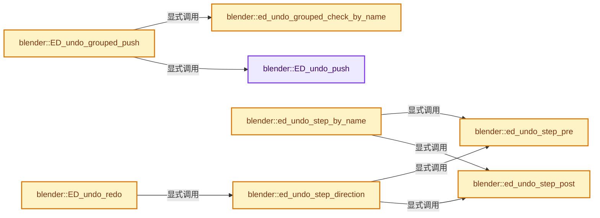
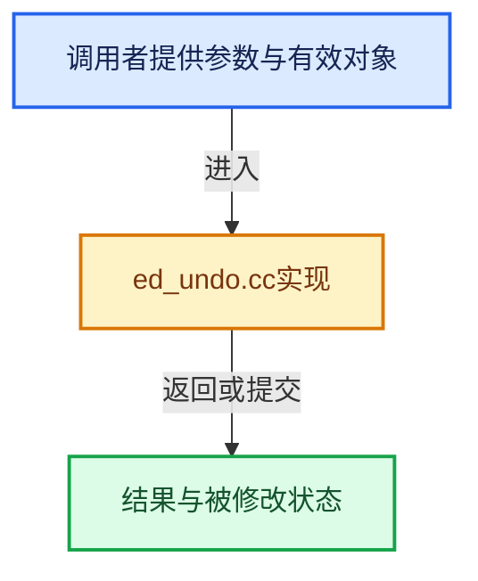

# 实现依赖专题：source/blender/editors/undo/ed_undo.cc

[方向导航](README.md) · [符号索引](../%E7%AC%A6%E5%8F%B7%E4%BE%9D%E8%B5%96%E4%B8%8E%E5%AE%9E%E7%8E%B0%E7%B4%A2%E5%BC%95.md)

本专题从正文实际调用进入，集中保存共享实现。函数有稳定锚点，可从调用处直接跳到对应完整函数；递归与互相调用通过回链组织。

## 本文件的实现关系






## 完整成员与函数实现

<a id="f-7c1123c9f74b3706"></a>

### `blender::ED_undo_push`

实现位置：[source/blender/editors/undo/ed_undo.cc](../../../../../source/blender/editors/undo/ed_undo.cc) · L103—L158。

接口参数：

- `bContext *C`
- `const char *str`
- `UndoEncodeHints hints`

**教学注释版**

<!-- annotated:db50c6c9176aaf -->

```cpp
void ED_undo_push(bContext *C, const char *str, UndoEncodeHints hints)
{
  CLOG_INFO(&LOG, "Push '%s'", str);
  WM_file_tag_modified();

  wmWindowManager *wm = CTX_wm_manager(C);
  if (G.background) {
    /* Python developers may have explicitly created the undo stack in background mode,
     * otherwise allow it to be nullptr, see: #60934.
     * Otherwise it must never be nullptr, even when undo is disabled. */
    if (wm->runtime->undo_stack == nullptr) {
      return;
    }
  }

  int steps = U.undosteps;

  /* Ensure steps that have been initialized are always pushed,
   * even when undo steps are zero.
   *
   * Note that some modes (paint, sculpt) initialize an undo step before an action runs,
   * then accumulate changes there, or restore data from it in the case of 2D painting.
   *
   * For this reason we need to handle the undo step even when undo steps is set to zero.
   */
  if ((steps <= 0) && wm->runtime->undo_stack->step_init != nullptr) {
    steps = 1;
  }
  if (steps <= 0) {
    return;
  }

  eUndoPushReturn push_retval;

  /* Only apply limit if this is the last undo step. */
  if (wm->runtime->undo_stack->step_active &&
      (wm->runtime->undo_stack->step_active->next == nullptr))
  {
    BKE_undosys_stack_limit_steps_and_memory(wm->runtime->undo_stack, steps - 1, 0);
  }

  push_retval = BKE_undosys_step_push(wm->runtime->undo_stack, C, str, hints);

  if (U.undomemory != 0) {
    const size_t memory_limit = size_t(U.undomemory) * 1024 * 1024;
    BKE_undosys_stack_limit_steps_and_memory(wm->runtime->undo_stack, -1, memory_limit);
  }

  if (CLOG_CHECK(&LOG, CLG_LEVEL_DEBUG)) {
    BKE_undosys_print(wm->runtime->undo_stack);
  }

  if (push_retval & UNDO_PUSH_RET_OVERRIDE_CHANGED) {
    WM_main_add_notifier(NC_WM | ND_LIB_OVERRIDE_CHANGED, nullptr);
  }
}
```

<details>
<summary>核对原始源码：source/blender/editors/undo/ed_undo.cc · L103—L158</summary>

<!-- original:db50c6c9176aaf:source/blender/editors/undo/ed_undo.cc:103:158 -->

```cpp
void ED_undo_push(bContext *C, const char *str, UndoEncodeHints hints)
{
  CLOG_INFO(&LOG, "Push '%s'", str);
  WM_file_tag_modified();

  wmWindowManager *wm = CTX_wm_manager(C);
  if (G.background) {
    /* Python developers may have explicitly created the undo stack in background mode,
     * otherwise allow it to be nullptr, see: #60934.
     * Otherwise it must never be nullptr, even when undo is disabled. */
    if (wm->runtime->undo_stack == nullptr) {
      return;
    }
  }

  int steps = U.undosteps;

  /* Ensure steps that have been initialized are always pushed,
   * even when undo steps are zero.
   *
   * Note that some modes (paint, sculpt) initialize an undo step before an action runs,
   * then accumulate changes there, or restore data from it in the case of 2D painting.
   *
   * For this reason we need to handle the undo step even when undo steps is set to zero.
   */
  if ((steps <= 0) && wm->runtime->undo_stack->step_init != nullptr) {
    steps = 1;
  }
  if (steps <= 0) {
    return;
  }

  eUndoPushReturn push_retval;

  /* Only apply limit if this is the last undo step. */
  if (wm->runtime->undo_stack->step_active &&
      (wm->runtime->undo_stack->step_active->next == nullptr))
  {
    BKE_undosys_stack_limit_steps_and_memory(wm->runtime->undo_stack, steps - 1, 0);
  }

  push_retval = BKE_undosys_step_push(wm->runtime->undo_stack, C, str, hints);

  if (U.undomemory != 0) {
    const size_t memory_limit = size_t(U.undomemory) * 1024 * 1024;
    BKE_undosys_stack_limit_steps_and_memory(wm->runtime->undo_stack, -1, memory_limit);
  }

  if (CLOG_CHECK(&LOG, CLG_LEVEL_DEBUG)) {
    BKE_undosys_print(wm->runtime->undo_stack);
  }

  if (push_retval & UNDO_PUSH_RET_OVERRIDE_CHANGED) {
    WM_main_add_notifier(NC_WM | ND_LIB_OVERRIDE_CHANGED, nullptr);
  }
}
```

</details>

**沿实际写入检查状态**

- `steps = 1;`
- `push_retval = BKE_undosys_step_push(wm->runtime->undo_stack, C, str, hints);`

**继续追踪实现**

- `CLOG_INFO` → [CLOG_INFO · L190](%E4%BE%9D%E8%B5%96-CLG_log-e9051b.md#m-f8b5efdfcc0f)。宏定义由构建条件选择。
- `WM_file_tag_modified` → [blender::WM_file_tag_modified · L186](%E4%BE%9D%E8%B5%96-wm_files-026458.md#f-9c21895afdf84dac)。
- `CTX_wm_manager` → [blender::CTX_wm_manager · L928](%E4%BE%9D%E8%B5%96-context-a929d9.md#f-158f36db7379fbe8)。
- `BKE_undosys_stack_limit_steps_and_memory` → [blender::BKE_undosys_stack_limit_steps_and_memory · L421](%E4%BE%9D%E8%B5%96-undo_system-be6b00.md#f-b74c4c257a62f126)。
- `BKE_undosys_step_push` → [blender::BKE_undosys_step_push · L655](%E4%BE%9D%E8%B5%96-undo_system-be6b00.md#f-13f66c4b3ce34bf7)。
- `CLOG_CHECK` → [CLOG_CHECK · L147](%E4%BE%9D%E8%B5%96-CLG_log-e9051b.md#m-27348fec3943)。宏定义由构建条件选择。
- `BKE_undosys_print` → [blender::BKE_undosys_print · L1034](%E4%BE%9D%E8%B5%96-undo_system-be6b00.md#f-7348445065a9b19a)。
- `WM_main_add_notifier` → [blender::WM_main_add_notifier · L403](%E4%BE%9D%E8%B5%96-wm_event_system-a0fa4f.md#f-29a090eae8ebe51c)。

<a id="f-63907287e47d905f"></a>

### `blender::ed_undo_step_pre`

实现位置：[source/blender/editors/undo/ed_undo.cc](../../../../../source/blender/editors/undo/ed_undo.cc) · L163—L194。

接口参数：

- `bContext *C`
- `wmWindowManager *wm`
- `const enum eUndoStepDir undo_dir`
- `ReportList *reports`

**教学注释版**

<!-- annotated:39ef05fbdfbf64 -->

```cpp
static void ed_undo_step_pre(bContext *C,
                             wmWindowManager *wm,
                             const enum eUndoStepDir undo_dir,
                             ReportList *reports)
{
  BLI_assert(ELEM(undo_dir, STEP_UNDO, STEP_REDO));

  Main *bmain = CTX_data_main(C);
  Scene *scene = CTX_data_scene(C);

  /* undo during jobs are running can easily lead to freeing data using by jobs,
   * or they can just lead to freezing job in some other cases */
  ED_preview_kill_jobs_for_undo(wm, bmain);
  WM_jobs_kill_all(wm);

  if (G.debug & G_DEBUG_IO) {
    if (bmain->lock != nullptr) {
      BKE_report(
          reports, RPT_DEBUG, "Checking validity of current .blend file *BEFORE* undo step");
      BLO_main_validate_libraries(bmain, reports);
    }
  }

  /* App-Handlers (pre). */
  {
    /* NOTE: ignore grease pencil for now. */
    wm->op_undo_depth++;
    BKE_callback_exec_id(
        bmain, &scene->id, (undo_dir == STEP_UNDO) ? BKE_CB_EVT_UNDO_PRE : BKE_CB_EVT_REDO_PRE);
    wm->op_undo_depth--;
  }
}
```

<details>
<summary>核对原始源码：source/blender/editors/undo/ed_undo.cc · L163—L194</summary>

<!-- original:39ef05fbdfbf64:source/blender/editors/undo/ed_undo.cc:163:194 -->

```cpp
static void ed_undo_step_pre(bContext *C,
                             wmWindowManager *wm,
                             const enum eUndoStepDir undo_dir,
                             ReportList *reports)
{
  BLI_assert(ELEM(undo_dir, STEP_UNDO, STEP_REDO));

  Main *bmain = CTX_data_main(C);
  Scene *scene = CTX_data_scene(C);

  /* undo during jobs are running can easily lead to freeing data using by jobs,
   * or they can just lead to freezing job in some other cases */
  ED_preview_kill_jobs_for_undo(wm, bmain);
  WM_jobs_kill_all(wm);

  if (G.debug & G_DEBUG_IO) {
    if (bmain->lock != nullptr) {
      BKE_report(
          reports, RPT_DEBUG, "Checking validity of current .blend file *BEFORE* undo step");
      BLO_main_validate_libraries(bmain, reports);
    }
  }

  /* App-Handlers (pre). */
  {
    /* NOTE: ignore grease pencil for now. */
    wm->op_undo_depth++;
    BKE_callback_exec_id(
        bmain, &scene->id, (undo_dir == STEP_UNDO) ? BKE_CB_EVT_UNDO_PRE : BKE_CB_EVT_REDO_PRE);
    wm->op_undo_depth--;
  }
}
```

</details>

**继续追踪实现**

- `BLI_assert` → [BLI_assert · L48](../01-%E5%9F%BA%E7%A1%80%E5%AE%B9%E5%99%A8%E4%B8%8E%E7%8E%B0%E4%BB%A3CPP/%E4%BE%9D%E8%B5%96-BLI_assert-cc98e8.md#m-57a88495704d)；[BLI_assert · L63](../01-%E5%9F%BA%E7%A1%80%E5%AE%B9%E5%99%A8%E4%B8%8E%E7%8E%B0%E4%BB%A3CPP/%E4%BE%9D%E8%B5%96-BLI_assert-cc98e8.md#m-d07050020cb5)。宏定义由构建条件选择。
- `ELEM` → [ELEM · L88](%E4%BE%9D%E8%B5%96-GHOST_utildefines-34b996.md#m-d28724a15928)；[ELEM · L135](../01-%E5%9F%BA%E7%A1%80%E5%AE%B9%E5%99%A8%E4%B8%8E%E7%8E%B0%E4%BB%A3CPP/%E4%BE%9D%E8%B5%96-BLI_utildefines-293a0a.md#m-d6572de7cae0)。宏定义由构建条件选择。
- `CTX_data_main` → [blender::CTX_data_main · L1313](%E4%BE%9D%E8%B5%96-context-a929d9.md#f-6d4ba24a62a80b94)。
- `CTX_data_scene` → [blender::CTX_data_scene · L1329](%E4%BE%9D%E8%B5%96-context-a929d9.md#f-6a2fb518a7aa2eee)。
- `ED_preview_kill_jobs_for_undo` → [blender::ED_preview_kill_jobs_for_undo · L2477](%E4%BE%9D%E8%B5%96-render_preview-3e12aa.md#f-f0858d80e387b2a1)。
- `WM_jobs_kill_all` → [blender::WM_jobs_kill_all · L621](%E4%BE%9D%E8%B5%96-wm_jobs-fec83b.md#f-2dd48fd36587d27f)。
- `BKE_report` → [blender::BKE_report · L162](%E4%BE%9D%E8%B5%96-report-f916fd.md#f-56816f68adfe537b)。
- `BLO_main_validate_libraries` → [blender::BLO_main_validate_libraries · L43](%E4%BE%9D%E8%B5%96-blend_validate-f26671.md#f-b4e163e5e5a0432a)。
- `BKE_callback_exec_id` → [blender::BKE_callback_exec_id · L45](%E4%BE%9D%E8%B5%96-callbacks-448f23.md#f-e8d8375e78975c0b)。

<a id="f-1383956051fd19eb"></a>

### `blender::ed_undo_step_post`

实现位置：[source/blender/editors/undo/ed_undo.cc](../../../../../source/blender/editors/undo/ed_undo.cc) · L201—L242。

接口参数：

- `bContext *C`
- `wmWindowManager *wm`
- `const enum eUndoStepDir undo_dir`
- `ReportList *reports`

**教学注释版**

<!-- annotated:5f7bbee448b5c3 -->

```cpp
static void ed_undo_step_post(bContext *C,
                              wmWindowManager *wm,
                              const enum eUndoStepDir undo_dir,
                              ReportList *reports)
{
  using namespace blender::ed;
  BLI_assert(ELEM(undo_dir, STEP_UNDO, STEP_REDO));

  Main *bmain = CTX_data_main(C);
  Scene *scene = CTX_data_scene(C);

  /* App-Handlers (post). */
  {
    wm->op_undo_depth++;
    BKE_callback_exec_id(
        bmain, &scene->id, (undo_dir == STEP_UNDO) ? BKE_CB_EVT_UNDO_POST : BKE_CB_EVT_REDO_POST);
    wm->op_undo_depth--;
  }

  if (G.debug & G_DEBUG_IO) {
    if (bmain->lock != nullptr) {
      BKE_report(reports, RPT_INFO, "Checking validity of current .blend file *AFTER* undo step");
      BLO_main_validate_libraries(bmain, reports);
    }
  }

  /* Undo/redo may have invalidated a lot of data, ensure UI has also been fully updated before
   * handling next events. */
  WM_event_handling_break(*C);

  WM_event_add_notifier(C, NC_WINDOW, nullptr);
  WM_event_add_notifier(C, NC_WM | ND_UNDO, nullptr);

  WM_toolsystem_refresh_active(C);
  WM_toolsystem_refresh_screen_all(bmain);

  asset::list::storage_tag_main_data_dirty();

  if (CLOG_CHECK(&LOG, CLG_LEVEL_DEBUG)) {
    BKE_undosys_print(wm->runtime->undo_stack);
  }
}
```

<details>
<summary>核对原始源码：source/blender/editors/undo/ed_undo.cc · L201—L242</summary>

<!-- original:5f7bbee448b5c3:source/blender/editors/undo/ed_undo.cc:201:242 -->

```cpp
static void ed_undo_step_post(bContext *C,
                              wmWindowManager *wm,
                              const enum eUndoStepDir undo_dir,
                              ReportList *reports)
{
  using namespace blender::ed;
  BLI_assert(ELEM(undo_dir, STEP_UNDO, STEP_REDO));

  Main *bmain = CTX_data_main(C);
  Scene *scene = CTX_data_scene(C);

  /* App-Handlers (post). */
  {
    wm->op_undo_depth++;
    BKE_callback_exec_id(
        bmain, &scene->id, (undo_dir == STEP_UNDO) ? BKE_CB_EVT_UNDO_POST : BKE_CB_EVT_REDO_POST);
    wm->op_undo_depth--;
  }

  if (G.debug & G_DEBUG_IO) {
    if (bmain->lock != nullptr) {
      BKE_report(reports, RPT_INFO, "Checking validity of current .blend file *AFTER* undo step");
      BLO_main_validate_libraries(bmain, reports);
    }
  }

  /* Undo/redo may have invalidated a lot of data, ensure UI has also been fully updated before
   * handling next events. */
  WM_event_handling_break(*C);

  WM_event_add_notifier(C, NC_WINDOW, nullptr);
  WM_event_add_notifier(C, NC_WM | ND_UNDO, nullptr);

  WM_toolsystem_refresh_active(C);
  WM_toolsystem_refresh_screen_all(bmain);

  asset::list::storage_tag_main_data_dirty();

  if (CLOG_CHECK(&LOG, CLG_LEVEL_DEBUG)) {
    BKE_undosys_print(wm->runtime->undo_stack);
  }
}
```

</details>

**继续追踪实现**

- `BLI_assert` → [BLI_assert · L48](../01-%E5%9F%BA%E7%A1%80%E5%AE%B9%E5%99%A8%E4%B8%8E%E7%8E%B0%E4%BB%A3CPP/%E4%BE%9D%E8%B5%96-BLI_assert-cc98e8.md#m-57a88495704d)；[BLI_assert · L63](../01-%E5%9F%BA%E7%A1%80%E5%AE%B9%E5%99%A8%E4%B8%8E%E7%8E%B0%E4%BB%A3CPP/%E4%BE%9D%E8%B5%96-BLI_assert-cc98e8.md#m-d07050020cb5)。宏定义由构建条件选择。
- `ELEM` → [ELEM · L88](%E4%BE%9D%E8%B5%96-GHOST_utildefines-34b996.md#m-d28724a15928)；[ELEM · L135](../01-%E5%9F%BA%E7%A1%80%E5%AE%B9%E5%99%A8%E4%B8%8E%E7%8E%B0%E4%BB%A3CPP/%E4%BE%9D%E8%B5%96-BLI_utildefines-293a0a.md#m-d6572de7cae0)。宏定义由构建条件选择。
- `CTX_data_main` → [blender::CTX_data_main · L1313](%E4%BE%9D%E8%B5%96-context-a929d9.md#f-6d4ba24a62a80b94)。
- `CTX_data_scene` → [blender::CTX_data_scene · L1329](%E4%BE%9D%E8%B5%96-context-a929d9.md#f-6a2fb518a7aa2eee)。
- `BKE_callback_exec_id` → [blender::BKE_callback_exec_id · L45](%E4%BE%9D%E8%B5%96-callbacks-448f23.md#f-e8d8375e78975c0b)。
- `BKE_report` → [blender::BKE_report · L162](%E4%BE%9D%E8%B5%96-report-f916fd.md#f-56816f68adfe537b)。
- `BLO_main_validate_libraries` → [blender::BLO_main_validate_libraries · L43](%E4%BE%9D%E8%B5%96-blend_validate-f26671.md#f-b4e163e5e5a0432a)。
- `WM_event_handling_break` → [blender::WM_event_handling_break · L350](%E4%BE%9D%E8%B5%96-wm_event_system-a0fa4f.md#f-4491082cb6f860b8)。
- `WM_event_add_notifier` → [blender::WM_event_add_notifier · L396](%E4%BE%9D%E8%B5%96-wm_event_system-a0fa4f.md#f-a1b32e7f4a69b28f)。
- `WM_toolsystem_refresh_active` → [blender::WM_toolsystem_refresh_active · L804](%E4%BE%9D%E8%B5%96-wm_toolsystem-d1c73e.md#f-e39ec4ad92357a5b)。
- `WM_toolsystem_refresh_screen_all` → [blender::WM_toolsystem_refresh_screen_all · L919](%E4%BE%9D%E8%B5%96-wm_toolsystem-d1c73e.md#f-cf14161205f044d1)。
- `asset::list::storage_tag_main_data_dirty` → [blender::ed::asset::list::storage_tag_main_data_dirty · L355](%E4%BE%9D%E8%B5%96-asset_list-d25fcb.md#f-8cf3d650042f0929)。
- `CLOG_CHECK` → [CLOG_CHECK · L147](%E4%BE%9D%E8%B5%96-CLG_log-e9051b.md#m-27348fec3943)。宏定义由构建条件选择。
- `BKE_undosys_print` → [blender::BKE_undosys_print · L1034](%E4%BE%9D%E8%B5%96-undo_system-be6b00.md#f-7348445065a9b19a)。

<a id="f-858463acb54a019f"></a>

### `blender::ed_undo_step_direction`

实现位置：[source/blender/editors/undo/ed_undo.cc](../../../../../source/blender/editors/undo/ed_undo.cc) · L249—L271。

接口参数：

- `bContext *C`
- `enum eUndoStepDir step`
- `ReportList *reports`

**教学注释版**

<!-- annotated:5332d7ffe48473 -->

```cpp
static wmOperatorStatus ed_undo_step_direction(bContext *C,
                                               enum eUndoStepDir step,
                                               ReportList *reports)
{
  BLI_assert(ELEM(step, STEP_UNDO, STEP_REDO));

  CLOG_INFO(&LOG, "Step direction=%s", (step == STEP_UNDO) ? "STEP_UNDO" : "STEP_REDO");

  wmWindowManager *wm = CTX_wm_manager(C);

  ed_undo_step_pre(C, wm, step, reports);

  if (step == STEP_UNDO) {
    BKE_undosys_step_undo(wm->runtime->undo_stack, C);
  }
  else {
    BKE_undosys_step_redo(wm->runtime->undo_stack, C);
  }

  ed_undo_step_post(C, wm, step, reports);

  return OPERATOR_FINISHED;
}
```

<details>
<summary>核对原始源码：source/blender/editors/undo/ed_undo.cc · L249—L271</summary>

<!-- original:5332d7ffe48473:source/blender/editors/undo/ed_undo.cc:249:271 -->

```cpp
static wmOperatorStatus ed_undo_step_direction(bContext *C,
                                               enum eUndoStepDir step,
                                               ReportList *reports)
{
  BLI_assert(ELEM(step, STEP_UNDO, STEP_REDO));

  CLOG_INFO(&LOG, "Step direction=%s", (step == STEP_UNDO) ? "STEP_UNDO" : "STEP_REDO");

  wmWindowManager *wm = CTX_wm_manager(C);

  ed_undo_step_pre(C, wm, step, reports);

  if (step == STEP_UNDO) {
    BKE_undosys_step_undo(wm->runtime->undo_stack, C);
  }
  else {
    BKE_undosys_step_redo(wm->runtime->undo_stack, C);
  }

  ed_undo_step_post(C, wm, step, reports);

  return OPERATOR_FINISHED;
}
```

</details>

**结果出口**

- `return OPERATOR_FINISHED;`

**继续追踪实现**

- `BLI_assert` → [BLI_assert · L48](../01-%E5%9F%BA%E7%A1%80%E5%AE%B9%E5%99%A8%E4%B8%8E%E7%8E%B0%E4%BB%A3CPP/%E4%BE%9D%E8%B5%96-BLI_assert-cc98e8.md#m-57a88495704d)；[BLI_assert · L63](../01-%E5%9F%BA%E7%A1%80%E5%AE%B9%E5%99%A8%E4%B8%8E%E7%8E%B0%E4%BB%A3CPP/%E4%BE%9D%E8%B5%96-BLI_assert-cc98e8.md#m-d07050020cb5)。宏定义由构建条件选择。
- `ELEM` → [ELEM · L88](%E4%BE%9D%E8%B5%96-GHOST_utildefines-34b996.md#m-d28724a15928)；[ELEM · L135](../01-%E5%9F%BA%E7%A1%80%E5%AE%B9%E5%99%A8%E4%B8%8E%E7%8E%B0%E4%BB%A3CPP/%E4%BE%9D%E8%B5%96-BLI_utildefines-293a0a.md#m-d6572de7cae0)。宏定义由构建条件选择。
- `CLOG_INFO` → [CLOG_INFO · L190](%E4%BE%9D%E8%B5%96-CLG_log-e9051b.md#m-f8b5efdfcc0f)。宏定义由构建条件选择。
- `CTX_wm_manager` → [blender::CTX_wm_manager · L928](%E4%BE%9D%E8%B5%96-context-a929d9.md#f-158f36db7379fbe8)。
- `ed_undo_step_pre` → [blender::ed_undo_step_pre · L163](%E4%BE%9D%E8%B5%96-ed_undo-0195cf.md#f-63907287e47d905f)。
- `BKE_undosys_step_undo` → [blender::BKE_undosys_step_undo · L906](%E4%BE%9D%E8%B5%96-undo_system-be6b00.md#f-5fecf5d94ec22ee9)。
- `BKE_undosys_step_redo` → [blender::BKE_undosys_step_redo · L933](%E4%BE%9D%E8%B5%96-undo_system-be6b00.md#f-c9a8aa78f4527779)。
- `ed_undo_step_post` → [blender::ed_undo_step_post · L201](%E4%BE%9D%E8%B5%96-ed_undo-0195cf.md#f-1383956051fd19eb)。

<a id="f-13a4b0a917af15ed"></a>

### `blender::ed_undo_step_by_name`

实现位置：[source/blender/editors/undo/ed_undo.cc](../../../../../source/blender/editors/undo/ed_undo.cc) · L278—L315。

接口参数：

- `bContext *C`
- `const char *undo_name`
- `ReportList *reports`

**教学注释版**

<!-- annotated:4118d19b32be3e -->

```cpp
static int ed_undo_step_by_name(bContext *C, const char *undo_name, ReportList *reports)
{
  BLI_assert(undo_name != nullptr);

  wmWindowManager *wm = CTX_wm_manager(C);
  UndoStep *undo_step_from_name = BKE_undosys_step_find_by_name(wm->runtime->undo_stack,
                                                                undo_name);
  if (undo_step_from_name == nullptr) {
    CLOG_ERROR(&LOG, "Step name='%s' not found in current undo stack", undo_name);

    return OPERATOR_CANCELLED;
  }

  UndoStep *undo_step_target = undo_step_from_name->prev;
  if (undo_step_target == nullptr) {
    CLOG_ERROR(&LOG, "Step name='%s' cannot be undone", undo_name);

    return OPERATOR_CANCELLED;
  }

  const int undo_dir_i = BKE_undosys_step_calc_direction(
      wm->runtime->undo_stack, undo_step_target, nullptr);
  BLI_assert(ELEM(undo_dir_i, -1, 1));
  const enum eUndoStepDir undo_dir = (undo_dir_i == -1) ? STEP_UNDO : STEP_REDO;

  CLOG_INFO(&LOG,
            "Step name='%s', found direction=%s",
            undo_name,
            (undo_dir == STEP_UNDO) ? "STEP_UNDO" : "STEP_REDO");

  ed_undo_step_pre(C, wm, undo_dir, reports);

  BKE_undosys_step_load_data_ex(wm->runtime->undo_stack, C, undo_step_target, nullptr, true);

  ed_undo_step_post(C, wm, undo_dir, reports);

  return OPERATOR_FINISHED;
}
```

<details>
<summary>核对原始源码：source/blender/editors/undo/ed_undo.cc · L278—L315</summary>

<!-- original:4118d19b32be3e:source/blender/editors/undo/ed_undo.cc:278:315 -->

```cpp
static int ed_undo_step_by_name(bContext *C, const char *undo_name, ReportList *reports)
{
  BLI_assert(undo_name != nullptr);

  wmWindowManager *wm = CTX_wm_manager(C);
  UndoStep *undo_step_from_name = BKE_undosys_step_find_by_name(wm->runtime->undo_stack,
                                                                undo_name);
  if (undo_step_from_name == nullptr) {
    CLOG_ERROR(&LOG, "Step name='%s' not found in current undo stack", undo_name);

    return OPERATOR_CANCELLED;
  }

  UndoStep *undo_step_target = undo_step_from_name->prev;
  if (undo_step_target == nullptr) {
    CLOG_ERROR(&LOG, "Step name='%s' cannot be undone", undo_name);

    return OPERATOR_CANCELLED;
  }

  const int undo_dir_i = BKE_undosys_step_calc_direction(
      wm->runtime->undo_stack, undo_step_target, nullptr);
  BLI_assert(ELEM(undo_dir_i, -1, 1));
  const enum eUndoStepDir undo_dir = (undo_dir_i == -1) ? STEP_UNDO : STEP_REDO;

  CLOG_INFO(&LOG,
            "Step name='%s', found direction=%s",
            undo_name,
            (undo_dir == STEP_UNDO) ? "STEP_UNDO" : "STEP_REDO");

  ed_undo_step_pre(C, wm, undo_dir, reports);

  BKE_undosys_step_load_data_ex(wm->runtime->undo_stack, C, undo_step_target, nullptr, true);

  ed_undo_step_post(C, wm, undo_dir, reports);

  return OPERATOR_FINISHED;
}
```

</details>

**结果出口**

- `return OPERATOR_CANCELLED;`
- `return OPERATOR_FINISHED;`

**继续追踪实现**

- `BLI_assert` → [BLI_assert · L48](../01-%E5%9F%BA%E7%A1%80%E5%AE%B9%E5%99%A8%E4%B8%8E%E7%8E%B0%E4%BB%A3CPP/%E4%BE%9D%E8%B5%96-BLI_assert-cc98e8.md#m-57a88495704d)；[BLI_assert · L63](../01-%E5%9F%BA%E7%A1%80%E5%AE%B9%E5%99%A8%E4%B8%8E%E7%8E%B0%E4%BB%A3CPP/%E4%BE%9D%E8%B5%96-BLI_assert-cc98e8.md#m-d07050020cb5)。宏定义由构建条件选择。
- `CTX_wm_manager` → [blender::CTX_wm_manager · L928](%E4%BE%9D%E8%B5%96-context-a929d9.md#f-158f36db7379fbe8)。
- `BKE_undosys_step_find_by_name` → [blender::BKE_undosys_step_find_by_name · L709](%E4%BE%9D%E8%B5%96-undo_system-be6b00.md#f-6db28d2f4e2d511b)。
- `CLOG_ERROR` → [CLOG_ERROR · L188](%E4%BE%9D%E8%B5%96-CLG_log-e9051b.md#m-081575cdc8d0)。宏定义由构建条件选择。
- `BKE_undosys_step_calc_direction` → [blender::BKE_undosys_step_calc_direction · L724](%E4%BE%9D%E8%B5%96-undo_system-be6b00.md#f-fe01e980ec11330b)。
- `ELEM` → [ELEM · L88](%E4%BE%9D%E8%B5%96-GHOST_utildefines-34b996.md#m-d28724a15928)；[ELEM · L135](../01-%E5%9F%BA%E7%A1%80%E5%AE%B9%E5%99%A8%E4%B8%8E%E7%8E%B0%E4%BB%A3CPP/%E4%BE%9D%E8%B5%96-BLI_utildefines-293a0a.md#m-d6572de7cae0)。宏定义由构建条件选择。
- `CLOG_INFO` → [CLOG_INFO · L190](%E4%BE%9D%E8%B5%96-CLG_log-e9051b.md#m-f8b5efdfcc0f)。宏定义由构建条件选择。
- `ed_undo_step_pre` → [blender::ed_undo_step_pre · L163](%E4%BE%9D%E8%B5%96-ed_undo-0195cf.md#f-63907287e47d905f)。
- `BKE_undosys_step_load_data_ex` → [blender::BKE_undosys_step_load_data_ex · L783](%E4%BE%9D%E8%B5%96-undo_system-be6b00.md#f-10d77ccb5b829473)。
- `ed_undo_step_post` → [blender::ed_undo_step_post · L201](%E4%BE%9D%E8%B5%96-ed_undo-0195cf.md#f-1383956051fd19eb)。

<a id="f-a4c4819bd332072c"></a>

### `blender::ed_undo_grouped_check_by_name`

实现位置：[source/blender/editors/undo/ed_undo.cc](../../../../../source/blender/editors/undo/ed_undo.cc) · L348—L355。

接口参数：

- `const UndoStack *ustack`
- `const char *str`

**教学注释版**

<!-- annotated:32c0593b1ef046 -->

```cpp
static bool ed_undo_grouped_check_by_name(const UndoStack *ustack, const char *str)
{
  const UndoStep *us = ustack->step_active;
  if (us && STREQ(str, us->name)) {
    return true;
  }
  return false;
}
```

<details>
<summary>核对原始源码：source/blender/editors/undo/ed_undo.cc · L348—L355</summary>

<!-- original:32c0593b1ef046:source/blender/editors/undo/ed_undo.cc:348:355 -->

```cpp
static bool ed_undo_grouped_check_by_name(const UndoStack *ustack, const char *str)
{
  const UndoStep *us = ustack->step_active;
  if (us && STREQ(str, us->name)) {
    return true;
  }
  return false;
}
```

</details>

**结果出口**

- `return true;`
- `return false;`

**继续追踪实现**

- `STREQ` → [STREQ · L112](%E4%BE%9D%E8%B5%96-GHOST_utildefines-34b996.md#m-9549fb6aafd2)；[STREQ · L451](../01-%E5%9F%BA%E7%A1%80%E5%AE%B9%E5%99%A8%E4%B8%8E%E7%8E%B0%E4%BB%A3CPP/%E4%BE%9D%E8%B5%96-BLI_utildefines-293a0a.md#m-c7b745bcfad2)；[STREQ · L55](%E4%BE%9D%E8%B5%96-clog-a0bec8.md#m-96e78f386894)。宏定义由构建条件选择。

<a id="f-b80d237e2624bb1c"></a>

### `blender::ED_undo_grouped_push`

实现位置：[source/blender/editors/undo/ed_undo.cc](../../../../../source/blender/editors/undo/ed_undo.cc) · L357—L374。

接口参数：

- `bContext *C`
- `const char *str`
- `UndoEncodeHints hints`

**教学注释版**

<!-- annotated:8701e1ae178dcb -->

```cpp
void ED_undo_grouped_push(bContext *C, const char *str, UndoEncodeHints hints)
{
  /* do nothing if previous undo task is the same as this one (or from the same undo group) */
  wmWindowManager *wm = CTX_wm_manager(C);
  UndoStack *ustack = wm->runtime->undo_stack;
  /* See matching check in #ED_undo_push. */
  if (G.background) {
    if (ustack == nullptr) {
      return;
    }
  }
  if (ed_undo_grouped_check_by_name(ustack, str)) {
    BKE_undosys_stack_clear_active(ustack);
  }

  /* push as usual */
  ED_undo_push(C, str, hints);
}
```

<details>
<summary>核对原始源码：source/blender/editors/undo/ed_undo.cc · L357—L374</summary>

<!-- original:8701e1ae178dcb:source/blender/editors/undo/ed_undo.cc:357:374 -->

```cpp
void ED_undo_grouped_push(bContext *C, const char *str, UndoEncodeHints hints)
{
  /* do nothing if previous undo task is the same as this one (or from the same undo group) */
  wmWindowManager *wm = CTX_wm_manager(C);
  UndoStack *ustack = wm->runtime->undo_stack;
  /* See matching check in #ED_undo_push. */
  if (G.background) {
    if (ustack == nullptr) {
      return;
    }
  }
  if (ed_undo_grouped_check_by_name(ustack, str)) {
    BKE_undosys_stack_clear_active(ustack);
  }

  /* push as usual */
  ED_undo_push(C, str, hints);
}
```

</details>

**继续追踪实现**

- `CTX_wm_manager` → [blender::CTX_wm_manager · L928](%E4%BE%9D%E8%B5%96-context-a929d9.md#f-158f36db7379fbe8)。
- `ed_undo_grouped_check_by_name` → [blender::ed_undo_grouped_check_by_name · L348](%E4%BE%9D%E8%B5%96-ed_undo-0195cf.md#f-a4c4819bd332072c)。
- `BKE_undosys_stack_clear_active` → [blender::BKE_undosys_stack_clear_active · L300](%E4%BE%9D%E8%B5%96-undo_system-be6b00.md#f-a2ad512fac03bfe4)。
- `ED_undo_push` → [blender::ED_undo_push · L103](%E4%BE%9D%E8%B5%96-ed_undo-0195cf.md#f-7c1123c9f74b3706)。

<a id="f-eec88f5e9a4f5946"></a>

### `blender::ED_undo_redo`

实现位置：[source/blender/editors/undo/ed_undo.cc](../../../../../source/blender/editors/undo/ed_undo.cc) · L380—L383。

接口参数：

- `bContext *C`

**教学注释版**

<!-- annotated:6863612f25817d -->

```cpp
void ED_undo_redo(bContext *C)
{
  ed_undo_step_direction(C, STEP_REDO, nullptr);
}
```

<details>
<summary>核对原始源码：source/blender/editors/undo/ed_undo.cc · L380—L383</summary>

<!-- original:6863612f25817d:source/blender/editors/undo/ed_undo.cc:380:383 -->

```cpp
void ED_undo_redo(bContext *C)
{
  ed_undo_step_direction(C, STEP_REDO, nullptr);
}
```

</details>

**继续追踪实现**

- `ed_undo_step_direction` → [blender::ed_undo_step_direction · L249](%E4%BE%9D%E8%B5%96-ed_undo-0195cf.md#f-858463acb54a019f)。

<a id="f-e5656b0041413f67"></a>

### `blender::ed_undo_push_check_id_changes_outside_mode`

实现位置：[source/blender/editors/undo/ed_undo.cc](../../../../../source/blender/editors/undo/ed_undo.cc) · L478—L517。

接口参数：

- `Main *bmain`

**教学注释版**

<!-- annotated:de17bab0d3bb28 -->

```cpp
static bool ed_undo_push_check_id_changes_outside_mode(Main *bmain)
{
  /* ID's added/removed/renamed. */
  if (bmain->is_memfile_undo_written == false) {
    return true;
  }

  /* Gather modified ID's, skipping ID types that are not stored by undo. */
  Vector<const ID *> ids;
  const MainListsArray lbarray = BKE_main_lists_get(*bmain);
  for (const ListBaseT<ID> *lb : lbarray) {
    const ID *id_first = lb->first();
    if ((id_first == nullptr) || !ID_CHECK_UNDO(id_first)) {
      continue;
    }
    // [讲解] ids.append：在尾部建立新元素，必要时先扩大存储。
    ids.append(id_first);
  }

  /* Check the gathered ID's in parallel, one task per ID type.
   *
   * NOTE(@ideasman42): This may create some tasks without much work:
   * Something we typically want to avoid. We could optimize this by doing
   * a single threaded pass on the first N items in each list.
   * However it adds code complexity without solving any real world problem.
   * Accept the overhead in the case where there isn't much work to improve
   * the worst when there are many ID's. */
  std::atomic<bool> modified = false;
  TaskPool *task_pool = BLI_task_pool_create(&modified, TASK_PRIORITY_HIGH);
  for (const ID *id_first : ids) {
    if (modified.load()) {
      break;
    }
    BLI_task_pool_push(
        task_pool, ed_undo_push_check_id_changes_fn, const_cast<ID *>(id_first), false, nullptr);
  }
  BLI_task_pool_work_and_wait(task_pool);
  BLI_task_pool_free(task_pool);

  return modified.load();
}
```

<details>
<summary>核对原始源码：source/blender/editors/undo/ed_undo.cc · L478—L517</summary>

<!-- original:de17bab0d3bb28:source/blender/editors/undo/ed_undo.cc:478:517 -->

```cpp
static bool ed_undo_push_check_id_changes_outside_mode(Main *bmain)
{
  /* ID's added/removed/renamed. */
  if (bmain->is_memfile_undo_written == false) {
    return true;
  }

  /* Gather modified ID's, skipping ID types that are not stored by undo. */
  Vector<const ID *> ids;
  const MainListsArray lbarray = BKE_main_lists_get(*bmain);
  for (const ListBaseT<ID> *lb : lbarray) {
    const ID *id_first = lb->first();
    if ((id_first == nullptr) || !ID_CHECK_UNDO(id_first)) {
      continue;
    }
    ids.append(id_first);
  }

  /* Check the gathered ID's in parallel, one task per ID type.
   *
   * NOTE(@ideasman42): This may create some tasks without much work:
   * Something we typically want to avoid. We could optimize this by doing
   * a single threaded pass on the first N items in each list.
   * However it adds code complexity without solving any real world problem.
   * Accept the overhead in the case where there isn't much work to improve
   * the worst when there are many ID's. */
  std::atomic<bool> modified = false;
  TaskPool *task_pool = BLI_task_pool_create(&modified, TASK_PRIORITY_HIGH);
  for (const ID *id_first : ids) {
    if (modified.load()) {
      break;
    }
    BLI_task_pool_push(
        task_pool, ed_undo_push_check_id_changes_fn, const_cast<ID *>(id_first), false, nullptr);
  }
  BLI_task_pool_work_and_wait(task_pool);
  BLI_task_pool_free(task_pool);

  return modified.load();
}
```

</details>

**结果出口**

- `return true;`
- `return modified.load();`

**继续追踪实现**

- `BKE_main_lists_get` → [blender::BKE_main_lists_get · L1158](%E4%BE%9D%E8%B5%96-main-ffa8b3.md#f-908cb8449aa99c35)。
- `lb->first` → [调用协议](../%E6%A8%A1%E6%9D%BF%E5%AE%8F%E4%B8%8E%E5%8A%A8%E6%80%81%E5%88%86%E6%B4%BE%E5%8D%8F%E8%AE%AE.md)：接收对象类型依赖auto、返回值或模板实例；不按同名猜测目标。调用位置L489。
- `ID_CHECK_UNDO` → [ID_CHECK_UNDO · L686](%E4%BE%9D%E8%B5%96-DNA_ID-3eb091.md#m-1237eb993bd2)。宏定义由构建条件选择。
- `ids.append` → [blender::Vector::append · L498](../01-%E5%9F%BA%E7%A1%80%E5%AE%B9%E5%99%A8%E4%B8%8E%E7%8E%B0%E4%BB%A3CPP/11-Vector%E6%8F%92%E5%85%A5%E5%88%A0%E9%99%A4%E4%B8%8E%E9%87%8D%E6%8E%92.md#f-5bde268a69e443ec)；[blender::Vector::append · L502](../01-%E5%9F%BA%E7%A1%80%E5%AE%B9%E5%99%A8%E4%B8%8E%E7%8E%B0%E4%BB%A3CPP/11-Vector%E6%8F%92%E5%85%A5%E5%88%A0%E9%99%A4%E4%B8%8E%E9%87%8D%E6%8E%92.md#f-591e0b15e6308532)。同名重载需按实参类型选择。
- `BLI_task_pool_create` → [BLI_task_pool_create · L404](../11-Depsgraph%E4%B8%8E%E5%B9%B6%E8%A1%8C%E4%BB%BB%E5%8A%A1%E7%B3%BB%E7%BB%9F/07-%E4%BB%BB%E5%8A%A1%E6%B1%A0%E4%B8%8ETBB%E6%8E%A5%E5%85%A5.md#f-1bbb9c0703fd163c)。
- `modified.load` → [外部契约](https://eel.is/c++draft/)：这个边界按实际表达式及所属类型核对参数、返回值、寿命与失败行为。这里提供接口入口，不声称已解释该第三方版本的内部实现。
- `BLI_task_pool_push` → [BLI_task_pool_push · L446](../11-Depsgraph%E4%B8%8E%E5%B9%B6%E8%A1%8C%E4%BB%BB%E5%8A%A1%E7%B3%BB%E7%BB%9F/07-%E4%BB%BB%E5%8A%A1%E6%B1%A0%E4%B8%8ETBB%E6%8E%A5%E5%85%A5.md#f-16c248b3ea6653d2)。
- `BLI_task_pool_work_and_wait` → [BLI_task_pool_work_and_wait · L455](../11-Depsgraph%E4%B8%8E%E5%B9%B6%E8%A1%8C%E4%BB%BB%E5%8A%A1%E7%B3%BB%E7%BB%9F/07-%E4%BB%BB%E5%8A%A1%E6%B1%A0%E4%B8%8ETBB%E6%8E%A5%E5%85%A5.md#f-cece9e6aa22a9121)。
- `BLI_task_pool_free` → [BLI_task_pool_free · L441](../11-Depsgraph%E4%B8%8E%E5%B9%B6%E8%A1%8C%E4%BB%BB%E5%8A%A1%E7%B3%BB%E7%BB%9F/07-%E4%BB%BB%E5%8A%A1%E6%B1%A0%E4%B8%8ETBB%E6%8E%A5%E5%85%A5.md#f-b9af08e8b1362aaa)。

<a id="f-ec9bcfad1d7e47ce"></a>

### `blender::undo_encode_hints_from_context`

实现位置：[source/blender/editors/undo/ed_undo.cc](../../../../../source/blender/editors/undo/ed_undo.cc) · L519—L551。

接口参数：

- `bContext *C`
- `const char *str`

**教学注释版**

<!-- annotated:5c3bc2436ffacd -->

```cpp
static UndoEncodeHints undo_encode_hints_from_context(bContext *C, const char *str)
{
  const UndoStack *ustack = CTX_wm_manager(C)->runtime->undo_stack;
  UndoEncodeHints hints = UndoEncodeHints::None;

  /* The undo stack may be null in background mode where undo pushes are a no-op,
   * see matching check in #ED_undo_push. */
  if (ustack == nullptr) {
    return hints;
  }

  /* Match the undo type #BKE_undosys_step_push uses,
   * the context is only a fallback when no undo step has been initialized. */
  const UndoType *ut = ustack->step_init ? ustack->step_init->type :
                                           BKE_undosys_type_from_context(C);

  if (ELEM(ut, nullptr, BKE_UNDOSYS_TYPE_MEMFILE)) {
    return hints;
  }

  if (ut->flags & UNDOTYPE_FLAG_ENCODE_PRE_MEMFILE_SUPPORTED) {
    /* When the undo step for this operator is not stored in the memfile undo system,
     * changes to ID's made by the operator would be excluded from the undo step.
     * Request a memfile undo step before this operators step so they're included. */
    Main *bmain = CTX_data_main(C);
    if (ed_undo_push_check_id_changes_outside_mode(bmain)) {
      CLOG_DEBUG(&LOG, "adding additional MEMFILE undo step: %s", str);
      hints |= UndoEncodeHints::PreMemFileChanges;
    }
  }

  return hints;
}
```

<details>
<summary>核对原始源码：source/blender/editors/undo/ed_undo.cc · L519—L551</summary>

<!-- original:5c3bc2436ffacd:source/blender/editors/undo/ed_undo.cc:519:551 -->

```cpp
static UndoEncodeHints undo_encode_hints_from_context(bContext *C, const char *str)
{
  const UndoStack *ustack = CTX_wm_manager(C)->runtime->undo_stack;
  UndoEncodeHints hints = UndoEncodeHints::None;

  /* The undo stack may be null in background mode where undo pushes are a no-op,
   * see matching check in #ED_undo_push. */
  if (ustack == nullptr) {
    return hints;
  }

  /* Match the undo type #BKE_undosys_step_push uses,
   * the context is only a fallback when no undo step has been initialized. */
  const UndoType *ut = ustack->step_init ? ustack->step_init->type :
                                           BKE_undosys_type_from_context(C);

  if (ELEM(ut, nullptr, BKE_UNDOSYS_TYPE_MEMFILE)) {
    return hints;
  }

  if (ut->flags & UNDOTYPE_FLAG_ENCODE_PRE_MEMFILE_SUPPORTED) {
    /* When the undo step for this operator is not stored in the memfile undo system,
     * changes to ID's made by the operator would be excluded from the undo step.
     * Request a memfile undo step before this operators step so they're included. */
    Main *bmain = CTX_data_main(C);
    if (ed_undo_push_check_id_changes_outside_mode(bmain)) {
      CLOG_DEBUG(&LOG, "adding additional MEMFILE undo step: %s", str);
      hints |= UndoEncodeHints::PreMemFileChanges;
    }
  }

  return hints;
}
```

</details>

**沿实际写入检查状态**

- `hints |= UndoEncodeHints::PreMemFileChanges;`

**结果出口**

- `return hints;`

**继续追踪实现**

- `CTX_wm_manager` → [blender::CTX_wm_manager · L928](%E4%BE%9D%E8%B5%96-context-a929d9.md#f-158f36db7379fbe8)。
- `BKE_undosys_type_from_context` → [blender::BKE_undosys_type_from_context · L82](%E4%BE%9D%E8%B5%96-undo_system-be6b00.md#f-04d010c517b6a941)。
- `ELEM` → [ELEM · L88](%E4%BE%9D%E8%B5%96-GHOST_utildefines-34b996.md#m-d28724a15928)；[ELEM · L135](../01-%E5%9F%BA%E7%A1%80%E5%AE%B9%E5%99%A8%E4%B8%8E%E7%8E%B0%E4%BB%A3CPP/%E4%BE%9D%E8%B5%96-BLI_utildefines-293a0a.md#m-d6572de7cae0)。宏定义由构建条件选择。
- `CTX_data_main` → [blender::CTX_data_main · L1313](%E4%BE%9D%E8%B5%96-context-a929d9.md#f-6d4ba24a62a80b94)。
- `ed_undo_push_check_id_changes_outside_mode` → [blender::ed_undo_push_check_id_changes_outside_mode · L478](%E4%BE%9D%E8%B5%96-ed_undo-0195cf.md#f-e5656b0041413f67)。
- `CLOG_DEBUG` → [CLOG_DEBUG · L191](%E4%BE%9D%E8%B5%96-CLG_log-e9051b.md#m-e062f5f17675)。宏定义由构建条件选择。

<a id="f-1eb420d4ce7cd126"></a>

### `blender::ED_undo_push_op`

实现位置：[source/blender/editors/undo/ed_undo.cc](../../../../../source/blender/editors/undo/ed_undo.cc) · L553—L559。

接口参数：

- `bContext *C`
- `wmOperator *op`

**教学注释版**

<!-- annotated:d687239988f2c4 -->

```cpp
void ED_undo_push_op(bContext *C, wmOperator *op)
{
  UndoEncodeHints hints = undo_encode_hints_from_context(C, op->type->name);

  /* in future, get undo string info? */
  ED_undo_push(C, op->type->name, hints);
}
```

<details>
<summary>核对原始源码：source/blender/editors/undo/ed_undo.cc · L553—L559</summary>

<!-- original:d687239988f2c4:source/blender/editors/undo/ed_undo.cc:553:559 -->

```cpp
void ED_undo_push_op(bContext *C, wmOperator *op)
{
  UndoEncodeHints hints = undo_encode_hints_from_context(C, op->type->name);

  /* in future, get undo string info? */
  ED_undo_push(C, op->type->name, hints);
}
```

</details>

**继续追踪实现**

- `undo_encode_hints_from_context` → [blender::undo_encode_hints_from_context · L519](%E4%BE%9D%E8%B5%96-ed_undo-0195cf.md#f-ec9bcfad1d7e47ce)。
- `ED_undo_push` → [blender::ED_undo_push · L103](%E4%BE%9D%E8%B5%96-ed_undo-0195cf.md#f-7c1123c9f74b3706)。

<a id="f-0baa1d6cdd86f9e5"></a>

### `blender::ED_undo_grouped_push_op`

实现位置：[source/blender/editors/undo/ed_undo.cc](../../../../../source/blender/editors/undo/ed_undo.cc) · L561—L566。

接口参数：

- `bContext *C`
- `wmOperator *op`

**教学注释版**

<!-- annotated:702b09803121f4 -->

```cpp
void ED_undo_grouped_push_op(bContext *C, wmOperator *op)
{
  const char *str = (op->type->undo_group[0] != '\0') ? op->type->undo_group : op->type->name;
  UndoEncodeHints hints = undo_encode_hints_from_context(C, str);
  ED_undo_grouped_push(C, str, hints);
}
```

<details>
<summary>核对原始源码：source/blender/editors/undo/ed_undo.cc · L561—L566</summary>

<!-- original:702b09803121f4:source/blender/editors/undo/ed_undo.cc:561:566 -->

```cpp
void ED_undo_grouped_push_op(bContext *C, wmOperator *op)
{
  const char *str = (op->type->undo_group[0] != '\0') ? op->type->undo_group : op->type->name;
  UndoEncodeHints hints = undo_encode_hints_from_context(C, str);
  ED_undo_grouped_push(C, str, hints);
}
```

</details>

**继续追踪实现**

- `undo_encode_hints_from_context` → [blender::undo_encode_hints_from_context · L519](%E4%BE%9D%E8%B5%96-ed_undo-0195cf.md#f-ec9bcfad1d7e47ce)。
- `ED_undo_grouped_push` → [blender::ED_undo_grouped_push · L357](%E4%BE%9D%E8%B5%96-ed_undo-0195cf.md#f-b80d237e2624bb1c)。

<a id="f-f8804b7fe9f7c926"></a>

### `blender::ED_undo_pop_op`

实现位置：[source/blender/editors/undo/ed_undo.cc](../../../../../source/blender/editors/undo/ed_undo.cc) · L568—L572。

接口参数：

- `bContext *C`
- `wmOperator *op`

**教学注释版**

<!-- annotated:ca82ae9173b565 -->

```cpp
void ED_undo_pop_op(bContext *C, wmOperator *op)
{
  /* search back a couple of undo's, in case something else added pushes */
  ed_undo_step_by_name(C, op->type->name, op->reports);
}
```

<details>
<summary>核对原始源码：source/blender/editors/undo/ed_undo.cc · L568—L572</summary>

<!-- original:ca82ae9173b565:source/blender/editors/undo/ed_undo.cc:568:572 -->

```cpp
void ED_undo_pop_op(bContext *C, wmOperator *op)
{
  /* search back a couple of undo's, in case something else added pushes */
  ed_undo_step_by_name(C, op->type->name, op->reports);
}
```

</details>

**继续追踪实现**

- `ed_undo_step_by_name` → [blender::ed_undo_step_by_name · L278](%E4%BE%9D%E8%B5%96-ed_undo-0195cf.md#f-13a4b0a917af15ed)。

<a id="f-3d21d30cc5dcadfd"></a>

### `blender::ED_undo_is_legacy_compatible_for_property`

实现位置：[source/blender/editors/undo/ed_undo.cc](../../../../../source/blender/editors/undo/ed_undo.cc) · L607—L688。

接口参数：

- `bContext *C`
- `ID *id`
- `const PointerRNA &ptr`
- `const PropertyRNA &prop`

**教学注释版**

<!-- annotated:b48938cb57803f -->

```cpp
std::optional<UndoEncodeHints> ED_undo_is_legacy_compatible_for_property(bContext *C,
                                                                         ID *id,
                                                                         const PointerRNA &ptr,
                                                                         const PropertyRNA &prop)
{
  if (!RNA_property_undo_check(&prop, ptr.type)) {
    return std::nullopt;
  }
  /* If the whole ID type doesn't support undo there is no need to check the current context. */
  if (id && !ID_CHECK_UNDO(id)) {
    return std::nullopt;
  }

  if (ELEM(&prop,
           /* Exception for renaming ID data, we always need undo pushes in this case,
            * because undo systems track data by their ID, see: #67002. */
           &rna_ID_name,
           /* Exception for active shape-key, since changing this in edit-mode updates
            * the shape key from object mode data. */
           &rna_Object_active_shape_key_index))
  {
    return UndoEncodeHints::None;
  }

  Main *bmain = CTX_data_main(C);
  const Scene *scene = CTX_data_scene(C);
  ViewLayer *view_layer = CTX_data_view_layer(C);
  if (view_layer != nullptr) {
    BKE_view_layer_synced_ensure(*bmain, scene, view_layer);
    Object *obact = BKE_view_layer_active_object_get(view_layer);
    if (obact != nullptr) {
      if (obact->mode & OB_MODE_SCULPT) {
        /* Changing properties while in sculpt mode is expensive due to the paint BVH rebuild.
         * Avoid pushing such undo steps for now. */
        CLOG_DEBUG(&LOG, "skipping undo for sculpt-mode");
        return std::nullopt;
      }
      if (obact->mode & OB_MODE_PARTICLE_EDIT) {
        /* Particle-edit undo steps only store point-cache data
         * (see #particle_undosys_step_encode), never generic ID/property state,
         * so redirect property changes to a `memfile` step. */
        return UndoEncodeHints::PreMemFileChanges | UndoEncodeHints::HasMemFileChangesOnly;
      }
      if (obact->mode & OB_MODE_EDIT) {
        /* Check if the `id` is covered by edit-mode undo. */

        /* When the object is in edit-mode, returning None here is fine as the edit-mode
         * data will track the undo state.
         *
         * Checking if the ID itself is in edit-mode ensures (for example),
         * that a mesh pinned in the properties editor which is *not* in edit-mode
         * has its undo data tracked even the active mesh is in edit-mode. */

        const bool is_id_in_editmode = (id && obact->data &&
                                        GS(id->name) == GS(((ID *)obact->data)->name) &&
                                        /* Only object-data that stores it's own edit-mode
                                         * data tracks it's own undo steps.
                                         * So passing object as null is OK here. */
                                        BKE_object_data_is_in_editmode(nullptr, id));

        if (is_id_in_editmode == false) {
          bool skip_undo = true;
          /* Make a special exception for mesh and tool-settings
           * because the undo steps store some tool-settings. */
          if (obact->type == OB_MESH) {
            if (RNA_struct_is_a(ptr.type, RNA_ToolSettings)) {
              skip_undo = false;
            }
          }

          if (skip_undo) {
            /* The property isn't stored by edit-mode undo steps (id type mismatch),
             * store the change in a memfile step, the edit-mode step has no changes itself. */
            CLOG_DEBUG(&LOG, "memfile-only undo for edit-mode");
            return UndoEncodeHints::PreMemFileChanges | UndoEncodeHints::HasMemFileChangesOnly;
          }
        }
      }
    }
  }
  return UndoEncodeHints::None;
}
```

<details>
<summary>核对原始源码：source/blender/editors/undo/ed_undo.cc · L607—L688</summary>

<!-- original:b48938cb57803f:source/blender/editors/undo/ed_undo.cc:607:688 -->

```cpp
std::optional<UndoEncodeHints> ED_undo_is_legacy_compatible_for_property(bContext *C,
                                                                         ID *id,
                                                                         const PointerRNA &ptr,
                                                                         const PropertyRNA &prop)
{
  if (!RNA_property_undo_check(&prop, ptr.type)) {
    return std::nullopt;
  }
  /* If the whole ID type doesn't support undo there is no need to check the current context. */
  if (id && !ID_CHECK_UNDO(id)) {
    return std::nullopt;
  }

  if (ELEM(&prop,
           /* Exception for renaming ID data, we always need undo pushes in this case,
            * because undo systems track data by their ID, see: #67002. */
           &rna_ID_name,
           /* Exception for active shape-key, since changing this in edit-mode updates
            * the shape key from object mode data. */
           &rna_Object_active_shape_key_index))
  {
    return UndoEncodeHints::None;
  }

  Main *bmain = CTX_data_main(C);
  const Scene *scene = CTX_data_scene(C);
  ViewLayer *view_layer = CTX_data_view_layer(C);
  if (view_layer != nullptr) {
    BKE_view_layer_synced_ensure(*bmain, scene, view_layer);
    Object *obact = BKE_view_layer_active_object_get(view_layer);
    if (obact != nullptr) {
      if (obact->mode & OB_MODE_SCULPT) {
        /* Changing properties while in sculpt mode is expensive due to the paint BVH rebuild.
         * Avoid pushing such undo steps for now. */
        CLOG_DEBUG(&LOG, "skipping undo for sculpt-mode");
        return std::nullopt;
      }
      if (obact->mode & OB_MODE_PARTICLE_EDIT) {
        /* Particle-edit undo steps only store point-cache data
         * (see #particle_undosys_step_encode), never generic ID/property state,
         * so redirect property changes to a `memfile` step. */
        return UndoEncodeHints::PreMemFileChanges | UndoEncodeHints::HasMemFileChangesOnly;
      }
      if (obact->mode & OB_MODE_EDIT) {
        /* Check if the `id` is covered by edit-mode undo. */

        /* When the object is in edit-mode, returning None here is fine as the edit-mode
         * data will track the undo state.
         *
         * Checking if the ID itself is in edit-mode ensures (for example),
         * that a mesh pinned in the properties editor which is *not* in edit-mode
         * has its undo data tracked even the active mesh is in edit-mode. */

        const bool is_id_in_editmode = (id && obact->data &&
                                        GS(id->name) == GS(((ID *)obact->data)->name) &&
                                        /* Only object-data that stores it's own edit-mode
                                         * data tracks it's own undo steps.
                                         * So passing object as null is OK here. */
                                        BKE_object_data_is_in_editmode(nullptr, id));

        if (is_id_in_editmode == false) {
          bool skip_undo = true;
          /* Make a special exception for mesh and tool-settings
           * because the undo steps store some tool-settings. */
          if (obact->type == OB_MESH) {
            if (RNA_struct_is_a(ptr.type, RNA_ToolSettings)) {
              skip_undo = false;
            }
          }

          if (skip_undo) {
            /* The property isn't stored by edit-mode undo steps (id type mismatch),
             * store the change in a memfile step, the edit-mode step has no changes itself. */
            CLOG_DEBUG(&LOG, "memfile-only undo for edit-mode");
            return UndoEncodeHints::PreMemFileChanges | UndoEncodeHints::HasMemFileChangesOnly;
          }
        }
      }
    }
  }
  return UndoEncodeHints::None;
}
```

</details>

**沿实际写入检查状态**

- `skip_undo = false;`

**结果出口**

- `return std::nullopt;`
- `return UndoEncodeHints::None;`
- `return UndoEncodeHints::PreMemFileChanges | UndoEncodeHints::HasMemFileChangesOnly;`

**继续追踪实现**

- `RNA_property_undo_check` → [blender::RNA_property_undo_check · L2327](%E4%BE%9D%E8%B5%96-rna_access-706bea.md#f-f53001bc31194334)。
- `ID_CHECK_UNDO` → [ID_CHECK_UNDO · L686](%E4%BE%9D%E8%B5%96-DNA_ID-3eb091.md#m-1237eb993bd2)。宏定义由构建条件选择。
- `ELEM` → [ELEM · L88](%E4%BE%9D%E8%B5%96-GHOST_utildefines-34b996.md#m-d28724a15928)；[ELEM · L135](../01-%E5%9F%BA%E7%A1%80%E5%AE%B9%E5%99%A8%E4%B8%8E%E7%8E%B0%E4%BB%A3CPP/%E4%BE%9D%E8%B5%96-BLI_utildefines-293a0a.md#m-d6572de7cae0)。宏定义由构建条件选择。
- `CTX_data_main` → [blender::CTX_data_main · L1313](%E4%BE%9D%E8%B5%96-context-a929d9.md#f-6d4ba24a62a80b94)。
- `CTX_data_scene` → [blender::CTX_data_scene · L1329](%E4%BE%9D%E8%B5%96-context-a929d9.md#f-6a2fb518a7aa2eee)。
- `CTX_data_view_layer` → [blender::CTX_data_view_layer · L1352](%E4%BE%9D%E8%B5%96-context-a929d9.md#f-31b9fbfc3ff836d4)。
- `BKE_view_layer_synced_ensure` → [blender::BKE_view_layer_synced_ensure · L1035](%E4%BE%9D%E8%B5%96-layer-0bc136.md#f-602c088654ebcb63)。
- `BKE_view_layer_active_object_get` → [blender::BKE_view_layer_active_object_get · L286](%E4%BE%9D%E8%B5%96-layer_utils-31ba6d.md#f-aa39df7416329726)。
- `CLOG_DEBUG` → [CLOG_DEBUG · L191](%E4%BE%9D%E8%B5%96-CLG_log-e9051b.md#m-e062f5f17675)。宏定义由构建条件选择。
- `GS` → [blender::GS · L410](%E4%BE%9D%E8%B5%96-DNA_ID-3eb091.md#f-c3ff509f79f21b05)。
- `BKE_object_data_is_in_editmode` → [blender::BKE_object_data_is_in_editmode · L1932](%E4%BE%9D%E8%B5%96-object-843689.md#f-44b525ac74ad9099)。
- `RNA_struct_is_a` → [blender::RNA_struct_is_a · L833](%E4%BE%9D%E8%B5%96-rna_access-706bea.md#f-9eaabe3c6e731ea5)。

<a id="f-aca4a8715b23ec5e"></a>

### `blender::ED_undo_operator_repeat`

实现位置：[source/blender/editors/undo/ed_undo.cc](../../../../../source/blender/editors/undo/ed_undo.cc) · L879—L954。

接口参数：

- `bContext *C`
- `wmOperator *op`

**教学注释版**

<!-- annotated:c60aaf15e73d6a -->

```cpp
bool ED_undo_operator_repeat(bContext *C, wmOperator *op)
{
  bool success = false;

  if (op) {
    CLOG_INFO(&LOG, "Operator repeat idname='%s'", op->type->idname);
    wmWindowManager *wm = CTX_wm_manager(C);
    const ScrArea *area = CTX_wm_area(C);
    Scene *scene = CTX_data_scene(C);

    /* keep in sync with logic in view3d_panel_operator_redo() */
    ARegion *region_orig = CTX_wm_region(C);
    /* If the redo is called from a HUD, this knows about the region type the operator was
     * initially called in, so attempt to restore that. */
    ARegion *redo_region_from_hud = (region_orig->regiontype == RGN_TYPE_HUD) ?
                                        ui::ED_area_type_hud_redo_region_find(area, region_orig) :
                                        nullptr;
    ARegion *region_repeat = redo_region_from_hud ? redo_region_from_hud :
                                                    BKE_area_find_region_active_win(area);

    if (region_repeat) {
      CTX_wm_region_set(C, region_repeat);
    }

    if (WM_operator_repeat_check(C, op) && WM_operator_poll(C, op->type) &&
        /* NOTE: undo/redo can't run if there are jobs active,
         * check for screen jobs only so jobs like material/texture/world preview
         * (which copy their data), won't stop redo, see #29579.
         *
         * NOTE: WM_operator_check_ui_enabled() jobs test _must_ stay in sync with this. */
        !WM_jobs_has_running(wm, scene, WM_JOB_TYPE_ANY, WM_JOB_BACKGROUND))
    {
      if (G.debug & G_DEBUG) {
        printf("redo_cb: operator redo %s\n", op->type->name);
      }

      WM_operator_free_all_after(wm, op);

      ED_undo_pop_op(C, op);

      if (op->type->check) {
        if (op->type->check(C, op)) {
          /* check for popup and re-layout buttons */
          ARegion *region_popup = CTX_wm_region_popup(C);
          if (region_popup) {
            ED_region_tag_refresh_ui(region_popup);
          }
        }
      }

      const wmOperatorStatus retval = WM_operator_repeat(C, op);
      if ((retval & OPERATOR_FINISHED) == 0) {
        if (G.debug & G_DEBUG) {
          printf("redo_cb: operator redo failed: %s, return %d\n", op->type->name, retval);
        }
        ED_undo_redo(C);
      }
      else {
        success = true;
      }
    }
    else {
      if (G.debug & G_DEBUG) {
        printf("redo_cb: WM_operator_repeat_check returned false %s\n", op->type->name);
      }
    }

    /* set region back */
    CTX_wm_region_set(C, region_orig);
  }
  else {
    CLOG_WARN(&LOG, "called with nullptr 'op'");
  }

  return success;
}
```

<details>
<summary>核对原始源码：source/blender/editors/undo/ed_undo.cc · L879—L954</summary>

<!-- original:c60aaf15e73d6a:source/blender/editors/undo/ed_undo.cc:879:954 -->

```cpp
bool ED_undo_operator_repeat(bContext *C, wmOperator *op)
{
  bool success = false;

  if (op) {
    CLOG_INFO(&LOG, "Operator repeat idname='%s'", op->type->idname);
    wmWindowManager *wm = CTX_wm_manager(C);
    const ScrArea *area = CTX_wm_area(C);
    Scene *scene = CTX_data_scene(C);

    /* keep in sync with logic in view3d_panel_operator_redo() */
    ARegion *region_orig = CTX_wm_region(C);
    /* If the redo is called from a HUD, this knows about the region type the operator was
     * initially called in, so attempt to restore that. */
    ARegion *redo_region_from_hud = (region_orig->regiontype == RGN_TYPE_HUD) ?
                                        ui::ED_area_type_hud_redo_region_find(area, region_orig) :
                                        nullptr;
    ARegion *region_repeat = redo_region_from_hud ? redo_region_from_hud :
                                                    BKE_area_find_region_active_win(area);

    if (region_repeat) {
      CTX_wm_region_set(C, region_repeat);
    }

    if (WM_operator_repeat_check(C, op) && WM_operator_poll(C, op->type) &&
        /* NOTE: undo/redo can't run if there are jobs active,
         * check for screen jobs only so jobs like material/texture/world preview
         * (which copy their data), won't stop redo, see #29579.
         *
         * NOTE: WM_operator_check_ui_enabled() jobs test _must_ stay in sync with this. */
        !WM_jobs_has_running(wm, scene, WM_JOB_TYPE_ANY, WM_JOB_BACKGROUND))
    {
      if (G.debug & G_DEBUG) {
        printf("redo_cb: operator redo %s\n", op->type->name);
      }

      WM_operator_free_all_after(wm, op);

      ED_undo_pop_op(C, op);

      if (op->type->check) {
        if (op->type->check(C, op)) {
          /* check for popup and re-layout buttons */
          ARegion *region_popup = CTX_wm_region_popup(C);
          if (region_popup) {
            ED_region_tag_refresh_ui(region_popup);
          }
        }
      }

      const wmOperatorStatus retval = WM_operator_repeat(C, op);
      if ((retval & OPERATOR_FINISHED) == 0) {
        if (G.debug & G_DEBUG) {
          printf("redo_cb: operator redo failed: %s, return %d\n", op->type->name, retval);
        }
        ED_undo_redo(C);
      }
      else {
        success = true;
      }
    }
    else {
      if (G.debug & G_DEBUG) {
        printf("redo_cb: WM_operator_repeat_check returned false %s\n", op->type->name);
      }
    }

    /* set region back */
    CTX_wm_region_set(C, region_orig);
  }
  else {
    CLOG_WARN(&LOG, "called with nullptr 'op'");
  }

  return success;
}
```

</details>

**沿实际写入检查状态**

- `success = true;`

**结果出口**

- `return success;`

**继续追踪实现**

- `CLOG_INFO` → [CLOG_INFO · L190](%E4%BE%9D%E8%B5%96-CLG_log-e9051b.md#m-f8b5efdfcc0f)。宏定义由构建条件选择。
- `CTX_wm_manager` → [blender::CTX_wm_manager · L928](%E4%BE%9D%E8%B5%96-context-a929d9.md#f-158f36db7379fbe8)。
- `CTX_wm_area` → [blender::CTX_wm_area · L954](%E4%BE%9D%E8%B5%96-context-a929d9.md#f-f8ad7c2c364d711c)。
- `CTX_data_scene` → [blender::CTX_data_scene · L1329](%E4%BE%9D%E8%B5%96-context-a929d9.md#f-6a2fb518a7aa2eee)。
- `CTX_wm_region` → [blender::CTX_wm_region · L965](%E4%BE%9D%E8%B5%96-context-a929d9.md#f-6cc0a26bc4539ae0)。
- `ui::ED_area_type_hud_redo_region_find` → [blender::ui::ED_area_type_hud_redo_region_find · L475](%E4%BE%9D%E8%B5%96-interface_region_hud-9de944.md#f-8187c864eefee167)。
- `BKE_area_find_region_active_win` → [blender::BKE_area_find_region_active_win · L1035](%E4%BE%9D%E8%B5%96-screen-f062a7.md#f-07a1d68833cd1a0a)。
- `CTX_wm_region_set` → [blender::CTX_wm_region_set · L1240](%E4%BE%9D%E8%B5%96-context-a929d9.md#f-7c17937537b1c2fc)。
- `WM_operator_repeat_check` → [blender::WM_operator_repeat_check · L1477](%E4%BE%9D%E8%B5%96-wm_event_system-a0fa4f.md#f-1c0fbf1f114ca1e3)。
- `WM_operator_poll` → [blender::WM_operator_poll · L1110](%E4%BE%9D%E8%B5%96-wm_event_system-a0fa4f.md#f-f468dca2684ae99e)。
- `WM_jobs_has_running` → [blender::WM_jobs_has_running · L809](%E4%BE%9D%E8%B5%96-wm_jobs-fec83b.md#f-ec91415d4f7d247f)。
- `printf` → [外部契约](https://eel.is/c++draft/)：这个边界按实际表达式及所属类型核对参数、返回值、寿命与失败行为。这里提供接口入口，不声称已解释该第三方版本的内部实现。
- `WM_operator_free_all_after` → [blender::WM_operator_free_all_after · L310](%E4%BE%9D%E8%B5%96-wm-ef447a.md#f-7073e7762d0ea5c1)。
- `ED_undo_pop_op` → [blender::ED_undo_pop_op · L568](%E4%BE%9D%E8%B5%96-ed_undo-0195cf.md#f-f8804b7fe9f7c926)。
- `op->type->check` → [调用协议](../%E6%A8%A1%E6%9D%BF%E5%AE%8F%E4%B8%8E%E5%8A%A8%E6%80%81%E5%88%86%E6%B4%BE%E5%8D%8F%E8%AE%AE.md)：接收对象类型依赖auto、返回值或模板实例；不按同名猜测目标。调用位置L920。
- `CTX_wm_region_popup` → [blender::CTX_wm_region_popup · L976](%E4%BE%9D%E8%B5%96-context-a929d9.md#f-0300c76092cd3bbc)。
- `ED_region_tag_refresh_ui` → [blender::ED_region_tag_refresh_ui · L738](%E4%BE%9D%E8%B5%96-area-87d68a.md#f-fec3f537791fe9b1)。
- `WM_operator_repeat` → [blender::WM_operator_repeat · L1461](%E4%BE%9D%E8%B5%96-wm_event_system-a0fa4f.md#f-bc917a724f7377ce)。
- `ED_undo_redo` → [blender::ED_undo_redo · L380](%E4%BE%9D%E8%B5%96-ed_undo-0195cf.md#f-eec88f5e9a4f5946)。
- `CLOG_WARN` → [CLOG_WARN · L189](%E4%BE%9D%E8%B5%96-CLG_log-e9051b.md#m-9da21a06cdbe)。宏定义由构建条件选择。
