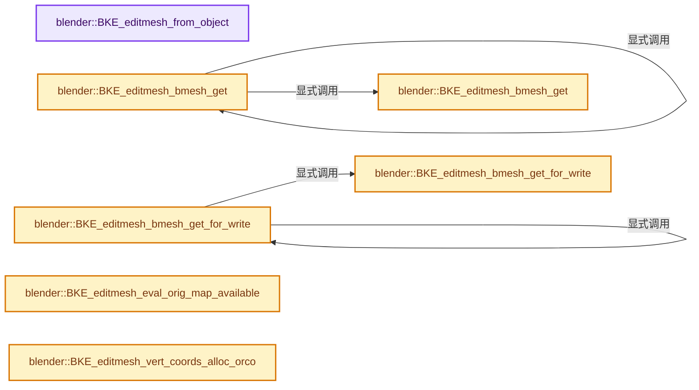
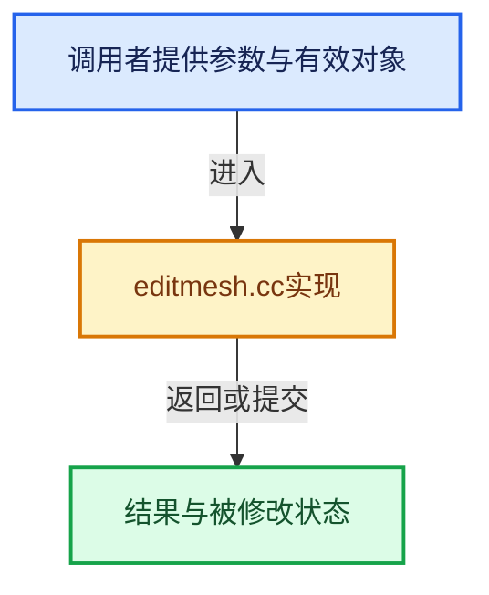

# 实现依赖专题：source/blender/blenkernel/intern/editmesh.cc

[方向导航](README.md) · [符号索引](../%E7%AC%A6%E5%8F%B7%E4%BE%9D%E8%B5%96%E4%B8%8E%E5%AE%9E%E7%8E%B0%E7%B4%A2%E5%BC%95.md)

本专题从正文实际调用进入，集中保存共享实现。函数有稳定锚点，可从调用处直接跳到对应完整函数；递归与互相调用通过回链组织。

## 本文件的实现关系






## 完整成员与函数实现

<a id="f-6b7c14655fd4c396"></a>

### `blender::BKE_editmesh_from_object`

实现位置：[source/blender/blenkernel/intern/editmesh.cc](../../../../../source/blender/blenkernel/intern/editmesh.cc) · L59—L63。

接口参数：

- `Object *ob`

**教学注释版**

<!-- annotated:d5d92535cf06f6 -->

```cpp
BMEditMesh *BKE_editmesh_from_object(Object *ob)
{
  BLI_assert(ob->type == OB_MESH);
  return (id_cast<Mesh *>(ob->data))->runtime->edit_mesh.get();
}
```

<details>
<summary>核对原始源码：source/blender/blenkernel/intern/editmesh.cc · L59—L63</summary>

<!-- original:d5d92535cf06f6:source/blender/blenkernel/intern/editmesh.cc:59:63 -->

```cpp
BMEditMesh *BKE_editmesh_from_object(Object *ob)
{
  BLI_assert(ob->type == OB_MESH);
  return (id_cast<Mesh *>(ob->data))->runtime->edit_mesh.get();
}
```

</details>

**结果出口**

- `return (id_cast<Mesh *>(ob->data))->runtime->edit_mesh.get();`

**继续追踪实现**

- `BLI_assert` → [BLI_assert · L48](../01-%E5%9F%BA%E7%A1%80%E5%AE%B9%E5%99%A8%E4%B8%8E%E7%8E%B0%E4%BB%A3CPP/%E4%BE%9D%E8%B5%96-BLI_assert-cc98e8.md#m-57a88495704d)；[BLI_assert · L63](../01-%E5%9F%BA%E7%A1%80%E5%AE%B9%E5%99%A8%E4%B8%8E%E7%8E%B0%E4%BB%A3CPP/%E4%BE%9D%E8%B5%96-BLI_assert-cc98e8.md#m-d07050020cb5)。宏定义由构建条件选择。
- `(id_cast<Mesh *>(ob->data))->runtime->edit_mesh.get` → [调用协议](../%E6%A8%A1%E6%9D%BF%E5%AE%8F%E4%B8%8E%E5%8A%A8%E6%80%81%E5%88%86%E6%B4%BE%E5%8D%8F%E8%AE%AE.md)：接收对象类型依赖auto、返回值或模板实例；不按同名猜测目标。调用位置L62。
- `id_cast<Mesh *>` → [blender::id_cast · L1417](%E4%BE%9D%E8%B5%96-DNA_ID-3eb091.md#f-6c8ac6412850ac5a)。

<a id="f-2afdd2773d3f0d88"></a>

### `blender::BKE_editmesh_bmesh_get`

实现位置：[source/blender/blenkernel/intern/editmesh.cc](../../../../../source/blender/blenkernel/intern/editmesh.cc) · L65—L69。

接口参数：

- `const Object *ob`

**教学注释版**

<!-- annotated:0d27e59daf551b -->

```cpp
const BMesh *BKE_editmesh_bmesh_get(const Object *ob)
{
  const Mesh *mesh = id_cast<const Mesh *>(ob->data);
  return BKE_editmesh_bmesh_get(mesh);
}
```

<details>
<summary>核对原始源码：source/blender/blenkernel/intern/editmesh.cc · L65—L69</summary>

<!-- original:0d27e59daf551b:source/blender/blenkernel/intern/editmesh.cc:65:69 -->

```cpp
const BMesh *BKE_editmesh_bmesh_get(const Object *ob)
{
  const Mesh *mesh = id_cast<const Mesh *>(ob->data);
  return BKE_editmesh_bmesh_get(mesh);
}
```

</details>

**结果出口**

- `return BKE_editmesh_bmesh_get(mesh);`

**继续追踪实现**

- `id_cast<const Mesh *>` → [blender::id_cast · L1417](%E4%BE%9D%E8%B5%96-DNA_ID-3eb091.md#f-6c8ac6412850ac5a)。
- `BKE_editmesh_bmesh_get` → [blender::BKE_editmesh_bmesh_get · L65](%E4%BE%9D%E8%B5%96-editmesh-1ee56f.md#f-2afdd2773d3f0d88)；[blender::BKE_editmesh_bmesh_get · L71](%E4%BE%9D%E8%B5%96-editmesh-1ee56f.md#f-80631d704a7e9947)。同名重载需按实参类型选择。

<a id="f-80631d704a7e9947"></a>

### `blender::BKE_editmesh_bmesh_get`

实现位置：[source/blender/blenkernel/intern/editmesh.cc](../../../../../source/blender/blenkernel/intern/editmesh.cc) · L71—L77。

接口参数：

- `const Mesh *mesh`

**教学注释版**

<!-- annotated:de0b5e62089abb -->

```cpp
const BMesh *BKE_editmesh_bmesh_get(const Mesh *mesh)
{
  if (!mesh->runtime->edit_mesh) {
    return nullptr;
  }
  return mesh->runtime->edit_mesh->bm;
}
```

<details>
<summary>核对原始源码：source/blender/blenkernel/intern/editmesh.cc · L71—L77</summary>

<!-- original:de0b5e62089abb:source/blender/blenkernel/intern/editmesh.cc:71:77 -->

```cpp
const BMesh *BKE_editmesh_bmesh_get(const Mesh *mesh)
{
  if (!mesh->runtime->edit_mesh) {
    return nullptr;
  }
  return mesh->runtime->edit_mesh->bm;
}
```

</details>

**结果出口**

- `return nullptr;`
- `return mesh->runtime->edit_mesh->bm;`

**继续追踪实现**

本实现没有需要继续展开的显式调用；检查返回表达式、对象转换和调用者前置条件。

<a id="f-fa556ba8fafc4b41"></a>

### `blender::BKE_editmesh_bmesh_get_for_write`

实现位置：[source/blender/blenkernel/intern/editmesh.cc](../../../../../source/blender/blenkernel/intern/editmesh.cc) · L79—L85。

接口参数：

- `Mesh *mesh`

**教学注释版**

<!-- annotated:983398da3004ba -->

```cpp
BMesh *BKE_editmesh_bmesh_get_for_write(Mesh *mesh)
{
  if (!mesh->runtime->edit_mesh) {
    return nullptr;
  }
  return mesh->runtime->edit_mesh->bm;
}
```

<details>
<summary>核对原始源码：source/blender/blenkernel/intern/editmesh.cc · L79—L85</summary>

<!-- original:983398da3004ba:source/blender/blenkernel/intern/editmesh.cc:79:85 -->

```cpp
BMesh *BKE_editmesh_bmesh_get_for_write(Mesh *mesh)
{
  if (!mesh->runtime->edit_mesh) {
    return nullptr;
  }
  return mesh->runtime->edit_mesh->bm;
}
```

</details>

**结果出口**

- `return nullptr;`
- `return mesh->runtime->edit_mesh->bm;`

**继续追踪实现**

本实现没有需要继续展开的显式调用；检查返回表达式、对象转换和调用者前置条件。

<a id="f-6137590869c86e48"></a>

### `blender::BKE_editmesh_bmesh_get_for_write`

实现位置：[source/blender/blenkernel/intern/editmesh.cc](../../../../../source/blender/blenkernel/intern/editmesh.cc) · L87—L91。

接口参数：

- `Object *ob`

**教学注释版**

<!-- annotated:666e5af645ddcf -->

```cpp
BMesh *BKE_editmesh_bmesh_get_for_write(Object *ob)
{
  Mesh *mesh = id_cast<Mesh *>(ob->data);
  return BKE_editmesh_bmesh_get_for_write(mesh);
}
```

<details>
<summary>核对原始源码：source/blender/blenkernel/intern/editmesh.cc · L87—L91</summary>

<!-- original:666e5af645ddcf:source/blender/blenkernel/intern/editmesh.cc:87:91 -->

```cpp
BMesh *BKE_editmesh_bmesh_get_for_write(Object *ob)
{
  Mesh *mesh = id_cast<Mesh *>(ob->data);
  return BKE_editmesh_bmesh_get_for_write(mesh);
}
```

</details>

**结果出口**

- `return BKE_editmesh_bmesh_get_for_write(mesh);`

**继续追踪实现**

- `id_cast<Mesh *>` → [blender::id_cast · L1417](%E4%BE%9D%E8%B5%96-DNA_ID-3eb091.md#f-6c8ac6412850ac5a)。
- `BKE_editmesh_bmesh_get_for_write` → [blender::BKE_editmesh_bmesh_get_for_write · L79](%E4%BE%9D%E8%B5%96-editmesh-1ee56f.md#f-fa556ba8fafc4b41)；[blender::BKE_editmesh_bmesh_get_for_write · L87](%E4%BE%9D%E8%B5%96-editmesh-1ee56f.md#f-6137590869c86e48)。同名重载需按实参类型选择。

<a id="f-a2fcec2dc3dfc12f"></a>

### `blender::BKE_editmesh_eval_orig_map_available`

实现位置：[source/blender/blenkernel/intern/editmesh.cc](../../../../../source/blender/blenkernel/intern/editmesh.cc) · L93—L105。

接口参数：

- `const Mesh &mesh_eval`
- `const Mesh *mesh_orig`

**教学注释版**

<!-- annotated:d30198849cd66b -->

```cpp
bool BKE_editmesh_eval_orig_map_available(const Mesh &mesh_eval, const Mesh *mesh_orig)
{
  if (!mesh_orig) {
    return false;
  }
  if (&mesh_eval == mesh_orig) {
    return true;
  }
  if (mesh_eval.runtime->edit_mesh) {
    return mesh_eval.runtime->edit_mesh == mesh_orig->runtime->edit_mesh;
  }
  return false;
}
```

<details>
<summary>核对原始源码：source/blender/blenkernel/intern/editmesh.cc · L93—L105</summary>

<!-- original:d30198849cd66b:source/blender/blenkernel/intern/editmesh.cc:93:105 -->

```cpp
bool BKE_editmesh_eval_orig_map_available(const Mesh &mesh_eval, const Mesh *mesh_orig)
{
  if (!mesh_orig) {
    return false;
  }
  if (&mesh_eval == mesh_orig) {
    return true;
  }
  if (mesh_eval.runtime->edit_mesh) {
    return mesh_eval.runtime->edit_mesh == mesh_orig->runtime->edit_mesh;
  }
  return false;
}
```

</details>

**结果出口**

- `return false;`
- `return true;`
- `return mesh_eval.runtime->edit_mesh == mesh_orig->runtime->edit_mesh;`

**继续追踪实现**

本实现没有需要继续展开的显式调用；检查返回表达式、对象转换和调用者前置条件。

<a id="f-14093a8eb37db829"></a>

### `blender::BKE_editmesh_vert_coords_alloc_orco`

实现位置：[source/blender/blenkernel/intern/editmesh.cc](../../../../../source/blender/blenkernel/intern/editmesh.cc) · L248—L251。

接口参数：

- `const BMesh *bm`

**教学注释版**

<!-- annotated:054d65d2335a30 -->

```cpp
Array<float3> BKE_editmesh_vert_coords_alloc_orco(const BMesh *bm)
{
  return BM_mesh_vert_coords_alloc(bm);
}
```

<details>
<summary>核对原始源码：source/blender/blenkernel/intern/editmesh.cc · L248—L251</summary>

<!-- original:054d65d2335a30:source/blender/blenkernel/intern/editmesh.cc:248:251 -->

```cpp
Array<float3> BKE_editmesh_vert_coords_alloc_orco(const BMesh *bm)
{
  return BM_mesh_vert_coords_alloc(bm);
}
```

</details>

**结果出口**

- `return BM_mesh_vert_coords_alloc(bm);`

**继续追踪实现**

- `BM_mesh_vert_coords_alloc` → [blender::BM_mesh_vert_coords_alloc · L1337](%E4%BE%9D%E8%B5%96-bmesh_mesh-283e2d.md#f-bc4760be1676a19c)。
