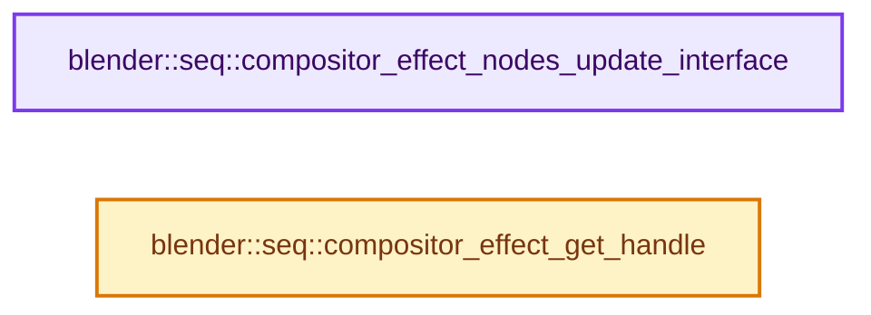

# 实现依赖专题：source/blender/sequencer/intern/effects/effect_compositor.cc

[方向导航](README.md) · [符号索引](../%E7%AC%A6%E5%8F%B7%E4%BE%9D%E8%B5%96%E4%B8%8E%E5%AE%9E%E7%8E%B0%E7%B4%A2%E5%BC%95.md)

本专题从正文实际调用进入，集中保存共享实现。函数有稳定锚点，可从调用处直接跳到对应完整函数；递归与互相调用通过回链组织。

## 本文件的实现关系




## 完整成员与函数实现

<a id="f-c06bb90bc4f15098"></a>

### `blender::seq::compositor_effect_nodes_update_interface`

实现位置：[source/blender/sequencer/intern/effects/effect_compositor.cc](../../../../../source/blender/sequencer/intern/effects/effect_compositor.cc) · L247—L269。

接口参数：

- `Main &bmain`
- `Scene &sequencer_scene`
- `Strip &strip`

**教学注释版**

<!-- annotated:6f047c89ddaaae -->

```cpp
void compositor_effect_nodes_update_interface(Main &bmain, Scene &sequencer_scene, Strip &strip)
{
  if (strip.type != STRIP_TYPE_COMPOSITOR || strip.effectdata == nullptr) {
    return;
  }
  CompositorEffectVars *comp = static_cast<CompositorEffectVars *>(strip.effectdata);
  if (!comp->system_properties) {
    comp->system_properties =
        bke::idprop::create_group("SequencerCompositorEffectProperties").release();
  }

  /* In case the node group is missing, do not update the properties to avoid the values reverting
   * to their default value if the node group later becomes available. */
  if (!comp->node_group || ID_MISSING(comp->node_group)) {
    return;
  }

  PointerRNA properties_ptr = RNA_pointer_create_discrete(
      &sequencer_scene.id, RNA_SequencerCompositorEffectProperties, comp);
  RNA_ensure_and_sync_system_properties(bmain, properties_ptr, *comp->system_properties);

  DEG_id_tag_update(&sequencer_scene.id, ID_RECALC_SEQUENCER_STRIPS);
}
```

<details>
<summary>核对原始源码：source/blender/sequencer/intern/effects/effect_compositor.cc · L247—L269</summary>

<!-- original:6f047c89ddaaae:source/blender/sequencer/intern/effects/effect_compositor.cc:247:269 -->

```cpp
void compositor_effect_nodes_update_interface(Main &bmain, Scene &sequencer_scene, Strip &strip)
{
  if (strip.type != STRIP_TYPE_COMPOSITOR || strip.effectdata == nullptr) {
    return;
  }
  CompositorEffectVars *comp = static_cast<CompositorEffectVars *>(strip.effectdata);
  if (!comp->system_properties) {
    comp->system_properties =
        bke::idprop::create_group("SequencerCompositorEffectProperties").release();
  }

  /* In case the node group is missing, do not update the properties to avoid the values reverting
   * to their default value if the node group later becomes available. */
  if (!comp->node_group || ID_MISSING(comp->node_group)) {
    return;
  }

  PointerRNA properties_ptr = RNA_pointer_create_discrete(
      &sequencer_scene.id, RNA_SequencerCompositorEffectProperties, comp);
  RNA_ensure_and_sync_system_properties(bmain, properties_ptr, *comp->system_properties);

  DEG_id_tag_update(&sequencer_scene.id, ID_RECALC_SEQUENCER_STRIPS);
}
```

</details>

**沿实际写入检查状态**

- `comp->system_properties =`

**继续追踪实现**

- `bke::idprop::create_group("SequencerCompositorEffectProperties").release` → [调用协议](../%E6%A8%A1%E6%9D%BF%E5%AE%8F%E4%B8%8E%E5%8A%A8%E6%80%81%E5%88%86%E6%B4%BE%E5%8D%8F%E8%AE%AE.md)：接收对象类型依赖auto、返回值或模板实例；不按同名猜测目标。调用位置L255。
- `bke::idprop::create_group` → [blender::bke::idprop::create_group · L155](%E4%BE%9D%E8%B5%96-idprop_create-f89f51.md#f-b1e2d8bfd5654bc2)。
- `ID_MISSING` → [ID_MISSING · L695](%E4%BE%9D%E8%B5%96-DNA_ID-3eb091.md#m-ab9a2a270fb3)。宏定义由构建条件选择。
- `RNA_pointer_create_discrete` → [blender::RNA_pointer_create_discrete · L181](%E4%BE%9D%E8%B5%96-rna_access-706bea.md#f-592a276e869c6d94)。
- `RNA_ensure_and_sync_system_properties` → [blender::RNA_ensure_and_sync_system_properties · L6568](%E4%BE%9D%E8%B5%96-rna_access-706bea.md#f-3787705e085177e6)。
- `DEG_id_tag_update` → [blender::DEG_id_tag_update · L844](../11-Depsgraph%E4%B8%8E%E5%B9%B6%E8%A1%8C%E4%BB%BB%E5%8A%A1%E7%B3%BB%E7%BB%9F/%E4%BE%9D%E8%B5%96-depsgraph_tag-d8b3c7.md#f-62d2949dd168bb81)。

<a id="f-57df7555b6293630"></a>

### `blender::seq::compositor_effect_get_handle`

实现位置：[source/blender/sequencer/intern/effects/effect_compositor.cc](../../../../../source/blender/sequencer/intern/effects/effect_compositor.cc) · L334—L341。

接口参数：

- `EffectHandle &rval`

**教学注释版**

<!-- annotated:7537d637849151 -->

```cpp
void compositor_effect_get_handle(EffectHandle &rval)
{
  rval.init = init_compositor_effect;
  rval.free = free_compositor_effect;
  rval.copy = copy_compositor_effect;
  rval.execute = do_compositor_effect;
  rval.early_out = early_out_compositor;
}
```

<details>
<summary>核对原始源码：source/blender/sequencer/intern/effects/effect_compositor.cc · L334—L341</summary>

<!-- original:7537d637849151:source/blender/sequencer/intern/effects/effect_compositor.cc:334:341 -->

```cpp
void compositor_effect_get_handle(EffectHandle &rval)
{
  rval.init = init_compositor_effect;
  rval.free = free_compositor_effect;
  rval.copy = copy_compositor_effect;
  rval.execute = do_compositor_effect;
  rval.early_out = early_out_compositor;
}
```

</details>

**沿实际写入检查状态**

- `rval.init = init_compositor_effect;`
- `rval.free = free_compositor_effect;`
- `rval.copy = copy_compositor_effect;`
- `rval.execute = do_compositor_effect;`
- `rval.early_out = early_out_compositor;`

**继续追踪实现**

本实现没有需要继续展开的显式调用；检查返回表达式、对象转换和调用者前置条件。
