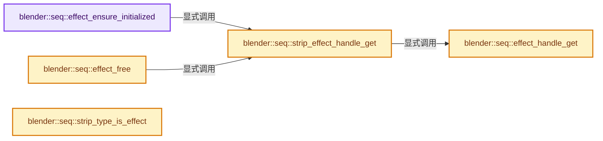
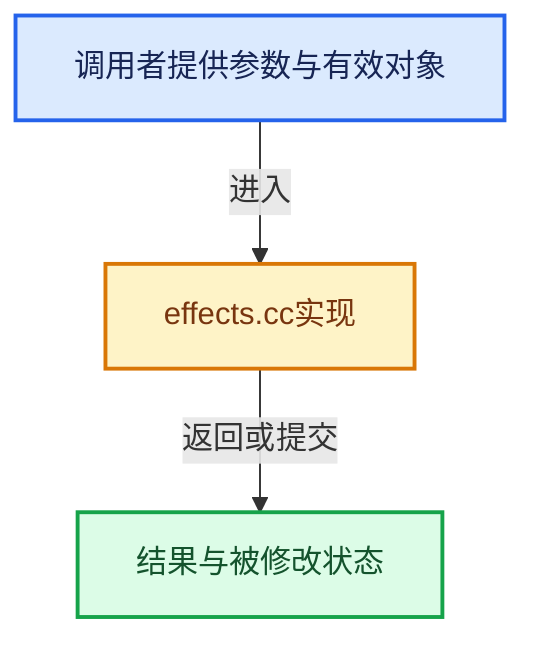

# 实现依赖专题：source/blender/sequencer/intern/effects/effects.cc

[方向导航](README.md) · [符号索引](../%E7%AC%A6%E5%8F%B7%E4%BE%9D%E8%B5%96%E4%B8%8E%E5%AE%9E%E7%8E%B0%E7%B4%A2%E5%BC%95.md)

本专题从正文实际调用进入，集中保存共享实现。函数有稳定锚点，可从调用处直接跳到对应完整函数；递归与互相调用通过回链组织。

## 本文件的实现关系






## 完整成员与函数实现

<a id="f-44e1cc3d445afe4d"></a>

### `blender::seq::effect_ensure_initialized`

实现位置：[source/blender/sequencer/intern/effects/effects.cc](../../../../../source/blender/sequencer/intern/effects/effects.cc) · L137—L145。

接口参数：

- `Strip *strip`

**教学注释版**

<!-- annotated:a224ee74ee52ab -->

```cpp
void effect_ensure_initialized(Strip *strip)
{
  if (strip->effectdata == nullptr) {
    EffectHandle h = strip_effect_handle_get(strip);
    if (h.init != nullptr) {
      h.init(strip);
    }
  }
}
```

<details>
<summary>核对原始源码：source/blender/sequencer/intern/effects/effects.cc · L137—L145</summary>

<!-- original:a224ee74ee52ab:source/blender/sequencer/intern/effects/effects.cc:137:145 -->

```cpp
void effect_ensure_initialized(Strip *strip)
{
  if (strip->effectdata == nullptr) {
    EffectHandle h = strip_effect_handle_get(strip);
    if (h.init != nullptr) {
      h.init(strip);
    }
  }
}
```

</details>

**继续追踪实现**

- `strip_effect_handle_get` → [blender::seq::strip_effect_handle_get · L284](%E4%BE%9D%E8%B5%96-effects-05081a.md#f-733e3c3c364310fb)。
- `h.init` → [调用协议](../%E6%A8%A1%E6%9D%BF%E5%AE%8F%E4%B8%8E%E5%8A%A8%E6%80%81%E5%88%86%E6%B4%BE%E5%8D%8F%E8%AE%AE.md)：由接收对象具体类型或运行时策略提供实现。调用位置L142。

<a id="f-04d32610078ef2fa"></a>

### `blender::seq::effect_free`

实现位置：[source/blender/sequencer/intern/effects/effects.cc](../../../../../source/blender/sequencer/intern/effects/effects.cc) · L147—L154。

接口参数：

- `Strip *strip`

**教学注释版**

<!-- annotated:4f9958b36f3bdc -->

```cpp
void effect_free(Strip *strip)
{
  EffectHandle h = strip_effect_handle_get(strip);
  if (h.free != nullptr) {
    // [讲解] h.free：这个边界按实际表达式及所属类型核对参数、返回值、寿命与失败行为。这里提供接口入口，不声称已解释该第三方版本的内部实现。
    h.free(strip, true);
    BLI_assert(strip->effectdata == nullptr);
  }
}
```

<details>
<summary>核对原始源码：source/blender/sequencer/intern/effects/effects.cc · L147—L154</summary>

<!-- original:4f9958b36f3bdc:source/blender/sequencer/intern/effects/effects.cc:147:154 -->

```cpp
void effect_free(Strip *strip)
{
  EffectHandle h = strip_effect_handle_get(strip);
  if (h.free != nullptr) {
    h.free(strip, true);
    BLI_assert(strip->effectdata == nullptr);
  }
}
```

</details>

**继续追踪实现**

- `strip_effect_handle_get` → [blender::seq::strip_effect_handle_get · L284](%E4%BE%9D%E8%B5%96-effects-05081a.md#f-733e3c3c364310fb)。
- `h.free` → [外部契约](https://eel.is/c++draft/)：这个边界按实际表达式及所属类型核对参数、返回值、寿命与失败行为。这里提供接口入口，不声称已解释该第三方版本的内部实现。
- `BLI_assert` → [BLI_assert · L48](../01-%E5%9F%BA%E7%A1%80%E5%AE%B9%E5%99%A8%E4%B8%8E%E7%8E%B0%E4%BB%A3CPP/%E4%BE%9D%E8%B5%96-BLI_assert-cc98e8.md#m-57a88495704d)；[BLI_assert · L63](../01-%E5%9F%BA%E7%A1%80%E5%AE%B9%E5%99%A8%E4%B8%8E%E7%8E%B0%E4%BB%A3CPP/%E4%BE%9D%E8%B5%96-BLI_assert-cc98e8.md#m-d07050020cb5)。宏定义由构建条件选择。

<a id="f-07ecff5900d9e68f"></a>

### `blender::seq::effect_handle_get`

实现位置：[source/blender/sequencer/intern/effects/effects.cc](../../../../../source/blender/sequencer/intern/effects/effects.cc) · L156—L223。

接口参数：

- `StripType strip_type`

**教学注释版**

<!-- annotated:64e1326db96dac -->

```cpp
EffectHandle effect_handle_get(StripType strip_type)
{
  EffectHandle rval;

  rval.init = init_noop;
  rval.free = nullptr;
  rval.early_out = early_out_noop;
  rval.execute = nullptr;
  rval.copy = copy_effect_default;

  switch (strip_type) {
    case STRIP_TYPE_CROSS:
      cross_effect_get_handle(rval);
      break;
    case STRIP_TYPE_GAMCROSS:
      gamma_cross_effect_get_handle(rval);
      break;
    case STRIP_TYPE_COMPOSITOR:
      compositor_effect_get_handle(rval);
      break;
    case STRIP_TYPE_ADD:
      add_effect_get_handle(rval);
      break;
    case STRIP_TYPE_SUB:
      sub_effect_get_handle(rval);
      break;
    case STRIP_TYPE_MUL:
      mul_effect_get_handle(rval);
      break;
    case STRIP_TYPE_COLORMIX:
      color_mix_effect_get_handle(rval);
      break;
    case STRIP_TYPE_ALPHAOVER:
      alpha_over_effect_get_handle(rval);
      break;
    case STRIP_TYPE_ALPHAUNDER:
      alpha_under_effect_get_handle(rval);
      break;
    case STRIP_TYPE_WIPE:
      wipe_effect_get_handle(rval);
      break;
    case STRIP_TYPE_GLOW:
      glow_effect_get_handle(rval);
      break;
    case STRIP_TYPE_SPEED:
      speed_effect_get_handle(rval);
      break;
    case STRIP_TYPE_COLOR:
      solid_color_effect_get_handle(rval);
      break;
    case STRIP_TYPE_MULTICAM:
      multi_camera_effect_get_handle(rval);
      break;
    case STRIP_TYPE_ADJUSTMENT:
      adjustment_effect_get_handle(rval);
      break;
    case STRIP_TYPE_GAUSSIAN_BLUR:
      gaussian_blur_effect_get_handle(rval);
      break;
    case STRIP_TYPE_TEXT:
      text_effect_get_handle(rval);
      break;
    default:
      break;
  }

  return rval;
}
```

<details>
<summary>核对原始源码：source/blender/sequencer/intern/effects/effects.cc · L156—L223</summary>

<!-- original:64e1326db96dac:source/blender/sequencer/intern/effects/effects.cc:156:223 -->

```cpp
EffectHandle effect_handle_get(StripType strip_type)
{
  EffectHandle rval;

  rval.init = init_noop;
  rval.free = nullptr;
  rval.early_out = early_out_noop;
  rval.execute = nullptr;
  rval.copy = copy_effect_default;

  switch (strip_type) {
    case STRIP_TYPE_CROSS:
      cross_effect_get_handle(rval);
      break;
    case STRIP_TYPE_GAMCROSS:
      gamma_cross_effect_get_handle(rval);
      break;
    case STRIP_TYPE_COMPOSITOR:
      compositor_effect_get_handle(rval);
      break;
    case STRIP_TYPE_ADD:
      add_effect_get_handle(rval);
      break;
    case STRIP_TYPE_SUB:
      sub_effect_get_handle(rval);
      break;
    case STRIP_TYPE_MUL:
      mul_effect_get_handle(rval);
      break;
    case STRIP_TYPE_COLORMIX:
      color_mix_effect_get_handle(rval);
      break;
    case STRIP_TYPE_ALPHAOVER:
      alpha_over_effect_get_handle(rval);
      break;
    case STRIP_TYPE_ALPHAUNDER:
      alpha_under_effect_get_handle(rval);
      break;
    case STRIP_TYPE_WIPE:
      wipe_effect_get_handle(rval);
      break;
    case STRIP_TYPE_GLOW:
      glow_effect_get_handle(rval);
      break;
    case STRIP_TYPE_SPEED:
      speed_effect_get_handle(rval);
      break;
    case STRIP_TYPE_COLOR:
      solid_color_effect_get_handle(rval);
      break;
    case STRIP_TYPE_MULTICAM:
      multi_camera_effect_get_handle(rval);
      break;
    case STRIP_TYPE_ADJUSTMENT:
      adjustment_effect_get_handle(rval);
      break;
    case STRIP_TYPE_GAUSSIAN_BLUR:
      gaussian_blur_effect_get_handle(rval);
      break;
    case STRIP_TYPE_TEXT:
      text_effect_get_handle(rval);
      break;
    default:
      break;
  }

  return rval;
}
```

</details>

**沿实际写入检查状态**

- `rval.init = init_noop;`
- `rval.free = nullptr;`
- `rval.early_out = early_out_noop;`
- `rval.execute = nullptr;`
- `rval.copy = copy_effect_default;`

**结果出口**

- `return rval;`

**继续追踪实现**

- `cross_effect_get_handle` → [blender::seq::cross_effect_get_handle · L124](%E4%BE%9D%E8%B5%96-effect_cross-f5fbcf.md#f-bd52565e7664cef7)。
- `gamma_cross_effect_get_handle` → [blender::seq::gamma_cross_effect_get_handle · L130](%E4%BE%9D%E8%B5%96-effect_cross-f5fbcf.md#f-75182bfdd852d3a9)。
- `compositor_effect_get_handle` → [blender::seq::compositor_effect_get_handle · L334](%E4%BE%9D%E8%B5%96-effect_compositor-63bd71.md#f-57df7555b6293630)。
- `add_effect_get_handle` → [blender::seq::add_effect_get_handle · L163](%E4%BE%9D%E8%B5%96-effect_add_sub_mul-a77c72.md#f-cdb39ffbb02cdf32)。
- `sub_effect_get_handle` → [blender::seq::sub_effect_get_handle · L169](%E4%BE%9D%E8%B5%96-effect_add_sub_mul-a77c72.md#f-409611bf46701193)。
- `mul_effect_get_handle` → [blender::seq::mul_effect_get_handle · L175](%E4%BE%9D%E8%B5%96-effect_add_sub_mul-a77c72.md#f-c73a6c89f1a8eb9d)。
- `color_mix_effect_get_handle` → [blender::seq::color_mix_effect_get_handle · L394](%E4%BE%9D%E8%B5%96-effect_blend-ac6e36.md#f-40f97f93647ac72e)。
- `alpha_over_effect_get_handle` → [blender::seq::alpha_over_effect_get_handle · L402](%E4%BE%9D%E8%B5%96-effect_blend-ac6e36.md#f-91c059417b117c46)。
- `alpha_under_effect_get_handle` → [blender::seq::alpha_under_effect_get_handle · L409](%E4%BE%9D%E8%B5%96-effect_blend-ac6e36.md#f-2ccc1ced83c33dbb)。
- `wipe_effect_get_handle` → [blender::seq::wipe_effect_get_handle · L245](%E4%BE%9D%E8%B5%96-effect_wipe-fe7086.md#f-ddea007121b8cfab)。
- `glow_effect_get_handle` → [blender::seq::glow_effect_get_handle · L239](%E4%BE%9D%E8%B5%96-effect_glow-5f5433.md#f-2d28df54d53347f5)。
- `speed_effect_get_handle` → [blender::seq::speed_effect_get_handle · L204](%E4%BE%9D%E8%B5%96-effect_speed-a1134e.md#f-727dcef541ef41f2)。
- `solid_color_effect_get_handle` → [blender::seq::solid_color_effect_get_handle · L77](%E4%BE%9D%E8%B5%96-effect_solid_color-3c6961.md#f-1ba035649eeeff46)。
- `multi_camera_effect_get_handle` → [blender::seq::multi_camera_effect_get_handle · L59](%E4%BE%9D%E8%B5%96-effect_multi_camera-a92683.md#f-c253d6e98ddfb313)。
- `adjustment_effect_get_handle` → [blender::seq::adjustment_effect_get_handle · L86](%E4%BE%9D%E8%B5%96-effect_adjustment-77c30d.md#f-286926980ed99525)。
- `gaussian_blur_effect_get_handle` → [blender::seq::gaussian_blur_effect_get_handle · L227](%E4%BE%9D%E8%B5%96-effect_gaussian_blur-c21166.md#f-486aa1d2921ab698)。
- `text_effect_get_handle` → [blender::seq::text_effect_get_handle · L1165](%E4%BE%9D%E8%B5%96-effect_text-9adf94.md#f-97ecbf8ae0bf7434)。

<a id="f-733e3c3c364310fb"></a>

### `blender::seq::strip_effect_handle_get`

实现位置：[source/blender/sequencer/intern/effects/effects.cc](../../../../../source/blender/sequencer/intern/effects/effects.cc) · L284—L291。

接口参数：

- `Strip *strip`

**教学注释版**

<!-- annotated:2a8a3b5ff6e678 -->

```cpp
EffectHandle strip_effect_handle_get(Strip *strip)
{
  EffectHandle h = {};
  if (strip->is_effect()) {
    h = effect_handle_get(strip->type);
  }
  return h;
}
```

<details>
<summary>核对原始源码：source/blender/sequencer/intern/effects/effects.cc · L284—L291</summary>

<!-- original:2a8a3b5ff6e678:source/blender/sequencer/intern/effects/effects.cc:284:291 -->

```cpp
EffectHandle strip_effect_handle_get(Strip *strip)
{
  EffectHandle h = {};
  if (strip->is_effect()) {
    h = effect_handle_get(strip->type);
  }
  return h;
}
```

</details>

**沿实际写入检查状态**

- `h = effect_handle_get(strip->type);`

**结果出口**

- `return h;`

**继续追踪实现**

- `strip->is_effect` → [blender::Strip::is_effect · L1391](%E4%BE%9D%E8%B5%96-sequencer-837668.md#f-26a10ad33ac0e4b2)。
- `effect_handle_get` → [blender::seq::effect_handle_get · L156](%E4%BE%9D%E8%B5%96-effects-05081a.md#f-07ecff5900d9e68f)。

<a id="f-7dc54a18828270eb"></a>

### `blender::seq::strip_type_is_effect`

实现位置：[source/blender/sequencer/intern/effects/effects.cc](../../../../../source/blender/sequencer/intern/effects/effects.cc) · L374—L379。

接口参数：

- `StripType type`

**教学注释版**

<!-- annotated:8ad8a86fa3ea97 -->

```cpp
bool strip_type_is_effect(StripType type)
{
  return (type >= STRIP_TYPE_CROSS && type <= STRIP_TYPE_COMPOSITOR) ||
         (type >= STRIP_TYPE_WIPE && type <= STRIP_TYPE_ADJUSTMENT) ||
         (type >= STRIP_TYPE_GAUSSIAN_BLUR && type <= STRIP_TYPE_COLORMIX);
}
```

<details>
<summary>核对原始源码：source/blender/sequencer/intern/effects/effects.cc · L374—L379</summary>

<!-- original:8ad8a86fa3ea97:source/blender/sequencer/intern/effects/effects.cc:374:379 -->

```cpp
bool strip_type_is_effect(StripType type)
{
  return (type >= STRIP_TYPE_CROSS && type <= STRIP_TYPE_COMPOSITOR) ||
         (type >= STRIP_TYPE_WIPE && type <= STRIP_TYPE_ADJUSTMENT) ||
         (type >= STRIP_TYPE_GAUSSIAN_BLUR && type <= STRIP_TYPE_COLORMIX);
}
```

</details>

**结果出口**

- `return (type >= STRIP_TYPE_CROSS && type <= STRIP_TYPE_COMPOSITOR) ||`

**继续追踪实现**

本实现没有需要继续展开的显式调用；检查返回表达式、对象转换和调用者前置条件。
