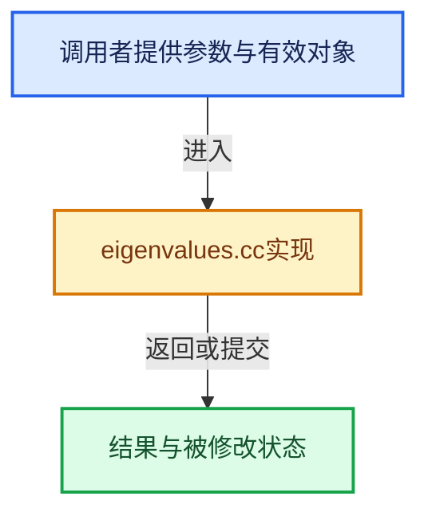

# 实现依赖专题：intern/eigen/intern/eigenvalues.cc

[方向导航](README.md) · [符号索引](../%E7%AC%A6%E5%8F%B7%E4%BE%9D%E8%B5%96%E4%B8%8E%E5%AE%9E%E7%8E%B0%E7%B4%A2%E5%BC%95.md)

本专题从正文实际调用进入，集中保存共享实现。函数有稳定锚点，可从调用处直接跳到对应完整函数；递归与互相调用通过回链组织。

## 本文件的实现关系





## 完整成员与函数实现

<a id="f-fbaec1be1a205236"></a>

### `EIG_self_adjoint_eigen_solve`

实现位置：[intern/eigen/intern/eigenvalues.cc](../../../../../intern/eigen/intern/eigenvalues.cc) · L26—L49。

接口参数：

- `const int size`
- `const float *matrix`
- `float *r_eigen_values`
- `float *r_eigen_vectors`

**教学注释版**

<!-- annotated:43eef673fa7087 -->

```cpp
bool EIG_self_adjoint_eigen_solve(const int size,
                                  const float *matrix,
                                  float *r_eigen_values,
                                  float *r_eigen_vectors)
{
  SelfAdjointEigenSolver<MatrixXf> eigen_solver;

  /* Blender and Eigen matrices are both column-major. */
  eigen_solver.compute(Map<MatrixXf>((float *)matrix, size, size));

  if (eigen_solver.info() != Success) {
    return false;
  }

  if (r_eigen_values) {
    Map<VectorXf>(r_eigen_values, size) = eigen_solver.eigenvalues().transpose();
  }

  if (r_eigen_vectors) {
    Map<MatrixXf>(r_eigen_vectors, size, size) = eigen_solver.eigenvectors();
  }

  return true;
}
```

<details>
<summary>核对原始源码：intern/eigen/intern/eigenvalues.cc · L26—L49</summary>

<!-- original:43eef673fa7087:intern/eigen/intern/eigenvalues.cc:26:49 -->

```cpp
bool EIG_self_adjoint_eigen_solve(const int size,
                                  const float *matrix,
                                  float *r_eigen_values,
                                  float *r_eigen_vectors)
{
  SelfAdjointEigenSolver<MatrixXf> eigen_solver;

  /* Blender and Eigen matrices are both column-major. */
  eigen_solver.compute(Map<MatrixXf>((float *)matrix, size, size));

  if (eigen_solver.info() != Success) {
    return false;
  }

  if (r_eigen_values) {
    Map<VectorXf>(r_eigen_values, size) = eigen_solver.eigenvalues().transpose();
  }

  if (r_eigen_vectors) {
    Map<MatrixXf>(r_eigen_vectors, size, size) = eigen_solver.eigenvectors();
  }

  return true;
}
```

</details>

**结果出口**

- `return false;`
- `return true;`

**继续追踪实现**

- `eigen_solver.compute` → [compute · L22](%E4%BE%9D%E8%B5%96-gpu_shader_cxx_attribute-d75f56.md#m-ea80b54273b2)。宏定义由构建条件选择。
- `Map<MatrixXf>` → [HdCyclesRenderBuffer::Map · L70](%E4%BE%9D%E8%B5%96-render_buffer-3897e3.md#f-612f36a470bea05f)。
- `eigen_solver.info` → [blender::nodes::SocketSearchData::info · L142](../09-LazyFunction%E4%B8%8E%E8%8A%82%E7%82%B9%E6%89%A7%E8%A1%8C%E6%9E%B6%E6%9E%84/%E4%BE%9D%E8%B5%96-geometry_nodes_caller_ui-ccd1aa.md#f-cff9f419020c1e90)。
- `Map<VectorXf>` → [HdCyclesRenderBuffer::Map · L70](%E4%BE%9D%E8%B5%96-render_buffer-3897e3.md#f-612f36a470bea05f)。
- `eigen_solver.eigenvalues().transpose` → [调用协议](../%E6%A8%A1%E6%9D%BF%E5%AE%8F%E4%B8%8E%E5%8A%A8%E6%80%81%E5%88%86%E6%B4%BE%E5%8D%8F%E8%AE%AE.md)：接收对象类型依赖auto、返回值或模板实例；不按同名猜测目标。调用位置L41。
- `eigen_solver.eigenvalues` → [调用协议](../%E6%A8%A1%E6%9D%BF%E5%AE%8F%E4%B8%8E%E5%8A%A8%E6%80%81%E5%88%86%E6%B4%BE%E5%8D%8F%E8%AE%AE.md)：由接收对象具体类型或运行时策略提供实现。调用位置L41。
- `eigen_solver.eigenvectors` → [调用协议](../%E6%A8%A1%E6%9D%BF%E5%AE%8F%E4%B8%8E%E5%8A%A8%E6%80%81%E5%88%86%E6%B4%BE%E5%8D%8F%E8%AE%AE.md)：由接收对象具体类型或运行时策略提供实现。调用位置L45。
