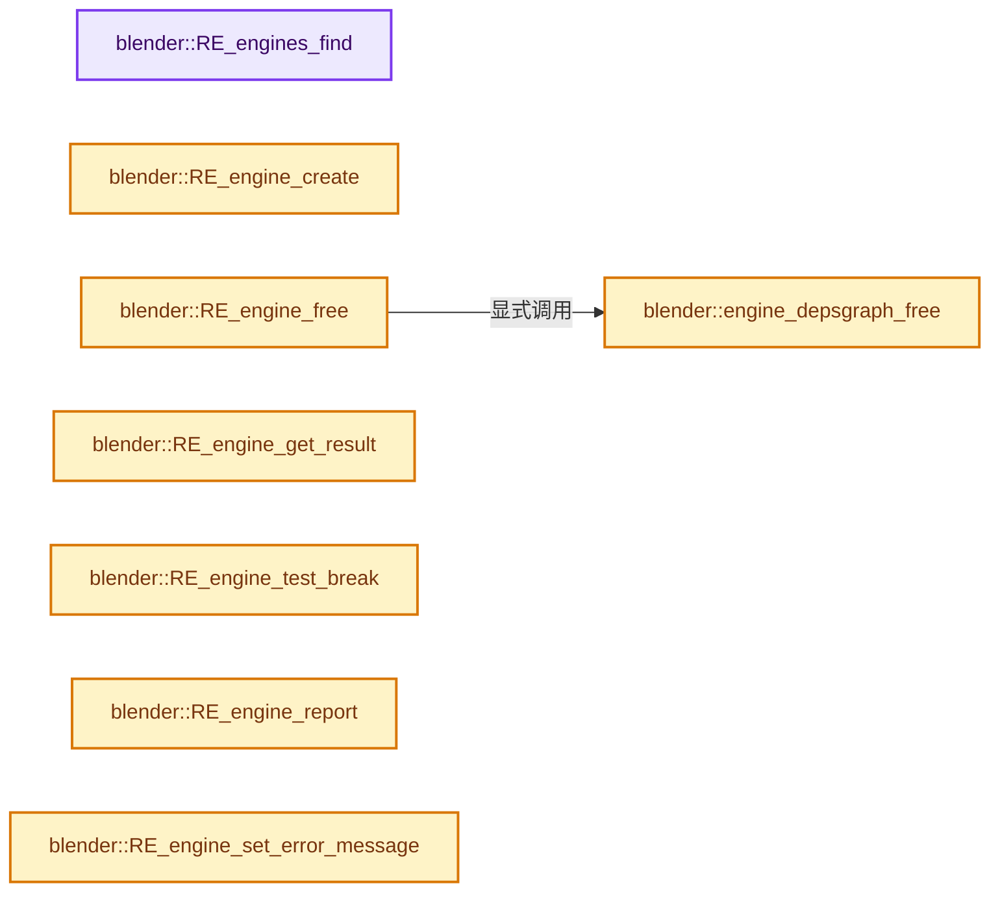
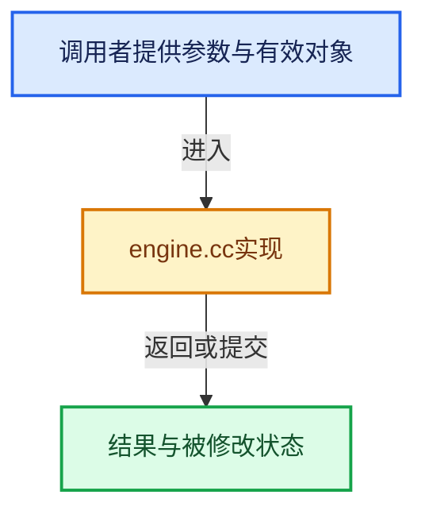

# 实现依赖专题：source/blender/render/intern/engine.cc

[方向导航](README.md) · [符号索引](../%E7%AC%A6%E5%8F%B7%E4%BE%9D%E8%B5%96%E4%B8%8E%E5%AE%9E%E7%8E%B0%E7%B4%A2%E5%BC%95.md)

本专题从正文实际调用进入，集中保存共享实现。函数有稳定锚点，可从调用处直接跳到对应完整函数；递归与互相调用通过回链组织。

## 本文件的实现关系






## 完整成员与函数实现

<a id="f-ac7af80bac61d49c"></a>

### `blender::RE_engines_find`

实现位置：[source/blender/render/intern/engine.cc](../../../../../source/blender/render/intern/engine.cc) · L104—L114。

接口参数：

- `const char *idname`

**教学注释版**

<!-- annotated:1b90b2c5f421c6 -->

```cpp
RenderEngineType *RE_engines_find(const char *idname)
{
  RenderEngineType *type = static_cast<RenderEngineType *>(
      BLI_findstring(&R_engines, idname, offsetof(RenderEngineType, idname)));
  if (!type) {
    type = static_cast<RenderEngineType *>(
        BLI_findstring(&R_engines, "BLENDER_EEVEE", offsetof(RenderEngineType, idname)));
  }

  return type;
}
```

<details>
<summary>核对原始源码：source/blender/render/intern/engine.cc · L104—L114</summary>

<!-- original:1b90b2c5f421c6:source/blender/render/intern/engine.cc:104:114 -->

```cpp
RenderEngineType *RE_engines_find(const char *idname)
{
  RenderEngineType *type = static_cast<RenderEngineType *>(
      BLI_findstring(&R_engines, idname, offsetof(RenderEngineType, idname)));
  if (!type) {
    type = static_cast<RenderEngineType *>(
        BLI_findstring(&R_engines, "BLENDER_EEVEE", offsetof(RenderEngineType, idname)));
  }

  return type;
}
```

</details>

**沿实际写入检查状态**

- `type = static_cast<RenderEngineType *>(`

**结果出口**

- `return type;`

**继续追踪实现**

- `BLI_findstring` → [blender::BLI_findstring · L615](../01-%E5%9F%BA%E7%A1%80%E5%AE%B9%E5%99%A8%E4%B8%8E%E7%8E%B0%E4%BB%A3CPP/%E4%BE%9D%E8%B5%96-listbase-2816d9.md#f-d913b13b2651348e)。

<a id="f-fc6b7abeddeaef72"></a>

### `blender::RE_engine_create`

实现位置：[source/blender/render/intern/engine.cc](../../../../../source/blender/render/intern/engine.cc) · L128—L137。

接口参数：

- `RenderEngineType *type`

**教学注释版**

<!-- annotated:d57d119c292809 -->

```cpp
RenderEngine *RE_engine_create(RenderEngineType *type)
{
  RenderEngine *engine = MEM_new_zeroed<RenderEngine>("RenderEngine");
  engine->type = type;

  BLI_mutex_init(&engine->update_render_passes_mutex);
  BLI_mutex_init(&engine->blender_gpu_context_mutex);

  return engine;
}
```

<details>
<summary>核对原始源码：source/blender/render/intern/engine.cc · L128—L137</summary>

<!-- original:d57d119c292809:source/blender/render/intern/engine.cc:128:137 -->

```cpp
RenderEngine *RE_engine_create(RenderEngineType *type)
{
  RenderEngine *engine = MEM_new_zeroed<RenderEngine>("RenderEngine");
  engine->type = type;

  BLI_mutex_init(&engine->update_render_passes_mutex);
  BLI_mutex_init(&engine->blender_gpu_context_mutex);

  return engine;
}
```

</details>

**沿实际写入检查状态**

- `engine->type = type;`

**结果出口**

- `return engine;`

**继续追踪实现**

- `MEM_new_zeroed<RenderEngine>` → [MEM_new_zeroed · L550](../03-%E5%86%85%E5%AD%98%E5%88%86%E9%85%8D%E4%B8%8E%E8%BF%90%E8%A1%8C%E6%97%B6%E7%B1%BB%E5%9E%8B/%E4%BE%9D%E8%B5%96-MEM_guardedalloc-b54eca.md#f-eeb1e2a7f57dd231)；[MEM_new_zeroed · L114](../03-%E5%86%85%E5%AD%98%E5%88%86%E9%85%8D%E4%B8%8E%E8%BF%90%E8%A1%8C%E6%97%B6%E7%B1%BB%E5%9E%8B/%E4%BE%9D%E8%B5%96-mallocn-afdcd4.md#f-e04cf01c64c8b180)。同名重载需按实参类型选择。
- `BLI_mutex_init` → [BLI_mutex_init · L343](../01-%E5%9F%BA%E7%A1%80%E5%AE%B9%E5%99%A8%E4%B8%8E%E7%8E%B0%E4%BB%A3CPP/%E4%BE%9D%E8%B5%96-threads-a036bf.md#f-7d065be18920fb3a)。

<a id="f-deb51be0f72a6b77"></a>

### `blender::engine_depsgraph_free`

实现位置：[source/blender/render/intern/engine.cc](../../../../../source/blender/render/intern/engine.cc) · L139—L168。

接口参数：

- `RenderEngine *engine`

**教学注释版**

<!-- annotated:561758027c0af3 -->

```cpp
static void engine_depsgraph_free(RenderEngine *engine)
{
  if (engine->depsgraph) {
    /* Need GPU context since this might free GPU buffers. */
    const bool use_gpu_context = (engine->type->flag & RE_USE_GPU_CONTEXT);
    if (use_gpu_context) {
      /* This function can be called on the main thread before RenderEngine is destroyed.
       * In this case, just bind the main draw context to gather the deleted GPU buffers.
       * Binding the same GPU context as the render engine is not needed (see #129019). */
      if (BLI_thread_is_main()) {
        DRW_gpu_context_enable();
      }
      else {
        DRW_render_context_enable(engine->re);
      }
    }

    DEG_graph_free(engine->depsgraph);
    engine->depsgraph = nullptr;

    if (use_gpu_context) {
      if (BLI_thread_is_main()) {
        DRW_gpu_context_disable();
      }
      else {
        DRW_render_context_disable(engine->re);
      }
    }
  }
}
```

<details>
<summary>核对原始源码：source/blender/render/intern/engine.cc · L139—L168</summary>

<!-- original:561758027c0af3:source/blender/render/intern/engine.cc:139:168 -->

```cpp
static void engine_depsgraph_free(RenderEngine *engine)
{
  if (engine->depsgraph) {
    /* Need GPU context since this might free GPU buffers. */
    const bool use_gpu_context = (engine->type->flag & RE_USE_GPU_CONTEXT);
    if (use_gpu_context) {
      /* This function can be called on the main thread before RenderEngine is destroyed.
       * In this case, just bind the main draw context to gather the deleted GPU buffers.
       * Binding the same GPU context as the render engine is not needed (see #129019). */
      if (BLI_thread_is_main()) {
        DRW_gpu_context_enable();
      }
      else {
        DRW_render_context_enable(engine->re);
      }
    }

    DEG_graph_free(engine->depsgraph);
    engine->depsgraph = nullptr;

    if (use_gpu_context) {
      if (BLI_thread_is_main()) {
        DRW_gpu_context_disable();
      }
      else {
        DRW_render_context_disable(engine->re);
      }
    }
  }
}
```

</details>

**沿实际写入检查状态**

- `engine->depsgraph = nullptr;`

**继续追踪实现**

- `BLI_thread_is_main` → [BLI_thread_is_main · L184](../01-%E5%9F%BA%E7%A1%80%E5%AE%B9%E5%99%A8%E4%B8%8E%E7%8E%B0%E4%BB%A3CPP/%E4%BE%9D%E8%B5%96-threads-a036bf.md#f-da304af4327defdc)。
- `DRW_gpu_context_enable` → [blender::DRW_gpu_context_enable · L230](%E4%BE%9D%E8%B5%96-draw_gpu_context-25fcfe.md#f-25fa543faf476757)。
- `DRW_render_context_enable` → [blender::DRW_render_context_enable · L288](%E4%BE%9D%E8%B5%96-draw_gpu_context-25fcfe.md#f-ebed564046dfa3c8)。
- `DEG_graph_free` → [blender::DEG_graph_free · L307](../11-Depsgraph%E4%B8%8E%E5%B9%B6%E8%A1%8C%E4%BB%BB%E5%8A%A1%E7%B3%BB%E7%BB%9F/%E4%BE%9D%E8%B5%96-depsgraph-177fcb.md#f-85cbdc7eccf6ba7e)。
- `DRW_gpu_context_disable` → [blender::DRW_gpu_context_disable · L254](%E4%BE%9D%E8%B5%96-draw_gpu_context-25fcfe.md#f-f096405c6087d7b7)。
- `DRW_render_context_disable` → [blender::DRW_render_context_disable · L316](%E4%BE%9D%E8%B5%96-draw_gpu_context-25fcfe.md#f-2c9e8be208513be2)。

<a id="f-30325d7527e2b3b7"></a>

### `blender::RE_engine_free`

实现位置：[source/blender/render/intern/engine.cc](../../../../../source/blender/render/intern/engine.cc) · L170—L184。

接口参数：

- `RenderEngine *engine`

**教学注释版**

<!-- annotated:334121b4269162 -->

```cpp
void RE_engine_free(RenderEngine *engine)
{
#ifdef WITH_PYTHON
  if (engine->py_instance) {
    BPY_DECREF_RNA_INVALIDATE(engine->py_instance);
  }
#endif

  engine_depsgraph_free(engine);

  BLI_mutex_end(&engine->blender_gpu_context_mutex);
  BLI_mutex_end(&engine->update_render_passes_mutex);

  MEM_delete(engine);
}
```

<details>
<summary>核对原始源码：source/blender/render/intern/engine.cc · L170—L184</summary>

<!-- original:334121b4269162:source/blender/render/intern/engine.cc:170:184 -->

```cpp
void RE_engine_free(RenderEngine *engine)
{
#ifdef WITH_PYTHON
  if (engine->py_instance) {
    BPY_DECREF_RNA_INVALIDATE(engine->py_instance);
  }
#endif

  engine_depsgraph_free(engine);

  BLI_mutex_end(&engine->blender_gpu_context_mutex);
  BLI_mutex_end(&engine->update_render_passes_mutex);

  MEM_delete(engine);
}
```

</details>

**继续追踪实现**

- `BPY_DECREF_RNA_INVALIDATE` → [blender::BPY_DECREF_RNA_INVALIDATE · L800](%E4%BE%9D%E8%B5%96-bpy_interface-b3b9e6.md#f-91a708534db859b3)。
- `engine_depsgraph_free` → [blender::engine_depsgraph_free · L139](%E4%BE%9D%E8%B5%96-engine-ac0ebe.md#f-deb51be0f72a6b77)。
- `BLI_mutex_end` → [BLI_mutex_end · L363](../01-%E5%9F%BA%E7%A1%80%E5%AE%B9%E5%99%A8%E4%B8%8E%E7%8E%B0%E4%BB%A3CPP/%E4%BE%9D%E8%B5%96-threads-a036bf.md#f-dd8453f55f028ed4)。
- `MEM_delete` → [MEM_delete · L400](../03-%E5%86%85%E5%AD%98%E5%88%86%E9%85%8D%E4%B8%8E%E8%BF%90%E8%A1%8C%E6%97%B6%E7%B1%BB%E5%9E%8B/%E4%BE%9D%E8%B5%96-MEM_guardedalloc-b54eca.md#f-9049ffdd1682887c)。

<a id="f-504ce675daf2103d"></a>

### `blender::RE_engine_get_result`

实现位置：[source/blender/render/intern/engine.cc](../../../../../source/blender/render/intern/engine.cc) · L475—L478。

接口参数：

- `RenderEngine *engine`

**教学注释版**

<!-- annotated:3c745d67cb274d -->

```cpp
RenderResult *RE_engine_get_result(RenderEngine *engine)
{
  return engine->re->result;
}
```

<details>
<summary>核对原始源码：source/blender/render/intern/engine.cc · L475—L478</summary>

<!-- original:3c745d67cb274d:source/blender/render/intern/engine.cc:475:478 -->

```cpp
RenderResult *RE_engine_get_result(RenderEngine *engine)
{
  return engine->re->result;
}
```

</details>

**结果出口**

- `return engine->re->result;`

**继续追踪实现**

本实现没有需要继续展开的显式调用；检查返回表达式、对象转换和调用者前置条件。

<a id="f-ed10dd21a5d03708"></a>

### `blender::RE_engine_test_break`

实现位置：[source/blender/render/intern/engine.cc](../../../../../source/blender/render/intern/engine.cc) · L482—L491。

接口参数：

- `RenderEngine *engine`

**教学注释版**

<!-- annotated:948d65e94bb00c -->

```cpp
bool RE_engine_test_break(RenderEngine *engine)
{
  Render *re = engine->re;

  if (re) {
    return re->display->test_break();
  }

  return false;
}
```

<details>
<summary>核对原始源码：source/blender/render/intern/engine.cc · L482—L491</summary>

<!-- original:948d65e94bb00c:source/blender/render/intern/engine.cc:482:491 -->

```cpp
bool RE_engine_test_break(RenderEngine *engine)
{
  Render *re = engine->re;

  if (re) {
    return re->display->test_break();
  }

  return false;
}
```

</details>

**结果出口**

- `return re->display->test_break();`
- `return false;`

**继续追踪实现**

- `re->display->test_break` → [调用协议](../%E6%A8%A1%E6%9D%BF%E5%AE%8F%E4%B8%8E%E5%8A%A8%E6%80%81%E5%88%86%E6%B4%BE%E5%8D%8F%E8%AE%AE.md)：接收对象类型依赖auto、返回值或模板实例；不按同名猜测目标。调用位置L487。

<a id="f-43129d896b6336ff"></a>

### `blender::RE_engine_report`

实现位置：[source/blender/render/intern/engine.cc](../../../../../source/blender/render/intern/engine.cc) · L542—L552。

接口参数：

- `RenderEngine *engine`
- `int type`
- `const char *msg`

**教学注释版**

<!-- annotated:0aa805f01a2f17 -->

```cpp
void RE_engine_report(RenderEngine *engine, int type, const char *msg)
{
  Render *re = engine->re;

  if (re) {
    BKE_report(engine->re->reports, eReportType(type), msg);
  }
  else if (engine->reports) {
    BKE_report(engine->reports, eReportType(type), msg);
  }
}
```

<details>
<summary>核对原始源码：source/blender/render/intern/engine.cc · L542—L552</summary>

<!-- original:0aa805f01a2f17:source/blender/render/intern/engine.cc:542:552 -->

```cpp
void RE_engine_report(RenderEngine *engine, int type, const char *msg)
{
  Render *re = engine->re;

  if (re) {
    BKE_report(engine->re->reports, eReportType(type), msg);
  }
  else if (engine->reports) {
    BKE_report(engine->reports, eReportType(type), msg);
  }
}
```

</details>

**继续追踪实现**

- `BKE_report` → [blender::BKE_report · L162](%E4%BE%9D%E8%B5%96-report-f916fd.md#f-56816f68adfe537b)。
- `eReportType` → [blender::eReportType](%E4%BE%9D%E8%B5%96-BLO_read_write-a54308.md#t-252e2b809ee5)；[blender::eReportType](%E4%BE%9D%E8%B5%96-BKE_report-17e93a.md#t-51cb77cd79a0)；[blender::eReportType](%E4%BE%9D%E8%B5%96-ED_object-eec6ba.md#t-5398020e6f16)。

<a id="f-c4eddc952e8741a1"></a>

### `blender::RE_engine_set_error_message`

实现位置：[source/blender/render/intern/engine.cc](../../../../../source/blender/render/intern/engine.cc) · L554—L567。

接口参数：

- `RenderEngine *engine`
- `const char *msg`

**教学注释版**

<!-- annotated:89ede42556685a -->

```cpp
void RE_engine_set_error_message(RenderEngine *engine, const char *msg)
{
  Render *re = engine->re;
  if (re != nullptr) {
    RenderResult *rr = RE_AcquireResultRead(re);
    if (rr) {
      if (rr->error != nullptr) {
        MEM_delete(rr->error);
      }
      rr->error = BLI_strdup(msg);
    }
    RE_ReleaseResult(re);
  }
}
```

<details>
<summary>核对原始源码：source/blender/render/intern/engine.cc · L554—L567</summary>

<!-- original:89ede42556685a:source/blender/render/intern/engine.cc:554:567 -->

```cpp
void RE_engine_set_error_message(RenderEngine *engine, const char *msg)
{
  Render *re = engine->re;
  if (re != nullptr) {
    RenderResult *rr = RE_AcquireResultRead(re);
    if (rr) {
      if (rr->error != nullptr) {
        MEM_delete(rr->error);
      }
      rr->error = BLI_strdup(msg);
    }
    RE_ReleaseResult(re);
  }
}
```

</details>

**沿实际写入检查状态**

- `rr->error = BLI_strdup(msg);`

**继续追踪实现**

- `RE_AcquireResultRead` → [blender::RE_AcquireResultRead · L315](%E4%BE%9D%E8%B5%96-pipeline-340e5b.md#f-532195deb597de61)。
- `MEM_delete` → [MEM_delete · L400](../03-%E5%86%85%E5%AD%98%E5%88%86%E9%85%8D%E4%B8%8E%E8%BF%90%E8%A1%8C%E6%97%B6%E7%B1%BB%E5%9E%8B/%E4%BE%9D%E8%B5%96-MEM_guardedalloc-b54eca.md#f-9049ffdd1682887c)。
- `BLI_strdup` → [blender::BLI_strdup · L43](../01-%E5%9F%BA%E7%A1%80%E5%AE%B9%E5%99%A8%E4%B8%8E%E7%8E%B0%E4%BB%A3CPP/%E4%BE%9D%E8%B5%96-string-1d986f.md#f-7e6d5c696c20c0e1)。
- `RE_ReleaseResult` → [blender::RE_ReleaseResult · L353](%E4%BE%9D%E8%B5%96-pipeline-340e5b.md#f-0f9ec0b05735f99c)。

<a id="f-eebedcd4be3c87ad"></a>

### `blender::engine_keep_depsgraph`

实现位置：[source/blender/render/intern/engine.cc](../../../../../source/blender/render/intern/engine.cc) · L664—L671。

接口参数：

- `RenderEngine *engine`

**教学注释版**

<!-- annotated:f6360b68a5c160 -->

```cpp
static bool engine_keep_depsgraph(RenderEngine *engine)
{
  /* For persistent data or GPU engines like Eevee, reuse the depsgraph between
   * view layers and animation frames. For renderers like Cycles that create
   * their own copy of the scene, persistent data must be explicitly enabled to
   * keep memory usage low by default. */
  return (engine->re->r.mode & R_PERSISTENT_DATA) || (engine->type->flag & RE_USE_GPU_CONTEXT);
}
```

<details>
<summary>核对原始源码：source/blender/render/intern/engine.cc · L664—L671</summary>

<!-- original:f6360b68a5c160:source/blender/render/intern/engine.cc:664:671 -->

```cpp
static bool engine_keep_depsgraph(RenderEngine *engine)
{
  /* For persistent data or GPU engines like Eevee, reuse the depsgraph between
   * view layers and animation frames. For renderers like Cycles that create
   * their own copy of the scene, persistent data must be explicitly enabled to
   * keep memory usage low by default. */
  return (engine->re->r.mode & R_PERSISTENT_DATA) || (engine->type->flag & RE_USE_GPU_CONTEXT);
}
```

</details>

**结果出口**

- `return (engine->re->r.mode & R_PERSISTENT_DATA) || (engine->type->flag & RE_USE_GPU_CONTEXT);`

**继续追踪实现**

本实现没有需要继续展开的显式调用；检查返回表达式、对象转换和调用者前置条件。

<a id="f-adde97ee4ecdb840"></a>

### `blender::engine_depsgraph_init`

实现位置：[source/blender/render/intern/engine.cc](../../../../../source/blender/render/intern/engine.cc) · L674—L731。

接口参数：

- `RenderEngine *engine`
- `ViewLayer *view_layer`

**教学注释版**

<!-- annotated:18486af7cb6b14 -->

```cpp
static void engine_depsgraph_init(RenderEngine *engine, ViewLayer *view_layer)
{
  Main *bmain = engine->re->main;
  Scene *scene = engine->re->scene;
  bool reuse_depsgraph = false;

  /* Reuse depsgraph from persistent data if possible. */
  if (engine->depsgraph) {
    if (DEG_get_bmain(engine->depsgraph) != bmain ||
        DEG_get_input_scene(engine->depsgraph) != scene)
    {
      /* If bmain or scene changes, we need a completely new graph. */
      engine_depsgraph_free(engine);
    }
    else if (DEG_get_input_view_layer(engine->depsgraph) != view_layer) {
      /* If only view layer changed, reuse depsgraph in the hope of reusing
       * objects shared between view layers. */
      DEG_graph_replace_owners(engine->depsgraph, bmain, scene, view_layer);
      DEG_graph_tag_relations_update(engine->depsgraph);
    }

    reuse_depsgraph = true;
  }

  if (!engine->depsgraph) {
    /* Ensure we only use persistent data for one scene / view layer at a time,
     * to avoid excessive memory usage. */
    RE_FreePersistentData(nullptr);

    /* Create new depsgraph if not cached with persistent data. */
    engine->depsgraph = DEG_graph_new(bmain, scene, view_layer, DAG_EVAL_RENDER);
    DEG_debug_name_set(engine->depsgraph, "RENDER");
  }

  if (engine->re->r.scemode & R_BUTS_PREVIEW) {
    /* Update for preview render. */
    Depsgraph *depsgraph = engine->depsgraph;
    DEG_graph_relations_update(depsgraph);

    /* Need GPU context since this might free GPU buffers. */
    const bool use_gpu_context = (engine->type->flag & RE_USE_GPU_CONTEXT) && reuse_depsgraph;
    if (use_gpu_context) {
      DRW_render_context_enable(engine->re);
    }

    DEG_evaluate_on_framechange(depsgraph, BKE_scene_frame_get(scene));

    if (use_gpu_context) {
      DRW_render_context_disable(engine->re);
    }
  }
  else {
    /* Go through update with full Python callbacks for regular render. */
    BKE_scene_graph_update_for_newframe_ex(engine->depsgraph, false);
  }

  engine->has_grease_pencil = DRW_render_check_grease_pencil(engine->depsgraph);
}
```

<details>
<summary>核对原始源码：source/blender/render/intern/engine.cc · L674—L731</summary>

<!-- original:18486af7cb6b14:source/blender/render/intern/engine.cc:674:731 -->

```cpp
static void engine_depsgraph_init(RenderEngine *engine, ViewLayer *view_layer)
{
  Main *bmain = engine->re->main;
  Scene *scene = engine->re->scene;
  bool reuse_depsgraph = false;

  /* Reuse depsgraph from persistent data if possible. */
  if (engine->depsgraph) {
    if (DEG_get_bmain(engine->depsgraph) != bmain ||
        DEG_get_input_scene(engine->depsgraph) != scene)
    {
      /* If bmain or scene changes, we need a completely new graph. */
      engine_depsgraph_free(engine);
    }
    else if (DEG_get_input_view_layer(engine->depsgraph) != view_layer) {
      /* If only view layer changed, reuse depsgraph in the hope of reusing
       * objects shared between view layers. */
      DEG_graph_replace_owners(engine->depsgraph, bmain, scene, view_layer);
      DEG_graph_tag_relations_update(engine->depsgraph);
    }

    reuse_depsgraph = true;
  }

  if (!engine->depsgraph) {
    /* Ensure we only use persistent data for one scene / view layer at a time,
     * to avoid excessive memory usage. */
    RE_FreePersistentData(nullptr);

    /* Create new depsgraph if not cached with persistent data. */
    engine->depsgraph = DEG_graph_new(bmain, scene, view_layer, DAG_EVAL_RENDER);
    DEG_debug_name_set(engine->depsgraph, "RENDER");
  }

  if (engine->re->r.scemode & R_BUTS_PREVIEW) {
    /* Update for preview render. */
    Depsgraph *depsgraph = engine->depsgraph;
    DEG_graph_relations_update(depsgraph);

    /* Need GPU context since this might free GPU buffers. */
    const bool use_gpu_context = (engine->type->flag & RE_USE_GPU_CONTEXT) && reuse_depsgraph;
    if (use_gpu_context) {
      DRW_render_context_enable(engine->re);
    }

    DEG_evaluate_on_framechange(depsgraph, BKE_scene_frame_get(scene));

    if (use_gpu_context) {
      DRW_render_context_disable(engine->re);
    }
  }
  else {
    /* Go through update with full Python callbacks for regular render. */
    BKE_scene_graph_update_for_newframe_ex(engine->depsgraph, false);
  }

  engine->has_grease_pencil = DRW_render_check_grease_pencil(engine->depsgraph);
}
```

</details>

**沿实际写入检查状态**

- `reuse_depsgraph = true;`
- `engine->depsgraph = DEG_graph_new(bmain, scene, view_layer, DAG_EVAL_RENDER);`
- `engine->has_grease_pencil = DRW_render_check_grease_pencil(engine->depsgraph);`

**继续追踪实现**

- `DEG_get_bmain` → [blender::DEG_get_bmain · L93](../11-Depsgraph%E4%B8%8E%E5%B9%B6%E8%A1%8C%E4%BB%BB%E5%8A%A1%E7%B3%BB%E7%BB%9F/%E4%BE%9D%E8%B5%96-depsgraph_query-e8b1e4.md#f-9dfed3e433db8080)。
- `DEG_get_input_scene` → [blender::DEG_get_input_scene · L81](../11-Depsgraph%E4%B8%8E%E5%B9%B6%E8%A1%8C%E4%BB%BB%E5%8A%A1%E7%B3%BB%E7%BB%9F/%E4%BE%9D%E8%B5%96-depsgraph_query-e8b1e4.md#f-674b6004195dc1ed)。
- `engine_depsgraph_free` → [blender::engine_depsgraph_free · L139](%E4%BE%9D%E8%B5%96-engine-ac0ebe.md#f-deb51be0f72a6b77)。
- `DEG_get_input_view_layer` → [blender::DEG_get_input_view_layer · L87](../11-Depsgraph%E4%B8%8E%E5%B9%B6%E8%A1%8C%E4%BB%BB%E5%8A%A1%E7%B3%BB%E7%BB%9F/%E4%BE%9D%E8%B5%96-depsgraph_query-e8b1e4.md#f-ee9cdeb518197b8c)。
- `DEG_graph_replace_owners` → [blender::DEG_graph_replace_owners · L286](../11-Depsgraph%E4%B8%8E%E5%B9%B6%E8%A1%8C%E4%BB%BB%E5%8A%A1%E7%B3%BB%E7%BB%9F/%E4%BE%9D%E8%B5%96-depsgraph-177fcb.md#f-70c80b22053f4d88)。
- `DEG_graph_tag_relations_update` → [blender::DEG_graph_tag_relations_update · L319](../11-Depsgraph%E4%B8%8E%E5%B9%B6%E8%A1%8C%E4%BB%BB%E5%8A%A1%E7%B3%BB%E7%BB%9F/%E4%BE%9D%E8%B5%96-depsgraph_build-ea2fc8.md#f-144b78d3b38e52e0)。
- `RE_FreePersistentData` → [blender::RE_FreePersistentData · L720](%E4%BE%9D%E8%B5%96-pipeline-340e5b.md#f-744be12b767fcedf)。
- `DEG_graph_new` → [blender::DEG_graph_new · L279](../11-Depsgraph%E4%B8%8E%E5%B9%B6%E8%A1%8C%E4%BB%BB%E5%8A%A1%E7%B3%BB%E7%BB%9F/%E4%BE%9D%E8%B5%96-depsgraph-177fcb.md#f-11a9e5374e07d3c0)。
- `DEG_debug_name_set` → [blender::DEG_debug_name_set · L43](../11-Depsgraph%E4%B8%8E%E5%B9%B6%E8%A1%8C%E4%BB%BB%E5%8A%A1%E7%B3%BB%E7%BB%9F/%E4%BE%9D%E8%B5%96-depsgraph_debug-f95ade.md#f-3282e7f60ed22e0a)。
- `DEG_graph_relations_update` → [blender::DEG_graph_relations_update · L340](../11-Depsgraph%E4%B8%8E%E5%B9%B6%E8%A1%8C%E4%BB%BB%E5%8A%A1%E7%B3%BB%E7%BB%9F/%E4%BE%9D%E8%B5%96-depsgraph_build-ea2fc8.md#f-69595312f2edad41)。
- `DRW_render_context_enable` → [blender::DRW_render_context_enable · L288](%E4%BE%9D%E8%B5%96-draw_gpu_context-25fcfe.md#f-ebed564046dfa3c8)。
- `DEG_evaluate_on_framechange` → [blender::DEG_evaluate_on_framechange · L79](../11-Depsgraph%E4%B8%8E%E5%B9%B6%E8%A1%8C%E4%BB%BB%E5%8A%A1%E7%B3%BB%E7%BB%9F/%E4%BE%9D%E8%B5%96-depsgraph_eval-a90044.md#f-76a97d2b0968d4a2)。
- `BKE_scene_frame_get` → [blender::BKE_scene_frame_get · L2605](%E4%BE%9D%E8%B5%96-scene-94f43c.md#f-f5a9b57ad7195b79)。
- `DRW_render_context_disable` → [blender::DRW_render_context_disable · L316](%E4%BE%9D%E8%B5%96-draw_gpu_context-25fcfe.md#f-2c9e8be208513be2)。
- `BKE_scene_graph_update_for_newframe_ex` → [blender::BKE_scene_graph_update_for_newframe_ex · L2887](%E4%BE%9D%E8%B5%96-scene-94f43c.md#f-4973f4c9c3929166)。
- `DRW_render_check_grease_pencil` → [blender::DRW_render_check_grease_pencil · L1996](%E4%BE%9D%E8%B5%96-draw_context-58a534.md#f-a2addf7c19e4def7)。

<a id="f-33153bee332af210"></a>

### `blender::engine_depsgraph_exit`

实现位置：[source/blender/render/intern/engine.cc](../../../../../source/blender/render/intern/engine.cc) · L733—L746。

接口参数：

- `RenderEngine *engine`

**教学注释版**

<!-- annotated:06ddf7424f1a04 -->

```cpp
static void engine_depsgraph_exit(RenderEngine *engine)
{
  if (engine->depsgraph) {
    if (engine_keep_depsgraph(engine)) {
      /* Clear recalc flags since the engine should have handled the updates for the currently
       * rendered framed by now. */
      DEG_ids_clear_recalc(engine->depsgraph, false);
    }
    else {
      /* Free immediately to save memory. */
      engine_depsgraph_free(engine);
    }
  }
}
```

<details>
<summary>核对原始源码：source/blender/render/intern/engine.cc · L733—L746</summary>

<!-- original:06ddf7424f1a04:source/blender/render/intern/engine.cc:733:746 -->

```cpp
static void engine_depsgraph_exit(RenderEngine *engine)
{
  if (engine->depsgraph) {
    if (engine_keep_depsgraph(engine)) {
      /* Clear recalc flags since the engine should have handled the updates for the currently
       * rendered framed by now. */
      DEG_ids_clear_recalc(engine->depsgraph, false);
    }
    else {
      /* Free immediately to save memory. */
      engine_depsgraph_free(engine);
    }
  }
}
```

</details>

**继续追踪实现**

- `engine_keep_depsgraph` → [blender::engine_keep_depsgraph · L664](%E4%BE%9D%E8%B5%96-engine-ac0ebe.md#f-eebedcd4be3c87ad)。
- `DEG_ids_clear_recalc` → [blender::DEG_ids_clear_recalc · L959](../11-Depsgraph%E4%B8%8E%E5%B9%B6%E8%A1%8C%E4%BB%BB%E5%8A%A1%E7%B3%BB%E7%BB%9F/%E4%BE%9D%E8%B5%96-depsgraph_tag-d8b3c7.md#f-cbdf7f439484ba56)。
- `engine_depsgraph_free` → [blender::engine_depsgraph_free · L139](%E4%BE%9D%E8%B5%96-engine-ac0ebe.md#f-deb51be0f72a6b77)。

<a id="f-445315afa7e977f3"></a>

### `blender::RE_engine_frame_set`

实现位置：[source/blender/render/intern/engine.cc](../../../../../source/blender/render/intern/engine.cc) · L748—L765。

接口参数：

- `RenderEngine *engine`
- `int frame`
- `float subframe`

**教学注释版**

<!-- annotated:aa769f5aae101d -->

```cpp
void RE_engine_frame_set(RenderEngine *engine, int frame, float subframe)
{
  if (!engine->depsgraph) {
    return;
  }

  /* Clear recalc flags before update so engine can detect what changed. */
  DEG_ids_clear_recalc(engine->depsgraph, false);

  Render *re = engine->re;
  double cfra = double(frame) + double(subframe);

  CLAMP(cfra, MINAFRAME, MAXFRAME);
  BKE_scene_frame_set(re->scene, cfra);
  BKE_scene_graph_update_for_newframe_ex(engine->depsgraph, false);

  BKE_scene_camera_switch_update(re->scene);
}
```

<details>
<summary>核对原始源码：source/blender/render/intern/engine.cc · L748—L765</summary>

<!-- original:aa769f5aae101d:source/blender/render/intern/engine.cc:748:765 -->

```cpp
void RE_engine_frame_set(RenderEngine *engine, int frame, float subframe)
{
  if (!engine->depsgraph) {
    return;
  }

  /* Clear recalc flags before update so engine can detect what changed. */
  DEG_ids_clear_recalc(engine->depsgraph, false);

  Render *re = engine->re;
  double cfra = double(frame) + double(subframe);

  CLAMP(cfra, MINAFRAME, MAXFRAME);
  BKE_scene_frame_set(re->scene, cfra);
  BKE_scene_graph_update_for_newframe_ex(engine->depsgraph, false);

  BKE_scene_camera_switch_update(re->scene);
}
```

</details>

**继续追踪实现**

- `DEG_ids_clear_recalc` → [blender::DEG_ids_clear_recalc · L959](../11-Depsgraph%E4%B8%8E%E5%B9%B6%E8%A1%8C%E4%BB%BB%E5%8A%A1%E7%B3%BB%E7%BB%9F/%E4%BE%9D%E8%B5%96-depsgraph_tag-d8b3c7.md#f-cbdf7f439484ba56)。
- `CLAMP` → [CLAMP · L200](../01-%E5%9F%BA%E7%A1%80%E5%AE%B9%E5%99%A8%E4%B8%8E%E7%8E%B0%E4%BB%A3CPP/%E4%BE%9D%E8%B5%96-BLI_utildefines-293a0a.md#m-69703e497120)。宏定义由构建条件选择。
- `BKE_scene_frame_set` → [blender::BKE_scene_frame_set · L2610](%E4%BE%9D%E8%B5%96-scene-94f43c.md#f-6be529b23561f739)。
- `BKE_scene_graph_update_for_newframe_ex` → [blender::BKE_scene_graph_update_for_newframe_ex · L2887](%E4%BE%9D%E8%B5%96-scene-94f43c.md#f-4973f4c9c3929166)。
- `BKE_scene_camera_switch_update` → [blender::BKE_scene_camera_switch_update · L2490](%E4%BE%9D%E8%B5%96-scene-94f43c.md#f-09fb19d0fe6111bf)。

<a id="f-e58780b75f55f53c"></a>

### `blender::possibly_using_gpu_compositor`

实现位置：[source/blender/render/intern/engine.cc](../../../../../source/blender/render/intern/engine.cc) · L860—L874。

接口参数：

- `const Render *re`

**教学注释版**

<!-- annotated:33f67a9cca4730 -->

```cpp
static bool possibly_using_gpu_compositor(const Render *re)
{
  if (re->r.compositor_device != SCE_COMPOSITOR_DEVICE_GPU) {
    return false;
  }

  /* Note a secondary Render instance from a Render Layers node has a null pipeline scene,
   * but no compositing is performed for it so we can return false. */
  const Scene *scene = re->pipeline_scene_eval;
  if (!scene) {
    return false;
  }

  return bke::compositor::is_enabled(*scene, bke::compositor::ExecutionMode::Render);
}
```

<details>
<summary>核对原始源码：source/blender/render/intern/engine.cc · L860—L874</summary>

<!-- original:33f67a9cca4730:source/blender/render/intern/engine.cc:860:874 -->

```cpp
static bool possibly_using_gpu_compositor(const Render *re)
{
  if (re->r.compositor_device != SCE_COMPOSITOR_DEVICE_GPU) {
    return false;
  }

  /* Note a secondary Render instance from a Render Layers node has a null pipeline scene,
   * but no compositing is performed for it so we can return false. */
  const Scene *scene = re->pipeline_scene_eval;
  if (!scene) {
    return false;
  }

  return bke::compositor::is_enabled(*scene, bke::compositor::ExecutionMode::Render);
}
```

</details>

**结果出口**

- `return false;`
- `return bke::compositor::is_enabled(*scene, bke::compositor::ExecutionMode::Render);`

**继续追踪实现**

- `bke::compositor::is_enabled` → [blender::bke::compositor::is_enabled · L185](%E4%BE%9D%E8%B5%96-compositor-ce5aa3.md#f-819c7d4837fda4bd)。

<a id="f-e6ef348078766b84"></a>

### `blender::engine_render_view_layer`

实现位置：[source/blender/render/intern/engine.cc](../../../../../source/blender/render/intern/engine.cc) · L876—L971。

接口参数：

- `Render *re`
- `RenderEngine *engine`
- `ViewLayer *view_layer_iter`
- `const bool use_engine`
- `const bool use_grease_pencil`

**教学注释版**

<!-- annotated:6d2325473850a2 -->

```cpp
static void engine_render_view_layer(Render *re,
                                     RenderEngine *engine,
                                     ViewLayer *view_layer_iter,
                                     const bool use_engine,
                                     const bool use_grease_pencil)
{
  /* Lock UI so scene can't be edited while we read from it in this render thread. */
  re->display->draw_lock();

  /* Create depsgraph with scene evaluated at render resolution. */
  ViewLayer *view_layer = static_cast<ViewLayer *>(
      BLI_findstring(&re->scene->view_layers, view_layer_iter->name, offsetof(ViewLayer, name)));
  if (!re->prepare_viewlayer(view_layer, engine->depsgraph)) {
    re->display->draw_unlock();
    return;
  }
  engine_depsgraph_init(engine, view_layer);

  /* Sync data to engine, within draw lock so scene data can be accessed safely. */
  if (use_engine) {
    const bool use_gpu_context = (engine->type->flag & RE_USE_GPU_CONTEXT);
    if (use_gpu_context) {
      DRW_render_context_enable(engine->re);
    }
    else if (G.background && ((engine->has_grease_pencil && use_grease_pencil) ||
                              possibly_using_gpu_compositor(re)))
    {
      /* Workaround for specific NVidia drivers which crash on Linux when OptiX context is
       * initialized prior to OpenGL context. This affects driver versions 545.29.06, 550.54.14,
       * and 550.67 running on kernel 6.8.
       *
       * The idea here is to initialize GPU context before giving control to the render engine in
       * cases when we know that the GPU context will definitely be needed later on.
       *
       * Only do it for background renders to avoid possible extra global locking during the
       * context initialization. For the non-background renders the GPU context is already
       * initialized for the Blender interface and no workaround is needed.
       *
       * Technically it is enough to only call WM_init_gpu_offscreen() here, but it expects
       * to only be called once, and from here it is not possible to know whether GPU
       * sub-system is initialized or not. So instead temporarily enable the render context,
       * which will take care of the GPU context initialization.
       *
       * For demo file and tracking progress of possible fixes on driver side refer to #120007. */
      DRW_render_context_enable(engine->re);
      DRW_render_context_disable(engine->re);
    }

    if (engine->type->update) {
      engine->type->update(engine, re->main, engine->depsgraph);
    }
    if (use_gpu_context) {
      DRW_render_context_disable(engine->re);
    }
  }

  re->display->draw_unlock();

  /* Perform render with engine. */
  if (use_engine) {
    const bool use_gpu_context = (engine->type->flag & RE_USE_GPU_CONTEXT);
    if (use_gpu_context) {
      DRW_render_context_enable(engine->re);
    }

    BLI_mutex_lock(&engine->re->engine_draw_mutex);
    re->engine->flag |= RE_ENGINE_CAN_DRAW;
    BLI_mutex_unlock(&engine->re->engine_draw_mutex);

    engine->type->render(engine, engine->depsgraph);

    BLI_mutex_lock(&engine->re->engine_draw_mutex);
    re->engine->flag &= ~RE_ENGINE_CAN_DRAW;
    BLI_mutex_unlock(&engine->re->engine_draw_mutex);

    if (use_gpu_context) {
      DRW_render_context_disable(engine->re);
    }
  }

  /* Optionally composite grease pencil over render result.
   * Only do it if the passes are allocated (and the engine will not override the grease pencil
   * when reading its result from EXR file and writing to the Blender side). */
  if (engine->has_grease_pencil && use_grease_pencil && re->result->passes_allocated) {
    /* NOTE: External engine might have been requested to free its
     * dependency graph, which is only allowed if there is no grease
     * pencil (pipeline is taking care of that). */
    if (!RE_engine_test_break(engine) && engine->depsgraph != nullptr) {
      CLOG_INFO(&LOG, "Rendering grease pencil");
      DRW_render_gpencil(engine, engine->depsgraph);
    }
  }

  /* Free dependency graph, if engine has not done it already. */
  engine_depsgraph_exit(engine);
}
```

<details>
<summary>核对原始源码：source/blender/render/intern/engine.cc · L876—L971</summary>

<!-- original:6d2325473850a2:source/blender/render/intern/engine.cc:876:971 -->

```cpp
static void engine_render_view_layer(Render *re,
                                     RenderEngine *engine,
                                     ViewLayer *view_layer_iter,
                                     const bool use_engine,
                                     const bool use_grease_pencil)
{
  /* Lock UI so scene can't be edited while we read from it in this render thread. */
  re->display->draw_lock();

  /* Create depsgraph with scene evaluated at render resolution. */
  ViewLayer *view_layer = static_cast<ViewLayer *>(
      BLI_findstring(&re->scene->view_layers, view_layer_iter->name, offsetof(ViewLayer, name)));
  if (!re->prepare_viewlayer(view_layer, engine->depsgraph)) {
    re->display->draw_unlock();
    return;
  }
  engine_depsgraph_init(engine, view_layer);

  /* Sync data to engine, within draw lock so scene data can be accessed safely. */
  if (use_engine) {
    const bool use_gpu_context = (engine->type->flag & RE_USE_GPU_CONTEXT);
    if (use_gpu_context) {
      DRW_render_context_enable(engine->re);
    }
    else if (G.background && ((engine->has_grease_pencil && use_grease_pencil) ||
                              possibly_using_gpu_compositor(re)))
    {
      /* Workaround for specific NVidia drivers which crash on Linux when OptiX context is
       * initialized prior to OpenGL context. This affects driver versions 545.29.06, 550.54.14,
       * and 550.67 running on kernel 6.8.
       *
       * The idea here is to initialize GPU context before giving control to the render engine in
       * cases when we know that the GPU context will definitely be needed later on.
       *
       * Only do it for background renders to avoid possible extra global locking during the
       * context initialization. For the non-background renders the GPU context is already
       * initialized for the Blender interface and no workaround is needed.
       *
       * Technically it is enough to only call WM_init_gpu_offscreen() here, but it expects
       * to only be called once, and from here it is not possible to know whether GPU
       * sub-system is initialized or not. So instead temporarily enable the render context,
       * which will take care of the GPU context initialization.
       *
       * For demo file and tracking progress of possible fixes on driver side refer to #120007. */
      DRW_render_context_enable(engine->re);
      DRW_render_context_disable(engine->re);
    }

    if (engine->type->update) {
      engine->type->update(engine, re->main, engine->depsgraph);
    }
    if (use_gpu_context) {
      DRW_render_context_disable(engine->re);
    }
  }

  re->display->draw_unlock();

  /* Perform render with engine. */
  if (use_engine) {
    const bool use_gpu_context = (engine->type->flag & RE_USE_GPU_CONTEXT);
    if (use_gpu_context) {
      DRW_render_context_enable(engine->re);
    }

    BLI_mutex_lock(&engine->re->engine_draw_mutex);
    re->engine->flag |= RE_ENGINE_CAN_DRAW;
    BLI_mutex_unlock(&engine->re->engine_draw_mutex);

    engine->type->render(engine, engine->depsgraph);

    BLI_mutex_lock(&engine->re->engine_draw_mutex);
    re->engine->flag &= ~RE_ENGINE_CAN_DRAW;
    BLI_mutex_unlock(&engine->re->engine_draw_mutex);

    if (use_gpu_context) {
      DRW_render_context_disable(engine->re);
    }
  }

  /* Optionally composite grease pencil over render result.
   * Only do it if the passes are allocated (and the engine will not override the grease pencil
   * when reading its result from EXR file and writing to the Blender side). */
  if (engine->has_grease_pencil && use_grease_pencil && re->result->passes_allocated) {
    /* NOTE: External engine might have been requested to free its
     * dependency graph, which is only allowed if there is no grease
     * pencil (pipeline is taking care of that). */
    if (!RE_engine_test_break(engine) && engine->depsgraph != nullptr) {
      CLOG_INFO(&LOG, "Rendering grease pencil");
      DRW_render_gpencil(engine, engine->depsgraph);
    }
  }

  /* Free dependency graph, if engine has not done it already. */
  engine_depsgraph_exit(engine);
}
```

</details>

**沿实际写入检查状态**

- `re->engine->flag |= RE_ENGINE_CAN_DRAW;`
- `re->engine->flag &= ~RE_ENGINE_CAN_DRAW;`

**继续追踪实现**

- `re->display->draw_lock` → [调用协议](../%E6%A8%A1%E6%9D%BF%E5%AE%8F%E4%B8%8E%E5%8A%A8%E6%80%81%E5%88%86%E6%B4%BE%E5%8D%8F%E8%AE%AE.md)：接收对象类型依赖auto、返回值或模板实例；不按同名猜测目标。调用位置L883。
- `BLI_findstring` → [blender::BLI_findstring · L615](../01-%E5%9F%BA%E7%A1%80%E5%AE%B9%E5%99%A8%E4%B8%8E%E7%8E%B0%E4%BB%A3CPP/%E4%BE%9D%E8%B5%96-listbase-2816d9.md#f-d913b13b2651348e)。
- `re->prepare_viewlayer` → [blender::Render::prepare_viewlayer · L61](%E4%BE%9D%E8%B5%96-render_types-a51bdc.md#f-601eb7268c79ab15)。
- `re->display->draw_unlock` → [调用协议](../%E6%A8%A1%E6%9D%BF%E5%AE%8F%E4%B8%8E%E5%8A%A8%E6%80%81%E5%88%86%E6%B4%BE%E5%8D%8F%E8%AE%AE.md)：接收对象类型依赖auto、返回值或模板实例；不按同名猜测目标。调用位置L889。
- `engine_depsgraph_init` → [blender::engine_depsgraph_init · L674](%E4%BE%9D%E8%B5%96-engine-ac0ebe.md#f-adde97ee4ecdb840)。
- `DRW_render_context_enable` → [blender::DRW_render_context_enable · L288](%E4%BE%9D%E8%B5%96-draw_gpu_context-25fcfe.md#f-ebed564046dfa3c8)。
- `possibly_using_gpu_compositor` → [blender::possibly_using_gpu_compositor · L860](%E4%BE%9D%E8%B5%96-engine-ac0ebe.md#f-e58780b75f55f53c)。
- `DRW_render_context_disable` → [blender::DRW_render_context_disable · L316](%E4%BE%9D%E8%B5%96-draw_gpu_context-25fcfe.md#f-2c9e8be208513be2)。
- `engine->type->update` → [调用协议](../%E6%A8%A1%E6%9D%BF%E5%AE%8F%E4%B8%8E%E5%8A%A8%E6%80%81%E5%88%86%E6%B4%BE%E5%8D%8F%E8%AE%AE.md)：接收对象类型依赖auto、返回值或模板实例；不按同名猜测目标。调用位置L925。
- `BLI_mutex_lock` → [BLI_mutex_lock · L348](../01-%E5%9F%BA%E7%A1%80%E5%AE%B9%E5%99%A8%E4%B8%8E%E7%8E%B0%E4%BB%A3CPP/%E4%BE%9D%E8%B5%96-threads-a036bf.md#f-825ea5a7ea897c32)。
- `BLI_mutex_unlock` → [BLI_mutex_unlock · L353](../01-%E5%9F%BA%E7%A1%80%E5%AE%B9%E5%99%A8%E4%B8%8E%E7%8E%B0%E4%BB%A3CPP/%E4%BE%9D%E8%B5%96-threads-a036bf.md#f-e8638af1addfc8a4)。
- `engine->type->render` → [调用协议](../%E6%A8%A1%E6%9D%BF%E5%AE%8F%E4%B8%8E%E5%8A%A8%E6%80%81%E5%88%86%E6%B4%BE%E5%8D%8F%E8%AE%AE.md)：接收对象类型依赖auto、返回值或模板实例；不按同名猜测目标。调用位置L945。
- `RE_engine_test_break` → [blender::RE_engine_test_break · L482](%E4%BE%9D%E8%B5%96-engine-ac0ebe.md#f-ed10dd21a5d03708)。
- `CLOG_INFO` → [CLOG_INFO · L190](%E4%BE%9D%E8%B5%96-CLG_log-e9051b.md#m-f8b5efdfcc0f)。宏定义由构建条件选择。
- `DRW_render_gpencil` → [blender::DRW_render_gpencil · L2009](%E4%BE%9D%E8%B5%96-draw_context-58a534.md#f-66db3edd56647eb2)。
- `engine_depsgraph_exit` → [blender::engine_depsgraph_exit · L733](%E4%BE%9D%E8%B5%96-engine-ac0ebe.md#f-33153bee332af210)。

<a id="f-508b26044f40d307"></a>

### `blender::engine_render_create_result`

实现位置：[source/blender/render/intern/engine.cc](../../../../../source/blender/render/intern/engine.cc) · L986—L1005。

接口参数：

- `Render *re`

**教学注释版**

<!-- annotated:31af0eea6104d5 -->

```cpp
static RenderResult *engine_render_create_result(Render *re)
{
  RenderResult *rr = render_result_new(re, &re->disprect, RR_ALL_LAYERS, RR_ALL_VIEWS);
  if (rr == nullptr) {
    return nullptr;
  }

  FOREACH_VIEW_LAYER_TO_RENDER_BEGIN (re, view_layer) {
    RE_engine_update_render_passes(
        re->engine, re->scene, view_layer, engine_render_add_result_pass_cb, rr);
  }
  FOREACH_VIEW_LAYER_TO_RENDER_END;

  /* Preview does not support deferred render result allocation. */
  if (re->r.scemode & R_BUTS_PREVIEW) {
    render_result_passes_allocated_ensure(rr);
  }

  return rr;
}
```

<details>
<summary>核对原始源码：source/blender/render/intern/engine.cc · L986—L1005</summary>

<!-- original:31af0eea6104d5:source/blender/render/intern/engine.cc:986:1005 -->

```cpp
static RenderResult *engine_render_create_result(Render *re)
{
  RenderResult *rr = render_result_new(re, &re->disprect, RR_ALL_LAYERS, RR_ALL_VIEWS);
  if (rr == nullptr) {
    return nullptr;
  }

  FOREACH_VIEW_LAYER_TO_RENDER_BEGIN (re, view_layer) {
    RE_engine_update_render_passes(
        re->engine, re->scene, view_layer, engine_render_add_result_pass_cb, rr);
  }
  FOREACH_VIEW_LAYER_TO_RENDER_END;

  /* Preview does not support deferred render result allocation. */
  if (re->r.scemode & R_BUTS_PREVIEW) {
    render_result_passes_allocated_ensure(rr);
  }

  return rr;
}
```

</details>

**结果出口**

- `return nullptr;`
- `return rr;`

**继续追踪实现**

- `render_result_new` → [blender::render_result_new · L254](%E4%BE%9D%E8%B5%96-render_result-8cc813.md#f-6da1e26f5058a8a4)。
- `RE_engine_update_render_passes` → [blender::RE_engine_update_render_passes · L1175](%E4%BE%9D%E8%B5%96-engine-ac0ebe.md#f-e051b1dbc6f00b2a)。
- `render_result_passes_allocated_ensure` → [blender::render_result_passes_allocated_ensure · L351](%E4%BE%9D%E8%B5%96-render_result-8cc813.md#f-930e96366bcc8ebd)。

<a id="f-7ffd0552b66d8d3d"></a>

### `blender::RE_engine_render`

实现位置：[source/blender/render/intern/engine.cc](../../../../../source/blender/render/intern/engine.cc) · L1007—L1173。

接口参数：

- `Render *re`
- `bool do_all`

**教学注释版**

<!-- annotated:e1be86be740bf5 -->

```cpp
bool RE_engine_render(Render *re, bool do_all)
{
  RenderEngineType *type = RE_engines_find(re->r.engine);

  /* verify if we can render */
  if (!type->render) {
    return false;
  }
  if ((re->r.scemode & R_BUTS_PREVIEW) && !(type->flag & RE_USE_PREVIEW)) {
    return false;
  }
  if (do_all && !(type->flag & RE_USE_POSTPROCESS)) {
    return false;
  }
  if (!do_all && (type->flag & RE_USE_POSTPROCESS)) {
    return false;
  }

  /* Lock drawing in UI during data phase. */
  re->display->draw_lock();

  if (type->flag & RE_USE_GPU_CONTEXT) {
    WM_init_gpu_backend();
    if (!GPU_backend_supported()) {
      /* Clear UI drawing locks. */
      re->display->draw_unlock();
      BKE_report(re->reports, RPT_ERROR, "Cannot initialize the GPU");
      G.is_break = true;
      return true;
    }
  }

  /* Create engine. */
  RenderEngine *engine = re->engine;

  if (!engine) {
    engine = RE_engine_create(type);
    re->engine = engine;
  }

  /* Create render result. Do this before acquiring lock, to avoid lock
   * inversion as this calls python to get the render passes, while python UI
   * code can also hold a lock on the render result. */
  const bool create_new_result = (re->result == nullptr || !(re->r.scemode & R_BUTS_PREVIEW));
  RenderResult *new_result = (create_new_result) ? engine_render_create_result(re) : nullptr;

  BLI_rw_mutex_lock(&re->resultmutex, THREAD_LOCK_WRITE);
  if (create_new_result) {
    if (re->result) {
      render_result_free(re->result);
    }

    re->result = new_result;
  }
  BLI_rw_mutex_unlock(&re->resultmutex);

  if (re->result == nullptr) {
    /* Clear UI drawing locks. */
    re->display->draw_unlock();
    /* Free engine. */
    RE_engine_free(engine);
    re->engine = nullptr;
    /* Too small image is handled earlier, here it could only happen if
     * there was no sufficient memory to allocate all passes.
     */
    BKE_report(re->reports, RPT_ERROR, "Failed allocate render result, out of memory");
    G.is_break = true;
    return true;
  }

  /* set render info */
  re->i.cfra = re->scene->r.cfra;
  STRNCPY(re->i.scene_name, re->scene->id.name + 2);

  engine->flag |= RE_ENGINE_RENDERING;

  /* TODO: actually link to a parent which shouldn't happen */
  engine->re = re;

  if (re->flag & R_ANIMATION) {
    engine->flag |= RE_ENGINE_ANIMATION;
  }
  if (re->r.scemode & R_BUTS_PREVIEW) {
    engine->flag |= RE_ENGINE_PREVIEW;
  }
  engine->camera_override = re->camera_override;

  engine->resolution_x = re->winx;
  engine->resolution_y = re->winy;

  /* Clear UI drawing locks. */
  re->display->draw_unlock();

  /* Render view layers. */
  bool delay_grease_pencil = false;

  if (type->render) {
    FOREACH_VIEW_LAYER_TO_RENDER_BEGIN (re, view_layer_iter) {
      CLOG_INFO(&LOG, "Start rendering: %s, %s", re->scene->id.name + 2, view_layer_iter->name);
      CLOG_INFO(&LOG, "Engine: %s", engine->type->name);
      const bool use_grease_pencil = (view_layer_iter->layflag & SCE_LAY_GREASE_PENCIL) != 0;
      engine_render_view_layer(re, engine, view_layer_iter, true, use_grease_pencil);

      /* If render passes are not allocated the render engine deferred final pixels write for
       * later. Need to defer the grease pencil for until after the engine has written the
       * render result to Blender. */
      delay_grease_pencil = use_grease_pencil && engine->has_grease_pencil &&
                            !re->result->passes_allocated;

      if (RE_engine_test_break(engine)) {
        break;
      }
    }
    FOREACH_VIEW_LAYER_TO_RENDER_END;
  }

  if (type->render_frame_finish) {
    type->render_frame_finish(engine);
  }

  /* Perform delayed grease pencil rendering. */
  if (delay_grease_pencil) {
    FOREACH_VIEW_LAYER_TO_RENDER_BEGIN (re, view_layer_iter) {
      const bool use_grease_pencil = (view_layer_iter->layflag & SCE_LAY_GREASE_PENCIL) != 0;
      if (!use_grease_pencil) {
        continue;
      }
      engine_render_view_layer(re, engine, view_layer_iter, false, true);
      if (RE_engine_test_break(engine)) {
        break;
      }
    }
    FOREACH_VIEW_LAYER_TO_RENDER_END;
  }

  /* Clear tile data */
  engine->flag &= ~RE_ENGINE_RENDERING;

  render_result_free_list(&engine->fullresult, engine->fullresult.first());

  /* re->engine becomes zero if user changed active render engine during render */
  if (!engine_keep_depsgraph(engine) || !re->engine) {
    engine_depsgraph_free(engine);

    RE_engine_free(engine);
    re->engine = nullptr;
  }

  if (re->r.scemode & R_EXR_CACHE_FILE) {
    BLI_rw_mutex_lock(&re->resultmutex, THREAD_LOCK_WRITE);
    render_result_exr_file_cache_write(re);
    BLI_rw_mutex_unlock(&re->resultmutex);
  }

  if (BKE_reports_contain(re->reports, RPT_ERROR)) {
    G.is_break = true;
  }

#ifdef WITH_FREESTYLE
  if (re->r.mode & R_EDGE_FRS) {
    CLOG_INFO(&LOG, "Rendering freestyle");
    RE_RenderFreestyleExternal(re);
  }
#endif

  return true;
}
```

<details>
<summary>核对原始源码：source/blender/render/intern/engine.cc · L1007—L1173</summary>

<!-- original:e1be86be740bf5:source/blender/render/intern/engine.cc:1007:1173 -->

```cpp
bool RE_engine_render(Render *re, bool do_all)
{
  RenderEngineType *type = RE_engines_find(re->r.engine);

  /* verify if we can render */
  if (!type->render) {
    return false;
  }
  if ((re->r.scemode & R_BUTS_PREVIEW) && !(type->flag & RE_USE_PREVIEW)) {
    return false;
  }
  if (do_all && !(type->flag & RE_USE_POSTPROCESS)) {
    return false;
  }
  if (!do_all && (type->flag & RE_USE_POSTPROCESS)) {
    return false;
  }

  /* Lock drawing in UI during data phase. */
  re->display->draw_lock();

  if (type->flag & RE_USE_GPU_CONTEXT) {
    WM_init_gpu_backend();
    if (!GPU_backend_supported()) {
      /* Clear UI drawing locks. */
      re->display->draw_unlock();
      BKE_report(re->reports, RPT_ERROR, "Cannot initialize the GPU");
      G.is_break = true;
      return true;
    }
  }

  /* Create engine. */
  RenderEngine *engine = re->engine;

  if (!engine) {
    engine = RE_engine_create(type);
    re->engine = engine;
  }

  /* Create render result. Do this before acquiring lock, to avoid lock
   * inversion as this calls python to get the render passes, while python UI
   * code can also hold a lock on the render result. */
  const bool create_new_result = (re->result == nullptr || !(re->r.scemode & R_BUTS_PREVIEW));
  RenderResult *new_result = (create_new_result) ? engine_render_create_result(re) : nullptr;

  BLI_rw_mutex_lock(&re->resultmutex, THREAD_LOCK_WRITE);
  if (create_new_result) {
    if (re->result) {
      render_result_free(re->result);
    }

    re->result = new_result;
  }
  BLI_rw_mutex_unlock(&re->resultmutex);

  if (re->result == nullptr) {
    /* Clear UI drawing locks. */
    re->display->draw_unlock();
    /* Free engine. */
    RE_engine_free(engine);
    re->engine = nullptr;
    /* Too small image is handled earlier, here it could only happen if
     * there was no sufficient memory to allocate all passes.
     */
    BKE_report(re->reports, RPT_ERROR, "Failed allocate render result, out of memory");
    G.is_break = true;
    return true;
  }

  /* set render info */
  re->i.cfra = re->scene->r.cfra;
  STRNCPY(re->i.scene_name, re->scene->id.name + 2);

  engine->flag |= RE_ENGINE_RENDERING;

  /* TODO: actually link to a parent which shouldn't happen */
  engine->re = re;

  if (re->flag & R_ANIMATION) {
    engine->flag |= RE_ENGINE_ANIMATION;
  }
  if (re->r.scemode & R_BUTS_PREVIEW) {
    engine->flag |= RE_ENGINE_PREVIEW;
  }
  engine->camera_override = re->camera_override;

  engine->resolution_x = re->winx;
  engine->resolution_y = re->winy;

  /* Clear UI drawing locks. */
  re->display->draw_unlock();

  /* Render view layers. */
  bool delay_grease_pencil = false;

  if (type->render) {
    FOREACH_VIEW_LAYER_TO_RENDER_BEGIN (re, view_layer_iter) {
      CLOG_INFO(&LOG, "Start rendering: %s, %s", re->scene->id.name + 2, view_layer_iter->name);
      CLOG_INFO(&LOG, "Engine: %s", engine->type->name);
      const bool use_grease_pencil = (view_layer_iter->layflag & SCE_LAY_GREASE_PENCIL) != 0;
      engine_render_view_layer(re, engine, view_layer_iter, true, use_grease_pencil);

      /* If render passes are not allocated the render engine deferred final pixels write for
       * later. Need to defer the grease pencil for until after the engine has written the
       * render result to Blender. */
      delay_grease_pencil = use_grease_pencil && engine->has_grease_pencil &&
                            !re->result->passes_allocated;

      if (RE_engine_test_break(engine)) {
        break;
      }
    }
    FOREACH_VIEW_LAYER_TO_RENDER_END;
  }

  if (type->render_frame_finish) {
    type->render_frame_finish(engine);
  }

  /* Perform delayed grease pencil rendering. */
  if (delay_grease_pencil) {
    FOREACH_VIEW_LAYER_TO_RENDER_BEGIN (re, view_layer_iter) {
      const bool use_grease_pencil = (view_layer_iter->layflag & SCE_LAY_GREASE_PENCIL) != 0;
      if (!use_grease_pencil) {
        continue;
      }
      engine_render_view_layer(re, engine, view_layer_iter, false, true);
      if (RE_engine_test_break(engine)) {
        break;
      }
    }
    FOREACH_VIEW_LAYER_TO_RENDER_END;
  }

  /* Clear tile data */
  engine->flag &= ~RE_ENGINE_RENDERING;

  render_result_free_list(&engine->fullresult, engine->fullresult.first());

  /* re->engine becomes zero if user changed active render engine during render */
  if (!engine_keep_depsgraph(engine) || !re->engine) {
    engine_depsgraph_free(engine);

    RE_engine_free(engine);
    re->engine = nullptr;
  }

  if (re->r.scemode & R_EXR_CACHE_FILE) {
    BLI_rw_mutex_lock(&re->resultmutex, THREAD_LOCK_WRITE);
    render_result_exr_file_cache_write(re);
    BLI_rw_mutex_unlock(&re->resultmutex);
  }

  if (BKE_reports_contain(re->reports, RPT_ERROR)) {
    G.is_break = true;
  }

#ifdef WITH_FREESTYLE
  if (re->r.mode & R_EDGE_FRS) {
    CLOG_INFO(&LOG, "Rendering freestyle");
    RE_RenderFreestyleExternal(re);
  }
#endif

  return true;
}
```

</details>

**沿实际写入检查状态**

- `G.is_break = true;`
- `engine = RE_engine_create(type);`
- `re->engine = engine;`
- `re->result = new_result;`
- `re->engine = nullptr;`
- `re->i.cfra = re->scene->r.cfra;`
- `engine->flag |= RE_ENGINE_RENDERING;`
- `engine->re = re;`
- `engine->flag |= RE_ENGINE_ANIMATION;`
- `engine->flag |= RE_ENGINE_PREVIEW;`
- `engine->camera_override = re->camera_override;`
- `engine->resolution_x = re->winx;`
- `engine->resolution_y = re->winy;`
- `delay_grease_pencil = use_grease_pencil && engine->has_grease_pencil &&`
- `engine->flag &= ~RE_ENGINE_RENDERING;`

**结果出口**

- `return false;`
- `return true;`

**继续追踪实现**

- `RE_engines_find` → [blender::RE_engines_find · L104](%E4%BE%9D%E8%B5%96-engine-ac0ebe.md#f-ac7af80bac61d49c)。
- `re->display->draw_lock` → [调用协议](../%E6%A8%A1%E6%9D%BF%E5%AE%8F%E4%B8%8E%E5%8A%A8%E6%80%81%E5%88%86%E6%B4%BE%E5%8D%8F%E8%AE%AE.md)：接收对象类型依赖auto、返回值或模板实例；不按同名猜测目标。调用位置L1026。
- `WM_init_gpu_backend` → [blender::WM_init_gpu_backend · L150](%E4%BE%9D%E8%B5%96-wm_init_exit-857601.md#f-dda93bdd3cffe503)。
- `GPU_backend_supported` → [blender::GPU_backend_supported · L556](%E4%BE%9D%E8%B5%96-gpu_context-77a234.md#f-4a415245c3bf7368)。
- `re->display->draw_unlock` → [调用协议](../%E6%A8%A1%E6%9D%BF%E5%AE%8F%E4%B8%8E%E5%8A%A8%E6%80%81%E5%88%86%E6%B4%BE%E5%8D%8F%E8%AE%AE.md)：接收对象类型依赖auto、返回值或模板实例；不按同名猜测目标。调用位置L1032。
- `BKE_report` → [blender::BKE_report · L162](%E4%BE%9D%E8%B5%96-report-f916fd.md#f-56816f68adfe537b)。
- `RE_engine_create` → [blender::RE_engine_create · L128](%E4%BE%9D%E8%B5%96-engine-ac0ebe.md#f-fc6b7abeddeaef72)。
- `engine_render_create_result` → [blender::engine_render_create_result · L986](%E4%BE%9D%E8%B5%96-engine-ac0ebe.md#f-508b26044f40d307)。
- `BLI_rw_mutex_lock` → [BLI_rw_mutex_lock · L470](../01-%E5%9F%BA%E7%A1%80%E5%AE%B9%E5%99%A8%E4%B8%8E%E7%8E%B0%E4%BB%A3CPP/%E4%BE%9D%E8%B5%96-threads-a036bf.md#f-567e78db2b1a0d53)。
- `render_result_free` → [blender::render_result_free · L65](%E4%BE%9D%E8%B5%96-render_result-8cc813.md#f-ee9de2547c9f9bc9)。
- `BLI_rw_mutex_unlock` → [BLI_rw_mutex_unlock · L480](../01-%E5%9F%BA%E7%A1%80%E5%AE%B9%E5%99%A8%E4%B8%8E%E7%8E%B0%E4%BB%A3CPP/%E4%BE%9D%E8%B5%96-threads-a036bf.md#f-2b8f406eaca6d7b7)。
- `RE_engine_free` → [blender::RE_engine_free · L170](%E4%BE%9D%E8%B5%96-engine-ac0ebe.md#f-30325d7527e2b3b7)。
- `STRNCPY` → [blender::STRNCPY · L690](../01-%E5%9F%BA%E7%A1%80%E5%AE%B9%E5%99%A8%E4%B8%8E%E7%8E%B0%E4%BB%A3CPP/%E4%BE%9D%E8%B5%96-BLI_string-b43058.md#f-6b2d861724026be6)。
- `CLOG_INFO` → [CLOG_INFO · L190](%E4%BE%9D%E8%B5%96-CLG_log-e9051b.md#m-f8b5efdfcc0f)。宏定义由构建条件选择。
- `engine_render_view_layer` → [blender::engine_render_view_layer · L876](%E4%BE%9D%E8%B5%96-engine-ac0ebe.md#f-e6ef348078766b84)。
- `RE_engine_test_break` → [blender::RE_engine_test_break · L482](%E4%BE%9D%E8%B5%96-engine-ac0ebe.md#f-ed10dd21a5d03708)。
- `type->render_frame_finish` → [BlenderSession::render_frame_finish · L478](%E4%BE%9D%E8%B5%96-session-bf7379.md#f-e8467c21cc604d2d)。
- `render_result_free_list` → [blender::render_result_free_list · L110](%E4%BE%9D%E8%B5%96-render_result-8cc813.md#f-3ad3cf5b34d48976)。
- `engine->fullresult.first` → [调用协议](../%E6%A8%A1%E6%9D%BF%E5%AE%8F%E4%B8%8E%E5%8A%A8%E6%80%81%E5%88%86%E6%B4%BE%E5%8D%8F%E8%AE%AE.md)：接收对象类型依赖auto、返回值或模板实例；不按同名猜测目标。调用位置L1145。
- `engine_keep_depsgraph` → [blender::engine_keep_depsgraph · L664](%E4%BE%9D%E8%B5%96-engine-ac0ebe.md#f-eebedcd4be3c87ad)。
- `engine_depsgraph_free` → [blender::engine_depsgraph_free · L139](%E4%BE%9D%E8%B5%96-engine-ac0ebe.md#f-deb51be0f72a6b77)。
- `render_result_exr_file_cache_write` → [blender::render_result_exr_file_cache_write · L968](%E4%BE%9D%E8%B5%96-render_result-8cc813.md#f-822cb84674b9aac8)。
- `BKE_reports_contain` → [blender::BKE_reports_contain · L394](%E4%BE%9D%E8%B5%96-report-f916fd.md#f-1284522d0eafd19e)。
- `RE_RenderFreestyleExternal` → [blender::RE_RenderFreestyleExternal · L2133](%E4%BE%9D%E8%B5%96-pipeline-340e5b.md#f-2d0299033a402210)。

<a id="f-e051b1dbc6f00b2a"></a>

### `blender::RE_engine_update_render_passes`

实现位置：[source/blender/render/intern/engine.cc](../../../../../source/blender/render/intern/engine.cc) · L1175—L1194。

接口参数：

- `RenderEngine *engine`
- `Scene *scene`
- `ViewLayer *view_layer`
- `update_render_passes_cb_t callback`
- `void *callback_data`

**教学注释版**

<!-- annotated:b37d7f8e7e3b64 -->

```cpp
void RE_engine_update_render_passes(RenderEngine *engine,
                                    Scene *scene,
                                    ViewLayer *view_layer,
                                    update_render_passes_cb_t callback,
                                    void *callback_data)
{
  if (!(scene && view_layer && engine && callback && engine->type->update_render_passes)) {
    return;
  }

  BLI_mutex_lock(&engine->update_render_passes_mutex);

  engine->update_render_passes_cb = callback;
  engine->update_render_passes_data = callback_data;
  engine->type->update_render_passes(engine, scene, view_layer);
  engine->update_render_passes_cb = nullptr;
  engine->update_render_passes_data = nullptr;

  BLI_mutex_unlock(&engine->update_render_passes_mutex);
}
```

<details>
<summary>核对原始源码：source/blender/render/intern/engine.cc · L1175—L1194</summary>

<!-- original:b37d7f8e7e3b64:source/blender/render/intern/engine.cc:1175:1194 -->

```cpp
void RE_engine_update_render_passes(RenderEngine *engine,
                                    Scene *scene,
                                    ViewLayer *view_layer,
                                    update_render_passes_cb_t callback,
                                    void *callback_data)
{
  if (!(scene && view_layer && engine && callback && engine->type->update_render_passes)) {
    return;
  }

  BLI_mutex_lock(&engine->update_render_passes_mutex);

  engine->update_render_passes_cb = callback;
  engine->update_render_passes_data = callback_data;
  engine->type->update_render_passes(engine, scene, view_layer);
  engine->update_render_passes_cb = nullptr;
  engine->update_render_passes_data = nullptr;

  BLI_mutex_unlock(&engine->update_render_passes_mutex);
}
```

</details>

**沿实际写入检查状态**

- `engine->update_render_passes_cb = callback;`
- `engine->update_render_passes_data = callback_data;`
- `engine->update_render_passes_cb = nullptr;`
- `engine->update_render_passes_data = nullptr;`

**继续追踪实现**

- `BLI_mutex_lock` → [BLI_mutex_lock · L348](../01-%E5%9F%BA%E7%A1%80%E5%AE%B9%E5%99%A8%E4%B8%8E%E7%8E%B0%E4%BB%A3CPP/%E4%BE%9D%E8%B5%96-threads-a036bf.md#f-825ea5a7ea897c32)。
- `engine->type->update_render_passes` → [调用协议](../%E6%A8%A1%E6%9D%BF%E5%AE%8F%E4%B8%8E%E5%8A%A8%E6%80%81%E5%88%86%E6%B4%BE%E5%8D%8F%E8%AE%AE.md)：接收对象类型依赖auto、返回值或模板实例；不按同名猜测目标。调用位置L1189。
- `BLI_mutex_unlock` → [BLI_mutex_unlock · L353](../01-%E5%9F%BA%E7%A1%80%E5%AE%B9%E5%99%A8%E4%B8%8E%E7%8E%B0%E4%BB%A3CPP/%E4%BE%9D%E8%B5%96-threads-a036bf.md#f-e8638af1addfc8a4)。

<a id="f-e1f5f8da4cb14842"></a>

### `blender::RE_engine_draw_acquire`

实现位置：[source/blender/render/intern/engine.cc](../../../../../source/blender/render/intern/engine.cc) · L1234—L1262。

接口参数：

- `Render *re`

**教学注释版**

<!-- annotated:2e7786d22fef85 -->

```cpp
bool RE_engine_draw_acquire(Render *re)
{
  RenderEngine *engine = re->engine;

  if (!engine) {
    /* No engine-side drawing if the engine does not exist. */
    return false;
  }

  if (!engine->type->draw) {
    /* Required callbacks are not implemented on the engine side. */
    return false;
  }

  /* Lock before checking the flag, to avoid possible conflicts with the render thread. */
  BLI_mutex_lock(&re->engine_draw_mutex);

  if ((engine->flag & RE_ENGINE_CAN_DRAW) == 0) {
    /* The rendering is not started yet, or has finished.
     *
     * In the former case there will nothing to be drawn, so can simply use RenderResult drawing
     * pipeline. In the latter case the engine has destroyed its display-only resources (textures,
     * graphics interops, etc..) so need to use the #RenderResult drawing pipeline. */
    BLI_mutex_unlock(&re->engine_draw_mutex);
    return false;
  }

  return true;
}
```

<details>
<summary>核对原始源码：source/blender/render/intern/engine.cc · L1234—L1262</summary>

<!-- original:2e7786d22fef85:source/blender/render/intern/engine.cc:1234:1262 -->

```cpp
bool RE_engine_draw_acquire(Render *re)
{
  RenderEngine *engine = re->engine;

  if (!engine) {
    /* No engine-side drawing if the engine does not exist. */
    return false;
  }

  if (!engine->type->draw) {
    /* Required callbacks are not implemented on the engine side. */
    return false;
  }

  /* Lock before checking the flag, to avoid possible conflicts with the render thread. */
  BLI_mutex_lock(&re->engine_draw_mutex);

  if ((engine->flag & RE_ENGINE_CAN_DRAW) == 0) {
    /* The rendering is not started yet, or has finished.
     *
     * In the former case there will nothing to be drawn, so can simply use RenderResult drawing
     * pipeline. In the latter case the engine has destroyed its display-only resources (textures,
     * graphics interops, etc..) so need to use the #RenderResult drawing pipeline. */
    BLI_mutex_unlock(&re->engine_draw_mutex);
    return false;
  }

  return true;
}
```

</details>

**结果出口**

- `return false;`
- `return true;`

**继续追踪实现**

- `BLI_mutex_lock` → [BLI_mutex_lock · L348](../01-%E5%9F%BA%E7%A1%80%E5%AE%B9%E5%99%A8%E4%B8%8E%E7%8E%B0%E4%BB%A3CPP/%E4%BE%9D%E8%B5%96-threads-a036bf.md#f-825ea5a7ea897c32)。
- `BLI_mutex_unlock` → [BLI_mutex_unlock · L353](../01-%E5%9F%BA%E7%A1%80%E5%AE%B9%E5%99%A8%E4%B8%8E%E7%8E%B0%E4%BB%A3CPP/%E4%BE%9D%E8%B5%96-threads-a036bf.md#f-e8638af1addfc8a4)。
