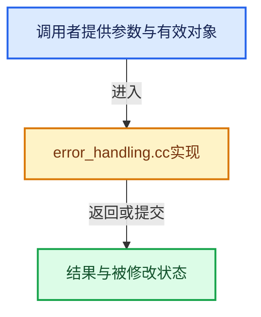

# 实现依赖专题：source/blender/imbuf/opencolorio/intern/libocio/error_handling.cc

[方向导航](README.md) · [符号索引](../%E7%AC%A6%E5%8F%B7%E4%BE%9D%E8%B5%96%E4%B8%8E%E5%AE%9E%E7%8E%B0%E7%B4%A2%E5%BC%95.md)

本专题从正文实际调用进入，集中保存共享实现。函数有稳定锚点，可从调用处直接跳到对应完整函数；递归与互相调用通过回链组织。

## 本文件的实现关系





## 完整成员与函数实现

<a id="f-ee55c3aa111fb1c4"></a>

### `blender::ocio::report_exception`

实现位置：[source/blender/imbuf/opencolorio/intern/libocio/error_handling.cc](../../../../../source/blender/imbuf/opencolorio/intern/libocio/error_handling.cc) · L15—L18。

接口参数：

- `const OCIO_NAMESPACE::Exception &exception`

**教学注释版**

<!-- annotated:ede7af9e01928c -->

```cpp
void report_exception(const OCIO_NAMESPACE::Exception &exception)
{
  CLOG_ERROR(&LOG, "OpenColorIO Error: %s", exception.what());
}
```

<details>
<summary>核对原始源码：source/blender/imbuf/opencolorio/intern/libocio/error_handling.cc · L15—L18</summary>

<!-- original:ede7af9e01928c:source/blender/imbuf/opencolorio/intern/libocio/error_handling.cc:15:18 -->

```cpp
void report_exception(const OCIO_NAMESPACE::Exception &exception)
{
  CLOG_ERROR(&LOG, "OpenColorIO Error: %s", exception.what());
}
```

</details>

**继续追踪实现**

- `CLOG_ERROR` → [CLOG_ERROR · L188](%E4%BE%9D%E8%B5%96-CLG_log-e9051b.md#m-081575cdc8d0)。宏定义由构建条件选择。
- `exception.what` → [GHOST_XrException::what · L22](%E4%BE%9D%E8%B5%96-GHOST_XrException-37f429.md#f-da2482d747eab515)。
