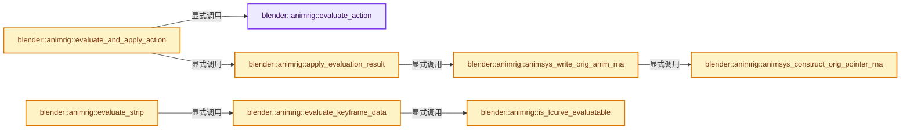
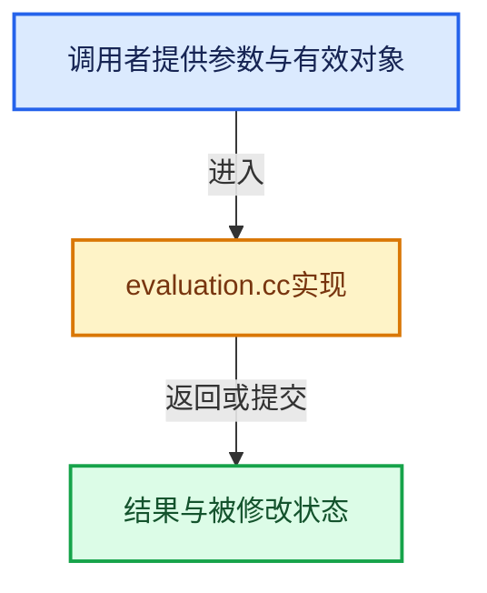

# 实现依赖专题：source/blender/animrig/intern/evaluation.cc

[方向导航](README.md) · [符号索引](../%E7%AC%A6%E5%8F%B7%E4%BE%9D%E8%B5%96%E4%B8%8E%E5%AE%9E%E7%8E%B0%E7%B4%A2%E5%BC%95.md)

本专题从正文实际调用进入，集中保存共享实现。函数有稳定锚点，可从调用处直接跳到对应完整函数；递归与互相调用通过回链组织。

## 本文件的实现关系






## 完整成员与函数实现

<a id="f-8bc6f2d49a06617f"></a>

### `blender::animrig::evaluate_action`

实现位置：[source/blender/animrig/intern/evaluation.cc](../../../../../source/blender/animrig/intern/evaluation.cc) · L48—L81。

接口参数：

- `PointerRNA &animated_id_ptr`
- `Action &action`
- `const slot_handle_t slot_handle`
- `const AnimationEvalContext &anim_eval_context`

**教学注释版**

<!-- annotated:e993a160956a89 -->

```cpp
EvaluationResult evaluate_action(PointerRNA &animated_id_ptr,
                                 Action &action,
                                 const slot_handle_t slot_handle,
                                 const AnimationEvalContext &anim_eval_context)
{
  EvaluationResult result;

  /* Evaluate each layer in order. */
  for (Layer *layer : action.layers()) {
    if (layer->influence <= 0.0f) {
      /* Don't bother evaluating layers without influence. */
      continue;
    }

    EvaluationResult layer_result = evaluate_layer(
        animated_id_ptr, action, *layer, slot_handle, anim_eval_context);
    if (!layer_result) {
      continue;
    }

    if (!result) {
      /* Simple case: no results so far, so just use this layer as-is. There is
       * nothing to blend/combine with, so ignore the influence and combination
       * options. */
      // [讲解] std::move：把表达式转换成可供移动重载选择的值类别；不保证真的移动，不结束源对象寿命，对const值可能选择复制。
      result = std::move(layer_result);
      continue;
    }

    /* Complex case: blend this layer's result into combined result. */
    blend_layer_results(result, layer_result, *layer);
  }

  return result;
}
```

<details>
<summary>核对原始源码：source/blender/animrig/intern/evaluation.cc · L48—L81</summary>

<!-- original:e993a160956a89:source/blender/animrig/intern/evaluation.cc:48:81 -->

```cpp
EvaluationResult evaluate_action(PointerRNA &animated_id_ptr,
                                 Action &action,
                                 const slot_handle_t slot_handle,
                                 const AnimationEvalContext &anim_eval_context)
{
  EvaluationResult result;

  /* Evaluate each layer in order. */
  for (Layer *layer : action.layers()) {
    if (layer->influence <= 0.0f) {
      /* Don't bother evaluating layers without influence. */
      continue;
    }

    EvaluationResult layer_result = evaluate_layer(
        animated_id_ptr, action, *layer, slot_handle, anim_eval_context);
    if (!layer_result) {
      continue;
    }

    if (!result) {
      /* Simple case: no results so far, so just use this layer as-is. There is
       * nothing to blend/combine with, so ignore the influence and combination
       * options. */
      result = std::move(layer_result);
      continue;
    }

    /* Complex case: blend this layer's result into combined result. */
    blend_layer_results(result, layer_result, *layer);
  }

  return result;
}
```

</details>

**沿实际写入检查状态**

- `result = std::move(layer_result);`

**结果出口**

- `return result;`

**继续追踪实现**

- `action.layers` → [blender::animrig::Action::layers · L228](%E4%BE%9D%E8%B5%96-action-a70714.md#f-acb1b8fd444e908c)；[blender::animrig::Action::layers · L232](%E4%BE%9D%E8%B5%96-action-a70714.md#f-dbffb3af38ca8b15)。同名重载需按实参类型选择。
- `evaluate_layer` → [blender::animrig::internal::evaluate_layer · L301](%E4%BE%9D%E8%B5%96-evaluation-cf27ff.md#f-7b2732da304a3cf1)。
- `std::move` → [外部契约](https://eel.is/c++draft/utility.forward)：把表达式转换成可供移动重载选择的值类别；不保证真的移动，不结束源对象寿命，对const值可能选择复制。
- `blend_layer_results` → [blender::animrig::blend_layer_results · L255](%E4%BE%9D%E8%B5%96-evaluation-cf27ff.md#f-04a0670d2d0c0463)。

<a id="f-b3c06da8a2aac109"></a>

### `blender::animrig::evaluate_and_apply_action`

实现位置：[source/blender/animrig/intern/evaluation.cc](../../../../../source/blender/animrig/intern/evaluation.cc) · L83—L96。

接口参数：

- `PointerRNA &animated_id_ptr`
- `Action &action`
- `const slot_handle_t slot_handle`
- `const AnimationEvalContext &anim_eval_context`
- `const bool flush_to_original`

**教学注释版**

<!-- annotated:f8df6b276963c2 -->

```cpp
void evaluate_and_apply_action(PointerRNA &animated_id_ptr,
                               Action &action,
                               const slot_handle_t slot_handle,
                               const AnimationEvalContext &anim_eval_context,
                               const bool flush_to_original)
{
  EvaluationResult evaluation_result = evaluate_action(
      animated_id_ptr, action, slot_handle, anim_eval_context);
  if (!evaluation_result) {
    return;
  }

  apply_evaluation_result(evaluation_result, animated_id_ptr, flush_to_original);
}
```

<details>
<summary>核对原始源码：source/blender/animrig/intern/evaluation.cc · L83—L96</summary>

<!-- original:f8df6b276963c2:source/blender/animrig/intern/evaluation.cc:83:96 -->

```cpp
void evaluate_and_apply_action(PointerRNA &animated_id_ptr,
                               Action &action,
                               const slot_handle_t slot_handle,
                               const AnimationEvalContext &anim_eval_context,
                               const bool flush_to_original)
{
  EvaluationResult evaluation_result = evaluate_action(
      animated_id_ptr, action, slot_handle, anim_eval_context);
  if (!evaluation_result) {
    return;
  }

  apply_evaluation_result(evaluation_result, animated_id_ptr, flush_to_original);
}
```

</details>

**继续追踪实现**

- `evaluate_action` → [blender::animrig::evaluate_action · L48](%E4%BE%9D%E8%B5%96-evaluation-cf27ff.md#f-8bc6f2d49a06617f)。
- `apply_evaluation_result` → [blender::animrig::apply_evaluation_result · L213](%E4%BE%9D%E8%B5%96-evaluation-cf27ff.md#f-170a318a18b3541d)。

<a id="f-30357155e600f93d"></a>

### `blender::animrig::is_fcurve_evaluatable`

实现位置：[source/blender/animrig/intern/evaluation.cc](../../../../../source/blender/animrig/intern/evaluation.cc) · L99—L115。

接口参数：

- `const FCurve *fcu`

**教学注释版**

<!-- annotated:dab21de798c632 -->

```cpp
static bool is_fcurve_evaluatable(const FCurve *fcu)
{
  if (fcu->rna_path().is_empty()) {
    return false;
  }

  /* Not checking for FCURVE_DISABLED here, because those FCurves may still be evaluatable for
   * other users of the same slot. See #135666. This is safe to do since this function isn't called
   * for drivers. */
  if (fcu->flag & FCURVE_MUTED) {
    return false;
  }
  if (BKE_fcurve_is_empty(fcu)) {
    return false;
  }
  return true;
}
```

<details>
<summary>核对原始源码：source/blender/animrig/intern/evaluation.cc · L99—L115</summary>

<!-- original:dab21de798c632:source/blender/animrig/intern/evaluation.cc:99:115 -->

```cpp
static bool is_fcurve_evaluatable(const FCurve *fcu)
{
  if (fcu->rna_path().is_empty()) {
    return false;
  }

  /* Not checking for FCURVE_DISABLED here, because those FCurves may still be evaluatable for
   * other users of the same slot. See #135666. This is safe to do since this function isn't called
   * for drivers. */
  if (fcu->flag & FCURVE_MUTED) {
    return false;
  }
  if (BKE_fcurve_is_empty(fcu)) {
    return false;
  }
  return true;
}
```

</details>

**结果出口**

- `return false;`
- `return true;`

**继续追踪实现**

- `fcu->rna_path().is_empty` → [调用协议](../%E6%A8%A1%E6%9D%BF%E5%AE%8F%E4%B8%8E%E5%8A%A8%E6%80%81%E5%88%86%E6%B4%BE%E5%8D%8F%E8%AE%AE.md)：接收对象类型依赖auto、返回值或模板实例；不按同名猜测目标。调用位置L101。
- `fcu->rna_path` → [blender::FCurve::rna_path · L189](%E4%BE%9D%E8%B5%96-fcurve-593e2e.md#f-b3be61588d36ab9c)。
- `BKE_fcurve_is_empty` → [blender::BKE_fcurve_is_empty · L2492](%E4%BE%9D%E8%B5%96-fcurve-593e2e.md#f-d6df9e9e77afd03e)。

<a id="f-c3b58039aaedea17"></a>

### `blender::animrig::animsys_construct_orig_pointer_rna`

实现位置：[source/blender/animrig/intern/evaluation.cc](../../../../../source/blender/animrig/intern/evaluation.cc) · L119—L133。

接口参数：

- `const PointerRNA *ptr`
- `PointerRNA *ptr_orig`

**教学注释版**

<!-- annotated:48fdf2eff90a2f -->

```cpp
static void animsys_construct_orig_pointer_rna(const PointerRNA *ptr, PointerRNA *ptr_orig)
{
  *ptr_orig = *ptr;
  /* Original note from anim_sys.cc:
   * -----------
   * NOTE: nlastrip_evaluate_controls() creates PointerRNA with ID of nullptr. Technically, this is
   * not a valid pointer, but there are exceptions in various places of this file which handles
   * such pointers.
   * We do special trickery here as well, to quickly go from evaluated to original NlaStrip.
   * -----------
   * And this is all not ported to the new layered animation system. */
  BLI_assert_msg(ptr->owner_id, "NLA support was not ported to the layered animation system");
  ptr_orig->owner_id = ptr_orig->owner_id->orig_id;
  ptr_orig->data = ptr_orig->owner_id;
}
```

<details>
<summary>核对原始源码：source/blender/animrig/intern/evaluation.cc · L119—L133</summary>

<!-- original:48fdf2eff90a2f:source/blender/animrig/intern/evaluation.cc:119:133 -->

```cpp
static void animsys_construct_orig_pointer_rna(const PointerRNA *ptr, PointerRNA *ptr_orig)
{
  *ptr_orig = *ptr;
  /* Original note from anim_sys.cc:
   * -----------
   * NOTE: nlastrip_evaluate_controls() creates PointerRNA with ID of nullptr. Technically, this is
   * not a valid pointer, but there are exceptions in various places of this file which handles
   * such pointers.
   * We do special trickery here as well, to quickly go from evaluated to original NlaStrip.
   * -----------
   * And this is all not ported to the new layered animation system. */
  BLI_assert_msg(ptr->owner_id, "NLA support was not ported to the layered animation system");
  ptr_orig->owner_id = ptr_orig->owner_id->orig_id;
  ptr_orig->data = ptr_orig->owner_id;
}
```

</details>

**沿实际写入检查状态**

- `ptr_orig->owner_id = ptr_orig->owner_id->orig_id;`
- `ptr_orig->data = ptr_orig->owner_id;`

**继续追踪实现**

- `BLI_assert_msg` → [BLI_assert_msg · L55](../01-%E5%9F%BA%E7%A1%80%E5%AE%B9%E5%99%A8%E4%B8%8E%E7%8E%B0%E4%BB%A3CPP/%E4%BE%9D%E8%B5%96-BLI_assert-cc98e8.md#m-695eed20dceb)；[BLI_assert_msg · L64](../01-%E5%9F%BA%E7%A1%80%E5%AE%B9%E5%99%A8%E4%B8%8E%E7%8E%B0%E4%BB%A3CPP/%E4%BE%9D%E8%B5%96-BLI_assert-cc98e8.md#m-7de5563de4db)。宏定义由构建条件选择。

<a id="f-861c4da29e640077"></a>

### `blender::animrig::animsys_write_orig_anim_rna`

实现位置：[source/blender/animrig/intern/evaluation.cc](../../../../../source/blender/animrig/intern/evaluation.cc) · L136—L149。

接口参数：

- `PointerRNA *ptr`
- `const ParsedRNAPathRef rna_path`
- `const int array_index`
- `const float value`

**教学注释版**

<!-- annotated:af84ec3ebfb5cc -->

```cpp
static void animsys_write_orig_anim_rna(PointerRNA *ptr,
                                        const ParsedRNAPathRef rna_path,
                                        const int array_index,
                                        const float value)
{
  PointerRNA ptr_orig;
  animsys_construct_orig_pointer_rna(ptr, &ptr_orig);

  PathResolvedRNA orig_anim_rna;
  /* TODO(sergey): Should be possible to cache resolved path in dependency graph somehow. */
  if (BKE_animsys_rna_path_resolve(&ptr_orig, rna_path, array_index, &orig_anim_rna)) {
    BKE_animsys_write_to_rna_path(&orig_anim_rna, value);
  }
}
```

<details>
<summary>核对原始源码：source/blender/animrig/intern/evaluation.cc · L136—L149</summary>

<!-- original:af84ec3ebfb5cc:source/blender/animrig/intern/evaluation.cc:136:149 -->

```cpp
static void animsys_write_orig_anim_rna(PointerRNA *ptr,
                                        const ParsedRNAPathRef rna_path,
                                        const int array_index,
                                        const float value)
{
  PointerRNA ptr_orig;
  animsys_construct_orig_pointer_rna(ptr, &ptr_orig);

  PathResolvedRNA orig_anim_rna;
  /* TODO(sergey): Should be possible to cache resolved path in dependency graph somehow. */
  if (BKE_animsys_rna_path_resolve(&ptr_orig, rna_path, array_index, &orig_anim_rna)) {
    BKE_animsys_write_to_rna_path(&orig_anim_rna, value);
  }
}
```

</details>

**继续追踪实现**

- `animsys_construct_orig_pointer_rna` → [blender::animrig::animsys_construct_orig_pointer_rna · L119](%E4%BE%9D%E8%B5%96-evaluation-cf27ff.md#f-c3b58039aaedea17)。
- `BKE_animsys_rna_path_resolve` → [blender::BKE_animsys_rna_path_resolve · L356](%E4%BE%9D%E8%B5%96-anim_sys-5a63db.md#f-5c73502a8e98ce35)。
- `BKE_animsys_write_to_rna_path` → [blender::BKE_animsys_write_to_rna_path · L461](%E4%BE%9D%E8%B5%96-anim_sys-5a63db.md#f-93df2a4caf33ded1)。

<a id="f-d640ee229934a3f8"></a>

### `blender::animrig::evaluate_keyframe_data`

实现位置：[source/blender/animrig/intern/evaluation.cc](../../../../../source/blender/animrig/intern/evaluation.cc) · L151—L211。

接口参数：

- `PointerRNA &animated_id_ptr`
- `StripKeyframeData &strip_data`
- `const slot_handle_t slot_handle`
- `const AnimationEvalContext &offset_eval_context`

**教学注释版**

<!-- annotated:6a62f8df3b63b8 -->

```cpp
static EvaluationResult evaluate_keyframe_data(PointerRNA &animated_id_ptr,
                                               StripKeyframeData &strip_data,
                                               const slot_handle_t slot_handle,
                                               const AnimationEvalContext &offset_eval_context)
{
  Channelbag *channelbag_for_slot = strip_data.channelbag_for_slot(slot_handle);
  if (!channelbag_for_slot) {
    return {};
  }

  Span<FCurve *> fcurves = channelbag_for_slot->fcurves();
  /* Stores true for FCurves with successfully resolved RNA paths. */
  // [讲解] fcurves.size：查询视图长度或生成对应有效索引区间。
  Array<bool> valid(fcurves.size(), false);
  Array<float> results(fcurves.size());
  Array<PathResolvedRNA> resolved_rna(fcurves.size());

  /* RNA path resolution may access data for writing and is not safe to parallelize here. */
  // [讲解] fcurves.index_range：查询视图长度或生成对应有效索引区间。
  for (const int i : fcurves.index_range()) {
    FCurve *fcu = fcurves[i];
    if (!is_fcurve_evaluatable(fcu)) {
      continue;
    }

    PathResolvedRNA &anim_rna = resolved_rna[i];
    if (!BKE_animsys_rna_path_resolve(
            &animated_id_ptr, fcu->rna_path_parsed(), fcu->array_index, &anim_rna))
    {
      continue;
    }

    valid[i] = true;
  }

  threading::parallel_for(fcurves.index_range(), 512, [&](const IndexRange range) {
    for (const int i : range) {
      if (!valid[i]) {
        continue;
      }

      FCurve *fcu = fcurves[i];
      BLI_assert(fcu->driver == nullptr);
      /* Not using calculate_fcurve because FCurves of channelbags are not drivers. */
      results[i] = evaluate_fcurve(fcu, offset_eval_context.eval_time);
    }
  });

  EvaluationResult evaluation_result;
  evaluation_result.reserve(fcurves.size());
  for (const int i : fcurves.index_range()) {
    if (!valid[i]) {
      continue;
    }
    /* This part is not threadsafe. */
    evaluation_result.store(fcurves[i]->rna_path_parsed(),
                            fcurves[i]->array_index,
                            results[i],
                            // [讲解] std::move：把表达式转换成可供移动重载选择的值类别；不保证真的移动，不结束源对象寿命，对const值可能选择复制。
                            std::move(resolved_rna[i]));
  }

  return evaluation_result;
}
```

<details>
<summary>核对原始源码：source/blender/animrig/intern/evaluation.cc · L151—L211</summary>

<!-- original:6a62f8df3b63b8:source/blender/animrig/intern/evaluation.cc:151:211 -->

```cpp
static EvaluationResult evaluate_keyframe_data(PointerRNA &animated_id_ptr,
                                               StripKeyframeData &strip_data,
                                               const slot_handle_t slot_handle,
                                               const AnimationEvalContext &offset_eval_context)
{
  Channelbag *channelbag_for_slot = strip_data.channelbag_for_slot(slot_handle);
  if (!channelbag_for_slot) {
    return {};
  }

  Span<FCurve *> fcurves = channelbag_for_slot->fcurves();
  /* Stores true for FCurves with successfully resolved RNA paths. */
  Array<bool> valid(fcurves.size(), false);
  Array<float> results(fcurves.size());
  Array<PathResolvedRNA> resolved_rna(fcurves.size());

  /* RNA path resolution may access data for writing and is not safe to parallelize here. */
  for (const int i : fcurves.index_range()) {
    FCurve *fcu = fcurves[i];
    if (!is_fcurve_evaluatable(fcu)) {
      continue;
    }

    PathResolvedRNA &anim_rna = resolved_rna[i];
    if (!BKE_animsys_rna_path_resolve(
            &animated_id_ptr, fcu->rna_path_parsed(), fcu->array_index, &anim_rna))
    {
      continue;
    }

    valid[i] = true;
  }

  threading::parallel_for(fcurves.index_range(), 512, [&](const IndexRange range) {
    for (const int i : range) {
      if (!valid[i]) {
        continue;
      }

      FCurve *fcu = fcurves[i];
      BLI_assert(fcu->driver == nullptr);
      /* Not using calculate_fcurve because FCurves of channelbags are not drivers. */
      results[i] = evaluate_fcurve(fcu, offset_eval_context.eval_time);
    }
  });

  EvaluationResult evaluation_result;
  evaluation_result.reserve(fcurves.size());
  for (const int i : fcurves.index_range()) {
    if (!valid[i]) {
      continue;
    }
    /* This part is not threadsafe. */
    evaluation_result.store(fcurves[i]->rna_path_parsed(),
                            fcurves[i]->array_index,
                            results[i],
                            std::move(resolved_rna[i]));
  }

  return evaluation_result;
}
```

</details>

**沿实际写入检查状态**

- `valid[i] = true;`
- `results[i] = evaluate_fcurve(fcu, offset_eval_context.eval_time);`

**结果出口**

- `return {};`
- `return evaluation_result;`

**继续追踪实现**

- `strip_data.channelbag_for_slot` → [blender::animrig::StripKeyframeData::channelbag_for_slot · L1664](%E4%BE%9D%E8%B5%96-action-a70714.md#f-c1bde2de7a2a96b0)；[blender::animrig::StripKeyframeData::channelbag_for_slot · L1682](%E4%BE%9D%E8%B5%96-action-a70714.md#f-b1bab77ef5f16980)；[blender::animrig::StripKeyframeData::channelbag_for_slot · L1688](%E4%BE%9D%E8%B5%96-action-a70714.md#f-ec49acc29f60cdaa)；[blender::animrig::StripKeyframeData::channelbag_for_slot · L1692](%E4%BE%9D%E8%B5%96-action-a70714.md#f-b63b7a5a45d56971)。同名重载需按实参类型选择。
- `channelbag_for_slot->fcurves` → [blender::animrig::Channelbag::fcurves · L2230](%E4%BE%9D%E8%B5%96-action-a70714.md#f-d3bca85b565c58e9)；[blender::animrig::Channelbag::fcurves · L2234](%E4%BE%9D%E8%B5%96-action-a70714.md#f-dcfb89e067173b12)。同名重载需按实参类型选择。
- `fcurves.size` → [blender::Span::size · L256](../01-%E5%9F%BA%E7%A1%80%E5%AE%B9%E5%99%A8%E4%B8%8E%E7%8E%B0%E4%BB%A3CPP/05-Span%E5%8F%AA%E8%AF%BB%E8%BF%9E%E7%BB%AD%E8%A7%86%E5%9B%BE.md#f-5f80fa006089c998)。
- `fcurves.index_range` → [blender::Span::index_range · L405](../01-%E5%9F%BA%E7%A1%80%E5%AE%B9%E5%99%A8%E4%B8%8E%E7%8E%B0%E4%BB%A3CPP/05-Span%E5%8F%AA%E8%AF%BB%E8%BF%9E%E7%BB%AD%E8%A7%86%E5%9B%BE.md#f-caaa9b06e13e53e0)。
- `is_fcurve_evaluatable` → [blender::animrig::is_fcurve_evaluatable · L99](%E4%BE%9D%E8%B5%96-evaluation-cf27ff.md#f-30357155e600f93d)。
- `BKE_animsys_rna_path_resolve` → [blender::BKE_animsys_rna_path_resolve · L356](%E4%BE%9D%E8%B5%96-anim_sys-5a63db.md#f-5c73502a8e98ce35)。
- `fcu->rna_path_parsed` → [blender::FCurve::rna_path_parsed · L194](%E4%BE%9D%E8%B5%96-fcurve-593e2e.md#f-3a8e2ed50f572880)。
- `threading::parallel_for` → [blender::threading::parallel_for · L68](../11-Depsgraph%E4%B8%8E%E5%B9%B6%E8%A1%8C%E4%BB%BB%E5%8A%A1%E7%B3%BB%E7%BB%9F/07-%E4%BB%BB%E5%8A%A1%E6%B1%A0%E4%B8%8ETBB%E6%8E%A5%E5%85%A5.md#f-838294754c24426c)。
- `BLI_assert` → [BLI_assert · L48](../01-%E5%9F%BA%E7%A1%80%E5%AE%B9%E5%99%A8%E4%B8%8E%E7%8E%B0%E4%BB%A3CPP/%E4%BE%9D%E8%B5%96-BLI_assert-cc98e8.md#m-57a88495704d)；[BLI_assert · L63](../01-%E5%9F%BA%E7%A1%80%E5%AE%B9%E5%99%A8%E4%B8%8E%E7%8E%B0%E4%BB%A3CPP/%E4%BE%9D%E8%B5%96-BLI_assert-cc98e8.md#m-d07050020cb5)。宏定义由构建条件选择。
- `evaluate_fcurve` → [blender::evaluate_fcurve · L2416](%E4%BE%9D%E8%B5%96-fcurve-593e2e.md#f-83388654bf008ed3)。
- `evaluation_result.reserve` → [blender::animrig::EvaluationResult::reserve · L92](%E4%BE%9D%E8%B5%96-ANIM_evaluation-a2dc3b.md#f-f23bdac7bc0ff1d8)。
- `evaluation_result.store` → [blender::animrig::EvaluationResult::store · L97](%E4%BE%9D%E8%B5%96-ANIM_evaluation-a2dc3b.md#f-b5557ea0276e2021)。
- `fcurves[i]->rna_path_parsed` → [调用协议](../%E6%A8%A1%E6%9D%BF%E5%AE%8F%E4%B8%8E%E5%8A%A8%E6%80%81%E5%88%86%E6%B4%BE%E5%8D%8F%E8%AE%AE.md)：接收对象类型依赖auto、返回值或模板实例；不按同名猜测目标。调用位置L204。
- `std::move` → [外部契约](https://eel.is/c++draft/utility.forward)：把表达式转换成可供移动重载选择的值类别；不保证真的移动，不结束源对象寿命，对const值可能选择复制。

<a id="f-170a318a18b3541d"></a>

### `blender::animrig::apply_evaluation_result`

实现位置：[source/blender/animrig/intern/evaluation.cc](../../../../../source/blender/animrig/intern/evaluation.cc) · L213—L232。

接口参数：

- `const EvaluationResult &evaluation_result`
- `PointerRNA &animated_id_ptr`
- `const bool flush_to_original`

**教学注释版**

<!-- annotated:52004f4c66f3f6 -->

```cpp
void apply_evaluation_result(const EvaluationResult &evaluation_result,
                             PointerRNA &animated_id_ptr,
                             const bool flush_to_original)
{
  for (const auto &channel_result : evaluation_result.items()) {
    const PropIdentifier &prop_ident = channel_result.key;
    const AnimatedProperty &anim_prop = channel_result.value;
    const float animated_value = anim_prop.value;
    PathResolvedRNA anim_rna = anim_prop.prop_rna;

    BKE_animsys_write_to_rna_path(&anim_rna, animated_value);

    if (flush_to_original) {
      /* Convert the StringRef to a `const char *`, as the rest of the RNA path handling code in
       * BKE still uses `char *` instead of `StringRef`. */
      animsys_write_orig_anim_rna(
          &animated_id_ptr, prop_ident.rna_path, prop_ident.array_index, animated_value);
    }
  }
}
```

<details>
<summary>核对原始源码：source/blender/animrig/intern/evaluation.cc · L213—L232</summary>

<!-- original:52004f4c66f3f6:source/blender/animrig/intern/evaluation.cc:213:232 -->

```cpp
void apply_evaluation_result(const EvaluationResult &evaluation_result,
                             PointerRNA &animated_id_ptr,
                             const bool flush_to_original)
{
  for (const auto &channel_result : evaluation_result.items()) {
    const PropIdentifier &prop_ident = channel_result.key;
    const AnimatedProperty &anim_prop = channel_result.value;
    const float animated_value = anim_prop.value;
    PathResolvedRNA anim_rna = anim_prop.prop_rna;

    BKE_animsys_write_to_rna_path(&anim_rna, animated_value);

    if (flush_to_original) {
      /* Convert the StringRef to a `const char *`, as the rest of the RNA path handling code in
       * BKE still uses `char *` instead of `StringRef`. */
      animsys_write_orig_anim_rna(
          &animated_id_ptr, prop_ident.rna_path, prop_ident.array_index, animated_value);
    }
  }
}
```

</details>

**继续追踪实现**

- `evaluation_result.items` → [blender::animrig::EvaluationResult::items · L115](%E4%BE%9D%E8%B5%96-ANIM_evaluation-a2dc3b.md#f-679ea21e7e0129a6)。
- `BKE_animsys_write_to_rna_path` → [blender::BKE_animsys_write_to_rna_path · L461](%E4%BE%9D%E8%B5%96-anim_sys-5a63db.md#f-93df2a4caf33ded1)。
- `animsys_write_orig_anim_rna` → [blender::animrig::animsys_write_orig_anim_rna · L136](%E4%BE%9D%E8%B5%96-evaluation-cf27ff.md#f-861c4da29e640077)。

<a id="f-67de1957bbcfa2f9"></a>

### `blender::animrig::evaluate_strip`

实现位置：[source/blender/animrig/intern/evaluation.cc](../../../../../source/blender/animrig/intern/evaluation.cc) · L234—L253。

接口参数：

- `PointerRNA &animated_id_ptr`
- `Action &owning_action`
- `Strip &strip`
- `const slot_handle_t slot_handle`
- `const AnimationEvalContext &anim_eval_context`

**教学注释版**

<!-- annotated:eda1d9b3443789 -->

```cpp
static EvaluationResult evaluate_strip(PointerRNA &animated_id_ptr,
                                       Action &owning_action,
                                       Strip &strip,
                                       const slot_handle_t slot_handle,
                                       const AnimationEvalContext &anim_eval_context)
{
  AnimationEvalContext offset_eval_context = anim_eval_context;
  /* Positive offset means the entire strip is pushed "to the right", so
   * evaluation needs to happen further "to the left". */
  offset_eval_context.eval_time -= strip.frame_offset;

  switch (strip.type()) {
    case Strip::Type::Keyframe: {
      StripKeyframeData &strip_data = strip.data<StripKeyframeData>(owning_action);
      return evaluate_keyframe_data(animated_id_ptr, strip_data, slot_handle, offset_eval_context);
    }
  }

  return {};
}
```

<details>
<summary>核对原始源码：source/blender/animrig/intern/evaluation.cc · L234—L253</summary>

<!-- original:eda1d9b3443789:source/blender/animrig/intern/evaluation.cc:234:253 -->

```cpp
static EvaluationResult evaluate_strip(PointerRNA &animated_id_ptr,
                                       Action &owning_action,
                                       Strip &strip,
                                       const slot_handle_t slot_handle,
                                       const AnimationEvalContext &anim_eval_context)
{
  AnimationEvalContext offset_eval_context = anim_eval_context;
  /* Positive offset means the entire strip is pushed "to the right", so
   * evaluation needs to happen further "to the left". */
  offset_eval_context.eval_time -= strip.frame_offset;

  switch (strip.type()) {
    case Strip::Type::Keyframe: {
      StripKeyframeData &strip_data = strip.data<StripKeyframeData>(owning_action);
      return evaluate_keyframe_data(animated_id_ptr, strip_data, slot_handle, offset_eval_context);
    }
  }

  return {};
}
```

</details>

**沿实际写入检查状态**

- `offset_eval_context.eval_time -= strip.frame_offset;`

**结果出口**

- `return evaluate_keyframe_data(animated_id_ptr, strip_data, slot_handle, offset_eval_context);`
- `return {};`

**继续追踪实现**

- `strip.type` → [blender::animrig::Strip::type · L552](%E4%BE%9D%E8%B5%96-ANIM_action-8e402f.md#f-594f232522f646b5)。
- `strip.data<StripKeyframeData>` → [blender::animrig::data · L1610](%E4%BE%9D%E8%B5%96-action-a70714.md#f-260cc8a2a2e0ad69)；[blender::animrig::data · L1617](%E4%BE%9D%E8%B5%96-action-a70714.md#f-f499f257eaf57d0c)。同名重载需按实参类型选择。
- `evaluate_keyframe_data` → [blender::animrig::evaluate_keyframe_data · L151](%E4%BE%9D%E8%B5%96-evaluation-cf27ff.md#f-d640ee229934a3f8)。

<a id="f-04a0670d2d0c0463"></a>

### `blender::animrig::blend_layer_results`

实现位置：[source/blender/animrig/intern/evaluation.cc](../../../../../source/blender/animrig/intern/evaluation.cc) · L255—L297。

接口参数：

- `EvaluationResult &final_result`
- `const EvaluationResult &intermediate_result`
- `const Layer &current_layer`

**教学注释版**

<!-- annotated:9a852a0b4b97a3 -->

```cpp
void blend_layer_results(EvaluationResult &final_result,
                         const EvaluationResult &intermediate_result,
                         const Layer &current_layer)
{
  /* TODO?: store the layer results sequentially, so that we can step through
   * them in parallel, instead of iterating over one and doing map lookups on
   * the other. */

  for (const auto &channel_result : intermediate_result.items()) {
    const PropIdentifier &prop_ident = channel_result.key;
    AnimatedProperty *last_prop = final_result.lookup_ptr(prop_ident);
    const AnimatedProperty &anim_prop = channel_result.value;

    if (!last_prop) {
      /* Nothing to blend with, so just take (influence * value). */
      final_result.store(prop_ident.rna_path,
                         prop_ident.array_index,
                         anim_prop.value * current_layer.influence,
                         anim_prop.prop_rna);
      continue;
    }

    /* TODO: move this to a separate function. And write more smartness for rotations. */
    switch (current_layer.mix_mode()) {
      case Layer::MixMode::Replace:
        last_prop->value = anim_prop.value * current_layer.influence;
        break;
      case Layer::MixMode::Offset:
        last_prop->value = math::interpolate(
            current_layer.influence, last_prop->value, anim_prop.value);
        break;
      case Layer::MixMode::Add:
        last_prop->value += anim_prop.value * current_layer.influence;
        break;
      case Layer::MixMode::Subtract:
        last_prop->value -= anim_prop.value * current_layer.influence;
        break;
      case Layer::MixMode::Multiply:
        last_prop->value *= anim_prop.value * current_layer.influence;
        break;
    };
  }
}
```

<details>
<summary>核对原始源码：source/blender/animrig/intern/evaluation.cc · L255—L297</summary>

<!-- original:9a852a0b4b97a3:source/blender/animrig/intern/evaluation.cc:255:297 -->

```cpp
void blend_layer_results(EvaluationResult &final_result,
                         const EvaluationResult &intermediate_result,
                         const Layer &current_layer)
{
  /* TODO?: store the layer results sequentially, so that we can step through
   * them in parallel, instead of iterating over one and doing map lookups on
   * the other. */

  for (const auto &channel_result : intermediate_result.items()) {
    const PropIdentifier &prop_ident = channel_result.key;
    AnimatedProperty *last_prop = final_result.lookup_ptr(prop_ident);
    const AnimatedProperty &anim_prop = channel_result.value;

    if (!last_prop) {
      /* Nothing to blend with, so just take (influence * value). */
      final_result.store(prop_ident.rna_path,
                         prop_ident.array_index,
                         anim_prop.value * current_layer.influence,
                         anim_prop.prop_rna);
      continue;
    }

    /* TODO: move this to a separate function. And write more smartness for rotations. */
    switch (current_layer.mix_mode()) {
      case Layer::MixMode::Replace:
        last_prop->value = anim_prop.value * current_layer.influence;
        break;
      case Layer::MixMode::Offset:
        last_prop->value = math::interpolate(
            current_layer.influence, last_prop->value, anim_prop.value);
        break;
      case Layer::MixMode::Add:
        last_prop->value += anim_prop.value * current_layer.influence;
        break;
      case Layer::MixMode::Subtract:
        last_prop->value -= anim_prop.value * current_layer.influence;
        break;
      case Layer::MixMode::Multiply:
        last_prop->value *= anim_prop.value * current_layer.influence;
        break;
    };
  }
}
```

</details>

**沿实际写入检查状态**

- `last_prop->value = anim_prop.value * current_layer.influence;`
- `last_prop->value = math::interpolate(`
- `last_prop->value += anim_prop.value * current_layer.influence;`
- `last_prop->value -= anim_prop.value * current_layer.influence;`
- `last_prop->value *= anim_prop.value * current_layer.influence;`

**继续追踪实现**

- `intermediate_result.items` → [blender::animrig::EvaluationResult::items · L115](%E4%BE%9D%E8%B5%96-ANIM_evaluation-a2dc3b.md#f-679ea21e7e0129a6)。
- `final_result.lookup_ptr` → [blender::animrig::EvaluationResult::lookup_ptr · L106](%E4%BE%9D%E8%B5%96-ANIM_evaluation-a2dc3b.md#f-71713d4a2caa2e6f)；[blender::animrig::EvaluationResult::lookup_ptr · L110](%E4%BE%9D%E8%B5%96-ANIM_evaluation-a2dc3b.md#f-3251f07b512827bd)。同名重载需按实参类型选择。
- `final_result.store` → [blender::animrig::EvaluationResult::store · L97](%E4%BE%9D%E8%B5%96-ANIM_evaluation-a2dc3b.md#f-b5557ea0276e2021)。
- `current_layer.mix_mode` → [blender::animrig::Layer::mix_mode · L664](%E4%BE%9D%E8%B5%96-ANIM_action-8e402f.md#f-ab1f047e6a5a245b)。
- `math::interpolate` → [blender::math::interpolate · L335](../12-%E7%A9%BA%E9%97%B4%E6%95%B0%E6%8D%AE%E7%BB%93%E6%9E%84%E4%B8%8E%E5%87%A0%E4%BD%95%E7%AE%97%E6%B3%95/%E4%BE%9D%E8%B5%96-math_matrix-d7d8ee.md#f-91e7f517ebd72fb5)；[blender::math::interpolate · L379](../12-%E7%A9%BA%E9%97%B4%E6%95%B0%E6%8D%AE%E7%BB%93%E6%9E%84%E4%B8%8E%E5%87%A0%E4%BD%95%E7%AE%97%E6%B3%95/%E4%BE%9D%E8%B5%96-math_matrix-d7d8ee.md#f-a1be14e86ce595c2)；[blender::math::interpolate · L636](../12-%E7%A9%BA%E9%97%B4%E6%95%B0%E6%8D%AE%E7%BB%93%E6%9E%84%E4%B8%8E%E5%87%A0%E4%BD%95%E7%AE%97%E6%B3%95/%E4%BE%9D%E8%B5%96-BLI_math_vector-906a87.md#f-d612b6d6ab1b6e7c)；[blender::math::interpolate · L303](../12-%E7%A9%BA%E9%97%B4%E6%95%B0%E6%8D%AE%E7%BB%93%E6%9E%84%E4%B8%8E%E5%87%A0%E4%BD%95%E7%AE%97%E6%B3%95/%E4%BE%9D%E8%B5%96-BLI_math_quaternion-cf105d.md#f-48b9ace2a9c6185c)；[blender::math::interpolate · L17](../12-%E7%A9%BA%E9%97%B4%E6%95%B0%E6%8D%AE%E7%BB%93%E6%9E%84%E4%B8%8E%E5%87%A0%E4%BD%95%E7%AE%97%E6%B3%95/%E4%BE%9D%E8%B5%96-BLI_math_color-f3a6ea.md#f-eb5ef92b0f8c0926)；[blender::math::interpolate · L28](../12-%E7%A9%BA%E9%97%B4%E6%95%B0%E6%8D%AE%E7%BB%93%E6%9E%84%E4%B8%8E%E5%87%A0%E4%BD%95%E7%AE%97%E6%B3%95/%E4%BE%9D%E8%B5%96-BLI_math_color-f3a6ea.md#f-2a9e33ec55979ab6)；[blender::math::interpolate · L278](../12-%E7%A9%BA%E9%97%B4%E6%95%B0%E6%8D%AE%E7%BB%93%E6%9E%84%E4%B8%8E%E5%87%A0%E4%BD%95%E7%AE%97%E6%B3%95/%E4%BE%9D%E8%B5%96-BLI_math_base-0728eb.md#f-2629b871528f6528)。同名重载需按实参类型选择。

<a id="f-7b2732da304a3cf1"></a>

### `blender::animrig::internal::evaluate_layer`

实现位置：[source/blender/animrig/intern/evaluation.cc](../../../../../source/blender/animrig/intern/evaluation.cc) · L301—L339。

接口参数：

- `PointerRNA &animated_id_ptr`
- `Action &owning_action`
- `Layer &layer`
- `const slot_handle_t slot_handle`
- `const AnimationEvalContext &anim_eval_context`

**教学注释版**

<!-- annotated:d762f3a4ce7d91 -->

```cpp
EvaluationResult evaluate_layer(PointerRNA &animated_id_ptr,
                                Action &owning_action,
                                Layer &layer,
                                const slot_handle_t slot_handle,
                                const AnimationEvalContext &anim_eval_context)
{
  /* TODO: implement cross-blending between overlapping strips. For now, this is not supported.
   * Instead, the first strong result is taken (see below), and if that is not available, the last
   * weak result will be used.
   *
   * Weak result: obtained from evaluating the final frame of the strip.
   * Strong result: any result that is not a weak result. */
  EvaluationResult last_weak_result;

  for (Strip *strip : layer.strips()) {
    if (!strip->contains_frame(anim_eval_context.eval_time)) {
      continue;
    }

    /* Cannot use const here because the std::move would not work otherwise. */
    EvaluationResult strip_result = evaluate_strip(
        animated_id_ptr, owning_action, *strip, slot_handle, anim_eval_context);
    if (!strip_result) {
      continue;
    }

    const bool is_weak_result = strip->is_last_frame(anim_eval_context.eval_time);
    if (is_weak_result) {
      /* Keep going until a strong result is found. */
      // [讲解] std::move：把表达式转换成可供移动重载选择的值类别；不保证真的移动，不结束源对象寿命，对const值可能选择复制。
      last_weak_result = std::move(strip_result);
      continue;
    }

    /* Found a strong result, just return it. */
    return strip_result;
  }

  return last_weak_result;
}
```

<details>
<summary>核对原始源码：source/blender/animrig/intern/evaluation.cc · L301—L339</summary>

<!-- original:d762f3a4ce7d91:source/blender/animrig/intern/evaluation.cc:301:339 -->

```cpp
EvaluationResult evaluate_layer(PointerRNA &animated_id_ptr,
                                Action &owning_action,
                                Layer &layer,
                                const slot_handle_t slot_handle,
                                const AnimationEvalContext &anim_eval_context)
{
  /* TODO: implement cross-blending between overlapping strips. For now, this is not supported.
   * Instead, the first strong result is taken (see below), and if that is not available, the last
   * weak result will be used.
   *
   * Weak result: obtained from evaluating the final frame of the strip.
   * Strong result: any result that is not a weak result. */
  EvaluationResult last_weak_result;

  for (Strip *strip : layer.strips()) {
    if (!strip->contains_frame(anim_eval_context.eval_time)) {
      continue;
    }

    /* Cannot use const here because the std::move would not work otherwise. */
    EvaluationResult strip_result = evaluate_strip(
        animated_id_ptr, owning_action, *strip, slot_handle, anim_eval_context);
    if (!strip_result) {
      continue;
    }

    const bool is_weak_result = strip->is_last_frame(anim_eval_context.eval_time);
    if (is_weak_result) {
      /* Keep going until a strong result is found. */
      last_weak_result = std::move(strip_result);
      continue;
    }

    /* Found a strong result, just return it. */
    return strip_result;
  }

  return last_weak_result;
}
```

</details>

**沿实际写入检查状态**

- `last_weak_result = std::move(strip_result);`

**结果出口**

- `return strip_result;`
- `return last_weak_result;`

**继续追踪实现**

- `layer.strips` → [blender::animrig::Layer::strips · L909](%E4%BE%9D%E8%B5%96-action-a70714.md#f-ae881f7558851e99)；[blender::animrig::Layer::strips · L913](%E4%BE%9D%E8%B5%96-action-a70714.md#f-54e4e722533eee5d)。同名重载需按实参类型选择。
- `strip->contains_frame` → [调用协议](../%E6%A8%A1%E6%9D%BF%E5%AE%8F%E4%B8%8E%E5%8A%A8%E6%80%81%E5%88%86%E6%B4%BE%E5%8D%8F%E8%AE%AE.md)：接收对象类型依赖auto、返回值或模板实例；不按同名猜测目标。调用位置L316。
- `evaluate_strip` → [blender::animrig::evaluate_strip · L234](%E4%BE%9D%E8%B5%96-evaluation-cf27ff.md#f-67de1957bbcfa2f9)。
- `strip->is_last_frame` → [调用协议](../%E6%A8%A1%E6%9D%BF%E5%AE%8F%E4%B8%8E%E5%8A%A8%E6%80%81%E5%88%86%E6%B4%BE%E5%8D%8F%E8%AE%AE.md)：接收对象类型依赖auto、返回值或模板实例；不按同名猜测目标。调用位置L327。
- `std::move` → [外部契约](https://eel.is/c++draft/utility.forward)：把表达式转换成可供移动重载选择的值类别；不保证真的移动，不结束源对象寿命，对const值可能选择复制。
