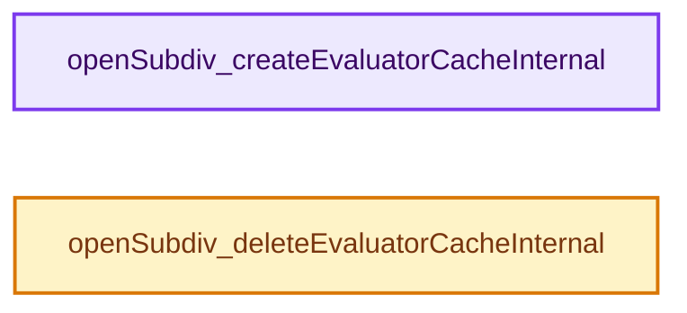
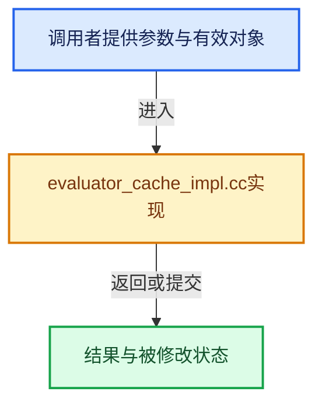

# 实现依赖专题：intern/opensubdiv/internal/evaluator/evaluator_cache_impl.cc

[方向导航](README.md) · [符号索引](../%E7%AC%A6%E5%8F%B7%E4%BE%9D%E8%B5%96%E4%B8%8E%E5%AE%9E%E7%8E%B0%E7%B4%A2%E5%BC%95.md)

本专题从正文实际调用进入，集中保存共享实现。函数有稳定锚点，可从调用处直接跳到对应完整函数；递归与互相调用通过回链组织。

## 本文件的实现关系






## 完整成员与函数实现

<a id="f-96433579f6d1658b"></a>

### `openSubdiv_createEvaluatorCacheInternal`

实现位置：[intern/opensubdiv/internal/evaluator/evaluator_cache_impl.cc](../../../../../intern/opensubdiv/internal/evaluator/evaluator_cache_impl.cc) · L16—L28。

接口参数：

- `eOpenSubdivEvaluator evaluator_type`

**教学注释版**

<!-- annotated:344a8a2ceb9cd3 -->

```cpp
OpenSubdiv_EvaluatorCacheImpl *openSubdiv_createEvaluatorCacheInternal(
    eOpenSubdivEvaluator evaluator_type)
{
  if (evaluator_type != eOpenSubdivEvaluator::OPENSUBDIV_EVALUATOR_GPU) {
    return nullptr;
  }
  OpenSubdiv_EvaluatorCacheImpl *evaluator_cache;
  evaluator_cache = new OpenSubdiv_EvaluatorCacheImpl;
  blender::opensubdiv::GpuEvalOutput::EvaluatorCache *eval_cache;
  eval_cache = new blender::opensubdiv::GpuEvalOutput::EvaluatorCache();
  evaluator_cache->eval_cache = eval_cache;
  return evaluator_cache;
}
```

<details>
<summary>核对原始源码：intern/opensubdiv/internal/evaluator/evaluator_cache_impl.cc · L16—L28</summary>

<!-- original:344a8a2ceb9cd3:intern/opensubdiv/internal/evaluator/evaluator_cache_impl.cc:16:28 -->

```cpp
OpenSubdiv_EvaluatorCacheImpl *openSubdiv_createEvaluatorCacheInternal(
    eOpenSubdivEvaluator evaluator_type)
{
  if (evaluator_type != eOpenSubdivEvaluator::OPENSUBDIV_EVALUATOR_GPU) {
    return nullptr;
  }
  OpenSubdiv_EvaluatorCacheImpl *evaluator_cache;
  evaluator_cache = new OpenSubdiv_EvaluatorCacheImpl;
  blender::opensubdiv::GpuEvalOutput::EvaluatorCache *eval_cache;
  eval_cache = new blender::opensubdiv::GpuEvalOutput::EvaluatorCache();
  evaluator_cache->eval_cache = eval_cache;
  return evaluator_cache;
}
```

</details>

**沿实际写入检查状态**

- `evaluator_cache = new OpenSubdiv_EvaluatorCacheImpl;`
- `eval_cache = new blender::opensubdiv::GpuEvalOutput::EvaluatorCache();`
- `evaluator_cache->eval_cache = eval_cache;`

**结果出口**

- `return nullptr;`
- `return evaluator_cache;`

**继续追踪实现**

本实现没有需要继续展开的显式调用；检查返回表达式、对象转换和调用者前置条件。

<a id="f-f16a68a049e91562"></a>

### `openSubdiv_deleteEvaluatorCacheInternal`

实现位置：[intern/opensubdiv/internal/evaluator/evaluator_cache_impl.cc](../../../../../intern/opensubdiv/internal/evaluator/evaluator_cache_impl.cc) · L30—L33。

接口参数：

- `OpenSubdiv_EvaluatorCacheImpl *evaluator_cache`

**教学注释版**

<!-- annotated:21f1649f476b69 -->

```cpp
void openSubdiv_deleteEvaluatorCacheInternal(OpenSubdiv_EvaluatorCacheImpl *evaluator_cache)
{
  delete evaluator_cache;
}
```

<details>
<summary>核对原始源码：intern/opensubdiv/internal/evaluator/evaluator_cache_impl.cc · L30—L33</summary>

<!-- original:21f1649f476b69:intern/opensubdiv/internal/evaluator/evaluator_cache_impl.cc:30:33 -->

```cpp
void openSubdiv_deleteEvaluatorCacheInternal(OpenSubdiv_EvaluatorCacheImpl *evaluator_cache)
{
  delete evaluator_cache;
}
```

</details>

**继续追踪实现**

本实现没有需要继续展开的显式调用；检查返回表达式、对象转换和调用者前置条件。
