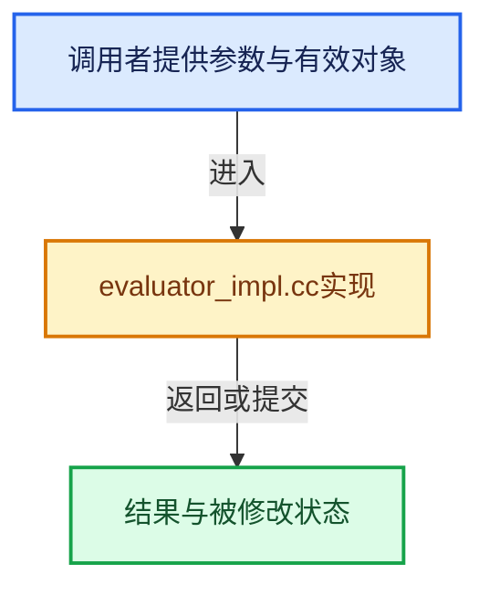

# 实现依赖专题：intern/opensubdiv/internal/evaluator/evaluator_impl.cc

[方向导航](README.md) · [符号索引](../%E7%AC%A6%E5%8F%B7%E4%BE%9D%E8%B5%96%E4%B8%8E%E5%AE%9E%E7%8E%B0%E7%B4%A2%E5%BC%95.md)

本专题从正文实际调用进入，集中保存共享实现。函数有稳定锚点，可从调用处直接跳到对应完整函数；递归与互相调用通过回链组织。

## 本文件的实现关系





## 完整成员与函数实现

<a id="f-fc0cb574f78671b9"></a>

### `openSubdiv_createEvaluatorFromTopologyRefiner`

实现位置：[intern/opensubdiv/internal/evaluator/evaluator_impl.cc](../../../../../intern/opensubdiv/internal/evaluator/evaluator_impl.cc) · L424—L581。

接口参数：

- `blender::opensubdiv::TopologyRefinerImpl *topology_refiner`
- `eOpenSubdivEvaluator evaluator_type`
- `OpenSubdiv_EvaluatorCache *evaluator_cache_descr`

**教学注释版**

<!-- annotated:f71edba14187a8 -->

```cpp
OpenSubdiv_Evaluator *openSubdiv_createEvaluatorFromTopologyRefiner(
    blender::opensubdiv::TopologyRefinerImpl *topology_refiner,
    eOpenSubdivEvaluator evaluator_type,
    OpenSubdiv_EvaluatorCache *evaluator_cache_descr)
{
  TopologyRefiner *refiner = topology_refiner->topology_refiner;
  if (refiner == nullptr) {
    // Happens on bad topology.
    return nullptr;
  }
  // TODO(sergey): Base this on actual topology.
  const bool has_varying_data = false;
  const int num_face_varying_channels = refiner->GetNumFVarChannels();
  const bool has_face_varying_data = (num_face_varying_channels != 0);
  const int level = topology_refiner->settings.level;
  const bool is_adaptive = topology_refiner->settings.is_adaptive;
  // Common settings for stencils and patches.
  const bool stencil_generate_intermediate_levels = is_adaptive;
  const bool stencil_generate_offsets = true;
  const bool use_inf_sharp_patch = true;
  // Refine the topology with given settings.
  // TODO(sergey): What if topology is already refined?
  if (is_adaptive) {
    TopologyRefiner::AdaptiveOptions options(level);
    options.considerFVarChannels = has_face_varying_data;
    options.useInfSharpPatch = use_inf_sharp_patch;
    refiner->RefineAdaptive(options);
  }
  else {
    TopologyRefiner::UniformOptions options(level);
    refiner->RefineUniform(options);
  }

  // Work around ASAN warnings, due to OpenSubdiv pretending to have an actual StencilTable
  // instance while it's really its base class.
  auto delete_stencil_table = [](const StencilTable *table) {
    static_assert(std::is_base_of_v<StencilTableReal<float>, StencilTable>);
    delete reinterpret_cast<const StencilTableReal<float> *>(table);
  };

  // Generate stencil table to update the bi-cubic patches control vertices
  // after they have been re-posed (both for vertex & varying interpolation).
  //
  // Vertex stencils.
  StencilTableFactory::Options vertex_stencil_options;
  vertex_stencil_options.generateOffsets = stencil_generate_offsets;
  vertex_stencil_options.generateIntermediateLevels = stencil_generate_intermediate_levels;
  const StencilTable *vertex_stencils = StencilTableFactory::Create(*refiner,
                                                                    vertex_stencil_options);
  // Varying stencils.
  //
  // TODO(sergey): Seems currently varying stencils are always required in
  // OpenSubdiv itself.
  const StencilTable *varying_stencils = nullptr;
  if (has_varying_data) {
    StencilTableFactory::Options varying_stencil_options;
    varying_stencil_options.generateOffsets = stencil_generate_offsets;
    varying_stencil_options.generateIntermediateLevels = stencil_generate_intermediate_levels;
    varying_stencil_options.interpolationMode = StencilTableFactory::INTERPOLATE_VARYING;
    varying_stencils = StencilTableFactory::Create(*refiner, varying_stencil_options);
  }
  // Face warying stencil.
  std::vector<const StencilTable *> all_face_varying_stencils;
  all_face_varying_stencils.reserve(num_face_varying_channels);
  for (int face_varying_channel = 0; face_varying_channel < num_face_varying_channels;
       ++face_varying_channel)
  {
    StencilTableFactory::Options face_varying_stencil_options;
    face_varying_stencil_options.generateOffsets = stencil_generate_offsets;
    face_varying_stencil_options.generateIntermediateLevels = stencil_generate_intermediate_levels;
    face_varying_stencil_options.interpolationMode = StencilTableFactory::INTERPOLATE_FACE_VARYING;
    face_varying_stencil_options.fvarChannel = face_varying_channel;
    all_face_varying_stencils.push_back(
        StencilTableFactory::Create(*refiner, face_varying_stencil_options));
  }
  // Generate bi-cubic patch table for the limit surface.
  PatchTableFactory::Options patch_options(level);
  patch_options.SetEndCapType(PatchTableFactory::Options::ENDCAP_GREGORY_BASIS);
  patch_options.useInfSharpPatch = use_inf_sharp_patch;
  patch_options.generateFVarTables = has_face_varying_data;
  patch_options.generateFVarLegacyLinearPatches = false;
  const PatchTable *patch_table = PatchTableFactory::Create(*refiner, patch_options);
  // Append local points stencils.
  // Point stencils.
  const StencilTable *local_point_stencil_table = patch_table->GetLocalPointStencilTable();
  if (local_point_stencil_table != nullptr) {
    const StencilTable *table = StencilTableFactory::AppendLocalPointStencilTable(
        *refiner, vertex_stencils, local_point_stencil_table);
    delete_stencil_table(vertex_stencils);
    if (table == nullptr) {
      return nullptr;
    }
    vertex_stencils = table;
  }
  // Varying stencils.
  if (has_varying_data) {
    const StencilTable *local_point_varying_stencil_table =
        patch_table->GetLocalPointVaryingStencilTable();
    if (local_point_varying_stencil_table != nullptr) {
      const StencilTable *table = StencilTableFactory::AppendLocalPointStencilTable(
          *refiner, varying_stencils, local_point_varying_stencil_table);
      delete_stencil_table(varying_stencils);
      varying_stencils = table;
    }
  }
  for (int face_varying_channel = 0; face_varying_channel < num_face_varying_channels;
       ++face_varying_channel)
  {
    const StencilTable *table = StencilTableFactory::AppendLocalPointStencilTableFaceVarying(
        *refiner,
        all_face_varying_stencils[face_varying_channel],
        patch_table->GetLocalPointFaceVaryingStencilTable(face_varying_channel),
        face_varying_channel);
    if (table != nullptr) {
      delete_stencil_table(all_face_varying_stencils[face_varying_channel]);
      all_face_varying_stencils[face_varying_channel] = table;
    }
  }
  // Create OpenSubdiv's CPU side evaluator.
  blender::opensubdiv::EvalOutputAPI::EvalOutput *eval_output = nullptr;

  const bool use_gpu_evaluator = evaluator_type == OPENSUBDIV_EVALUATOR_GPU;
  if (use_gpu_evaluator) {
    blender::opensubdiv::GpuEvalOutput::EvaluatorCache *evaluator_cache = nullptr;
    if (evaluator_cache_descr) {
      evaluator_cache = static_cast<blender::opensubdiv::GpuEvalOutput::EvaluatorCache *>(
          evaluator_cache_descr->impl->eval_cache);
    }

    eval_output = new blender::opensubdiv::GpuEvalOutput(vertex_stencils,
                                                         varying_stencils,
                                                         all_face_varying_stencils,
                                                         2,
                                                         patch_table,
                                                         evaluator_cache);
  }
  else {
    eval_output = new blender::opensubdiv::CpuEvalOutput(
        vertex_stencils, varying_stencils, all_face_varying_stencils, 2, patch_table);
  }

  blender::opensubdiv::PatchMap *patch_map = new blender::opensubdiv::PatchMap(*patch_table);
  // Wrap everything we need into an object which we control from our side.
  OpenSubdiv_Evaluator *evaluator = new OpenSubdiv_Evaluator();
  evaluator->type = evaluator_type;

  evaluator->eval_output = new blender::opensubdiv::EvalOutputAPI(eval_output, patch_map);
  evaluator->patch_map = patch_map;
  evaluator->patch_table = patch_table;
  // TODO(sergey): Look into whether we've got duplicated stencils arrays.
  delete_stencil_table(vertex_stencils);
  delete_stencil_table(varying_stencils);
  for (const StencilTable *table : all_face_varying_stencils) {
    delete_stencil_table(table);
  }

  return evaluator;
}
```

<details>
<summary>核对原始源码：intern/opensubdiv/internal/evaluator/evaluator_impl.cc · L424—L581</summary>

<!-- original:f71edba14187a8:intern/opensubdiv/internal/evaluator/evaluator_impl.cc:424:581 -->

```cpp
OpenSubdiv_Evaluator *openSubdiv_createEvaluatorFromTopologyRefiner(
    blender::opensubdiv::TopologyRefinerImpl *topology_refiner,
    eOpenSubdivEvaluator evaluator_type,
    OpenSubdiv_EvaluatorCache *evaluator_cache_descr)
{
  TopologyRefiner *refiner = topology_refiner->topology_refiner;
  if (refiner == nullptr) {
    // Happens on bad topology.
    return nullptr;
  }
  // TODO(sergey): Base this on actual topology.
  const bool has_varying_data = false;
  const int num_face_varying_channels = refiner->GetNumFVarChannels();
  const bool has_face_varying_data = (num_face_varying_channels != 0);
  const int level = topology_refiner->settings.level;
  const bool is_adaptive = topology_refiner->settings.is_adaptive;
  // Common settings for stencils and patches.
  const bool stencil_generate_intermediate_levels = is_adaptive;
  const bool stencil_generate_offsets = true;
  const bool use_inf_sharp_patch = true;
  // Refine the topology with given settings.
  // TODO(sergey): What if topology is already refined?
  if (is_adaptive) {
    TopologyRefiner::AdaptiveOptions options(level);
    options.considerFVarChannels = has_face_varying_data;
    options.useInfSharpPatch = use_inf_sharp_patch;
    refiner->RefineAdaptive(options);
  }
  else {
    TopologyRefiner::UniformOptions options(level);
    refiner->RefineUniform(options);
  }

  // Work around ASAN warnings, due to OpenSubdiv pretending to have an actual StencilTable
  // instance while it's really its base class.
  auto delete_stencil_table = [](const StencilTable *table) {
    static_assert(std::is_base_of_v<StencilTableReal<float>, StencilTable>);
    delete reinterpret_cast<const StencilTableReal<float> *>(table);
  };

  // Generate stencil table to update the bi-cubic patches control vertices
  // after they have been re-posed (both for vertex & varying interpolation).
  //
  // Vertex stencils.
  StencilTableFactory::Options vertex_stencil_options;
  vertex_stencil_options.generateOffsets = stencil_generate_offsets;
  vertex_stencil_options.generateIntermediateLevels = stencil_generate_intermediate_levels;
  const StencilTable *vertex_stencils = StencilTableFactory::Create(*refiner,
                                                                    vertex_stencil_options);
  // Varying stencils.
  //
  // TODO(sergey): Seems currently varying stencils are always required in
  // OpenSubdiv itself.
  const StencilTable *varying_stencils = nullptr;
  if (has_varying_data) {
    StencilTableFactory::Options varying_stencil_options;
    varying_stencil_options.generateOffsets = stencil_generate_offsets;
    varying_stencil_options.generateIntermediateLevels = stencil_generate_intermediate_levels;
    varying_stencil_options.interpolationMode = StencilTableFactory::INTERPOLATE_VARYING;
    varying_stencils = StencilTableFactory::Create(*refiner, varying_stencil_options);
  }
  // Face warying stencil.
  std::vector<const StencilTable *> all_face_varying_stencils;
  all_face_varying_stencils.reserve(num_face_varying_channels);
  for (int face_varying_channel = 0; face_varying_channel < num_face_varying_channels;
       ++face_varying_channel)
  {
    StencilTableFactory::Options face_varying_stencil_options;
    face_varying_stencil_options.generateOffsets = stencil_generate_offsets;
    face_varying_stencil_options.generateIntermediateLevels = stencil_generate_intermediate_levels;
    face_varying_stencil_options.interpolationMode = StencilTableFactory::INTERPOLATE_FACE_VARYING;
    face_varying_stencil_options.fvarChannel = face_varying_channel;
    all_face_varying_stencils.push_back(
        StencilTableFactory::Create(*refiner, face_varying_stencil_options));
  }
  // Generate bi-cubic patch table for the limit surface.
  PatchTableFactory::Options patch_options(level);
  patch_options.SetEndCapType(PatchTableFactory::Options::ENDCAP_GREGORY_BASIS);
  patch_options.useInfSharpPatch = use_inf_sharp_patch;
  patch_options.generateFVarTables = has_face_varying_data;
  patch_options.generateFVarLegacyLinearPatches = false;
  const PatchTable *patch_table = PatchTableFactory::Create(*refiner, patch_options);
  // Append local points stencils.
  // Point stencils.
  const StencilTable *local_point_stencil_table = patch_table->GetLocalPointStencilTable();
  if (local_point_stencil_table != nullptr) {
    const StencilTable *table = StencilTableFactory::AppendLocalPointStencilTable(
        *refiner, vertex_stencils, local_point_stencil_table);
    delete_stencil_table(vertex_stencils);
    if (table == nullptr) {
      return nullptr;
    }
    vertex_stencils = table;
  }
  // Varying stencils.
  if (has_varying_data) {
    const StencilTable *local_point_varying_stencil_table =
        patch_table->GetLocalPointVaryingStencilTable();
    if (local_point_varying_stencil_table != nullptr) {
      const StencilTable *table = StencilTableFactory::AppendLocalPointStencilTable(
          *refiner, varying_stencils, local_point_varying_stencil_table);
      delete_stencil_table(varying_stencils);
      varying_stencils = table;
    }
  }
  for (int face_varying_channel = 0; face_varying_channel < num_face_varying_channels;
       ++face_varying_channel)
  {
    const StencilTable *table = StencilTableFactory::AppendLocalPointStencilTableFaceVarying(
        *refiner,
        all_face_varying_stencils[face_varying_channel],
        patch_table->GetLocalPointFaceVaryingStencilTable(face_varying_channel),
        face_varying_channel);
    if (table != nullptr) {
      delete_stencil_table(all_face_varying_stencils[face_varying_channel]);
      all_face_varying_stencils[face_varying_channel] = table;
    }
  }
  // Create OpenSubdiv's CPU side evaluator.
  blender::opensubdiv::EvalOutputAPI::EvalOutput *eval_output = nullptr;

  const bool use_gpu_evaluator = evaluator_type == OPENSUBDIV_EVALUATOR_GPU;
  if (use_gpu_evaluator) {
    blender::opensubdiv::GpuEvalOutput::EvaluatorCache *evaluator_cache = nullptr;
    if (evaluator_cache_descr) {
      evaluator_cache = static_cast<blender::opensubdiv::GpuEvalOutput::EvaluatorCache *>(
          evaluator_cache_descr->impl->eval_cache);
    }

    eval_output = new blender::opensubdiv::GpuEvalOutput(vertex_stencils,
                                                         varying_stencils,
                                                         all_face_varying_stencils,
                                                         2,
                                                         patch_table,
                                                         evaluator_cache);
  }
  else {
    eval_output = new blender::opensubdiv::CpuEvalOutput(
        vertex_stencils, varying_stencils, all_face_varying_stencils, 2, patch_table);
  }

  blender::opensubdiv::PatchMap *patch_map = new blender::opensubdiv::PatchMap(*patch_table);
  // Wrap everything we need into an object which we control from our side.
  OpenSubdiv_Evaluator *evaluator = new OpenSubdiv_Evaluator();
  evaluator->type = evaluator_type;

  evaluator->eval_output = new blender::opensubdiv::EvalOutputAPI(eval_output, patch_map);
  evaluator->patch_map = patch_map;
  evaluator->patch_table = patch_table;
  // TODO(sergey): Look into whether we've got duplicated stencils arrays.
  delete_stencil_table(vertex_stencils);
  delete_stencil_table(varying_stencils);
  for (const StencilTable *table : all_face_varying_stencils) {
    delete_stencil_table(table);
  }

  return evaluator;
}
```

</details>

**沿实际写入检查状态**

- `options.considerFVarChannels = has_face_varying_data;`
- `options.useInfSharpPatch = use_inf_sharp_patch;`
- `vertex_stencil_options.generateOffsets = stencil_generate_offsets;`
- `vertex_stencil_options.generateIntermediateLevels = stencil_generate_intermediate_levels;`
- `varying_stencil_options.generateOffsets = stencil_generate_offsets;`
- `varying_stencil_options.generateIntermediateLevels = stencil_generate_intermediate_levels;`
- `varying_stencil_options.interpolationMode = StencilTableFactory::INTERPOLATE_VARYING;`
- `varying_stencils = StencilTableFactory::Create(*refiner, varying_stencil_options);`
- `face_varying_stencil_options.generateOffsets = stencil_generate_offsets;`
- `face_varying_stencil_options.generateIntermediateLevels = stencil_generate_intermediate_levels;`
- `face_varying_stencil_options.interpolationMode = StencilTableFactory::INTERPOLATE_FACE_VARYING;`
- `face_varying_stencil_options.fvarChannel = face_varying_channel;`
- `patch_options.useInfSharpPatch = use_inf_sharp_patch;`
- `patch_options.generateFVarTables = has_face_varying_data;`
- `patch_options.generateFVarLegacyLinearPatches = false;`
- `vertex_stencils = table;`
- `varying_stencils = table;`
- `all_face_varying_stencils[face_varying_channel] = table;`
- `evaluator_cache = static_cast<blender::opensubdiv::GpuEvalOutput::EvaluatorCache *>(`
- `eval_output = new blender::opensubdiv::GpuEvalOutput(vertex_stencils,`
- `eval_output = new blender::opensubdiv::CpuEvalOutput(`
- `evaluator->type = evaluator_type;`
- `evaluator->eval_output = new blender::opensubdiv::EvalOutputAPI(eval_output, patch_map);`
- `evaluator->patch_map = patch_map;`
- `evaluator->patch_table = patch_table;`

**结果出口**

- `return nullptr;`
- `return evaluator;`

**继续追踪实现**

- `refiner->GetNumFVarChannels` → [blender::opensubdiv::GPUPatchTable::GetNumFVarChannels · L58](%E4%BE%9D%E8%B5%96-gpu_patch_table-7ca9ff.md#f-be07aa1249e0dbff)。
- `refiner->RefineAdaptive` → [调用协议](../%E6%A8%A1%E6%9D%BF%E5%AE%8F%E4%B8%8E%E5%8A%A8%E6%80%81%E5%88%86%E6%B4%BE%E5%8D%8F%E8%AE%AE.md)：由接收对象具体类型或运行时策略提供实现。调用位置L450。
- `refiner->RefineUniform` → [调用协议](../%E6%A8%A1%E6%9D%BF%E5%AE%8F%E4%B8%8E%E5%8A%A8%E6%80%81%E5%88%86%E6%B4%BE%E5%8D%8F%E8%AE%AE.md)：由接收对象具体类型或运行时策略提供实现。调用位置L454。
- `StencilTableFactory::Create` → [Create · L59](%E4%BE%9D%E8%B5%96-ocio_color_space_conversion_shader-1c4da4.md#f-dff2dc03be8772d1)。
- `all_face_varying_stencils.reserve` → [外部契约](https://eel.is/c++draft/)：这个边界按实际表达式及所属类型核对参数、返回值、寿命与失败行为。这里提供接口入口，不声称已解释该第三方版本的内部实现。
- `all_face_varying_stencils.push_back` → [外部契约](https://eel.is/c++draft/)：这个边界按实际表达式及所属类型核对参数、返回值、寿命与失败行为。这里提供接口入口，不声称已解释该第三方版本的内部实现。
- `patch_options.SetEndCapType` → [调用协议](../%E6%A8%A1%E6%9D%BF%E5%AE%8F%E4%B8%8E%E5%8A%A8%E6%80%81%E5%88%86%E6%B4%BE%E5%8D%8F%E8%AE%AE.md)：由接收对象具体类型或运行时策略提供实现。调用位置L501。
- `PatchTableFactory::Create` → [Create · L59](%E4%BE%9D%E8%B5%96-ocio_color_space_conversion_shader-1c4da4.md#f-dff2dc03be8772d1)。
- `patch_table->GetLocalPointStencilTable` → [调用协议](../%E6%A8%A1%E6%9D%BF%E5%AE%8F%E4%B8%8E%E5%8A%A8%E6%80%81%E5%88%86%E6%B4%BE%E5%8D%8F%E8%AE%AE.md)：由接收对象具体类型或运行时策略提供实现。调用位置L508。
- `StencilTableFactory::AppendLocalPointStencilTable` → [调用协议](../%E6%A8%A1%E6%9D%BF%E5%AE%8F%E4%B8%8E%E5%8A%A8%E6%80%81%E5%88%86%E6%B4%BE%E5%8D%8F%E8%AE%AE.md)：函数指针、局部可调用对象或未展开的宏；必须结合调用者环境。调用位置L510。
- `delete_stencil_table` → [调用协议](../%E6%A8%A1%E6%9D%BF%E5%AE%8F%E4%B8%8E%E5%8A%A8%E6%80%81%E5%88%86%E6%B4%BE%E5%8D%8F%E8%AE%AE.md)：局部可调用对象，须结合其初始化与捕获环境。调用位置L512。
- `patch_table->GetLocalPointVaryingStencilTable` → [调用协议](../%E6%A8%A1%E6%9D%BF%E5%AE%8F%E4%B8%8E%E5%8A%A8%E6%80%81%E5%88%86%E6%B4%BE%E5%8D%8F%E8%AE%AE.md)：由接收对象具体类型或运行时策略提供实现。调用位置L521。
- `StencilTableFactory::AppendLocalPointStencilTableFaceVarying` → [调用协议](../%E6%A8%A1%E6%9D%BF%E5%AE%8F%E4%B8%8E%E5%8A%A8%E6%80%81%E5%88%86%E6%B4%BE%E5%8D%8F%E8%AE%AE.md)：函数指针、局部可调用对象或未展开的宏；必须结合调用者环境。调用位置L532。
- `patch_table->GetLocalPointFaceVaryingStencilTable` → [调用协议](../%E6%A8%A1%E6%9D%BF%E5%AE%8F%E4%B8%8E%E5%8A%A8%E6%80%81%E5%88%86%E6%B4%BE%E5%8D%8F%E8%AE%AE.md)：由接收对象具体类型或运行时策略提供实现。调用位置L535。
