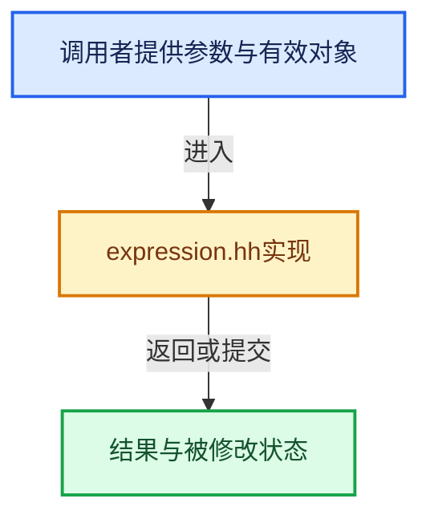

# 实现依赖专题：source/blender/gpu/shader_tool/expression.hh

[方向导航](README.md) · [符号索引](../%E7%AC%A6%E5%8F%B7%E4%BE%9D%E8%B5%96%E4%B8%8E%E5%AE%9E%E7%8E%B0%E7%B4%A2%E5%BC%95.md)

本专题从正文实际调用进入，集中保存共享实现。函数有稳定锚点，可从调用处直接跳到对应完整函数；递归与互相调用通过回链组织。

## 本文件的实现关系





## 完整成员与函数实现

<a id="f-f9b1c3be93dffa2c"></a>

### `blender::gpu::shader::parser::ExpressionParser::eval`

实现位置：[source/blender/gpu/shader_tool/expression.hh](../../../../../source/blender/gpu/shader_tool/expression.hh) · L42—L52。

**教学注释版**

<!-- annotated:740330c1262b81 -->

```cpp
  int64_t eval() const
  {
    // [讲解] assert：检查开发者预期条件，配置可能关闭；不承担完整输入处理或自动修复。
    assert(size_ > 0);
    EvalContext ctx((*this)[0]);

    int64_t v = ctx.expr(EvalContext::BindingPower(0));
    if (ctx.peek() != Invalid) {
      throw std::runtime_error("Trailing input");
    }
    return v;
  }
```

<details>
<summary>核对原始源码：source/blender/gpu/shader_tool/expression.hh · L42—L52</summary>

<!-- original:740330c1262b81:source/blender/gpu/shader_tool/expression.hh:42:52 -->

```cpp
  int64_t eval() const
  {
    assert(size_ > 0);
    EvalContext ctx((*this)[0]);

    int64_t v = ctx.expr(EvalContext::BindingPower(0));
    if (ctx.peek() != Invalid) {
      throw std::runtime_error("Trailing input");
    }
    return v;
  }
```

</details>

**结果出口**

- `return v;`

**继续追踪实现**

- `assert` → [外部契约](https://eel.is/c++draft/assertions)：检查开发者预期条件，配置可能关闭；不承担完整输入处理或自动修复。
- `ctx.expr` → [调用协议](../%E6%A8%A1%E6%9D%BF%E5%AE%8F%E4%B8%8E%E5%8A%A8%E6%80%81%E5%88%86%E6%B4%BE%E5%8D%8F%E8%AE%AE.md)：由接收对象具体类型或运行时策略提供实现。调用位置L47。
- `EvalContext::BindingPower` → [PrattParser::BindingPower::BindingPower · L49](%E4%BE%9D%E8%B5%96-pratt_parser-3d8a76.md#f-07a35c67f039cae5)。
- `ctx.peek` → [blender::gpu::shader::parser::ExpressionParser::EvalContext::peek · L222](%E4%BE%9D%E8%B5%96-expression-a92fb2.md#f-7ad05a2b38c7809c)。
- `std::runtime_error` → [外部契约](https://eel.is/c++draft/)：这个边界按实际表达式及所属类型核对参数、返回值、寿命与失败行为。这里提供接口入口，不声称已解释该第三方版本的内部实现。

<a id="f-7ad05a2b38c7809c"></a>

### `blender::gpu::shader::parser::ExpressionParser::EvalContext::peek`

实现位置：[source/blender/gpu/shader_tool/expression.hh](../../../../../source/blender/gpu/shader_tool/expression.hh) · L222—L225。

**教学注释版**

<!-- annotated:1af9d0e3a8e527 -->

```cpp
    TokenType peek() const
    {
      return tok.type();
    }
```

<details>
<summary>核对原始源码：source/blender/gpu/shader_tool/expression.hh · L222—L225</summary>

<!-- original:1af9d0e3a8e527:source/blender/gpu/shader_tool/expression.hh:222:225 -->

```cpp
    TokenType peek() const
    {
      return tok.type();
    }
```

</details>

**结果出口**

- `return tok.type();`

**继续追踪实现**

- `tok.type` → [blender::gpu::shader::parser::Token::type · L159](%E4%BE%9D%E8%B5%96-token-e86ff5.md#f-2e7ce1ce5f396d1b)。
