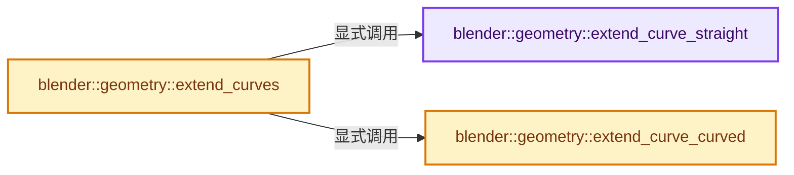
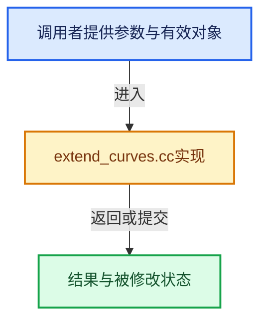

# 实现依赖专题：source/blender/geometry/intern/extend_curves.cc

[方向导航](README.md) · [符号索引](../%E7%AC%A6%E5%8F%B7%E4%BE%9D%E8%B5%96%E4%B8%8E%E5%AE%9E%E7%8E%B0%E7%B4%A2%E5%BC%95.md)

本专题从正文实际调用进入，集中保存共享实现。函数有稳定锚点，可从调用处直接跳到对应完整函数；递归与互相调用通过回链组织。

## 本文件的实现关系






## 完整成员与函数实现

<a id="f-309f4d76f8189962"></a>

### `blender::geometry::extend_curve_straight`

实现位置：[source/blender/geometry/intern/extend_curves.cc](../../../../../source/blender/geometry/intern/extend_curves.cc) · L24—L70。

接口参数：

- `const float used_percent_length`
- `const float new_size`
- `const Span<int> start_points`
- `const Span<int> end_points`
- `const int curve`
- `const IndexRange new_curve`
- `const Span<float> use_start_lengths`
- `const Span<float> use_end_lengths`
- `MutableSpan<float3> positions`

**教学注释版**

<!-- annotated:411041c5717598 -->

```cpp
static void extend_curve_straight(const float used_percent_length,
                                  const float new_size,
                                  const Span<int> start_points,
                                  const Span<int> end_points,
                                  const int curve,
                                  const IndexRange new_curve,
                                  const Span<float> use_start_lengths,
                                  const Span<float> use_end_lengths,
                                  MutableSpan<float3> positions)
{
  float overshoot_point_param = used_percent_length * (new_size - 1);
  if (start_points[curve]) {
    /* Here we use the vector between two adjacent points around #overshoot_point_param as
     * our reference for the direction of extension, however to have better tolerance for jitter,
     * using the vector (a_few_points_back - end_point) might be a better solution in the future.
     */
    int index1 = math::floor(overshoot_point_param);
    int index2 = math::ceil(overshoot_point_param);

    /* When #overshoot_point_param is zero */
    if (index2 == 0) {
      index2 = 1;
    }
    float3 result = math::interpolate(positions[new_curve[index1]],
                                      positions[new_curve[index2]],
                                      fmodf(overshoot_point_param, 1.0f));
    // [讲解] new_curve.first：读取范围两端的有效索引或值。
    result -= positions[new_curve.first()];
    if (math::is_zero(result)) [[unlikely]] {
      result = positions[new_curve[1]] - positions[new_curve[0]];
    }
    positions[new_curve[0]] += result * (-use_start_lengths[curve] / math::length(result));
  }

  if (end_points[curve]) {
    int index1 = new_size - 1 - math::floor(overshoot_point_param);
    int index2 = new_size - 1 - math::ceil(overshoot_point_param);
    float3 result = math::interpolate(positions[new_curve[index1]],
                                      positions[new_curve[index2]],
                                      fmodf(overshoot_point_param, 1.0f));
    // [讲解] new_curve.last：读取范围两端的有效索引或值。
    result -= positions[new_curve.last()];
    if (math::is_zero(result)) [[unlikely]] {
      result = positions[new_curve[new_size - 2]] - positions[new_curve[new_size - 1]];
    }
    positions[new_curve[new_size - 1]] += result *
                                          (-use_end_lengths[curve] / math::length(result));
  }
}
```

<details>
<summary>核对原始源码：source/blender/geometry/intern/extend_curves.cc · L24—L70</summary>

<!-- original:411041c5717598:source/blender/geometry/intern/extend_curves.cc:24:70 -->

```cpp
static void extend_curve_straight(const float used_percent_length,
                                  const float new_size,
                                  const Span<int> start_points,
                                  const Span<int> end_points,
                                  const int curve,
                                  const IndexRange new_curve,
                                  const Span<float> use_start_lengths,
                                  const Span<float> use_end_lengths,
                                  MutableSpan<float3> positions)
{
  float overshoot_point_param = used_percent_length * (new_size - 1);
  if (start_points[curve]) {
    /* Here we use the vector between two adjacent points around #overshoot_point_param as
     * our reference for the direction of extension, however to have better tolerance for jitter,
     * using the vector (a_few_points_back - end_point) might be a better solution in the future.
     */
    int index1 = math::floor(overshoot_point_param);
    int index2 = math::ceil(overshoot_point_param);

    /* When #overshoot_point_param is zero */
    if (index2 == 0) {
      index2 = 1;
    }
    float3 result = math::interpolate(positions[new_curve[index1]],
                                      positions[new_curve[index2]],
                                      fmodf(overshoot_point_param, 1.0f));
    result -= positions[new_curve.first()];
    if (math::is_zero(result)) [[unlikely]] {
      result = positions[new_curve[1]] - positions[new_curve[0]];
    }
    positions[new_curve[0]] += result * (-use_start_lengths[curve] / math::length(result));
  }

  if (end_points[curve]) {
    int index1 = new_size - 1 - math::floor(overshoot_point_param);
    int index2 = new_size - 1 - math::ceil(overshoot_point_param);
    float3 result = math::interpolate(positions[new_curve[index1]],
                                      positions[new_curve[index2]],
                                      fmodf(overshoot_point_param, 1.0f));
    result -= positions[new_curve.last()];
    if (math::is_zero(result)) [[unlikely]] {
      result = positions[new_curve[new_size - 2]] - positions[new_curve[new_size - 1]];
    }
    positions[new_curve[new_size - 1]] += result *
                                          (-use_end_lengths[curve] / math::length(result));
  }
}
```

</details>

**沿实际写入检查状态**

- `index2 = 1;`
- `result -= positions[new_curve.first()];`
- `result = positions[new_curve[1]] - positions[new_curve[0]];`
- `positions[new_curve[0]] += result * (-use_start_lengths[curve] / math::length(result));`
- `result -= positions[new_curve.last()];`
- `result = positions[new_curve[new_size - 2]] - positions[new_curve[new_size - 1]];`

**继续追踪实现**

- `math::floor` → [外部契约](https://eel.is/c++draft/)：这个边界按实际表达式及所属类型核对参数、返回值、寿命与失败行为。这里提供接口入口，不声称已解释该第三方版本的内部实现。
- `math::ceil` → [外部契约](https://eel.is/c++draft/)：这个边界按实际表达式及所属类型核对参数、返回值、寿命与失败行为。这里提供接口入口，不声称已解释该第三方版本的内部实现。
- `math::interpolate` → [blender::math::interpolate · L335](../12-%E7%A9%BA%E9%97%B4%E6%95%B0%E6%8D%AE%E7%BB%93%E6%9E%84%E4%B8%8E%E5%87%A0%E4%BD%95%E7%AE%97%E6%B3%95/%E4%BE%9D%E8%B5%96-math_matrix-d7d8ee.md#f-91e7f517ebd72fb5)；[blender::math::interpolate · L379](../12-%E7%A9%BA%E9%97%B4%E6%95%B0%E6%8D%AE%E7%BB%93%E6%9E%84%E4%B8%8E%E5%87%A0%E4%BD%95%E7%AE%97%E6%B3%95/%E4%BE%9D%E8%B5%96-math_matrix-d7d8ee.md#f-a1be14e86ce595c2)；[blender::math::interpolate · L636](../12-%E7%A9%BA%E9%97%B4%E6%95%B0%E6%8D%AE%E7%BB%93%E6%9E%84%E4%B8%8E%E5%87%A0%E4%BD%95%E7%AE%97%E6%B3%95/%E4%BE%9D%E8%B5%96-BLI_math_vector-906a87.md#f-d612b6d6ab1b6e7c)；[blender::math::interpolate · L303](../12-%E7%A9%BA%E9%97%B4%E6%95%B0%E6%8D%AE%E7%BB%93%E6%9E%84%E4%B8%8E%E5%87%A0%E4%BD%95%E7%AE%97%E6%B3%95/%E4%BE%9D%E8%B5%96-BLI_math_quaternion-cf105d.md#f-48b9ace2a9c6185c)；[blender::math::interpolate · L17](../12-%E7%A9%BA%E9%97%B4%E6%95%B0%E6%8D%AE%E7%BB%93%E6%9E%84%E4%B8%8E%E5%87%A0%E4%BD%95%E7%AE%97%E6%B3%95/%E4%BE%9D%E8%B5%96-BLI_math_color-f3a6ea.md#f-eb5ef92b0f8c0926)；[blender::math::interpolate · L28](../12-%E7%A9%BA%E9%97%B4%E6%95%B0%E6%8D%AE%E7%BB%93%E6%9E%84%E4%B8%8E%E5%87%A0%E4%BD%95%E7%AE%97%E6%B3%95/%E4%BE%9D%E8%B5%96-BLI_math_color-f3a6ea.md#f-2a9e33ec55979ab6)；[blender::math::interpolate · L278](../12-%E7%A9%BA%E9%97%B4%E6%95%B0%E6%8D%AE%E7%BB%93%E6%9E%84%E4%B8%8E%E5%87%A0%E4%BD%95%E7%AE%97%E6%B3%95/%E4%BE%9D%E8%B5%96-BLI_math_base-0728eb.md#f-2629b871528f6528)。同名重载需按实参类型选择。
- `fmodf` → [fmodf · L182](%E4%BE%9D%E8%B5%96-compat-56205c.md#m-56e5993ab048)；[fmodf · L277](%E4%BE%9D%E8%B5%96-compat-efe0e9.md#m-d7e7e2616aed)。宏定义由构建条件选择。
- `new_curve.first` → [blender::IndexRange::first · L204](../01-%E5%9F%BA%E7%A1%80%E5%AE%B9%E5%99%A8%E4%B8%8E%E7%8E%B0%E4%BB%A3CPP/04-IndexRange%E8%BF%9E%E7%BB%AD%E6%95%B4%E6%95%B0%E5%8C%BA%E9%97%B4.md#f-ab443c94e531befa)。
- `math::is_zero` → [blender::math::is_zero · L784](../12-%E7%A9%BA%E9%97%B4%E6%95%B0%E6%8D%AE%E7%BB%93%E6%9E%84%E4%B8%8E%E5%87%A0%E4%BD%95%E7%AE%97%E6%B3%95/%E4%BE%9D%E8%B5%96-BLI_math_vector-906a87.md#f-b05b3db842a9f17e)；[blender::math::is_zero · L108](../12-%E7%A9%BA%E9%97%B4%E6%95%B0%E6%8D%AE%E7%BB%93%E6%9E%84%E4%B8%8E%E5%87%A0%E4%BD%95%E7%AE%97%E6%B3%95/%E4%BE%9D%E8%B5%96-BLI_math_quaternion-cf105d.md#f-b97bee3fbc328c0d)；[blender::math::is_zero · L593](../12-%E7%A9%BA%E9%97%B4%E6%95%B0%E6%8D%AE%E7%BB%93%E6%9E%84%E4%B8%8E%E5%87%A0%E4%BD%95%E7%AE%97%E6%B3%95/%E4%BE%9D%E8%B5%96-BLI_math_matrix-b7b2b4.md#f-b879ac524126b464)；[blender::math::is_zero · L23](../12-%E7%A9%BA%E9%97%B4%E6%95%B0%E6%8D%AE%E7%BB%93%E6%9E%84%E4%B8%8E%E5%87%A0%E4%BD%95%E7%AE%97%E6%B3%95/%E4%BE%9D%E8%B5%96-BLI_math_base-0728eb.md#f-6fdcc74ca7338838)。同名重载需按实参类型选择。
- `math::length` → [blender::math::length · L40](../12-%E7%A9%BA%E9%97%B4%E6%95%B0%E6%8D%AE%E7%BB%93%E6%9E%84%E4%B8%8E%E5%87%A0%E4%BD%95%E7%AE%97%E6%B3%95/%E4%BE%9D%E8%B5%96-BLI_math_vector_mpq_types-faeefa.md#f-16c31b0e3391026f)；[blender::math::length · L49](../12-%E7%A9%BA%E9%97%B4%E6%95%B0%E6%8D%AE%E7%BB%93%E6%9E%84%E4%B8%8E%E5%87%A0%E4%BD%95%E7%AE%97%E6%B3%95/%E4%BE%9D%E8%B5%96-BLI_math_vector_mpq_types-faeefa.md#f-82d5aa193c621065)；[blender::math::length · L457](../12-%E7%A9%BA%E9%97%B4%E6%95%B0%E6%8D%AE%E7%BB%93%E6%9E%84%E4%B8%8E%E5%87%A0%E4%BD%95%E7%AE%97%E6%B3%95/%E4%BE%9D%E8%B5%96-BLI_math_vector-906a87.md#f-2c7dceafa898907c)。同名重载需按实参类型选择。
- `new_curve.last` → [blender::IndexRange::last · L214](../01-%E5%9F%BA%E7%A1%80%E5%AE%B9%E5%99%A8%E4%B8%8E%E7%8E%B0%E4%BB%A3CPP/04-IndexRange%E8%BF%9E%E7%BB%AD%E6%95%B4%E6%95%B0%E5%8C%BA%E9%97%B4.md#f-66896c6351a40de1)；[blender::gpu::shader::parser::IndexRange::last · L62](%E4%BE%9D%E8%B5%96-utils-06433d.md#f-373501206569c3b3)。同名重载需按实参类型选择。

<a id="f-a39e764033a59f51"></a>

### `blender::geometry::extend_curve_curved`

实现位置：[source/blender/geometry/intern/extend_curves.cc](../../../../../source/blender/geometry/intern/extend_curves.cc) · L72—L197。

接口参数：

- `const float used_percent_length`
- `const Span<int> start_points`
- `const Span<int> end_points`
- `const OffsetIndices<int> points_by_curve`
- `const int curve`
- `const IndexRange new_curve`
- `const Span<float> use_start_lengths`
- `const Span<float> use_end_lengths`
- `const float max_angle`
- `const float segment_influence`
- `const bool invert_curvature`
- `MutableSpan<float3> positions`

**教学注释版**

<!-- annotated:5e93dd60a4b491 -->

```cpp
static void extend_curve_curved(const float used_percent_length,
                                const Span<int> start_points,
                                const Span<int> end_points,
                                const OffsetIndices<int> points_by_curve,
                                const int curve,
                                const IndexRange new_curve,
                                const Span<float> use_start_lengths,
                                const Span<float> use_end_lengths,
                                const float max_angle,
                                const float segment_influence,
                                const bool invert_curvature,
                                MutableSpan<float3> positions)
{
  /* Curvature calculation. */
  const int first_old_index = start_points[curve] ? start_points[curve] : 0;
  const int last_old_index = points_by_curve[curve].size() - 1 + first_old_index;
  const int orig_totpoints = points_by_curve[curve].size();

  /* The fractional amount of points to query when calculating the average curvature of the
   * strokes. */
  const float overshoot_parameter = used_percent_length * (orig_totpoints - 2);
  int overshoot_pointcount = math::ceil(overshoot_parameter);
  overshoot_pointcount = math::clamp(overshoot_pointcount, 1, orig_totpoints - 2);

  /* Do for both sides without code duplication. */
  float3 vec1, total_angle;
  for (int k = 0; k < 2; k++) {
    if ((k == 0 && !start_points[curve]) || (k == 1 && !end_points[curve])) {
      continue;
    }

    const int start_i = k == 0 ? first_old_index : last_old_index;
    const int dir_i = 1 - k * 2;

    vec1 = positions[new_curve[start_i + dir_i]] - positions[new_curve[start_i]];
    total_angle = float3({0, 0, 0});

    float segment_length;
    vec1 = math::normalize_and_get_length(vec1, segment_length);

    float overshoot_length = 0.0f;

    /* Accumulate rotation angle and length. */
    int j = 0;
    float3 no, vec2;
    for (int i = start_i; j < overshoot_pointcount; i += dir_i, j++) {
      /* Don't fully add last segment to get continuity in overshoot_fac. */
      float fac = math::min(overshoot_parameter - j, 1.0f);

      /* Read segments. */
      vec2 = vec1;
      vec1 = positions[new_curve[i + dir_i * 2]] - positions[new_curve[i + dir_i]];

      float len;
      vec1 = math::normalize_and_get_length(vec1, len);
      float angle = math::angle_between(vec1, vec2).radian() * fac;

      /* Add half of both adjacent legs of the current angle. */
      const float added_len = (segment_length + len) * 0.5f * fac;
      overshoot_length += added_len;
      segment_length = len;

      if (angle > max_angle) {
        continue;
      }
      if (angle > M_PI * 0.995f) {
        continue;
      }

      angle *= math::pow(added_len, segment_influence);

      no = math::cross(vec1, vec2);
      no = math::normalize(no) * angle;
      total_angle += no;
    }

    if (overshoot_length == 0.0f) [[unlikely]] {
      /* Don't do a proper extension if the used points are all in the same position. */
      continue;
    }

    vec1 = positions[new_curve[start_i]] - positions[new_curve[start_i + dir_i]];
    /* In general curvature = 1/radius. For the case without the
     * weights introduced by #segment_influence, the calculation is:
     * `curvature = delta angle/delta arclength = len_v3(total_angle) / overshoot_length` */
    float curvature = normalize_v3(total_angle) / overshoot_length;
    /* Compensate for the weights powf(added_len, segment_influence). */
    curvature /= math::pow(overshoot_length / math::min(overshoot_parameter, float(j)),
                           segment_influence);
    if (invert_curvature) {
      curvature = -curvature;
    }
    const float dist = k == 0 ? use_start_lengths[curve] : use_end_lengths[curve];
    const int extra_point_count = k == 0 ? start_points[curve] : end_points[curve];
    const float angle_step = curvature * dist / extra_point_count;
    float step_length = dist / extra_point_count;
    if (math::abs(angle_step) > FLT_EPSILON) {
      /* Make a direct step length from the assigned arc step length. */
      step_length *= sin(angle_step * 0.5f) / (angle_step * 0.5f);
    }
    else {
      total_angle = float3({0, 0, 0});
    }
    float prev_length;
    vec1 = math::normalize_and_get_length(vec1, prev_length);
    vec1 *= step_length;

    /* Build rotation matrix here to get best performance. */
    math::AxisAngle axis_base(total_angle, angle_step);
    math::Quaternion q = math::to_quaternion(axis_base);
    float3x3 rot = math::from_rotation<float3x3>(q);

    /* Rotate the starting direction to account for change in edge lengths. */
    math::AxisAngle step_base(total_angle,
                              math::max(0.0f, 1.0f - math::abs(segment_influence)) *
                                  (curvature * prev_length - angle_step) / 2.0f);
    q = math::to_quaternion(step_base);
    vec1 = math::transform_point(q, vec1);

    /* Now iteratively accumulate the segments with a rotating added direction. */
    for (int i = start_i - dir_i, j = 0; j < extra_point_count; i -= dir_i, j++) {
      vec1 = rot * vec1;
      positions[new_curve[i]] = vec1 + positions[new_curve[i + dir_i]];
    }
  }
}
```

<details>
<summary>核对原始源码：source/blender/geometry/intern/extend_curves.cc · L72—L197</summary>

<!-- original:5e93dd60a4b491:source/blender/geometry/intern/extend_curves.cc:72:197 -->

```cpp
static void extend_curve_curved(const float used_percent_length,
                                const Span<int> start_points,
                                const Span<int> end_points,
                                const OffsetIndices<int> points_by_curve,
                                const int curve,
                                const IndexRange new_curve,
                                const Span<float> use_start_lengths,
                                const Span<float> use_end_lengths,
                                const float max_angle,
                                const float segment_influence,
                                const bool invert_curvature,
                                MutableSpan<float3> positions)
{
  /* Curvature calculation. */
  const int first_old_index = start_points[curve] ? start_points[curve] : 0;
  const int last_old_index = points_by_curve[curve].size() - 1 + first_old_index;
  const int orig_totpoints = points_by_curve[curve].size();

  /* The fractional amount of points to query when calculating the average curvature of the
   * strokes. */
  const float overshoot_parameter = used_percent_length * (orig_totpoints - 2);
  int overshoot_pointcount = math::ceil(overshoot_parameter);
  overshoot_pointcount = math::clamp(overshoot_pointcount, 1, orig_totpoints - 2);

  /* Do for both sides without code duplication. */
  float3 vec1, total_angle;
  for (int k = 0; k < 2; k++) {
    if ((k == 0 && !start_points[curve]) || (k == 1 && !end_points[curve])) {
      continue;
    }

    const int start_i = k == 0 ? first_old_index : last_old_index;
    const int dir_i = 1 - k * 2;

    vec1 = positions[new_curve[start_i + dir_i]] - positions[new_curve[start_i]];
    total_angle = float3({0, 0, 0});

    float segment_length;
    vec1 = math::normalize_and_get_length(vec1, segment_length);

    float overshoot_length = 0.0f;

    /* Accumulate rotation angle and length. */
    int j = 0;
    float3 no, vec2;
    for (int i = start_i; j < overshoot_pointcount; i += dir_i, j++) {
      /* Don't fully add last segment to get continuity in overshoot_fac. */
      float fac = math::min(overshoot_parameter - j, 1.0f);

      /* Read segments. */
      vec2 = vec1;
      vec1 = positions[new_curve[i + dir_i * 2]] - positions[new_curve[i + dir_i]];

      float len;
      vec1 = math::normalize_and_get_length(vec1, len);
      float angle = math::angle_between(vec1, vec2).radian() * fac;

      /* Add half of both adjacent legs of the current angle. */
      const float added_len = (segment_length + len) * 0.5f * fac;
      overshoot_length += added_len;
      segment_length = len;

      if (angle > max_angle) {
        continue;
      }
      if (angle > M_PI * 0.995f) {
        continue;
      }

      angle *= math::pow(added_len, segment_influence);

      no = math::cross(vec1, vec2);
      no = math::normalize(no) * angle;
      total_angle += no;
    }

    if (overshoot_length == 0.0f) [[unlikely]] {
      /* Don't do a proper extension if the used points are all in the same position. */
      continue;
    }

    vec1 = positions[new_curve[start_i]] - positions[new_curve[start_i + dir_i]];
    /* In general curvature = 1/radius. For the case without the
     * weights introduced by #segment_influence, the calculation is:
     * `curvature = delta angle/delta arclength = len_v3(total_angle) / overshoot_length` */
    float curvature = normalize_v3(total_angle) / overshoot_length;
    /* Compensate for the weights powf(added_len, segment_influence). */
    curvature /= math::pow(overshoot_length / math::min(overshoot_parameter, float(j)),
                           segment_influence);
    if (invert_curvature) {
      curvature = -curvature;
    }
    const float dist = k == 0 ? use_start_lengths[curve] : use_end_lengths[curve];
    const int extra_point_count = k == 0 ? start_points[curve] : end_points[curve];
    const float angle_step = curvature * dist / extra_point_count;
    float step_length = dist / extra_point_count;
    if (math::abs(angle_step) > FLT_EPSILON) {
      /* Make a direct step length from the assigned arc step length. */
      step_length *= sin(angle_step * 0.5f) / (angle_step * 0.5f);
    }
    else {
      total_angle = float3({0, 0, 0});
    }
    float prev_length;
    vec1 = math::normalize_and_get_length(vec1, prev_length);
    vec1 *= step_length;

    /* Build rotation matrix here to get best performance. */
    math::AxisAngle axis_base(total_angle, angle_step);
    math::Quaternion q = math::to_quaternion(axis_base);
    float3x3 rot = math::from_rotation<float3x3>(q);

    /* Rotate the starting direction to account for change in edge lengths. */
    math::AxisAngle step_base(total_angle,
                              math::max(0.0f, 1.0f - math::abs(segment_influence)) *
                                  (curvature * prev_length - angle_step) / 2.0f);
    q = math::to_quaternion(step_base);
    vec1 = math::transform_point(q, vec1);

    /* Now iteratively accumulate the segments with a rotating added direction. */
    for (int i = start_i - dir_i, j = 0; j < extra_point_count; i -= dir_i, j++) {
      vec1 = rot * vec1;
      positions[new_curve[i]] = vec1 + positions[new_curve[i + dir_i]];
    }
  }
}
```

</details>

**沿实际写入检查状态**

- `overshoot_pointcount = math::clamp(overshoot_pointcount, 1, orig_totpoints - 2);`
- `vec1 = positions[new_curve[start_i + dir_i]] - positions[new_curve[start_i]];`
- `total_angle = float3({0, 0, 0});`
- `vec1 = math::normalize_and_get_length(vec1, segment_length);`
- `vec2 = vec1;`
- `vec1 = positions[new_curve[i + dir_i * 2]] - positions[new_curve[i + dir_i]];`
- `vec1 = math::normalize_and_get_length(vec1, len);`
- `overshoot_length += added_len;`
- `segment_length = len;`
- `angle *= math::pow(added_len, segment_influence);`
- `no = math::cross(vec1, vec2);`
- `no = math::normalize(no) * angle;`
- `total_angle += no;`
- `vec1 = positions[new_curve[start_i]] - positions[new_curve[start_i + dir_i]];`
- `curvature = -curvature;`
- `step_length *= sin(angle_step * 0.5f) / (angle_step * 0.5f);`
- `vec1 = math::normalize_and_get_length(vec1, prev_length);`
- `vec1 *= step_length;`
- `q = math::to_quaternion(step_base);`
- `vec1 = math::transform_point(q, vec1);`
- `vec1 = rot * vec1;`
- `positions[new_curve[i]] = vec1 + positions[new_curve[i + dir_i]];`

**继续追踪实现**

- `points_by_curve[curve].size` → [调用协议](../%E6%A8%A1%E6%9D%BF%E5%AE%8F%E4%B8%8E%E5%8A%A8%E6%80%81%E5%88%86%E6%B4%BE%E5%8D%8F%E8%AE%AE.md)：接收对象类型依赖auto、返回值或模板实例；不按同名猜测目标。调用位置L87。
- `math::ceil` → [外部契约](https://eel.is/c++draft/)：这个边界按实际表达式及所属类型核对参数、返回值、寿命与失败行为。这里提供接口入口，不声称已解释该第三方版本的内部实现。
- `math::clamp` → [blender::math::clamp · L118](../12-%E7%A9%BA%E9%97%B4%E6%95%B0%E6%8D%AE%E7%BB%93%E6%9E%84%E4%B8%8E%E5%87%A0%E4%BD%95%E7%AE%97%E6%B3%95/%E4%BE%9D%E8%B5%96-BLI_math_vector-906a87.md#f-65702e97e59fc41e)；[blender::math::clamp · L130](../12-%E7%A9%BA%E9%97%B4%E6%95%B0%E6%8D%AE%E7%BB%93%E6%9E%84%E4%B8%8E%E5%87%A0%E4%BD%95%E7%AE%97%E6%B3%95/%E4%BE%9D%E8%B5%96-BLI_math_vector-906a87.md#f-0365873940e23a11)；[blender::math::clamp · L69](../12-%E7%A9%BA%E9%97%B4%E6%95%B0%E6%8D%AE%E7%BB%93%E6%9E%84%E4%B8%8E%E5%87%A0%E4%BD%95%E7%AE%97%E6%B3%95/%E4%BE%9D%E8%B5%96-BLI_math_base-0728eb.md#f-9282cf5d06fa3723)。同名重载需按实参类型选择。
- `float3` → [float3 · L641](%E4%BE%9D%E8%B5%96-smaa-b67bc2.md#m-0ea8254cfdb4)。宏定义由构建条件选择。
- `math::normalize_and_get_length` → [blender::math::normalize_and_get_length · L526](../12-%E7%A9%BA%E9%97%B4%E6%95%B0%E6%8D%AE%E7%BB%93%E6%9E%84%E4%B8%8E%E5%87%A0%E4%BD%95%E7%AE%97%E6%B3%95/%E4%BE%9D%E8%B5%96-BLI_math_vector-906a87.md#f-77d1393eb1349806)；[blender::math::normalize_and_get_length · L250](../12-%E7%A9%BA%E9%97%B4%E6%95%B0%E6%8D%AE%E7%BB%93%E6%9E%84%E4%B8%8E%E5%87%A0%E4%BD%95%E7%AE%97%E6%B3%95/%E4%BE%9D%E8%B5%96-BLI_math_quaternion-cf105d.md#f-6fcf25529d2136aa)。同名重载需按实参类型选择。
- `math::min` → [blender::math::min · L56](../12-%E7%A9%BA%E9%97%B4%E6%95%B0%E6%8D%AE%E7%BB%93%E6%9E%84%E4%B8%8E%E5%87%A0%E4%BD%95%E7%AE%97%E6%B3%95/%E4%BE%9D%E8%B5%96-BLI_math_vector-906a87.md#f-ee6ead51e4bb3364)；[blender::math::min · L65](../12-%E7%A9%BA%E9%97%B4%E6%95%B0%E6%8D%AE%E7%BB%93%E6%9E%84%E4%B8%8E%E5%87%A0%E4%BD%95%E7%AE%97%E6%B3%95/%E4%BE%9D%E8%B5%96-BLI_math_vector-906a87.md#f-f65ce48b3051cce3)；[blender::math::min · L81](../12-%E7%A9%BA%E9%97%B4%E6%95%B0%E6%8D%AE%E7%BB%93%E6%9E%84%E4%B8%8E%E5%87%A0%E4%BD%95%E7%AE%97%E6%B3%95/%E4%BE%9D%E8%B5%96-BLI_math_vector-906a87.md#f-9c602d29fab41795)；[blender::math::min · L43](../12-%E7%A9%BA%E9%97%B4%E6%95%B0%E6%8D%AE%E7%BB%93%E6%9E%84%E4%B8%8E%E5%87%A0%E4%BD%95%E7%AE%97%E6%B3%95/%E4%BE%9D%E8%B5%96-BLI_math_base-0728eb.md#f-72ff0c229e6c09b0)。同名重载需按实参类型选择。
- `math::angle_between(vec1, vec2).radian` → [调用协议](../%E6%A8%A1%E6%9D%BF%E5%AE%8F%E4%B8%8E%E5%8A%A8%E6%80%81%E5%88%86%E6%B4%BE%E5%8D%8F%E8%AE%AE.md)：接收对象类型依赖auto、返回值或模板实例；不按同名猜测目标。调用位置L127。
- `math::angle_between` → [blender::math::angle_between · L151](../12-%E7%A9%BA%E9%97%B4%E6%95%B0%E6%8D%AE%E7%BB%93%E6%9E%84%E4%B8%8E%E5%87%A0%E4%BD%95%E7%AE%97%E6%B3%95/%E4%BE%9D%E8%B5%96-BLI_math_rotation-f8b98a.md#f-b19459f175a6ddcb)；[blender::math::angle_between · L157](../12-%E7%A9%BA%E9%97%B4%E6%95%B0%E6%8D%AE%E7%BB%93%E6%9E%84%E4%B8%8E%E5%87%A0%E4%BD%95%E7%AE%97%E6%B3%95/%E4%BE%9D%E8%B5%96-BLI_math_rotation-f8b98a.md#f-30033a924d07192e)；[blender::math::angle_between · L164](../12-%E7%A9%BA%E9%97%B4%E6%95%B0%E6%8D%AE%E7%BB%93%E6%9E%84%E4%B8%8E%E5%87%A0%E4%BD%95%E7%AE%97%E6%B3%95/%E4%BE%9D%E8%B5%96-BLI_math_rotation-f8b98a.md#f-a35fe0ed487c166d)。同名重载需按实参类型选择。
- `math::pow` → [外部契约](https://eel.is/c++draft/)：这个边界按实际表达式及所属类型核对参数、返回值、寿命与失败行为。这里提供接口入口，不声称已解释该第三方版本的内部实现。
- `math::cross` → [blender::math::cross · L549](../12-%E7%A9%BA%E9%97%B4%E6%95%B0%E6%8D%AE%E7%BB%93%E6%9E%84%E4%B8%8E%E5%87%A0%E4%BD%95%E7%AE%97%E6%B3%95/%E4%BE%9D%E8%B5%96-BLI_math_vector-906a87.md#f-cb1b14dc107aa107)；[blender::math::cross · L562](../12-%E7%A9%BA%E9%97%B4%E6%95%B0%E6%8D%AE%E7%BB%93%E6%9E%84%E4%B8%8E%E5%87%A0%E4%BD%95%E7%AE%97%E6%B3%95/%E4%BE%9D%E8%B5%96-BLI_math_vector-906a87.md#f-8dcac1cc63a3672a)；[blender::math::cross · L217](../12-%E7%A9%BA%E9%97%B4%E6%95%B0%E6%8D%AE%E7%BB%93%E6%9E%84%E4%B8%8E%E5%87%A0%E4%BD%95%E7%AE%97%E6%B3%95/%E4%BE%9D%E8%B5%96-BLI_math_basis_types-fc7090.md#f-0cb9fb63f068f85e)。同名重载需按实参类型选择。
- `math::normalize` → [blender::math::normalize · L542](../12-%E7%A9%BA%E9%97%B4%E6%95%B0%E6%8D%AE%E7%BB%93%E6%9E%84%E4%B8%8E%E5%87%A0%E4%BD%95%E7%AE%97%E6%B3%95/%E4%BE%9D%E8%B5%96-BLI_math_vector-906a87.md#f-5bea914457e11f7f)；[blender::math::normalize · L258](../12-%E7%A9%BA%E9%97%B4%E6%95%B0%E6%8D%AE%E7%BB%93%E6%9E%84%E4%B8%8E%E5%87%A0%E4%BD%95%E7%AE%97%E6%B3%95/%E4%BE%9D%E8%B5%96-BLI_math_quaternion-cf105d.md#f-5bf6b351333e4054)；[blender::math::normalize · L450](../12-%E7%A9%BA%E9%97%B4%E6%95%B0%E6%8D%AE%E7%BB%93%E6%9E%84%E4%B8%8E%E5%87%A0%E4%BD%95%E7%AE%97%E6%B3%95/%E4%BE%9D%E8%B5%96-BLI_math_quaternion-cf105d.md#f-b852cee8f0cc9b6a)；[blender::math::normalize · L745](../12-%E7%A9%BA%E9%97%B4%E6%95%B0%E6%8D%AE%E7%BB%93%E6%9E%84%E4%B8%8E%E5%87%A0%E4%BD%95%E7%AE%97%E6%B3%95/%E4%BE%9D%E8%B5%96-BLI_math_matrix-b7b2b4.md#f-2235cb6f5ec7ff18)；[blender::math::normalize · L783](../12-%E7%A9%BA%E9%97%B4%E6%95%B0%E6%8D%AE%E7%BB%93%E6%9E%84%E4%B8%8E%E5%87%A0%E4%BD%95%E7%AE%97%E6%B3%95/%E4%BE%9D%E8%B5%96-BLI_math_matrix-b7b2b4.md#f-0386bc4ee9ac7425)。同名重载需按实参类型选择。
- `normalize_v3` → [blender::normalize_v3 · L933](../12-%E7%A9%BA%E9%97%B4%E6%95%B0%E6%8D%AE%E7%BB%93%E6%9E%84%E4%B8%8E%E5%87%A0%E4%BD%95%E7%AE%97%E6%B3%95/%E4%BE%9D%E8%B5%96-math_vector_inline-0c8541.md#f-5f3257e657ef732c)。
- `math::abs` → [blender::math::abs · L38](../12-%E7%A9%BA%E9%97%B4%E6%95%B0%E6%8D%AE%E7%BB%93%E6%9E%84%E4%B8%8E%E5%87%A0%E4%BD%95%E7%AE%97%E6%B3%95/%E4%BE%9D%E8%B5%96-BLI_math_vector-906a87.md#f-e755530125bc2198)；[blender::math::abs · L201](../12-%E7%A9%BA%E9%97%B4%E6%95%B0%E6%8D%AE%E7%BB%93%E6%9E%84%E4%B8%8E%E5%87%A0%E4%BD%95%E7%AE%97%E6%B3%95/%E4%BE%9D%E8%B5%96-BLI_math_basis_types-fc7090.md#f-a137ffce39989ffc)；[blender::math::abs · L33](../12-%E7%A9%BA%E9%97%B4%E6%95%B0%E6%8D%AE%E7%BB%93%E6%9E%84%E4%B8%8E%E5%87%A0%E4%BD%95%E7%AE%97%E6%B3%95/%E4%BE%9D%E8%B5%96-BLI_math_base-0728eb.md#f-a2c9c981f4e8420c)。同名重载需按实参类型选择。
- `sin` → [外部契约](https://eel.is/c++draft/)：这个边界按实际表达式及所属类型核对参数、返回值、寿命与失败行为。这里提供接口入口，不声称已解释该第三方版本的内部实现。
- `math::to_quaternion` → [blender::math::to_quaternion · L400](../12-%E7%A9%BA%E9%97%B4%E6%95%B0%E6%8D%AE%E7%BB%93%E6%9E%84%E4%B8%8E%E5%87%A0%E4%BD%95%E7%AE%97%E6%B3%95/%E4%BE%9D%E8%B5%96-BLI_math_rotation-f8b98a.md#f-8368957aa016c3c4)；[blender::math::to_quaternion · L50](../12-%E7%A9%BA%E9%97%B4%E6%95%B0%E6%8D%AE%E7%BB%93%E6%9E%84%E4%B8%8E%E5%87%A0%E4%BD%95%E7%AE%97%E6%B3%95/%E4%BE%9D%E8%B5%96-BLI_math_euler-8ad87a.md#f-dfb9029b915ba7ec)；[blender::math::to_quaternion · L75](../12-%E7%A9%BA%E9%97%B4%E6%95%B0%E6%8D%AE%E7%BB%93%E6%9E%84%E4%B8%8E%E5%87%A0%E4%BD%95%E7%AE%97%E6%B3%95/%E4%BE%9D%E8%B5%96-BLI_math_euler-8ad87a.md#f-e3803542ea9383ea)；[blender::math::to_quaternion · L70](../12-%E7%A9%BA%E9%97%B4%E6%95%B0%E6%8D%AE%E7%BB%93%E6%9E%84%E4%B8%8E%E5%87%A0%E4%BD%95%E7%AE%97%E6%B3%95/%E4%BE%9D%E8%B5%96-BLI_math_axis_angle-623a67.md#f-a87213edc1fe438e)。同名重载需按实参类型选择。
- `math::from_rotation<float3x3>` → [调用协议](../%E6%A8%A1%E6%9D%BF%E5%AE%8F%E4%B8%8E%E5%8A%A8%E6%80%81%E5%88%86%E6%B4%BE%E5%8D%8F%E8%AE%AE.md)：函数指针、局部可调用对象或未展开的宏；必须结合调用者环境。调用位置L182。
- `math::max` → [blender::math::max · L87](../12-%E7%A9%BA%E9%97%B4%E6%95%B0%E6%8D%AE%E7%BB%93%E6%9E%84%E4%B8%8E%E5%87%A0%E4%BD%95%E7%AE%97%E6%B3%95/%E4%BE%9D%E8%B5%96-BLI_math_vector-906a87.md#f-9be564a293777d6b)；[blender::math::max · L96](../12-%E7%A9%BA%E9%97%B4%E6%95%B0%E6%8D%AE%E7%BB%93%E6%9E%84%E4%B8%8E%E5%87%A0%E4%BD%95%E7%AE%97%E6%B3%95/%E4%BE%9D%E8%B5%96-BLI_math_vector-906a87.md#f-ce32dff37d0af3bc)；[blender::math::max · L112](../12-%E7%A9%BA%E9%97%B4%E6%95%B0%E6%8D%AE%E7%BB%93%E6%9E%84%E4%B8%8E%E5%87%A0%E4%BD%95%E7%AE%97%E6%B3%95/%E4%BE%9D%E8%B5%96-BLI_math_vector-906a87.md#f-668eb1fcf1fa8292)；[blender::math::max · L49](../12-%E7%A9%BA%E9%97%B4%E6%95%B0%E6%8D%AE%E7%BB%93%E6%9E%84%E4%B8%8E%E5%87%A0%E4%BD%95%E7%AE%97%E6%B3%95/%E4%BE%9D%E8%B5%96-BLI_math_base-0728eb.md#f-a6991ca3d12937e1)。同名重载需按实参类型选择。
- `math::transform_point` → [blender::math::transform_point · L318](../12-%E7%A9%BA%E9%97%B4%E6%95%B0%E6%8D%AE%E7%BB%93%E6%9E%84%E4%B8%8E%E5%87%A0%E4%BD%95%E7%AE%97%E6%B3%95/%E4%BE%9D%E8%B5%96-BLI_math_quaternion-cf105d.md#f-e52a2e8c12e32657)；[blender::math::transform_point · L491](../12-%E7%A9%BA%E9%97%B4%E6%95%B0%E6%8D%AE%E7%BB%93%E6%9E%84%E4%B8%8E%E5%87%A0%E4%BD%95%E7%AE%97%E6%B3%95/%E4%BE%9D%E8%B5%96-BLI_math_quaternion-cf105d.md#f-6c9f8362c60efe6c)；[blender::math::transform_point · L445](../12-%E7%A9%BA%E9%97%B4%E6%95%B0%E6%8D%AE%E7%BB%93%E6%9E%84%E4%B8%8E%E5%87%A0%E4%BD%95%E7%AE%97%E6%B3%95/%E4%BE%9D%E8%B5%96-BLI_math_basis_types-fc7090.md#f-a151fd44ae743502)。同名重载需按实参类型选择。

<a id="f-3610d5742fc0f2dd"></a>

### `blender::geometry::extend_curves`

实现位置：[source/blender/geometry/intern/extend_curves.cc](../../../../../source/blender/geometry/intern/extend_curves.cc) · L199—L368。

接口参数：

- `bke::CurvesGeometry &src_curves`
- `const IndexMask &selection`
- `const VArray<float> &start_lengths`
- `const VArray<float> &end_lengths`
- `const float overshoot_fac`
- `const bool follow_curvature`
- `const float point_density`
- `const float segment_influence`
- `const float max_angle`
- `const bool invert_curvature`
- `const GeometryNodeCurveSampleMode sample_mode`
- `const bke::AttributeFilter &attribute_filter`

**教学注释版**

<!-- annotated:07dc197b65fcfe -->

```cpp
bke::CurvesGeometry extend_curves(bke::CurvesGeometry &src_curves,
                                  const IndexMask &selection,
                                  const VArray<float> &start_lengths,
                                  const VArray<float> &end_lengths,
                                  const float overshoot_fac,
                                  const bool follow_curvature,
                                  const float point_density,
                                  const float segment_influence,
                                  const float max_angle,
                                  const bool invert_curvature,
                                  const GeometryNodeCurveSampleMode sample_mode,
                                  const bke::AttributeFilter &attribute_filter)
{
  if (src_curves.points_num() < 2) {
    return src_curves;
  }
  if (selection.is_empty()) {
    return src_curves;
  }

  const int src_curves_num = src_curves.curves_num();

  /* Extra point count at the start/end of extended strokes. For straight extension, or for strokes
   * with only 2 points (thus unable to curve), the value of their respective index should be set
   * to 1 to allow #extend_curves_straight() to identify strokes to work on. */
  Array<int> start_points(src_curves_num, 0);
  Array<int> end_points(src_curves_num, 0);

  Array<float> use_start_lengths(src_curves_num);
  Array<float> use_end_lengths(src_curves_num);

  const OffsetIndices<int> points_by_curve = src_curves.points_by_curve();

  src_curves.ensure_evaluated_lengths();
  selection.foreach_index([&](const int curve) {
    use_start_lengths[curve] = start_lengths[curve];
    use_end_lengths[curve] = end_lengths[curve];
    if (sample_mode == GEO_NODE_CURVE_SAMPLE_FACTOR) {
      float total_length = src_curves.evaluated_length_total_for_curve(curve, false);
      use_start_lengths[curve] *= total_length;
      use_end_lengths[curve] *= total_length;
    }
  });

  bke::CurvesGeometry dst_curves;

  if (!follow_curvature) {
    /* Use the old curves when extending straight when no new points are added. */
    // [讲解] std::move：把表达式转换成可供移动重载选择的值类别；不保证真的移动，不结束源对象寿命，对const值可能选择复制。
    dst_curves = std::move(src_curves);
    /* Enable affected curves for #extend_curves_straight(). */
    index_mask::masked_fill<int>(start_points, 1, selection);
    index_mask::masked_fill<int>(end_points, 1, selection);
  }
  else {
    /* Copy only curves domain since we are not changing the number of curves here. */
    dst_curves = bke::curves::copy_only_curve_domain(src_curves);
    MutableSpan<int> dst_points_by_curve = dst_curves.offsets_for_write();
    offset_indices::copy_group_sizes(
        src_curves.points_by_curve(), src_curves.curves_range(), dst_points_by_curve);
    /* Count how many points we need. */
    selection.foreach_index([&](const int curve) {
      const int point_count = dst_points_by_curve[curve];
      if (point_count <= 2) {
        /* Can't make a curve, set start/end points to 1 to allow straight extension. */
        start_points[curve] = 1;
        end_points[curve] = 1;
        return;
      }

      const int count_start = (use_start_lengths[curve] > 0) ?
                                  math::ceil(use_start_lengths[curve] * point_density) :
                                  0;
      const int count_end = (use_end_lengths[curve] > 0) ?
                                math::ceil(use_end_lengths[curve] * point_density) :
                                0;
      dst_points_by_curve[curve] += count_start;
      dst_points_by_curve[curve] += count_end;
      start_points[curve] = count_start;
      end_points[curve] = count_end;
    });

    OffsetIndices dst_indices = offset_indices::accumulate_counts_to_offsets(dst_points_by_curve);
    // [讲解] dst_points_by_curve.last：按视图边界访问元素。
    int target_point_count = dst_points_by_curve.last();

    /* Make destination to source map for points. */
    Array<int> dst_to_src_point(target_point_count);
    for (const int curve : src_curves.curves_range()) {
      const int point_count = points_by_curve[curve].size();
      int local_front = 0;
      // [讲解] dst_to_src_point.as_mutable_span：提供数组的借用访问入口。
      MutableSpan<int> new_points_by_curve = dst_to_src_point.as_mutable_span().slice(
          dst_indices[curve]);
      if (point_count <= 2) {
        for (const int point_i : new_points_by_curve.index_range()) {
          new_points_by_curve[point_i] = points_by_curve[curve][point_i];
        }
        continue;
      }
      if (follow_curvature) {
        // [讲解] new_points_by_curve.slice：从已有范围生成子范围。
        MutableSpan<int> starts = new_points_by_curve.slice(0, start_points[curve]);
        // [讲解] starts.fill：修改已有目标元素，不改变底层容器长度。
        starts.fill(points_by_curve[curve].first());
        local_front = start_points[curve];
        MutableSpan<int> ends = new_points_by_curve.slice(
            // [讲解] new_points_by_curve.size：读取连续区间或分组的边界信息。
            new_points_by_curve.size() - end_points[curve], end_points[curve]);
        ends.fill(points_by_curve[curve].last());
      }
      MutableSpan<int> original_points = new_points_by_curve.slice(local_front, point_count);
      // [讲解] original_points.index_range：查询视图长度或生成对应有效索引区间。
      for (const int point_i : original_points.index_range()) {
        original_points[point_i] = points_by_curve[curve][point_i];
      }
    }

    dst_curves.resize(target_point_count, src_curves_num);

    const bke::AttributeAccessor src_attributes = src_curves.attributes();
    bke::MutableAttributeAccessor dst_attributes = dst_curves.attributes_for_write();

    /* Transfer point attributes. */
    gather_attributes(src_attributes,
                      bke::AttrDomain::Point,
                      bke::AttrDomain::Point,
                      attribute_filter,
                      dst_to_src_point,
                      dst_attributes);
  }

  MutableSpan<float3> positions = dst_curves.positions_for_write();

  const OffsetIndices<int> new_points_by_curve = dst_curves.points_by_curve();
  threading::parallel_for(dst_curves.curves_range(), 512, [&](const IndexRange curves_range) {
    for (const int curve : curves_range) {
      const IndexRange new_curve = new_points_by_curve[curve];
      int new_size = new_curve.size();

      /* #used_percent_length must always be finite and non-zero. */
      const float used_percent_length = math::clamp(
          isfinite(overshoot_fac) ? overshoot_fac : 0.1f, 1e-4f, 1.0f);

      if (!follow_curvature || new_size == 2) {
        extend_curve_straight(used_percent_length,
                              new_size,
                              // [讲解] start_points.as_span：提供数组的借用访问入口。
                              start_points.as_span(),
                              end_points.as_span(),
                              curve,
                              new_curve,
                              use_start_lengths.as_span(),
                              use_end_lengths.as_span(),
                              positions);
      }
      else if (start_points[curve] > 0 || end_points[curve] > 0) {
        extend_curve_curved(used_percent_length,
                            start_points.as_span(),
                            end_points.as_span(),
                            points_by_curve,
                            curve,
                            new_curve,
                            use_start_lengths.as_span(),
                            use_end_lengths.as_span(),
                            max_angle,
                            segment_influence,
                            invert_curvature,
                            positions);
      }
    }
  });
  if (src_curves.nurbs_has_custom_knots()) {
    bke::curves::nurbs::update_custom_knot_modes(
        dst_curves.curves_range(), NURBS_KNOT_MODE_NORMAL, NURBS_KNOT_MODE_NORMAL, dst_curves);
  }
  return dst_curves;
}
```

<details>
<summary>核对原始源码：source/blender/geometry/intern/extend_curves.cc · L199—L368</summary>

<!-- original:07dc197b65fcfe:source/blender/geometry/intern/extend_curves.cc:199:368 -->

```cpp
bke::CurvesGeometry extend_curves(bke::CurvesGeometry &src_curves,
                                  const IndexMask &selection,
                                  const VArray<float> &start_lengths,
                                  const VArray<float> &end_lengths,
                                  const float overshoot_fac,
                                  const bool follow_curvature,
                                  const float point_density,
                                  const float segment_influence,
                                  const float max_angle,
                                  const bool invert_curvature,
                                  const GeometryNodeCurveSampleMode sample_mode,
                                  const bke::AttributeFilter &attribute_filter)
{
  if (src_curves.points_num() < 2) {
    return src_curves;
  }
  if (selection.is_empty()) {
    return src_curves;
  }

  const int src_curves_num = src_curves.curves_num();

  /* Extra point count at the start/end of extended strokes. For straight extension, or for strokes
   * with only 2 points (thus unable to curve), the value of their respective index should be set
   * to 1 to allow #extend_curves_straight() to identify strokes to work on. */
  Array<int> start_points(src_curves_num, 0);
  Array<int> end_points(src_curves_num, 0);

  Array<float> use_start_lengths(src_curves_num);
  Array<float> use_end_lengths(src_curves_num);

  const OffsetIndices<int> points_by_curve = src_curves.points_by_curve();

  src_curves.ensure_evaluated_lengths();
  selection.foreach_index([&](const int curve) {
    use_start_lengths[curve] = start_lengths[curve];
    use_end_lengths[curve] = end_lengths[curve];
    if (sample_mode == GEO_NODE_CURVE_SAMPLE_FACTOR) {
      float total_length = src_curves.evaluated_length_total_for_curve(curve, false);
      use_start_lengths[curve] *= total_length;
      use_end_lengths[curve] *= total_length;
    }
  });

  bke::CurvesGeometry dst_curves;

  if (!follow_curvature) {
    /* Use the old curves when extending straight when no new points are added. */
    dst_curves = std::move(src_curves);
    /* Enable affected curves for #extend_curves_straight(). */
    index_mask::masked_fill<int>(start_points, 1, selection);
    index_mask::masked_fill<int>(end_points, 1, selection);
  }
  else {
    /* Copy only curves domain since we are not changing the number of curves here. */
    dst_curves = bke::curves::copy_only_curve_domain(src_curves);
    MutableSpan<int> dst_points_by_curve = dst_curves.offsets_for_write();
    offset_indices::copy_group_sizes(
        src_curves.points_by_curve(), src_curves.curves_range(), dst_points_by_curve);
    /* Count how many points we need. */
    selection.foreach_index([&](const int curve) {
      const int point_count = dst_points_by_curve[curve];
      if (point_count <= 2) {
        /* Can't make a curve, set start/end points to 1 to allow straight extension. */
        start_points[curve] = 1;
        end_points[curve] = 1;
        return;
      }

      const int count_start = (use_start_lengths[curve] > 0) ?
                                  math::ceil(use_start_lengths[curve] * point_density) :
                                  0;
      const int count_end = (use_end_lengths[curve] > 0) ?
                                math::ceil(use_end_lengths[curve] * point_density) :
                                0;
      dst_points_by_curve[curve] += count_start;
      dst_points_by_curve[curve] += count_end;
      start_points[curve] = count_start;
      end_points[curve] = count_end;
    });

    OffsetIndices dst_indices = offset_indices::accumulate_counts_to_offsets(dst_points_by_curve);
    int target_point_count = dst_points_by_curve.last();

    /* Make destination to source map for points. */
    Array<int> dst_to_src_point(target_point_count);
    for (const int curve : src_curves.curves_range()) {
      const int point_count = points_by_curve[curve].size();
      int local_front = 0;
      MutableSpan<int> new_points_by_curve = dst_to_src_point.as_mutable_span().slice(
          dst_indices[curve]);
      if (point_count <= 2) {
        for (const int point_i : new_points_by_curve.index_range()) {
          new_points_by_curve[point_i] = points_by_curve[curve][point_i];
        }
        continue;
      }
      if (follow_curvature) {
        MutableSpan<int> starts = new_points_by_curve.slice(0, start_points[curve]);
        starts.fill(points_by_curve[curve].first());
        local_front = start_points[curve];
        MutableSpan<int> ends = new_points_by_curve.slice(
            new_points_by_curve.size() - end_points[curve], end_points[curve]);
        ends.fill(points_by_curve[curve].last());
      }
      MutableSpan<int> original_points = new_points_by_curve.slice(local_front, point_count);
      for (const int point_i : original_points.index_range()) {
        original_points[point_i] = points_by_curve[curve][point_i];
      }
    }

    dst_curves.resize(target_point_count, src_curves_num);

    const bke::AttributeAccessor src_attributes = src_curves.attributes();
    bke::MutableAttributeAccessor dst_attributes = dst_curves.attributes_for_write();

    /* Transfer point attributes. */
    gather_attributes(src_attributes,
                      bke::AttrDomain::Point,
                      bke::AttrDomain::Point,
                      attribute_filter,
                      dst_to_src_point,
                      dst_attributes);
  }

  MutableSpan<float3> positions = dst_curves.positions_for_write();

  const OffsetIndices<int> new_points_by_curve = dst_curves.points_by_curve();
  threading::parallel_for(dst_curves.curves_range(), 512, [&](const IndexRange curves_range) {
    for (const int curve : curves_range) {
      const IndexRange new_curve = new_points_by_curve[curve];
      int new_size = new_curve.size();

      /* #used_percent_length must always be finite and non-zero. */
      const float used_percent_length = math::clamp(
          isfinite(overshoot_fac) ? overshoot_fac : 0.1f, 1e-4f, 1.0f);

      if (!follow_curvature || new_size == 2) {
        extend_curve_straight(used_percent_length,
                              new_size,
                              start_points.as_span(),
                              end_points.as_span(),
                              curve,
                              new_curve,
                              use_start_lengths.as_span(),
                              use_end_lengths.as_span(),
                              positions);
      }
      else if (start_points[curve] > 0 || end_points[curve] > 0) {
        extend_curve_curved(used_percent_length,
                            start_points.as_span(),
                            end_points.as_span(),
                            points_by_curve,
                            curve,
                            new_curve,
                            use_start_lengths.as_span(),
                            use_end_lengths.as_span(),
                            max_angle,
                            segment_influence,
                            invert_curvature,
                            positions);
      }
    }
  });
  if (src_curves.nurbs_has_custom_knots()) {
    bke::curves::nurbs::update_custom_knot_modes(
        dst_curves.curves_range(), NURBS_KNOT_MODE_NORMAL, NURBS_KNOT_MODE_NORMAL, dst_curves);
  }
  return dst_curves;
}
```

</details>

**沿实际写入检查状态**

- `use_start_lengths[curve] = start_lengths[curve];`
- `use_end_lengths[curve] = end_lengths[curve];`
- `use_start_lengths[curve] *= total_length;`
- `use_end_lengths[curve] *= total_length;`
- `dst_curves = std::move(src_curves);`
- `dst_curves = bke::curves::copy_only_curve_domain(src_curves);`
- `start_points[curve] = 1;`
- `end_points[curve] = 1;`
- `dst_points_by_curve[curve] += count_start;`
- `dst_points_by_curve[curve] += count_end;`
- `start_points[curve] = count_start;`
- `end_points[curve] = count_end;`
- `new_points_by_curve[point_i] = points_by_curve[curve][point_i];`
- `local_front = start_points[curve];`
- `original_points[point_i] = points_by_curve[curve][point_i];`

**结果出口**

- `return src_curves;`
- `return dst_curves;`

**继续追踪实现**

- `src_curves.points_num` → [blender::bke::CurvesGeometry::points_num · L1001](04-CurvesGeometry%E5%AD%98%E5%82%A8.md#f-049421b1f643c700)。
- `selection.is_empty` → [blender::index_mask::IndexMask::is_empty · L748](../04-%E8%99%9A%E6%8B%9F%E6%95%B0%E7%BB%84%E4%B8%8E%E7%B4%A2%E5%BC%95%E9%80%89%E6%8B%A9/09-%E5%88%86%E6%AE%B5%E5%AD%98%E5%82%A8%E4%B8%8E%E9%81%8D%E5%8E%86.md#f-190ac996386064f4)。
- `src_curves.curves_num` → [blender::bke::CurvesGeometry::curves_num · L1005](04-CurvesGeometry%E5%AD%98%E5%82%A8.md#f-eabb3f0e5d3c57be)。
- `src_curves.points_by_curve` → [blender::bke::CurvesGeometry::points_by_curve · L1058](04-CurvesGeometry%E5%AD%98%E5%82%A8.md#f-a0416697e10ec205)。
- `src_curves.ensure_evaluated_lengths` → [blender::bke::CurvesGeometry::ensure_evaluated_lengths · L1183](%E4%BE%9D%E8%B5%96-curves_geometry-ad7f9f.md#f-2e6e98abd3c59b14)。
- `selection.foreach_index` → [blender::index_mask::IndexMask::foreach_index · L855](../04-%E8%99%9A%E6%8B%9F%E6%95%B0%E7%BB%84%E4%B8%8E%E7%B4%A2%E5%BC%95%E9%80%89%E6%8B%A9/09-%E5%88%86%E6%AE%B5%E5%AD%98%E5%82%A8%E4%B8%8E%E9%81%8D%E5%8E%86.md#f-cd6cd317e2e2812c)。
- `src_curves.evaluated_length_total_for_curve` → [blender::bke::CurvesGeometry::evaluated_length_total_for_curve · L1095](04-CurvesGeometry%E5%AD%98%E5%82%A8.md#f-e26e35a431ece56a)。
- `std::move` → [外部契约](https://eel.is/c++draft/utility.forward)：把表达式转换成可供移动重载选择的值类别；不保证真的移动，不结束源对象寿命，对const值可能选择复制。
- `index_mask::masked_fill<int>` → [blender::index_mask::masked_fill · L1261](../04-%E8%99%9A%E6%8B%9F%E6%95%B0%E7%BB%84%E4%B8%8E%E7%B4%A2%E5%BC%95%E9%80%89%E6%8B%A9/12-%E9%87%8D%E6%9E%84%E5%8E%86%E5%8F%B2%E4%B8%8E%E5%9F%BA%E5%87%86%E7%BB%83%E4%B9%A0.md#f-00f1f611c7000f05)。
- `bke::curves::copy_only_curve_domain` → [blender::bke::curves::copy_only_curve_domain · L71](%E4%BE%9D%E8%B5%96-curves_utils-29d2f5.md#f-84cdd2c91f50ea76)。
- `dst_curves.offsets_for_write` → [blender::bke::CurvesGeometry::offsets_for_write · L352](%E4%BE%9D%E8%B5%96-curves_geometry-ad7f9f.md#f-9ea1e4f36b216dd0)。
- `offset_indices::copy_group_sizes` → [blender::offset_indices::copy_group_sizes · L79](05-%E9%82%BB%E6%8E%A5%E5%85%B3%E7%B3%BB%E4%B8%8E%E5%89%8D%E7%BC%80%E5%92%8C.md#f-5727ee5259519dfa)。
- `src_curves.curves_range` → [blender::bke::CurvesGeometry::curves_range · L1023](04-CurvesGeometry%E5%AD%98%E5%82%A8.md#f-9aedfb1afc5ebcfb)。
- `math::ceil` → [外部契约](https://eel.is/c++draft/)：这个边界按实际表达式及所属类型核对参数、返回值、寿命与失败行为。这里提供接口入口，不声称已解释该第三方版本的内部实现。
- `offset_indices::accumulate_counts_to_offsets` → [blender::offset_indices::accumulate_counts_to_offsets · L24](05-%E9%82%BB%E6%8E%A5%E5%85%B3%E7%B3%BB%E4%B8%8E%E5%89%8D%E7%BC%80%E5%92%8C.md#f-cfa9fbd186afcdd5)。
- `dst_points_by_curve.last` → [blender::MutableSpan::last · L695](../01-%E5%9F%BA%E7%A1%80%E5%AE%B9%E5%99%A8%E4%B8%8E%E7%8E%B0%E4%BB%A3CPP/06-MutableSpan%E5%8F%AF%E5%86%99%E8%A7%86%E5%9B%BE.md#f-73191eeabe29aab7)。
- `points_by_curve[curve].size` → [调用协议](../%E6%A8%A1%E6%9D%BF%E5%AE%8F%E4%B8%8E%E5%8A%A8%E6%80%81%E5%88%86%E6%B4%BE%E5%8D%8F%E8%AE%AE.md)：接收对象类型依赖auto、返回值或模板实例；不按同名猜测目标。调用位置L286。
- `dst_to_src_point.as_mutable_span().slice` → [调用协议](../%E6%A8%A1%E6%9D%BF%E5%AE%8F%E4%B8%8E%E5%8A%A8%E6%80%81%E5%88%86%E6%B4%BE%E5%8D%8F%E8%AE%AE.md)：接收对象类型依赖auto、返回值或模板实例；不按同名猜测目标。调用位置L288。
- `dst_to_src_point.as_mutable_span` → [blender::Array::as_mutable_span · L259](../01-%E5%9F%BA%E7%A1%80%E5%AE%B9%E5%99%A8%E4%B8%8E%E7%8E%B0%E4%BB%A3CPP/08-Array%E5%A4%8D%E5%88%B6%E7%A7%BB%E5%8A%A8%E4%B8%8E%E9%94%80%E6%AF%81.md#f-4e91de9f1337c144)。
- `new_points_by_curve.index_range` → [blender::offset_indices::OffsetIndices::index_range · L77](02-OffsetIndices%E5%AE%8C%E6%95%B4%E6%8E%A5%E5%8F%A3.md#f-19b5ca1456de007d)。
- `new_points_by_curve.slice` → [blender::offset_indices::OffsetIndices::slice · L103](02-OffsetIndices%E5%AE%8C%E6%95%B4%E6%8E%A5%E5%8F%A3.md#f-79800a807858620a)。
- `starts.fill` → [blender::MutableSpan::fill · L523](../01-%E5%9F%BA%E7%A1%80%E5%AE%B9%E5%99%A8%E4%B8%8E%E7%8E%B0%E4%BB%A3CPP/06-MutableSpan%E5%8F%AF%E5%86%99%E8%A7%86%E5%9B%BE.md#f-8daedd52c727ec26)。
- `points_by_curve[curve].first` → [调用协议](../%E6%A8%A1%E6%9D%BF%E5%AE%8F%E4%B8%8E%E5%8A%A8%E6%80%81%E5%88%86%E6%B4%BE%E5%8D%8F%E8%AE%AE.md)：接收对象类型依赖auto、返回值或模板实例；不按同名猜测目标。调用位置L298。
- `new_points_by_curve.size` → [blender::offset_indices::OffsetIndices::size · L67](02-OffsetIndices%E5%AE%8C%E6%95%B4%E6%8E%A5%E5%8F%A3.md#f-e238abc62ed42abd)。
- `ends.fill` → [blender::MutableSpan::fill · L523](../01-%E5%9F%BA%E7%A1%80%E5%AE%B9%E5%99%A8%E4%B8%8E%E7%8E%B0%E4%BB%A3CPP/06-MutableSpan%E5%8F%AF%E5%86%99%E8%A7%86%E5%9B%BE.md#f-8daedd52c727ec26)。
- `points_by_curve[curve].last` → [调用协议](../%E6%A8%A1%E6%9D%BF%E5%AE%8F%E4%B8%8E%E5%8A%A8%E6%80%81%E5%88%86%E6%B4%BE%E5%8D%8F%E8%AE%AE.md)：接收对象类型依赖auto、返回值或模板实例；不按同名猜测目标。调用位置L302。
- `original_points.index_range` → [blender::MutableSpan::index_range · L676](../01-%E5%9F%BA%E7%A1%80%E5%AE%B9%E5%99%A8%E4%B8%8E%E7%8E%B0%E4%BB%A3CPP/06-MutableSpan%E5%8F%AF%E5%86%99%E8%A7%86%E5%9B%BE.md#f-f9a9d59a69ca64b5)。
- `dst_curves.resize` → [blender::bke::CurvesGeometry::resize · L1223](%E4%BE%9D%E8%B5%96-curves_geometry-ad7f9f.md#f-3075a8d29a1332c0)。
- `src_curves.attributes` → [blender::bke::CurvesGeometry::attributes · L1908](%E4%BE%9D%E8%B5%96-curves_geometry-ad7f9f.md#f-8e24fbf758862a22)。
- `dst_curves.attributes_for_write` → [blender::bke::CurvesGeometry::attributes_for_write · L1913](%E4%BE%9D%E8%B5%96-curves_geometry-ad7f9f.md#f-4930091b34fa9663)。
- `gather_attributes` → [调用协议](../%E6%A8%A1%E6%9D%BF%E5%AE%8F%E4%B8%8E%E5%8A%A8%E6%80%81%E5%88%86%E6%B4%BE%E5%8D%8F%E8%AE%AE.md)：函数指针、局部可调用对象或未展开的宏；必须结合调用者环境。调用位置L316。
- `dst_curves.positions_for_write` → [blender::bke::CurvesGeometry::positions_for_write · L328](%E4%BE%9D%E8%B5%96-curves_geometry-ad7f9f.md#f-30e013e651e830c3)。
- `dst_curves.points_by_curve` → [blender::bke::CurvesGeometry::points_by_curve · L1058](04-CurvesGeometry%E5%AD%98%E5%82%A8.md#f-a0416697e10ec205)。
- `threading::parallel_for` → [blender::threading::parallel_for · L68](../11-Depsgraph%E4%B8%8E%E5%B9%B6%E8%A1%8C%E4%BB%BB%E5%8A%A1%E7%B3%BB%E7%BB%9F/07-%E4%BB%BB%E5%8A%A1%E6%B1%A0%E4%B8%8ETBB%E6%8E%A5%E5%85%A5.md#f-838294754c24426c)。
- `dst_curves.curves_range` → [blender::bke::CurvesGeometry::curves_range · L1023](04-CurvesGeometry%E5%AD%98%E5%82%A8.md#f-9aedfb1afc5ebcfb)。
- `new_curve.size` → [blender::IndexRange::size · L156](../01-%E5%9F%BA%E7%A1%80%E5%AE%B9%E5%99%A8%E4%B8%8E%E7%8E%B0%E4%BB%A3CPP/04-IndexRange%E8%BF%9E%E7%BB%AD%E6%95%B4%E6%95%B0%E5%8C%BA%E9%97%B4.md#f-05f66c3ebb2fdfec)。
- `math::clamp` → [blender::math::clamp · L118](../12-%E7%A9%BA%E9%97%B4%E6%95%B0%E6%8D%AE%E7%BB%93%E6%9E%84%E4%B8%8E%E5%87%A0%E4%BD%95%E7%AE%97%E6%B3%95/%E4%BE%9D%E8%B5%96-BLI_math_vector-906a87.md#f-65702e97e59fc41e)；[blender::math::clamp · L130](../12-%E7%A9%BA%E9%97%B4%E6%95%B0%E6%8D%AE%E7%BB%93%E6%9E%84%E4%B8%8E%E5%87%A0%E4%BD%95%E7%AE%97%E6%B3%95/%E4%BE%9D%E8%B5%96-BLI_math_vector-906a87.md#f-0365873940e23a11)；[blender::math::clamp · L69](../12-%E7%A9%BA%E9%97%B4%E6%95%B0%E6%8D%AE%E7%BB%93%E6%9E%84%E4%B8%8E%E5%87%A0%E4%BD%95%E7%AE%97%E6%B3%95/%E4%BE%9D%E8%B5%96-BLI_math_base-0728eb.md#f-9282cf5d06fa3723)。同名重载需按实参类型选择。
- `isfinite` → [isfinite · L125](%E4%BE%9D%E8%B5%96-math_base-b01ba9.md#m-ec002db2e0ff)。宏定义由构建条件选择。
- `extend_curve_straight` → [blender::geometry::extend_curve_straight · L24](%E4%BE%9D%E8%B5%96-extend_curves-fc62d4.md#f-309f4d76f8189962)。
- `start_points.as_span` → [blender::Array::as_span · L254](../01-%E5%9F%BA%E7%A1%80%E5%AE%B9%E5%99%A8%E4%B8%8E%E7%8E%B0%E4%BB%A3CPP/08-Array%E5%A4%8D%E5%88%B6%E7%A7%BB%E5%8A%A8%E4%B8%8E%E9%94%80%E6%AF%81.md#f-05fc77056a242032)。
- `end_points.as_span` → [blender::Array::as_span · L254](../01-%E5%9F%BA%E7%A1%80%E5%AE%B9%E5%99%A8%E4%B8%8E%E7%8E%B0%E4%BB%A3CPP/08-Array%E5%A4%8D%E5%88%B6%E7%A7%BB%E5%8A%A8%E4%B8%8E%E9%94%80%E6%AF%81.md#f-05fc77056a242032)。
- `use_start_lengths.as_span` → [blender::Array::as_span · L254](../01-%E5%9F%BA%E7%A1%80%E5%AE%B9%E5%99%A8%E4%B8%8E%E7%8E%B0%E4%BB%A3CPP/08-Array%E5%A4%8D%E5%88%B6%E7%A7%BB%E5%8A%A8%E4%B8%8E%E9%94%80%E6%AF%81.md#f-05fc77056a242032)。
- `use_end_lengths.as_span` → [blender::Array::as_span · L254](../01-%E5%9F%BA%E7%A1%80%E5%AE%B9%E5%99%A8%E4%B8%8E%E7%8E%B0%E4%BB%A3CPP/08-Array%E5%A4%8D%E5%88%B6%E7%A7%BB%E5%8A%A8%E4%B8%8E%E9%94%80%E6%AF%81.md#f-05fc77056a242032)。
- `extend_curve_curved` → [blender::geometry::extend_curve_curved · L72](%E4%BE%9D%E8%B5%96-extend_curves-fc62d4.md#f-a39e764033a59f51)。
- `src_curves.nurbs_has_custom_knots` → [blender::bke::CurvesGeometry::nurbs_has_custom_knots · L1009](04-CurvesGeometry%E5%AD%98%E5%82%A8.md#f-462177a6bae60d14)。
- `bke::curves::nurbs::update_custom_knot_modes` → [blender::bke::curves::nurbs::update_custom_knot_modes · L279](%E4%BE%9D%E8%B5%96-curves_utils-29d2f5.md#f-7285bc772668517a)。
