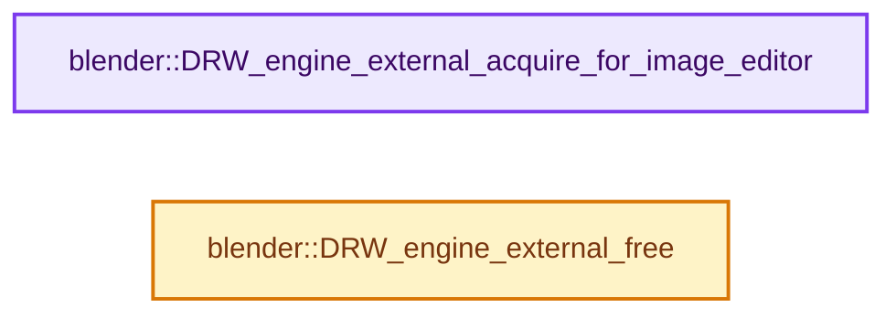

# 实现依赖专题：source/blender/draw/engines/external/external_engine.cc

[方向导航](README.md) · [符号索引](../%E7%AC%A6%E5%8F%B7%E4%BE%9D%E8%B5%96%E4%B8%8E%E5%AE%9E%E7%8E%B0%E7%B4%A2%E5%BC%95.md)

本专题从正文实际调用进入，集中保存共享实现。函数有稳定锚点，可从调用处直接跳到对应完整函数；递归与互相调用通过回链组织。

## 本文件的实现关系




## 完整成员与函数实现

<a id="f-304b280c856ea629"></a>

### `blender::DRW_engine_external_acquire_for_image_editor`

实现位置：[source/blender/draw/engines/external/external_engine.cc](../../../../../source/blender/draw/engines/external/external_engine.cc) · L488—L525。

接口参数：

- `const DRWContext *draw_ctx`

**教学注释版**

<!-- annotated:9415c0dcc7288e -->

```cpp
bool DRW_engine_external_acquire_for_image_editor(const DRWContext *draw_ctx)
{
  /* Get scene from the render job, to show progress for scenes render as part
   * of compositor or sequencer. */
  Scene *scene = ED_render_job_get_current_scene(draw_ctx->evil_C);
  if (scene == nullptr) {
    scene = draw_ctx->scene;
  }

  const SpaceLink *space_data = draw_ctx->space_data;
  if (space_data == nullptr) {
    return false;
  }

  const eSpace_Type space_type = eSpace_Type(draw_ctx->space_data->spacetype);
  if (space_type != SPACE_IMAGE) {
    return false;
  }

  SpaceImage *space_image = reinterpret_cast<SpaceImage *>(const_cast<SpaceLink *>(space_data));
  const Image *image = ED_space_image(space_image);
  if (image == nullptr || image->type != IMA_TYPE_R_RESULT) {
    return false;
  }

  if (image->render_slot != image->last_render_slot) {
    return false;
  }

  /* Render is allocated on main thread, so it is safe to access it from here. */
  Render *re = RE_GetSceneRender(scene);

  if (re == nullptr) {
    return false;
  }

  return RE_engine_draw_acquire(re);
}
```

<details>
<summary>核对原始源码：source/blender/draw/engines/external/external_engine.cc · L488—L525</summary>

<!-- original:9415c0dcc7288e:source/blender/draw/engines/external/external_engine.cc:488:525 -->

```cpp
bool DRW_engine_external_acquire_for_image_editor(const DRWContext *draw_ctx)
{
  /* Get scene from the render job, to show progress for scenes render as part
   * of compositor or sequencer. */
  Scene *scene = ED_render_job_get_current_scene(draw_ctx->evil_C);
  if (scene == nullptr) {
    scene = draw_ctx->scene;
  }

  const SpaceLink *space_data = draw_ctx->space_data;
  if (space_data == nullptr) {
    return false;
  }

  const eSpace_Type space_type = eSpace_Type(draw_ctx->space_data->spacetype);
  if (space_type != SPACE_IMAGE) {
    return false;
  }

  SpaceImage *space_image = reinterpret_cast<SpaceImage *>(const_cast<SpaceLink *>(space_data));
  const Image *image = ED_space_image(space_image);
  if (image == nullptr || image->type != IMA_TYPE_R_RESULT) {
    return false;
  }

  if (image->render_slot != image->last_render_slot) {
    return false;
  }

  /* Render is allocated on main thread, so it is safe to access it from here. */
  Render *re = RE_GetSceneRender(scene);

  if (re == nullptr) {
    return false;
  }

  return RE_engine_draw_acquire(re);
}
```

</details>

**沿实际写入检查状态**

- `scene = draw_ctx->scene;`

**结果出口**

- `return false;`
- `return RE_engine_draw_acquire(re);`

**继续追踪实现**

- `ED_render_job_get_current_scene` → [blender::ED_render_job_get_current_scene · L1140](%E4%BE%9D%E8%B5%96-render_internal-6f4e5d.md#f-9df7cdc145a96695)。
- `eSpace_Type` → [blender::eSpace_Type](%E4%BE%9D%E8%B5%96-DNA_space_enums-4e70fa.md#t-5ea20cb9d0ce)。
- `ED_space_image` → [blender::ED_space_image · L43](%E4%BE%9D%E8%B5%96-image_edit-fab2cb.md#f-5a297056ae3f426d)。
- `RE_GetSceneRender` → [blender::RE_GetSceneRender · L526](%E4%BE%9D%E8%B5%96-pipeline-340e5b.md#f-340965d59b8103ee)。
- `RE_engine_draw_acquire` → [blender::RE_engine_draw_acquire · L1234](%E4%BE%9D%E8%B5%96-engine-ac0ebe.md#f-e1f5f8da4cb14842)。

<a id="f-bbed69fd4769790f"></a>

### `blender::DRW_engine_external_free`

实现位置：[source/blender/draw/engines/external/external_engine.cc](../../../../../source/blender/draw/engines/external/external_engine.cc) · L527—L542。

接口参数：

- `RegionView3D *rv3d`

**教学注释版**

<!-- annotated:860a83bedd8531 -->

```cpp
void DRW_engine_external_free(RegionView3D *rv3d)
{
  if (rv3d->view_render) {
    /* Free engine with DRW context enabled, as this may clean up per-context
     * resources like VAOs. */
    bool swap_context = !DRW_gpu_context_is_enabled();
    if (swap_context) {
      DRW_gpu_context_enable_ex(true);
    }
    RE_FreeViewRender(rv3d->view_render);
    rv3d->view_render = nullptr;
    if (swap_context) {
      DRW_gpu_context_disable_ex(true);
    }
  }
}
```

<details>
<summary>核对原始源码：source/blender/draw/engines/external/external_engine.cc · L527—L542</summary>

<!-- original:860a83bedd8531:source/blender/draw/engines/external/external_engine.cc:527:542 -->

```cpp
void DRW_engine_external_free(RegionView3D *rv3d)
{
  if (rv3d->view_render) {
    /* Free engine with DRW context enabled, as this may clean up per-context
     * resources like VAOs. */
    bool swap_context = !DRW_gpu_context_is_enabled();
    if (swap_context) {
      DRW_gpu_context_enable_ex(true);
    }
    RE_FreeViewRender(rv3d->view_render);
    rv3d->view_render = nullptr;
    if (swap_context) {
      DRW_gpu_context_disable_ex(true);
    }
  }
}
```

</details>

**沿实际写入检查状态**

- `rv3d->view_render = nullptr;`

**继续追踪实现**

- `DRW_gpu_context_is_enabled` → [blender::DRW_gpu_context_is_enabled · L249](%E4%BE%9D%E8%B5%96-draw_gpu_context-25fcfe.md#f-cd7b15acc7b153b9)。
- `DRW_gpu_context_enable_ex` → [blender::DRW_gpu_context_enable_ex · L198](%E4%BE%9D%E8%B5%96-draw_gpu_context-25fcfe.md#f-883cf0914202a0a7)。
- `RE_FreeViewRender` → [blender::RE_FreeViewRender · L554](%E4%BE%9D%E8%B5%96-pipeline-340e5b.md#f-f30a2e13c56238aa)。
- `DRW_gpu_context_disable_ex` → [blender::DRW_gpu_context_disable_ex · L206](%E4%BE%9D%E8%B5%96-draw_gpu_context-25fcfe.md#f-f696f3fc7280fe49)。
