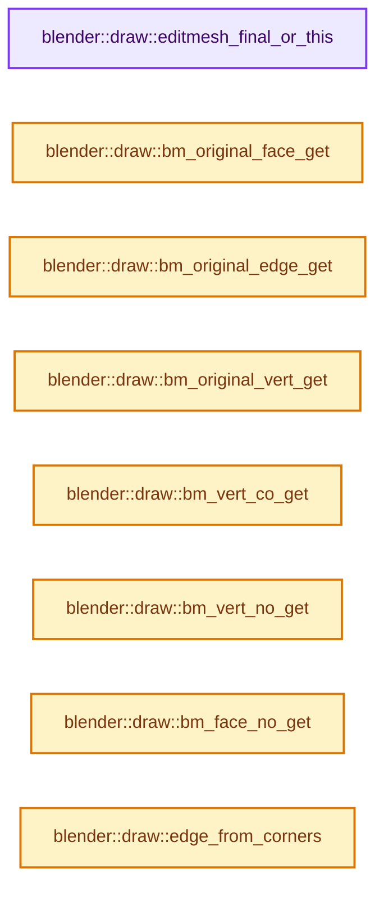
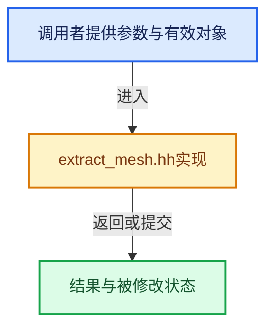

# 实现依赖专题：source/blender/draw/intern/mesh_extractors/extract_mesh.hh

[方向导航](README.md) · [符号索引](../%E7%AC%A6%E5%8F%B7%E4%BE%9D%E8%B5%96%E4%B8%8E%E5%AE%9E%E7%8E%B0%E7%B4%A2%E5%BC%95.md)

本专题从正文实际调用进入，集中保存共享实现。函数有稳定锚点，可从调用处直接跳到对应完整函数；递归与互相调用通过回链组织。

## 本文件的实现关系






## 完整成员与函数实现

<a id="f-944dcc47588a370b"></a>

### `blender::draw::editmesh_final_or_this`

实现位置：[source/blender/draw/intern/mesh_extractors/extract_mesh.hh](../../../../../source/blender/draw/intern/mesh_extractors/extract_mesh.hh) · L127—L136。

接口参数：

- `const Object &object`
- `const Mesh &mesh`

**教学注释版**

<!-- annotated:4fe7428cb07142 -->

```cpp
inline const Mesh &editmesh_final_or_this(const Object &object, const Mesh &mesh)
{
  if (mesh.runtime->edit_mesh != nullptr) {
    if (const Mesh *editmesh_eval_final = BKE_object_get_editmesh_eval_final(&object)) {
      return *editmesh_eval_final;
    }
  }

  return mesh;
}
```

<details>
<summary>核对原始源码：source/blender/draw/intern/mesh_extractors/extract_mesh.hh · L127—L136</summary>

<!-- original:4fe7428cb07142:source/blender/draw/intern/mesh_extractors/extract_mesh.hh:127:136 -->

```cpp
inline const Mesh &editmesh_final_or_this(const Object &object, const Mesh &mesh)
{
  if (mesh.runtime->edit_mesh != nullptr) {
    if (const Mesh *editmesh_eval_final = BKE_object_get_editmesh_eval_final(&object)) {
      return *editmesh_eval_final;
    }
  }

  return mesh;
}
```

</details>

**结果出口**

- `return *editmesh_eval_final;`
- `return mesh;`

**继续追踪实现**

- `BKE_object_get_editmesh_eval_final` → [blender::BKE_object_get_editmesh_eval_final · L4477](%E4%BE%9D%E8%B5%96-object-843689.md#f-1788f7ea6bf8faec)。

<a id="f-50ae48e6025f345a"></a>

### `blender::draw::bm_original_face_get`

实现位置：[source/blender/draw/intern/mesh_extractors/extract_mesh.hh](../../../../../source/blender/draw/intern/mesh_extractors/extract_mesh.hh) · L138—L144。

接口参数：

- `const MeshRenderData &mr`
- `int idx`

**教学注释版**

<!-- annotated:9598916f3b7f99 -->

```cpp
BLI_INLINE BMFace *bm_original_face_get(const MeshRenderData &mr, int idx)
{
  return ((mr.orig_index_face != nullptr) && (mr.orig_index_face[idx] != ORIGINDEX_NONE) &&
          mr.bm) ?
             BM_face_at_index(mr.bm, mr.orig_index_face[idx]) :
             nullptr;
}
```

<details>
<summary>核对原始源码：source/blender/draw/intern/mesh_extractors/extract_mesh.hh · L138—L144</summary>

<!-- original:9598916f3b7f99:source/blender/draw/intern/mesh_extractors/extract_mesh.hh:138:144 -->

```cpp
BLI_INLINE BMFace *bm_original_face_get(const MeshRenderData &mr, int idx)
{
  return ((mr.orig_index_face != nullptr) && (mr.orig_index_face[idx] != ORIGINDEX_NONE) &&
          mr.bm) ?
             BM_face_at_index(mr.bm, mr.orig_index_face[idx]) :
             nullptr;
}
```

</details>

**结果出口**

- `return ((mr.orig_index_face != nullptr) && (mr.orig_index_face[idx] != ORIGINDEX_NONE) &&`

**继续追踪实现**

- `BM_face_at_index` → [blender::BM_face_at_index · L122](%E4%BE%9D%E8%B5%96-bmesh_mesh-df20c7.md#f-366df62c166d5094)。

<a id="f-5abdd93646642da5"></a>

### `blender::draw::bm_original_edge_get`

实现位置：[source/blender/draw/intern/mesh_extractors/extract_mesh.hh](../../../../../source/blender/draw/intern/mesh_extractors/extract_mesh.hh) · L146—L152。

接口参数：

- `const MeshRenderData &mr`
- `int idx`

**教学注释版**

<!-- annotated:d2869d38b32c86 -->

```cpp
BLI_INLINE BMEdge *bm_original_edge_get(const MeshRenderData &mr, int idx)
{
  return ((mr.orig_index_edge != nullptr) && (mr.orig_index_edge[idx] != ORIGINDEX_NONE) &&
          mr.bm) ?
             BM_edge_at_index(mr.bm, mr.orig_index_edge[idx]) :
             nullptr;
}
```

<details>
<summary>核对原始源码：source/blender/draw/intern/mesh_extractors/extract_mesh.hh · L146—L152</summary>

<!-- original:d2869d38b32c86:source/blender/draw/intern/mesh_extractors/extract_mesh.hh:146:152 -->

```cpp
BLI_INLINE BMEdge *bm_original_edge_get(const MeshRenderData &mr, int idx)
{
  return ((mr.orig_index_edge != nullptr) && (mr.orig_index_edge[idx] != ORIGINDEX_NONE) &&
          mr.bm) ?
             BM_edge_at_index(mr.bm, mr.orig_index_edge[idx]) :
             nullptr;
}
```

</details>

**结果出口**

- `return ((mr.orig_index_edge != nullptr) && (mr.orig_index_edge[idx] != ORIGINDEX_NONE) &&`

**继续追踪实现**

- `BM_edge_at_index` → [blender::BM_edge_at_index · L116](%E4%BE%9D%E8%B5%96-bmesh_mesh-df20c7.md#f-81d027fd9e6b4c84)。

<a id="f-45547245e3f51daa"></a>

### `blender::draw::bm_original_vert_get`

实现位置：[source/blender/draw/intern/mesh_extractors/extract_mesh.hh](../../../../../source/blender/draw/intern/mesh_extractors/extract_mesh.hh) · L154—L160。

接口参数：

- `const MeshRenderData &mr`
- `int idx`

**教学注释版**

<!-- annotated:cd005ec3e1eded -->

```cpp
BLI_INLINE BMVert *bm_original_vert_get(const MeshRenderData &mr, int idx)
{
  return ((mr.orig_index_vert != nullptr) && (mr.orig_index_vert[idx] != ORIGINDEX_NONE) &&
          mr.bm) ?
             BM_vert_at_index(mr.bm, mr.orig_index_vert[idx]) :
             nullptr;
}
```

<details>
<summary>核对原始源码：source/blender/draw/intern/mesh_extractors/extract_mesh.hh · L154—L160</summary>

<!-- original:cd005ec3e1eded:source/blender/draw/intern/mesh_extractors/extract_mesh.hh:154:160 -->

```cpp
BLI_INLINE BMVert *bm_original_vert_get(const MeshRenderData &mr, int idx)
{
  return ((mr.orig_index_vert != nullptr) && (mr.orig_index_vert[idx] != ORIGINDEX_NONE) &&
          mr.bm) ?
             BM_vert_at_index(mr.bm, mr.orig_index_vert[idx]) :
             nullptr;
}
```

</details>

**结果出口**

- `return ((mr.orig_index_vert != nullptr) && (mr.orig_index_vert[idx] != ORIGINDEX_NONE) &&`

**继续追踪实现**

- `BM_vert_at_index` → [blender::BM_vert_at_index · L110](%E4%BE%9D%E8%B5%96-bmesh_mesh-df20c7.md#f-aced0ebcd417a2f4)。

<a id="f-b669e5a0bcf94c9f"></a>

### `blender::draw::bm_vert_co_get`

实现位置：[source/blender/draw/intern/mesh_extractors/extract_mesh.hh](../../../../../source/blender/draw/intern/mesh_extractors/extract_mesh.hh) · L162—L168。

接口参数：

- `const MeshRenderData &mr`
- `const BMVert *eve`

**教学注释版**

<!-- annotated:0cae8edb7335ee -->

```cpp
BLI_INLINE const float *bm_vert_co_get(const MeshRenderData &mr, const BMVert *eve)
{
  if (!mr.bm_vert_coords.is_empty()) {
    return mr.bm_vert_coords[BM_elem_index_get(eve)];
  }
  return eve->co;
}
```

<details>
<summary>核对原始源码：source/blender/draw/intern/mesh_extractors/extract_mesh.hh · L162—L168</summary>

<!-- original:0cae8edb7335ee:source/blender/draw/intern/mesh_extractors/extract_mesh.hh:162:168 -->

```cpp
BLI_INLINE const float *bm_vert_co_get(const MeshRenderData &mr, const BMVert *eve)
{
  if (!mr.bm_vert_coords.is_empty()) {
    return mr.bm_vert_coords[BM_elem_index_get(eve)];
  }
  return eve->co;
}
```

</details>

**结果出口**

- `return mr.bm_vert_coords[BM_elem_index_get(eve)];`
- `return eve->co;`

**继续追踪实现**

- `mr.bm_vert_coords.is_empty` → [调用协议](../%E6%A8%A1%E6%9D%BF%E5%AE%8F%E4%B8%8E%E5%8A%A8%E6%80%81%E5%88%86%E6%B4%BE%E5%8D%8F%E8%AE%AE.md)：接收对象类型依赖auto、返回值或模板实例；不按同名猜测目标。调用位置L164。
- `BM_elem_index_get` → [BM_elem_index_get · L120](%E4%BE%9D%E8%B5%96-bmesh_inline-74f1be.md#m-201981cdc62d)。宏定义由构建条件选择。

<a id="f-c2d47f6477827d01"></a>

### `blender::draw::bm_vert_no_get`

实现位置：[source/blender/draw/intern/mesh_extractors/extract_mesh.hh](../../../../../source/blender/draw/intern/mesh_extractors/extract_mesh.hh) · L170—L179。

接口参数：

- `const MeshRenderData &mr`
- `const BMVert *eve`

**教学注释版**

<!-- annotated:3691d347343455 -->

```cpp
BLI_INLINE const float *bm_vert_no_get(const MeshRenderData &mr, const BMVert *eve)
{
  if (mr.bm_free_normal_offset_vert != -1) {
    return BM_ELEM_CD_GET_FLOAT_P(eve, mr.bm_free_normal_offset_vert);
  }
  if (!mr.bm_vert_normals.is_empty()) {
    return mr.bm_vert_normals[BM_elem_index_get(eve)];
  }
  return eve->no;
}
```

<details>
<summary>核对原始源码：source/blender/draw/intern/mesh_extractors/extract_mesh.hh · L170—L179</summary>

<!-- original:3691d347343455:source/blender/draw/intern/mesh_extractors/extract_mesh.hh:170:179 -->

```cpp
BLI_INLINE const float *bm_vert_no_get(const MeshRenderData &mr, const BMVert *eve)
{
  if (mr.bm_free_normal_offset_vert != -1) {
    return BM_ELEM_CD_GET_FLOAT_P(eve, mr.bm_free_normal_offset_vert);
  }
  if (!mr.bm_vert_normals.is_empty()) {
    return mr.bm_vert_normals[BM_elem_index_get(eve)];
  }
  return eve->no;
}
```

</details>

**结果出口**

- `return BM_ELEM_CD_GET_FLOAT_P(eve, mr.bm_free_normal_offset_vert);`
- `return mr.bm_vert_normals[BM_elem_index_get(eve)];`
- `return eve->no;`

**继续追踪实现**

- `BM_ELEM_CD_GET_FLOAT_P` → [BM_ELEM_CD_GET_FLOAT_P · L635](%E4%BE%9D%E8%B5%96-bmesh_class-4cf146.md#m-544f72c45c1b)；[BM_ELEM_CD_GET_FLOAT_P · L661](%E4%BE%9D%E8%B5%96-bmesh_class-4cf146.md#m-c11efbe96e86)。宏定义由构建条件选择。
- `mr.bm_vert_normals.is_empty` → [调用协议](../%E6%A8%A1%E6%9D%BF%E5%AE%8F%E4%B8%8E%E5%8A%A8%E6%80%81%E5%88%86%E6%B4%BE%E5%8D%8F%E8%AE%AE.md)：接收对象类型依赖auto、返回值或模板实例；不按同名猜测目标。调用位置L175。
- `BM_elem_index_get` → [BM_elem_index_get · L120](%E4%BE%9D%E8%B5%96-bmesh_inline-74f1be.md#m-201981cdc62d)。宏定义由构建条件选择。

<a id="f-40a3dcea78714956"></a>

### `blender::draw::bm_face_no_get`

实现位置：[source/blender/draw/intern/mesh_extractors/extract_mesh.hh](../../../../../source/blender/draw/intern/mesh_extractors/extract_mesh.hh) · L181—L190。

接口参数：

- `const MeshRenderData &mr`
- `const BMFace *efa`

**教学注释版**

<!-- annotated:c4027101ace661 -->

```cpp
BLI_INLINE const float *bm_face_no_get(const MeshRenderData &mr, const BMFace *efa)
{
  if (mr.bm_free_normal_offset_face != -1) {
    return BM_ELEM_CD_GET_FLOAT_P(efa, mr.bm_free_normal_offset_face);
  }
  if (!mr.bm_face_normals.is_empty()) {
    return mr.bm_face_normals[BM_elem_index_get(efa)];
  }
  return efa->no;
}
```

<details>
<summary>核对原始源码：source/blender/draw/intern/mesh_extractors/extract_mesh.hh · L181—L190</summary>

<!-- original:c4027101ace661:source/blender/draw/intern/mesh_extractors/extract_mesh.hh:181:190 -->

```cpp
BLI_INLINE const float *bm_face_no_get(const MeshRenderData &mr, const BMFace *efa)
{
  if (mr.bm_free_normal_offset_face != -1) {
    return BM_ELEM_CD_GET_FLOAT_P(efa, mr.bm_free_normal_offset_face);
  }
  if (!mr.bm_face_normals.is_empty()) {
    return mr.bm_face_normals[BM_elem_index_get(efa)];
  }
  return efa->no;
}
```

</details>

**结果出口**

- `return BM_ELEM_CD_GET_FLOAT_P(efa, mr.bm_free_normal_offset_face);`
- `return mr.bm_face_normals[BM_elem_index_get(efa)];`
- `return efa->no;`

**继续追踪实现**

- `BM_ELEM_CD_GET_FLOAT_P` → [BM_ELEM_CD_GET_FLOAT_P · L635](%E4%BE%9D%E8%B5%96-bmesh_class-4cf146.md#m-544f72c45c1b)；[BM_ELEM_CD_GET_FLOAT_P · L661](%E4%BE%9D%E8%B5%96-bmesh_class-4cf146.md#m-c11efbe96e86)。宏定义由构建条件选择。
- `mr.bm_face_normals.is_empty` → [调用协议](../%E6%A8%A1%E6%9D%BF%E5%AE%8F%E4%B8%8E%E5%8A%A8%E6%80%81%E5%88%86%E6%B4%BE%E5%8D%8F%E8%AE%AE.md)：接收对象类型依赖auto、返回值或模板实例；不按同名猜测目标。调用位置L186。
- `BM_elem_index_get` → [BM_elem_index_get · L120](%E4%BE%9D%E8%B5%96-bmesh_inline-74f1be.md#m-201981cdc62d)。宏定义由构建条件选择。

<a id="f-235a5dd9eb64ff86"></a>

### `blender::draw::edge_from_corners`

实现位置：[source/blender/draw/intern/mesh_extractors/extract_mesh.hh](../../../../../source/blender/draw/intern/mesh_extractors/extract_mesh.hh) · L240—L244。

接口参数：

- `const IndexRange face`
- `const int corner`

**教学注释版**

<!-- annotated:8f8275f190626f -->

```cpp
inline uint2 edge_from_corners(const IndexRange face, const int corner)
{
  const int corner_next = bke::mesh::face_corner_next(face, corner);
  return uint2(corner, corner_next);
}
```

<details>
<summary>核对原始源码：source/blender/draw/intern/mesh_extractors/extract_mesh.hh · L240—L244</summary>

<!-- original:8f8275f190626f:source/blender/draw/intern/mesh_extractors/extract_mesh.hh:240:244 -->

```cpp
inline uint2 edge_from_corners(const IndexRange face, const int corner)
{
  const int corner_next = bke::mesh::face_corner_next(face, corner);
  return uint2(corner, corner_next);
}
```

</details>

**结果出口**

- `return uint2(corner, corner_next);`

**继续追踪实现**

- `bke::mesh::face_corner_next` → [blender::bke::mesh::face_corner_next · L315](01-Mesh%E9%A1%B6%E7%82%B9%E8%BE%B9%E9%9D%A2%E8%A7%92%E7%82%B9.md#f-bf639df87b51fe48)。
- `uint2` → [uint2](%E4%BE%9D%E8%B5%96-types_uint2-d0ea06.md#t-acfae85419d8)。

<a id="f-0d5eeb9cb9333f7e"></a>

### `blender::draw::extract_mesh_loose_edge_data`

实现位置：[source/blender/draw/intern/mesh_extractors/extract_mesh.hh](../../../../../source/blender/draw/intern/mesh_extractors/extract_mesh.hh) · L246—L259。

接口参数：

- `const Span<T> vert_data`
- `const Span<int2> edges`
- `const IndexMask &loose_edges`
- `MutableSpan<T> gpu_data`

**教学注释版**

<!-- annotated:c81e7a4fa203d3 -->

```cpp
template<typename T>
void extract_mesh_loose_edge_data(const Span<T> vert_data,
                                  const Span<int2> edges,
                                  const IndexMask &loose_edges,
                                  MutableSpan<T> gpu_data)
{
  loose_edges.foreach_index_optimized<int>(
      [&](const int i, const int pos) {
        const int2 edge = edges[i];
        gpu_data[pos * 2 + 0] = vert_data[edge[0]];
        gpu_data[pos * 2 + 1] = vert_data[edge[1]];
      },
      exec_mode::grain_size(4096));
}
```

<details>
<summary>核对原始源码：source/blender/draw/intern/mesh_extractors/extract_mesh.hh · L246—L259</summary>

<!-- original:c81e7a4fa203d3:source/blender/draw/intern/mesh_extractors/extract_mesh.hh:246:259 -->

```cpp
template<typename T>
void extract_mesh_loose_edge_data(const Span<T> vert_data,
                                  const Span<int2> edges,
                                  const IndexMask &loose_edges,
                                  MutableSpan<T> gpu_data)
{
  loose_edges.foreach_index_optimized<int>(
      [&](const int i, const int pos) {
        const int2 edge = edges[i];
        gpu_data[pos * 2 + 0] = vert_data[edge[0]];
        gpu_data[pos * 2 + 1] = vert_data[edge[1]];
      },
      exec_mode::grain_size(4096));
}
```

</details>

**继续追踪实现**

- `loose_edges.foreach_index_optimized<int>` → [blender::index_mask::IndexMask::foreach_index_optimized · L937](../04-%E8%99%9A%E6%8B%9F%E6%95%B0%E7%BB%84%E4%B8%8E%E7%B4%A2%E5%BC%95%E9%80%89%E6%8B%A9/12-%E9%87%8D%E6%9E%84%E5%8E%86%E5%8F%B2%E4%B8%8E%E5%9F%BA%E5%87%86%E7%BB%83%E4%B9%A0.md#f-a2c3e7876407eaaf)。
- `exec_mode::grain_size` → [blender::exec_mode::grain_size · L79](../01-%E5%9F%BA%E7%A1%80%E5%AE%B9%E5%99%A8%E4%B8%8E%E7%8E%B0%E4%BB%A3CPP/%E4%BE%9D%E8%B5%96-BLI_execution_mode-1528fb.md#f-0b4fc2f9fa6e66e7)。

<a id="f-1d43c35d50f54c24"></a>

### `blender::draw::loose_data_upload`

实现位置：[source/blender/draw/intern/mesh_extractors/extract_mesh.hh](../../../../../source/blender/draw/intern/mesh_extractors/extract_mesh.hh) · L289—L299。

接口参数：

- `const MeshRenderData &mr`
- `const Span<T> loose_data`
- `gpu::VertBuf &dst`

**教学注释版**

<!-- annotated:0bd20f3073d889 -->

```cpp
template<typename T>
void loose_data_upload(const MeshRenderData &mr, const Span<T> loose_data, gpu::VertBuf &dst)
{
  // [讲解] loose_data.is_empty：查询视图长度或生成对应有效索引区间。
  if (loose_data.is_empty()) {
    return;
  }
  BLI_assert(GPU_vertbuf_get_format(&dst)->stride == sizeof(T));
  GPU_vertbuf_use(&dst);
  GPU_vertbuf_update_sub(
      // [讲解] loose_data.data：返回借用范围的地址。
      &dst, mr.corners_num * sizeof(T), loose_data.size_in_bytes(), loose_data.data());
}
```

<details>
<summary>核对原始源码：source/blender/draw/intern/mesh_extractors/extract_mesh.hh · L289—L299</summary>

<!-- original:0bd20f3073d889:source/blender/draw/intern/mesh_extractors/extract_mesh.hh:289:299 -->

```cpp
template<typename T>
void loose_data_upload(const MeshRenderData &mr, const Span<T> loose_data, gpu::VertBuf &dst)
{
  if (loose_data.is_empty()) {
    return;
  }
  BLI_assert(GPU_vertbuf_get_format(&dst)->stride == sizeof(T));
  GPU_vertbuf_use(&dst);
  GPU_vertbuf_update_sub(
      &dst, mr.corners_num * sizeof(T), loose_data.size_in_bytes(), loose_data.data());
}
```

</details>

**继续追踪实现**

- `loose_data.is_empty` → [blender::Span::is_empty · L264](../01-%E5%9F%BA%E7%A1%80%E5%AE%B9%E5%99%A8%E4%B8%8E%E7%8E%B0%E4%BB%A3CPP/05-Span%E5%8F%AA%E8%AF%BB%E8%BF%9E%E7%BB%AD%E8%A7%86%E5%9B%BE.md#f-8cc1d7ba8feb50e6)。
- `BLI_assert` → [BLI_assert · L48](../01-%E5%9F%BA%E7%A1%80%E5%AE%B9%E5%99%A8%E4%B8%8E%E7%8E%B0%E4%BB%A3CPP/%E4%BE%9D%E8%B5%96-BLI_assert-cc98e8.md#m-57a88495704d)；[BLI_assert · L63](../01-%E5%9F%BA%E7%A1%80%E5%AE%B9%E5%99%A8%E4%B8%8E%E7%8E%B0%E4%BB%A3CPP/%E4%BE%9D%E8%B5%96-BLI_assert-cc98e8.md#m-d07050020cb5)。宏定义由构建条件选择。
- `GPU_vertbuf_get_format` → [blender::GPU_vertbuf_get_format · L265](%E4%BE%9D%E8%B5%96-gpu_vertex_buffer-eaa662.md#f-7c66ff8de8245148)。
- `GPU_vertbuf_use` → [blender::GPU_vertbuf_use · L295](%E4%BE%9D%E8%B5%96-gpu_vertex_buffer-eaa662.md#f-f2ce61da8df3615a)。
- `GPU_vertbuf_update_sub` → [blender::GPU_vertbuf_update_sub · L315](%E4%BE%9D%E8%B5%96-gpu_vertex_buffer-eaa662.md#f-dbb703497ad88d1b)。
- `loose_data.size_in_bytes` → [blender::Span::size_in_bytes · L272](../01-%E5%9F%BA%E7%A1%80%E5%AE%B9%E5%99%A8%E4%B8%8E%E7%8E%B0%E4%BB%A3CPP/05-Span%E5%8F%AA%E8%AF%BB%E8%BF%9E%E7%BB%AD%E8%A7%86%E5%9B%BE.md#f-1369fbdcc037fcaf)。
- `loose_data.data` → [blender::Span::data · L219](../01-%E5%9F%BA%E7%A1%80%E5%AE%B9%E5%99%A8%E4%B8%8E%E7%8E%B0%E4%BB%A3CPP/05-Span%E5%8F%AA%E8%AF%BB%E8%BF%9E%E7%BB%AD%E8%A7%86%E5%9B%BE.md#f-10c5889198935800)。
