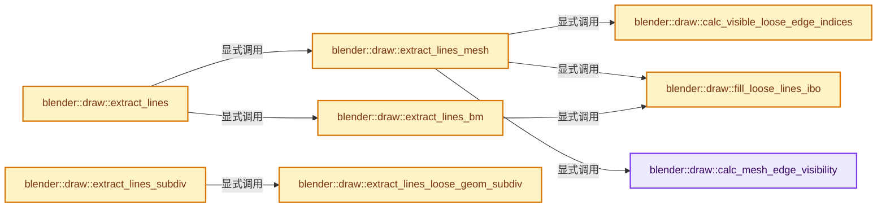
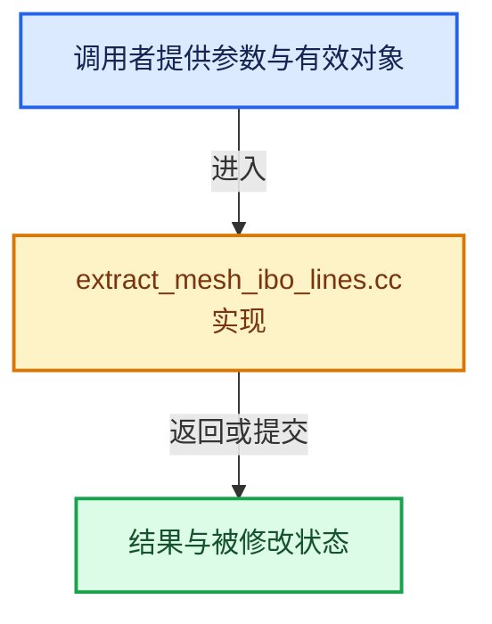

# 实现依赖专题：source/blender/draw/intern/mesh_extractors/extract_mesh_ibo_lines.cc

[方向导航](README.md) · [符号索引](../%E7%AC%A6%E5%8F%B7%E4%BE%9D%E8%B5%96%E4%B8%8E%E5%AE%9E%E7%8E%B0%E7%B4%A2%E5%BC%95.md)

本专题从正文实际调用进入，集中保存共享实现。函数有稳定锚点，可从调用处直接跳到对应完整函数；递归与互相调用通过回链组织。

## 本文件的实现关系






## 完整成员与函数实现

<a id="f-d915da536aa737ba"></a>

### `blender::draw::calc_mesh_edge_visibility`

实现位置：[source/blender/draw/intern/mesh_extractors/extract_mesh_ibo_lines.cc](../../../../../source/blender/draw/intern/mesh_extractors/extract_mesh_ibo_lines.cc) · L20—L38。

接口参数：

- `const MeshRenderData &mr`
- `const IndexMask &mask`
- `IndexMaskMemory &memory`

**教学注释版**

<!-- annotated:90c2da4d1cf5db -->

```cpp
static IndexMask calc_mesh_edge_visibility(const MeshRenderData &mr,
                                           const IndexMask &mask,
                                           IndexMaskMemory &memory)
{
  IndexMask visible = mask;
  if (!mr.mesh->runtime->subsurf_optimal_display_edges.is_empty()) {
    const BoundedBitSpan visible_bits = mr.mesh->runtime->subsurf_optimal_display_edges;
    visible = IndexMask::from_bits(visible, visible_bits, memory);
  }
  if (!mr.hide_edge.is_empty()) {
    visible = IndexMask::from_bools_inverse(visible, mr.hide_edge, memory);
  }
  if (mr.hide_unmapped_edges && mr.orig_index_edge != nullptr) {
    const int *orig_index = mr.orig_index_edge;
    static_assert(ORIGINDEX_NONE == -1);
    visible = array_utils::indices_non_negative(visible, Span(orig_index, mr.edges_num), memory);
  }
  return visible;
}
```

<details>
<summary>核对原始源码：source/blender/draw/intern/mesh_extractors/extract_mesh_ibo_lines.cc · L20—L38</summary>

<!-- original:90c2da4d1cf5db:source/blender/draw/intern/mesh_extractors/extract_mesh_ibo_lines.cc:20:38 -->

```cpp
static IndexMask calc_mesh_edge_visibility(const MeshRenderData &mr,
                                           const IndexMask &mask,
                                           IndexMaskMemory &memory)
{
  IndexMask visible = mask;
  if (!mr.mesh->runtime->subsurf_optimal_display_edges.is_empty()) {
    const BoundedBitSpan visible_bits = mr.mesh->runtime->subsurf_optimal_display_edges;
    visible = IndexMask::from_bits(visible, visible_bits, memory);
  }
  if (!mr.hide_edge.is_empty()) {
    visible = IndexMask::from_bools_inverse(visible, mr.hide_edge, memory);
  }
  if (mr.hide_unmapped_edges && mr.orig_index_edge != nullptr) {
    const int *orig_index = mr.orig_index_edge;
    static_assert(ORIGINDEX_NONE == -1);
    visible = array_utils::indices_non_negative(visible, Span(orig_index, mr.edges_num), memory);
  }
  return visible;
}
```

</details>

**沿实际写入检查状态**

- `visible = IndexMask::from_bits(visible, visible_bits, memory);`
- `visible = IndexMask::from_bools_inverse(visible, mr.hide_edge, memory);`
- `visible = array_utils::indices_non_negative(visible, Span(orig_index, mr.edges_num), memory);`

**结果出口**

- `return visible;`

**继续追踪实现**

- `mr.mesh->runtime->subsurf_optimal_display_edges.is_empty` → [调用协议](../%E6%A8%A1%E6%9D%BF%E5%AE%8F%E4%B8%8E%E5%8A%A8%E6%80%81%E5%88%86%E6%B4%BE%E5%8D%8F%E8%AE%AE.md)：接收对象类型依赖auto、返回值或模板实例；不按同名猜测目标。调用位置L25。
- `IndexMask::from_bits` → [blender::index_mask::IndexMask::from_bits · L452](../04-%E8%99%9A%E6%8B%9F%E6%95%B0%E7%BB%84%E4%B8%8E%E7%B4%A2%E5%BC%95%E9%80%89%E6%8B%A9/10-IndexMask%E6%9E%84%E5%BB%BA%E4%B8%8E%E5%B9%B6%E8%A1%8C.md#f-793d0ba2aa866e11)；[blender::index_mask::IndexMask::from_bits · L485](../04-%E8%99%9A%E6%8B%9F%E6%95%B0%E7%BB%84%E4%B8%8E%E7%B4%A2%E5%BC%95%E9%80%89%E6%8B%A9/10-IndexMask%E6%9E%84%E5%BB%BA%E4%B8%8E%E5%B9%B6%E8%A1%8C.md#f-c64648e6798fe52e)。同名重载需按实参类型选择。
- `mr.hide_edge.is_empty` → [调用协议](../%E6%A8%A1%E6%9D%BF%E5%AE%8F%E4%B8%8E%E5%8A%A8%E6%80%81%E5%88%86%E6%B4%BE%E5%8D%8F%E8%AE%AE.md)：接收对象类型依赖auto、返回值或模板实例；不按同名猜测目标。调用位置L29。
- `IndexMask::from_bools_inverse` → [blender::index_mask::IndexMask::from_bools_inverse · L603](../04-%E8%99%9A%E6%8B%9F%E6%95%B0%E7%BB%84%E4%B8%8E%E7%B4%A2%E5%BC%95%E9%80%89%E6%8B%A9/10-IndexMask%E6%9E%84%E5%BB%BA%E4%B8%8E%E5%B9%B6%E8%A1%8C.md#f-96442cca3bb6cc50)；[blender::index_mask::IndexMask::from_bools_inverse · L608](../04-%E8%99%9A%E6%8B%9F%E6%95%B0%E7%BB%84%E4%B8%8E%E7%B4%A2%E5%BC%95%E9%80%89%E6%8B%A9/10-IndexMask%E6%9E%84%E5%BB%BA%E4%B8%8E%E5%B9%B6%E8%A1%8C.md#f-c40b154f402a386c)；[blender::index_mask::IndexMask::from_bools_inverse · L640](../04-%E8%99%9A%E6%8B%9F%E6%95%B0%E7%BB%84%E4%B8%8E%E7%B4%A2%E5%BC%95%E9%80%89%E6%8B%A9/10-IndexMask%E6%9E%84%E5%BB%BA%E4%B8%8E%E5%B9%B6%E8%A1%8C.md#f-f2da3a64e1eb2558)；[blender::index_mask::IndexMask::from_bools_inverse · L668](../04-%E8%99%9A%E6%8B%9F%E6%95%B0%E7%BB%84%E4%B8%8E%E7%B4%A2%E5%BC%95%E9%80%89%E6%8B%A9/10-IndexMask%E6%9E%84%E5%BB%BA%E4%B8%8E%E5%B9%B6%E8%A1%8C.md#f-1975fcd2e2ded5f3)。同名重载需按实参类型选择。
- `array_utils::indices_non_negative` → [blender::array_utils::indices_non_negative · L455](../01-%E5%9F%BA%E7%A1%80%E5%AE%B9%E5%99%A8%E4%B8%8E%E7%8E%B0%E4%BB%A3CPP/%E4%BE%9D%E8%B5%96-array_utils-cbb70f.md#f-2c083cdfa58fcf58)。
- `Span` → [blender::Span](../01-%E5%9F%BA%E7%A1%80%E5%AE%B9%E5%99%A8%E4%B8%8E%E7%8E%B0%E4%BB%A3CPP/%E4%BE%9D%E8%B5%96-BLI_span-6aa95f.md#t-8765a8e0c1d5)；[blender::Span](../01-%E5%9F%BA%E7%A1%80%E5%AE%B9%E5%99%A8%E4%B8%8E%E7%8E%B0%E4%BB%A3CPP/%E4%BE%9D%E8%B5%96-BLI_index_range-7d7cc5.md#t-86091874a1c0)；[blender::Span](%E4%BE%9D%E8%B5%96-DNA_pointcloud_types-cfb82c.md#t-112aa6ed842c)；[blender::Span](%E4%BE%9D%E8%B5%96-DNA_node_types-6708b9.md#t-49ec6fbb9b69)；[blender::Span](%E4%BE%9D%E8%B5%96-DNA_mesh_types-81f02e.md#t-184fd48fb638)；[blender::Span](%E4%BE%9D%E8%B5%96-DNA_anim_types-39c5d9.md#t-d841071994c2)；[blender::Span](%E4%BE%9D%E8%B5%96-RNA_path_fwd-79c989.md#t-4dbb08969e41)。

<a id="f-42d0bd136c3348e7"></a>

### `blender::draw::fill_loose_lines_ibo`

实现位置：[source/blender/draw/intern/mesh_extractors/extract_mesh_ibo_lines.cc](../../../../../source/blender/draw/intern/mesh_extractors/extract_mesh_ibo_lines.cc) · L40—L61。

接口参数：

- `const MeshRenderData &mr`
- `const IndexMask &visible`
- `MutableSpan<uint2> data`

**教学注释版**

<!-- annotated:11315175b49b3d -->

```cpp
static void fill_loose_lines_ibo(const MeshRenderData &mr,
                                 const IndexMask &visible,
                                 MutableSpan<uint2> data)
{
  /* Vertices for loose edges are not shared in the GPU vertex buffers, so the indices are simply
   * an increasing contiguous range. Ideally this would be generated on the GPU itself, or just
   * unnecessary, but a large number of loose edges isn't expected to be a common performance
   * bottleneck either. */
  threading::memory_bandwidth_bound_task(data.size_in_bytes(), [&]() {
    const uint loose_start = mr.corners_num;
    if (visible.size() == mr.loose_edges.size()) {
      // [讲解] data.cast<uint>：按类型与布局约束重新解释视图。
      array_utils::fill_index_range(data.cast<uint>(), loose_start);
    }
    else {
      visible.foreach_index_optimized<int>(
          [&](const int i, const int pos) {
            data[pos] = loose_start + uint2(i * 2 + 0, i * 2 + 1);
          },
          exec_mode::grain_size(4096));
    }
  });
}
```

<details>
<summary>核对原始源码：source/blender/draw/intern/mesh_extractors/extract_mesh_ibo_lines.cc · L40—L61</summary>

<!-- original:11315175b49b3d:source/blender/draw/intern/mesh_extractors/extract_mesh_ibo_lines.cc:40:61 -->

```cpp
static void fill_loose_lines_ibo(const MeshRenderData &mr,
                                 const IndexMask &visible,
                                 MutableSpan<uint2> data)
{
  /* Vertices for loose edges are not shared in the GPU vertex buffers, so the indices are simply
   * an increasing contiguous range. Ideally this would be generated on the GPU itself, or just
   * unnecessary, but a large number of loose edges isn't expected to be a common performance
   * bottleneck either. */
  threading::memory_bandwidth_bound_task(data.size_in_bytes(), [&]() {
    const uint loose_start = mr.corners_num;
    if (visible.size() == mr.loose_edges.size()) {
      array_utils::fill_index_range(data.cast<uint>(), loose_start);
    }
    else {
      visible.foreach_index_optimized<int>(
          [&](const int i, const int pos) {
            data[pos] = loose_start + uint2(i * 2 + 0, i * 2 + 1);
          },
          exec_mode::grain_size(4096));
    }
  });
}
```

</details>

**沿实际写入检查状态**

- `data[pos] = loose_start + uint2(i * 2 + 0, i * 2 + 1);`

**继续追踪实现**

- `threading::memory_bandwidth_bound_task` → [blender::threading::memory_bandwidth_bound_task · L250](../11-Depsgraph%E4%B8%8E%E5%B9%B6%E8%A1%8C%E4%BB%BB%E5%8A%A1%E7%B3%BB%E7%BB%9F/07-%E4%BB%BB%E5%8A%A1%E6%B1%A0%E4%B8%8ETBB%E6%8E%A5%E5%85%A5.md#f-aa412ccec656928d)。
- `data.size_in_bytes` → [blender::MutableSpan::size_in_bytes · L507](../01-%E5%9F%BA%E7%A1%80%E5%AE%B9%E5%99%A8%E4%B8%8E%E7%8E%B0%E4%BB%A3CPP/06-MutableSpan%E5%8F%AF%E5%86%99%E8%A7%86%E5%9B%BE.md#f-2e42823b970a8406)。
- `visible.size` → [blender::index_mask::IndexMask::size · L743](../04-%E8%99%9A%E6%8B%9F%E6%95%B0%E7%BB%84%E4%B8%8E%E7%B4%A2%E5%BC%95%E9%80%89%E6%8B%A9/09-%E5%88%86%E6%AE%B5%E5%AD%98%E5%82%A8%E4%B8%8E%E9%81%8D%E5%8E%86.md#f-0163b32abc9a0d9c)。
- `mr.loose_edges.size` → [调用协议](../%E6%A8%A1%E6%9D%BF%E5%AE%8F%E4%B8%8E%E5%8A%A8%E6%80%81%E5%88%86%E6%B4%BE%E5%8D%8F%E8%AE%AE.md)：接收对象类型依赖auto、返回值或模板实例；不按同名猜测目标。调用位置L50。
- `array_utils::fill_index_range` → [blender::array_utils::fill_index_range · L434](07-%E5%88%86%E7%BB%84%E8%AE%BF%E9%97%AE%E4%B8%8E%E5%8F%8D%E5%90%91%E7%B4%A2%E5%BC%95.md#f-f8128b104d76df0f)；[blender::array_utils::fill_index_range · L439](07-%E5%88%86%E7%BB%84%E8%AE%BF%E9%97%AE%E4%B8%8E%E5%8F%8D%E5%90%91%E7%B4%A2%E5%BC%95.md#f-95ca84458bfc7e7e)；[blender::array_utils::fill_index_range · L445](07-%E5%88%86%E7%BB%84%E8%AE%BF%E9%97%AE%E4%B8%8E%E5%8F%8D%E5%90%91%E7%B4%A2%E5%BC%95.md#f-c11b114c213cd61a)。同名重载需按实参类型选择。
- `data.cast<uint>` → [blender::MutableSpan::cast · L755](../01-%E5%9F%BA%E7%A1%80%E5%AE%B9%E5%99%A8%E4%B8%8E%E7%8E%B0%E4%BB%A3CPP/06-MutableSpan%E5%8F%AF%E5%86%99%E8%A7%86%E5%9B%BE.md#f-360354e608371779)。
- `visible.foreach_index_optimized<int>` → [blender::index_mask::IndexMask::foreach_index_optimized · L937](../04-%E8%99%9A%E6%8B%9F%E6%95%B0%E7%BB%84%E4%B8%8E%E7%B4%A2%E5%BC%95%E9%80%89%E6%8B%A9/12-%E9%87%8D%E6%9E%84%E5%8E%86%E5%8F%B2%E4%B8%8E%E5%9F%BA%E5%87%86%E7%BB%83%E4%B9%A0.md#f-a2c3e7876407eaaf)。
- `uint2` → [uint2](%E4%BE%9D%E8%B5%96-types_uint2-d0ea06.md#t-acfae85419d8)。
- `exec_mode::grain_size` → [blender::exec_mode::grain_size · L79](../01-%E5%9F%BA%E7%A1%80%E5%AE%B9%E5%99%A8%E4%B8%8E%E7%8E%B0%E4%BB%A3CPP/%E4%BE%9D%E8%B5%96-BLI_execution_mode-1528fb.md#f-0b4fc2f9fa6e66e7)。

<a id="f-711b1ee4223f7cf0"></a>

### `blender::draw::calc_visible_loose_edge_indices`

实现位置：[source/blender/draw/intern/mesh_extractors/extract_mesh_ibo_lines.cc](../../../../../source/blender/draw/intern/mesh_extractors/extract_mesh_ibo_lines.cc) · L63—L82。

接口参数：

- `const MeshRenderData &mr`
- `IndexMaskMemory &memory`

**教学注释版**

<!-- annotated:15ee315fd706cc -->

```cpp
static IndexMask calc_visible_loose_edge_indices(const MeshRenderData &mr, IndexMaskMemory &memory)
{
  /* Since we're building a mask of the full loose edge data arrays (i.e. rather than a mask
   * of the mesh's edges) we need random access to the IndexMask indices. */
  Array<int, 64> loose_edges(mr.loose_edges.size());
  // [讲解] loose_edges.as_mutable_span：提供数组的借用访问入口。
  mr.loose_edges.to_indices(loose_edges.as_mutable_span());
  // [讲解] loose_edges.size：查询固定有效长度及其索引范围。
  IndexMask visible(loose_edges.size());
  if (!mr.hide_edge.is_empty()) {
    const Span<bool> hide_edge = mr.hide_edge;
    visible = IndexMask::from_predicate(
        visible, memory, [&](const int i) { return !hide_edge[loose_edges[i]]; });
  }
  if (mr.hide_unmapped_edges && mr.orig_index_edge != nullptr) {
    const int *orig_index = mr.orig_index_edge;
    visible = IndexMask::from_predicate(visible, memory, [&](const int64_t i) {
      return orig_index[loose_edges[i]] != ORIGINDEX_NONE;
    });
  }
  return visible;
}
```

<details>
<summary>核对原始源码：source/blender/draw/intern/mesh_extractors/extract_mesh_ibo_lines.cc · L63—L82</summary>

<!-- original:15ee315fd706cc:source/blender/draw/intern/mesh_extractors/extract_mesh_ibo_lines.cc:63:82 -->

```cpp
static IndexMask calc_visible_loose_edge_indices(const MeshRenderData &mr, IndexMaskMemory &memory)
{
  /* Since we're building a mask of the full loose edge data arrays (i.e. rather than a mask
   * of the mesh's edges) we need random access to the IndexMask indices. */
  Array<int, 64> loose_edges(mr.loose_edges.size());
  mr.loose_edges.to_indices(loose_edges.as_mutable_span());
  IndexMask visible(loose_edges.size());
  if (!mr.hide_edge.is_empty()) {
    const Span<bool> hide_edge = mr.hide_edge;
    visible = IndexMask::from_predicate(
        visible, memory, [&](const int i) { return !hide_edge[loose_edges[i]]; });
  }
  if (mr.hide_unmapped_edges && mr.orig_index_edge != nullptr) {
    const int *orig_index = mr.orig_index_edge;
    visible = IndexMask::from_predicate(visible, memory, [&](const int64_t i) {
      return orig_index[loose_edges[i]] != ORIGINDEX_NONE;
    });
  }
  return visible;
}
```

</details>

**沿实际写入检查状态**

- `visible = IndexMask::from_predicate(`
- `visible = IndexMask::from_predicate(visible, memory, [&](const int64_t i) {`

**结果出口**

- `return orig_index[loose_edges[i]] != ORIGINDEX_NONE;`
- `return visible;`

**继续追踪实现**

- `mr.loose_edges.size` → [调用协议](../%E6%A8%A1%E6%9D%BF%E5%AE%8F%E4%B8%8E%E5%8A%A8%E6%80%81%E5%88%86%E6%B4%BE%E5%8D%8F%E8%AE%AE.md)：接收对象类型依赖auto、返回值或模板实例；不按同名猜测目标。调用位置L67。
- `mr.loose_edges.to_indices` → [调用协议](../%E6%A8%A1%E6%9D%BF%E5%AE%8F%E4%B8%8E%E5%8A%A8%E6%80%81%E5%88%86%E6%B4%BE%E5%8D%8F%E8%AE%AE.md)：接收对象类型依赖auto、返回值或模板实例；不按同名猜测目标。调用位置L68。
- `loose_edges.as_mutable_span` → [blender::Array::as_mutable_span · L259](../01-%E5%9F%BA%E7%A1%80%E5%AE%B9%E5%99%A8%E4%B8%8E%E7%8E%B0%E4%BB%A3CPP/08-Array%E5%A4%8D%E5%88%B6%E7%A7%BB%E5%8A%A8%E4%B8%8E%E9%94%80%E6%AF%81.md#f-4e91de9f1337c144)。
- `loose_edges.size` → [blender::Array::size · L267](../01-%E5%9F%BA%E7%A1%80%E5%AE%B9%E5%99%A8%E4%B8%8E%E7%8E%B0%E4%BB%A3CPP/08-Array%E5%A4%8D%E5%88%B6%E7%A7%BB%E5%8A%A8%E4%B8%8E%E9%94%80%E6%AF%81.md#f-c13f1b5a44f423b2)。
- `mr.hide_edge.is_empty` → [调用协议](../%E6%A8%A1%E6%9D%BF%E5%AE%8F%E4%B8%8E%E5%8A%A8%E6%80%81%E5%88%86%E6%B4%BE%E5%8D%8F%E8%AE%AE.md)：接收对象类型依赖auto、返回值或模板实例；不按同名猜测目标。调用位置L70。
- `IndexMask::from_predicate` → [blender::index_mask::IndexMask::from_predicate · L1073](../04-%E8%99%9A%E6%8B%9F%E6%95%B0%E7%BB%84%E4%B8%8E%E7%B4%A2%E5%BC%95%E9%80%89%E6%8B%A9/12-%E9%87%8D%E6%9E%84%E5%8E%86%E5%8F%B2%E4%B8%8E%E5%9F%BA%E5%87%86%E7%BB%83%E4%B9%A0.md#f-3864daa059098df8)。

<a id="f-bb75a48211827283"></a>

### `blender::draw::extract_lines_mesh`

实现位置：[source/blender/draw/intern/mesh_extractors/extract_mesh_ibo_lines.cc](../../../../../source/blender/draw/intern/mesh_extractors/extract_mesh_ibo_lines.cc) · L84—L172。

接口参数：

- `const MeshRenderData &mr`
- `gpu::IndexBufPtr *lines`
- `gpu::IndexBufPtr *lines_loose`
- `bool &no_loose_wire`

**教学注释版**

<!-- annotated:9e7c3276c745c5 -->

```cpp
static void extract_lines_mesh(const MeshRenderData &mr,
                               gpu::IndexBufPtr *lines,
                               gpu::IndexBufPtr *lines_loose,
                               bool &no_loose_wire)
{
  IndexMaskMemory memory;
  const IndexMask visible_loose_edges = calc_visible_loose_edge_indices(mr, memory);
  const int max_index = mr.corners_num + mr.loose_edges.size() * 2;

  no_loose_wire = visible_loose_edges.is_empty();

  if (lines_loose && !lines) {
    GPUIndexBufBuilder builder;
    GPU_indexbuf_init(&builder, GPU_PRIM_LINES, visible_loose_edges.size(), max_index);
    MutableSpan<uint2> data = GPU_indexbuf_get_data(&builder).cast<uint2>();
    fill_loose_lines_ibo(mr, visible_loose_edges, data);
    *lines_loose = gpu::IndexBufPtr(GPU_indexbuf_build_ex(&builder, 0, max_index, false));
    return;
  }

  const IndexMask non_loose_edges = mr.loose_edges.complement(IndexRange(mr.edges_num), memory);
  const IndexMask visible_non_loose_edges = calc_mesh_edge_visibility(mr, non_loose_edges, memory);

  GPUIndexBufBuilder builder;
  GPU_indexbuf_init(&builder,
                    GPU_PRIM_LINES,
                    visible_non_loose_edges.size() + visible_loose_edges.size(),
                    max_index);
  MutableSpan<uint2> data = GPU_indexbuf_get_data(&builder).cast<uint2>();

  /* This code fills the index buffer in a non-deterministic way, with non-atomic access to `used`.
   * This is okay because any of the possible face corner indices are correct, since they all
   * correspond to the same #Mesh vertex. `used` exists here as a performance optimization to
   * avoid writing to the VBO. */
  const OffsetIndices faces = mr.faces;
  const Span<int> corner_edges = mr.corner_edges;
  if (visible_non_loose_edges.size() == mr.edges_num) {
    /* All edges in the mesh are visible. The edges in the GPU buffer will have the same order as
     * the mesh's edges, so any remapping is unnecessary. Use a boolean array to avoid writing to
     * the same indices again multiple times from different threads. This is slightly beneficial
     * because booleans are 8 times smaller than the `uint2` for each edge. */
    Array<bool> used(mr.edges_num, false);
    threading::memory_bandwidth_bound_task(
        // [讲解] used.as_span：提供数组的借用访问入口。
        used.as_span().size_in_bytes() + data.size_in_bytes() + corner_edges.size_in_bytes(),
        [&]() {
          threading::parallel_for(faces.index_range(), 2048, [&](const IndexRange range) {
            for (const int face_index : range) {
              const IndexRange face = faces[face_index];
              for (const int corner : face) {
                const int edge = corner_edges[corner];
                if (!used[edge]) {
                  used[edge] = true;
                  data[edge] = edge_from_corners(face, corner);
                }
              }
            }
          });
        });
  }
  else {
    Array<int> map(mr.edges_num, -1);
    threading::memory_bandwidth_bound_task(
        map.as_span().size_in_bytes() + data.size_in_bytes() + corner_edges.size_in_bytes(),
        [&]() {
          // [讲解] map.as_mutable_span：提供数组的借用访问入口。
          index_mask::build_reverse_map(visible_non_loose_edges, map.as_mutable_span());
          threading::parallel_for(faces.index_range(), 2048, [&](const IndexRange range) {
            for (const int face_index : range) {
              const IndexRange face = faces[face_index];
              for (const int corner : face) {
                const int edge = corner_edges[corner];
                const int vbo_index = map[edge];
                if (vbo_index != -1) {
                  map[edge] = -1;
                  data[vbo_index] = edge_from_corners(face, corner);
                }
              }
            }
          });
        });
  }

  // [讲解] data.take_back：从两端裁去或选取一定数量元素形成新视图。
  fill_loose_lines_ibo(mr, visible_loose_edges, data.take_back(visible_loose_edges.size()));

  *lines = gpu::IndexBufPtr(GPU_indexbuf_build_ex(&builder, 0, max_index, false));
  if (lines_loose) {
    *lines_loose = gpu::IndexBufPtr(GPU_indexbuf_create_subrange(
        lines->get(), visible_non_loose_edges.size() * 2, visible_loose_edges.size() * 2));
  }
}
```

<details>
<summary>核对原始源码：source/blender/draw/intern/mesh_extractors/extract_mesh_ibo_lines.cc · L84—L172</summary>

<!-- original:9e7c3276c745c5:source/blender/draw/intern/mesh_extractors/extract_mesh_ibo_lines.cc:84:172 -->

```cpp
static void extract_lines_mesh(const MeshRenderData &mr,
                               gpu::IndexBufPtr *lines,
                               gpu::IndexBufPtr *lines_loose,
                               bool &no_loose_wire)
{
  IndexMaskMemory memory;
  const IndexMask visible_loose_edges = calc_visible_loose_edge_indices(mr, memory);
  const int max_index = mr.corners_num + mr.loose_edges.size() * 2;

  no_loose_wire = visible_loose_edges.is_empty();

  if (lines_loose && !lines) {
    GPUIndexBufBuilder builder;
    GPU_indexbuf_init(&builder, GPU_PRIM_LINES, visible_loose_edges.size(), max_index);
    MutableSpan<uint2> data = GPU_indexbuf_get_data(&builder).cast<uint2>();
    fill_loose_lines_ibo(mr, visible_loose_edges, data);
    *lines_loose = gpu::IndexBufPtr(GPU_indexbuf_build_ex(&builder, 0, max_index, false));
    return;
  }

  const IndexMask non_loose_edges = mr.loose_edges.complement(IndexRange(mr.edges_num), memory);
  const IndexMask visible_non_loose_edges = calc_mesh_edge_visibility(mr, non_loose_edges, memory);

  GPUIndexBufBuilder builder;
  GPU_indexbuf_init(&builder,
                    GPU_PRIM_LINES,
                    visible_non_loose_edges.size() + visible_loose_edges.size(),
                    max_index);
  MutableSpan<uint2> data = GPU_indexbuf_get_data(&builder).cast<uint2>();

  /* This code fills the index buffer in a non-deterministic way, with non-atomic access to `used`.
   * This is okay because any of the possible face corner indices are correct, since they all
   * correspond to the same #Mesh vertex. `used` exists here as a performance optimization to
   * avoid writing to the VBO. */
  const OffsetIndices faces = mr.faces;
  const Span<int> corner_edges = mr.corner_edges;
  if (visible_non_loose_edges.size() == mr.edges_num) {
    /* All edges in the mesh are visible. The edges in the GPU buffer will have the same order as
     * the mesh's edges, so any remapping is unnecessary. Use a boolean array to avoid writing to
     * the same indices again multiple times from different threads. This is slightly beneficial
     * because booleans are 8 times smaller than the `uint2` for each edge. */
    Array<bool> used(mr.edges_num, false);
    threading::memory_bandwidth_bound_task(
        used.as_span().size_in_bytes() + data.size_in_bytes() + corner_edges.size_in_bytes(),
        [&]() {
          threading::parallel_for(faces.index_range(), 2048, [&](const IndexRange range) {
            for (const int face_index : range) {
              const IndexRange face = faces[face_index];
              for (const int corner : face) {
                const int edge = corner_edges[corner];
                if (!used[edge]) {
                  used[edge] = true;
                  data[edge] = edge_from_corners(face, corner);
                }
              }
            }
          });
        });
  }
  else {
    Array<int> map(mr.edges_num, -1);
    threading::memory_bandwidth_bound_task(
        map.as_span().size_in_bytes() + data.size_in_bytes() + corner_edges.size_in_bytes(),
        [&]() {
          index_mask::build_reverse_map(visible_non_loose_edges, map.as_mutable_span());
          threading::parallel_for(faces.index_range(), 2048, [&](const IndexRange range) {
            for (const int face_index : range) {
              const IndexRange face = faces[face_index];
              for (const int corner : face) {
                const int edge = corner_edges[corner];
                const int vbo_index = map[edge];
                if (vbo_index != -1) {
                  map[edge] = -1;
                  data[vbo_index] = edge_from_corners(face, corner);
                }
              }
            }
          });
        });
  }

  fill_loose_lines_ibo(mr, visible_loose_edges, data.take_back(visible_loose_edges.size()));

  *lines = gpu::IndexBufPtr(GPU_indexbuf_build_ex(&builder, 0, max_index, false));
  if (lines_loose) {
    *lines_loose = gpu::IndexBufPtr(GPU_indexbuf_create_subrange(
        lines->get(), visible_non_loose_edges.size() * 2, visible_loose_edges.size() * 2));
  }
}
```

</details>

**沿实际写入检查状态**

- `no_loose_wire = visible_loose_edges.is_empty();`
- `used[edge] = true;`
- `data[edge] = edge_from_corners(face, corner);`
- `map[edge] = -1;`
- `data[vbo_index] = edge_from_corners(face, corner);`

**继续追踪实现**

- `calc_visible_loose_edge_indices` → [blender::draw::calc_visible_loose_edge_indices · L63](%E4%BE%9D%E8%B5%96-extract_mesh_ibo_lines-07d02a.md#f-711b1ee4223f7cf0)。
- `mr.loose_edges.size` → [调用协议](../%E6%A8%A1%E6%9D%BF%E5%AE%8F%E4%B8%8E%E5%8A%A8%E6%80%81%E5%88%86%E6%B4%BE%E5%8D%8F%E8%AE%AE.md)：接收对象类型依赖auto、返回值或模板实例；不按同名猜测目标。调用位置L91。
- `visible_loose_edges.is_empty` → [blender::index_mask::IndexMask::is_empty · L748](../04-%E8%99%9A%E6%8B%9F%E6%95%B0%E7%BB%84%E4%B8%8E%E7%B4%A2%E5%BC%95%E9%80%89%E6%8B%A9/09-%E5%88%86%E6%AE%B5%E5%AD%98%E5%82%A8%E4%B8%8E%E9%81%8D%E5%8E%86.md#f-190ac996386064f4)。
- `GPU_indexbuf_init` → [blender::GPU_indexbuf_init · L73](%E4%BE%9D%E8%B5%96-gpu_index_buffer-c3daac.md#f-adccf0f2321fb073)。
- `visible_loose_edges.size` → [blender::index_mask::IndexMask::size · L743](../04-%E8%99%9A%E6%8B%9F%E6%95%B0%E7%BB%84%E4%B8%8E%E7%B4%A2%E5%BC%95%E9%80%89%E6%8B%A9/09-%E5%88%86%E6%AE%B5%E5%AD%98%E5%82%A8%E4%B8%8E%E9%81%8D%E5%8E%86.md#f-0163b32abc9a0d9c)。
- `GPU_indexbuf_get_data(&builder).cast<uint2>` → [调用协议](../%E6%A8%A1%E6%9D%BF%E5%AE%8F%E4%B8%8E%E5%8A%A8%E6%80%81%E5%88%86%E6%B4%BE%E5%8D%8F%E8%AE%AE.md)：接收对象类型依赖auto、返回值或模板实例；不按同名猜测目标。调用位置L98。
- `GPU_indexbuf_get_data` → [blender::GPU_indexbuf_get_data · L96](%E4%BE%9D%E8%B5%96-gpu_index_buffer-c3daac.md#f-a5d0d67214a893c0)。
- `fill_loose_lines_ibo` → [blender::draw::fill_loose_lines_ibo · L40](%E4%BE%9D%E8%B5%96-extract_mesh_ibo_lines-07d02a.md#f-42d0bd136c3348e7)。
- `gpu::IndexBufPtr` → [调用协议](../%E6%A8%A1%E6%9D%BF%E5%AE%8F%E4%B8%8E%E5%8A%A8%E6%80%81%E5%88%86%E6%B4%BE%E5%8D%8F%E8%AE%AE.md)：函数指针、局部可调用对象或未展开的宏；必须结合调用者环境。调用位置L100。
- `GPU_indexbuf_build_ex` → [blender::GPU_indexbuf_build_ex · L473](%E4%BE%9D%E8%B5%96-gpu_index_buffer-c3daac.md#f-99e8b36d94dd0581)。
- `mr.loose_edges.complement` → [调用协议](../%E6%A8%A1%E6%9D%BF%E5%AE%8F%E4%B8%8E%E5%8A%A8%E6%80%81%E5%88%86%E6%B4%BE%E5%8D%8F%E8%AE%AE.md)：接收对象类型依赖auto、返回值或模板实例；不按同名猜测目标。调用位置L104。
- `IndexRange` → [blender::IndexRange](../01-%E5%9F%BA%E7%A1%80%E5%AE%B9%E5%99%A8%E4%B8%8E%E7%8E%B0%E4%BB%A3CPP/%E4%BE%9D%E8%B5%96-BLI_index_range-7d7cc5.md#t-caa3466d6776)；[blender::gpu::shader::parser::IndexRange](%E4%BE%9D%E8%B5%96-utils-06433d.md#t-82d2bd4ea71c)；[blender::IndexRange](%E4%BE%9D%E8%B5%96-DNA_node_types-6708b9.md#t-0448cc889d39)。
- `calc_mesh_edge_visibility` → [blender::draw::calc_mesh_edge_visibility · L20](%E4%BE%9D%E8%B5%96-extract_mesh_ibo_lines-07d02a.md#f-d915da536aa737ba)。
- `visible_non_loose_edges.size` → [blender::index_mask::IndexMask::size · L743](../04-%E8%99%9A%E6%8B%9F%E6%95%B0%E7%BB%84%E4%B8%8E%E7%B4%A2%E5%BC%95%E9%80%89%E6%8B%A9/09-%E5%88%86%E6%AE%B5%E5%AD%98%E5%82%A8%E4%B8%8E%E9%81%8D%E5%8E%86.md#f-0163b32abc9a0d9c)。
- `threading::memory_bandwidth_bound_task` → [blender::threading::memory_bandwidth_bound_task · L250](../11-Depsgraph%E4%B8%8E%E5%B9%B6%E8%A1%8C%E4%BB%BB%E5%8A%A1%E7%B3%BB%E7%BB%9F/07-%E4%BB%BB%E5%8A%A1%E6%B1%A0%E4%B8%8ETBB%E6%8E%A5%E5%85%A5.md#f-aa412ccec656928d)。
- `used.as_span().size_in_bytes` → [调用协议](../%E6%A8%A1%E6%9D%BF%E5%AE%8F%E4%B8%8E%E5%8A%A8%E6%80%81%E5%88%86%E6%B4%BE%E5%8D%8F%E8%AE%AE.md)：接收对象类型依赖auto、返回值或模板实例；不按同名猜测目标。调用位置L127。
- `used.as_span` → [blender::Array::as_span · L254](../01-%E5%9F%BA%E7%A1%80%E5%AE%B9%E5%99%A8%E4%B8%8E%E7%8E%B0%E4%BB%A3CPP/08-Array%E5%A4%8D%E5%88%B6%E7%A7%BB%E5%8A%A8%E4%B8%8E%E9%94%80%E6%AF%81.md#f-05fc77056a242032)。
- `data.size_in_bytes` → [blender::MutableSpan::size_in_bytes · L507](../01-%E5%9F%BA%E7%A1%80%E5%AE%B9%E5%99%A8%E4%B8%8E%E7%8E%B0%E4%BB%A3CPP/06-MutableSpan%E5%8F%AF%E5%86%99%E8%A7%86%E5%9B%BE.md#f-2e42823b970a8406)。
- `corner_edges.size_in_bytes` → [blender::Span::size_in_bytes · L272](../01-%E5%9F%BA%E7%A1%80%E5%AE%B9%E5%99%A8%E4%B8%8E%E7%8E%B0%E4%BB%A3CPP/05-Span%E5%8F%AA%E8%AF%BB%E8%BF%9E%E7%BB%AD%E8%A7%86%E5%9B%BE.md#f-1369fbdcc037fcaf)。
- `threading::parallel_for` → [blender::threading::parallel_for · L68](../11-Depsgraph%E4%B8%8E%E5%B9%B6%E8%A1%8C%E4%BB%BB%E5%8A%A1%E7%B3%BB%E7%BB%9F/07-%E4%BB%BB%E5%8A%A1%E6%B1%A0%E4%B8%8ETBB%E6%8E%A5%E5%85%A5.md#f-838294754c24426c)。
- `faces.index_range` → [blender::offset_indices::OffsetIndices::index_range · L77](02-OffsetIndices%E5%AE%8C%E6%95%B4%E6%8E%A5%E5%8F%A3.md#f-19b5ca1456de007d)。
- `edge_from_corners` → [blender::draw::edge_from_corners · L240](%E4%BE%9D%E8%B5%96-extract_mesh-4bd3fc.md#f-235a5dd9eb64ff86)。
- `map.as_span().size_in_bytes` → [调用协议](../%E6%A8%A1%E6%9D%BF%E5%AE%8F%E4%B8%8E%E5%8A%A8%E6%80%81%E5%88%86%E6%B4%BE%E5%8D%8F%E8%AE%AE.md)：接收对象类型依赖auto、返回值或模板实例；不按同名猜测目标。调用位置L146。
- `map.as_span` → [blender::Array::as_span · L254](../01-%E5%9F%BA%E7%A1%80%E5%AE%B9%E5%99%A8%E4%B8%8E%E7%8E%B0%E4%BB%A3CPP/08-Array%E5%A4%8D%E5%88%B6%E7%A7%BB%E5%8A%A8%E4%B8%8E%E9%94%80%E6%AF%81.md#f-05fc77056a242032)。
- `index_mask::build_reverse_map` → [blender::index_mask::build_reverse_map · L36](../04-%E8%99%9A%E6%8B%9F%E6%95%B0%E7%BB%84%E4%B8%8E%E7%B4%A2%E5%BC%95%E9%80%89%E6%8B%A9/10-IndexMask%E6%9E%84%E5%BB%BA%E4%B8%8E%E5%B9%B6%E8%A1%8C.md#f-70299191942ae7f9)。
- `map.as_mutable_span` → [blender::Array::as_mutable_span · L259](../01-%E5%9F%BA%E7%A1%80%E5%AE%B9%E5%99%A8%E4%B8%8E%E7%8E%B0%E4%BB%A3CPP/08-Array%E5%A4%8D%E5%88%B6%E7%A7%BB%E5%8A%A8%E4%B8%8E%E9%94%80%E6%AF%81.md#f-4e91de9f1337c144)。
- `data.take_back` → [blender::MutableSpan::take_back · L646](../01-%E5%9F%BA%E7%A1%80%E5%AE%B9%E5%99%A8%E4%B8%8E%E7%8E%B0%E4%BB%A3CPP/06-MutableSpan%E5%8F%AF%E5%86%99%E8%A7%86%E5%9B%BE.md#f-3fce5fbbe328c130)。
- `GPU_indexbuf_create_subrange` → [blender::GPU_indexbuf_create_subrange · L434](%E4%BE%9D%E8%B5%96-gpu_index_buffer-c3daac.md#f-16b280cb398e7157)。
- `lines->get` → [blender::draw::GSplatEvalCache::get · L545](%E4%BE%9D%E8%B5%96-draw_cache_impl_gsplat-0b4128.md#f-3fb704a0b74cb9e4)。

<a id="f-685017f2a1728911"></a>

### `blender::draw::extract_lines_bm`

实现位置：[source/blender/draw/intern/mesh_extractors/extract_mesh_ibo_lines.cc](../../../../../source/blender/draw/intern/mesh_extractors/extract_mesh_ibo_lines.cc) · L174—L232。

接口参数：

- `const MeshRenderData &mr`
- `gpu::IndexBufPtr *lines`
- `gpu::IndexBufPtr *lines_loose`
- `bool &no_loose_wire`

**教学注释版**

<!-- annotated:010932b8adb7a2 -->

```cpp
static void extract_lines_bm(const MeshRenderData &mr,
                             gpu::IndexBufPtr *lines,
                             gpu::IndexBufPtr *lines_loose,
                             bool &no_loose_wire)
{
  const BMesh &bm = *mr.bm;
  Array<int, 64> loose_edges(mr.loose_edges.size());
  // [讲解] loose_edges.as_mutable_span：提供数组的借用访问入口。
  mr.loose_edges.to_indices(loose_edges.as_mutable_span());

  IndexMaskMemory memory;
  const IndexMask visible_loose_edges = IndexMask::from_predicate(
      // [讲解] loose_edges.index_range：查询固定有效长度及其索引范围。
      loose_edges.index_range(), memory, [&](const int i) {
        const BMEdge &edge = *BM_edge_at_index(&const_cast<BMesh &>(bm), loose_edges[i]);
        return !BM_elem_flag_test_bool(&edge, BM_ELEM_HIDDEN);
      });
  // [讲解] loose_edges.size：查询固定有效长度及其索引范围。
  const int max_index = mr.corners_num + loose_edges.size() * 2;

  no_loose_wire = visible_loose_edges.is_empty();

  if (lines_loose && !lines) {
    GPUIndexBufBuilder builder;
    GPU_indexbuf_init(&builder, GPU_PRIM_LINES, visible_loose_edges.size(), max_index);
    MutableSpan<uint2> data = GPU_indexbuf_get_data(&builder).cast<uint2>();
    fill_loose_lines_ibo(mr, visible_loose_edges, data);
    *lines_loose = gpu::IndexBufPtr(GPU_indexbuf_build_ex(&builder, 0, max_index, false));
    return;
  }

  const IndexMask non_loose_edges = mr.loose_edges.complement(IndexRange(bm.totedge), memory);
  const IndexMask visible_non_loose_edges = IndexMask::from_predicate(
      non_loose_edges, memory, [&](const int i) {
        const BMEdge &edge = *BM_edge_at_index(&const_cast<BMesh &>(bm), i);
        return !BM_elem_flag_test_bool(&edge, BM_ELEM_HIDDEN);
      });

  GPUIndexBufBuilder builder;
  GPU_indexbuf_init(&builder,
                    GPU_PRIM_LINES,
                    visible_non_loose_edges.size() + visible_loose_edges.size(),
                    max_index);
  MutableSpan<uint2> data = GPU_indexbuf_get_data(&builder).cast<uint2>();

  /* Make use of BMesh's edge to loop topology knowledge to iterate over edges instead of
   * iterating over faces and defining edges implicitly as done in the #Mesh extraction. */
  visible_non_loose_edges.foreach_index(
      [&](const int i, const int pos) {
        const BMEdge &edge = *BM_edge_at_index(&const_cast<BMesh &>(bm), i);
        data[pos] = uint2(BM_elem_index_get(edge.l), BM_elem_index_get(edge.l->next));
      },
      exec_mode::grain_size(4096));

  // [讲解] data.take_back：从两端裁去或选取一定数量元素形成新视图。
  fill_loose_lines_ibo(mr, visible_loose_edges, data.take_back(visible_loose_edges.size()));

  *lines = gpu::IndexBufPtr(GPU_indexbuf_build_ex(&builder, 0, max_index, false));
  if (lines_loose) {
    *lines_loose = gpu::IndexBufPtr(GPU_indexbuf_create_subrange(
        lines->get(), visible_non_loose_edges.size() * 2, visible_loose_edges.size() * 2));
  }
}
```

<details>
<summary>核对原始源码：source/blender/draw/intern/mesh_extractors/extract_mesh_ibo_lines.cc · L174—L232</summary>

<!-- original:010932b8adb7a2:source/blender/draw/intern/mesh_extractors/extract_mesh_ibo_lines.cc:174:232 -->

```cpp
static void extract_lines_bm(const MeshRenderData &mr,
                             gpu::IndexBufPtr *lines,
                             gpu::IndexBufPtr *lines_loose,
                             bool &no_loose_wire)
{
  const BMesh &bm = *mr.bm;
  Array<int, 64> loose_edges(mr.loose_edges.size());
  mr.loose_edges.to_indices(loose_edges.as_mutable_span());

  IndexMaskMemory memory;
  const IndexMask visible_loose_edges = IndexMask::from_predicate(
      loose_edges.index_range(), memory, [&](const int i) {
        const BMEdge &edge = *BM_edge_at_index(&const_cast<BMesh &>(bm), loose_edges[i]);
        return !BM_elem_flag_test_bool(&edge, BM_ELEM_HIDDEN);
      });
  const int max_index = mr.corners_num + loose_edges.size() * 2;

  no_loose_wire = visible_loose_edges.is_empty();

  if (lines_loose && !lines) {
    GPUIndexBufBuilder builder;
    GPU_indexbuf_init(&builder, GPU_PRIM_LINES, visible_loose_edges.size(), max_index);
    MutableSpan<uint2> data = GPU_indexbuf_get_data(&builder).cast<uint2>();
    fill_loose_lines_ibo(mr, visible_loose_edges, data);
    *lines_loose = gpu::IndexBufPtr(GPU_indexbuf_build_ex(&builder, 0, max_index, false));
    return;
  }

  const IndexMask non_loose_edges = mr.loose_edges.complement(IndexRange(bm.totedge), memory);
  const IndexMask visible_non_loose_edges = IndexMask::from_predicate(
      non_loose_edges, memory, [&](const int i) {
        const BMEdge &edge = *BM_edge_at_index(&const_cast<BMesh &>(bm), i);
        return !BM_elem_flag_test_bool(&edge, BM_ELEM_HIDDEN);
      });

  GPUIndexBufBuilder builder;
  GPU_indexbuf_init(&builder,
                    GPU_PRIM_LINES,
                    visible_non_loose_edges.size() + visible_loose_edges.size(),
                    max_index);
  MutableSpan<uint2> data = GPU_indexbuf_get_data(&builder).cast<uint2>();

  /* Make use of BMesh's edge to loop topology knowledge to iterate over edges instead of
   * iterating over faces and defining edges implicitly as done in the #Mesh extraction. */
  visible_non_loose_edges.foreach_index(
      [&](const int i, const int pos) {
        const BMEdge &edge = *BM_edge_at_index(&const_cast<BMesh &>(bm), i);
        data[pos] = uint2(BM_elem_index_get(edge.l), BM_elem_index_get(edge.l->next));
      },
      exec_mode::grain_size(4096));

  fill_loose_lines_ibo(mr, visible_loose_edges, data.take_back(visible_loose_edges.size()));

  *lines = gpu::IndexBufPtr(GPU_indexbuf_build_ex(&builder, 0, max_index, false));
  if (lines_loose) {
    *lines_loose = gpu::IndexBufPtr(GPU_indexbuf_create_subrange(
        lines->get(), visible_non_loose_edges.size() * 2, visible_loose_edges.size() * 2));
  }
}
```

</details>

**沿实际写入检查状态**

- `no_loose_wire = visible_loose_edges.is_empty();`
- `data[pos] = uint2(BM_elem_index_get(edge.l), BM_elem_index_get(edge.l->next));`

**结果出口**

- `return !BM_elem_flag_test_bool(&edge, BM_ELEM_HIDDEN);`

**继续追踪实现**

- `mr.loose_edges.size` → [调用协议](../%E6%A8%A1%E6%9D%BF%E5%AE%8F%E4%B8%8E%E5%8A%A8%E6%80%81%E5%88%86%E6%B4%BE%E5%8D%8F%E8%AE%AE.md)：接收对象类型依赖auto、返回值或模板实例；不按同名猜测目标。调用位置L180。
- `mr.loose_edges.to_indices` → [调用协议](../%E6%A8%A1%E6%9D%BF%E5%AE%8F%E4%B8%8E%E5%8A%A8%E6%80%81%E5%88%86%E6%B4%BE%E5%8D%8F%E8%AE%AE.md)：接收对象类型依赖auto、返回值或模板实例；不按同名猜测目标。调用位置L181。
- `loose_edges.as_mutable_span` → [blender::Array::as_mutable_span · L259](../01-%E5%9F%BA%E7%A1%80%E5%AE%B9%E5%99%A8%E4%B8%8E%E7%8E%B0%E4%BB%A3CPP/08-Array%E5%A4%8D%E5%88%B6%E7%A7%BB%E5%8A%A8%E4%B8%8E%E9%94%80%E6%AF%81.md#f-4e91de9f1337c144)。
- `IndexMask::from_predicate` → [blender::index_mask::IndexMask::from_predicate · L1073](../04-%E8%99%9A%E6%8B%9F%E6%95%B0%E7%BB%84%E4%B8%8E%E7%B4%A2%E5%BC%95%E9%80%89%E6%8B%A9/12-%E9%87%8D%E6%9E%84%E5%8E%86%E5%8F%B2%E4%B8%8E%E5%9F%BA%E5%87%86%E7%BB%83%E4%B9%A0.md#f-3864daa059098df8)。
- `loose_edges.index_range` → [blender::Array::index_range · L371](../01-%E5%9F%BA%E7%A1%80%E5%AE%B9%E5%99%A8%E4%B8%8E%E7%8E%B0%E4%BB%A3CPP/08-Array%E5%A4%8D%E5%88%B6%E7%A7%BB%E5%8A%A8%E4%B8%8E%E9%94%80%E6%AF%81.md#f-50a09e14742887a0)。
- `BM_edge_at_index` → [blender::BM_edge_at_index · L116](%E4%BE%9D%E8%B5%96-bmesh_mesh-df20c7.md#f-81d027fd9e6b4c84)。
- `BM_elem_flag_test_bool` → [BM_elem_flag_test_bool · L22](%E4%BE%9D%E8%B5%96-bmesh_inline-74f1be.md#m-a8ef8d976b74)。宏定义由构建条件选择。
- `loose_edges.size` → [blender::Array::size · L267](../01-%E5%9F%BA%E7%A1%80%E5%AE%B9%E5%99%A8%E4%B8%8E%E7%8E%B0%E4%BB%A3CPP/08-Array%E5%A4%8D%E5%88%B6%E7%A7%BB%E5%8A%A8%E4%B8%8E%E9%94%80%E6%AF%81.md#f-c13f1b5a44f423b2)。
- `visible_loose_edges.is_empty` → [blender::index_mask::IndexMask::is_empty · L748](../04-%E8%99%9A%E6%8B%9F%E6%95%B0%E7%BB%84%E4%B8%8E%E7%B4%A2%E5%BC%95%E9%80%89%E6%8B%A9/09-%E5%88%86%E6%AE%B5%E5%AD%98%E5%82%A8%E4%B8%8E%E9%81%8D%E5%8E%86.md#f-190ac996386064f4)。
- `GPU_indexbuf_init` → [blender::GPU_indexbuf_init · L73](%E4%BE%9D%E8%B5%96-gpu_index_buffer-c3daac.md#f-adccf0f2321fb073)。
- `visible_loose_edges.size` → [blender::index_mask::IndexMask::size · L743](../04-%E8%99%9A%E6%8B%9F%E6%95%B0%E7%BB%84%E4%B8%8E%E7%B4%A2%E5%BC%95%E9%80%89%E6%8B%A9/09-%E5%88%86%E6%AE%B5%E5%AD%98%E5%82%A8%E4%B8%8E%E9%81%8D%E5%8E%86.md#f-0163b32abc9a0d9c)。
- `GPU_indexbuf_get_data(&builder).cast<uint2>` → [调用协议](../%E6%A8%A1%E6%9D%BF%E5%AE%8F%E4%B8%8E%E5%8A%A8%E6%80%81%E5%88%86%E6%B4%BE%E5%8D%8F%E8%AE%AE.md)：接收对象类型依赖auto、返回值或模板实例；不按同名猜测目标。调用位置L196。
- `GPU_indexbuf_get_data` → [blender::GPU_indexbuf_get_data · L96](%E4%BE%9D%E8%B5%96-gpu_index_buffer-c3daac.md#f-a5d0d67214a893c0)。
- `fill_loose_lines_ibo` → [blender::draw::fill_loose_lines_ibo · L40](%E4%BE%9D%E8%B5%96-extract_mesh_ibo_lines-07d02a.md#f-42d0bd136c3348e7)。
- `gpu::IndexBufPtr` → [调用协议](../%E6%A8%A1%E6%9D%BF%E5%AE%8F%E4%B8%8E%E5%8A%A8%E6%80%81%E5%88%86%E6%B4%BE%E5%8D%8F%E8%AE%AE.md)：函数指针、局部可调用对象或未展开的宏；必须结合调用者环境。调用位置L198。
- `GPU_indexbuf_build_ex` → [blender::GPU_indexbuf_build_ex · L473](%E4%BE%9D%E8%B5%96-gpu_index_buffer-c3daac.md#f-99e8b36d94dd0581)。
- `mr.loose_edges.complement` → [调用协议](../%E6%A8%A1%E6%9D%BF%E5%AE%8F%E4%B8%8E%E5%8A%A8%E6%80%81%E5%88%86%E6%B4%BE%E5%8D%8F%E8%AE%AE.md)：接收对象类型依赖auto、返回值或模板实例；不按同名猜测目标。调用位置L202。
- `IndexRange` → [blender::IndexRange](../01-%E5%9F%BA%E7%A1%80%E5%AE%B9%E5%99%A8%E4%B8%8E%E7%8E%B0%E4%BB%A3CPP/%E4%BE%9D%E8%B5%96-BLI_index_range-7d7cc5.md#t-caa3466d6776)；[blender::gpu::shader::parser::IndexRange](%E4%BE%9D%E8%B5%96-utils-06433d.md#t-82d2bd4ea71c)；[blender::IndexRange](%E4%BE%9D%E8%B5%96-DNA_node_types-6708b9.md#t-0448cc889d39)。
- `visible_non_loose_edges.size` → [blender::index_mask::IndexMask::size · L743](../04-%E8%99%9A%E6%8B%9F%E6%95%B0%E7%BB%84%E4%B8%8E%E7%B4%A2%E5%BC%95%E9%80%89%E6%8B%A9/09-%E5%88%86%E6%AE%B5%E5%AD%98%E5%82%A8%E4%B8%8E%E9%81%8D%E5%8E%86.md#f-0163b32abc9a0d9c)。
- `visible_non_loose_edges.foreach_index` → [blender::index_mask::IndexMask::foreach_index · L855](../04-%E8%99%9A%E6%8B%9F%E6%95%B0%E7%BB%84%E4%B8%8E%E7%B4%A2%E5%BC%95%E9%80%89%E6%8B%A9/09-%E5%88%86%E6%AE%B5%E5%AD%98%E5%82%A8%E4%B8%8E%E9%81%8D%E5%8E%86.md#f-cd6cd317e2e2812c)。
- `uint2` → [uint2](%E4%BE%9D%E8%B5%96-types_uint2-d0ea06.md#t-acfae85419d8)。
- `BM_elem_index_get` → [BM_elem_index_get · L120](%E4%BE%9D%E8%B5%96-bmesh_inline-74f1be.md#m-201981cdc62d)。宏定义由构建条件选择。
- `exec_mode::grain_size` → [blender::exec_mode::grain_size · L79](../01-%E5%9F%BA%E7%A1%80%E5%AE%B9%E5%99%A8%E4%B8%8E%E7%8E%B0%E4%BB%A3CPP/%E4%BE%9D%E8%B5%96-BLI_execution_mode-1528fb.md#f-0b4fc2f9fa6e66e7)。
- `data.take_back` → [blender::MutableSpan::take_back · L646](../01-%E5%9F%BA%E7%A1%80%E5%AE%B9%E5%99%A8%E4%B8%8E%E7%8E%B0%E4%BB%A3CPP/06-MutableSpan%E5%8F%AF%E5%86%99%E8%A7%86%E5%9B%BE.md#f-3fce5fbbe328c130)。
- `GPU_indexbuf_create_subrange` → [blender::GPU_indexbuf_create_subrange · L434](%E4%BE%9D%E8%B5%96-gpu_index_buffer-c3daac.md#f-16b280cb398e7157)。
- `lines->get` → [blender::draw::GSplatEvalCache::get · L545](%E4%BE%9D%E8%B5%96-draw_cache_impl_gsplat-0b4128.md#f-3fb704a0b74cb9e4)。

<a id="f-ab6d441e7afa8309"></a>

### `blender::draw::extract_lines`

实现位置：[source/blender/draw/intern/mesh_extractors/extract_mesh_ibo_lines.cc](../../../../../source/blender/draw/intern/mesh_extractors/extract_mesh_ibo_lines.cc) · L234—L245。

接口参数：

- `const MeshRenderData &mr`
- `gpu::IndexBufPtr *lines`
- `gpu::IndexBufPtr *lines_loose`
- `bool &no_loose_wire`

**教学注释版**

<!-- annotated:906e3a1108c2bb -->

```cpp
void extract_lines(const MeshRenderData &mr,
                   gpu::IndexBufPtr *lines,
                   gpu::IndexBufPtr *lines_loose,
                   bool &no_loose_wire)
{
  if (mr.extract_type == MeshExtractType::Mesh) {
    extract_lines_mesh(mr, lines, lines_loose, no_loose_wire);
  }
  else {
    extract_lines_bm(mr, lines, lines_loose, no_loose_wire);
  }
}
```

<details>
<summary>核对原始源码：source/blender/draw/intern/mesh_extractors/extract_mesh_ibo_lines.cc · L234—L245</summary>

<!-- original:906e3a1108c2bb:source/blender/draw/intern/mesh_extractors/extract_mesh_ibo_lines.cc:234:245 -->

```cpp
void extract_lines(const MeshRenderData &mr,
                   gpu::IndexBufPtr *lines,
                   gpu::IndexBufPtr *lines_loose,
                   bool &no_loose_wire)
{
  if (mr.extract_type == MeshExtractType::Mesh) {
    extract_lines_mesh(mr, lines, lines_loose, no_loose_wire);
  }
  else {
    extract_lines_bm(mr, lines, lines_loose, no_loose_wire);
  }
}
```

</details>

**继续追踪实现**

- `extract_lines_mesh` → [blender::draw::extract_lines_mesh · L84](%E4%BE%9D%E8%B5%96-extract_mesh_ibo_lines-07d02a.md#f-bb75a48211827283)。
- `extract_lines_bm` → [blender::draw::extract_lines_bm · L174](%E4%BE%9D%E8%B5%96-extract_mesh_ibo_lines-07d02a.md#f-685017f2a1728911)。

<a id="f-09cdbaaeca020f0e"></a>

### `blender::draw::extract_lines_loose_geom_subdiv`

实现位置：[source/blender/draw/intern/mesh_extractors/extract_mesh_ibo_lines.cc](../../../../../source/blender/draw/intern/mesh_extractors/extract_mesh_ibo_lines.cc) · L247—L326。

接口参数：

- `const DRWSubdivCache &subdiv_cache`
- `const MeshRenderData &mr`
- `const int edge_loose_offset`
- `gpu::IndexBuf *ibo`

**教学注释版**

<!-- annotated:7ea2bdce53870a -->

```cpp
static void extract_lines_loose_geom_subdiv(const DRWSubdivCache &subdiv_cache,
                                            const MeshRenderData &mr,
                                            const int edge_loose_offset,
                                            gpu::IndexBuf *ibo)
{
  Array<int, 64> loose_edges(mr.loose_edges.size());
  // [讲解] loose_edges.as_mutable_span：提供数组的借用访问入口。
  mr.loose_edges.to_indices(loose_edges.as_mutable_span());
  // [讲解] loose_edges.is_empty：查询固定有效长度及其索引范围。
  if (loose_edges.is_empty()) {
    return;
  }
  const int edges_per_edge = subdiv_edges_per_coarse_edge(subdiv_cache);
  const int loose_edges_num = subdiv_loose_edges_num(mr, subdiv_cache);

  /* Update flags for loose edges, points are already handled. */
  static const GPUVertFormat format = GPU_vertformat_from_attribute("data",
                                                                    gpu::VertAttrType::UINT_32);

  gpu::VertBuf *flags = GPU_vertbuf_calloc();
  GPU_vertbuf_init_with_format(*flags, format);

  GPU_vertbuf_data_alloc(*flags, loose_edges_num);

  MutableSpan<uint> flags_data = flags->data<uint>();

  switch (mr.extract_type) {
    case MeshExtractType::Mesh: {
      const int *orig_index_edge = (mr.hide_unmapped_edges) ? mr.orig_index_edge : nullptr;
      if (orig_index_edge == nullptr) {
        const Span<bool> hide_edge = mr.hide_edge;
        if (!hide_edge.is_empty()) {
          // [讲解] loose_edges.index_range：查询固定有效长度及其索引范围。
          for (const int i : loose_edges.index_range()) {
            const bool value = hide_edge[loose_edges[i]];
            // [讲解] flags_data.slice：建立原连续范围的子视图。
            flags_data.slice(i * edges_per_edge, edges_per_edge).fill(value);
          }
        }
        else {
          // [讲解] flags_data.fill：修改已有目标元素，不改变底层容器长度。
          flags_data.fill(0);
        }
      }
      else {
        if (mr.bm) {
          for (const int i : loose_edges.index_range()) {
            const BMEdge *bm_edge = bm_original_edge_get(mr, loose_edges[i]);
            const int value = (bm_edge) ? BM_elem_flag_test_bool(bm_edge, BM_ELEM_HIDDEN) : true;
            flags_data.slice(i * edges_per_edge, edges_per_edge).fill(value);
          }
        }
        else {
          const Span<bool> hide_edge = mr.hide_edge;
          if (!hide_edge.is_empty()) {
            for (const int i : loose_edges.index_range()) {
              const bool value = (orig_index_edge[loose_edges[i]] == ORIGINDEX_NONE) ?
                                     false :
                                     hide_edge[loose_edges[i]];
              flags_data.slice(i * edges_per_edge, edges_per_edge).fill(value);
            }
          }
          else {
            flags_data.fill(0);
          }
        }
      }
      break;
    }
    case MeshExtractType::BMesh: {
      BMesh *bm = mr.bm;
      for (const int i : loose_edges.index_range()) {
        const BMEdge *bm_edge = BM_edge_at_index(bm, loose_edges[i]);
        const bool value = BM_elem_flag_test_bool(bm_edge, BM_ELEM_HIDDEN);
        flags_data.slice(i * edges_per_edge, edges_per_edge).fill(value);
      }
      break;
    }
  }

  draw_subdiv_build_lines_loose_buffer(
      subdiv_cache, ibo, flags, uint(edge_loose_offset), loose_edges_num);

  GPU_vertbuf_discard(flags);
}
```

<details>
<summary>核对原始源码：source/blender/draw/intern/mesh_extractors/extract_mesh_ibo_lines.cc · L247—L326</summary>

<!-- original:7ea2bdce53870a:source/blender/draw/intern/mesh_extractors/extract_mesh_ibo_lines.cc:247:326 -->

```cpp
static void extract_lines_loose_geom_subdiv(const DRWSubdivCache &subdiv_cache,
                                            const MeshRenderData &mr,
                                            const int edge_loose_offset,
                                            gpu::IndexBuf *ibo)
{
  Array<int, 64> loose_edges(mr.loose_edges.size());
  mr.loose_edges.to_indices(loose_edges.as_mutable_span());
  if (loose_edges.is_empty()) {
    return;
  }
  const int edges_per_edge = subdiv_edges_per_coarse_edge(subdiv_cache);
  const int loose_edges_num = subdiv_loose_edges_num(mr, subdiv_cache);

  /* Update flags for loose edges, points are already handled. */
  static const GPUVertFormat format = GPU_vertformat_from_attribute("data",
                                                                    gpu::VertAttrType::UINT_32);

  gpu::VertBuf *flags = GPU_vertbuf_calloc();
  GPU_vertbuf_init_with_format(*flags, format);

  GPU_vertbuf_data_alloc(*flags, loose_edges_num);

  MutableSpan<uint> flags_data = flags->data<uint>();

  switch (mr.extract_type) {
    case MeshExtractType::Mesh: {
      const int *orig_index_edge = (mr.hide_unmapped_edges) ? mr.orig_index_edge : nullptr;
      if (orig_index_edge == nullptr) {
        const Span<bool> hide_edge = mr.hide_edge;
        if (!hide_edge.is_empty()) {
          for (const int i : loose_edges.index_range()) {
            const bool value = hide_edge[loose_edges[i]];
            flags_data.slice(i * edges_per_edge, edges_per_edge).fill(value);
          }
        }
        else {
          flags_data.fill(0);
        }
      }
      else {
        if (mr.bm) {
          for (const int i : loose_edges.index_range()) {
            const BMEdge *bm_edge = bm_original_edge_get(mr, loose_edges[i]);
            const int value = (bm_edge) ? BM_elem_flag_test_bool(bm_edge, BM_ELEM_HIDDEN) : true;
            flags_data.slice(i * edges_per_edge, edges_per_edge).fill(value);
          }
        }
        else {
          const Span<bool> hide_edge = mr.hide_edge;
          if (!hide_edge.is_empty()) {
            for (const int i : loose_edges.index_range()) {
              const bool value = (orig_index_edge[loose_edges[i]] == ORIGINDEX_NONE) ?
                                     false :
                                     hide_edge[loose_edges[i]];
              flags_data.slice(i * edges_per_edge, edges_per_edge).fill(value);
            }
          }
          else {
            flags_data.fill(0);
          }
        }
      }
      break;
    }
    case MeshExtractType::BMesh: {
      BMesh *bm = mr.bm;
      for (const int i : loose_edges.index_range()) {
        const BMEdge *bm_edge = BM_edge_at_index(bm, loose_edges[i]);
        const bool value = BM_elem_flag_test_bool(bm_edge, BM_ELEM_HIDDEN);
        flags_data.slice(i * edges_per_edge, edges_per_edge).fill(value);
      }
      break;
    }
  }

  draw_subdiv_build_lines_loose_buffer(
      subdiv_cache, ibo, flags, uint(edge_loose_offset), loose_edges_num);

  GPU_vertbuf_discard(flags);
}
```

</details>

**继续追踪实现**

- `mr.loose_edges.size` → [调用协议](../%E6%A8%A1%E6%9D%BF%E5%AE%8F%E4%B8%8E%E5%8A%A8%E6%80%81%E5%88%86%E6%B4%BE%E5%8D%8F%E8%AE%AE.md)：接收对象类型依赖auto、返回值或模板实例；不按同名猜测目标。调用位置L252。
- `mr.loose_edges.to_indices` → [调用协议](../%E6%A8%A1%E6%9D%BF%E5%AE%8F%E4%B8%8E%E5%8A%A8%E6%80%81%E5%88%86%E6%B4%BE%E5%8D%8F%E8%AE%AE.md)：接收对象类型依赖auto、返回值或模板实例；不按同名猜测目标。调用位置L253。
- `loose_edges.as_mutable_span` → [blender::Array::as_mutable_span · L259](../01-%E5%9F%BA%E7%A1%80%E5%AE%B9%E5%99%A8%E4%B8%8E%E7%8E%B0%E4%BB%A3CPP/08-Array%E5%A4%8D%E5%88%B6%E7%A7%BB%E5%8A%A8%E4%B8%8E%E9%94%80%E6%AF%81.md#f-4e91de9f1337c144)。
- `loose_edges.is_empty` → [blender::Array::is_empty · L275](../01-%E5%9F%BA%E7%A1%80%E5%AE%B9%E5%99%A8%E4%B8%8E%E7%8E%B0%E4%BB%A3CPP/08-Array%E5%A4%8D%E5%88%B6%E7%A7%BB%E5%8A%A8%E4%B8%8E%E9%94%80%E6%AF%81.md#f-5eba6dba0f0e521b)。
- `subdiv_edges_per_coarse_edge` → [blender::draw::subdiv_edges_per_coarse_edge · L260](%E4%BE%9D%E8%B5%96-draw_subdivision-515402.md#f-29b57ae81803ddc2)。
- `subdiv_loose_edges_num` → [blender::draw::subdiv_loose_edges_num · L272](%E4%BE%9D%E8%B5%96-draw_subdivision-515402.md#f-d1a5e50512c1cd67)。
- `GPU_vertformat_from_attribute` → [blender::GPU_vertformat_from_attribute · L427](%E4%BE%9D%E8%B5%96-gpu_vertex_format-4f7148.md#f-2643d25087989f8e)。
- `GPU_vertbuf_calloc` → [blender::GPU_vertbuf_calloc · L112](%E4%BE%9D%E8%B5%96-gpu_vertex_buffer-eaa662.md#f-bddd6e0944c513f4)。
- `GPU_vertbuf_init_with_format` → [GPU_vertbuf_init_with_format · L277](%E4%BE%9D%E8%B5%96-GPU_vertex_buffer-d7610b.md#m-7100390733f1)。宏定义由构建条件选择。
- `GPU_vertbuf_data_alloc` → [blender::GPU_vertbuf_data_alloc · L172](%E4%BE%9D%E8%B5%96-gpu_vertex_buffer-eaa662.md#f-8ee5cf106e0f2b0f)。
- `flags->data<uint>` → [blender::gpu::VertBuf::data · L220](%E4%BE%9D%E8%B5%96-GPU_vertex_buffer-d7610b.md#f-e72412fdddda8bf5)。
- `hide_edge.is_empty` → [blender::Span::is_empty · L264](../01-%E5%9F%BA%E7%A1%80%E5%AE%B9%E5%99%A8%E4%B8%8E%E7%8E%B0%E4%BB%A3CPP/05-Span%E5%8F%AA%E8%AF%BB%E8%BF%9E%E7%BB%AD%E8%A7%86%E5%9B%BE.md#f-8cc1d7ba8feb50e6)。
- `loose_edges.index_range` → [blender::Array::index_range · L371](../01-%E5%9F%BA%E7%A1%80%E5%AE%B9%E5%99%A8%E4%B8%8E%E7%8E%B0%E4%BB%A3CPP/08-Array%E5%A4%8D%E5%88%B6%E7%A7%BB%E5%8A%A8%E4%B8%8E%E9%94%80%E6%AF%81.md#f-50a09e14742887a0)。
- `flags_data.slice(i * edges_per_edge, edges_per_edge).fill` → [调用协议](../%E6%A8%A1%E6%9D%BF%E5%AE%8F%E4%B8%8E%E5%8A%A8%E6%80%81%E5%88%86%E6%B4%BE%E5%8D%8F%E8%AE%AE.md)：接收对象类型依赖auto、返回值或模板实例；不按同名猜测目标。调用位置L279。
- `flags_data.slice` → [blender::MutableSpan::slice · L579](../01-%E5%9F%BA%E7%A1%80%E5%AE%B9%E5%99%A8%E4%B8%8E%E7%8E%B0%E4%BB%A3CPP/06-MutableSpan%E5%8F%AF%E5%86%99%E8%A7%86%E5%9B%BE.md#f-6808b4aefbf58808)；[blender::MutableSpan::slice · L587](../01-%E5%9F%BA%E7%A1%80%E5%AE%B9%E5%99%A8%E4%B8%8E%E7%8E%B0%E4%BB%A3CPP/06-MutableSpan%E5%8F%AF%E5%86%99%E8%A7%86%E5%9B%BE.md#f-c05b010821861e4f)。同名重载需按实参类型选择。
- `flags_data.fill` → [blender::MutableSpan::fill · L523](../01-%E5%9F%BA%E7%A1%80%E5%AE%B9%E5%99%A8%E4%B8%8E%E7%8E%B0%E4%BB%A3CPP/06-MutableSpan%E5%8F%AF%E5%86%99%E8%A7%86%E5%9B%BE.md#f-8daedd52c727ec26)。
- `bm_original_edge_get` → [blender::draw::bm_original_edge_get · L146](%E4%BE%9D%E8%B5%96-extract_mesh-4bd3fc.md#f-5abdd93646642da5)。
- `BM_elem_flag_test_bool` → [BM_elem_flag_test_bool · L22](%E4%BE%9D%E8%B5%96-bmesh_inline-74f1be.md#m-a8ef8d976b74)。宏定义由构建条件选择。
- `BM_edge_at_index` → [blender::BM_edge_at_index · L116](%E4%BE%9D%E8%B5%96-bmesh_mesh-df20c7.md#f-81d027fd9e6b4c84)。
- `draw_subdiv_build_lines_loose_buffer` → [blender::draw::draw_subdiv_build_lines_loose_buffer · L1331](%E4%BE%9D%E8%B5%96-draw_cache_impl_subdivision-33125a.md#f-ef5d71ccedfa7c5e)。
- `GPU_vertbuf_discard` → [blender::GPU_vertbuf_discard · L154](%E4%BE%9D%E8%B5%96-gpu_vertex_buffer-eaa662.md#f-05a0c4598ede18a4)。

<a id="f-035f144636a549ab"></a>

### `blender::draw::extract_lines_subdiv`

实现位置：[source/blender/draw/intern/mesh_extractors/extract_mesh_ibo_lines.cc](../../../../../source/blender/draw/intern/mesh_extractors/extract_mesh_ibo_lines.cc) · L328—L356。

接口参数：

- `const DRWSubdivCache &subdiv_cache`
- `const MeshRenderData &mr`
- `gpu::IndexBufPtr *lines`
- `gpu::IndexBufPtr *lines_loose`
- `bool &no_loose_wire`

**教学注释版**

<!-- annotated:dfe7f1ae3dbee2 -->

```cpp
void extract_lines_subdiv(const DRWSubdivCache &subdiv_cache,
                          const MeshRenderData &mr,
                          gpu::IndexBufPtr *lines,
                          gpu::IndexBufPtr *lines_loose,
                          bool &no_loose_wire)
{
  const int loose_ibo_size = subdiv_loose_edges_num(mr, subdiv_cache) * 2;
  no_loose_wire = loose_ibo_size == 0;

  if (lines_loose && !lines) {
    *lines_loose = gpu::IndexBufPtr(GPU_indexbuf_build_on_device(loose_ibo_size));
    extract_lines_loose_geom_subdiv(subdiv_cache, mr, 0, lines_loose->get());
    return;
  }

  const int non_loose_ibo_size = subdiv_cache.num_subdiv_loops * 2;

  *lines = gpu::IndexBufPtr(GPU_indexbuf_build_on_device(non_loose_ibo_size + loose_ibo_size));
  if (non_loose_ibo_size > 0) {
    draw_subdiv_build_lines_buffer(subdiv_cache, lines->get());
  }
  extract_lines_loose_geom_subdiv(subdiv_cache, mr, non_loose_ibo_size, lines->get());

  if (lines_loose) {
    /* Multiply by 2 because these are edges indices. */
    *lines_loose = gpu::IndexBufPtr(
        GPU_indexbuf_create_subrange(lines->get(), non_loose_ibo_size, loose_ibo_size));
  }
}
```

<details>
<summary>核对原始源码：source/blender/draw/intern/mesh_extractors/extract_mesh_ibo_lines.cc · L328—L356</summary>

<!-- original:dfe7f1ae3dbee2:source/blender/draw/intern/mesh_extractors/extract_mesh_ibo_lines.cc:328:356 -->

```cpp
void extract_lines_subdiv(const DRWSubdivCache &subdiv_cache,
                          const MeshRenderData &mr,
                          gpu::IndexBufPtr *lines,
                          gpu::IndexBufPtr *lines_loose,
                          bool &no_loose_wire)
{
  const int loose_ibo_size = subdiv_loose_edges_num(mr, subdiv_cache) * 2;
  no_loose_wire = loose_ibo_size == 0;

  if (lines_loose && !lines) {
    *lines_loose = gpu::IndexBufPtr(GPU_indexbuf_build_on_device(loose_ibo_size));
    extract_lines_loose_geom_subdiv(subdiv_cache, mr, 0, lines_loose->get());
    return;
  }

  const int non_loose_ibo_size = subdiv_cache.num_subdiv_loops * 2;

  *lines = gpu::IndexBufPtr(GPU_indexbuf_build_on_device(non_loose_ibo_size + loose_ibo_size));
  if (non_loose_ibo_size > 0) {
    draw_subdiv_build_lines_buffer(subdiv_cache, lines->get());
  }
  extract_lines_loose_geom_subdiv(subdiv_cache, mr, non_loose_ibo_size, lines->get());

  if (lines_loose) {
    /* Multiply by 2 because these are edges indices. */
    *lines_loose = gpu::IndexBufPtr(
        GPU_indexbuf_create_subrange(lines->get(), non_loose_ibo_size, loose_ibo_size));
  }
}
```

</details>

**沿实际写入检查状态**

- `no_loose_wire = loose_ibo_size == 0;`

**继续追踪实现**

- `subdiv_loose_edges_num` → [blender::draw::subdiv_loose_edges_num · L272](%E4%BE%9D%E8%B5%96-draw_subdivision-515402.md#f-d1a5e50512c1cd67)。
- `gpu::IndexBufPtr` → [调用协议](../%E6%A8%A1%E6%9D%BF%E5%AE%8F%E4%B8%8E%E5%8A%A8%E6%80%81%E5%88%86%E6%B4%BE%E5%8D%8F%E8%AE%AE.md)：函数指针、局部可调用对象或未展开的宏；必须结合调用者环境。调用位置L338。
- `GPU_indexbuf_build_on_device` → [blender::GPU_indexbuf_build_on_device · L83](%E4%BE%9D%E8%B5%96-gpu_index_buffer-c3daac.md#f-d79a15f80e7a5700)。
- `extract_lines_loose_geom_subdiv` → [blender::draw::extract_lines_loose_geom_subdiv · L247](%E4%BE%9D%E8%B5%96-extract_mesh_ibo_lines-07d02a.md#f-09cdbaaeca020f0e)。
- `lines_loose->get` → [blender::draw::GSplatEvalCache::get · L545](%E4%BE%9D%E8%B5%96-draw_cache_impl_gsplat-0b4128.md#f-3fb704a0b74cb9e4)。
- `draw_subdiv_build_lines_buffer` → [blender::draw::draw_subdiv_build_lines_buffer · L1312](%E4%BE%9D%E8%B5%96-draw_cache_impl_subdivision-33125a.md#f-25e1d91df29dbb48)。
- `lines->get` → [blender::draw::GSplatEvalCache::get · L545](%E4%BE%9D%E8%B5%96-draw_cache_impl_gsplat-0b4128.md#f-3fb704a0b74cb9e4)。
- `GPU_indexbuf_create_subrange` → [blender::GPU_indexbuf_create_subrange · L434](%E4%BE%9D%E8%B5%96-gpu_index_buffer-c3daac.md#f-16b280cb398e7157)。
