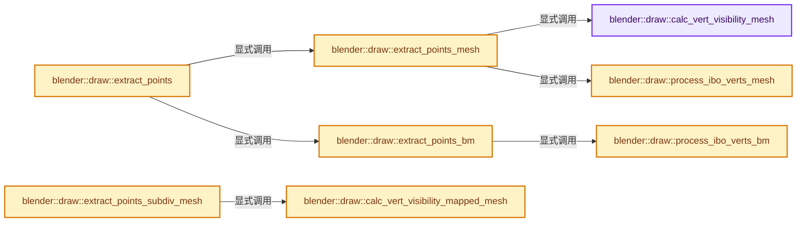
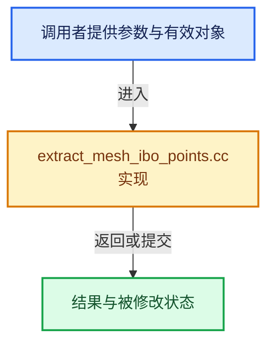

# 实现依赖专题：source/blender/draw/intern/mesh_extractors/extract_mesh_ibo_points.cc

[方向导航](README.md) · [符号索引](../%E7%AC%A6%E5%8F%B7%E4%BE%9D%E8%B5%96%E4%B8%8E%E5%AE%9E%E7%8E%B0%E7%B4%A2%E5%BC%95.md)

本专题从正文实际调用进入，集中保存共享实现。函数有稳定锚点，可从调用处直接跳到对应完整函数；递归与互相调用通过回链组织。

## 本文件的实现关系






## 完整成员与函数实现

<a id="f-18f83ce56cfd90f0"></a>

### `blender::draw::calc_vert_visibility_mesh`

实现位置：[source/blender/draw/intern/mesh_extractors/extract_mesh_ibo_points.cc](../../../../../source/blender/draw/intern/mesh_extractors/extract_mesh_ibo_points.cc) · L19—L33。

接口参数：

- `const MeshRenderData &mr`
- `const IndexMask &mask`
- `IndexMaskMemory &memory`

**教学注释版**

<!-- annotated:aff4da4c884908 -->

```cpp
static IndexMask calc_vert_visibility_mesh(const MeshRenderData &mr,
                                           const IndexMask &mask,
                                           IndexMaskMemory &memory)
{
  IndexMask visible = mask;
  if (!mr.hide_vert.is_empty()) {
    visible = IndexMask::from_bools_inverse(visible, mr.hide_vert, memory);
  }
  if (mr.orig_index_vert != nullptr) {
    const int *orig_index = mr.orig_index_vert;
    static_assert(ORIGINDEX_NONE == -1);
    visible = array_utils::indices_non_negative(visible, Span(orig_index, mr.verts_num), memory);
  }
  return visible;
}
```

<details>
<summary>核对原始源码：source/blender/draw/intern/mesh_extractors/extract_mesh_ibo_points.cc · L19—L33</summary>

<!-- original:aff4da4c884908:source/blender/draw/intern/mesh_extractors/extract_mesh_ibo_points.cc:19:33 -->

```cpp
static IndexMask calc_vert_visibility_mesh(const MeshRenderData &mr,
                                           const IndexMask &mask,
                                           IndexMaskMemory &memory)
{
  IndexMask visible = mask;
  if (!mr.hide_vert.is_empty()) {
    visible = IndexMask::from_bools_inverse(visible, mr.hide_vert, memory);
  }
  if (mr.orig_index_vert != nullptr) {
    const int *orig_index = mr.orig_index_vert;
    static_assert(ORIGINDEX_NONE == -1);
    visible = array_utils::indices_non_negative(visible, Span(orig_index, mr.verts_num), memory);
  }
  return visible;
}
```

</details>

**沿实际写入检查状态**

- `visible = IndexMask::from_bools_inverse(visible, mr.hide_vert, memory);`
- `visible = array_utils::indices_non_negative(visible, Span(orig_index, mr.verts_num), memory);`

**结果出口**

- `return visible;`

**继续追踪实现**

- `mr.hide_vert.is_empty` → [调用协议](../%E6%A8%A1%E6%9D%BF%E5%AE%8F%E4%B8%8E%E5%8A%A8%E6%80%81%E5%88%86%E6%B4%BE%E5%8D%8F%E8%AE%AE.md)：接收对象类型依赖auto、返回值或模板实例；不按同名猜测目标。调用位置L24。
- `IndexMask::from_bools_inverse` → [blender::index_mask::IndexMask::from_bools_inverse · L603](../04-%E8%99%9A%E6%8B%9F%E6%95%B0%E7%BB%84%E4%B8%8E%E7%B4%A2%E5%BC%95%E9%80%89%E6%8B%A9/10-IndexMask%E6%9E%84%E5%BB%BA%E4%B8%8E%E5%B9%B6%E8%A1%8C.md#f-96442cca3bb6cc50)；[blender::index_mask::IndexMask::from_bools_inverse · L608](../04-%E8%99%9A%E6%8B%9F%E6%95%B0%E7%BB%84%E4%B8%8E%E7%B4%A2%E5%BC%95%E9%80%89%E6%8B%A9/10-IndexMask%E6%9E%84%E5%BB%BA%E4%B8%8E%E5%B9%B6%E8%A1%8C.md#f-c40b154f402a386c)；[blender::index_mask::IndexMask::from_bools_inverse · L640](../04-%E8%99%9A%E6%8B%9F%E6%95%B0%E7%BB%84%E4%B8%8E%E7%B4%A2%E5%BC%95%E9%80%89%E6%8B%A9/10-IndexMask%E6%9E%84%E5%BB%BA%E4%B8%8E%E5%B9%B6%E8%A1%8C.md#f-f2da3a64e1eb2558)；[blender::index_mask::IndexMask::from_bools_inverse · L668](../04-%E8%99%9A%E6%8B%9F%E6%95%B0%E7%BB%84%E4%B8%8E%E7%B4%A2%E5%BC%95%E9%80%89%E6%8B%A9/10-IndexMask%E6%9E%84%E5%BB%BA%E4%B8%8E%E5%B9%B6%E8%A1%8C.md#f-1975fcd2e2ded5f3)。同名重载需按实参类型选择。
- `array_utils::indices_non_negative` → [blender::array_utils::indices_non_negative · L455](../01-%E5%9F%BA%E7%A1%80%E5%AE%B9%E5%99%A8%E4%B8%8E%E7%8E%B0%E4%BB%A3CPP/%E4%BE%9D%E8%B5%96-array_utils-cbb70f.md#f-2c083cdfa58fcf58)。
- `Span` → [blender::Span](../01-%E5%9F%BA%E7%A1%80%E5%AE%B9%E5%99%A8%E4%B8%8E%E7%8E%B0%E4%BB%A3CPP/%E4%BE%9D%E8%B5%96-BLI_span-6aa95f.md#t-8765a8e0c1d5)；[blender::Span](../01-%E5%9F%BA%E7%A1%80%E5%AE%B9%E5%99%A8%E4%B8%8E%E7%8E%B0%E4%BB%A3CPP/%E4%BE%9D%E8%B5%96-BLI_index_range-7d7cc5.md#t-86091874a1c0)；[blender::Span](%E4%BE%9D%E8%B5%96-DNA_pointcloud_types-cfb82c.md#t-112aa6ed842c)；[blender::Span](%E4%BE%9D%E8%B5%96-DNA_node_types-6708b9.md#t-49ec6fbb9b69)；[blender::Span](%E4%BE%9D%E8%B5%96-DNA_mesh_types-81f02e.md#t-184fd48fb638)；[blender::Span](%E4%BE%9D%E8%B5%96-DNA_anim_types-39c5d9.md#t-d841071994c2)；[blender::Span](%E4%BE%9D%E8%B5%96-RNA_path_fwd-79c989.md#t-4dbb08969e41)。

<a id="f-0656465dba21ffb5"></a>

### `blender::draw::process_ibo_verts_mesh`

实现位置：[source/blender/draw/intern/mesh_extractors/extract_mesh_ibo_points.cc](../../../../../source/blender/draw/intern/mesh_extractors/extract_mesh_ibo_points.cc) · L40—L64。

接口参数：

- `const MeshRenderData &mr`
- `const Fn &process_vert_fn`

**教学注释版**

<!-- annotated:30cdaa49ec7393 -->

```cpp
template<typename Fn>
static void process_ibo_verts_mesh(const MeshRenderData &mr, const Fn &process_vert_fn)
{
  const Span<int> corner_verts = mr.corner_verts;
  // [讲解] corner_verts.index_range：查询视图长度或生成对应有效索引区间。
  threading::parallel_for(corner_verts.index_range(), 2048, [&](const IndexRange range) {
    for (const int corner : range) {
      process_vert_fn(corner, corner_verts[corner]);
    }
  });

  const int loose_edges_start = mr.corners_num;
  const Span<int2> edges = mr.edges;
  mr.loose_edges.foreach_index_optimized<int>(
      [&](const int i, const int pos) {
        const int2 edge = edges[i];
        process_vert_fn(loose_edges_start + pos * 2 + 0, edge[0]);
        process_vert_fn(loose_edges_start + pos * 2 + 1, edge[1]);
      },
      exec_mode::grain_size(8196));

  const int loose_verts_start = mr.corners_num + mr.loose_edges.size() * 2;
  mr.loose_verts.foreach_index_optimized<int>(
      [&](const int i, const int pos) { process_vert_fn(loose_verts_start + pos, i); },
      exec_mode::grain_size(8196));
}
```

<details>
<summary>核对原始源码：source/blender/draw/intern/mesh_extractors/extract_mesh_ibo_points.cc · L40—L64</summary>

<!-- original:30cdaa49ec7393:source/blender/draw/intern/mesh_extractors/extract_mesh_ibo_points.cc:40:64 -->

```cpp
template<typename Fn>
static void process_ibo_verts_mesh(const MeshRenderData &mr, const Fn &process_vert_fn)
{
  const Span<int> corner_verts = mr.corner_verts;
  threading::parallel_for(corner_verts.index_range(), 2048, [&](const IndexRange range) {
    for (const int corner : range) {
      process_vert_fn(corner, corner_verts[corner]);
    }
  });

  const int loose_edges_start = mr.corners_num;
  const Span<int2> edges = mr.edges;
  mr.loose_edges.foreach_index_optimized<int>(
      [&](const int i, const int pos) {
        const int2 edge = edges[i];
        process_vert_fn(loose_edges_start + pos * 2 + 0, edge[0]);
        process_vert_fn(loose_edges_start + pos * 2 + 1, edge[1]);
      },
      exec_mode::grain_size(8196));

  const int loose_verts_start = mr.corners_num + mr.loose_edges.size() * 2;
  mr.loose_verts.foreach_index_optimized<int>(
      [&](const int i, const int pos) { process_vert_fn(loose_verts_start + pos, i); },
      exec_mode::grain_size(8196));
}
```

</details>

**继续追踪实现**

- `threading::parallel_for` → [blender::threading::parallel_for · L68](../11-Depsgraph%E4%B8%8E%E5%B9%B6%E8%A1%8C%E4%BB%BB%E5%8A%A1%E7%B3%BB%E7%BB%9F/07-%E4%BB%BB%E5%8A%A1%E6%B1%A0%E4%B8%8ETBB%E6%8E%A5%E5%85%A5.md#f-838294754c24426c)。
- `corner_verts.index_range` → [blender::Span::index_range · L405](../01-%E5%9F%BA%E7%A1%80%E5%AE%B9%E5%99%A8%E4%B8%8E%E7%8E%B0%E4%BB%A3CPP/05-Span%E5%8F%AA%E8%AF%BB%E8%BF%9E%E7%BB%AD%E8%A7%86%E5%9B%BE.md#f-caaa9b06e13e53e0)。
- `process_vert_fn` → [调用协议](../%E6%A8%A1%E6%9D%BF%E5%AE%8F%E4%B8%8E%E5%8A%A8%E6%80%81%E5%88%86%E6%B4%BE%E5%8D%8F%E8%AE%AE.md)：局部可调用对象，须结合其初始化与捕获环境。调用位置L46。
- `mr.loose_edges.foreach_index_optimized<int>` → [调用协议](../%E6%A8%A1%E6%9D%BF%E5%AE%8F%E4%B8%8E%E5%8A%A8%E6%80%81%E5%88%86%E6%B4%BE%E5%8D%8F%E8%AE%AE.md)：接收对象类型依赖auto、返回值或模板实例；不按同名猜测目标。调用位置L52。
- `exec_mode::grain_size` → [blender::exec_mode::grain_size · L79](../01-%E5%9F%BA%E7%A1%80%E5%AE%B9%E5%99%A8%E4%B8%8E%E7%8E%B0%E4%BB%A3CPP/%E4%BE%9D%E8%B5%96-BLI_execution_mode-1528fb.md#f-0b4fc2f9fa6e66e7)。
- `mr.loose_edges.size` → [调用协议](../%E6%A8%A1%E6%9D%BF%E5%AE%8F%E4%B8%8E%E5%8A%A8%E6%80%81%E5%88%86%E6%B4%BE%E5%8D%8F%E8%AE%AE.md)：接收对象类型依赖auto、返回值或模板实例；不按同名猜测目标。调用位置L60。
- `mr.loose_verts.foreach_index_optimized<int>` → [调用协议](../%E6%A8%A1%E6%9D%BF%E5%AE%8F%E4%B8%8E%E5%8A%A8%E6%80%81%E5%88%86%E6%B4%BE%E5%8D%8F%E8%AE%AE.md)：接收对象类型依赖auto、返回值或模板实例；不按同名猜测目标。调用位置L61。

<a id="f-80d450a142d26d3d"></a>

### `blender::draw::extract_points_mesh`

实现位置：[source/blender/draw/intern/mesh_extractors/extract_mesh_ibo_points.cc](../../../../../source/blender/draw/intern/mesh_extractors/extract_mesh_ibo_points.cc) · L66—L101。

接口参数：

- `const MeshRenderData &mr`

**教学注释版**

<!-- annotated:0aaa046aad757f -->

```cpp
static gpu::IndexBufPtr extract_points_mesh(const MeshRenderData &mr)
{
  IndexMaskMemory memory;
  const IndexMask visible_verts = calc_vert_visibility_mesh(mr, IndexMask(mr.verts_num), memory);

  const int max_index = mr.corners_num + mr.loose_edges.size() * 2 + mr.loose_verts.size();
  GPUIndexBufBuilder builder;
  GPU_indexbuf_init(&builder, GPU_PRIM_POINTS, visible_verts.size(), max_index);
  MutableSpan<uint> data = GPU_indexbuf_get_data(&builder);

  threading::memory_bandwidth_bound_task(mr.corner_verts.size_in_bytes(), [&]() {
    if (visible_verts.size() == mr.verts_num) {
      Array<bool> used(mr.verts_num, false);
      process_ibo_verts_mesh(mr, [&](const int ibo_index, const int vert) {
        if (!used[vert]) {
          used[vert] = true;
          data[vert] = ibo_index;
        }
      });
    }
    else {
      /* Compress the vertex indices into the smaller range of visible vertices in the IBO. */
      Array<int> map(mr.verts_num, -1);
      // [讲解] map.as_mutable_span：提供数组的借用访问入口。
      index_mask::build_reverse_map(visible_verts, map.as_mutable_span());
      process_ibo_verts_mesh(mr, [&](const int ibo_index, const int vert) {
        const int index = map[vert];
        if (index != -1) {
          map[vert] = -1;
          data[index] = ibo_index;
        }
      });
    }
  });

  return gpu::IndexBufPtr(GPU_indexbuf_build_ex(&builder, 0, max_index, false));
}
```

<details>
<summary>核对原始源码：source/blender/draw/intern/mesh_extractors/extract_mesh_ibo_points.cc · L66—L101</summary>

<!-- original:0aaa046aad757f:source/blender/draw/intern/mesh_extractors/extract_mesh_ibo_points.cc:66:101 -->

```cpp
static gpu::IndexBufPtr extract_points_mesh(const MeshRenderData &mr)
{
  IndexMaskMemory memory;
  const IndexMask visible_verts = calc_vert_visibility_mesh(mr, IndexMask(mr.verts_num), memory);

  const int max_index = mr.corners_num + mr.loose_edges.size() * 2 + mr.loose_verts.size();
  GPUIndexBufBuilder builder;
  GPU_indexbuf_init(&builder, GPU_PRIM_POINTS, visible_verts.size(), max_index);
  MutableSpan<uint> data = GPU_indexbuf_get_data(&builder);

  threading::memory_bandwidth_bound_task(mr.corner_verts.size_in_bytes(), [&]() {
    if (visible_verts.size() == mr.verts_num) {
      Array<bool> used(mr.verts_num, false);
      process_ibo_verts_mesh(mr, [&](const int ibo_index, const int vert) {
        if (!used[vert]) {
          used[vert] = true;
          data[vert] = ibo_index;
        }
      });
    }
    else {
      /* Compress the vertex indices into the smaller range of visible vertices in the IBO. */
      Array<int> map(mr.verts_num, -1);
      index_mask::build_reverse_map(visible_verts, map.as_mutable_span());
      process_ibo_verts_mesh(mr, [&](const int ibo_index, const int vert) {
        const int index = map[vert];
        if (index != -1) {
          map[vert] = -1;
          data[index] = ibo_index;
        }
      });
    }
  });

  return gpu::IndexBufPtr(GPU_indexbuf_build_ex(&builder, 0, max_index, false));
}
```

</details>

**沿实际写入检查状态**

- `used[vert] = true;`
- `data[vert] = ibo_index;`
- `map[vert] = -1;`
- `data[index] = ibo_index;`

**结果出口**

- `return gpu::IndexBufPtr(GPU_indexbuf_build_ex(&builder, 0, max_index, false));`

**继续追踪实现**

- `calc_vert_visibility_mesh` → [blender::draw::calc_vert_visibility_mesh · L19](%E4%BE%9D%E8%B5%96-extract_mesh_ibo_points-c428dd.md#f-18f83ce56cfd90f0)。
- `IndexMask` → [blender::index_mask::IndexMask::IndexMask · L704](../04-%E8%99%9A%E6%8B%9F%E6%95%B0%E7%BB%84%E4%B8%8E%E7%B4%A2%E5%BC%95%E9%80%89%E6%8B%A9/09-%E5%88%86%E6%AE%B5%E5%AD%98%E5%82%A8%E4%B8%8E%E9%81%8D%E5%8E%86.md#f-8c95440e4c5fec78)；[blender::index_mask::IndexMask::IndexMask · L709](../04-%E8%99%9A%E6%8B%9F%E6%95%B0%E7%BB%84%E4%B8%8E%E7%B4%A2%E5%BC%95%E9%80%89%E6%8B%A9/09-%E5%88%86%E6%AE%B5%E5%AD%98%E5%82%A8%E4%B8%8E%E9%81%8D%E5%8E%86.md#f-fdd9dc18868bc0cd)；[blender::index_mask::IndexMask::IndexMask · L722](../04-%E8%99%9A%E6%8B%9F%E6%95%B0%E7%BB%84%E4%B8%8E%E7%B4%A2%E5%BC%95%E9%80%89%E6%8B%A9/09-%E5%88%86%E6%AE%B5%E5%AD%98%E5%82%A8%E4%B8%8E%E9%81%8D%E5%8E%86.md#f-4b32f3ba3de66d05)。同名重载需按实参类型选择。
- `mr.loose_edges.size` → [调用协议](../%E6%A8%A1%E6%9D%BF%E5%AE%8F%E4%B8%8E%E5%8A%A8%E6%80%81%E5%88%86%E6%B4%BE%E5%8D%8F%E8%AE%AE.md)：接收对象类型依赖auto、返回值或模板实例；不按同名猜测目标。调用位置L71。
- `mr.loose_verts.size` → [调用协议](../%E6%A8%A1%E6%9D%BF%E5%AE%8F%E4%B8%8E%E5%8A%A8%E6%80%81%E5%88%86%E6%B4%BE%E5%8D%8F%E8%AE%AE.md)：接收对象类型依赖auto、返回值或模板实例；不按同名猜测目标。调用位置L71。
- `GPU_indexbuf_init` → [blender::GPU_indexbuf_init · L73](%E4%BE%9D%E8%B5%96-gpu_index_buffer-c3daac.md#f-adccf0f2321fb073)。
- `visible_verts.size` → [blender::index_mask::IndexMask::size · L743](../04-%E8%99%9A%E6%8B%9F%E6%95%B0%E7%BB%84%E4%B8%8E%E7%B4%A2%E5%BC%95%E9%80%89%E6%8B%A9/09-%E5%88%86%E6%AE%B5%E5%AD%98%E5%82%A8%E4%B8%8E%E9%81%8D%E5%8E%86.md#f-0163b32abc9a0d9c)。
- `GPU_indexbuf_get_data` → [blender::GPU_indexbuf_get_data · L96](%E4%BE%9D%E8%B5%96-gpu_index_buffer-c3daac.md#f-a5d0d67214a893c0)。
- `threading::memory_bandwidth_bound_task` → [blender::threading::memory_bandwidth_bound_task · L250](../11-Depsgraph%E4%B8%8E%E5%B9%B6%E8%A1%8C%E4%BB%BB%E5%8A%A1%E7%B3%BB%E7%BB%9F/07-%E4%BB%BB%E5%8A%A1%E6%B1%A0%E4%B8%8ETBB%E6%8E%A5%E5%85%A5.md#f-aa412ccec656928d)。
- `mr.corner_verts.size_in_bytes` → [调用协议](../%E6%A8%A1%E6%9D%BF%E5%AE%8F%E4%B8%8E%E5%8A%A8%E6%80%81%E5%88%86%E6%B4%BE%E5%8D%8F%E8%AE%AE.md)：接收对象类型依赖auto、返回值或模板实例；不按同名猜测目标。调用位置L76。
- `process_ibo_verts_mesh` → [blender::draw::process_ibo_verts_mesh · L40](%E4%BE%9D%E8%B5%96-extract_mesh_ibo_points-c428dd.md#f-0656465dba21ffb5)。
- `index_mask::build_reverse_map` → [blender::index_mask::build_reverse_map · L36](../04-%E8%99%9A%E6%8B%9F%E6%95%B0%E7%BB%84%E4%B8%8E%E7%B4%A2%E5%BC%95%E9%80%89%E6%8B%A9/10-IndexMask%E6%9E%84%E5%BB%BA%E4%B8%8E%E5%B9%B6%E8%A1%8C.md#f-70299191942ae7f9)。
- `map.as_mutable_span` → [blender::Array::as_mutable_span · L259](../01-%E5%9F%BA%E7%A1%80%E5%AE%B9%E5%99%A8%E4%B8%8E%E7%8E%B0%E4%BB%A3CPP/08-Array%E5%A4%8D%E5%88%B6%E7%A7%BB%E5%8A%A8%E4%B8%8E%E9%94%80%E6%AF%81.md#f-4e91de9f1337c144)。
- `gpu::IndexBufPtr` → [调用协议](../%E6%A8%A1%E6%9D%BF%E5%AE%8F%E4%B8%8E%E5%8A%A8%E6%80%81%E5%88%86%E6%B4%BE%E5%8D%8F%E8%AE%AE.md)：函数指针、局部可调用对象或未展开的宏；必须结合调用者环境。调用位置L100。
- `GPU_indexbuf_build_ex` → [blender::GPU_indexbuf_build_ex · L473](%E4%BE%9D%E8%B5%96-gpu_index_buffer-c3daac.md#f-99e8b36d94dd0581)。

<a id="f-610534aed1220367"></a>

### `blender::draw::process_ibo_verts_bm`

实现位置：[source/blender/draw/intern/mesh_extractors/extract_mesh_ibo_points.cc](../../../../../source/blender/draw/intern/mesh_extractors/extract_mesh_ibo_points.cc) · L103—L130。

接口参数：

- `const MeshRenderData &mr`
- `const Fn &process_vert_fn`

**教学注释版**

<!-- annotated:046e9a161f8312 -->

```cpp
template<typename Fn>
static void process_ibo_verts_bm(const MeshRenderData &mr, const Fn &process_vert_fn)
{
  BMesh &bm = *mr.bm;

  threading::parallel_for(IndexRange(mr.verts_num), 4096, [&](const IndexRange range) {
    for (const int i : range) {
      BMVert &vert = *BM_vert_at_index(&bm, i);
      if (const BMLoop *loop = BM_vert_find_first_loop(&vert)) {
        process_vert_fn(BM_elem_index_get(loop), i);
      }
    }
  });

  const int loose_edges_start = mr.corners_num;
  mr.loose_edges.foreach_index(
      [&](const int i, const int pos) {
        const BMEdge &edge = *BM_edge_at_index(&bm, i);
        process_vert_fn(loose_edges_start + pos * 2 + 0, BM_elem_index_get(edge.v1));
        process_vert_fn(loose_edges_start + pos * 2 + 1, BM_elem_index_get(edge.v2));
      },
      exec_mode::grain_size(4096));

  const int loose_verts_start = mr.corners_num + mr.loose_edges.size() * 2;
  mr.loose_verts.foreach_index_optimized<int>(
      [&](const int i, const int pos) { process_vert_fn(loose_verts_start + pos, i); },
      exec_mode::grain_size(4096));
}
```

<details>
<summary>核对原始源码：source/blender/draw/intern/mesh_extractors/extract_mesh_ibo_points.cc · L103—L130</summary>

<!-- original:046e9a161f8312:source/blender/draw/intern/mesh_extractors/extract_mesh_ibo_points.cc:103:130 -->

```cpp
template<typename Fn>
static void process_ibo_verts_bm(const MeshRenderData &mr, const Fn &process_vert_fn)
{
  BMesh &bm = *mr.bm;

  threading::parallel_for(IndexRange(mr.verts_num), 4096, [&](const IndexRange range) {
    for (const int i : range) {
      BMVert &vert = *BM_vert_at_index(&bm, i);
      if (const BMLoop *loop = BM_vert_find_first_loop(&vert)) {
        process_vert_fn(BM_elem_index_get(loop), i);
      }
    }
  });

  const int loose_edges_start = mr.corners_num;
  mr.loose_edges.foreach_index(
      [&](const int i, const int pos) {
        const BMEdge &edge = *BM_edge_at_index(&bm, i);
        process_vert_fn(loose_edges_start + pos * 2 + 0, BM_elem_index_get(edge.v1));
        process_vert_fn(loose_edges_start + pos * 2 + 1, BM_elem_index_get(edge.v2));
      },
      exec_mode::grain_size(4096));

  const int loose_verts_start = mr.corners_num + mr.loose_edges.size() * 2;
  mr.loose_verts.foreach_index_optimized<int>(
      [&](const int i, const int pos) { process_vert_fn(loose_verts_start + pos, i); },
      exec_mode::grain_size(4096));
}
```

</details>

**继续追踪实现**

- `threading::parallel_for` → [blender::threading::parallel_for · L68](../11-Depsgraph%E4%B8%8E%E5%B9%B6%E8%A1%8C%E4%BB%BB%E5%8A%A1%E7%B3%BB%E7%BB%9F/07-%E4%BB%BB%E5%8A%A1%E6%B1%A0%E4%B8%8ETBB%E6%8E%A5%E5%85%A5.md#f-838294754c24426c)。
- `IndexRange` → [blender::IndexRange](../01-%E5%9F%BA%E7%A1%80%E5%AE%B9%E5%99%A8%E4%B8%8E%E7%8E%B0%E4%BB%A3CPP/%E4%BE%9D%E8%B5%96-BLI_index_range-7d7cc5.md#t-caa3466d6776)；[blender::gpu::shader::parser::IndexRange](%E4%BE%9D%E8%B5%96-utils-06433d.md#t-82d2bd4ea71c)；[blender::IndexRange](%E4%BE%9D%E8%B5%96-DNA_node_types-6708b9.md#t-0448cc889d39)。
- `BM_vert_at_index` → [blender::BM_vert_at_index · L110](%E4%BE%9D%E8%B5%96-bmesh_mesh-df20c7.md#f-aced0ebcd417a2f4)。
- `BM_vert_find_first_loop` → [blender::BM_vert_find_first_loop · L309](%E4%BE%9D%E8%B5%96-bmesh_query-b0f8d6.md#f-18741548918712b6)。
- `process_vert_fn` → [调用协议](../%E6%A8%A1%E6%9D%BF%E5%AE%8F%E4%B8%8E%E5%8A%A8%E6%80%81%E5%88%86%E6%B4%BE%E5%8D%8F%E8%AE%AE.md)：局部可调用对象，须结合其初始化与捕获环境。调用位置L112。
- `BM_elem_index_get` → [BM_elem_index_get · L120](%E4%BE%9D%E8%B5%96-bmesh_inline-74f1be.md#m-201981cdc62d)。宏定义由构建条件选择。
- `mr.loose_edges.foreach_index` → [调用协议](../%E6%A8%A1%E6%9D%BF%E5%AE%8F%E4%B8%8E%E5%8A%A8%E6%80%81%E5%88%86%E6%B4%BE%E5%8D%8F%E8%AE%AE.md)：接收对象类型依赖auto、返回值或模板实例；不按同名猜测目标。调用位置L118。
- `BM_edge_at_index` → [blender::BM_edge_at_index · L116](%E4%BE%9D%E8%B5%96-bmesh_mesh-df20c7.md#f-81d027fd9e6b4c84)。
- `exec_mode::grain_size` → [blender::exec_mode::grain_size · L79](../01-%E5%9F%BA%E7%A1%80%E5%AE%B9%E5%99%A8%E4%B8%8E%E7%8E%B0%E4%BB%A3CPP/%E4%BE%9D%E8%B5%96-BLI_execution_mode-1528fb.md#f-0b4fc2f9fa6e66e7)。
- `mr.loose_edges.size` → [调用协议](../%E6%A8%A1%E6%9D%BF%E5%AE%8F%E4%B8%8E%E5%8A%A8%E6%80%81%E5%88%86%E6%B4%BE%E5%8D%8F%E8%AE%AE.md)：接收对象类型依赖auto、返回值或模板实例；不按同名猜测目标。调用位置L126。
- `mr.loose_verts.foreach_index_optimized<int>` → [调用协议](../%E6%A8%A1%E6%9D%BF%E5%AE%8F%E4%B8%8E%E5%8A%A8%E6%80%81%E5%88%86%E6%B4%BE%E5%8D%8F%E8%AE%AE.md)：接收对象类型依赖auto、返回值或模板实例；不按同名猜测目标。调用位置L127。

<a id="f-2ea6445d1ae107eb"></a>

### `blender::draw::extract_points_bm`

实现位置：[source/blender/draw/intern/mesh_extractors/extract_mesh_ibo_points.cc](../../../../../source/blender/draw/intern/mesh_extractors/extract_mesh_ibo_points.cc) · L132—L181。

接口参数：

- `const MeshRenderData &mr`

**教学注释版**

<!-- annotated:62a6b8e14985f7 -->

```cpp
static gpu::IndexBufPtr extract_points_bm(const MeshRenderData &mr)
{
  BMesh &bm = *mr.bm;

  IndexMaskMemory memory;
  const IndexMask visible_verts = IndexMask::from_predicate(
      IndexRange(bm.totvert), memory, [&](const int i) {
        return !BM_elem_flag_test_bool(BM_vert_at_index(&const_cast<BMesh &>(bm), i),
                                       BM_ELEM_HIDDEN);
      });

  const int max_index = mr.corners_num + mr.loose_edges.size() * 2 + mr.loose_verts.size();
  GPUIndexBufBuilder builder;
  GPU_indexbuf_init(&builder, GPU_PRIM_POINTS, visible_verts.size(), max_index);
  MutableSpan<uint> data = GPU_indexbuf_get_data(&builder);

  if (mr.loose_verts.is_empty() && mr.loose_edges.is_empty()) {
    /* Make use of BMesh's vertex to loop topology knowledge to iterate over verts instead of
     * iterating over faces and defining points implicitly as done in the #Mesh extraction. */
    visible_verts.foreach_index(
        [&](const int i, const int pos) {
          BMVert &vert = *BM_vert_at_index(&bm, i);
          data[pos] = BM_elem_index_get(BM_vert_find_first_loop(&vert));
        },
        exec_mode::grain_size(4096));
  }
  else if (visible_verts.size() == bm.totvert) {
    Array<bool> used(mr.verts_num, false);
    process_ibo_verts_bm(mr, [&](const int ibo_index, const int vert) {
      if (!used[vert]) {
        used[vert] = true;
        data[vert] = ibo_index;
      }
    });
  }
  else {
    /* Compress the vertex indices into the smaller range of visible vertices in the IBO. */
    Array<int> map(mr.verts_num, -1);
    // [讲解] map.as_mutable_span：提供数组的借用访问入口。
    index_mask::build_reverse_map(visible_verts, map.as_mutable_span());
    process_ibo_verts_bm(mr, [&](const int ibo_index, const int vert) {
      const int index = map[vert];
      if (index != -1) {
        map[vert] = -1;
        data[index] = ibo_index;
      }
    });
  }

  return gpu::IndexBufPtr(GPU_indexbuf_build_ex(&builder, 0, max_index, false));
}
```

<details>
<summary>核对原始源码：source/blender/draw/intern/mesh_extractors/extract_mesh_ibo_points.cc · L132—L181</summary>

<!-- original:62a6b8e14985f7:source/blender/draw/intern/mesh_extractors/extract_mesh_ibo_points.cc:132:181 -->

```cpp
static gpu::IndexBufPtr extract_points_bm(const MeshRenderData &mr)
{
  BMesh &bm = *mr.bm;

  IndexMaskMemory memory;
  const IndexMask visible_verts = IndexMask::from_predicate(
      IndexRange(bm.totvert), memory, [&](const int i) {
        return !BM_elem_flag_test_bool(BM_vert_at_index(&const_cast<BMesh &>(bm), i),
                                       BM_ELEM_HIDDEN);
      });

  const int max_index = mr.corners_num + mr.loose_edges.size() * 2 + mr.loose_verts.size();
  GPUIndexBufBuilder builder;
  GPU_indexbuf_init(&builder, GPU_PRIM_POINTS, visible_verts.size(), max_index);
  MutableSpan<uint> data = GPU_indexbuf_get_data(&builder);

  if (mr.loose_verts.is_empty() && mr.loose_edges.is_empty()) {
    /* Make use of BMesh's vertex to loop topology knowledge to iterate over verts instead of
     * iterating over faces and defining points implicitly as done in the #Mesh extraction. */
    visible_verts.foreach_index(
        [&](const int i, const int pos) {
          BMVert &vert = *BM_vert_at_index(&bm, i);
          data[pos] = BM_elem_index_get(BM_vert_find_first_loop(&vert));
        },
        exec_mode::grain_size(4096));
  }
  else if (visible_verts.size() == bm.totvert) {
    Array<bool> used(mr.verts_num, false);
    process_ibo_verts_bm(mr, [&](const int ibo_index, const int vert) {
      if (!used[vert]) {
        used[vert] = true;
        data[vert] = ibo_index;
      }
    });
  }
  else {
    /* Compress the vertex indices into the smaller range of visible vertices in the IBO. */
    Array<int> map(mr.verts_num, -1);
    index_mask::build_reverse_map(visible_verts, map.as_mutable_span());
    process_ibo_verts_bm(mr, [&](const int ibo_index, const int vert) {
      const int index = map[vert];
      if (index != -1) {
        map[vert] = -1;
        data[index] = ibo_index;
      }
    });
  }

  return gpu::IndexBufPtr(GPU_indexbuf_build_ex(&builder, 0, max_index, false));
}
```

</details>

**沿实际写入检查状态**

- `data[pos] = BM_elem_index_get(BM_vert_find_first_loop(&vert));`
- `used[vert] = true;`
- `data[vert] = ibo_index;`
- `map[vert] = -1;`
- `data[index] = ibo_index;`

**结果出口**

- `return !BM_elem_flag_test_bool(BM_vert_at_index(&const_cast<BMesh &>(bm), i),`
- `return gpu::IndexBufPtr(GPU_indexbuf_build_ex(&builder, 0, max_index, false));`

**继续追踪实现**

- `IndexMask::from_predicate` → [blender::index_mask::IndexMask::from_predicate · L1073](../04-%E8%99%9A%E6%8B%9F%E6%95%B0%E7%BB%84%E4%B8%8E%E7%B4%A2%E5%BC%95%E9%80%89%E6%8B%A9/12-%E9%87%8D%E6%9E%84%E5%8E%86%E5%8F%B2%E4%B8%8E%E5%9F%BA%E5%87%86%E7%BB%83%E4%B9%A0.md#f-3864daa059098df8)。
- `IndexRange` → [blender::IndexRange](../01-%E5%9F%BA%E7%A1%80%E5%AE%B9%E5%99%A8%E4%B8%8E%E7%8E%B0%E4%BB%A3CPP/%E4%BE%9D%E8%B5%96-BLI_index_range-7d7cc5.md#t-caa3466d6776)；[blender::gpu::shader::parser::IndexRange](%E4%BE%9D%E8%B5%96-utils-06433d.md#t-82d2bd4ea71c)；[blender::IndexRange](%E4%BE%9D%E8%B5%96-DNA_node_types-6708b9.md#t-0448cc889d39)。
- `BM_elem_flag_test_bool` → [BM_elem_flag_test_bool · L22](%E4%BE%9D%E8%B5%96-bmesh_inline-74f1be.md#m-a8ef8d976b74)。宏定义由构建条件选择。
- `BM_vert_at_index` → [blender::BM_vert_at_index · L110](%E4%BE%9D%E8%B5%96-bmesh_mesh-df20c7.md#f-aced0ebcd417a2f4)。
- `mr.loose_edges.size` → [调用协议](../%E6%A8%A1%E6%9D%BF%E5%AE%8F%E4%B8%8E%E5%8A%A8%E6%80%81%E5%88%86%E6%B4%BE%E5%8D%8F%E8%AE%AE.md)：接收对象类型依赖auto、返回值或模板实例；不按同名猜测目标。调用位置L143。
- `mr.loose_verts.size` → [调用协议](../%E6%A8%A1%E6%9D%BF%E5%AE%8F%E4%B8%8E%E5%8A%A8%E6%80%81%E5%88%86%E6%B4%BE%E5%8D%8F%E8%AE%AE.md)：接收对象类型依赖auto、返回值或模板实例；不按同名猜测目标。调用位置L143。
- `GPU_indexbuf_init` → [blender::GPU_indexbuf_init · L73](%E4%BE%9D%E8%B5%96-gpu_index_buffer-c3daac.md#f-adccf0f2321fb073)。
- `visible_verts.size` → [blender::index_mask::IndexMask::size · L743](../04-%E8%99%9A%E6%8B%9F%E6%95%B0%E7%BB%84%E4%B8%8E%E7%B4%A2%E5%BC%95%E9%80%89%E6%8B%A9/09-%E5%88%86%E6%AE%B5%E5%AD%98%E5%82%A8%E4%B8%8E%E9%81%8D%E5%8E%86.md#f-0163b32abc9a0d9c)。
- `GPU_indexbuf_get_data` → [blender::GPU_indexbuf_get_data · L96](%E4%BE%9D%E8%B5%96-gpu_index_buffer-c3daac.md#f-a5d0d67214a893c0)。
- `mr.loose_verts.is_empty` → [调用协议](../%E6%A8%A1%E6%9D%BF%E5%AE%8F%E4%B8%8E%E5%8A%A8%E6%80%81%E5%88%86%E6%B4%BE%E5%8D%8F%E8%AE%AE.md)：接收对象类型依赖auto、返回值或模板实例；不按同名猜测目标。调用位置L148。
- `mr.loose_edges.is_empty` → [调用协议](../%E6%A8%A1%E6%9D%BF%E5%AE%8F%E4%B8%8E%E5%8A%A8%E6%80%81%E5%88%86%E6%B4%BE%E5%8D%8F%E8%AE%AE.md)：接收对象类型依赖auto、返回值或模板实例；不按同名猜测目标。调用位置L148。
- `visible_verts.foreach_index` → [blender::index_mask::IndexMask::foreach_index · L855](../04-%E8%99%9A%E6%8B%9F%E6%95%B0%E7%BB%84%E4%B8%8E%E7%B4%A2%E5%BC%95%E9%80%89%E6%8B%A9/09-%E5%88%86%E6%AE%B5%E5%AD%98%E5%82%A8%E4%B8%8E%E9%81%8D%E5%8E%86.md#f-cd6cd317e2e2812c)。
- `BM_elem_index_get` → [BM_elem_index_get · L120](%E4%BE%9D%E8%B5%96-bmesh_inline-74f1be.md#m-201981cdc62d)。宏定义由构建条件选择。
- `BM_vert_find_first_loop` → [blender::BM_vert_find_first_loop · L309](%E4%BE%9D%E8%B5%96-bmesh_query-b0f8d6.md#f-18741548918712b6)。
- `exec_mode::grain_size` → [blender::exec_mode::grain_size · L79](../01-%E5%9F%BA%E7%A1%80%E5%AE%B9%E5%99%A8%E4%B8%8E%E7%8E%B0%E4%BB%A3CPP/%E4%BE%9D%E8%B5%96-BLI_execution_mode-1528fb.md#f-0b4fc2f9fa6e66e7)。
- `process_ibo_verts_bm` → [blender::draw::process_ibo_verts_bm · L103](%E4%BE%9D%E8%B5%96-extract_mesh_ibo_points-c428dd.md#f-610534aed1220367)。
- `index_mask::build_reverse_map` → [blender::index_mask::build_reverse_map · L36](../04-%E8%99%9A%E6%8B%9F%E6%95%B0%E7%BB%84%E4%B8%8E%E7%B4%A2%E5%BC%95%E9%80%89%E6%8B%A9/10-IndexMask%E6%9E%84%E5%BB%BA%E4%B8%8E%E5%B9%B6%E8%A1%8C.md#f-70299191942ae7f9)。
- `map.as_mutable_span` → [blender::Array::as_mutable_span · L259](../01-%E5%9F%BA%E7%A1%80%E5%AE%B9%E5%99%A8%E4%B8%8E%E7%8E%B0%E4%BB%A3CPP/08-Array%E5%A4%8D%E5%88%B6%E7%A7%BB%E5%8A%A8%E4%B8%8E%E9%94%80%E6%AF%81.md#f-4e91de9f1337c144)。
- `gpu::IndexBufPtr` → [调用协议](../%E6%A8%A1%E6%9D%BF%E5%AE%8F%E4%B8%8E%E5%8A%A8%E6%80%81%E5%88%86%E6%B4%BE%E5%8D%8F%E8%AE%AE.md)：函数指针、局部可调用对象或未展开的宏；必须结合调用者环境。调用位置L180。
- `GPU_indexbuf_build_ex` → [blender::GPU_indexbuf_build_ex · L473](%E4%BE%9D%E8%B5%96-gpu_index_buffer-c3daac.md#f-99e8b36d94dd0581)。

<a id="f-0d4495b7b941850e"></a>

### `blender::draw::extract_points`

实现位置：[source/blender/draw/intern/mesh_extractors/extract_mesh_ibo_points.cc](../../../../../source/blender/draw/intern/mesh_extractors/extract_mesh_ibo_points.cc) · L183—L189。

接口参数：

- `const MeshRenderData &mr`

**教学注释版**

<!-- annotated:b84fcaa813becd -->

```cpp
gpu::IndexBufPtr extract_points(const MeshRenderData &mr)
{
  if (mr.extract_type == MeshExtractType::Mesh) {
    return extract_points_mesh(mr);
  }
  return extract_points_bm(mr);
}
```

<details>
<summary>核对原始源码：source/blender/draw/intern/mesh_extractors/extract_mesh_ibo_points.cc · L183—L189</summary>

<!-- original:b84fcaa813becd:source/blender/draw/intern/mesh_extractors/extract_mesh_ibo_points.cc:183:189 -->

```cpp
gpu::IndexBufPtr extract_points(const MeshRenderData &mr)
{
  if (mr.extract_type == MeshExtractType::Mesh) {
    return extract_points_mesh(mr);
  }
  return extract_points_bm(mr);
}
```

</details>

**结果出口**

- `return extract_points_mesh(mr);`
- `return extract_points_bm(mr);`

**继续追踪实现**

- `extract_points_mesh` → [blender::draw::extract_points_mesh · L66](%E4%BE%9D%E8%B5%96-extract_mesh_ibo_points-c428dd.md#f-80d450a142d26d3d)。
- `extract_points_bm` → [blender::draw::extract_points_bm · L132](%E4%BE%9D%E8%B5%96-extract_mesh_ibo_points-c428dd.md#f-2ea6445d1ae107eb)。

<a id="f-37621d6397eaddfd"></a>

### `blender::draw::calc_vert_visibility_mapped_mesh`

实现位置：[source/blender/draw/intern/mesh_extractors/extract_mesh_ibo_points.cc](../../../../../source/blender/draw/intern/mesh_extractors/extract_mesh_ibo_points.cc) · L191—L208。

接口参数：

- `const MeshRenderData &mr`
- `const IndexMask &mask`
- `const Span<int> map`
- `IndexMaskMemory &memory`

**教学注释版**

<!-- annotated:a789cec81971e0 -->

```cpp
static IndexMask calc_vert_visibility_mapped_mesh(const MeshRenderData &mr,
                                                  const IndexMask &mask,
                                                  const Span<int> map,
                                                  IndexMaskMemory &memory)
{
  IndexMask visible = mask;
  if (!mr.hide_vert.is_empty()) {
    const Span<bool> hide_vert = mr.hide_vert;
    visible = IndexMask::from_predicate(
        visible, memory, [&](const int i) { return !hide_vert[map[i]]; });
  }
  if (mr.orig_index_vert != nullptr) {
    const int *orig_index = mr.orig_index_vert;
    visible = IndexMask::from_predicate(
        visible, memory, [&](const int i) { return orig_index[map[i]] != ORIGINDEX_NONE; });
  }
  return visible;
}
```

<details>
<summary>核对原始源码：source/blender/draw/intern/mesh_extractors/extract_mesh_ibo_points.cc · L191—L208</summary>

<!-- original:a789cec81971e0:source/blender/draw/intern/mesh_extractors/extract_mesh_ibo_points.cc:191:208 -->

```cpp
static IndexMask calc_vert_visibility_mapped_mesh(const MeshRenderData &mr,
                                                  const IndexMask &mask,
                                                  const Span<int> map,
                                                  IndexMaskMemory &memory)
{
  IndexMask visible = mask;
  if (!mr.hide_vert.is_empty()) {
    const Span<bool> hide_vert = mr.hide_vert;
    visible = IndexMask::from_predicate(
        visible, memory, [&](const int i) { return !hide_vert[map[i]]; });
  }
  if (mr.orig_index_vert != nullptr) {
    const int *orig_index = mr.orig_index_vert;
    visible = IndexMask::from_predicate(
        visible, memory, [&](const int i) { return orig_index[map[i]] != ORIGINDEX_NONE; });
  }
  return visible;
}
```

</details>

**沿实际写入检查状态**

- `visible = IndexMask::from_predicate(`

**结果出口**

- `return visible;`

**继续追踪实现**

- `mr.hide_vert.is_empty` → [调用协议](../%E6%A8%A1%E6%9D%BF%E5%AE%8F%E4%B8%8E%E5%8A%A8%E6%80%81%E5%88%86%E6%B4%BE%E5%8D%8F%E8%AE%AE.md)：接收对象类型依赖auto、返回值或模板实例；不按同名猜测目标。调用位置L197。
- `IndexMask::from_predicate` → [blender::index_mask::IndexMask::from_predicate · L1073](../04-%E8%99%9A%E6%8B%9F%E6%95%B0%E7%BB%84%E4%B8%8E%E7%B4%A2%E5%BC%95%E9%80%89%E6%8B%A9/12-%E9%87%8D%E6%9E%84%E5%8E%86%E5%8F%B2%E4%B8%8E%E5%9F%BA%E5%87%86%E7%BB%83%E4%B9%A0.md#f-3864daa059098df8)。

<a id="f-45bee39be60d651f"></a>

### `blender::draw::extract_points_subdiv_mesh`

实现位置：[source/blender/draw/intern/mesh_extractors/extract_mesh_ibo_points.cc](../../../../../source/blender/draw/intern/mesh_extractors/extract_mesh_ibo_points.cc) · L210—L267。

接口参数：

- `const MeshRenderData &mr`
- `const DRWSubdivCache &subdiv_cache`

**教学注释版**

<!-- annotated:5abd9d6d36222b -->

```cpp
static gpu::IndexBufPtr extract_points_subdiv_mesh(const MeshRenderData &mr,
                                                   const DRWSubdivCache &subdiv_cache)
{
  const Span<int2> coarse_edges = mr.edges;
  const int verts_per_edge = subdiv_verts_per_coarse_edge(subdiv_cache);
  const int loose_edge_verts_num = verts_per_edge * mr.loose_edges.size();

  const Span<bool> hide_vert = mr.hide_vert;
  const Span<int> corner_orig_verts = subdiv_cache.verts_orig_index->data<int>();

  IndexMaskMemory memory;
  IndexMask visible_corners = IndexMask::from_predicate(
      // [讲解] corner_orig_verts.index_range：查询视图长度或生成对应有效索引区间。
      corner_orig_verts.index_range(), memory, [&](const int i) {
        return corner_orig_verts[i] != -1;
      });
  visible_corners = calc_vert_visibility_mapped_mesh(
      mr, visible_corners, corner_orig_verts, memory);

  Array<int, 64> loose_verts(mr.loose_verts.size());
  // [讲解] loose_verts.as_mutable_span：提供数组的借用访问入口。
  mr.loose_verts.to_indices(loose_verts.as_mutable_span());
  const IndexMask visible_loose = calc_vert_visibility_mapped_mesh(
      // [讲解] loose_verts.size：查询固定有效长度及其索引范围。
      mr, IndexMask(loose_verts.size()), loose_verts, memory);

  const int max_index = subdiv_cache.num_subdiv_loops + loose_edge_verts_num + loose_verts.size();
  GPUIndexBufBuilder builder;
  GPU_indexbuf_init(&builder,
                    GPU_PRIM_POINTS,
                    visible_corners.size() + mr.loose_edges.size() * 2 + visible_loose.size(),
                    max_index);
  MutableSpan<uint> data = GPU_indexbuf_get_data(&builder);

  // [讲解] data.take_front：从两端裁去或选取一定数量元素形成新视图。
  visible_corners.to_indices<int32_t>(data.take_front(visible_corners.size()).cast<int32_t>());

  const auto show_vert = [&](const int vert) {
    // [讲解] hide_vert.is_empty：查询视图长度或生成对应有效索引区间。
    if (!hide_vert.is_empty() && hide_vert[vert]) {
      return false;
    }
    if (mr.orig_index_vert && mr.orig_index_vert[vert] == ORIGINDEX_NONE) {
      return false;
    }
    return true;
  };

  // [讲解] data.slice：建立原连续范围的子视图。
  MutableSpan loose_edge_data = data.slice(visible_corners.size(), mr.loose_edges.size() * 2);
  const int loose_geom_start = subdiv_cache.num_subdiv_loops;
  mr.loose_edges.foreach_index([&](const int i, const int pos) {
    const int2 edge = coarse_edges[i];
    const IndexRange edge_range(loose_geom_start + pos * verts_per_edge, verts_per_edge);
    // [讲解] edge_range.first：读取范围两端的有效索引或值。
    loose_edge_data[pos * 2 + 0] = show_vert(edge[0]) ? edge_range.first() : gpu::RESTART_INDEX;
    // [讲解] edge_range.last：读取范围两端的有效索引或值。
    loose_edge_data[pos * 2 + 1] = show_vert(edge[1]) ? edge_range.last() : gpu::RESTART_INDEX;
  });

  // [讲解] data.take_back：从两端裁去或选取一定数量元素形成新视图。
  MutableSpan loose_vert_data = data.take_back(visible_loose.size()).cast<int32_t>();
  const int loose_verts_start = loose_geom_start + loose_edge_verts_num;
  visible_loose.shift(loose_verts_start, memory).to_indices<int32_t>(loose_vert_data);

  return gpu::IndexBufPtr(GPU_indexbuf_build_ex(&builder, 0, max_index, true));
}
```

<details>
<summary>核对原始源码：source/blender/draw/intern/mesh_extractors/extract_mesh_ibo_points.cc · L210—L267</summary>

<!-- original:5abd9d6d36222b:source/blender/draw/intern/mesh_extractors/extract_mesh_ibo_points.cc:210:267 -->

```cpp
static gpu::IndexBufPtr extract_points_subdiv_mesh(const MeshRenderData &mr,
                                                   const DRWSubdivCache &subdiv_cache)
{
  const Span<int2> coarse_edges = mr.edges;
  const int verts_per_edge = subdiv_verts_per_coarse_edge(subdiv_cache);
  const int loose_edge_verts_num = verts_per_edge * mr.loose_edges.size();

  const Span<bool> hide_vert = mr.hide_vert;
  const Span<int> corner_orig_verts = subdiv_cache.verts_orig_index->data<int>();

  IndexMaskMemory memory;
  IndexMask visible_corners = IndexMask::from_predicate(
      corner_orig_verts.index_range(), memory, [&](const int i) {
        return corner_orig_verts[i] != -1;
      });
  visible_corners = calc_vert_visibility_mapped_mesh(
      mr, visible_corners, corner_orig_verts, memory);

  Array<int, 64> loose_verts(mr.loose_verts.size());
  mr.loose_verts.to_indices(loose_verts.as_mutable_span());
  const IndexMask visible_loose = calc_vert_visibility_mapped_mesh(
      mr, IndexMask(loose_verts.size()), loose_verts, memory);

  const int max_index = subdiv_cache.num_subdiv_loops + loose_edge_verts_num + loose_verts.size();
  GPUIndexBufBuilder builder;
  GPU_indexbuf_init(&builder,
                    GPU_PRIM_POINTS,
                    visible_corners.size() + mr.loose_edges.size() * 2 + visible_loose.size(),
                    max_index);
  MutableSpan<uint> data = GPU_indexbuf_get_data(&builder);

  visible_corners.to_indices<int32_t>(data.take_front(visible_corners.size()).cast<int32_t>());

  const auto show_vert = [&](const int vert) {
    if (!hide_vert.is_empty() && hide_vert[vert]) {
      return false;
    }
    if (mr.orig_index_vert && mr.orig_index_vert[vert] == ORIGINDEX_NONE) {
      return false;
    }
    return true;
  };

  MutableSpan loose_edge_data = data.slice(visible_corners.size(), mr.loose_edges.size() * 2);
  const int loose_geom_start = subdiv_cache.num_subdiv_loops;
  mr.loose_edges.foreach_index([&](const int i, const int pos) {
    const int2 edge = coarse_edges[i];
    const IndexRange edge_range(loose_geom_start + pos * verts_per_edge, verts_per_edge);
    loose_edge_data[pos * 2 + 0] = show_vert(edge[0]) ? edge_range.first() : gpu::RESTART_INDEX;
    loose_edge_data[pos * 2 + 1] = show_vert(edge[1]) ? edge_range.last() : gpu::RESTART_INDEX;
  });

  MutableSpan loose_vert_data = data.take_back(visible_loose.size()).cast<int32_t>();
  const int loose_verts_start = loose_geom_start + loose_edge_verts_num;
  visible_loose.shift(loose_verts_start, memory).to_indices<int32_t>(loose_vert_data);

  return gpu::IndexBufPtr(GPU_indexbuf_build_ex(&builder, 0, max_index, true));
}
```

</details>

**沿实际写入检查状态**

- `visible_corners = calc_vert_visibility_mapped_mesh(`

**结果出口**

- `return corner_orig_verts[i] != -1;`
- `return false;`
- `return true;`
- `return gpu::IndexBufPtr(GPU_indexbuf_build_ex(&builder, 0, max_index, true));`

**继续追踪实现**

- `subdiv_verts_per_coarse_edge` → [blender::draw::subdiv_verts_per_coarse_edge · L266](%E4%BE%9D%E8%B5%96-draw_subdivision-515402.md#f-57bd5b1d183a1da8)。
- `mr.loose_edges.size` → [调用协议](../%E6%A8%A1%E6%9D%BF%E5%AE%8F%E4%B8%8E%E5%8A%A8%E6%80%81%E5%88%86%E6%B4%BE%E5%8D%8F%E8%AE%AE.md)：接收对象类型依赖auto、返回值或模板实例；不按同名猜测目标。调用位置L215。
- `subdiv_cache.verts_orig_index->data<int>` → [调用协议](../%E6%A8%A1%E6%9D%BF%E5%AE%8F%E4%B8%8E%E5%8A%A8%E6%80%81%E5%88%86%E6%B4%BE%E5%8D%8F%E8%AE%AE.md)：接收对象类型依赖auto、返回值或模板实例；不按同名猜测目标。调用位置L218。
- `IndexMask::from_predicate` → [blender::index_mask::IndexMask::from_predicate · L1073](../04-%E8%99%9A%E6%8B%9F%E6%95%B0%E7%BB%84%E4%B8%8E%E7%B4%A2%E5%BC%95%E9%80%89%E6%8B%A9/12-%E9%87%8D%E6%9E%84%E5%8E%86%E5%8F%B2%E4%B8%8E%E5%9F%BA%E5%87%86%E7%BB%83%E4%B9%A0.md#f-3864daa059098df8)。
- `corner_orig_verts.index_range` → [blender::Span::index_range · L405](../01-%E5%9F%BA%E7%A1%80%E5%AE%B9%E5%99%A8%E4%B8%8E%E7%8E%B0%E4%BB%A3CPP/05-Span%E5%8F%AA%E8%AF%BB%E8%BF%9E%E7%BB%AD%E8%A7%86%E5%9B%BE.md#f-caaa9b06e13e53e0)。
- `calc_vert_visibility_mapped_mesh` → [blender::draw::calc_vert_visibility_mapped_mesh · L191](%E4%BE%9D%E8%B5%96-extract_mesh_ibo_points-c428dd.md#f-37621d6397eaddfd)。
- `mr.loose_verts.size` → [调用协议](../%E6%A8%A1%E6%9D%BF%E5%AE%8F%E4%B8%8E%E5%8A%A8%E6%80%81%E5%88%86%E6%B4%BE%E5%8D%8F%E8%AE%AE.md)：接收对象类型依赖auto、返回值或模板实例；不按同名猜测目标。调用位置L228。
- `mr.loose_verts.to_indices` → [调用协议](../%E6%A8%A1%E6%9D%BF%E5%AE%8F%E4%B8%8E%E5%8A%A8%E6%80%81%E5%88%86%E6%B4%BE%E5%8D%8F%E8%AE%AE.md)：接收对象类型依赖auto、返回值或模板实例；不按同名猜测目标。调用位置L229。
- `loose_verts.as_mutable_span` → [blender::Array::as_mutable_span · L259](../01-%E5%9F%BA%E7%A1%80%E5%AE%B9%E5%99%A8%E4%B8%8E%E7%8E%B0%E4%BB%A3CPP/08-Array%E5%A4%8D%E5%88%B6%E7%A7%BB%E5%8A%A8%E4%B8%8E%E9%94%80%E6%AF%81.md#f-4e91de9f1337c144)。
- `IndexMask` → [blender::index_mask::IndexMask::IndexMask · L704](../04-%E8%99%9A%E6%8B%9F%E6%95%B0%E7%BB%84%E4%B8%8E%E7%B4%A2%E5%BC%95%E9%80%89%E6%8B%A9/09-%E5%88%86%E6%AE%B5%E5%AD%98%E5%82%A8%E4%B8%8E%E9%81%8D%E5%8E%86.md#f-8c95440e4c5fec78)；[blender::index_mask::IndexMask::IndexMask · L709](../04-%E8%99%9A%E6%8B%9F%E6%95%B0%E7%BB%84%E4%B8%8E%E7%B4%A2%E5%BC%95%E9%80%89%E6%8B%A9/09-%E5%88%86%E6%AE%B5%E5%AD%98%E5%82%A8%E4%B8%8E%E9%81%8D%E5%8E%86.md#f-fdd9dc18868bc0cd)；[blender::index_mask::IndexMask::IndexMask · L722](../04-%E8%99%9A%E6%8B%9F%E6%95%B0%E7%BB%84%E4%B8%8E%E7%B4%A2%E5%BC%95%E9%80%89%E6%8B%A9/09-%E5%88%86%E6%AE%B5%E5%AD%98%E5%82%A8%E4%B8%8E%E9%81%8D%E5%8E%86.md#f-4b32f3ba3de66d05)。同名重载需按实参类型选择。
- `loose_verts.size` → [blender::Array::size · L267](../01-%E5%9F%BA%E7%A1%80%E5%AE%B9%E5%99%A8%E4%B8%8E%E7%8E%B0%E4%BB%A3CPP/08-Array%E5%A4%8D%E5%88%B6%E7%A7%BB%E5%8A%A8%E4%B8%8E%E9%94%80%E6%AF%81.md#f-c13f1b5a44f423b2)。
- `GPU_indexbuf_init` → [blender::GPU_indexbuf_init · L73](%E4%BE%9D%E8%B5%96-gpu_index_buffer-c3daac.md#f-adccf0f2321fb073)。
- `visible_corners.size` → [blender::index_mask::IndexMask::size · L743](../04-%E8%99%9A%E6%8B%9F%E6%95%B0%E7%BB%84%E4%B8%8E%E7%B4%A2%E5%BC%95%E9%80%89%E6%8B%A9/09-%E5%88%86%E6%AE%B5%E5%AD%98%E5%82%A8%E4%B8%8E%E9%81%8D%E5%8E%86.md#f-0163b32abc9a0d9c)。
- `visible_loose.size` → [blender::index_mask::IndexMask::size · L743](../04-%E8%99%9A%E6%8B%9F%E6%95%B0%E7%BB%84%E4%B8%8E%E7%B4%A2%E5%BC%95%E9%80%89%E6%8B%A9/09-%E5%88%86%E6%AE%B5%E5%AD%98%E5%82%A8%E4%B8%8E%E9%81%8D%E5%8E%86.md#f-0163b32abc9a0d9c)。
- `GPU_indexbuf_get_data` → [blender::GPU_indexbuf_get_data · L96](%E4%BE%9D%E8%B5%96-gpu_index_buffer-c3daac.md#f-a5d0d67214a893c0)。
- `visible_corners.to_indices<int32_t>` → [blender::index_mask::IndexMask::to_indices · L1129](../04-%E8%99%9A%E6%8B%9F%E6%95%B0%E7%BB%84%E4%B8%8E%E7%B4%A2%E5%BC%95%E9%80%89%E6%8B%A9/12-%E9%87%8D%E6%9E%84%E5%8E%86%E5%8F%B2%E4%B8%8E%E5%9F%BA%E5%87%86%E7%BB%83%E4%B9%A0.md#f-9821e0729f14f866)；[blender::index_mask::IndexMask::to_indices · L766](../04-%E8%99%9A%E6%8B%9F%E6%95%B0%E7%BB%84%E4%B8%8E%E7%B4%A2%E5%BC%95%E9%80%89%E6%8B%A9/10-IndexMask%E6%9E%84%E5%BB%BA%E4%B8%8E%E5%B9%B6%E8%A1%8C.md#f-7d2f4148b6937424)。同名重载需按实参类型选择。
- `data.take_front(visible_corners.size()).cast<int32_t>` → [调用协议](../%E6%A8%A1%E6%9D%BF%E5%AE%8F%E4%B8%8E%E5%8A%A8%E6%80%81%E5%88%86%E6%B4%BE%E5%8D%8F%E8%AE%AE.md)：接收对象类型依赖auto、返回值或模板实例；不按同名猜测目标。调用位置L241。
- `data.take_front` → [blender::MutableSpan::take_front · L635](../01-%E5%9F%BA%E7%A1%80%E5%AE%B9%E5%99%A8%E4%B8%8E%E7%8E%B0%E4%BB%A3CPP/06-MutableSpan%E5%8F%AF%E5%86%99%E8%A7%86%E5%9B%BE.md#f-0a0235d84ddc265d)。
- `hide_vert.is_empty` → [blender::Span::is_empty · L264](../01-%E5%9F%BA%E7%A1%80%E5%AE%B9%E5%99%A8%E4%B8%8E%E7%8E%B0%E4%BB%A3CPP/05-Span%E5%8F%AA%E8%AF%BB%E8%BF%9E%E7%BB%AD%E8%A7%86%E5%9B%BE.md#f-8cc1d7ba8feb50e6)。
- `data.slice` → [blender::MutableSpan::slice · L579](../01-%E5%9F%BA%E7%A1%80%E5%AE%B9%E5%99%A8%E4%B8%8E%E7%8E%B0%E4%BB%A3CPP/06-MutableSpan%E5%8F%AF%E5%86%99%E8%A7%86%E5%9B%BE.md#f-6808b4aefbf58808)；[blender::MutableSpan::slice · L587](../01-%E5%9F%BA%E7%A1%80%E5%AE%B9%E5%99%A8%E4%B8%8E%E7%8E%B0%E4%BB%A3CPP/06-MutableSpan%E5%8F%AF%E5%86%99%E8%A7%86%E5%9B%BE.md#f-c05b010821861e4f)。同名重载需按实参类型选择。
- `mr.loose_edges.foreach_index` → [调用协议](../%E6%A8%A1%E6%9D%BF%E5%AE%8F%E4%B8%8E%E5%8A%A8%E6%80%81%E5%88%86%E6%B4%BE%E5%8D%8F%E8%AE%AE.md)：接收对象类型依赖auto、返回值或模板实例；不按同名猜测目标。调用位置L255。
- `show_vert` → [调用协议](../%E6%A8%A1%E6%9D%BF%E5%AE%8F%E4%B8%8E%E5%8A%A8%E6%80%81%E5%88%86%E6%B4%BE%E5%8D%8F%E8%AE%AE.md)：局部可调用对象，须结合其初始化与捕获环境。调用位置L258。
- `edge_range.first` → [blender::IndexRange::first · L204](../01-%E5%9F%BA%E7%A1%80%E5%AE%B9%E5%99%A8%E4%B8%8E%E7%8E%B0%E4%BB%A3CPP/04-IndexRange%E8%BF%9E%E7%BB%AD%E6%95%B4%E6%95%B0%E5%8C%BA%E9%97%B4.md#f-ab443c94e531befa)。
- `edge_range.last` → [blender::IndexRange::last · L214](../01-%E5%9F%BA%E7%A1%80%E5%AE%B9%E5%99%A8%E4%B8%8E%E7%8E%B0%E4%BB%A3CPP/04-IndexRange%E8%BF%9E%E7%BB%AD%E6%95%B4%E6%95%B0%E5%8C%BA%E9%97%B4.md#f-66896c6351a40de1)；[blender::gpu::shader::parser::IndexRange::last · L62](%E4%BE%9D%E8%B5%96-utils-06433d.md#f-373501206569c3b3)。同名重载需按实参类型选择。
- `data.take_back(visible_loose.size()).cast<int32_t>` → [调用协议](../%E6%A8%A1%E6%9D%BF%E5%AE%8F%E4%B8%8E%E5%8A%A8%E6%80%81%E5%88%86%E6%B4%BE%E5%8D%8F%E8%AE%AE.md)：接收对象类型依赖auto、返回值或模板实例；不按同名猜测目标。调用位置L262。
- `data.take_back` → [blender::MutableSpan::take_back · L646](../01-%E5%9F%BA%E7%A1%80%E5%AE%B9%E5%99%A8%E4%B8%8E%E7%8E%B0%E4%BB%A3CPP/06-MutableSpan%E5%8F%AF%E5%86%99%E8%A7%86%E5%9B%BE.md#f-3fce5fbbe328c130)。
- `visible_loose.shift(loose_verts_start, memory).to_indices<int32_t>` → [调用协议](../%E6%A8%A1%E6%9D%BF%E5%AE%8F%E4%B8%8E%E5%8A%A8%E6%80%81%E5%88%86%E6%B4%BE%E5%8D%8F%E8%AE%AE.md)：接收对象类型依赖auto、返回值或模板实例；不按同名猜测目标。调用位置L264。
- `visible_loose.shift` → [blender::index_mask::IndexMask::shift · L205](../04-%E8%99%9A%E6%8B%9F%E6%95%B0%E7%BB%84%E4%B8%8E%E7%B4%A2%E5%BC%95%E9%80%89%E6%8B%A9/10-IndexMask%E6%9E%84%E5%BB%BA%E4%B8%8E%E5%B9%B6%E8%A1%8C.md#f-cca6002a18fe18fd)。
- `gpu::IndexBufPtr` → [调用协议](../%E6%A8%A1%E6%9D%BF%E5%AE%8F%E4%B8%8E%E5%8A%A8%E6%80%81%E5%88%86%E6%B4%BE%E5%8D%8F%E8%AE%AE.md)：函数指针、局部可调用对象或未展开的宏；必须结合调用者环境。调用位置L266。
- `GPU_indexbuf_build_ex` → [blender::GPU_indexbuf_build_ex · L473](%E4%BE%9D%E8%B5%96-gpu_index_buffer-c3daac.md#f-99e8b36d94dd0581)。

<a id="f-8ea58285da09d379"></a>

### `blender::draw::extract_points_subdiv_bm`

实现位置：[source/blender/draw/intern/mesh_extractors/extract_mesh_ibo_points.cc](../../../../../source/blender/draw/intern/mesh_extractors/extract_mesh_ibo_points.cc) · L269—L319。

接口参数：

- `const MeshRenderData &mr`
- `const DRWSubdivCache &subdiv_cache`

**教学注释版**

<!-- annotated:ff8f343e4b7e93 -->

```cpp
static gpu::IndexBufPtr extract_points_subdiv_bm(const MeshRenderData &mr,
                                                 const DRWSubdivCache &subdiv_cache)
{
  const Span<int2> coarse_edges = mr.edges;
  const IndexMask &loose_verts = mr.loose_verts;
  const IndexMask &loose_edges = mr.loose_edges;
  const int verts_per_edge = subdiv_verts_per_coarse_edge(subdiv_cache);
  const int loose_edge_verts_num = verts_per_edge * loose_edges.size();

  const Span<int> corner_orig_verts = subdiv_cache.verts_orig_index->data<int>();

  const auto show_vert_bm = [&](const int vert_index) {
    const BMVert *vert = mr.orig_index_vert ? bm_original_vert_get(mr, vert_index) :
                                              BM_vert_at_index(mr.bm, vert_index);
    return !BM_elem_flag_test_bool(vert, BM_ELEM_HIDDEN);
  };

  IndexMaskMemory memory;
  const IndexMask visible_corners = IndexMask::from_predicate(
      // [讲解] corner_orig_verts.index_range：查询视图长度或生成对应有效索引区间。
      corner_orig_verts.index_range(), memory, [&](const int i) {
        return corner_orig_verts[i] != -1 && show_vert_bm(corner_orig_verts[i]);
      });

  const IndexMask visible_loose = IndexMask::from_predicate(
      loose_verts.index_range(), memory, [&](const int vert) { return show_vert_bm(vert); });

  const int max_index = subdiv_cache.num_subdiv_loops + loose_edge_verts_num + loose_verts.size();
  GPUIndexBufBuilder builder;
  GPU_indexbuf_init(&builder,
                    GPU_PRIM_POINTS,
                    visible_corners.size() + loose_edges.size() * 2 + visible_loose.size(),
                    max_index);
  MutableSpan<uint> data = GPU_indexbuf_get_data(&builder);

  // [讲解] data.take_front：从两端裁去或选取一定数量元素形成新视图。
  visible_corners.to_indices<int32_t>(data.take_front(visible_corners.size()).cast<int32_t>());

  // [讲解] data.slice：建立原连续范围的子视图。
  MutableSpan loose_edge_data = data.slice(visible_corners.size(), loose_edges.size() * 2);
  const int loose_geom_start = subdiv_cache.num_subdiv_loops;
  for (const int i : loose_edges.index_range()) {
    const int2 edge = coarse_edges[loose_edges[i]];
    const IndexRange edge_range(loose_geom_start + i * verts_per_edge, verts_per_edge);
    // [讲解] edge_range.first：读取范围两端的有效索引或值。
    loose_edge_data[i * 2 + 0] = show_vert_bm(edge[0]) ? edge_range.first() : gpu::RESTART_INDEX;
    // [讲解] edge_range.last：读取范围两端的有效索引或值。
    loose_edge_data[i * 2 + 1] = show_vert_bm(edge[1]) ? edge_range.last() : gpu::RESTART_INDEX;
  }

  // [讲解] data.take_back：从两端裁去或选取一定数量元素形成新视图。
  MutableSpan loose_vert_data = data.take_back(visible_loose.size()).cast<int32_t>();
  const int loose_verts_start = loose_geom_start + loose_edge_verts_num;
  visible_loose.shift(loose_verts_start, memory).to_indices<int32_t>(loose_vert_data);

  return gpu::IndexBufPtr(GPU_indexbuf_build_ex(&builder, 0, max_index, true));
}
```

<details>
<summary>核对原始源码：source/blender/draw/intern/mesh_extractors/extract_mesh_ibo_points.cc · L269—L319</summary>

<!-- original:ff8f343e4b7e93:source/blender/draw/intern/mesh_extractors/extract_mesh_ibo_points.cc:269:319 -->

```cpp
static gpu::IndexBufPtr extract_points_subdiv_bm(const MeshRenderData &mr,
                                                 const DRWSubdivCache &subdiv_cache)
{
  const Span<int2> coarse_edges = mr.edges;
  const IndexMask &loose_verts = mr.loose_verts;
  const IndexMask &loose_edges = mr.loose_edges;
  const int verts_per_edge = subdiv_verts_per_coarse_edge(subdiv_cache);
  const int loose_edge_verts_num = verts_per_edge * loose_edges.size();

  const Span<int> corner_orig_verts = subdiv_cache.verts_orig_index->data<int>();

  const auto show_vert_bm = [&](const int vert_index) {
    const BMVert *vert = mr.orig_index_vert ? bm_original_vert_get(mr, vert_index) :
                                              BM_vert_at_index(mr.bm, vert_index);
    return !BM_elem_flag_test_bool(vert, BM_ELEM_HIDDEN);
  };

  IndexMaskMemory memory;
  const IndexMask visible_corners = IndexMask::from_predicate(
      corner_orig_verts.index_range(), memory, [&](const int i) {
        return corner_orig_verts[i] != -1 && show_vert_bm(corner_orig_verts[i]);
      });

  const IndexMask visible_loose = IndexMask::from_predicate(
      loose_verts.index_range(), memory, [&](const int vert) { return show_vert_bm(vert); });

  const int max_index = subdiv_cache.num_subdiv_loops + loose_edge_verts_num + loose_verts.size();
  GPUIndexBufBuilder builder;
  GPU_indexbuf_init(&builder,
                    GPU_PRIM_POINTS,
                    visible_corners.size() + loose_edges.size() * 2 + visible_loose.size(),
                    max_index);
  MutableSpan<uint> data = GPU_indexbuf_get_data(&builder);

  visible_corners.to_indices<int32_t>(data.take_front(visible_corners.size()).cast<int32_t>());

  MutableSpan loose_edge_data = data.slice(visible_corners.size(), loose_edges.size() * 2);
  const int loose_geom_start = subdiv_cache.num_subdiv_loops;
  for (const int i : loose_edges.index_range()) {
    const int2 edge = coarse_edges[loose_edges[i]];
    const IndexRange edge_range(loose_geom_start + i * verts_per_edge, verts_per_edge);
    loose_edge_data[i * 2 + 0] = show_vert_bm(edge[0]) ? edge_range.first() : gpu::RESTART_INDEX;
    loose_edge_data[i * 2 + 1] = show_vert_bm(edge[1]) ? edge_range.last() : gpu::RESTART_INDEX;
  }

  MutableSpan loose_vert_data = data.take_back(visible_loose.size()).cast<int32_t>();
  const int loose_verts_start = loose_geom_start + loose_edge_verts_num;
  visible_loose.shift(loose_verts_start, memory).to_indices<int32_t>(loose_vert_data);

  return gpu::IndexBufPtr(GPU_indexbuf_build_ex(&builder, 0, max_index, true));
}
```

</details>

**结果出口**

- `return !BM_elem_flag_test_bool(vert, BM_ELEM_HIDDEN);`
- `return corner_orig_verts[i] != -1 && show_vert_bm(corner_orig_verts[i]);`
- `return gpu::IndexBufPtr(GPU_indexbuf_build_ex(&builder, 0, max_index, true));`

**继续追踪实现**

- `subdiv_verts_per_coarse_edge` → [blender::draw::subdiv_verts_per_coarse_edge · L266](%E4%BE%9D%E8%B5%96-draw_subdivision-515402.md#f-57bd5b1d183a1da8)。
- `loose_edges.size` → [blender::index_mask::IndexMask::size · L743](../04-%E8%99%9A%E6%8B%9F%E6%95%B0%E7%BB%84%E4%B8%8E%E7%B4%A2%E5%BC%95%E9%80%89%E6%8B%A9/09-%E5%88%86%E6%AE%B5%E5%AD%98%E5%82%A8%E4%B8%8E%E9%81%8D%E5%8E%86.md#f-0163b32abc9a0d9c)。
- `subdiv_cache.verts_orig_index->data<int>` → [调用协议](../%E6%A8%A1%E6%9D%BF%E5%AE%8F%E4%B8%8E%E5%8A%A8%E6%80%81%E5%88%86%E6%B4%BE%E5%8D%8F%E8%AE%AE.md)：接收对象类型依赖auto、返回值或模板实例；不按同名猜测目标。调用位置L278。
- `bm_original_vert_get` → [blender::draw::bm_original_vert_get · L154](%E4%BE%9D%E8%B5%96-extract_mesh-4bd3fc.md#f-45547245e3f51daa)。
- `BM_vert_at_index` → [blender::BM_vert_at_index · L110](%E4%BE%9D%E8%B5%96-bmesh_mesh-df20c7.md#f-aced0ebcd417a2f4)。
- `BM_elem_flag_test_bool` → [BM_elem_flag_test_bool · L22](%E4%BE%9D%E8%B5%96-bmesh_inline-74f1be.md#m-a8ef8d976b74)。宏定义由构建条件选择。
- `IndexMask::from_predicate` → [blender::index_mask::IndexMask::from_predicate · L1073](../04-%E8%99%9A%E6%8B%9F%E6%95%B0%E7%BB%84%E4%B8%8E%E7%B4%A2%E5%BC%95%E9%80%89%E6%8B%A9/12-%E9%87%8D%E6%9E%84%E5%8E%86%E5%8F%B2%E4%B8%8E%E5%9F%BA%E5%87%86%E7%BB%83%E4%B9%A0.md#f-3864daa059098df8)。
- `corner_orig_verts.index_range` → [blender::Span::index_range · L405](../01-%E5%9F%BA%E7%A1%80%E5%AE%B9%E5%99%A8%E4%B8%8E%E7%8E%B0%E4%BB%A3CPP/05-Span%E5%8F%AA%E8%AF%BB%E8%BF%9E%E7%BB%AD%E8%A7%86%E5%9B%BE.md#f-caaa9b06e13e53e0)。
- `show_vert_bm` → [调用协议](../%E6%A8%A1%E6%9D%BF%E5%AE%8F%E4%B8%8E%E5%8A%A8%E6%80%81%E5%88%86%E6%B4%BE%E5%8D%8F%E8%AE%AE.md)：局部可调用对象，须结合其初始化与捕获环境。调用位置L289。
- `loose_verts.index_range` → [blender::index_mask::IndexMask::index_range · L753](../04-%E8%99%9A%E6%8B%9F%E6%95%B0%E7%BB%84%E4%B8%8E%E7%B4%A2%E5%BC%95%E9%80%89%E6%8B%A9/09-%E5%88%86%E6%AE%B5%E5%AD%98%E5%82%A8%E4%B8%8E%E9%81%8D%E5%8E%86.md#f-749c399cf5bc4035)。
- `loose_verts.size` → [blender::index_mask::IndexMask::size · L743](../04-%E8%99%9A%E6%8B%9F%E6%95%B0%E7%BB%84%E4%B8%8E%E7%B4%A2%E5%BC%95%E9%80%89%E6%8B%A9/09-%E5%88%86%E6%AE%B5%E5%AD%98%E5%82%A8%E4%B8%8E%E9%81%8D%E5%8E%86.md#f-0163b32abc9a0d9c)。
- `GPU_indexbuf_init` → [blender::GPU_indexbuf_init · L73](%E4%BE%9D%E8%B5%96-gpu_index_buffer-c3daac.md#f-adccf0f2321fb073)。
- `visible_corners.size` → [blender::index_mask::IndexMask::size · L743](../04-%E8%99%9A%E6%8B%9F%E6%95%B0%E7%BB%84%E4%B8%8E%E7%B4%A2%E5%BC%95%E9%80%89%E6%8B%A9/09-%E5%88%86%E6%AE%B5%E5%AD%98%E5%82%A8%E4%B8%8E%E9%81%8D%E5%8E%86.md#f-0163b32abc9a0d9c)。
- `visible_loose.size` → [blender::index_mask::IndexMask::size · L743](../04-%E8%99%9A%E6%8B%9F%E6%95%B0%E7%BB%84%E4%B8%8E%E7%B4%A2%E5%BC%95%E9%80%89%E6%8B%A9/09-%E5%88%86%E6%AE%B5%E5%AD%98%E5%82%A8%E4%B8%8E%E9%81%8D%E5%8E%86.md#f-0163b32abc9a0d9c)。
- `GPU_indexbuf_get_data` → [blender::GPU_indexbuf_get_data · L96](%E4%BE%9D%E8%B5%96-gpu_index_buffer-c3daac.md#f-a5d0d67214a893c0)。
- `visible_corners.to_indices<int32_t>` → [blender::index_mask::IndexMask::to_indices · L1129](../04-%E8%99%9A%E6%8B%9F%E6%95%B0%E7%BB%84%E4%B8%8E%E7%B4%A2%E5%BC%95%E9%80%89%E6%8B%A9/12-%E9%87%8D%E6%9E%84%E5%8E%86%E5%8F%B2%E4%B8%8E%E5%9F%BA%E5%87%86%E7%BB%83%E4%B9%A0.md#f-9821e0729f14f866)；[blender::index_mask::IndexMask::to_indices · L766](../04-%E8%99%9A%E6%8B%9F%E6%95%B0%E7%BB%84%E4%B8%8E%E7%B4%A2%E5%BC%95%E9%80%89%E6%8B%A9/10-IndexMask%E6%9E%84%E5%BB%BA%E4%B8%8E%E5%B9%B6%E8%A1%8C.md#f-7d2f4148b6937424)。同名重载需按实参类型选择。
- `data.take_front(visible_corners.size()).cast<int32_t>` → [调用协议](../%E6%A8%A1%E6%9D%BF%E5%AE%8F%E4%B8%8E%E5%8A%A8%E6%80%81%E5%88%86%E6%B4%BE%E5%8D%8F%E8%AE%AE.md)：接收对象类型依赖auto、返回值或模板实例；不按同名猜测目标。调用位置L303。
- `data.take_front` → [blender::MutableSpan::take_front · L635](../01-%E5%9F%BA%E7%A1%80%E5%AE%B9%E5%99%A8%E4%B8%8E%E7%8E%B0%E4%BB%A3CPP/06-MutableSpan%E5%8F%AF%E5%86%99%E8%A7%86%E5%9B%BE.md#f-0a0235d84ddc265d)。
- `data.slice` → [blender::MutableSpan::slice · L579](../01-%E5%9F%BA%E7%A1%80%E5%AE%B9%E5%99%A8%E4%B8%8E%E7%8E%B0%E4%BB%A3CPP/06-MutableSpan%E5%8F%AF%E5%86%99%E8%A7%86%E5%9B%BE.md#f-6808b4aefbf58808)；[blender::MutableSpan::slice · L587](../01-%E5%9F%BA%E7%A1%80%E5%AE%B9%E5%99%A8%E4%B8%8E%E7%8E%B0%E4%BB%A3CPP/06-MutableSpan%E5%8F%AF%E5%86%99%E8%A7%86%E5%9B%BE.md#f-c05b010821861e4f)。同名重载需按实参类型选择。
- `loose_edges.index_range` → [blender::index_mask::IndexMask::index_range · L753](../04-%E8%99%9A%E6%8B%9F%E6%95%B0%E7%BB%84%E4%B8%8E%E7%B4%A2%E5%BC%95%E9%80%89%E6%8B%A9/09-%E5%88%86%E6%AE%B5%E5%AD%98%E5%82%A8%E4%B8%8E%E9%81%8D%E5%8E%86.md#f-749c399cf5bc4035)。
- `edge_range.first` → [blender::IndexRange::first · L204](../01-%E5%9F%BA%E7%A1%80%E5%AE%B9%E5%99%A8%E4%B8%8E%E7%8E%B0%E4%BB%A3CPP/04-IndexRange%E8%BF%9E%E7%BB%AD%E6%95%B4%E6%95%B0%E5%8C%BA%E9%97%B4.md#f-ab443c94e531befa)。
- `edge_range.last` → [blender::IndexRange::last · L214](../01-%E5%9F%BA%E7%A1%80%E5%AE%B9%E5%99%A8%E4%B8%8E%E7%8E%B0%E4%BB%A3CPP/04-IndexRange%E8%BF%9E%E7%BB%AD%E6%95%B4%E6%95%B0%E5%8C%BA%E9%97%B4.md#f-66896c6351a40de1)；[blender::gpu::shader::parser::IndexRange::last · L62](%E4%BE%9D%E8%B5%96-utils-06433d.md#f-373501206569c3b3)。同名重载需按实参类型选择。
- `data.take_back(visible_loose.size()).cast<int32_t>` → [调用协议](../%E6%A8%A1%E6%9D%BF%E5%AE%8F%E4%B8%8E%E5%8A%A8%E6%80%81%E5%88%86%E6%B4%BE%E5%8D%8F%E8%AE%AE.md)：接收对象类型依赖auto、返回值或模板实例；不按同名猜测目标。调用位置L314。
- `data.take_back` → [blender::MutableSpan::take_back · L646](../01-%E5%9F%BA%E7%A1%80%E5%AE%B9%E5%99%A8%E4%B8%8E%E7%8E%B0%E4%BB%A3CPP/06-MutableSpan%E5%8F%AF%E5%86%99%E8%A7%86%E5%9B%BE.md#f-3fce5fbbe328c130)。
- `visible_loose.shift(loose_verts_start, memory).to_indices<int32_t>` → [调用协议](../%E6%A8%A1%E6%9D%BF%E5%AE%8F%E4%B8%8E%E5%8A%A8%E6%80%81%E5%88%86%E6%B4%BE%E5%8D%8F%E8%AE%AE.md)：接收对象类型依赖auto、返回值或模板实例；不按同名猜测目标。调用位置L316。
- `visible_loose.shift` → [blender::index_mask::IndexMask::shift · L205](../04-%E8%99%9A%E6%8B%9F%E6%95%B0%E7%BB%84%E4%B8%8E%E7%B4%A2%E5%BC%95%E9%80%89%E6%8B%A9/10-IndexMask%E6%9E%84%E5%BB%BA%E4%B8%8E%E5%B9%B6%E8%A1%8C.md#f-cca6002a18fe18fd)。
- `gpu::IndexBufPtr` → [调用协议](../%E6%A8%A1%E6%9D%BF%E5%AE%8F%E4%B8%8E%E5%8A%A8%E6%80%81%E5%88%86%E6%B4%BE%E5%8D%8F%E8%AE%AE.md)：函数指针、局部可调用对象或未展开的宏；必须结合调用者环境。调用位置L318。
- `GPU_indexbuf_build_ex` → [blender::GPU_indexbuf_build_ex · L473](%E4%BE%9D%E8%B5%96-gpu_index_buffer-c3daac.md#f-99e8b36d94dd0581)。

<a id="f-3562ab3228f8ff1d"></a>

### `blender::draw::extract_points_subdiv`

实现位置：[source/blender/draw/intern/mesh_extractors/extract_mesh_ibo_points.cc](../../../../../source/blender/draw/intern/mesh_extractors/extract_mesh_ibo_points.cc) · L321—L328。

接口参数：

- `const MeshRenderData &mr`
- `const DRWSubdivCache &subdiv_cache`

**教学注释版**

<!-- annotated:249fef641d063f -->

```cpp
gpu::IndexBufPtr extract_points_subdiv(const MeshRenderData &mr,
                                       const DRWSubdivCache &subdiv_cache)
{
  if (mr.extract_type == MeshExtractType::Mesh) {
    return extract_points_subdiv_mesh(mr, subdiv_cache);
  }
  return extract_points_subdiv_bm(mr, subdiv_cache);
}
```

<details>
<summary>核对原始源码：source/blender/draw/intern/mesh_extractors/extract_mesh_ibo_points.cc · L321—L328</summary>

<!-- original:249fef641d063f:source/blender/draw/intern/mesh_extractors/extract_mesh_ibo_points.cc:321:328 -->

```cpp
gpu::IndexBufPtr extract_points_subdiv(const MeshRenderData &mr,
                                       const DRWSubdivCache &subdiv_cache)
{
  if (mr.extract_type == MeshExtractType::Mesh) {
    return extract_points_subdiv_mesh(mr, subdiv_cache);
  }
  return extract_points_subdiv_bm(mr, subdiv_cache);
}
```

</details>

**结果出口**

- `return extract_points_subdiv_mesh(mr, subdiv_cache);`
- `return extract_points_subdiv_bm(mr, subdiv_cache);`

**继续追踪实现**

- `extract_points_subdiv_mesh` → [blender::draw::extract_points_subdiv_mesh · L210](%E4%BE%9D%E8%B5%96-extract_mesh_ibo_points-c428dd.md#f-45bee39be60d651f)。
- `extract_points_subdiv_bm` → [blender::draw::extract_points_subdiv_bm · L269](%E4%BE%9D%E8%B5%96-extract_mesh_ibo_points-c428dd.md#f-8ea58285da09d379)。
