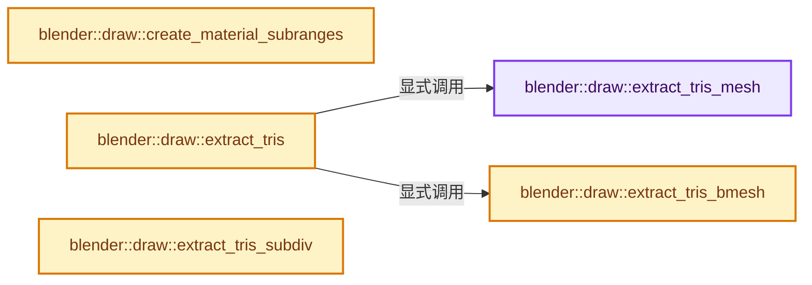
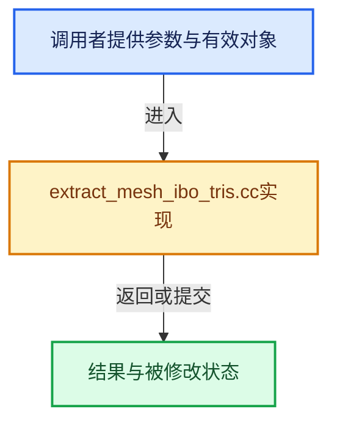

# 实现依赖专题：source/blender/draw/intern/mesh_extractors/extract_mesh_ibo_tris.cc

[方向导航](README.md) · [符号索引](../%E7%AC%A6%E5%8F%B7%E4%BE%9D%E8%B5%96%E4%B8%8E%E5%AE%9E%E7%8E%B0%E7%B4%A2%E5%BC%95.md)

本专题从正文实际调用进入，集中保存共享实现。函数有稳定锚点，可从调用处直接跳到对应完整函数；递归与互相调用通过回链组织。

## 本文件的实现关系






## 完整成员与函数实现

<a id="f-004dea3bd3a1bbb6"></a>

### `blender::draw::extract_tris_mesh`

实现位置：[source/blender/draw/intern/mesh_extractors/extract_mesh_ibo_tris.cc](../../../../../source/blender/draw/intern/mesh_extractors/extract_mesh_ibo_tris.cc) · L21—L58。

接口参数：

- `const MeshRenderData &mr`
- `const SortedFaceData &face_sorted`

**教学注释版**

<!-- annotated:68cfb4c26a1ac9 -->

```cpp
static gpu::IndexBufPtr extract_tris_mesh(const MeshRenderData &mr,
                                          const SortedFaceData &face_sorted)
{
  const Span<int3> corner_tris = mr.mesh->corner_tris();
  if (!face_sorted.face_tri_offsets) {
    /* There are no hidden faces and no reordering is necessary to group triangles with the same
     * material. The corner indices from #Mesh::corner_tris() can be copied directly to the GPU. */
    // [讲解] corner_tris.size：查询视图长度或生成对应有效索引区间。
    BLI_assert(face_sorted.visible_tris_num == corner_tris.size());
    return gpu::IndexBufPtr(GPU_indexbuf_build_from_memory(GPU_PRIM_TRIS,
                                                           // [讲解] corner_tris.cast<uint32_t>：按类型与布局约束重新解释视图。
                                                           corner_tris.cast<uint32_t>().data(),
                                                           corner_tris.size(),
                                                           0,
                                                           mr.corners_num,
                                                           false));
  }

  const OffsetIndices faces = mr.faces;
  const Span<bool> hide_poly = mr.hide_poly;

  GPUIndexBufBuilder builder;
  GPU_indexbuf_init(&builder, GPU_PRIM_TRIS, face_sorted.visible_tris_num, mr.corners_num);
  MutableSpan<uint3> data = GPU_indexbuf_get_data(&builder).cast<uint3>();

  const Span<int> face_tri_offsets = face_sorted.face_tri_offsets->as_span();
  threading::parallel_for(faces.index_range(), 2048, [&](const IndexRange range) {
    for (const int face : range) {
      // [讲解] hide_poly.is_empty：查询视图长度或生成对应有效索引区间。
      if (!hide_poly.is_empty() && hide_poly[face]) {
        continue;
      }
      const IndexRange mesh_range = bke::mesh::face_triangles_range(faces, face);
      // [讲解] corner_tris.slice：建立原连续范围的子视图。
      const Span<uint3> mesh_tris = corner_tris.slice(mesh_range).cast<uint3>();
      MutableSpan<uint3> ibo_tris = data.slice(face_tri_offsets[face], mesh_tris.size());
      // [讲解] ibo_tris.copy_from：修改已有目标元素，不改变底层容器长度。
      ibo_tris.copy_from(mesh_tris);
    }
  });

  return gpu::IndexBufPtr(GPU_indexbuf_build_ex(&builder, 0, mr.corners_num, false));
}
```

<details>
<summary>核对原始源码：source/blender/draw/intern/mesh_extractors/extract_mesh_ibo_tris.cc · L21—L58</summary>

<!-- original:68cfb4c26a1ac9:source/blender/draw/intern/mesh_extractors/extract_mesh_ibo_tris.cc:21:58 -->

```cpp
static gpu::IndexBufPtr extract_tris_mesh(const MeshRenderData &mr,
                                          const SortedFaceData &face_sorted)
{
  const Span<int3> corner_tris = mr.mesh->corner_tris();
  if (!face_sorted.face_tri_offsets) {
    /* There are no hidden faces and no reordering is necessary to group triangles with the same
     * material. The corner indices from #Mesh::corner_tris() can be copied directly to the GPU. */
    BLI_assert(face_sorted.visible_tris_num == corner_tris.size());
    return gpu::IndexBufPtr(GPU_indexbuf_build_from_memory(GPU_PRIM_TRIS,
                                                           corner_tris.cast<uint32_t>().data(),
                                                           corner_tris.size(),
                                                           0,
                                                           mr.corners_num,
                                                           false));
  }

  const OffsetIndices faces = mr.faces;
  const Span<bool> hide_poly = mr.hide_poly;

  GPUIndexBufBuilder builder;
  GPU_indexbuf_init(&builder, GPU_PRIM_TRIS, face_sorted.visible_tris_num, mr.corners_num);
  MutableSpan<uint3> data = GPU_indexbuf_get_data(&builder).cast<uint3>();

  const Span<int> face_tri_offsets = face_sorted.face_tri_offsets->as_span();
  threading::parallel_for(faces.index_range(), 2048, [&](const IndexRange range) {
    for (const int face : range) {
      if (!hide_poly.is_empty() && hide_poly[face]) {
        continue;
      }
      const IndexRange mesh_range = bke::mesh::face_triangles_range(faces, face);
      const Span<uint3> mesh_tris = corner_tris.slice(mesh_range).cast<uint3>();
      MutableSpan<uint3> ibo_tris = data.slice(face_tri_offsets[face], mesh_tris.size());
      ibo_tris.copy_from(mesh_tris);
    }
  });

  return gpu::IndexBufPtr(GPU_indexbuf_build_ex(&builder, 0, mr.corners_num, false));
}
```

</details>

**结果出口**

- `return gpu::IndexBufPtr(GPU_indexbuf_build_from_memory(GPU_PRIM_TRIS,`
- `return gpu::IndexBufPtr(GPU_indexbuf_build_ex(&builder, 0, mr.corners_num, false));`

**继续追踪实现**

- `mr.mesh->corner_tris` → [调用协议](../%E6%A8%A1%E6%9D%BF%E5%AE%8F%E4%B8%8E%E5%8A%A8%E6%80%81%E5%88%86%E6%B4%BE%E5%8D%8F%E8%AE%AE.md)：接收对象类型依赖auto、返回值或模板实例；不按同名猜测目标。调用位置L24。
- `BLI_assert` → [BLI_assert · L48](../01-%E5%9F%BA%E7%A1%80%E5%AE%B9%E5%99%A8%E4%B8%8E%E7%8E%B0%E4%BB%A3CPP/%E4%BE%9D%E8%B5%96-BLI_assert-cc98e8.md#m-57a88495704d)；[BLI_assert · L63](../01-%E5%9F%BA%E7%A1%80%E5%AE%B9%E5%99%A8%E4%B8%8E%E7%8E%B0%E4%BB%A3CPP/%E4%BE%9D%E8%B5%96-BLI_assert-cc98e8.md#m-d07050020cb5)。宏定义由构建条件选择。
- `corner_tris.size` → [blender::Span::size · L256](../01-%E5%9F%BA%E7%A1%80%E5%AE%B9%E5%99%A8%E4%B8%8E%E7%8E%B0%E4%BB%A3CPP/05-Span%E5%8F%AA%E8%AF%BB%E8%BF%9E%E7%BB%AD%E8%A7%86%E5%9B%BE.md#f-5f80fa006089c998)。
- `gpu::IndexBufPtr` → [调用协议](../%E6%A8%A1%E6%9D%BF%E5%AE%8F%E4%B8%8E%E5%8A%A8%E6%80%81%E5%88%86%E6%B4%BE%E5%8D%8F%E8%AE%AE.md)：函数指针、局部可调用对象或未展开的宏；必须结合调用者环境。调用位置L29。
- `GPU_indexbuf_build_from_memory` → [blender::GPU_indexbuf_build_from_memory · L483](%E4%BE%9D%E8%B5%96-gpu_index_buffer-c3daac.md#f-06c937699ed01175)。
- `corner_tris.cast<uint32_t>().data` → [调用协议](../%E6%A8%A1%E6%9D%BF%E5%AE%8F%E4%B8%8E%E5%8A%A8%E6%80%81%E5%88%86%E6%B4%BE%E5%8D%8F%E8%AE%AE.md)：接收对象类型依赖auto、返回值或模板实例；不按同名猜测目标。调用位置L30。
- `corner_tris.cast<uint32_t>` → [blender::Span::cast · L422](../01-%E5%9F%BA%E7%A1%80%E5%AE%B9%E5%99%A8%E4%B8%8E%E7%8E%B0%E4%BB%A3CPP/05-Span%E5%8F%AA%E8%AF%BB%E8%BF%9E%E7%BB%AD%E8%A7%86%E5%9B%BE.md#f-e082d823028af8f6)。
- `GPU_indexbuf_init` → [blender::GPU_indexbuf_init · L73](%E4%BE%9D%E8%B5%96-gpu_index_buffer-c3daac.md#f-adccf0f2321fb073)。
- `GPU_indexbuf_get_data(&builder).cast<uint3>` → [调用协议](../%E6%A8%A1%E6%9D%BF%E5%AE%8F%E4%B8%8E%E5%8A%A8%E6%80%81%E5%88%86%E6%B4%BE%E5%8D%8F%E8%AE%AE.md)：接收对象类型依赖auto、返回值或模板实例；不按同名猜测目标。调用位置L42。
- `GPU_indexbuf_get_data` → [blender::GPU_indexbuf_get_data · L96](%E4%BE%9D%E8%B5%96-gpu_index_buffer-c3daac.md#f-a5d0d67214a893c0)。
- `face_sorted.face_tri_offsets->as_span` → [调用协议](../%E6%A8%A1%E6%9D%BF%E5%AE%8F%E4%B8%8E%E5%8A%A8%E6%80%81%E5%88%86%E6%B4%BE%E5%8D%8F%E8%AE%AE.md)：接收对象类型依赖auto、返回值或模板实例；不按同名猜测目标。调用位置L44。
- `threading::parallel_for` → [blender::threading::parallel_for · L68](../11-Depsgraph%E4%B8%8E%E5%B9%B6%E8%A1%8C%E4%BB%BB%E5%8A%A1%E7%B3%BB%E7%BB%9F/07-%E4%BB%BB%E5%8A%A1%E6%B1%A0%E4%B8%8ETBB%E6%8E%A5%E5%85%A5.md#f-838294754c24426c)。
- `faces.index_range` → [blender::offset_indices::OffsetIndices::index_range · L77](02-OffsetIndices%E5%AE%8C%E6%95%B4%E6%8E%A5%E5%8F%A3.md#f-19b5ca1456de007d)。
- `hide_poly.is_empty` → [blender::Span::is_empty · L264](../01-%E5%9F%BA%E7%A1%80%E5%AE%B9%E5%99%A8%E4%B8%8E%E7%8E%B0%E4%BB%A3CPP/05-Span%E5%8F%AA%E8%AF%BB%E8%BF%9E%E7%BB%AD%E8%A7%86%E5%9B%BE.md#f-8cc1d7ba8feb50e6)。
- `bke::mesh::face_triangles_range` → [blender::bke::mesh::face_triangles_range · L359](01-Mesh%E9%A1%B6%E7%82%B9%E8%BE%B9%E9%9D%A2%E8%A7%92%E7%82%B9.md#f-029966d2ab83c686)。
- `corner_tris.slice(mesh_range).cast<uint3>` → [调用协议](../%E6%A8%A1%E6%9D%BF%E5%AE%8F%E4%B8%8E%E5%8A%A8%E6%80%81%E5%88%86%E6%B4%BE%E5%8D%8F%E8%AE%AE.md)：接收对象类型依赖auto、返回值或模板实例；不按同名猜测目标。调用位置L51。
- `corner_tris.slice` → [blender::Span::slice · L141](../01-%E5%9F%BA%E7%A1%80%E5%AE%B9%E5%99%A8%E4%B8%8E%E7%8E%B0%E4%BB%A3CPP/05-Span%E5%8F%AA%E8%AF%BB%E8%BF%9E%E7%BB%AD%E8%A7%86%E5%9B%BE.md#f-380a0e8fdcbd53cc)；[blender::Span::slice · L149](../01-%E5%9F%BA%E7%A1%80%E5%AE%B9%E5%99%A8%E4%B8%8E%E7%8E%B0%E4%BB%A3CPP/05-Span%E5%8F%AA%E8%AF%BB%E8%BF%9E%E7%BB%AD%E8%A7%86%E5%9B%BE.md#f-9b9c15e78dd54eec)。同名重载需按实参类型选择。
- `data.slice` → [blender::MutableSpan::slice · L579](../01-%E5%9F%BA%E7%A1%80%E5%AE%B9%E5%99%A8%E4%B8%8E%E7%8E%B0%E4%BB%A3CPP/06-MutableSpan%E5%8F%AF%E5%86%99%E8%A7%86%E5%9B%BE.md#f-6808b4aefbf58808)；[blender::MutableSpan::slice · L587](../01-%E5%9F%BA%E7%A1%80%E5%AE%B9%E5%99%A8%E4%B8%8E%E7%8E%B0%E4%BB%A3CPP/06-MutableSpan%E5%8F%AF%E5%86%99%E8%A7%86%E5%9B%BE.md#f-c05b010821861e4f)。同名重载需按实参类型选择。
- `mesh_tris.size` → [blender::Span::size · L256](../01-%E5%9F%BA%E7%A1%80%E5%AE%B9%E5%99%A8%E4%B8%8E%E7%8E%B0%E4%BB%A3CPP/05-Span%E5%8F%AA%E8%AF%BB%E8%BF%9E%E7%BB%AD%E8%A7%86%E5%9B%BE.md#f-5f80fa006089c998)。
- `ibo_tris.copy_from` → [blender::MutableSpan::copy_from · L745](../01-%E5%9F%BA%E7%A1%80%E5%AE%B9%E5%99%A8%E4%B8%8E%E7%8E%B0%E4%BB%A3CPP/06-MutableSpan%E5%8F%AF%E5%86%99%E8%A7%86%E5%9B%BE.md#f-e4f099b1497adddb)。
- `GPU_indexbuf_build_ex` → [blender::GPU_indexbuf_build_ex · L473](%E4%BE%9D%E8%B5%96-gpu_index_buffer-c3daac.md#f-99e8b36d94dd0581)。

<a id="f-15d793eb92e88f2e"></a>

### `blender::draw::extract_tris_bmesh`

实现位置：[source/blender/draw/intern/mesh_extractors/extract_mesh_ibo_tris.cc](../../../../../source/blender/draw/intern/mesh_extractors/extract_mesh_ibo_tris.cc) · L60—L89。

接口参数：

- `const MeshRenderData &mr`
- `const SortedFaceData &face_sorted`

**教学注释版**

<!-- annotated:70ada1349c2e11 -->

```cpp
static gpu::IndexBufPtr extract_tris_bmesh(const MeshRenderData &mr,
                                           const SortedFaceData &face_sorted)
{
  GPUIndexBufBuilder builder;
  GPU_indexbuf_init(&builder, GPU_PRIM_TRIS, face_sorted.visible_tris_num, mr.corners_num);
  MutableSpan<uint3> data = GPU_indexbuf_get_data(&builder).cast<uint3>();

  BMesh &bm = *mr.bm;
  const Span<std::array<BMLoop *, 3>> looptris = mr.edit_bmesh->looptris;
  const Span<int> face_tri_offsets = *face_sorted.face_tri_offsets;
  threading::parallel_for(IndexRange(bm.totface), 1024, [&](const IndexRange range) {
    for (const int face_index : range) {
      const BMFace &face = *BM_face_at_index(&bm, face_index);
      if (BM_elem_flag_test(&face, BM_ELEM_HIDDEN)) {
        continue;
      }
      const int corner_index = BM_elem_index_get(BM_FACE_FIRST_LOOP(&face));
      const IndexRange bm_tris(poly_to_tri_count(face_index, corner_index),
                               bke::mesh::face_triangles_num(face.len));
      // [讲解] bm_tris.size：读取连续区间或分组的边界信息。
      const IndexRange ibo_tris(face_tri_offsets[face_index], bm_tris.size());
      for (const int i : bm_tris.index_range()) {
        data[ibo_tris[i]] = uint3(BM_elem_index_get(looptris[bm_tris[i]][0]),
                                  BM_elem_index_get(looptris[bm_tris[i]][1]),
                                  BM_elem_index_get(looptris[bm_tris[i]][2]));
      }
    }
  });

  return gpu::IndexBufPtr(GPU_indexbuf_build_ex(&builder, 0, bm.totloop, false));
}
```

<details>
<summary>核对原始源码：source/blender/draw/intern/mesh_extractors/extract_mesh_ibo_tris.cc · L60—L89</summary>

<!-- original:70ada1349c2e11:source/blender/draw/intern/mesh_extractors/extract_mesh_ibo_tris.cc:60:89 -->

```cpp
static gpu::IndexBufPtr extract_tris_bmesh(const MeshRenderData &mr,
                                           const SortedFaceData &face_sorted)
{
  GPUIndexBufBuilder builder;
  GPU_indexbuf_init(&builder, GPU_PRIM_TRIS, face_sorted.visible_tris_num, mr.corners_num);
  MutableSpan<uint3> data = GPU_indexbuf_get_data(&builder).cast<uint3>();

  BMesh &bm = *mr.bm;
  const Span<std::array<BMLoop *, 3>> looptris = mr.edit_bmesh->looptris;
  const Span<int> face_tri_offsets = *face_sorted.face_tri_offsets;
  threading::parallel_for(IndexRange(bm.totface), 1024, [&](const IndexRange range) {
    for (const int face_index : range) {
      const BMFace &face = *BM_face_at_index(&bm, face_index);
      if (BM_elem_flag_test(&face, BM_ELEM_HIDDEN)) {
        continue;
      }
      const int corner_index = BM_elem_index_get(BM_FACE_FIRST_LOOP(&face));
      const IndexRange bm_tris(poly_to_tri_count(face_index, corner_index),
                               bke::mesh::face_triangles_num(face.len));
      const IndexRange ibo_tris(face_tri_offsets[face_index], bm_tris.size());
      for (const int i : bm_tris.index_range()) {
        data[ibo_tris[i]] = uint3(BM_elem_index_get(looptris[bm_tris[i]][0]),
                                  BM_elem_index_get(looptris[bm_tris[i]][1]),
                                  BM_elem_index_get(looptris[bm_tris[i]][2]));
      }
    }
  });

  return gpu::IndexBufPtr(GPU_indexbuf_build_ex(&builder, 0, bm.totloop, false));
}
```

</details>

**沿实际写入检查状态**

- `data[ibo_tris[i]] = uint3(BM_elem_index_get(looptris[bm_tris[i]][0]),`

**结果出口**

- `return gpu::IndexBufPtr(GPU_indexbuf_build_ex(&builder, 0, bm.totloop, false));`

**继续追踪实现**

- `GPU_indexbuf_init` → [blender::GPU_indexbuf_init · L73](%E4%BE%9D%E8%B5%96-gpu_index_buffer-c3daac.md#f-adccf0f2321fb073)。
- `GPU_indexbuf_get_data(&builder).cast<uint3>` → [调用协议](../%E6%A8%A1%E6%9D%BF%E5%AE%8F%E4%B8%8E%E5%8A%A8%E6%80%81%E5%88%86%E6%B4%BE%E5%8D%8F%E8%AE%AE.md)：接收对象类型依赖auto、返回值或模板实例；不按同名猜测目标。调用位置L65。
- `GPU_indexbuf_get_data` → [blender::GPU_indexbuf_get_data · L96](%E4%BE%9D%E8%B5%96-gpu_index_buffer-c3daac.md#f-a5d0d67214a893c0)。
- `threading::parallel_for` → [blender::threading::parallel_for · L68](../11-Depsgraph%E4%B8%8E%E5%B9%B6%E8%A1%8C%E4%BB%BB%E5%8A%A1%E7%B3%BB%E7%BB%9F/07-%E4%BB%BB%E5%8A%A1%E6%B1%A0%E4%B8%8ETBB%E6%8E%A5%E5%85%A5.md#f-838294754c24426c)。
- `IndexRange` → [blender::IndexRange](../01-%E5%9F%BA%E7%A1%80%E5%AE%B9%E5%99%A8%E4%B8%8E%E7%8E%B0%E4%BB%A3CPP/%E4%BE%9D%E8%B5%96-BLI_index_range-7d7cc5.md#t-caa3466d6776)；[blender::gpu::shader::parser::IndexRange](%E4%BE%9D%E8%B5%96-utils-06433d.md#t-82d2bd4ea71c)；[blender::IndexRange](%E4%BE%9D%E8%B5%96-DNA_node_types-6708b9.md#t-0448cc889d39)。
- `BM_face_at_index` → [blender::BM_face_at_index · L122](%E4%BE%9D%E8%B5%96-bmesh_mesh-df20c7.md#f-366df62c166d5094)。
- `BM_elem_flag_test` → [BM_elem_flag_test · L21](%E4%BE%9D%E8%B5%96-bmesh_inline-74f1be.md#m-2431d1179b41)。宏定义由构建条件选择。
- `BM_elem_index_get` → [BM_elem_index_get · L120](%E4%BE%9D%E8%B5%96-bmesh_inline-74f1be.md#m-201981cdc62d)。宏定义由构建条件选择。
- `BM_FACE_FIRST_LOOP` → [BM_FACE_FIRST_LOOP · L697](%E4%BE%9D%E8%B5%96-bmesh_class-4cf146.md#m-c7e10ffb38e6)；[BM_FACE_FIRST_LOOP · L699](%E4%BE%9D%E8%B5%96-bmesh_class-4cf146.md#m-76a054cc4770)。宏定义由构建条件选择。
- `poly_to_tri_count` → [调用协议](../%E6%A8%A1%E6%9D%BF%E5%AE%8F%E4%B8%8E%E5%8A%A8%E6%80%81%E5%88%86%E6%B4%BE%E5%8D%8F%E8%AE%AE.md)：函数指针、局部可调用对象或未展开的宏；必须结合调用者环境。调用位置L77。
- `bke::mesh::face_triangles_num` → [blender::bke::mesh::face_triangles_num · L350](01-Mesh%E9%A1%B6%E7%82%B9%E8%BE%B9%E9%9D%A2%E8%A7%92%E7%82%B9.md#f-720b4d927730b800)。
- `bm_tris.size` → [blender::IndexRange::size · L156](../01-%E5%9F%BA%E7%A1%80%E5%AE%B9%E5%99%A8%E4%B8%8E%E7%8E%B0%E4%BB%A3CPP/04-IndexRange%E8%BF%9E%E7%BB%AD%E6%95%B4%E6%95%B0%E5%8C%BA%E9%97%B4.md#f-05f66c3ebb2fdfec)。
- `bm_tris.index_range` → [blender::IndexRange::index_range · L161](../01-%E5%9F%BA%E7%A1%80%E5%AE%B9%E5%99%A8%E4%B8%8E%E7%8E%B0%E4%BB%A3CPP/04-IndexRange%E8%BF%9E%E7%BB%AD%E6%95%B4%E6%95%B0%E5%8C%BA%E9%97%B4.md#f-fd83072b4b81bce5)。
- `uint3` → [packed_uint3::uint3 · L54](%E4%BE%9D%E8%B5%96-types_uint3-654ef1.md#f-54e21cc96f356e94)。
- `gpu::IndexBufPtr` → [调用协议](../%E6%A8%A1%E6%9D%BF%E5%AE%8F%E4%B8%8E%E5%8A%A8%E6%80%81%E5%88%86%E6%B4%BE%E5%8D%8F%E8%AE%AE.md)：函数指针、局部可调用对象或未展开的宏；必须结合调用者环境。调用位置L88。
- `GPU_indexbuf_build_ex` → [blender::GPU_indexbuf_build_ex · L473](%E4%BE%9D%E8%B5%96-gpu_index_buffer-c3daac.md#f-99e8b36d94dd0581)。

<a id="f-3e83ddd5477e5d5b"></a>

### `blender::draw::create_material_subranges`

实现位置：[source/blender/draw/intern/mesh_extractors/extract_mesh_ibo_tris.cc](../../../../../source/blender/draw/intern/mesh_extractors/extract_mesh_ibo_tris.cc) · L91—L109。

接口参数：

- `const SortedFaceData &face_sorted`
- `gpu::IndexBuf &tris_ibo`
- `MutableSpan<gpu::IndexBufPtr> ibos`

**教学注释版**

<!-- annotated:47d4ba7202241d -->

```cpp
void create_material_subranges(const SortedFaceData &face_sorted,
                               gpu::IndexBuf &tris_ibo,
                               MutableSpan<gpu::IndexBufPtr> ibos)
{
  /* Create ibo sub-ranges. Always do this to avoid error when the standard surface batch
   * is created before the surfaces-per-material. */
  int mat_start = 0;
  for (const int i : face_sorted.tris_num_by_material.index_range()) {
    /* These IBOs have not been queried yet but we create them just in case they are needed
     * later since they are not tracked by mesh_buffer_cache_create_requested(). */

    const int mat_tri_len = face_sorted.tris_num_by_material[i];
    /* Multiply by 3 because these are triangle indices. */
    const int start = mat_start * 3;
    const int len = mat_tri_len * 3;
    ibos[i] = gpu::IndexBufPtr(GPU_indexbuf_create_subrange(&tris_ibo, start, len));
    mat_start += mat_tri_len;
  }
}
```

<details>
<summary>核对原始源码：source/blender/draw/intern/mesh_extractors/extract_mesh_ibo_tris.cc · L91—L109</summary>

<!-- original:47d4ba7202241d:source/blender/draw/intern/mesh_extractors/extract_mesh_ibo_tris.cc:91:109 -->

```cpp
void create_material_subranges(const SortedFaceData &face_sorted,
                               gpu::IndexBuf &tris_ibo,
                               MutableSpan<gpu::IndexBufPtr> ibos)
{
  /* Create ibo sub-ranges. Always do this to avoid error when the standard surface batch
   * is created before the surfaces-per-material. */
  int mat_start = 0;
  for (const int i : face_sorted.tris_num_by_material.index_range()) {
    /* These IBOs have not been queried yet but we create them just in case they are needed
     * later since they are not tracked by mesh_buffer_cache_create_requested(). */

    const int mat_tri_len = face_sorted.tris_num_by_material[i];
    /* Multiply by 3 because these are triangle indices. */
    const int start = mat_start * 3;
    const int len = mat_tri_len * 3;
    ibos[i] = gpu::IndexBufPtr(GPU_indexbuf_create_subrange(&tris_ibo, start, len));
    mat_start += mat_tri_len;
  }
}
```

</details>

**沿实际写入检查状态**

- `ibos[i] = gpu::IndexBufPtr(GPU_indexbuf_create_subrange(&tris_ibo, start, len));`
- `mat_start += mat_tri_len;`

**继续追踪实现**

- `face_sorted.tris_num_by_material.index_range` → [调用协议](../%E6%A8%A1%E6%9D%BF%E5%AE%8F%E4%B8%8E%E5%8A%A8%E6%80%81%E5%88%86%E6%B4%BE%E5%8D%8F%E8%AE%AE.md)：接收对象类型依赖auto、返回值或模板实例；不按同名猜测目标。调用位置L98。
- `gpu::IndexBufPtr` → [调用协议](../%E6%A8%A1%E6%9D%BF%E5%AE%8F%E4%B8%8E%E5%8A%A8%E6%80%81%E5%88%86%E6%B4%BE%E5%8D%8F%E8%AE%AE.md)：函数指针、局部可调用对象或未展开的宏；必须结合调用者环境。调用位置L106。
- `GPU_indexbuf_create_subrange` → [blender::GPU_indexbuf_create_subrange · L434](%E4%BE%9D%E8%B5%96-gpu_index_buffer-c3daac.md#f-16b280cb398e7157)。

<a id="f-a59e1858db6e548b"></a>

### `blender::draw::extract_tris`

实现位置：[source/blender/draw/intern/mesh_extractors/extract_mesh_ibo_tris.cc](../../../../../source/blender/draw/intern/mesh_extractors/extract_mesh_ibo_tris.cc) · L111—L117。

接口参数：

- `const MeshRenderData &mr`
- `const SortedFaceData &face_sorted`

**教学注释版**

<!-- annotated:88eebcb26b521f -->

```cpp
gpu::IndexBufPtr extract_tris(const MeshRenderData &mr, const SortedFaceData &face_sorted)
{
  if (mr.extract_type == MeshExtractType::Mesh) {
    return extract_tris_mesh(mr, face_sorted);
  }
  return extract_tris_bmesh(mr, face_sorted);
}
```

<details>
<summary>核对原始源码：source/blender/draw/intern/mesh_extractors/extract_mesh_ibo_tris.cc · L111—L117</summary>

<!-- original:88eebcb26b521f:source/blender/draw/intern/mesh_extractors/extract_mesh_ibo_tris.cc:111:117 -->

```cpp
gpu::IndexBufPtr extract_tris(const MeshRenderData &mr, const SortedFaceData &face_sorted)
{
  if (mr.extract_type == MeshExtractType::Mesh) {
    return extract_tris_mesh(mr, face_sorted);
  }
  return extract_tris_bmesh(mr, face_sorted);
}
```

</details>

**结果出口**

- `return extract_tris_mesh(mr, face_sorted);`
- `return extract_tris_bmesh(mr, face_sorted);`

**继续追踪实现**

- `extract_tris_mesh` → [blender::draw::extract_tris_mesh · L21](%E4%BE%9D%E8%B5%96-extract_mesh_ibo_tris-ddd9e4.md#f-004dea3bd3a1bbb6)。
- `extract_tris_bmesh` → [blender::draw::extract_tris_bmesh · L60](%E4%BE%9D%E8%B5%96-extract_mesh_ibo_tris-ddd9e4.md#f-15d793eb92e88f2e)。

<a id="f-157b64209bab247d"></a>

### `blender::draw::extract_tris_subdiv`

实现位置：[source/blender/draw/intern/mesh_extractors/extract_mesh_ibo_tris.cc](../../../../../source/blender/draw/intern/mesh_extractors/extract_mesh_ibo_tris.cc) · L119—L137。

接口参数：

- `const DRWSubdivCache &subdiv_cache`
- `MeshBatchCache &cache`

**教学注释版**

<!-- annotated:2aee45ad849db6 -->

```cpp
gpu::IndexBufPtr extract_tris_subdiv(const DRWSubdivCache &subdiv_cache, MeshBatchCache &cache)
{
  /* Initialize the index buffer, it was already allocated, it will be filled on the device. */
  gpu::IndexBufPtr ibo = gpu::IndexBufPtr(
      GPU_indexbuf_build_on_device(subdiv_cache.num_subdiv_triangles * 3));

  if (!cache.tris_per_mat.is_empty()) {
    for (int i = 0; i < cache.mat_len; i++) {
      /* Multiply by 6 since we have 2 triangles per quad. */
      const int start = subdiv_cache.mat_start[i] * 6;
      const int len = (subdiv_cache.mat_end[i] - subdiv_cache.mat_start[i]) * 6;
      cache.tris_per_mat[i] = gpu::IndexBufPtr(
          GPU_indexbuf_create_subrange(ibo.get(), start, len));
    }
  }

  draw_subdiv_build_tris_buffer(subdiv_cache, ibo.get(), cache.mat_len);
  return ibo;
}
```

<details>
<summary>核对原始源码：source/blender/draw/intern/mesh_extractors/extract_mesh_ibo_tris.cc · L119—L137</summary>

<!-- original:2aee45ad849db6:source/blender/draw/intern/mesh_extractors/extract_mesh_ibo_tris.cc:119:137 -->

```cpp
gpu::IndexBufPtr extract_tris_subdiv(const DRWSubdivCache &subdiv_cache, MeshBatchCache &cache)
{
  /* Initialize the index buffer, it was already allocated, it will be filled on the device. */
  gpu::IndexBufPtr ibo = gpu::IndexBufPtr(
      GPU_indexbuf_build_on_device(subdiv_cache.num_subdiv_triangles * 3));

  if (!cache.tris_per_mat.is_empty()) {
    for (int i = 0; i < cache.mat_len; i++) {
      /* Multiply by 6 since we have 2 triangles per quad. */
      const int start = subdiv_cache.mat_start[i] * 6;
      const int len = (subdiv_cache.mat_end[i] - subdiv_cache.mat_start[i]) * 6;
      cache.tris_per_mat[i] = gpu::IndexBufPtr(
          GPU_indexbuf_create_subrange(ibo.get(), start, len));
    }
  }

  draw_subdiv_build_tris_buffer(subdiv_cache, ibo.get(), cache.mat_len);
  return ibo;
}
```

</details>

**沿实际写入检查状态**

- `cache.tris_per_mat[i] = gpu::IndexBufPtr(`

**结果出口**

- `return ibo;`

**继续追踪实现**

- `gpu::IndexBufPtr` → [调用协议](../%E6%A8%A1%E6%9D%BF%E5%AE%8F%E4%B8%8E%E5%8A%A8%E6%80%81%E5%88%86%E6%B4%BE%E5%8D%8F%E8%AE%AE.md)：函数指针、局部可调用对象或未展开的宏；必须结合调用者环境。调用位置L122。
- `GPU_indexbuf_build_on_device` → [blender::GPU_indexbuf_build_on_device · L83](%E4%BE%9D%E8%B5%96-gpu_index_buffer-c3daac.md#f-d79a15f80e7a5700)。
- `cache.tris_per_mat.is_empty` → [调用协议](../%E6%A8%A1%E6%9D%BF%E5%AE%8F%E4%B8%8E%E5%8A%A8%E6%80%81%E5%88%86%E6%B4%BE%E5%8D%8F%E8%AE%AE.md)：接收对象类型依赖auto、返回值或模板实例；不按同名猜测目标。调用位置L125。
- `GPU_indexbuf_create_subrange` → [blender::GPU_indexbuf_create_subrange · L434](%E4%BE%9D%E8%B5%96-gpu_index_buffer-c3daac.md#f-16b280cb398e7157)。
- `ibo.get` → [blender::draw::GSplatEvalCache::get · L545](%E4%BE%9D%E8%B5%96-draw_cache_impl_gsplat-0b4128.md#f-3fb704a0b74cb9e4)。
- `draw_subdiv_build_tris_buffer` → [blender::draw::draw_subdiv_build_tris_buffer · L1218](%E4%BE%9D%E8%B5%96-draw_cache_impl_subdivision-33125a.md#f-020e6776ec21c043)。
