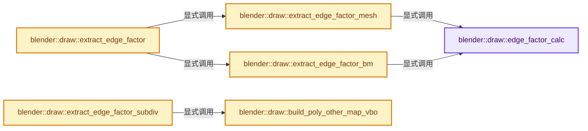
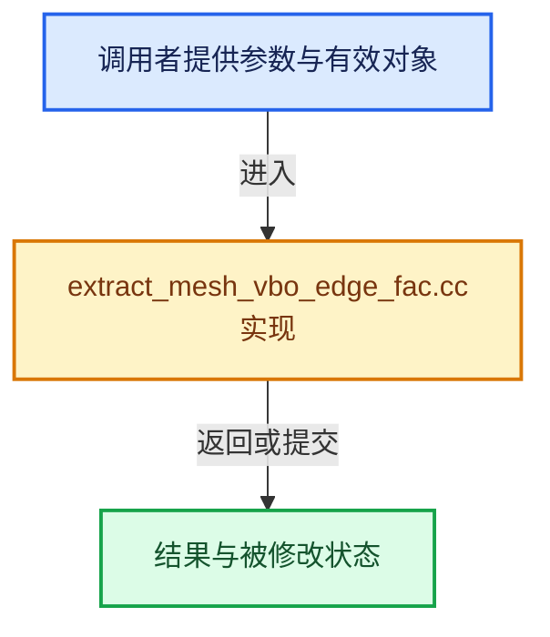

# 实现依赖专题：source/blender/draw/intern/mesh_extractors/extract_mesh_vbo_edge_fac.cc

[方向导航](README.md) · [符号索引](../%E7%AC%A6%E5%8F%B7%E4%BE%9D%E8%B5%96%E4%B8%8E%E5%AE%9E%E7%8E%B0%E7%B4%A2%E5%BC%95.md)

本专题从正文实际调用进入，集中保存共享实现。函数有稳定锚点，可从调用处直接跳到对应完整函数；递归与互相调用通过回链组织。

## 本文件的实现关系






## 完整成员与函数实现

<a id="f-cb8d67f846da0551"></a>

### `blender::draw::edge_factor_calc`

实现位置：[source/blender/draw/intern/mesh_extractors/extract_mesh_vbo_edge_fac.cc](../../../../../source/blender/draw/intern/mesh_extractors/extract_mesh_vbo_edge_fac.cc) · L32—L42。

接口参数：

- `const float3 &a`
- `const float3 &b`

**教学注释版**

<!-- annotated:91062543bbcd69 -->

```cpp
inline float edge_factor_calc(const float3 &a, const float3 &b)
{
  const float cosine = math::dot(a, b);

  /* Re-scale to the slider range. */
  float fac = (200 * (cosine - 1.0f)) + 1.0f;
  CLAMP(fac, 0.0f, 1.0f);
  /* 1.0 is a reserved value to force hide the wire. */
  constexpr float factor = 254.0f / 255.0f;
  return fac * factor;
}
```

<details>
<summary>核对原始源码：source/blender/draw/intern/mesh_extractors/extract_mesh_vbo_edge_fac.cc · L32—L42</summary>

<!-- original:91062543bbcd69:source/blender/draw/intern/mesh_extractors/extract_mesh_vbo_edge_fac.cc:32:42 -->

```cpp
inline float edge_factor_calc(const float3 &a, const float3 &b)
{
  const float cosine = math::dot(a, b);

  /* Re-scale to the slider range. */
  float fac = (200 * (cosine - 1.0f)) + 1.0f;
  CLAMP(fac, 0.0f, 1.0f);
  /* 1.0 is a reserved value to force hide the wire. */
  constexpr float factor = 254.0f / 255.0f;
  return fac * factor;
}
```

</details>

**结果出口**

- `return fac * factor;`

**继续追踪实现**

- `math::dot` → [blender::math::dot · L430](../12-%E7%A9%BA%E9%97%B4%E6%95%B0%E6%8D%AE%E7%BB%93%E6%9E%84%E4%B8%8E%E5%87%A0%E4%BD%95%E7%AE%97%E6%B3%95/%E4%BE%9D%E8%B5%96-BLI_math_vector-906a87.md#f-6f0c6a081b107428)；[blender::math::dot · L198](../12-%E7%A9%BA%E9%97%B4%E6%95%B0%E6%8D%AE%E7%BB%93%E6%9E%84%E4%B8%8E%E5%87%A0%E4%BD%95%E7%AE%97%E6%B3%95/%E4%BE%9D%E8%B5%96-BLI_math_quaternion-cf105d.md#f-5b1ef457981dbc76)。同名重载需按实参类型选择。
- `CLAMP` → [CLAMP · L200](../01-%E5%9F%BA%E7%A1%80%E5%AE%B9%E5%99%A8%E4%B8%8E%E7%8E%B0%E4%BB%A3CPP/%E4%BE%9D%E8%B5%96-BLI_utildefines-293a0a.md#m-69703e497120)。宏定义由构建条件选择。

<a id="f-945ea0ac7369ce39"></a>

### `blender::draw::extract_edge_factor_mesh`

实现位置：[source/blender/draw/intern/mesh_extractors/extract_mesh_vbo_edge_fac.cc](../../../../../source/blender/draw/intern/mesh_extractors/extract_mesh_vbo_edge_fac.cc) · L44—L94。

接口参数：

- `const MeshRenderData &mr`
- `MutableSpan<float> vbo_data`

**教学注释版**

<!-- annotated:c225f00eb4f9b3 -->

```cpp
static void extract_edge_factor_mesh(const MeshRenderData &mr, MutableSpan<float> vbo_data)
{
  const OffsetIndices faces = mr.faces;
  const Span<int> corner_edges = mr.corner_edges;
  const Span<float3> face_normals = mr.face_normals;
  const BitSpan optimal_display_edges = mr.mesh->runtime->subsurf_optimal_display_edges;

  Array<int8_t> edge_face_count(mr.edges_num, 0);
  Array<MEdgeDataPrev> edge_data(mr.edges_num);

  for (const int face : faces.index_range()) {
    for (const int corner : faces[face]) {
      const int edge = corner_edges[corner];
      if (!optimal_display_edges.is_empty() && !optimal_display_edges[edge]) {
        vbo_data[corner] = 1.0f;
        continue;
      }

      MEdgeDataPrev *medata = &edge_data[edge];

      const int8_t face_count = edge_face_count[edge];
      vbo_data[corner] = 0;
      if (face_count < 4) {
        if (face_count == 0) {
          /* Prepare to calculate the factor. */
          medata->corner_a = corner;
          medata->data = face;
        }
        else if (face_count == 1) {
          /* Calculate the factor for both corners. */
          const int other_face = medata->data;
          const float factor = edge_factor_calc(face_normals[other_face], face_normals[face]);
          vbo_data[medata->corner_a] = factor;
          vbo_data[corner] = factor;

          /* If the count still changes, use this `data` member to inform the corner. */
          medata->data = corner;
        }
        else {
          /* Non-manifold edge. Always visible. */
          const int corner_a = medata->corner_a;
          const int corner_b = medata->data;
          vbo_data[corner_a] = 0;
          vbo_data[corner_b] = 0;
        }

        edge_face_count[edge]++;
      }
    }
  }
}
```

<details>
<summary>核对原始源码：source/blender/draw/intern/mesh_extractors/extract_mesh_vbo_edge_fac.cc · L44—L94</summary>

<!-- original:c225f00eb4f9b3:source/blender/draw/intern/mesh_extractors/extract_mesh_vbo_edge_fac.cc:44:94 -->

```cpp
static void extract_edge_factor_mesh(const MeshRenderData &mr, MutableSpan<float> vbo_data)
{
  const OffsetIndices faces = mr.faces;
  const Span<int> corner_edges = mr.corner_edges;
  const Span<float3> face_normals = mr.face_normals;
  const BitSpan optimal_display_edges = mr.mesh->runtime->subsurf_optimal_display_edges;

  Array<int8_t> edge_face_count(mr.edges_num, 0);
  Array<MEdgeDataPrev> edge_data(mr.edges_num);

  for (const int face : faces.index_range()) {
    for (const int corner : faces[face]) {
      const int edge = corner_edges[corner];
      if (!optimal_display_edges.is_empty() && !optimal_display_edges[edge]) {
        vbo_data[corner] = 1.0f;
        continue;
      }

      MEdgeDataPrev *medata = &edge_data[edge];

      const int8_t face_count = edge_face_count[edge];
      vbo_data[corner] = 0;
      if (face_count < 4) {
        if (face_count == 0) {
          /* Prepare to calculate the factor. */
          medata->corner_a = corner;
          medata->data = face;
        }
        else if (face_count == 1) {
          /* Calculate the factor for both corners. */
          const int other_face = medata->data;
          const float factor = edge_factor_calc(face_normals[other_face], face_normals[face]);
          vbo_data[medata->corner_a] = factor;
          vbo_data[corner] = factor;

          /* If the count still changes, use this `data` member to inform the corner. */
          medata->data = corner;
        }
        else {
          /* Non-manifold edge. Always visible. */
          const int corner_a = medata->corner_a;
          const int corner_b = medata->data;
          vbo_data[corner_a] = 0;
          vbo_data[corner_b] = 0;
        }

        edge_face_count[edge]++;
      }
    }
  }
}
```

</details>

**沿实际写入检查状态**

- `vbo_data[corner] = 1.0f;`
- `vbo_data[corner] = 0;`
- `medata->corner_a = corner;`
- `medata->data = face;`
- `vbo_data[medata->corner_a] = factor;`
- `vbo_data[corner] = factor;`
- `medata->data = corner;`
- `vbo_data[corner_a] = 0;`
- `vbo_data[corner_b] = 0;`

**继续追踪实现**

- `faces.index_range` → [blender::offset_indices::OffsetIndices::index_range · L77](02-OffsetIndices%E5%AE%8C%E6%95%B4%E6%8E%A5%E5%8F%A3.md#f-19b5ca1456de007d)。
- `optimal_display_edges.is_empty` → [blender::bits::BitSpan::is_empty · L156](../01-%E5%9F%BA%E7%A1%80%E5%AE%B9%E5%99%A8%E4%B8%8E%E7%8E%B0%E4%BB%A3CPP/19-BitSpan%E4%B8%8EBitVector.md#f-9e464d71eeb9d5c6)。
- `edge_factor_calc` → [blender::draw::edge_factor_calc · L32](%E4%BE%9D%E8%B5%96-extract_mesh_vbo_edge_fac-6dad61.md#f-cb8d67f846da0551)。

<a id="f-e8d86e9e32a0da1c"></a>

### `blender::draw::extract_edge_factor_bm`

实现位置：[source/blender/draw/intern/mesh_extractors/extract_mesh_vbo_edge_fac.cc](../../../../../source/blender/draw/intern/mesh_extractors/extract_mesh_vbo_edge_fac.cc) · L96—L117。

接口参数：

- `const MeshRenderData &mr`
- `MutableSpan<float> vbo_data`

**教学注释版**

<!-- annotated:857ba0e67f9ff0 -->

```cpp
static void extract_edge_factor_bm(const MeshRenderData &mr, MutableSpan<float> vbo_data)
{
  BMesh &bm = *mr.bm;
  threading::parallel_for(IndexRange(bm.totface), 2048, [&](const IndexRange range) {
    for (const int face_index : range) {
      const BMFace &face = *BM_face_at_index(&bm, face_index);
      const BMLoop *loop = BM_FACE_FIRST_LOOP(&face);
      for ([[maybe_unused]] const int i : IndexRange(face.len)) {
        const int index = BM_elem_index_get(loop);
        if (BM_edge_is_manifold(loop->e)) {
          const BMFace *other_face = loop->radial_next->f;
          vbo_data[index] = edge_factor_calc(float3(bm_face_no_get(mr, &face)),
                                             float3(bm_face_no_get(mr, other_face)));
        }
        else {
          vbo_data[index] = 0.0f;
        }
        loop = loop->next;
      }
    }
  });
}
```

<details>
<summary>核对原始源码：source/blender/draw/intern/mesh_extractors/extract_mesh_vbo_edge_fac.cc · L96—L117</summary>

<!-- original:857ba0e67f9ff0:source/blender/draw/intern/mesh_extractors/extract_mesh_vbo_edge_fac.cc:96:117 -->

```cpp
static void extract_edge_factor_bm(const MeshRenderData &mr, MutableSpan<float> vbo_data)
{
  BMesh &bm = *mr.bm;
  threading::parallel_for(IndexRange(bm.totface), 2048, [&](const IndexRange range) {
    for (const int face_index : range) {
      const BMFace &face = *BM_face_at_index(&bm, face_index);
      const BMLoop *loop = BM_FACE_FIRST_LOOP(&face);
      for ([[maybe_unused]] const int i : IndexRange(face.len)) {
        const int index = BM_elem_index_get(loop);
        if (BM_edge_is_manifold(loop->e)) {
          const BMFace *other_face = loop->radial_next->f;
          vbo_data[index] = edge_factor_calc(float3(bm_face_no_get(mr, &face)),
                                             float3(bm_face_no_get(mr, other_face)));
        }
        else {
          vbo_data[index] = 0.0f;
        }
        loop = loop->next;
      }
    }
  });
}
```

</details>

**沿实际写入检查状态**

- `vbo_data[index] = edge_factor_calc(float3(bm_face_no_get(mr, &face)),`
- `vbo_data[index] = 0.0f;`
- `loop = loop->next;`

**继续追踪实现**

- `threading::parallel_for` → [blender::threading::parallel_for · L68](../11-Depsgraph%E4%B8%8E%E5%B9%B6%E8%A1%8C%E4%BB%BB%E5%8A%A1%E7%B3%BB%E7%BB%9F/07-%E4%BB%BB%E5%8A%A1%E6%B1%A0%E4%B8%8ETBB%E6%8E%A5%E5%85%A5.md#f-838294754c24426c)。
- `IndexRange` → [blender::IndexRange](../01-%E5%9F%BA%E7%A1%80%E5%AE%B9%E5%99%A8%E4%B8%8E%E7%8E%B0%E4%BB%A3CPP/%E4%BE%9D%E8%B5%96-BLI_index_range-7d7cc5.md#t-caa3466d6776)；[blender::gpu::shader::parser::IndexRange](%E4%BE%9D%E8%B5%96-utils-06433d.md#t-82d2bd4ea71c)；[blender::IndexRange](%E4%BE%9D%E8%B5%96-DNA_node_types-6708b9.md#t-0448cc889d39)。
- `BM_face_at_index` → [blender::BM_face_at_index · L122](%E4%BE%9D%E8%B5%96-bmesh_mesh-df20c7.md#f-366df62c166d5094)。
- `BM_FACE_FIRST_LOOP` → [BM_FACE_FIRST_LOOP · L697](%E4%BE%9D%E8%B5%96-bmesh_class-4cf146.md#m-c7e10ffb38e6)；[BM_FACE_FIRST_LOOP · L699](%E4%BE%9D%E8%B5%96-bmesh_class-4cf146.md#m-76a054cc4770)。宏定义由构建条件选择。
- `BM_elem_index_get` → [BM_elem_index_get · L120](%E4%BE%9D%E8%B5%96-bmesh_inline-74f1be.md#m-201981cdc62d)。宏定义由构建条件选择。
- `BM_edge_is_manifold` → [blender::BM_edge_is_manifold · L79](%E4%BE%9D%E8%B5%96-bmesh_query_inline-c93392.md#f-4944cfa861683f59)；[blender::BM_edge_is_manifold · L86](%E4%BE%9D%E8%B5%96-bmesh_query_inline-c93392.md#f-f07686548bcc2440)。同名重载需按实参类型选择。
- `edge_factor_calc` → [blender::draw::edge_factor_calc · L32](%E4%BE%9D%E8%B5%96-extract_mesh_vbo_edge_fac-6dad61.md#f-cb8d67f846da0551)。
- `float3` → [float3 · L641](%E4%BE%9D%E8%B5%96-smaa-b67bc2.md#m-0ea8254cfdb4)。宏定义由构建条件选择。
- `bm_face_no_get` → [blender::draw::bm_face_no_get · L181](%E4%BE%9D%E8%B5%96-extract_mesh-4bd3fc.md#f-40a3dcea78714956)。

<a id="f-360fa26a59003f68"></a>

### `blender::draw::extract_edge_factor`

实现位置：[source/blender/draw/intern/mesh_extractors/extract_mesh_vbo_edge_fac.cc](../../../../../source/blender/draw/intern/mesh_extractors/extract_mesh_vbo_edge_fac.cc) · L119—L134。

接口参数：

- `const MeshRenderData &mr`

**教学注释版**

<!-- annotated:bda4f9331209f9 -->

```cpp
gpu::VertBufPtr extract_edge_factor(const MeshRenderData &mr)
{
  static const GPUVertFormat format = GPU_vertformat_from_attribute("wd",
                                                                    gpu::VertAttrType::SFLOAT_32);
  gpu::VertBufPtr vbo = gpu::VertBufPtr(GPU_vertbuf_create_with_format(format));
  GPU_vertbuf_data_alloc(*vbo, mr.corners_num + mr.loose_indices_num);
  MutableSpan vbo_data = vbo->data<float>();
  if (mr.extract_type == MeshExtractType::Mesh) {
    extract_edge_factor_mesh(mr, vbo_data);
  }
  else {
    extract_edge_factor_bm(mr, vbo_data);
  }
  // [讲解] vbo_data.take_back：从两端裁去或选取一定数量元素形成新视图。
  vbo_data.take_back(mr.loose_indices_num).fill(0.0f);
  return vbo;
}
```

<details>
<summary>核对原始源码：source/blender/draw/intern/mesh_extractors/extract_mesh_vbo_edge_fac.cc · L119—L134</summary>

<!-- original:bda4f9331209f9:source/blender/draw/intern/mesh_extractors/extract_mesh_vbo_edge_fac.cc:119:134 -->

```cpp
gpu::VertBufPtr extract_edge_factor(const MeshRenderData &mr)
{
  static const GPUVertFormat format = GPU_vertformat_from_attribute("wd",
                                                                    gpu::VertAttrType::SFLOAT_32);
  gpu::VertBufPtr vbo = gpu::VertBufPtr(GPU_vertbuf_create_with_format(format));
  GPU_vertbuf_data_alloc(*vbo, mr.corners_num + mr.loose_indices_num);
  MutableSpan vbo_data = vbo->data<float>();
  if (mr.extract_type == MeshExtractType::Mesh) {
    extract_edge_factor_mesh(mr, vbo_data);
  }
  else {
    extract_edge_factor_bm(mr, vbo_data);
  }
  vbo_data.take_back(mr.loose_indices_num).fill(0.0f);
  return vbo;
}
```

</details>

**结果出口**

- `return vbo;`

**继续追踪实现**

- `GPU_vertformat_from_attribute` → [blender::GPU_vertformat_from_attribute · L427](%E4%BE%9D%E8%B5%96-gpu_vertex_format-4f7148.md#f-2643d25087989f8e)。
- `gpu::VertBufPtr` → [调用协议](../%E6%A8%A1%E6%9D%BF%E5%AE%8F%E4%B8%8E%E5%8A%A8%E6%80%81%E5%88%86%E6%B4%BE%E5%8D%8F%E8%AE%AE.md)：函数指针、局部可调用对象或未展开的宏；必须结合调用者环境。调用位置L123。
- `GPU_vertbuf_create_with_format` → [blender::GPU_vertbuf_create_with_format · L71](%E4%BE%9D%E8%B5%96-GPU_vertex_buffer-d7610b.md#f-bd43fe034e852138)。
- `GPU_vertbuf_data_alloc` → [blender::GPU_vertbuf_data_alloc · L172](%E4%BE%9D%E8%B5%96-gpu_vertex_buffer-eaa662.md#f-8ee5cf106e0f2b0f)。
- `vbo->data<float>` → [blender::draw::data · L124](%E4%BE%9D%E8%B5%96-DRW_gpu_wrapper-c80c4f.md#f-dc115dc22e0c9f33)；[blender::draw::data · L129](%E4%BE%9D%E8%B5%96-DRW_gpu_wrapper-c80c4f.md#f-5f325cb75387045c)。同名重载需按实参类型选择。
- `extract_edge_factor_mesh` → [blender::draw::extract_edge_factor_mesh · L44](%E4%BE%9D%E8%B5%96-extract_mesh_vbo_edge_fac-6dad61.md#f-945ea0ac7369ce39)。
- `extract_edge_factor_bm` → [blender::draw::extract_edge_factor_bm · L96](%E4%BE%9D%E8%B5%96-extract_mesh_vbo_edge_fac-6dad61.md#f-e8d86e9e32a0da1c)。
- `vbo_data.take_back(mr.loose_indices_num).fill` → [调用协议](../%E6%A8%A1%E6%9D%BF%E5%AE%8F%E4%B8%8E%E5%8A%A8%E6%80%81%E5%88%86%E6%B4%BE%E5%8D%8F%E8%AE%AE.md)：接收对象类型依赖auto、返回值或模板实例；不按同名猜测目标。调用位置L132。
- `vbo_data.take_back` → [blender::MutableSpan::take_back · L646](../01-%E5%9F%BA%E7%A1%80%E5%AE%B9%E5%99%A8%E4%B8%8E%E7%8E%B0%E4%BB%A3CPP/06-MutableSpan%E5%8F%AF%E5%86%99%E8%A7%86%E5%9B%BE.md#f-3fce5fbbe328c130)。

<a id="f-8b0d781d8770e814"></a>

### `blender::draw::build_poly_other_map_vbo`

实现位置：[source/blender/draw/intern/mesh_extractors/extract_mesh_vbo_edge_fac.cc](../../../../../source/blender/draw/intern/mesh_extractors/extract_mesh_vbo_edge_fac.cc) · L136—L177。

接口参数：

- `const DRWSubdivCache &subdiv_cache`

**教学注释版**

<!-- annotated:31b23c84a45a1a -->

```cpp
static gpu::VertBuf *build_poly_other_map_vbo(const DRWSubdivCache &subdiv_cache)
{
  gpu::VertBuf *vbo = GPU_vertbuf_calloc();

  static const GPUVertFormat format = GPU_vertformat_from_attribute("poly_other",
                                                                    gpu::VertAttrType::SINT_32);

  GPU_vertbuf_init_with_format(*vbo, format);
  GPU_vertbuf_data_alloc(*vbo, subdiv_cache.num_subdiv_loops);
  MutableSpan vbo_data = vbo->data<int>();

  Array<MEdgeDataPrev> edge_data(subdiv_cache.num_subdiv_edges);
  Array<int> tmp_edge_corner_count(subdiv_cache.num_subdiv_edges, 0);
  int *subdiv_loop_subdiv_edge_index = subdiv_cache.subdiv_loop_subdiv_edge_index;

  for (int corner : IndexRange(subdiv_cache.num_subdiv_loops)) {
    const int edge = subdiv_loop_subdiv_edge_index[corner];
    const int quad = corner / 4;
    const int corner_count = tmp_edge_corner_count[edge]++;

    vbo_data[corner] = -1;
    if (corner_count == 0) {
      edge_data[edge].corner_a = corner;
      edge_data[edge].data = quad;
    }
    else if (corner_count == 1) {
      const int corner_a = edge_data[edge].corner_a;
      const int quad_a = edge_data[edge].data;
      vbo_data[corner_a] = quad;
      vbo_data[corner] = quad_a;
      edge_data[edge].data = corner;
    }
    else if (corner_count == 2) {
      const int corner_a = edge_data[edge].corner_a;
      const int corner_b = edge_data[edge].data;
      vbo_data[corner_a] = -1;
      vbo_data[corner_b] = -1;
    }
  }

  return vbo;
}
```

<details>
<summary>核对原始源码：source/blender/draw/intern/mesh_extractors/extract_mesh_vbo_edge_fac.cc · L136—L177</summary>

<!-- original:31b23c84a45a1a:source/blender/draw/intern/mesh_extractors/extract_mesh_vbo_edge_fac.cc:136:177 -->

```cpp
static gpu::VertBuf *build_poly_other_map_vbo(const DRWSubdivCache &subdiv_cache)
{
  gpu::VertBuf *vbo = GPU_vertbuf_calloc();

  static const GPUVertFormat format = GPU_vertformat_from_attribute("poly_other",
                                                                    gpu::VertAttrType::SINT_32);

  GPU_vertbuf_init_with_format(*vbo, format);
  GPU_vertbuf_data_alloc(*vbo, subdiv_cache.num_subdiv_loops);
  MutableSpan vbo_data = vbo->data<int>();

  Array<MEdgeDataPrev> edge_data(subdiv_cache.num_subdiv_edges);
  Array<int> tmp_edge_corner_count(subdiv_cache.num_subdiv_edges, 0);
  int *subdiv_loop_subdiv_edge_index = subdiv_cache.subdiv_loop_subdiv_edge_index;

  for (int corner : IndexRange(subdiv_cache.num_subdiv_loops)) {
    const int edge = subdiv_loop_subdiv_edge_index[corner];
    const int quad = corner / 4;
    const int corner_count = tmp_edge_corner_count[edge]++;

    vbo_data[corner] = -1;
    if (corner_count == 0) {
      edge_data[edge].corner_a = corner;
      edge_data[edge].data = quad;
    }
    else if (corner_count == 1) {
      const int corner_a = edge_data[edge].corner_a;
      const int quad_a = edge_data[edge].data;
      vbo_data[corner_a] = quad;
      vbo_data[corner] = quad_a;
      edge_data[edge].data = corner;
    }
    else if (corner_count == 2) {
      const int corner_a = edge_data[edge].corner_a;
      const int corner_b = edge_data[edge].data;
      vbo_data[corner_a] = -1;
      vbo_data[corner_b] = -1;
    }
  }

  return vbo;
}
```

</details>

**沿实际写入检查状态**

- `vbo_data[corner] = -1;`
- `edge_data[edge].corner_a = corner;`
- `edge_data[edge].data = quad;`
- `vbo_data[corner_a] = quad;`
- `vbo_data[corner] = quad_a;`
- `edge_data[edge].data = corner;`
- `vbo_data[corner_a] = -1;`
- `vbo_data[corner_b] = -1;`

**结果出口**

- `return vbo;`

**继续追踪实现**

- `GPU_vertbuf_calloc` → [blender::GPU_vertbuf_calloc · L112](%E4%BE%9D%E8%B5%96-gpu_vertex_buffer-eaa662.md#f-bddd6e0944c513f4)。
- `GPU_vertformat_from_attribute` → [blender::GPU_vertformat_from_attribute · L427](%E4%BE%9D%E8%B5%96-gpu_vertex_format-4f7148.md#f-2643d25087989f8e)。
- `GPU_vertbuf_init_with_format` → [GPU_vertbuf_init_with_format · L277](%E4%BE%9D%E8%B5%96-GPU_vertex_buffer-d7610b.md#m-7100390733f1)。宏定义由构建条件选择。
- `GPU_vertbuf_data_alloc` → [blender::GPU_vertbuf_data_alloc · L172](%E4%BE%9D%E8%B5%96-gpu_vertex_buffer-eaa662.md#f-8ee5cf106e0f2b0f)。
- `vbo->data<int>` → [blender::gpu::VertBuf::data · L220](%E4%BE%9D%E8%B5%96-GPU_vertex_buffer-d7610b.md#f-e72412fdddda8bf5)。
- `IndexRange` → [blender::IndexRange](../01-%E5%9F%BA%E7%A1%80%E5%AE%B9%E5%99%A8%E4%B8%8E%E7%8E%B0%E4%BB%A3CPP/%E4%BE%9D%E8%B5%96-BLI_index_range-7d7cc5.md#t-caa3466d6776)；[blender::gpu::shader::parser::IndexRange](%E4%BE%9D%E8%B5%96-utils-06433d.md#t-82d2bd4ea71c)；[blender::IndexRange](%E4%BE%9D%E8%B5%96-DNA_node_types-6708b9.md#t-0448cc889d39)。

<a id="f-35cf147b3ee27d97"></a>

### `blender::draw::extract_edge_factor_subdiv`

实现位置：[source/blender/draw/intern/mesh_extractors/extract_mesh_vbo_edge_fac.cc](../../../../../source/blender/draw/intern/mesh_extractors/extract_mesh_vbo_edge_fac.cc) · L179—L210。

接口参数：

- `const DRWSubdivCache &subdiv_cache`
- `const MeshRenderData &mr`
- `gpu::VertBuf &pos_nor`

**教学注释版**

<!-- annotated:227a28538bcecb -->

```cpp
gpu::VertBufPtr extract_edge_factor_subdiv(const DRWSubdivCache &subdiv_cache,
                                           const MeshRenderData &mr,
                                           gpu::VertBuf &pos_nor)
{
  gpu::VertBufPtr vbo = gpu::VertBufPtr(GPU_vertbuf_create_on_device(
      GPU_vertformat_from_attribute("wd", gpu::VertAttrType::SFLOAT_32),
      subdiv_cache.num_subdiv_loops + subdiv_loose_edges_num(mr, subdiv_cache) * 2));

  if (mr.faces_num > 0) {
    gpu::VertBuf *poly_other_map = build_poly_other_map_vbo(subdiv_cache);

    draw_subdiv_build_edge_fac_buffer(
        subdiv_cache, &pos_nor, subdiv_cache.edges_draw_flag, poly_other_map, vbo.get());

    GPU_vertbuf_discard(poly_other_map);
  }

  const int loose_edges_num = subdiv_loose_edges_num(mr, subdiv_cache);
  if (loose_edges_num == 0) {
    return vbo;
  }

  /* Make sure buffer is active for sending loose data. */
  GPU_vertbuf_use(vbo.get());

  const int offset = subdiv_cache.num_subdiv_loops;
  const float values[2] = {1.0f, 1.0f};
  for (const int i : IndexRange(loose_edges_num)) {
    GPU_vertbuf_update_sub(vbo.get(), (offset + i * 2) * sizeof(float), sizeof(values), values);
  }
  return vbo;
}
```

<details>
<summary>核对原始源码：source/blender/draw/intern/mesh_extractors/extract_mesh_vbo_edge_fac.cc · L179—L210</summary>

<!-- original:227a28538bcecb:source/blender/draw/intern/mesh_extractors/extract_mesh_vbo_edge_fac.cc:179:210 -->

```cpp
gpu::VertBufPtr extract_edge_factor_subdiv(const DRWSubdivCache &subdiv_cache,
                                           const MeshRenderData &mr,
                                           gpu::VertBuf &pos_nor)
{
  gpu::VertBufPtr vbo = gpu::VertBufPtr(GPU_vertbuf_create_on_device(
      GPU_vertformat_from_attribute("wd", gpu::VertAttrType::SFLOAT_32),
      subdiv_cache.num_subdiv_loops + subdiv_loose_edges_num(mr, subdiv_cache) * 2));

  if (mr.faces_num > 0) {
    gpu::VertBuf *poly_other_map = build_poly_other_map_vbo(subdiv_cache);

    draw_subdiv_build_edge_fac_buffer(
        subdiv_cache, &pos_nor, subdiv_cache.edges_draw_flag, poly_other_map, vbo.get());

    GPU_vertbuf_discard(poly_other_map);
  }

  const int loose_edges_num = subdiv_loose_edges_num(mr, subdiv_cache);
  if (loose_edges_num == 0) {
    return vbo;
  }

  /* Make sure buffer is active for sending loose data. */
  GPU_vertbuf_use(vbo.get());

  const int offset = subdiv_cache.num_subdiv_loops;
  const float values[2] = {1.0f, 1.0f};
  for (const int i : IndexRange(loose_edges_num)) {
    GPU_vertbuf_update_sub(vbo.get(), (offset + i * 2) * sizeof(float), sizeof(values), values);
  }
  return vbo;
}
```

</details>

**结果出口**

- `return vbo;`

**继续追踪实现**

- `gpu::VertBufPtr` → [调用协议](../%E6%A8%A1%E6%9D%BF%E5%AE%8F%E4%B8%8E%E5%8A%A8%E6%80%81%E5%88%86%E6%B4%BE%E5%8D%8F%E8%AE%AE.md)：函数指针、局部可调用对象或未展开的宏；必须结合调用者环境。调用位置L183。
- `GPU_vertbuf_create_on_device` → [blender::GPU_vertbuf_create_on_device · L137](%E4%BE%9D%E8%B5%96-gpu_vertex_buffer-eaa662.md#f-abf244a18691f929)。
- `GPU_vertformat_from_attribute` → [blender::GPU_vertformat_from_attribute · L427](%E4%BE%9D%E8%B5%96-gpu_vertex_format-4f7148.md#f-2643d25087989f8e)。
- `subdiv_loose_edges_num` → [blender::draw::subdiv_loose_edges_num · L272](%E4%BE%9D%E8%B5%96-draw_subdivision-515402.md#f-d1a5e50512c1cd67)。
- `build_poly_other_map_vbo` → [blender::draw::build_poly_other_map_vbo · L136](%E4%BE%9D%E8%B5%96-extract_mesh_vbo_edge_fac-6dad61.md#f-8b0d781d8770e814)。
- `draw_subdiv_build_edge_fac_buffer` → [blender::draw::draw_subdiv_build_edge_fac_buffer · L1352](%E4%BE%9D%E8%B5%96-draw_cache_impl_subdivision-33125a.md#f-b01acfd006cc89a4)。
- `vbo.get` → [blender::draw::GSplatEvalCache::get · L545](%E4%BE%9D%E8%B5%96-draw_cache_impl_gsplat-0b4128.md#f-3fb704a0b74cb9e4)。
- `GPU_vertbuf_discard` → [blender::GPU_vertbuf_discard · L154](%E4%BE%9D%E8%B5%96-gpu_vertex_buffer-eaa662.md#f-05a0c4598ede18a4)。
- `GPU_vertbuf_use` → [blender::GPU_vertbuf_use · L295](%E4%BE%9D%E8%B5%96-gpu_vertex_buffer-eaa662.md#f-f2ce61da8df3615a)。
- `IndexRange` → [blender::IndexRange](../01-%E5%9F%BA%E7%A1%80%E5%AE%B9%E5%99%A8%E4%B8%8E%E7%8E%B0%E4%BB%A3CPP/%E4%BE%9D%E8%B5%96-BLI_index_range-7d7cc5.md#t-caa3466d6776)；[blender::gpu::shader::parser::IndexRange](%E4%BE%9D%E8%B5%96-utils-06433d.md#t-82d2bd4ea71c)；[blender::IndexRange](%E4%BE%9D%E8%B5%96-DNA_node_types-6708b9.md#t-0448cc889d39)。
- `GPU_vertbuf_update_sub` → [blender::GPU_vertbuf_update_sub · L315](%E4%BE%9D%E8%B5%96-gpu_vertex_buffer-eaa662.md#f-dbb703497ad88d1b)。
