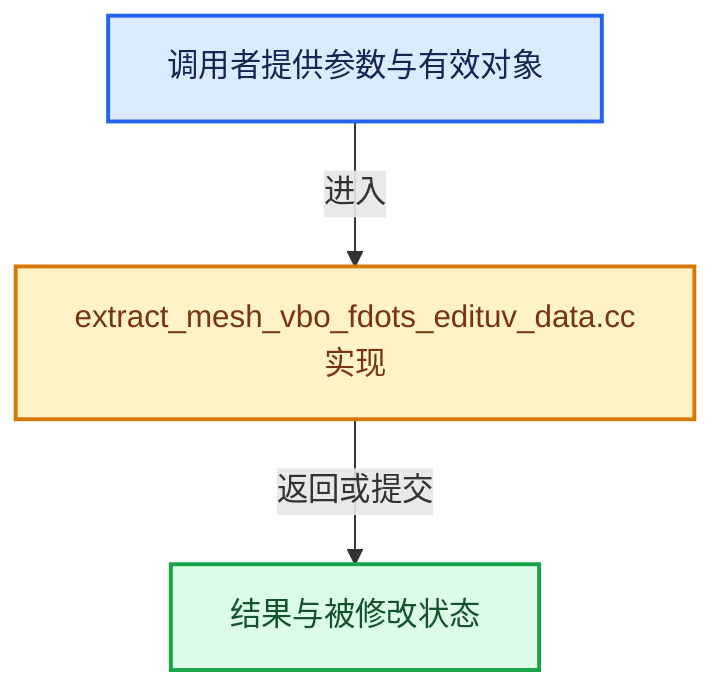

# 实现依赖专题：source/blender/draw/intern/mesh_extractors/extract_mesh_vbo_fdots_edituv_data.cc

[方向导航](README.md) · [符号索引](../%E7%AC%A6%E5%8F%B7%E4%BE%9D%E8%B5%96%E4%B8%8E%E5%AE%9E%E7%8E%B0%E7%B4%A2%E5%BC%95.md)

本专题从正文实际调用进入，集中保存共享实现。函数有稳定锚点，可从调用处直接跳到对应完整函数；递归与互相调用通过回链组织。

## 本文件的实现关系





## 完整成员与函数实现

<a id="f-d0f47388d275b201"></a>

### `blender::draw::extract_face_dots_edituv_data`

实现位置：[source/blender/draw/intern/mesh_extractors/extract_mesh_vbo_fdots_edituv_data.cc](../../../../../source/blender/draw/intern/mesh_extractors/extract_mesh_vbo_fdots_edituv_data.cc) · L15—L56。

接口参数：

- `const MeshRenderData &mr`

**教学注释版**

<!-- annotated:cda02a8352af90 -->

```cpp
gpu::VertBufPtr extract_face_dots_edituv_data(const MeshRenderData &mr)
{
  static const GPUVertFormat format = []() {
    GPUVertFormat format{};
    GPU_vertformat_attr_add(&format, "data", gpu::VertAttrType::UINT_8_8_8_8);
    GPU_vertformat_alias_add(&format, "flag");
    return format;
  }();
  gpu::VertBufPtr vbo = gpu::VertBufPtr(GPU_vertbuf_create_with_format(format));
  GPU_vertbuf_data_alloc(*vbo, mr.faces_num);
  MutableSpan vbo_data = vbo->data<EditLoopData>();
  const BMesh &bm = *mr.bm;
  const BMUVOffsets offsets = BM_uv_map_offsets_get(&bm);
  if (mr.extract_type == MeshExtractType::BMesh) {
    threading::parallel_for(IndexRange(bm.totface), 2048, [&](const IndexRange range) {
      for (const int face_index : range) {
        const BMFace &face = *BM_face_at_index(&const_cast<BMesh &>(bm), face_index);
        vbo_data[face_index] = {};
        mesh_render_data_face_flag(mr, &face, offsets, vbo_data[face_index]);
      }
    });
  }
  else {
    if (mr.orig_index_face) {
      const Span<int> orig_index_face(mr.orig_index_face, mr.faces_num);
      threading::parallel_for(IndexRange(mr.faces_num), 4096, [&](const IndexRange range) {
        for (const int face : range) {
          vbo_data[face] = {};
          if (orig_index_face[face] == ORIGINDEX_NONE) {
            continue;
          }
          const BMFace *orig_face = bm_original_face_get(mr, face);
          mesh_render_data_face_flag(mr, orig_face, offsets, vbo_data[face]);
        }
      });
    }
    else {
      // [讲解] vbo_data.fill：修改已有目标元素，不改变底层容器长度。
      vbo_data.fill({});
    }
  }
  return vbo;
}
```

<details>
<summary>核对原始源码：source/blender/draw/intern/mesh_extractors/extract_mesh_vbo_fdots_edituv_data.cc · L15—L56</summary>

<!-- original:cda02a8352af90:source/blender/draw/intern/mesh_extractors/extract_mesh_vbo_fdots_edituv_data.cc:15:56 -->

```cpp
gpu::VertBufPtr extract_face_dots_edituv_data(const MeshRenderData &mr)
{
  static const GPUVertFormat format = []() {
    GPUVertFormat format{};
    GPU_vertformat_attr_add(&format, "data", gpu::VertAttrType::UINT_8_8_8_8);
    GPU_vertformat_alias_add(&format, "flag");
    return format;
  }();
  gpu::VertBufPtr vbo = gpu::VertBufPtr(GPU_vertbuf_create_with_format(format));
  GPU_vertbuf_data_alloc(*vbo, mr.faces_num);
  MutableSpan vbo_data = vbo->data<EditLoopData>();
  const BMesh &bm = *mr.bm;
  const BMUVOffsets offsets = BM_uv_map_offsets_get(&bm);
  if (mr.extract_type == MeshExtractType::BMesh) {
    threading::parallel_for(IndexRange(bm.totface), 2048, [&](const IndexRange range) {
      for (const int face_index : range) {
        const BMFace &face = *BM_face_at_index(&const_cast<BMesh &>(bm), face_index);
        vbo_data[face_index] = {};
        mesh_render_data_face_flag(mr, &face, offsets, vbo_data[face_index]);
      }
    });
  }
  else {
    if (mr.orig_index_face) {
      const Span<int> orig_index_face(mr.orig_index_face, mr.faces_num);
      threading::parallel_for(IndexRange(mr.faces_num), 4096, [&](const IndexRange range) {
        for (const int face : range) {
          vbo_data[face] = {};
          if (orig_index_face[face] == ORIGINDEX_NONE) {
            continue;
          }
          const BMFace *orig_face = bm_original_face_get(mr, face);
          mesh_render_data_face_flag(mr, orig_face, offsets, vbo_data[face]);
        }
      });
    }
    else {
      vbo_data.fill({});
    }
  }
  return vbo;
}
```

</details>

**沿实际写入检查状态**

- `vbo_data[face_index] = {};`
- `vbo_data[face] = {};`

**结果出口**

- `return format;`
- `return vbo;`

**继续追踪实现**

- `[]() { GPUVertFormat format{}; GPU_vertformat_attr_add(&format, "data", gpu::VertAttrType::UINT_8_8_8_8); GPU_vertformat_alias_add(&format, "flag"); return format; }` → [调用协议](../%E6%A8%A1%E6%9D%BF%E5%AE%8F%E4%B8%8E%E5%8A%A8%E6%80%81%E5%88%86%E6%B4%BE%E5%8D%8F%E8%AE%AE.md)：函数指针、局部可调用对象或未展开的宏；必须结合调用者环境。调用位置L17。
- `GPU_vertformat_attr_add` → [blender::GPU_vertformat_attr_add · L389](%E4%BE%9D%E8%B5%96-gpu_vertex_format-4f7148.md#f-a36e23f37b97fff4)。
- `GPU_vertformat_alias_add` → [blender::GPU_vertformat_alias_add · L418](%E4%BE%9D%E8%B5%96-gpu_vertex_format-4f7148.md#f-5b19cd8281d0191e)。
- `gpu::VertBufPtr` → [调用协议](../%E6%A8%A1%E6%9D%BF%E5%AE%8F%E4%B8%8E%E5%8A%A8%E6%80%81%E5%88%86%E6%B4%BE%E5%8D%8F%E8%AE%AE.md)：函数指针、局部可调用对象或未展开的宏；必须结合调用者环境。调用位置L23。
- `GPU_vertbuf_create_with_format` → [blender::GPU_vertbuf_create_with_format · L71](%E4%BE%9D%E8%B5%96-GPU_vertex_buffer-d7610b.md#f-bd43fe034e852138)。
- `GPU_vertbuf_data_alloc` → [blender::GPU_vertbuf_data_alloc · L172](%E4%BE%9D%E8%B5%96-gpu_vertex_buffer-eaa662.md#f-8ee5cf106e0f2b0f)。
- `vbo->data<EditLoopData>` → [blender::draw::data · L124](%E4%BE%9D%E8%B5%96-DRW_gpu_wrapper-c80c4f.md#f-dc115dc22e0c9f33)；[blender::draw::data · L129](%E4%BE%9D%E8%B5%96-DRW_gpu_wrapper-c80c4f.md#f-5f325cb75387045c)。同名重载需按实参类型选择。
- `BM_uv_map_offsets_get` → [blender::BM_uv_map_offsets_get · L41](%E4%BE%9D%E8%B5%96-bmesh_query_uv-df9004.md#f-3ed93ab53a3df44e)。
- `threading::parallel_for` → [blender::threading::parallel_for · L68](../11-Depsgraph%E4%B8%8E%E5%B9%B6%E8%A1%8C%E4%BB%BB%E5%8A%A1%E7%B3%BB%E7%BB%9F/07-%E4%BB%BB%E5%8A%A1%E6%B1%A0%E4%B8%8ETBB%E6%8E%A5%E5%85%A5.md#f-838294754c24426c)。
- `IndexRange` → [blender::IndexRange](../01-%E5%9F%BA%E7%A1%80%E5%AE%B9%E5%99%A8%E4%B8%8E%E7%8E%B0%E4%BB%A3CPP/%E4%BE%9D%E8%B5%96-BLI_index_range-7d7cc5.md#t-caa3466d6776)；[blender::gpu::shader::parser::IndexRange](%E4%BE%9D%E8%B5%96-utils-06433d.md#t-82d2bd4ea71c)；[blender::IndexRange](%E4%BE%9D%E8%B5%96-DNA_node_types-6708b9.md#t-0448cc889d39)。
- `BM_face_at_index` → [blender::BM_face_at_index · L122](%E4%BE%9D%E8%B5%96-bmesh_mesh-df20c7.md#f-366df62c166d5094)。
- `mesh_render_data_face_flag` → [blender::draw::mesh_render_data_face_flag · L25](%E4%BE%9D%E8%B5%96-extract_mesh-3c59ed.md#f-78bb4555cc3bf13e)。
- `bm_original_face_get` → [blender::draw::bm_original_face_get · L138](%E4%BE%9D%E8%B5%96-extract_mesh-4bd3fc.md#f-50ae48e6025f345a)。
- `vbo_data.fill` → [blender::MutableSpan::fill · L523](../01-%E5%9F%BA%E7%A1%80%E5%AE%B9%E5%99%A8%E4%B8%8E%E7%8E%B0%E4%BB%A3CPP/06-MutableSpan%E5%8F%AF%E5%86%99%E8%A7%86%E5%9B%BE.md#f-8daedd52c727ec26)。
