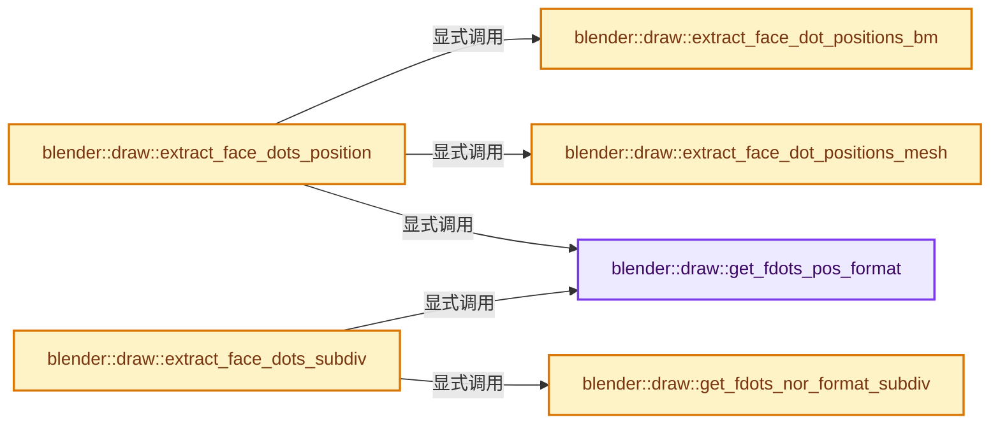
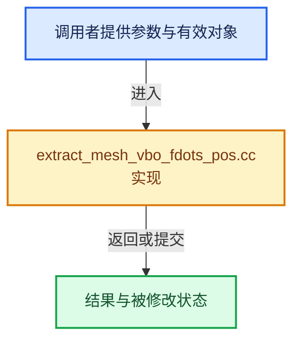

# 实现依赖专题：source/blender/draw/intern/mesh_extractors/extract_mesh_vbo_fdots_pos.cc

[方向导航](README.md) · [符号索引](../%E7%AC%A6%E5%8F%B7%E4%BE%9D%E8%B5%96%E4%B8%8E%E5%AE%9E%E7%8E%B0%E7%B4%A2%E5%BC%95.md)

本专题从正文实际调用进入，集中保存共享实现。函数有稳定锚点，可从调用处直接跳到对应完整函数；递归与互相调用通过回链组织。

## 本文件的实现关系






## 完整成员与函数实现

<a id="f-cf0bed593c42c855"></a>

### `blender::draw::get_fdots_pos_format`

实现位置：[source/blender/draw/intern/mesh_extractors/extract_mesh_vbo_fdots_pos.cc](../../../../../source/blender/draw/intern/mesh_extractors/extract_mesh_vbo_fdots_pos.cc) · L17—L22。

**教学注释版**

<!-- annotated:f1be566cc99cfe -->

```cpp
static const GPUVertFormat &get_fdots_pos_format()
{
  static const GPUVertFormat format = GPU_vertformat_from_attribute(
      "pos", gpu::VertAttrType::SFLOAT_32_32_32);
  return format;
}
```

<details>
<summary>核对原始源码：source/blender/draw/intern/mesh_extractors/extract_mesh_vbo_fdots_pos.cc · L17—L22</summary>

<!-- original:f1be566cc99cfe:source/blender/draw/intern/mesh_extractors/extract_mesh_vbo_fdots_pos.cc:17:22 -->

```cpp
static const GPUVertFormat &get_fdots_pos_format()
{
  static const GPUVertFormat format = GPU_vertformat_from_attribute(
      "pos", gpu::VertAttrType::SFLOAT_32_32_32);
  return format;
}
```

</details>

**结果出口**

- `return format;`

**继续追踪实现**

- `GPU_vertformat_from_attribute` → [blender::GPU_vertformat_from_attribute · L427](%E4%BE%9D%E8%B5%96-gpu_vertex_format-4f7148.md#f-2643d25087989f8e)。

<a id="f-e16ee9bcb46ea363"></a>

### `blender::draw::get_fdots_nor_format_subdiv`

实现位置：[source/blender/draw/intern/mesh_extractors/extract_mesh_vbo_fdots_pos.cc](../../../../../source/blender/draw/intern/mesh_extractors/extract_mesh_vbo_fdots_pos.cc) · L24—L29。

**教学注释版**

<!-- annotated:f5bfd72d3a01ca -->

```cpp
static const GPUVertFormat &get_fdots_nor_format_subdiv()
{
  static const GPUVertFormat format = GPU_vertformat_from_attribute(
      "norAndFlag", gpu::VertAttrType::SFLOAT_32_32_32_32);
  return format;
}
```

<details>
<summary>核对原始源码：source/blender/draw/intern/mesh_extractors/extract_mesh_vbo_fdots_pos.cc · L24—L29</summary>

<!-- original:f5bfd72d3a01ca:source/blender/draw/intern/mesh_extractors/extract_mesh_vbo_fdots_pos.cc:24:29 -->

```cpp
static const GPUVertFormat &get_fdots_nor_format_subdiv()
{
  static const GPUVertFormat format = GPU_vertformat_from_attribute(
      "norAndFlag", gpu::VertAttrType::SFLOAT_32_32_32_32);
  return format;
}
```

</details>

**结果出口**

- `return format;`

**继续追踪实现**

- `GPU_vertformat_from_attribute` → [blender::GPU_vertformat_from_attribute · L427](%E4%BE%9D%E8%B5%96-gpu_vertex_format-4f7148.md#f-2643d25087989f8e)。

<a id="f-a2e01eda74418d2e"></a>

### `blender::draw::extract_face_dot_positions_mesh`

实现位置：[source/blender/draw/intern/mesh_extractors/extract_mesh_vbo_fdots_pos.cc](../../../../../source/blender/draw/intern/mesh_extractors/extract_mesh_vbo_fdots_pos.cc) · L31—L60。

接口参数：

- `const MeshRenderData &mr`
- `MutableSpan<float3> vbo_data`

**教学注释版**

<!-- annotated:4756f0aab1cb37 -->

```cpp
static void extract_face_dot_positions_mesh(const MeshRenderData &mr, MutableSpan<float3> vbo_data)
{
  const Span<float3> positions = mr.vert_positions;
  const OffsetIndices faces = mr.faces;
  const Span<int> corner_verts = mr.corner_verts;
  if (mr.use_subsurf_fdots) {
    const BitSpan facedot_tags = mr.mesh->runtime->subsurf_face_dot_tags;
    threading::parallel_for(faces.index_range(), 4096, [&](const IndexRange range) {
      for (const int face : range) {
        // [讲解] corner_verts.slice：建立原连续范围的子视图。
        const Span<int> face_verts = corner_verts.slice(faces[face]);
        // [讲解] face_verts.begin：返回借用范围的地址。
        const int *vert = std::find_if(face_verts.begin(), face_verts.end(), [&](const int vert) {
          return facedot_tags[vert].test();
        });
        // [讲解] face_verts.end：返回借用范围的地址。
        if (vert == face_verts.end()) {
          vbo_data[face] = float3(0);
        }
        else {
          vbo_data[face] = positions[*vert];
        }
      }
    });
  }
  else {
    threading::parallel_for(faces.index_range(), 4096, [&](const IndexRange range) {
      for (const int face : range) {
        vbo_data[face] = bke::mesh::face_center_calc(positions, corner_verts.slice(faces[face]));
      }
    });
  }
}
```

<details>
<summary>核对原始源码：source/blender/draw/intern/mesh_extractors/extract_mesh_vbo_fdots_pos.cc · L31—L60</summary>

<!-- original:4756f0aab1cb37:source/blender/draw/intern/mesh_extractors/extract_mesh_vbo_fdots_pos.cc:31:60 -->

```cpp
static void extract_face_dot_positions_mesh(const MeshRenderData &mr, MutableSpan<float3> vbo_data)
{
  const Span<float3> positions = mr.vert_positions;
  const OffsetIndices faces = mr.faces;
  const Span<int> corner_verts = mr.corner_verts;
  if (mr.use_subsurf_fdots) {
    const BitSpan facedot_tags = mr.mesh->runtime->subsurf_face_dot_tags;
    threading::parallel_for(faces.index_range(), 4096, [&](const IndexRange range) {
      for (const int face : range) {
        const Span<int> face_verts = corner_verts.slice(faces[face]);
        const int *vert = std::find_if(face_verts.begin(), face_verts.end(), [&](const int vert) {
          return facedot_tags[vert].test();
        });
        if (vert == face_verts.end()) {
          vbo_data[face] = float3(0);
        }
        else {
          vbo_data[face] = positions[*vert];
        }
      }
    });
  }
  else {
    threading::parallel_for(faces.index_range(), 4096, [&](const IndexRange range) {
      for (const int face : range) {
        vbo_data[face] = bke::mesh::face_center_calc(positions, corner_verts.slice(faces[face]));
      }
    });
  }
}
```

</details>

**沿实际写入检查状态**

- `vbo_data[face] = float3(0);`
- `vbo_data[face] = positions[*vert];`
- `vbo_data[face] = bke::mesh::face_center_calc(positions, corner_verts.slice(faces[face]));`

**结果出口**

- `return facedot_tags[vert].test();`

**继续追踪实现**

- `threading::parallel_for` → [blender::threading::parallel_for · L68](../11-Depsgraph%E4%B8%8E%E5%B9%B6%E8%A1%8C%E4%BB%BB%E5%8A%A1%E7%B3%BB%E7%BB%9F/07-%E4%BB%BB%E5%8A%A1%E6%B1%A0%E4%B8%8ETBB%E6%8E%A5%E5%85%A5.md#f-838294754c24426c)。
- `faces.index_range` → [blender::offset_indices::OffsetIndices::index_range · L77](02-OffsetIndices%E5%AE%8C%E6%95%B4%E6%8E%A5%E5%8F%A3.md#f-19b5ca1456de007d)。
- `corner_verts.slice` → [blender::Span::slice · L141](../01-%E5%9F%BA%E7%A1%80%E5%AE%B9%E5%99%A8%E4%B8%8E%E7%8E%B0%E4%BB%A3CPP/05-Span%E5%8F%AA%E8%AF%BB%E8%BF%9E%E7%BB%AD%E8%A7%86%E5%9B%BE.md#f-380a0e8fdcbd53cc)；[blender::Span::slice · L149](../01-%E5%9F%BA%E7%A1%80%E5%AE%B9%E5%99%A8%E4%B8%8E%E7%8E%B0%E4%BB%A3CPP/05-Span%E5%8F%AA%E8%AF%BB%E8%BF%9E%E7%BB%AD%E8%A7%86%E5%9B%BE.md#f-9b9c15e78dd54eec)。同名重载需按实参类型选择。
- `std::find_if` → [外部契约](https://eel.is/c++draft/)：这个边界按实际表达式及所属类型核对参数、返回值、寿命与失败行为。这里提供接口入口，不声称已解释该第三方版本的内部实现。
- `face_verts.begin` → [blender::Span::begin · L224](../01-%E5%9F%BA%E7%A1%80%E5%AE%B9%E5%99%A8%E4%B8%8E%E7%8E%B0%E4%BB%A3CPP/05-Span%E5%8F%AA%E8%AF%BB%E8%BF%9E%E7%BB%AD%E8%A7%86%E5%9B%BE.md#f-415883b512284f46)。
- `face_verts.end` → [blender::Span::end · L228](../01-%E5%9F%BA%E7%A1%80%E5%AE%B9%E5%99%A8%E4%B8%8E%E7%8E%B0%E4%BB%A3CPP/05-Span%E5%8F%AA%E8%AF%BB%E8%BF%9E%E7%BB%AD%E8%A7%86%E5%9B%BE.md#f-a7d8b9e494c291a7)。
- `facedot_tags[vert].test` → [调用协议](../%E6%A8%A1%E6%9D%BF%E5%AE%8F%E4%B8%8E%E5%8A%A8%E6%80%81%E5%88%86%E6%B4%BE%E5%8D%8F%E8%AE%AE.md)：接收对象类型依赖auto、返回值或模板实例；不按同名猜测目标。调用位置L42。
- `float3` → [float3 · L641](%E4%BE%9D%E8%B5%96-smaa-b67bc2.md#m-0ea8254cfdb4)。宏定义由构建条件选择。
- `bke::mesh::face_center_calc` → [blender::bke::mesh::face_center_calc · L45](%E4%BE%9D%E8%B5%96-mesh_evaluate-427cfd.md#f-b983d3456bc87786)。

<a id="f-b914550b985e9d2b"></a>

### `blender::draw::extract_face_dot_positions_bm`

实现位置：[source/blender/draw/intern/mesh_extractors/extract_mesh_vbo_fdots_pos.cc](../../../../../source/blender/draw/intern/mesh_extractors/extract_mesh_vbo_fdots_pos.cc) · L62—L76。

接口参数：

- `const MeshRenderData &mr`
- `MutableSpan<float3> vbo_data`

**教学注释版**

<!-- annotated:14b5c33ba92b85 -->

```cpp
static void extract_face_dot_positions_bm(const MeshRenderData &mr, MutableSpan<float3> vbo_data)
{
  const BMesh &bm = *mr.bm;
  threading::parallel_for(IndexRange(bm.totface), 2048, [&](const IndexRange range) {
    for (const int face_index : range) {
      const BMFace &face = *BM_face_at_index(&const_cast<BMesh &>(bm), face_index);
      if (mr.bm_vert_coords.is_empty()) {
        BM_face_calc_center_median(&face, vbo_data[face_index]);
      }
      else {
        BM_face_calc_center_median_vcos(&bm, &face, vbo_data[face_index], mr.bm_vert_coords);
      }
    }
  });
}
```

<details>
<summary>核对原始源码：source/blender/draw/intern/mesh_extractors/extract_mesh_vbo_fdots_pos.cc · L62—L76</summary>

<!-- original:14b5c33ba92b85:source/blender/draw/intern/mesh_extractors/extract_mesh_vbo_fdots_pos.cc:62:76 -->

```cpp
static void extract_face_dot_positions_bm(const MeshRenderData &mr, MutableSpan<float3> vbo_data)
{
  const BMesh &bm = *mr.bm;
  threading::parallel_for(IndexRange(bm.totface), 2048, [&](const IndexRange range) {
    for (const int face_index : range) {
      const BMFace &face = *BM_face_at_index(&const_cast<BMesh &>(bm), face_index);
      if (mr.bm_vert_coords.is_empty()) {
        BM_face_calc_center_median(&face, vbo_data[face_index]);
      }
      else {
        BM_face_calc_center_median_vcos(&bm, &face, vbo_data[face_index], mr.bm_vert_coords);
      }
    }
  });
}
```

</details>

**继续追踪实现**

- `threading::parallel_for` → [blender::threading::parallel_for · L68](../11-Depsgraph%E4%B8%8E%E5%B9%B6%E8%A1%8C%E4%BB%BB%E5%8A%A1%E7%B3%BB%E7%BB%9F/07-%E4%BB%BB%E5%8A%A1%E6%B1%A0%E4%B8%8ETBB%E6%8E%A5%E5%85%A5.md#f-838294754c24426c)。
- `IndexRange` → [blender::IndexRange](../01-%E5%9F%BA%E7%A1%80%E5%AE%B9%E5%99%A8%E4%B8%8E%E7%8E%B0%E4%BB%A3CPP/%E4%BE%9D%E8%B5%96-BLI_index_range-7d7cc5.md#t-caa3466d6776)；[blender::gpu::shader::parser::IndexRange](%E4%BE%9D%E8%B5%96-utils-06433d.md#t-82d2bd4ea71c)；[blender::IndexRange](%E4%BE%9D%E8%B5%96-DNA_node_types-6708b9.md#t-0448cc889d39)。
- `BM_face_at_index` → [blender::BM_face_at_index · L122](%E4%BE%9D%E8%B5%96-bmesh_mesh-df20c7.md#f-366df62c166d5094)。
- `mr.bm_vert_coords.is_empty` → [调用协议](../%E6%A8%A1%E6%9D%BF%E5%AE%8F%E4%B8%8E%E5%8A%A8%E6%80%81%E5%88%86%E6%B4%BE%E5%8D%8F%E8%AE%AE.md)：接收对象类型依赖auto、返回值或模板实例；不按同名猜测目标。调用位置L68。
- `BM_face_calc_center_median` → [blender::BM_face_calc_center_median · L655](%E4%BE%9D%E8%B5%96-bmesh_polygon-a8ec8c.md#f-ca9310cae0d0c57b)。
- `BM_face_calc_center_median_vcos` → [blender::BM_face_calc_center_median_vcos · L1056](%E4%BE%9D%E8%B5%96-bmesh_polygon-a8ec8c.md#f-0600122e8a2f3696)。

<a id="f-cb47eb2b2020f0c6"></a>

### `blender::draw::extract_face_dots_position`

实现位置：[source/blender/draw/intern/mesh_extractors/extract_mesh_vbo_fdots_pos.cc](../../../../../source/blender/draw/intern/mesh_extractors/extract_mesh_vbo_fdots_pos.cc) · L78—L90。

接口参数：

- `const MeshRenderData &mr`

**教学注释版**

<!-- annotated:6088727ad598c2 -->

```cpp
gpu::VertBufPtr extract_face_dots_position(const MeshRenderData &mr)
{
  gpu::VertBufPtr vbo = gpu::VertBufPtr(GPU_vertbuf_create_with_format(get_fdots_pos_format()));
  GPU_vertbuf_data_alloc(*vbo, mr.corners_num + mr.loose_indices_num);
  MutableSpan vbo_data = vbo->data<float3>();
  if (mr.extract_type == MeshExtractType::Mesh) {
    extract_face_dot_positions_mesh(mr, vbo_data);
  }
  else {
    extract_face_dot_positions_bm(mr, vbo_data);
  }
  return vbo;
}
```

<details>
<summary>核对原始源码：source/blender/draw/intern/mesh_extractors/extract_mesh_vbo_fdots_pos.cc · L78—L90</summary>

<!-- original:6088727ad598c2:source/blender/draw/intern/mesh_extractors/extract_mesh_vbo_fdots_pos.cc:78:90 -->

```cpp
gpu::VertBufPtr extract_face_dots_position(const MeshRenderData &mr)
{
  gpu::VertBufPtr vbo = gpu::VertBufPtr(GPU_vertbuf_create_with_format(get_fdots_pos_format()));
  GPU_vertbuf_data_alloc(*vbo, mr.corners_num + mr.loose_indices_num);
  MutableSpan vbo_data = vbo->data<float3>();
  if (mr.extract_type == MeshExtractType::Mesh) {
    extract_face_dot_positions_mesh(mr, vbo_data);
  }
  else {
    extract_face_dot_positions_bm(mr, vbo_data);
  }
  return vbo;
}
```

</details>

**结果出口**

- `return vbo;`

**继续追踪实现**

- `gpu::VertBufPtr` → [调用协议](../%E6%A8%A1%E6%9D%BF%E5%AE%8F%E4%B8%8E%E5%8A%A8%E6%80%81%E5%88%86%E6%B4%BE%E5%8D%8F%E8%AE%AE.md)：函数指针、局部可调用对象或未展开的宏；必须结合调用者环境。调用位置L80。
- `GPU_vertbuf_create_with_format` → [blender::GPU_vertbuf_create_with_format · L71](%E4%BE%9D%E8%B5%96-GPU_vertex_buffer-d7610b.md#f-bd43fe034e852138)。
- `get_fdots_pos_format` → [blender::draw::get_fdots_pos_format · L17](%E4%BE%9D%E8%B5%96-extract_mesh_vbo_fdots_pos-836f42.md#f-cf0bed593c42c855)。
- `GPU_vertbuf_data_alloc` → [blender::GPU_vertbuf_data_alloc · L172](%E4%BE%9D%E8%B5%96-gpu_vertex_buffer-eaa662.md#f-8ee5cf106e0f2b0f)。
- `vbo->data<float3>` → [blender::draw::data · L124](%E4%BE%9D%E8%B5%96-DRW_gpu_wrapper-c80c4f.md#f-dc115dc22e0c9f33)；[blender::draw::data · L129](%E4%BE%9D%E8%B5%96-DRW_gpu_wrapper-c80c4f.md#f-5f325cb75387045c)。同名重载需按实参类型选择。
- `extract_face_dot_positions_mesh` → [blender::draw::extract_face_dot_positions_mesh · L31](%E4%BE%9D%E8%B5%96-extract_mesh_vbo_fdots_pos-836f42.md#f-a2e01eda74418d2e)。
- `extract_face_dot_positions_bm` → [blender::draw::extract_face_dot_positions_bm · L62](%E4%BE%9D%E8%B5%96-extract_mesh_vbo_fdots_pos-836f42.md#f-b914550b985e9d2b)。

<a id="f-c5740533a53688db"></a>

### `blender::draw::extract_face_dots_subdiv`

实现位置：[source/blender/draw/intern/mesh_extractors/extract_mesh_vbo_fdots_pos.cc](../../../../../source/blender/draw/intern/mesh_extractors/extract_mesh_vbo_fdots_pos.cc) · L92—L108。

接口参数：

- `const DRWSubdivCache &subdiv_cache`
- `gpu::VertBufPtr &fdots_pos`
- `gpu::VertBufPtr *fdots_nor`
- `gpu::IndexBufPtr &fdots`

**教学注释版**

<!-- annotated:976ce43dd3ff5a -->

```cpp
void extract_face_dots_subdiv(const DRWSubdivCache &subdiv_cache,
                              gpu::VertBufPtr &fdots_pos,
                              gpu::VertBufPtr *fdots_nor,
                              gpu::IndexBufPtr &fdots)
{
  /* We "extract" positions, normals, and indices at once. */
  /* The normals may not be requested. */
  if (fdots_nor) {
    *fdots_nor = gpu::VertBufPtr(GPU_vertbuf_create_on_device(get_fdots_nor_format_subdiv(),
                                                              subdiv_cache.num_coarse_faces));
  }
  fdots_pos = gpu::VertBufPtr(
      GPU_vertbuf_create_on_device(get_fdots_pos_format(), subdiv_cache.num_coarse_faces));
  fdots = gpu::IndexBufPtr(GPU_indexbuf_build_on_device(subdiv_cache.num_coarse_faces));
  draw_subdiv_build_fdots_buffers(
      subdiv_cache, fdots_pos.get(), fdots_nor ? fdots_nor->get() : nullptr, fdots.get());
}
```

<details>
<summary>核对原始源码：source/blender/draw/intern/mesh_extractors/extract_mesh_vbo_fdots_pos.cc · L92—L108</summary>

<!-- original:976ce43dd3ff5a:source/blender/draw/intern/mesh_extractors/extract_mesh_vbo_fdots_pos.cc:92:108 -->

```cpp
void extract_face_dots_subdiv(const DRWSubdivCache &subdiv_cache,
                              gpu::VertBufPtr &fdots_pos,
                              gpu::VertBufPtr *fdots_nor,
                              gpu::IndexBufPtr &fdots)
{
  /* We "extract" positions, normals, and indices at once. */
  /* The normals may not be requested. */
  if (fdots_nor) {
    *fdots_nor = gpu::VertBufPtr(GPU_vertbuf_create_on_device(get_fdots_nor_format_subdiv(),
                                                              subdiv_cache.num_coarse_faces));
  }
  fdots_pos = gpu::VertBufPtr(
      GPU_vertbuf_create_on_device(get_fdots_pos_format(), subdiv_cache.num_coarse_faces));
  fdots = gpu::IndexBufPtr(GPU_indexbuf_build_on_device(subdiv_cache.num_coarse_faces));
  draw_subdiv_build_fdots_buffers(
      subdiv_cache, fdots_pos.get(), fdots_nor ? fdots_nor->get() : nullptr, fdots.get());
}
```

</details>

**沿实际写入检查状态**

- `fdots_pos = gpu::VertBufPtr(`
- `fdots = gpu::IndexBufPtr(GPU_indexbuf_build_on_device(subdiv_cache.num_coarse_faces));`

**继续追踪实现**

- `gpu::VertBufPtr` → [调用协议](../%E6%A8%A1%E6%9D%BF%E5%AE%8F%E4%B8%8E%E5%8A%A8%E6%80%81%E5%88%86%E6%B4%BE%E5%8D%8F%E8%AE%AE.md)：函数指针、局部可调用对象或未展开的宏；必须结合调用者环境。调用位置L100。
- `GPU_vertbuf_create_on_device` → [blender::GPU_vertbuf_create_on_device · L137](%E4%BE%9D%E8%B5%96-gpu_vertex_buffer-eaa662.md#f-abf244a18691f929)。
- `get_fdots_nor_format_subdiv` → [blender::draw::get_fdots_nor_format_subdiv · L24](%E4%BE%9D%E8%B5%96-extract_mesh_vbo_fdots_pos-836f42.md#f-e16ee9bcb46ea363)。
- `get_fdots_pos_format` → [blender::draw::get_fdots_pos_format · L17](%E4%BE%9D%E8%B5%96-extract_mesh_vbo_fdots_pos-836f42.md#f-cf0bed593c42c855)。
- `gpu::IndexBufPtr` → [调用协议](../%E6%A8%A1%E6%9D%BF%E5%AE%8F%E4%B8%8E%E5%8A%A8%E6%80%81%E5%88%86%E6%B4%BE%E5%8D%8F%E8%AE%AE.md)：函数指针、局部可调用对象或未展开的宏；必须结合调用者环境。调用位置L105。
- `GPU_indexbuf_build_on_device` → [blender::GPU_indexbuf_build_on_device · L83](%E4%BE%9D%E8%B5%96-gpu_index_buffer-c3daac.md#f-d79a15f80e7a5700)。
- `draw_subdiv_build_fdots_buffers` → [blender::draw::draw_subdiv_build_fdots_buffers · L1253](%E4%BE%9D%E8%B5%96-draw_cache_impl_subdivision-33125a.md#f-67c5077dd844193f)。
- `fdots_pos.get` → [blender::draw::GSplatEvalCache::get · L545](%E4%BE%9D%E8%B5%96-draw_cache_impl_gsplat-0b4128.md#f-3fb704a0b74cb9e4)。
- `fdots_nor->get` → [blender::draw::GSplatEvalCache::get · L545](%E4%BE%9D%E8%B5%96-draw_cache_impl_gsplat-0b4128.md#f-3fb704a0b74cb9e4)。
- `fdots.get` → [blender::draw::GSplatEvalCache::get · L545](%E4%BE%9D%E8%B5%96-draw_cache_impl_gsplat-0b4128.md#f-3fb704a0b74cb9e4)。
