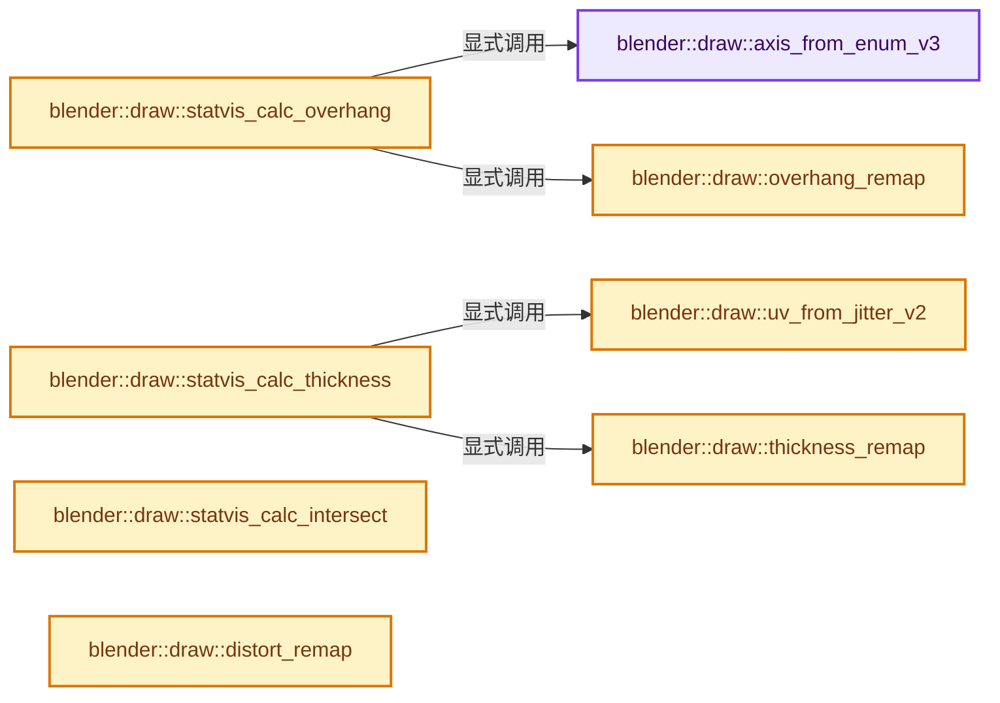
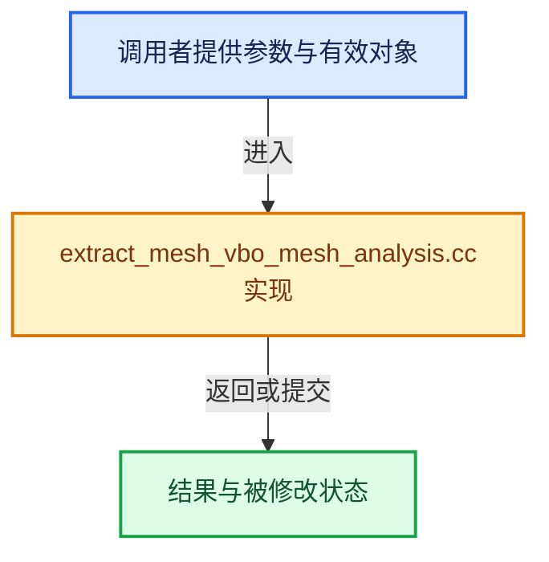

# 实现依赖专题：source/blender/draw/intern/mesh_extractors/extract_mesh_vbo_mesh_analysis.cc

[方向导航](README.md) · [符号索引](../%E7%AC%A6%E5%8F%B7%E4%BE%9D%E8%B5%96%E4%B8%8E%E5%AE%9E%E7%8E%B0%E7%B4%A2%E5%BC%95.md)

本专题从正文实际调用进入，集中保存共享实现。函数有稳定锚点，可从调用处直接跳到对应完整函数；递归与互相调用通过回链组织。

## 本文件的实现关系






## 完整成员与函数实现

<a id="f-809864aaf7da1fd0"></a>

### `blender::draw::axis_from_enum_v3`

实现位置：[source/blender/draw/intern/mesh_extractors/extract_mesh_vbo_mesh_analysis.cc](../../../../../source/blender/draw/intern/mesh_extractors/extract_mesh_vbo_mesh_analysis.cc) · L31—L40。

接口参数：

- `float v[3]`
- `const char axis`

**教学注释版**

<!-- annotated:0d4da071c58ade -->

```cpp
static void axis_from_enum_v3(float v[3], const char axis)
{
  zero_v3(v);
  if (axis < 3) {
    v[axis] = 1.0f;
  }
  else {
    v[axis - 3] = -1.0f;
  }
}
```

<details>
<summary>核对原始源码：source/blender/draw/intern/mesh_extractors/extract_mesh_vbo_mesh_analysis.cc · L31—L40</summary>

<!-- original:0d4da071c58ade:source/blender/draw/intern/mesh_extractors/extract_mesh_vbo_mesh_analysis.cc:31:40 -->

```cpp
static void axis_from_enum_v3(float v[3], const char axis)
{
  zero_v3(v);
  if (axis < 3) {
    v[axis] = 1.0f;
  }
  else {
    v[axis - 3] = -1.0f;
  }
}
```

</details>

**沿实际写入检查状态**

- `v[axis] = 1.0f;`

**继续追踪实现**

- `zero_v3` → [blender::zero_v3 · L26](../12-%E7%A9%BA%E9%97%B4%E6%95%B0%E6%8D%AE%E7%BB%93%E6%9E%84%E4%B8%8E%E5%87%A0%E4%BD%95%E7%AE%97%E6%B3%95/%E4%BE%9D%E8%B5%96-math_vector_inline-0c8541.md#f-13235b08fdecb098)。

<a id="f-b0c51cc58afe4d4d"></a>

### `blender::draw::overhang_remap`

实现位置：[source/blender/draw/intern/mesh_extractors/extract_mesh_vbo_mesh_analysis.cc](../../../../../source/blender/draw/intern/mesh_extractors/extract_mesh_vbo_mesh_analysis.cc) · L42—L56。

接口参数：

- `float fac`
- `float min`
- `float max`
- `float minmax_irange`

**教学注释版**

<!-- annotated:27575b9379c181 -->

```cpp
BLI_INLINE float overhang_remap(float fac, float min, float max, float minmax_irange)
{
  if (fac < min) {
    fac = 1.0f;
  }
  else if (fac > max) {
    fac = -1.0f;
  }
  else {
    fac = (fac - min) * minmax_irange;
    fac = 1.0f - fac;
    CLAMP(fac, 0.0f, 1.0f);
  }
  return fac;
}
```

<details>
<summary>核对原始源码：source/blender/draw/intern/mesh_extractors/extract_mesh_vbo_mesh_analysis.cc · L42—L56</summary>

<!-- original:27575b9379c181:source/blender/draw/intern/mesh_extractors/extract_mesh_vbo_mesh_analysis.cc:42:56 -->

```cpp
BLI_INLINE float overhang_remap(float fac, float min, float max, float minmax_irange)
{
  if (fac < min) {
    fac = 1.0f;
  }
  else if (fac > max) {
    fac = -1.0f;
  }
  else {
    fac = (fac - min) * minmax_irange;
    fac = 1.0f - fac;
    CLAMP(fac, 0.0f, 1.0f);
  }
  return fac;
}
```

</details>

**沿实际写入检查状态**

- `fac = 1.0f;`
- `fac = -1.0f;`
- `fac = (fac - min) * minmax_irange;`
- `fac = 1.0f - fac;`

**结果出口**

- `return fac;`

**继续追踪实现**

- `CLAMP` → [CLAMP · L200](../01-%E5%9F%BA%E7%A1%80%E5%AE%B9%E5%99%A8%E4%B8%8E%E7%8E%B0%E4%BB%A3CPP/%E4%BE%9D%E8%B5%96-BLI_utildefines-293a0a.md#m-69703e497120)。宏定义由构建条件选择。

<a id="f-6825812dc7258164"></a>

### `blender::draw::statvis_calc_overhang`

实现位置：[source/blender/draw/intern/mesh_extractors/extract_mesh_vbo_mesh_analysis.cc](../../../../../source/blender/draw/intern/mesh_extractors/extract_mesh_vbo_mesh_analysis.cc) · L58—L99。

接口参数：

- `const MeshRenderData &mr`
- `const float4x4 &object_to_world`
- `MutableSpan<float> r_overhang`

**教学注释版**

<!-- annotated:bfb5614de6dc2c -->

```cpp
static void statvis_calc_overhang(const MeshRenderData &mr,
                                  const float4x4 &object_to_world,
                                  MutableSpan<float> r_overhang)
{
  const MeshStatVis *statvis = &mr.toolsettings->statvis;
  const float min = statvis->overhang_min / float(M_PI);
  const float max = statvis->overhang_max / float(M_PI);
  const char axis = statvis->overhang_axis;
  float dir[3];
  const float minmax_irange = 1.0f / (max - min);

  BLI_assert(min <= max);

  axis_from_enum_v3(dir, axis);

  /* now convert into global space */
  mul_transposed_mat3_m4_v3(object_to_world.ptr(), dir);
  normalize_v3(dir);

  if (mr.extract_type == MeshExtractType::BMesh) {
    BMIter iter;
    BMesh *bm = mr.bm;
    BMFace *f;
    int l_index = 0;
    BM_ITER_MESH (f, &iter, bm, BM_FACES_OF_MESH) {
      float fac = angle_normalized_v3v3(bm_face_no_get(mr, f), dir) / float(M_PI);
      fac = overhang_remap(fac, min, max, minmax_irange);
      for (int i = 0; i < f->len; i++, l_index++) {
        r_overhang[l_index] = fac;
      }
    }
  }
  else {
    for (const int face_i : mr.faces.index_range()) {
      float fac = angle_normalized_v3v3(mr.face_normals[face_i], dir) / float(M_PI);
      fac = overhang_remap(fac, min, max, minmax_irange);
      for (const int loop_i : mr.faces[face_i]) {
        r_overhang[loop_i] = fac;
      }
    }
  }
}
```

<details>
<summary>核对原始源码：source/blender/draw/intern/mesh_extractors/extract_mesh_vbo_mesh_analysis.cc · L58—L99</summary>

<!-- original:bfb5614de6dc2c:source/blender/draw/intern/mesh_extractors/extract_mesh_vbo_mesh_analysis.cc:58:99 -->

```cpp
static void statvis_calc_overhang(const MeshRenderData &mr,
                                  const float4x4 &object_to_world,
                                  MutableSpan<float> r_overhang)
{
  const MeshStatVis *statvis = &mr.toolsettings->statvis;
  const float min = statvis->overhang_min / float(M_PI);
  const float max = statvis->overhang_max / float(M_PI);
  const char axis = statvis->overhang_axis;
  float dir[3];
  const float minmax_irange = 1.0f / (max - min);

  BLI_assert(min <= max);

  axis_from_enum_v3(dir, axis);

  /* now convert into global space */
  mul_transposed_mat3_m4_v3(object_to_world.ptr(), dir);
  normalize_v3(dir);

  if (mr.extract_type == MeshExtractType::BMesh) {
    BMIter iter;
    BMesh *bm = mr.bm;
    BMFace *f;
    int l_index = 0;
    BM_ITER_MESH (f, &iter, bm, BM_FACES_OF_MESH) {
      float fac = angle_normalized_v3v3(bm_face_no_get(mr, f), dir) / float(M_PI);
      fac = overhang_remap(fac, min, max, minmax_irange);
      for (int i = 0; i < f->len; i++, l_index++) {
        r_overhang[l_index] = fac;
      }
    }
  }
  else {
    for (const int face_i : mr.faces.index_range()) {
      float fac = angle_normalized_v3v3(mr.face_normals[face_i], dir) / float(M_PI);
      fac = overhang_remap(fac, min, max, minmax_irange);
      for (const int loop_i : mr.faces[face_i]) {
        r_overhang[loop_i] = fac;
      }
    }
  }
}
```

</details>

**沿实际写入检查状态**

- `fac = overhang_remap(fac, min, max, minmax_irange);`
- `r_overhang[l_index] = fac;`
- `r_overhang[loop_i] = fac;`

**继续追踪实现**

- `BLI_assert` → [BLI_assert · L48](../01-%E5%9F%BA%E7%A1%80%E5%AE%B9%E5%99%A8%E4%B8%8E%E7%8E%B0%E4%BB%A3CPP/%E4%BE%9D%E8%B5%96-BLI_assert-cc98e8.md#m-57a88495704d)；[BLI_assert · L63](../01-%E5%9F%BA%E7%A1%80%E5%AE%B9%E5%99%A8%E4%B8%8E%E7%8E%B0%E4%BB%A3CPP/%E4%BE%9D%E8%B5%96-BLI_assert-cc98e8.md#m-d07050020cb5)。宏定义由构建条件选择。
- `axis_from_enum_v3` → [blender::draw::axis_from_enum_v3 · L31](%E4%BE%9D%E8%B5%96-extract_mesh_vbo_mesh_analysis-c10902.md#f-809864aaf7da1fd0)。
- `mul_transposed_mat3_m4_v3` → [blender::mul_transposed_mat3_m4_v3 · L873](../12-%E7%A9%BA%E9%97%B4%E6%95%B0%E6%8D%AE%E7%BB%93%E6%9E%84%E4%B8%8E%E5%87%A0%E4%BD%95%E7%AE%97%E6%B3%95/%E4%BE%9D%E8%B5%96-math_matrix_c-004123.md#f-5d6030bbd8805405)。
- `object_to_world.ptr` → [调用协议](../%E6%A8%A1%E6%9D%BF%E5%AE%8F%E4%B8%8E%E5%8A%A8%E6%80%81%E5%88%86%E6%B4%BE%E5%8D%8F%E8%AE%AE.md)：由接收对象具体类型或运行时策略提供实现。调用位置L74。
- `normalize_v3` → [blender::normalize_v3 · L933](../12-%E7%A9%BA%E9%97%B4%E6%95%B0%E6%8D%AE%E7%BB%93%E6%9E%84%E4%B8%8E%E5%87%A0%E4%BD%95%E7%AE%97%E6%B3%95/%E4%BE%9D%E8%B5%96-math_vector_inline-0c8541.md#f-5f3257e657ef732c)。
- `BM_ITER_MESH` → [BM_ITER_MESH · L72](%E4%BE%9D%E8%B5%96-bmesh_iterators-13971c.md#m-cfc837c73218)。宏定义由构建条件选择。
- `angle_normalized_v3v3` → [调用协议](../%E6%A8%A1%E6%9D%BF%E5%AE%8F%E4%B8%8E%E5%8A%A8%E6%80%81%E5%88%86%E6%B4%BE%E5%8D%8F%E8%AE%AE.md)：函数指针、局部可调用对象或未展开的宏；必须结合调用者环境。调用位置L83。
- `bm_face_no_get` → [blender::draw::bm_face_no_get · L181](%E4%BE%9D%E8%B5%96-extract_mesh-4bd3fc.md#f-40a3dcea78714956)。
- `overhang_remap` → [blender::draw::overhang_remap · L42](%E4%BE%9D%E8%B5%96-extract_mesh_vbo_mesh_analysis-c10902.md#f-b0c51cc58afe4d4d)。
- `mr.faces.index_range` → [调用协议](../%E6%A8%A1%E6%9D%BF%E5%AE%8F%E4%B8%8E%E5%8A%A8%E6%80%81%E5%88%86%E6%B4%BE%E5%8D%8F%E8%AE%AE.md)：接收对象类型依赖auto、返回值或模板实例；不按同名猜测目标。调用位置L91。

<a id="f-fb4393d1c359eff7"></a>

### `blender::draw::uv_from_jitter_v2`

实现位置：[source/blender/draw/intern/mesh_extractors/extract_mesh_vbo_mesh_analysis.cc](../../../../../source/blender/draw/intern/mesh_extractors/extract_mesh_vbo_mesh_analysis.cc) · L104—L114。

接口参数：

- `float uv[2]`

**教学注释版**

<!-- annotated:5237002a21253f -->

```cpp
static void uv_from_jitter_v2(float uv[2])
{
  uv[0] += 0.5f;
  uv[1] += 0.5f;
  if (uv[0] + uv[1] > 1.0f) {
    uv[0] = 1.0f - uv[0];
    uv[1] = 1.0f - uv[1];
  }

  clamp_v2(uv, 0.0f, 1.0f);
}
```

<details>
<summary>核对原始源码：source/blender/draw/intern/mesh_extractors/extract_mesh_vbo_mesh_analysis.cc · L104—L114</summary>

<!-- original:5237002a21253f:source/blender/draw/intern/mesh_extractors/extract_mesh_vbo_mesh_analysis.cc:104:114 -->

```cpp
static void uv_from_jitter_v2(float uv[2])
{
  uv[0] += 0.5f;
  uv[1] += 0.5f;
  if (uv[0] + uv[1] > 1.0f) {
    uv[0] = 1.0f - uv[0];
    uv[1] = 1.0f - uv[1];
  }

  clamp_v2(uv, 0.0f, 1.0f);
}
```

</details>

**沿实际写入检查状态**

- `uv[0] += 0.5f;`
- `uv[1] += 0.5f;`
- `uv[0] = 1.0f - uv[0];`
- `uv[1] = 1.0f - uv[1];`

**继续追踪实现**

- `clamp_v2` → [blender::clamp_v2 · L1069](../12-%E7%A9%BA%E9%97%B4%E6%95%B0%E6%8D%AE%E7%BB%93%E6%9E%84%E4%B8%8E%E5%87%A0%E4%BD%95%E7%AE%97%E6%B3%95/%E4%BE%9D%E8%B5%96-math_vector_inline-0c8541.md#f-35d37cef6d22a13d)。

<a id="f-ffe8ab80c6cb3217"></a>

### `blender::draw::thickness_remap`

实现位置：[source/blender/draw/intern/mesh_extractors/extract_mesh_vbo_mesh_analysis.cc](../../../../../source/blender/draw/intern/mesh_extractors/extract_mesh_vbo_mesh_analysis.cc) · L116—L128。

接口参数：

- `float fac`
- `float min`
- `float max`
- `float minmax_irange`

**教学注释版**

<!-- annotated:95a0c51d9b284b -->

```cpp
BLI_INLINE float thickness_remap(float fac, float min, float max, float minmax_irange)
{
  /* important not '<=' */
  if (fac < max) {
    fac = (fac - min) * minmax_irange;
    fac = 1.0f - fac;
    CLAMP(fac, 0.0f, 1.0f);
  }
  else {
    fac = -1.0f;
  }
  return fac;
}
```

<details>
<summary>核对原始源码：source/blender/draw/intern/mesh_extractors/extract_mesh_vbo_mesh_analysis.cc · L116—L128</summary>

<!-- original:95a0c51d9b284b:source/blender/draw/intern/mesh_extractors/extract_mesh_vbo_mesh_analysis.cc:116:128 -->

```cpp
BLI_INLINE float thickness_remap(float fac, float min, float max, float minmax_irange)
{
  /* important not '<=' */
  if (fac < max) {
    fac = (fac - min) * minmax_irange;
    fac = 1.0f - fac;
    CLAMP(fac, 0.0f, 1.0f);
  }
  else {
    fac = -1.0f;
  }
  return fac;
}
```

</details>

**沿实际写入检查状态**

- `fac = (fac - min) * minmax_irange;`
- `fac = 1.0f - fac;`
- `fac = -1.0f;`

**结果出口**

- `return fac;`

**继续追踪实现**

- `CLAMP` → [CLAMP · L200](../01-%E5%9F%BA%E7%A1%80%E5%AE%B9%E5%99%A8%E4%B8%8E%E7%8E%B0%E4%BB%A3CPP/%E4%BE%9D%E8%B5%96-BLI_utildefines-293a0a.md#m-69703e497120)。宏定义由构建条件选择。

<a id="f-fd258caa013bf77a"></a>

### `blender::draw::statvis_calc_thickness`

实现位置：[source/blender/draw/intern/mesh_extractors/extract_mesh_vbo_mesh_analysis.cc](../../../../../source/blender/draw/intern/mesh_extractors/extract_mesh_vbo_mesh_analysis.cc) · L130—L245。

接口参数：

- `const MeshRenderData &mr`
- `const float4x4 &object_to_world`
- `MutableSpan<float> r_thickness`

**教学注释版**

<!-- annotated:e2bd1a894d9c3d -->

```cpp
static void statvis_calc_thickness(const MeshRenderData &mr,
                                   const float4x4 &object_to_world,
                                   MutableSpan<float> r_thickness)
{
  const float eps_offset = 0.00002f; /* values <= 0.00001 give errors */
  /* cheating to avoid another allocation */
  // [讲解] r_thickness.data：返回借用范围的地址。
  float *face_dists = r_thickness.data() + (mr.corners_num - mr.faces_num);
  const float scale = 1.0f / mat4_to_scale(object_to_world.ptr());
  const MeshStatVis *statvis = &mr.toolsettings->statvis;
  const float min = statvis->thickness_min * scale;
  const float max = statvis->thickness_max * scale;
  const float minmax_irange = 1.0f / (max - min);
  const int samples = statvis->thickness_samples;
  float jit_ofs[32][2];
  BLI_assert(samples <= 32);
  BLI_assert(min <= max);

  std::fill_n(face_dists, mr.faces_num, max);

  BLI_jitter_init(jit_ofs, samples);
  for (int j = 0; j < samples; j++) {
    uv_from_jitter_v2(jit_ofs[j]);
  }

  if (mr.extract_type == MeshExtractType::BMesh) {
    BMEditMesh *em = mr.edit_bmesh;
    BMesh *bm = mr.bm;
    BM_mesh_elem_index_ensure(bm, BM_FACE);

    BMBVHTree *bmtree = BKE_bmbvh_new_from_editmesh(em, bm, 0, nullptr, false);
    const Span<std::array<BMLoop *, 3>> looptris = em->looptris;
    for (int i = 0; i < mr.corner_tris_num; i++) {
      const BMLoop *const *ltri = looptris[i].data();
      const int index = BM_elem_index_get(ltri[0]->f);
      const float *cos[3] = {
          bm_vert_co_get(mr, ltri[0]->v),
          bm_vert_co_get(mr, ltri[1]->v),
          bm_vert_co_get(mr, ltri[2]->v),
      };
      float ray_co[3];
      float ray_no[3];

      normal_tri_v3(ray_no, cos[2], cos[1], cos[0]);

      for (int j = 0; j < samples; j++) {
        float dist = face_dists[index];
        interp_v3_v3v3v3_uv(ray_co, cos[0], cos[1], cos[2], jit_ofs[j]);
        madd_v3_v3fl(ray_co, ray_no, eps_offset);

        BMFace *f_hit = BKE_bmbvh_ray_cast(bmtree, ray_co, ray_no, 0.0f, &dist, nullptr, nullptr);
        if (f_hit && dist < face_dists[index]) {
          float angle_fac = fabsf(
              dot_v3v3(bm_face_no_get(mr, ltri[0]->f), bm_face_no_get(mr, f_hit)));
          angle_fac = 1.0f - angle_fac;
          angle_fac = angle_fac * angle_fac * angle_fac;
          angle_fac = 1.0f - angle_fac;
          dist /= angle_fac;
          // [讲解] std::min：按比较关系选取较小值；截断范围时还需先满足非负和可表示范围，min本身不会证明边界安全。
          face_dists[index] = std::min(dist, face_dists[index]);
        }
      }
    }
    BKE_bmbvh_free(bmtree);

    BMIter iter;
    BMFace *f;
    int l_index = 0;
    BM_ITER_MESH (f, &iter, bm, BM_FACES_OF_MESH) {
      float fac = face_dists[BM_elem_index_get(f)];
      fac = thickness_remap(fac, min, max, minmax_irange);
      for (int i = 0; i < f->len; i++, l_index++) {
        r_thickness[l_index] = fac;
      }
    }
  }
  else {
    if (mr.mesh->faces_num == 0) {
      return;
    }
    const bke::bvh::Tree &tree = mr.mesh->bvh_tris();
    const Span<int3> corner_tris = mr.mesh->corner_tris();
    const Span<int> tri_faces = mr.mesh->corner_tri_faces();
    // [讲解] corner_tris.index_range：查询视图长度或生成对应有效索引区间。
    for (const int i : corner_tris.index_range()) {
      const int index = tri_faces[i];
      const float *cos[3] = {mr.vert_positions[mr.corner_verts[corner_tris[i][0]]],
                             mr.vert_positions[mr.corner_verts[corner_tris[i][1]]],
                             mr.vert_positions[mr.corner_verts[corner_tris[i][2]]]};
      float ray_co[3];
      float ray_no[3];

      normal_tri_v3(ray_no, cos[2], cos[1], cos[0]);

      for (int j = 0; j < samples; j++) {
        interp_v3_v3v3v3_uv(ray_co, cos[0], cos[1], cos[2], jit_ofs[j]);
        madd_v3_v3fl(ray_co, ray_no, eps_offset);

        const bke::bvh::Ray ray(ray_co, ray_no, face_dists[index]);
        const std::optional<bke::bvh::RayHit> hit = tree.ray_intersect(ray);
        if (hit && hit->distance < face_dists[index]) {
          float angle_fac = fabsf(dot_v3v3(mr.face_normals[index], math::normalize(hit->normal)));
          angle_fac = 1.0f - angle_fac;
          angle_fac = angle_fac * angle_fac * angle_fac;
          angle_fac = 1.0f - angle_fac;
          face_dists[index] = std::min(hit->distance / angle_fac, face_dists[index]);
        }
      }
    }

    for (const int face_i : mr.faces.index_range()) {
      float fac = face_dists[face_i];
      fac = thickness_remap(fac, min, max, minmax_irange);
      for (const int loop_i : mr.faces[face_i]) {
        r_thickness[loop_i] = fac;
      }
    }
  }
}
```

<details>
<summary>核对原始源码：source/blender/draw/intern/mesh_extractors/extract_mesh_vbo_mesh_analysis.cc · L130—L245</summary>

<!-- original:e2bd1a894d9c3d:source/blender/draw/intern/mesh_extractors/extract_mesh_vbo_mesh_analysis.cc:130:245 -->

```cpp
static void statvis_calc_thickness(const MeshRenderData &mr,
                                   const float4x4 &object_to_world,
                                   MutableSpan<float> r_thickness)
{
  const float eps_offset = 0.00002f; /* values <= 0.00001 give errors */
  /* cheating to avoid another allocation */
  float *face_dists = r_thickness.data() + (mr.corners_num - mr.faces_num);
  const float scale = 1.0f / mat4_to_scale(object_to_world.ptr());
  const MeshStatVis *statvis = &mr.toolsettings->statvis;
  const float min = statvis->thickness_min * scale;
  const float max = statvis->thickness_max * scale;
  const float minmax_irange = 1.0f / (max - min);
  const int samples = statvis->thickness_samples;
  float jit_ofs[32][2];
  BLI_assert(samples <= 32);
  BLI_assert(min <= max);

  std::fill_n(face_dists, mr.faces_num, max);

  BLI_jitter_init(jit_ofs, samples);
  for (int j = 0; j < samples; j++) {
    uv_from_jitter_v2(jit_ofs[j]);
  }

  if (mr.extract_type == MeshExtractType::BMesh) {
    BMEditMesh *em = mr.edit_bmesh;
    BMesh *bm = mr.bm;
    BM_mesh_elem_index_ensure(bm, BM_FACE);

    BMBVHTree *bmtree = BKE_bmbvh_new_from_editmesh(em, bm, 0, nullptr, false);
    const Span<std::array<BMLoop *, 3>> looptris = em->looptris;
    for (int i = 0; i < mr.corner_tris_num; i++) {
      const BMLoop *const *ltri = looptris[i].data();
      const int index = BM_elem_index_get(ltri[0]->f);
      const float *cos[3] = {
          bm_vert_co_get(mr, ltri[0]->v),
          bm_vert_co_get(mr, ltri[1]->v),
          bm_vert_co_get(mr, ltri[2]->v),
      };
      float ray_co[3];
      float ray_no[3];

      normal_tri_v3(ray_no, cos[2], cos[1], cos[0]);

      for (int j = 0; j < samples; j++) {
        float dist = face_dists[index];
        interp_v3_v3v3v3_uv(ray_co, cos[0], cos[1], cos[2], jit_ofs[j]);
        madd_v3_v3fl(ray_co, ray_no, eps_offset);

        BMFace *f_hit = BKE_bmbvh_ray_cast(bmtree, ray_co, ray_no, 0.0f, &dist, nullptr, nullptr);
        if (f_hit && dist < face_dists[index]) {
          float angle_fac = fabsf(
              dot_v3v3(bm_face_no_get(mr, ltri[0]->f), bm_face_no_get(mr, f_hit)));
          angle_fac = 1.0f - angle_fac;
          angle_fac = angle_fac * angle_fac * angle_fac;
          angle_fac = 1.0f - angle_fac;
          dist /= angle_fac;
          face_dists[index] = std::min(dist, face_dists[index]);
        }
      }
    }
    BKE_bmbvh_free(bmtree);

    BMIter iter;
    BMFace *f;
    int l_index = 0;
    BM_ITER_MESH (f, &iter, bm, BM_FACES_OF_MESH) {
      float fac = face_dists[BM_elem_index_get(f)];
      fac = thickness_remap(fac, min, max, minmax_irange);
      for (int i = 0; i < f->len; i++, l_index++) {
        r_thickness[l_index] = fac;
      }
    }
  }
  else {
    if (mr.mesh->faces_num == 0) {
      return;
    }
    const bke::bvh::Tree &tree = mr.mesh->bvh_tris();
    const Span<int3> corner_tris = mr.mesh->corner_tris();
    const Span<int> tri_faces = mr.mesh->corner_tri_faces();
    for (const int i : corner_tris.index_range()) {
      const int index = tri_faces[i];
      const float *cos[3] = {mr.vert_positions[mr.corner_verts[corner_tris[i][0]]],
                             mr.vert_positions[mr.corner_verts[corner_tris[i][1]]],
                             mr.vert_positions[mr.corner_verts[corner_tris[i][2]]]};
      float ray_co[3];
      float ray_no[3];

      normal_tri_v3(ray_no, cos[2], cos[1], cos[0]);

      for (int j = 0; j < samples; j++) {
        interp_v3_v3v3v3_uv(ray_co, cos[0], cos[1], cos[2], jit_ofs[j]);
        madd_v3_v3fl(ray_co, ray_no, eps_offset);

        const bke::bvh::Ray ray(ray_co, ray_no, face_dists[index]);
        const std::optional<bke::bvh::RayHit> hit = tree.ray_intersect(ray);
        if (hit && hit->distance < face_dists[index]) {
          float angle_fac = fabsf(dot_v3v3(mr.face_normals[index], math::normalize(hit->normal)));
          angle_fac = 1.0f - angle_fac;
          angle_fac = angle_fac * angle_fac * angle_fac;
          angle_fac = 1.0f - angle_fac;
          face_dists[index] = std::min(hit->distance / angle_fac, face_dists[index]);
        }
      }
    }

    for (const int face_i : mr.faces.index_range()) {
      float fac = face_dists[face_i];
      fac = thickness_remap(fac, min, max, minmax_irange);
      for (const int loop_i : mr.faces[face_i]) {
        r_thickness[loop_i] = fac;
      }
    }
  }
}
```

</details>

**沿实际写入检查状态**

- `angle_fac = 1.0f - angle_fac;`
- `angle_fac = angle_fac * angle_fac * angle_fac;`
- `face_dists[index] = std::min(dist, face_dists[index]);`
- `fac = thickness_remap(fac, min, max, minmax_irange);`
- `r_thickness[l_index] = fac;`
- `face_dists[index] = std::min(hit->distance / angle_fac, face_dists[index]);`
- `r_thickness[loop_i] = fac;`

**继续追踪实现**

- `r_thickness.data` → [blender::MutableSpan::data · L545](../01-%E5%9F%BA%E7%A1%80%E5%AE%B9%E5%99%A8%E4%B8%8E%E7%8E%B0%E4%BB%A3CPP/06-MutableSpan%E5%8F%AF%E5%86%99%E8%A7%86%E5%9B%BE.md#f-eb45a6e4d8211efd)；[blender::gpu::shader::parser::MutableSpan::data · L82](%E4%BE%9D%E8%B5%96-utils-06433d.md#f-ad0a09cec9741c65)。同名重载需按实参类型选择。
- `mat4_to_scale` → [blender::mat4_to_scale · L2010](../12-%E7%A9%BA%E9%97%B4%E6%95%B0%E6%8D%AE%E7%BB%93%E6%9E%84%E4%B8%8E%E5%87%A0%E4%BD%95%E7%AE%97%E6%B3%95/%E4%BE%9D%E8%B5%96-math_matrix_c-004123.md#f-f3b0ab6283aee20c)。
- `object_to_world.ptr` → [调用协议](../%E6%A8%A1%E6%9D%BF%E5%AE%8F%E4%B8%8E%E5%8A%A8%E6%80%81%E5%88%86%E6%B4%BE%E5%8D%8F%E8%AE%AE.md)：由接收对象具体类型或运行时策略提供实现。调用位置L137。
- `BLI_assert` → [BLI_assert · L48](../01-%E5%9F%BA%E7%A1%80%E5%AE%B9%E5%99%A8%E4%B8%8E%E7%8E%B0%E4%BB%A3CPP/%E4%BE%9D%E8%B5%96-BLI_assert-cc98e8.md#m-57a88495704d)；[BLI_assert · L63](../01-%E5%9F%BA%E7%A1%80%E5%AE%B9%E5%99%A8%E4%B8%8E%E7%8E%B0%E4%BB%A3CPP/%E4%BE%9D%E8%B5%96-BLI_assert-cc98e8.md#m-d07050020cb5)。宏定义由构建条件选择。
- `std::fill_n` → [外部契约](https://eel.is/c++draft/)：这个边界按实际表达式及所属类型核对参数、返回值、寿命与失败行为。这里提供接口入口，不声称已解释该第三方版本的内部实现。
- `BLI_jitter_init` → [blender::BLI_jitter_init · L129](../01-%E5%9F%BA%E7%A1%80%E5%AE%B9%E5%99%A8%E4%B8%8E%E7%8E%B0%E4%BB%A3CPP/%E4%BE%9D%E8%B5%96-jitter_2d-649056.md#f-4973891f06af9586)。
- `uv_from_jitter_v2` → [blender::draw::uv_from_jitter_v2 · L104](%E4%BE%9D%E8%B5%96-extract_mesh_vbo_mesh_analysis-c10902.md#f-fb4393d1c359eff7)。
- `BM_mesh_elem_index_ensure` → [blender::BM_mesh_elem_index_ensure · L453](%E4%BE%9D%E8%B5%96-bmesh_mesh-283e2d.md#f-bd47fe96d72a16e4)。
- `BKE_bmbvh_new_from_editmesh` → [blender::BKE_bmbvh_new_from_editmesh · L34](%E4%BE%9D%E8%B5%96-editmesh_bvh-78b927.md#f-1a21cb276029cf96)。
- `looptris[i].data` → [调用协议](../%E6%A8%A1%E6%9D%BF%E5%AE%8F%E4%B8%8E%E5%8A%A8%E6%80%81%E5%88%86%E6%B4%BE%E5%8D%8F%E8%AE%AE.md)：接收对象类型依赖auto、返回值或模板实例；不按同名猜测目标。调用位置L162。
- `BM_elem_index_get` → [BM_elem_index_get · L120](%E4%BE%9D%E8%B5%96-bmesh_inline-74f1be.md#m-201981cdc62d)。宏定义由构建条件选择。
- `bm_vert_co_get` → [blender::draw::bm_vert_co_get · L162](%E4%BE%9D%E8%B5%96-extract_mesh-4bd3fc.md#f-b669e5a0bcf94c9f)。
- `normal_tri_v3` → [blender::normal_tri_v3 · L45](../12-%E7%A9%BA%E9%97%B4%E6%95%B0%E6%8D%AE%E7%BB%93%E6%9E%84%E4%B8%8E%E5%87%A0%E4%BD%95%E7%AE%97%E6%B3%95/%E4%BE%9D%E8%B5%96-math_geom-8d91a3.md#f-f574cdfe156b33d2)。
- `interp_v3_v3v3v3_uv` → [blender::interp_v3_v3v3v3_uv · L166](../12-%E7%A9%BA%E9%97%B4%E6%95%B0%E6%8D%AE%E7%BB%93%E6%9E%84%E4%B8%8E%E5%87%A0%E4%BD%95%E7%AE%97%E6%B3%95/%E4%BE%9D%E8%B5%96-math_vector-5f35fa.md#f-722a988a221ad545)。
- `madd_v3_v3fl` → [blender::madd_v3_v3fl · L501](../12-%E7%A9%BA%E9%97%B4%E6%95%B0%E6%8D%AE%E7%BB%93%E6%9E%84%E4%B8%8E%E5%87%A0%E4%BD%95%E7%AE%97%E6%B3%95/%E4%BE%9D%E8%B5%96-math_vector_inline-0c8541.md#f-4f81667c5d595c80)。
- `BKE_bmbvh_ray_cast` → [blender::BKE_bmbvh_ray_cast · L287](%E4%BE%9D%E8%B5%96-editmesh_bvh-78b927.md#f-d5b7e3826ab16a8b)。
- `fabsf` → [fabsf · L21](%E4%BE%9D%E8%B5%96-radial_tiling_shared-98abf9.md#m-02cc4c69cfb3)；[fabsf · L43](%E4%BE%9D%E8%B5%96-radial_tiling_shared-98abf9.md#m-04effe61803b)；[fabsf · L74](%E4%BE%9D%E8%B5%96-radial_tiling_shared-98abf9.md#m-927dd4eba7dc)；[fabsf · L25](../01-%E5%9F%BA%E7%A1%80%E5%AE%B9%E5%99%A8%E4%B8%8E%E7%8E%B0%E4%BB%A3CPP/%E4%BE%9D%E8%B5%96-radial_tiling_shared-7989a4.md#m-8348d6b3d08f)；[fabsf · L47](../01-%E5%9F%BA%E7%A1%80%E5%AE%B9%E5%99%A8%E4%B8%8E%E7%8E%B0%E4%BB%A3CPP/%E4%BE%9D%E8%B5%96-radial_tiling_shared-7989a4.md#m-13b7e0b6d84f)；[fabsf · L78](../01-%E5%9F%BA%E7%A1%80%E5%AE%B9%E5%99%A8%E4%B8%8E%E7%8E%B0%E4%BB%A3CPP/%E4%BE%9D%E8%B5%96-radial_tiling_shared-7989a4.md#m-326c83464a0d)；[fabsf · L21](%E4%BE%9D%E8%B5%96-node_radial_tiling_shared-b14bc2.md#m-7c3ee12fc119)；[fabsf · L43](%E4%BE%9D%E8%B5%96-node_radial_tiling_shared-b14bc2.md#m-9112db0e2dd1)；[fabsf · L74](%E4%BE%9D%E8%B5%96-node_radial_tiling_shared-b14bc2.md#m-ee4e61908a6f)；[fabsf · L167](%E4%BE%9D%E8%B5%96-compat-56205c.md#m-b039ee6c1601)；[fabsf · L265](%E4%BE%9D%E8%B5%96-compat-efe0e9.md#m-6b21869e9f3f)。宏定义由构建条件选择。
- `dot_v3v3` → [blender::dot_v3v3 · L646](../12-%E7%A9%BA%E9%97%B4%E6%95%B0%E6%8D%AE%E7%BB%93%E6%9E%84%E4%B8%8E%E5%87%A0%E4%BD%95%E7%AE%97%E6%B3%95/%E4%BE%9D%E8%B5%96-math_vector_inline-0c8541.md#f-c88befa67d07591a)。
- `bm_face_no_get` → [blender::draw::bm_face_no_get · L181](%E4%BE%9D%E8%B5%96-extract_mesh-4bd3fc.md#f-40a3dcea78714956)。
- `std::min` → [外部契约](https://eel.is/c++draft/alg.min.max)：按比较关系选取较小值；截断范围时还需先满足非负和可表示范围，min本身不会证明边界安全。
- `BKE_bmbvh_free` → [blender::BKE_bmbvh_free · L167](%E4%BE%9D%E8%B5%96-editmesh_bvh-78b927.md#f-262ad054309e1e98)。
- `BM_ITER_MESH` → [BM_ITER_MESH · L72](%E4%BE%9D%E8%B5%96-bmesh_iterators-13971c.md#m-cfc837c73218)。宏定义由构建条件选择。
- `thickness_remap` → [blender::draw::thickness_remap · L116](%E4%BE%9D%E8%B5%96-extract_mesh_vbo_mesh_analysis-c10902.md#f-ffe8ab80c6cb3217)。
- `mr.mesh->bvh_tris` → [调用协议](../%E6%A8%A1%E6%9D%BF%E5%AE%8F%E4%B8%8E%E5%8A%A8%E6%80%81%E5%88%86%E6%B4%BE%E5%8D%8F%E8%AE%AE.md)：接收对象类型依赖auto、返回值或模板实例；不按同名猜测目标。调用位置L208。
- `mr.mesh->corner_tris` → [调用协议](../%E6%A8%A1%E6%9D%BF%E5%AE%8F%E4%B8%8E%E5%8A%A8%E6%80%81%E5%88%86%E6%B4%BE%E5%8D%8F%E8%AE%AE.md)：接收对象类型依赖auto、返回值或模板实例；不按同名猜测目标。调用位置L209。
- `mr.mesh->corner_tri_faces` → [调用协议](../%E6%A8%A1%E6%9D%BF%E5%AE%8F%E4%B8%8E%E5%8A%A8%E6%80%81%E5%88%86%E6%B4%BE%E5%8D%8F%E8%AE%AE.md)：接收对象类型依赖auto、返回值或模板实例；不按同名猜测目标。调用位置L210。
- `corner_tris.index_range` → [blender::Span::index_range · L405](../01-%E5%9F%BA%E7%A1%80%E5%AE%B9%E5%99%A8%E4%B8%8E%E7%8E%B0%E4%BB%A3CPP/05-Span%E5%8F%AA%E8%AF%BB%E8%BF%9E%E7%BB%AD%E8%A7%86%E5%9B%BE.md#f-caaa9b06e13e53e0)。
- `tree.ray_intersect` → [blender::bke::bvh::Tree::ray_intersect · L439](%E4%BE%9D%E8%B5%96-bvh-718c1e.md#f-3d9dda9e8ce06a34)。
- `math::normalize` → [blender::math::normalize · L542](../12-%E7%A9%BA%E9%97%B4%E6%95%B0%E6%8D%AE%E7%BB%93%E6%9E%84%E4%B8%8E%E5%87%A0%E4%BD%95%E7%AE%97%E6%B3%95/%E4%BE%9D%E8%B5%96-BLI_math_vector-906a87.md#f-5bea914457e11f7f)；[blender::math::normalize · L258](../12-%E7%A9%BA%E9%97%B4%E6%95%B0%E6%8D%AE%E7%BB%93%E6%9E%84%E4%B8%8E%E5%87%A0%E4%BD%95%E7%AE%97%E6%B3%95/%E4%BE%9D%E8%B5%96-BLI_math_quaternion-cf105d.md#f-5bf6b351333e4054)；[blender::math::normalize · L450](../12-%E7%A9%BA%E9%97%B4%E6%95%B0%E6%8D%AE%E7%BB%93%E6%9E%84%E4%B8%8E%E5%87%A0%E4%BD%95%E7%AE%97%E6%B3%95/%E4%BE%9D%E8%B5%96-BLI_math_quaternion-cf105d.md#f-b852cee8f0cc9b6a)；[blender::math::normalize · L745](../12-%E7%A9%BA%E9%97%B4%E6%95%B0%E6%8D%AE%E7%BB%93%E6%9E%84%E4%B8%8E%E5%87%A0%E4%BD%95%E7%AE%97%E6%B3%95/%E4%BE%9D%E8%B5%96-BLI_math_matrix-b7b2b4.md#f-2235cb6f5ec7ff18)；[blender::math::normalize · L783](../12-%E7%A9%BA%E9%97%B4%E6%95%B0%E6%8D%AE%E7%BB%93%E6%9E%84%E4%B8%8E%E5%87%A0%E4%BD%95%E7%AE%97%E6%B3%95/%E4%BE%9D%E8%B5%96-BLI_math_matrix-b7b2b4.md#f-0386bc4ee9ac7425)。同名重载需按实参类型选择。
- `mr.faces.index_range` → [调用协议](../%E6%A8%A1%E6%9D%BF%E5%AE%8F%E4%B8%8E%E5%8A%A8%E6%80%81%E5%88%86%E6%B4%BE%E5%8D%8F%E8%AE%AE.md)：接收对象类型依赖auto、返回值或模板实例；不按同名猜测目标。调用位置L237。

<a id="f-4db6e8cb8dd18e65"></a>

### `blender::draw::statvis_calc_intersect`

实现位置：[source/blender/draw/intern/mesh_extractors/extract_mesh_vbo_mesh_analysis.cc](../../../../../source/blender/draw/intern/mesh_extractors/extract_mesh_vbo_mesh_analysis.cc) · L288—L355。

接口参数：

- `const MeshRenderData &mr`
- `MutableSpan<float> r_intersect`

**教学注释版**

<!-- annotated:a7f2851cb0b10b -->

```cpp
static void statvis_calc_intersect(const MeshRenderData &mr, MutableSpan<float> r_intersect)
{
  for (int l_index = 0; l_index < mr.corners_num; l_index++) {
    r_intersect[l_index] = -1.0f;
  }

  if (mr.extract_type == MeshExtractType::BMesh) {
    BMEditMesh *em = mr.edit_bmesh;
    uint overlap_len;
    BMesh *bm = mr.bm;

    BM_mesh_elem_index_ensure(bm, BM_FACE);

    BMBVHTree *bmtree = BKE_bmbvh_new_from_editmesh(em, bm, 0, nullptr, false);
    BVHTreeOverlap *overlap = BKE_bmbvh_overlap_self(bmtree, &overlap_len);

    if (overlap) {
      for (int i = 0; i < overlap_len; i++) {
        BMFace *f_hit_pair[2] = {
            em->looptris[overlap[i].indexA][0]->f,
            em->looptris[overlap[i].indexB][0]->f,
        };
        for (int j = 0; j < 2; j++) {
          BMFace *f_hit = f_hit_pair[j];
          BMLoop *l_first = BM_FACE_FIRST_LOOP(f_hit);
          int l_index = BM_elem_index_get(l_first);
          for (int k = 0; k < f_hit->len; k++, l_index++) {
            r_intersect[l_index] = 1.0f;
          }
        }
      }
      MEM_delete(overlap);
    }

    BKE_bmbvh_free(bmtree);
  }
  else {
    uint overlap_len;
    bke::BVHTreeFromMesh treeData = mr.mesh->bvh_corner_tris();
    const BVHTree *tree = treeData.tree;
    if (tree == nullptr) {
      return;
    }

    BVHTree_OverlapData data = {};
    data.positions = mr.vert_positions;
    data.corner_verts = mr.corner_verts;
    data.corner_tris = mr.mesh->corner_tris();
    data.tri_faces = mr.mesh->corner_tri_faces();
    data.epsilon = BLI_bvhtree_get_epsilon(tree);

    BVHTreeOverlap *overlap = BLI_bvhtree_overlap_self(tree, &overlap_len, bvh_overlap_cb, &data);
    if (overlap) {
      for (int i = 0; i < overlap_len; i++) {

        for (const IndexRange f_hit : {mr.faces[data.tri_faces[overlap[i].indexA]],
                                       mr.faces[data.tri_faces[overlap[i].indexB]]})
        {
          int l_index = f_hit.start();
          for (int k = 0; k < f_hit.size(); k++, l_index++) {
            r_intersect[l_index] = 1.0f;
          }
        }
      }
      MEM_delete(overlap);
    }
  }
}
```

<details>
<summary>核对原始源码：source/blender/draw/intern/mesh_extractors/extract_mesh_vbo_mesh_analysis.cc · L288—L355</summary>

<!-- original:a7f2851cb0b10b:source/blender/draw/intern/mesh_extractors/extract_mesh_vbo_mesh_analysis.cc:288:355 -->

```cpp
static void statvis_calc_intersect(const MeshRenderData &mr, MutableSpan<float> r_intersect)
{
  for (int l_index = 0; l_index < mr.corners_num; l_index++) {
    r_intersect[l_index] = -1.0f;
  }

  if (mr.extract_type == MeshExtractType::BMesh) {
    BMEditMesh *em = mr.edit_bmesh;
    uint overlap_len;
    BMesh *bm = mr.bm;

    BM_mesh_elem_index_ensure(bm, BM_FACE);

    BMBVHTree *bmtree = BKE_bmbvh_new_from_editmesh(em, bm, 0, nullptr, false);
    BVHTreeOverlap *overlap = BKE_bmbvh_overlap_self(bmtree, &overlap_len);

    if (overlap) {
      for (int i = 0; i < overlap_len; i++) {
        BMFace *f_hit_pair[2] = {
            em->looptris[overlap[i].indexA][0]->f,
            em->looptris[overlap[i].indexB][0]->f,
        };
        for (int j = 0; j < 2; j++) {
          BMFace *f_hit = f_hit_pair[j];
          BMLoop *l_first = BM_FACE_FIRST_LOOP(f_hit);
          int l_index = BM_elem_index_get(l_first);
          for (int k = 0; k < f_hit->len; k++, l_index++) {
            r_intersect[l_index] = 1.0f;
          }
        }
      }
      MEM_delete(overlap);
    }

    BKE_bmbvh_free(bmtree);
  }
  else {
    uint overlap_len;
    bke::BVHTreeFromMesh treeData = mr.mesh->bvh_corner_tris();
    const BVHTree *tree = treeData.tree;
    if (tree == nullptr) {
      return;
    }

    BVHTree_OverlapData data = {};
    data.positions = mr.vert_positions;
    data.corner_verts = mr.corner_verts;
    data.corner_tris = mr.mesh->corner_tris();
    data.tri_faces = mr.mesh->corner_tri_faces();
    data.epsilon = BLI_bvhtree_get_epsilon(tree);

    BVHTreeOverlap *overlap = BLI_bvhtree_overlap_self(tree, &overlap_len, bvh_overlap_cb, &data);
    if (overlap) {
      for (int i = 0; i < overlap_len; i++) {

        for (const IndexRange f_hit : {mr.faces[data.tri_faces[overlap[i].indexA]],
                                       mr.faces[data.tri_faces[overlap[i].indexB]]})
        {
          int l_index = f_hit.start();
          for (int k = 0; k < f_hit.size(); k++, l_index++) {
            r_intersect[l_index] = 1.0f;
          }
        }
      }
      MEM_delete(overlap);
    }
  }
}
```

</details>

**沿实际写入检查状态**

- `r_intersect[l_index] = -1.0f;`
- `r_intersect[l_index] = 1.0f;`
- `data.positions = mr.vert_positions;`
- `data.corner_verts = mr.corner_verts;`
- `data.corner_tris = mr.mesh->corner_tris();`
- `data.tri_faces = mr.mesh->corner_tri_faces();`
- `data.epsilon = BLI_bvhtree_get_epsilon(tree);`

**继续追踪实现**

- `BM_mesh_elem_index_ensure` → [blender::BM_mesh_elem_index_ensure · L453](%E4%BE%9D%E8%B5%96-bmesh_mesh-283e2d.md#f-bd47fe96d72a16e4)。
- `BKE_bmbvh_new_from_editmesh` → [blender::BKE_bmbvh_new_from_editmesh · L34](%E4%BE%9D%E8%B5%96-editmesh_bvh-78b927.md#f-1a21cb276029cf96)。
- `BKE_bmbvh_overlap_self` → [blender::BKE_bmbvh_overlap_self · L574](%E4%BE%9D%E8%B5%96-editmesh_bvh-78b927.md#f-d76bdd000079e8fa)。
- `BM_FACE_FIRST_LOOP` → [BM_FACE_FIRST_LOOP · L697](%E4%BE%9D%E8%B5%96-bmesh_class-4cf146.md#m-c7e10ffb38e6)；[BM_FACE_FIRST_LOOP · L699](%E4%BE%9D%E8%B5%96-bmesh_class-4cf146.md#m-76a054cc4770)。宏定义由构建条件选择。
- `BM_elem_index_get` → [BM_elem_index_get · L120](%E4%BE%9D%E8%B5%96-bmesh_inline-74f1be.md#m-201981cdc62d)。宏定义由构建条件选择。
- `MEM_delete` → [MEM_delete · L400](../03-%E5%86%85%E5%AD%98%E5%88%86%E9%85%8D%E4%B8%8E%E8%BF%90%E8%A1%8C%E6%97%B6%E7%B1%BB%E5%9E%8B/%E4%BE%9D%E8%B5%96-MEM_guardedalloc-b54eca.md#f-9049ffdd1682887c)。
- `BKE_bmbvh_free` → [blender::BKE_bmbvh_free · L167](%E4%BE%9D%E8%B5%96-editmesh_bvh-78b927.md#f-262ad054309e1e98)。
- `mr.mesh->bvh_corner_tris` → [调用协议](../%E6%A8%A1%E6%9D%BF%E5%AE%8F%E4%B8%8E%E5%8A%A8%E6%80%81%E5%88%86%E6%B4%BE%E5%8D%8F%E8%AE%AE.md)：接收对象类型依赖auto、返回值或模板实例；不按同名猜测目标。调用位置L326。
- `mr.mesh->corner_tris` → [调用协议](../%E6%A8%A1%E6%9D%BF%E5%AE%8F%E4%B8%8E%E5%8A%A8%E6%80%81%E5%88%86%E6%B4%BE%E5%8D%8F%E8%AE%AE.md)：接收对象类型依赖auto、返回值或模板实例；不按同名猜测目标。调用位置L335。
- `mr.mesh->corner_tri_faces` → [调用协议](../%E6%A8%A1%E6%9D%BF%E5%AE%8F%E4%B8%8E%E5%8A%A8%E6%80%81%E5%88%86%E6%B4%BE%E5%8D%8F%E8%AE%AE.md)：接收对象类型依赖auto、返回值或模板实例；不按同名猜测目标。调用位置L336。
- `BLI_bvhtree_get_epsilon` → [blender::BLI_bvhtree_get_epsilon · L1053](../12-%E7%A9%BA%E9%97%B4%E6%95%B0%E6%8D%AE%E7%BB%93%E6%9E%84%E4%B8%8E%E5%87%A0%E4%BD%95%E7%AE%97%E6%B3%95/%E4%BE%9D%E8%B5%96-BLI_kdopbvh-9f4bb8.md#f-65fb6578a78d4c5b)。
- `BLI_bvhtree_overlap_self` → [blender::BLI_bvhtree_overlap_self · L1450](../12-%E7%A9%BA%E9%97%B4%E6%95%B0%E6%8D%AE%E7%BB%93%E6%9E%84%E4%B8%8E%E5%87%A0%E4%BD%95%E7%AE%97%E6%B3%95/%E4%BE%9D%E8%B5%96-BLI_kdopbvh-9f4bb8.md#f-a7f5483ddd4149ed)。
- `f_hit.start` → [调用协议](../%E6%A8%A1%E6%9D%BF%E5%AE%8F%E4%B8%8E%E5%8A%A8%E6%80%81%E5%88%86%E6%B4%BE%E5%8D%8F%E8%AE%AE.md)：由接收对象具体类型或运行时策略提供实现。调用位置L346。
- `f_hit.size` → [调用协议](../%E6%A8%A1%E6%9D%BF%E5%AE%8F%E4%B8%8E%E5%8A%A8%E6%80%81%E5%88%86%E6%B4%BE%E5%8D%8F%E8%AE%AE.md)：由接收对象具体类型或运行时策略提供实现。调用位置L347。

<a id="f-d117f4f1c792d021"></a>

### `blender::draw::distort_remap`

实现位置：[source/blender/draw/intern/mesh_extractors/extract_mesh_vbo_mesh_analysis.cc](../../../../../source/blender/draw/intern/mesh_extractors/extract_mesh_vbo_mesh_analysis.cc) · L357—L368。

接口参数：

- `float fac`
- `float min`
- `float`
- `float minmax_irange`

**教学注释版**

<!-- annotated:7147a67ec58524 -->

```cpp
BLI_INLINE float distort_remap(float fac, float min, float /*max*/, float minmax_irange)
{
  if (fac >= min) {
    fac = (fac - min) * minmax_irange;
    CLAMP(fac, 0.0f, 1.0f);
  }
  else {
    /* fallback */
    fac = -1.0f;
  }
  return fac;
}
```

<details>
<summary>核对原始源码：source/blender/draw/intern/mesh_extractors/extract_mesh_vbo_mesh_analysis.cc · L357—L368</summary>

<!-- original:7147a67ec58524:source/blender/draw/intern/mesh_extractors/extract_mesh_vbo_mesh_analysis.cc:357:368 -->

```cpp
BLI_INLINE float distort_remap(float fac, float min, float /*max*/, float minmax_irange)
{
  if (fac >= min) {
    fac = (fac - min) * minmax_irange;
    CLAMP(fac, 0.0f, 1.0f);
  }
  else {
    /* fallback */
    fac = -1.0f;
  }
  return fac;
}
```

</details>

**沿实际写入检查状态**

- `fac = (fac - min) * minmax_irange;`
- `fac = -1.0f;`

**结果出口**

- `return fac;`

**继续追踪实现**

- `CLAMP` → [CLAMP · L200](../01-%E5%9F%BA%E7%A1%80%E5%AE%B9%E5%99%A8%E4%B8%8E%E7%8E%B0%E4%BB%A3CPP/%E4%BE%9D%E8%B5%96-BLI_utildefines-293a0a.md#m-69703e497120)。宏定义由构建条件选择。

<a id="f-4d4b1414d4d68678"></a>

### `blender::draw::statvis_calc_distort`

实现位置：[source/blender/draw/intern/mesh_extractors/extract_mesh_vbo_mesh_analysis.cc](../../../../../source/blender/draw/intern/mesh_extractors/extract_mesh_vbo_mesh_analysis.cc) · L370—L456。

接口参数：

- `const MeshRenderData &mr`
- `MutableSpan<float> r_distort`

**教学注释版**

<!-- annotated:b7c06a53065407 -->

```cpp
static void statvis_calc_distort(const MeshRenderData &mr, MutableSpan<float> r_distort)
{
  const MeshStatVis *statvis = &mr.toolsettings->statvis;
  const float min = statvis->distort_min;
  const float max = statvis->distort_max;
  const float minmax_irange = 1.0f / (max - min);

  if (mr.extract_type == MeshExtractType::BMesh) {
    BMIter iter;
    BMesh *bm = mr.bm;
    BMFace *f;

    int l_index = 0;
    int f_index = 0;
    BM_ITER_MESH_INDEX (f, &iter, bm, BM_FACES_OF_MESH, f_index) {
      float fac = -1.0f;

      if (f->len > 3) {
        BMLoop *l_iter, *l_first;

        fac = 0.0f;
        l_iter = l_first = BM_FACE_FIRST_LOOP(f);
        do {
          const float *no_face;
          float no_corner[3];
          if (!mr.bm_vert_coords.is_empty()) {
            no_face = mr.bm_face_normals[f_index];
            BM_loop_calc_face_normal_safe_vcos(
                l_iter,
                no_face,
                reinterpret_cast<const float (*)[3]>(mr.bm_vert_coords.data()),
                no_corner);
          }
          else {
            no_face = f->no;
            BM_loop_calc_face_normal_safe(l_iter, no_corner);
          }

          /* simple way to detect (what is most likely) concave */
          if (dot_v3v3(no_face, no_corner) < 0.0f) {
            negate_v3(no_corner);
          }
          fac = max_ff(fac, angle_normalized_v3v3(no_face, no_corner));

        } while ((l_iter = l_iter->next) != l_first);
        fac *= 2.0f;
      }

      fac = distort_remap(fac, min, max, minmax_irange);
      for (int i = 0; i < f->len; i++, l_index++) {
        r_distort[l_index] = fac;
      }
    }
  }
  else {
    for (const int face_index : mr.faces.index_range()) {
      const IndexRange face = mr.faces[face_index];
      float fac = -1.0f;

      // [讲解] face.size：读取连续区间或分组的边界信息。
      if (face.size() > 3) {
        const float *f_no = mr.face_normals[face_index];
        fac = 0.0f;

        for (const int corner : face.drop_front(1)) {
          const int corner_prev = bke::mesh::face_corner_prev(face, corner);
          const int corner_next = bke::mesh::face_corner_next(face, corner);
          float no_corner[3];
          normal_tri_v3(no_corner,
                        mr.vert_positions[mr.corner_verts[corner_prev]],
                        mr.vert_positions[mr.corner_verts[corner]],
                        mr.vert_positions[mr.corner_verts[corner_next]]);
          /* simple way to detect (what is most likely) concave */
          if (dot_v3v3(f_no, no_corner) < 0.0f) {
            negate_v3(no_corner);
          }
          fac = max_ff(fac, angle_normalized_v3v3(f_no, no_corner));
        }
        fac *= 2.0f;
      }

      fac = distort_remap(fac, min, max, minmax_irange);
      for (const int corner : face) {
        r_distort[corner] = fac;
      }
    }
  }
}
```

<details>
<summary>核对原始源码：source/blender/draw/intern/mesh_extractors/extract_mesh_vbo_mesh_analysis.cc · L370—L456</summary>

<!-- original:b7c06a53065407:source/blender/draw/intern/mesh_extractors/extract_mesh_vbo_mesh_analysis.cc:370:456 -->

```cpp
static void statvis_calc_distort(const MeshRenderData &mr, MutableSpan<float> r_distort)
{
  const MeshStatVis *statvis = &mr.toolsettings->statvis;
  const float min = statvis->distort_min;
  const float max = statvis->distort_max;
  const float minmax_irange = 1.0f / (max - min);

  if (mr.extract_type == MeshExtractType::BMesh) {
    BMIter iter;
    BMesh *bm = mr.bm;
    BMFace *f;

    int l_index = 0;
    int f_index = 0;
    BM_ITER_MESH_INDEX (f, &iter, bm, BM_FACES_OF_MESH, f_index) {
      float fac = -1.0f;

      if (f->len > 3) {
        BMLoop *l_iter, *l_first;

        fac = 0.0f;
        l_iter = l_first = BM_FACE_FIRST_LOOP(f);
        do {
          const float *no_face;
          float no_corner[3];
          if (!mr.bm_vert_coords.is_empty()) {
            no_face = mr.bm_face_normals[f_index];
            BM_loop_calc_face_normal_safe_vcos(
                l_iter,
                no_face,
                reinterpret_cast<const float (*)[3]>(mr.bm_vert_coords.data()),
                no_corner);
          }
          else {
            no_face = f->no;
            BM_loop_calc_face_normal_safe(l_iter, no_corner);
          }

          /* simple way to detect (what is most likely) concave */
          if (dot_v3v3(no_face, no_corner) < 0.0f) {
            negate_v3(no_corner);
          }
          fac = max_ff(fac, angle_normalized_v3v3(no_face, no_corner));

        } while ((l_iter = l_iter->next) != l_first);
        fac *= 2.0f;
      }

      fac = distort_remap(fac, min, max, minmax_irange);
      for (int i = 0; i < f->len; i++, l_index++) {
        r_distort[l_index] = fac;
      }
    }
  }
  else {
    for (const int face_index : mr.faces.index_range()) {
      const IndexRange face = mr.faces[face_index];
      float fac = -1.0f;

      if (face.size() > 3) {
        const float *f_no = mr.face_normals[face_index];
        fac = 0.0f;

        for (const int corner : face.drop_front(1)) {
          const int corner_prev = bke::mesh::face_corner_prev(face, corner);
          const int corner_next = bke::mesh::face_corner_next(face, corner);
          float no_corner[3];
          normal_tri_v3(no_corner,
                        mr.vert_positions[mr.corner_verts[corner_prev]],
                        mr.vert_positions[mr.corner_verts[corner]],
                        mr.vert_positions[mr.corner_verts[corner_next]]);
          /* simple way to detect (what is most likely) concave */
          if (dot_v3v3(f_no, no_corner) < 0.0f) {
            negate_v3(no_corner);
          }
          fac = max_ff(fac, angle_normalized_v3v3(f_no, no_corner));
        }
        fac *= 2.0f;
      }

      fac = distort_remap(fac, min, max, minmax_irange);
      for (const int corner : face) {
        r_distort[corner] = fac;
      }
    }
  }
}
```

</details>

**沿实际写入检查状态**

- `fac = 0.0f;`
- `l_iter = l_first = BM_FACE_FIRST_LOOP(f);`
- `no_face = mr.bm_face_normals[f_index];`
- `no_face = f->no;`
- `fac = max_ff(fac, angle_normalized_v3v3(no_face, no_corner));`
- `fac *= 2.0f;`
- `fac = distort_remap(fac, min, max, minmax_irange);`
- `r_distort[l_index] = fac;`
- `fac = max_ff(fac, angle_normalized_v3v3(f_no, no_corner));`
- `r_distort[corner] = fac;`

**继续追踪实现**

- `BM_ITER_MESH_INDEX` → [BM_ITER_MESH_INDEX · L76](%E4%BE%9D%E8%B5%96-bmesh_iterators-13971c.md#m-6a0cac4538f9)。宏定义由构建条件选择。
- `BM_FACE_FIRST_LOOP` → [BM_FACE_FIRST_LOOP · L697](%E4%BE%9D%E8%B5%96-bmesh_class-4cf146.md#m-c7e10ffb38e6)；[BM_FACE_FIRST_LOOP · L699](%E4%BE%9D%E8%B5%96-bmesh_class-4cf146.md#m-76a054cc4770)。宏定义由构建条件选择。
- `mr.bm_vert_coords.is_empty` → [调用协议](../%E6%A8%A1%E6%9D%BF%E5%AE%8F%E4%B8%8E%E5%8A%A8%E6%80%81%E5%88%86%E6%B4%BE%E5%8D%8F%E8%AE%AE.md)：接收对象类型依赖auto、返回值或模板实例；不按同名猜测目标。调用位置L395。
- `BM_loop_calc_face_normal_safe_vcos` → [blender::BM_loop_calc_face_normal_safe_vcos · L1275](%E4%BE%9D%E8%B5%96-bmesh_query-b0f8d6.md#f-631f6c1b8a8c5d49)。
- `mr.bm_vert_coords.data` → [调用协议](../%E6%A8%A1%E6%9D%BF%E5%AE%8F%E4%B8%8E%E5%8A%A8%E6%80%81%E5%88%86%E6%B4%BE%E5%8D%8F%E8%AE%AE.md)：接收对象类型依赖auto、返回值或模板实例；不按同名猜测目标。调用位置L400。
- `BM_loop_calc_face_normal_safe` → [blender::BM_loop_calc_face_normal_safe · L1270](%E4%BE%9D%E8%B5%96-bmesh_query-b0f8d6.md#f-f70aba3117594996)。
- `dot_v3v3` → [blender::dot_v3v3 · L646](../12-%E7%A9%BA%E9%97%B4%E6%95%B0%E6%8D%AE%E7%BB%93%E6%9E%84%E4%B8%8E%E5%87%A0%E4%BD%95%E7%AE%97%E6%B3%95/%E4%BE%9D%E8%B5%96-math_vector_inline-0c8541.md#f-c88befa67d07591a)。
- `negate_v3` → [blender::negate_v3 · L571](../12-%E7%A9%BA%E9%97%B4%E6%95%B0%E6%8D%AE%E7%BB%93%E6%9E%84%E4%B8%8E%E5%87%A0%E4%BD%95%E7%AE%97%E6%B3%95/%E4%BE%9D%E8%B5%96-math_vector_inline-0c8541.md#f-10baf09f690bcba8)。
- `max_ff` → [blender::max_ff · L325](../12-%E7%A9%BA%E9%97%B4%E6%95%B0%E6%8D%AE%E7%BB%93%E6%9E%84%E4%B8%8E%E5%87%A0%E4%BD%95%E7%AE%97%E6%B3%95/%E4%BE%9D%E8%B5%96-math_base_inline-546b00.md#f-05a351a3afd7dc2a)。
- `angle_normalized_v3v3` → [调用协议](../%E6%A8%A1%E6%9D%BF%E5%AE%8F%E4%B8%8E%E5%8A%A8%E6%80%81%E5%88%86%E6%B4%BE%E5%8D%8F%E8%AE%AE.md)：函数指针、局部可调用对象或未展开的宏；必须结合调用者环境。调用位置L412。
- `distort_remap` → [blender::draw::distort_remap · L357](%E4%BE%9D%E8%B5%96-extract_mesh_vbo_mesh_analysis-c10902.md#f-d117f4f1c792d021)。
- `mr.faces.index_range` → [调用协议](../%E6%A8%A1%E6%9D%BF%E5%AE%8F%E4%B8%8E%E5%8A%A8%E6%80%81%E5%88%86%E6%B4%BE%E5%8D%8F%E8%AE%AE.md)：接收对象类型依赖auto、返回值或模板实例；不按同名猜测目标。调用位置L425。
- `face.size` → [blender::IndexRange::size · L156](../01-%E5%9F%BA%E7%A1%80%E5%AE%B9%E5%99%A8%E4%B8%8E%E7%8E%B0%E4%BB%A3CPP/04-IndexRange%E8%BF%9E%E7%BB%AD%E6%95%B4%E6%95%B0%E5%8C%BA%E9%97%B4.md#f-05f66c3ebb2fdfec)。
- `face.drop_front` → [blender::IndexRange::drop_front · L306](../01-%E5%9F%BA%E7%A1%80%E5%AE%B9%E5%99%A8%E4%B8%8E%E7%8E%B0%E4%BB%A3CPP/04-IndexRange%E8%BF%9E%E7%BB%AD%E6%95%B4%E6%95%B0%E5%8C%BA%E9%97%B4.md#f-ef3101407d982c90)。
- `bke::mesh::face_corner_prev` → [blender::bke::mesh::face_corner_prev · L306](01-Mesh%E9%A1%B6%E7%82%B9%E8%BE%B9%E9%9D%A2%E8%A7%92%E7%82%B9.md#f-7d8f15af3216c9f5)。
- `bke::mesh::face_corner_next` → [blender::bke::mesh::face_corner_next · L315](01-Mesh%E9%A1%B6%E7%82%B9%E8%BE%B9%E9%9D%A2%E8%A7%92%E7%82%B9.md#f-bf639df87b51fe48)。
- `normal_tri_v3` → [blender::normal_tri_v3 · L45](../12-%E7%A9%BA%E9%97%B4%E6%95%B0%E6%8D%AE%E7%BB%93%E6%9E%84%E4%B8%8E%E5%87%A0%E4%BD%95%E7%AE%97%E6%B3%95/%E4%BE%9D%E8%B5%96-math_geom-8d91a3.md#f-f574cdfe156b33d2)。

<a id="f-691893806e7e692a"></a>

### `blender::draw::sharp_remap`

实现位置：[source/blender/draw/intern/mesh_extractors/extract_mesh_vbo_mesh_analysis.cc](../../../../../source/blender/draw/intern/mesh_extractors/extract_mesh_vbo_mesh_analysis.cc) · L458—L470。

接口参数：

- `float fac`
- `float min`
- `float`
- `float minmax_irange`

**教学注释版**

<!-- annotated:0749a6f41446eb -->

```cpp
BLI_INLINE float sharp_remap(float fac, float min, float /*max*/, float minmax_irange)
{
  /* important not '>=' */
  if (fac > min) {
    fac = (fac - min) * minmax_irange;
    CLAMP(fac, 0.0f, 1.0f);
  }
  else {
    /* fallback */
    fac = -1.0f;
  }
  return fac;
}
```

<details>
<summary>核对原始源码：source/blender/draw/intern/mesh_extractors/extract_mesh_vbo_mesh_analysis.cc · L458—L470</summary>

<!-- original:0749a6f41446eb:source/blender/draw/intern/mesh_extractors/extract_mesh_vbo_mesh_analysis.cc:458:470 -->

```cpp
BLI_INLINE float sharp_remap(float fac, float min, float /*max*/, float minmax_irange)
{
  /* important not '>=' */
  if (fac > min) {
    fac = (fac - min) * minmax_irange;
    CLAMP(fac, 0.0f, 1.0f);
  }
  else {
    /* fallback */
    fac = -1.0f;
  }
  return fac;
}
```

</details>

**沿实际写入检查状态**

- `fac = (fac - min) * minmax_irange;`
- `fac = -1.0f;`

**结果出口**

- `return fac;`

**继续追踪实现**

- `CLAMP` → [CLAMP · L200](../01-%E5%9F%BA%E7%A1%80%E5%AE%B9%E5%99%A8%E4%B8%8E%E7%8E%B0%E4%BB%A3CPP/%E4%BE%9D%E8%B5%96-BLI_utildefines-293a0a.md#m-69703e497120)。宏定义由构建条件选择。

<a id="f-57062fb7bb99084f"></a>

### `blender::draw::statvis_calc_sharp`

实现位置：[source/blender/draw/intern/mesh_extractors/extract_mesh_vbo_mesh_analysis.cc](../../../../../source/blender/draw/intern/mesh_extractors/extract_mesh_vbo_mesh_analysis.cc) · L472—L563。

接口参数：

- `const MeshRenderData &mr`
- `MutableSpan<float> r_sharp`

**教学注释版**

<!-- annotated:16adf396584bef -->

```cpp
static void statvis_calc_sharp(const MeshRenderData &mr, MutableSpan<float> r_sharp)
{
  const MeshStatVis *statvis = &mr.toolsettings->statvis;
  const float min = statvis->sharp_min;
  const float max = statvis->sharp_max;
  const float minmax_irange = 1.0f / (max - min);

  /* Can we avoid this extra allocation? */
  float *vert_angles = MEM_new_array_uninitialized<float>(mr.verts_num, __func__);
  std::fill_n(vert_angles, mr.verts_num, -M_PI);

  if (mr.extract_type == MeshExtractType::BMesh) {
    BMIter iter;
    BMesh *bm = mr.bm;
    BMFace *efa;
    BMEdge *e;
    /* first assign float values to verts */
    BM_ITER_MESH (e, &iter, bm, BM_EDGES_OF_MESH) {
      float angle = BM_edge_calc_face_angle_signed(e);
      float *col1 = &vert_angles[BM_elem_index_get(e->v1)];
      float *col2 = &vert_angles[BM_elem_index_get(e->v2)];
      *col1 = max_ff(*col1, angle);
      *col2 = max_ff(*col2, angle);
    }
    /* Copy vert value to loops. */
    BM_ITER_MESH (efa, &iter, bm, BM_FACES_OF_MESH) {
      BMLoop *l_iter, *l_first;
      l_iter = l_first = BM_FACE_FIRST_LOOP(efa);
      do {
        int l_index = BM_elem_index_get(l_iter);
        int v_index = BM_elem_index_get(l_iter->v);
        r_sharp[l_index] = sharp_remap(vert_angles[v_index], min, max, minmax_irange);
      } while ((l_iter = l_iter->next) != l_first);
    }
  }
  else {
    /* first assign float values to verts */

    Map<OrderedEdge, int> eh;
    // [讲解] eh.reserve：重新组织槽位或准备容量。
    eh.reserve(mr.edges_num);

    for (int face_index = 0; face_index < mr.faces_num; face_index++) {
      const IndexRange face = mr.faces[face_index];
      for (const int corner : face) {
        const int vert_curr = mr.corner_verts[corner];
        const int vert_next = mr.corner_verts[bke::mesh::face_corner_next(face, corner)];
        float angle;
        eh.add_or_modify(
            {vert_curr, vert_next},
            [&](int *value) { *value = face_index; },
            [&](int *value) {
              const int other_face_index = *value;
              if (other_face_index == -1) {
                /* non-manifold edge */
                angle = DEG2RADF(90.0f);
                return;
              }
              const float *f1_no = mr.face_normals[face_index];
              const float *f2_no = mr.face_normals[other_face_index];
              angle = angle_normalized_v3v3(f1_no, f2_no);
              angle = is_edge_convex_v3(mr.vert_positions[vert_curr],
                                        mr.vert_positions[vert_next],
                                        f1_no,
                                        f2_no) ?
                          angle :
                          -angle;
              /* Tag as manifold. */
              *value = -1;
            });
        float *col1 = &vert_angles[vert_curr];
        float *col2 = &vert_angles[vert_next];
        *col1 = max_ff(*col1, angle);
        *col2 = max_ff(*col2, angle);
      }
    }
    /* Remaining non manifold edges. */
    for (const OrderedEdge &edge : eh.keys()) {
      const float angle = DEG2RADF(90.0f);
      float *col1 = &vert_angles[edge.v_low];
      float *col2 = &vert_angles[edge.v_high];
      *col1 = max_ff(*col1, angle);
      *col2 = max_ff(*col2, angle);
    }

    for (int l_index = 0; l_index < mr.corners_num; l_index++) {
      const int vert = mr.corner_verts[l_index];
      r_sharp[l_index] = sharp_remap(vert_angles[vert], min, max, minmax_irange);
    }
  }

  MEM_delete(vert_angles);
}
```

<details>
<summary>核对原始源码：source/blender/draw/intern/mesh_extractors/extract_mesh_vbo_mesh_analysis.cc · L472—L563</summary>

<!-- original:16adf396584bef:source/blender/draw/intern/mesh_extractors/extract_mesh_vbo_mesh_analysis.cc:472:563 -->

```cpp
static void statvis_calc_sharp(const MeshRenderData &mr, MutableSpan<float> r_sharp)
{
  const MeshStatVis *statvis = &mr.toolsettings->statvis;
  const float min = statvis->sharp_min;
  const float max = statvis->sharp_max;
  const float minmax_irange = 1.0f / (max - min);

  /* Can we avoid this extra allocation? */
  float *vert_angles = MEM_new_array_uninitialized<float>(mr.verts_num, __func__);
  std::fill_n(vert_angles, mr.verts_num, -M_PI);

  if (mr.extract_type == MeshExtractType::BMesh) {
    BMIter iter;
    BMesh *bm = mr.bm;
    BMFace *efa;
    BMEdge *e;
    /* first assign float values to verts */
    BM_ITER_MESH (e, &iter, bm, BM_EDGES_OF_MESH) {
      float angle = BM_edge_calc_face_angle_signed(e);
      float *col1 = &vert_angles[BM_elem_index_get(e->v1)];
      float *col2 = &vert_angles[BM_elem_index_get(e->v2)];
      *col1 = max_ff(*col1, angle);
      *col2 = max_ff(*col2, angle);
    }
    /* Copy vert value to loops. */
    BM_ITER_MESH (efa, &iter, bm, BM_FACES_OF_MESH) {
      BMLoop *l_iter, *l_first;
      l_iter = l_first = BM_FACE_FIRST_LOOP(efa);
      do {
        int l_index = BM_elem_index_get(l_iter);
        int v_index = BM_elem_index_get(l_iter->v);
        r_sharp[l_index] = sharp_remap(vert_angles[v_index], min, max, minmax_irange);
      } while ((l_iter = l_iter->next) != l_first);
    }
  }
  else {
    /* first assign float values to verts */

    Map<OrderedEdge, int> eh;
    eh.reserve(mr.edges_num);

    for (int face_index = 0; face_index < mr.faces_num; face_index++) {
      const IndexRange face = mr.faces[face_index];
      for (const int corner : face) {
        const int vert_curr = mr.corner_verts[corner];
        const int vert_next = mr.corner_verts[bke::mesh::face_corner_next(face, corner)];
        float angle;
        eh.add_or_modify(
            {vert_curr, vert_next},
            [&](int *value) { *value = face_index; },
            [&](int *value) {
              const int other_face_index = *value;
              if (other_face_index == -1) {
                /* non-manifold edge */
                angle = DEG2RADF(90.0f);
                return;
              }
              const float *f1_no = mr.face_normals[face_index];
              const float *f2_no = mr.face_normals[other_face_index];
              angle = angle_normalized_v3v3(f1_no, f2_no);
              angle = is_edge_convex_v3(mr.vert_positions[vert_curr],
                                        mr.vert_positions[vert_next],
                                        f1_no,
                                        f2_no) ?
                          angle :
                          -angle;
              /* Tag as manifold. */
              *value = -1;
            });
        float *col1 = &vert_angles[vert_curr];
        float *col2 = &vert_angles[vert_next];
        *col1 = max_ff(*col1, angle);
        *col2 = max_ff(*col2, angle);
      }
    }
    /* Remaining non manifold edges. */
    for (const OrderedEdge &edge : eh.keys()) {
      const float angle = DEG2RADF(90.0f);
      float *col1 = &vert_angles[edge.v_low];
      float *col2 = &vert_angles[edge.v_high];
      *col1 = max_ff(*col1, angle);
      *col2 = max_ff(*col2, angle);
    }

    for (int l_index = 0; l_index < mr.corners_num; l_index++) {
      const int vert = mr.corner_verts[l_index];
      r_sharp[l_index] = sharp_remap(vert_angles[vert], min, max, minmax_irange);
    }
  }

  MEM_delete(vert_angles);
}
```

</details>

**沿实际写入检查状态**

- `l_iter = l_first = BM_FACE_FIRST_LOOP(efa);`
- `r_sharp[l_index] = sharp_remap(vert_angles[v_index], min, max, minmax_irange);`
- `angle = DEG2RADF(90.0f);`
- `angle = angle_normalized_v3v3(f1_no, f2_no);`
- `angle = is_edge_convex_v3(mr.vert_positions[vert_curr],`
- `r_sharp[l_index] = sharp_remap(vert_angles[vert], min, max, minmax_irange);`

**继续追踪实现**

- `MEM_new_array_uninitialized<float>` → [MEM_new_array_uninitialized · L608](../03-%E5%86%85%E5%AD%98%E5%88%86%E9%85%8D%E4%B8%8E%E8%BF%90%E8%A1%8C%E6%97%B6%E7%B1%BB%E5%9E%8B/%E4%BE%9D%E8%B5%96-MEM_guardedalloc-b54eca.md#f-b7103eae8eb57b05)；[MEM_new_array_uninitialized · L129](../03-%E5%86%85%E5%AD%98%E5%88%86%E9%85%8D%E4%B8%8E%E8%BF%90%E8%A1%8C%E6%97%B6%E7%B1%BB%E5%9E%8B/%E4%BE%9D%E8%B5%96-mallocn-afdcd4.md#f-bf6ef4ddcfb6e5df)。同名重载需按实参类型选择。
- `std::fill_n` → [外部契约](https://eel.is/c++draft/)：这个边界按实际表达式及所属类型核对参数、返回值、寿命与失败行为。这里提供接口入口，不声称已解释该第三方版本的内部实现。
- `BM_ITER_MESH` → [BM_ITER_MESH · L72](%E4%BE%9D%E8%B5%96-bmesh_iterators-13971c.md#m-cfc837c73218)。宏定义由构建条件选择。
- `BM_edge_calc_face_angle_signed` → [blender::BM_edge_calc_face_angle_signed · L1393](%E4%BE%9D%E8%B5%96-bmesh_query-b0f8d6.md#f-d67e1ab49d47e04f)。
- `BM_elem_index_get` → [BM_elem_index_get · L120](%E4%BE%9D%E8%B5%96-bmesh_inline-74f1be.md#m-201981cdc62d)。宏定义由构建条件选择。
- `max_ff` → [blender::max_ff · L325](../12-%E7%A9%BA%E9%97%B4%E6%95%B0%E6%8D%AE%E7%BB%93%E6%9E%84%E4%B8%8E%E5%87%A0%E4%BD%95%E7%AE%97%E6%B3%95/%E4%BE%9D%E8%B5%96-math_base_inline-546b00.md#f-05a351a3afd7dc2a)。
- `BM_FACE_FIRST_LOOP` → [BM_FACE_FIRST_LOOP · L697](%E4%BE%9D%E8%B5%96-bmesh_class-4cf146.md#m-c7e10ffb38e6)；[BM_FACE_FIRST_LOOP · L699](%E4%BE%9D%E8%B5%96-bmesh_class-4cf146.md#m-76a054cc4770)。宏定义由构建条件选择。
- `sharp_remap` → [blender::draw::sharp_remap · L458](%E4%BE%9D%E8%B5%96-extract_mesh_vbo_mesh_analysis-c10902.md#f-691893806e7e692a)。
- `eh.reserve` → [blender::Map::reserve · L1028](../02-%E5%93%88%E5%B8%8C%E8%A1%A8%E4%B8%8E%E5%85%B3%E8%81%94%E6%95%B0%E6%8D%AE%E7%BB%93%E6%9E%84/06-%E5%88%A0%E9%99%A4%E5%A2%93%E7%A2%91%E4%B8%8E%E5%80%BC%E9%94%80%E6%AF%81.md#f-03761191d90c03e9)。
- `bke::mesh::face_corner_next` → [blender::bke::mesh::face_corner_next · L315](01-Mesh%E9%A1%B6%E7%82%B9%E8%BE%B9%E9%9D%A2%E8%A7%92%E7%82%B9.md#f-bf639df87b51fe48)。
- `eh.add_or_modify` → [blender::Map::add_or_modify · L480](../02-%E5%93%88%E5%B8%8C%E8%A1%A8%E4%B8%8E%E5%85%B3%E8%81%94%E6%95%B0%E6%8D%AE%E7%BB%93%E6%9E%84/04-Map%E6%9F%A5%E6%89%BE%E4%B8%8E%E9%94%AE%E8%AE%BF%E9%97%AE.md#f-eb982d087ea50687)；[blender::Map::add_or_modify · L487](../02-%E5%93%88%E5%B8%8C%E8%A1%A8%E4%B8%8E%E5%85%B3%E8%81%94%E6%95%B0%E6%8D%AE%E7%BB%93%E6%9E%84/04-Map%E6%9F%A5%E6%89%BE%E4%B8%8E%E9%94%AE%E8%AE%BF%E9%97%AE.md#f-1811a186397c90d9)。同名重载需按实参类型选择。
- `DEG2RADF` → [DEG2RADF · L75](../12-%E7%A9%BA%E9%97%B4%E6%95%B0%E6%8D%AE%E7%BB%93%E6%9E%84%E4%B8%8E%E5%87%A0%E4%BD%95%E7%AE%97%E6%B3%95/%E4%BE%9D%E8%B5%96-BLI_math_constants-44e144.md#m-b7feaa4acbdb)；[DEG2RADF · L17](%E4%BE%9D%E8%B5%96-cycles_xml-1f0542.md#m-de839cbb85d5)。宏定义由构建条件选择。
- `angle_normalized_v3v3` → [调用协议](../%E6%A8%A1%E6%9D%BF%E5%AE%8F%E4%B8%8E%E5%8A%A8%E6%80%81%E5%88%86%E6%B4%BE%E5%8D%8F%E8%AE%AE.md)：函数指针、局部可调用对象或未展开的宏；必须结合调用者环境。调用位置L531。
- `is_edge_convex_v3` → [blender::is_edge_convex_v3 · L5528](../12-%E7%A9%BA%E9%97%B4%E6%95%B0%E6%8D%AE%E7%BB%93%E6%9E%84%E4%B8%8E%E5%87%A0%E4%BD%95%E7%AE%97%E6%B3%95/%E4%BE%9D%E8%B5%96-math_geom-8d91a3.md#f-6fd57561a7c460b9)。
- `eh.keys` → [blender::Map::keys · L875](../02-%E5%93%88%E5%B8%8C%E8%A1%A8%E4%B8%8E%E5%85%B3%E8%81%94%E6%95%B0%E6%8D%AE%E7%BB%93%E6%9E%84/06-%E5%88%A0%E9%99%A4%E5%A2%93%E7%A2%91%E4%B8%8E%E5%80%BC%E9%94%80%E6%AF%81.md#f-03712192091336cc)；[blender::Map::keys · L923](../02-%E5%93%88%E5%B8%8C%E8%A1%A8%E4%B8%8E%E5%85%B3%E8%81%94%E6%95%B0%E6%8D%AE%E7%BB%93%E6%9E%84/06-%E5%88%A0%E9%99%A4%E5%A2%93%E7%A2%91%E4%B8%8E%E5%80%BC%E9%94%80%E6%AF%81.md#f-94cdd669fbc1a03d)。同名重载需按实参类型选择。
- `MEM_delete` → [MEM_delete · L400](../03-%E5%86%85%E5%AD%98%E5%88%86%E9%85%8D%E4%B8%8E%E8%BF%90%E8%A1%8C%E6%97%B6%E7%B1%BB%E5%9E%8B/%E4%BE%9D%E8%B5%96-MEM_guardedalloc-b54eca.md#f-9049ffdd1682887c)。

<a id="f-77341d1bdc396314"></a>

### `blender::draw::extract_mesh_analysis`

实现位置：[source/blender/draw/intern/mesh_extractors/extract_mesh_vbo_mesh_analysis.cc](../../../../../source/blender/draw/intern/mesh_extractors/extract_mesh_vbo_mesh_analysis.cc) · L565—L592。

接口参数：

- `const MeshRenderData &mr`
- `const float4x4 &object_to_world`

**教学注释版**

<!-- annotated:311909edf1d2d3 -->

```cpp
gpu::VertBufPtr extract_mesh_analysis(const MeshRenderData &mr, const float4x4 &object_to_world)
{
  static const GPUVertFormat format = GPU_vertformat_from_attribute("weight",
                                                                    gpu::VertAttrType::SFLOAT_32);

  gpu::VertBufPtr vbo = gpu::VertBufPtr(GPU_vertbuf_create_with_format(format));
  GPU_vertbuf_data_alloc(*vbo, mr.corners_num);
  MutableSpan<float> vbo_data = vbo->data<float>();

  switch (mr.toolsettings->statvis.type) {
    case SCE_STATVIS_OVERHANG:
      statvis_calc_overhang(mr, object_to_world, vbo_data);
      break;
    case SCE_STATVIS_THICKNESS:
      statvis_calc_thickness(mr, object_to_world, vbo_data);
      break;
    case SCE_STATVIS_INTERSECT:
      statvis_calc_intersect(mr, vbo_data);
      break;
    case SCE_STATVIS_DISTORT:
      statvis_calc_distort(mr, vbo_data);
      break;
    case SCE_STATVIS_SHARP:
      statvis_calc_sharp(mr, vbo_data);
      break;
  }
  return vbo;
}
```

<details>
<summary>核对原始源码：source/blender/draw/intern/mesh_extractors/extract_mesh_vbo_mesh_analysis.cc · L565—L592</summary>

<!-- original:311909edf1d2d3:source/blender/draw/intern/mesh_extractors/extract_mesh_vbo_mesh_analysis.cc:565:592 -->

```cpp
gpu::VertBufPtr extract_mesh_analysis(const MeshRenderData &mr, const float4x4 &object_to_world)
{
  static const GPUVertFormat format = GPU_vertformat_from_attribute("weight",
                                                                    gpu::VertAttrType::SFLOAT_32);

  gpu::VertBufPtr vbo = gpu::VertBufPtr(GPU_vertbuf_create_with_format(format));
  GPU_vertbuf_data_alloc(*vbo, mr.corners_num);
  MutableSpan<float> vbo_data = vbo->data<float>();

  switch (mr.toolsettings->statvis.type) {
    case SCE_STATVIS_OVERHANG:
      statvis_calc_overhang(mr, object_to_world, vbo_data);
      break;
    case SCE_STATVIS_THICKNESS:
      statvis_calc_thickness(mr, object_to_world, vbo_data);
      break;
    case SCE_STATVIS_INTERSECT:
      statvis_calc_intersect(mr, vbo_data);
      break;
    case SCE_STATVIS_DISTORT:
      statvis_calc_distort(mr, vbo_data);
      break;
    case SCE_STATVIS_SHARP:
      statvis_calc_sharp(mr, vbo_data);
      break;
  }
  return vbo;
}
```

</details>

**结果出口**

- `return vbo;`

**继续追踪实现**

- `GPU_vertformat_from_attribute` → [blender::GPU_vertformat_from_attribute · L427](%E4%BE%9D%E8%B5%96-gpu_vertex_format-4f7148.md#f-2643d25087989f8e)。
- `gpu::VertBufPtr` → [调用协议](../%E6%A8%A1%E6%9D%BF%E5%AE%8F%E4%B8%8E%E5%8A%A8%E6%80%81%E5%88%86%E6%B4%BE%E5%8D%8F%E8%AE%AE.md)：函数指针、局部可调用对象或未展开的宏；必须结合调用者环境。调用位置L570。
- `GPU_vertbuf_create_with_format` → [blender::GPU_vertbuf_create_with_format · L71](%E4%BE%9D%E8%B5%96-GPU_vertex_buffer-d7610b.md#f-bd43fe034e852138)。
- `GPU_vertbuf_data_alloc` → [blender::GPU_vertbuf_data_alloc · L172](%E4%BE%9D%E8%B5%96-gpu_vertex_buffer-eaa662.md#f-8ee5cf106e0f2b0f)。
- `vbo->data<float>` → [blender::draw::data · L124](%E4%BE%9D%E8%B5%96-DRW_gpu_wrapper-c80c4f.md#f-dc115dc22e0c9f33)；[blender::draw::data · L129](%E4%BE%9D%E8%B5%96-DRW_gpu_wrapper-c80c4f.md#f-5f325cb75387045c)。同名重载需按实参类型选择。
- `statvis_calc_overhang` → [blender::draw::statvis_calc_overhang · L58](%E4%BE%9D%E8%B5%96-extract_mesh_vbo_mesh_analysis-c10902.md#f-6825812dc7258164)。
- `statvis_calc_thickness` → [blender::draw::statvis_calc_thickness · L130](%E4%BE%9D%E8%B5%96-extract_mesh_vbo_mesh_analysis-c10902.md#f-fd258caa013bf77a)。
- `statvis_calc_intersect` → [blender::draw::statvis_calc_intersect · L288](%E4%BE%9D%E8%B5%96-extract_mesh_vbo_mesh_analysis-c10902.md#f-4db6e8cb8dd18e65)。
- `statvis_calc_distort` → [blender::draw::statvis_calc_distort · L370](%E4%BE%9D%E8%B5%96-extract_mesh_vbo_mesh_analysis-c10902.md#f-4d4b1414d4d68678)。
- `statvis_calc_sharp` → [blender::draw::statvis_calc_sharp · L472](%E4%BE%9D%E8%B5%96-extract_mesh_vbo_mesh_analysis-c10902.md#f-57062fb7bb99084f)。
