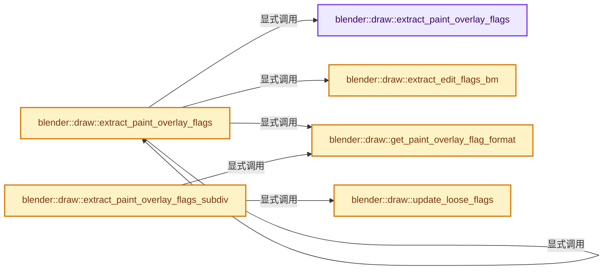
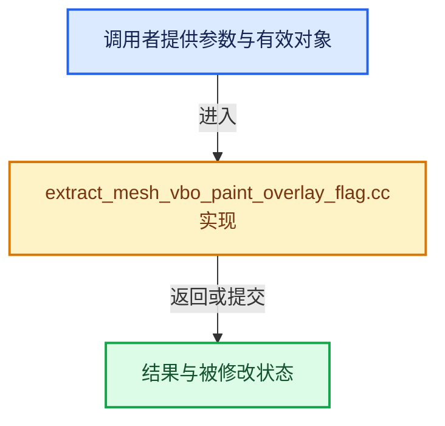

# 实现依赖专题：source/blender/draw/intern/mesh_extractors/extract_mesh_vbo_paint_overlay_flag.cc

[方向导航](README.md) · [符号索引](../%E7%AC%A6%E5%8F%B7%E4%BE%9D%E8%B5%96%E4%B8%8E%E5%AE%9E%E7%8E%B0%E7%B4%A2%E5%BC%95.md)

本专题从正文实际调用进入，集中保存共享实现。函数有稳定锚点，可从调用处直接跳到对应完整函数；递归与互相调用通过回链组织。

## 本文件的实现关系






## 完整成员与函数实现

<a id="f-b9daa80c1d6fa380"></a>

### `blender::draw::extract_paint_overlay_flags`

实现位置：[source/blender/draw/intern/mesh_extractors/extract_mesh_vbo_paint_overlay_flag.cc](../../../../../source/blender/draw/intern/mesh_extractors/extract_mesh_vbo_paint_overlay_flag.cc) · L15—L69。

接口参数：

- `const MeshRenderData &mr`
- `MutableSpan<int> flags`

**教学注释版**

<!-- annotated:36a14b5e80694c -->

```cpp
static void extract_paint_overlay_flags(const MeshRenderData &mr, MutableSpan<int> flags)
{
  const bool use_face_select = (mr.mesh->editflag & ME_EDIT_PAINT_FACE_SEL) != 0;
  Span<bool> selection;
  if (mr.mesh->editflag & ME_EDIT_PAINT_FACE_SEL) {
    selection = mr.select_poly;
  }
  else if (mr.mesh->editflag & ME_EDIT_PAINT_VERT_SEL) {
    selection = mr.select_vert;
  }
  // [讲解] selection.is_empty：查询视图长度或生成对应有效索引区间。
  if (selection.is_empty() && mr.hide_poly.is_empty() && (!mr.edit_bmesh || !mr.orig_index_vert)) {
    // [讲解] flags.fill：修改已有目标元素，不改变底层容器长度。
    flags.fill(0);
    return;
  }
  const OffsetIndices faces = mr.faces;
  threading::parallel_for(faces.index_range(), 1024, [&](const IndexRange range) {
    if (selection.is_empty()) {
      flags.fill(0);
    }
    else {
      if (use_face_select) {
        for (const int face : range) {
          // [讲解] flags.slice：建立原连续范围的子视图。
          flags.slice(faces[face]).fill(selection[face] ? 1 : 0);
        }
      }
      else {
        const Span<int> corner_verts = mr.corner_verts;
        for (const int face : range) {
          for (const int corner : faces[face]) {
            flags[corner] = selection[corner_verts[corner]] ? 1 : 0;
          }
        }
      }
    }
    if (!mr.hide_poly.is_empty()) {
      const Span<bool> hide_poly = mr.hide_poly;
      for (const int face : range) {
        if (hide_poly[face]) {
          flags.slice(faces[face]).fill(-1);
        }
      }
    }
    if (mr.edit_bmesh && mr.orig_index_vert) {
      const Span<int> corner_verts = mr.corner_verts;
      const Span<int> orig_indices(mr.orig_index_vert, mr.verts_num);
      for (const int face : range) {
        for (const int corner : faces[face]) {
          if (orig_indices[corner_verts[corner]] == ORIGINDEX_NONE) {
            flags[corner] = -1;
          }
        }
      }
    }
  });
}
```

<details>
<summary>核对原始源码：source/blender/draw/intern/mesh_extractors/extract_mesh_vbo_paint_overlay_flag.cc · L15—L69</summary>

<!-- original:36a14b5e80694c:source/blender/draw/intern/mesh_extractors/extract_mesh_vbo_paint_overlay_flag.cc:15:69 -->

```cpp
static void extract_paint_overlay_flags(const MeshRenderData &mr, MutableSpan<int> flags)
{
  const bool use_face_select = (mr.mesh->editflag & ME_EDIT_PAINT_FACE_SEL) != 0;
  Span<bool> selection;
  if (mr.mesh->editflag & ME_EDIT_PAINT_FACE_SEL) {
    selection = mr.select_poly;
  }
  else if (mr.mesh->editflag & ME_EDIT_PAINT_VERT_SEL) {
    selection = mr.select_vert;
  }
  if (selection.is_empty() && mr.hide_poly.is_empty() && (!mr.edit_bmesh || !mr.orig_index_vert)) {
    flags.fill(0);
    return;
  }
  const OffsetIndices faces = mr.faces;
  threading::parallel_for(faces.index_range(), 1024, [&](const IndexRange range) {
    if (selection.is_empty()) {
      flags.fill(0);
    }
    else {
      if (use_face_select) {
        for (const int face : range) {
          flags.slice(faces[face]).fill(selection[face] ? 1 : 0);
        }
      }
      else {
        const Span<int> corner_verts = mr.corner_verts;
        for (const int face : range) {
          for (const int corner : faces[face]) {
            flags[corner] = selection[corner_verts[corner]] ? 1 : 0;
          }
        }
      }
    }
    if (!mr.hide_poly.is_empty()) {
      const Span<bool> hide_poly = mr.hide_poly;
      for (const int face : range) {
        if (hide_poly[face]) {
          flags.slice(faces[face]).fill(-1);
        }
      }
    }
    if (mr.edit_bmesh && mr.orig_index_vert) {
      const Span<int> corner_verts = mr.corner_verts;
      const Span<int> orig_indices(mr.orig_index_vert, mr.verts_num);
      for (const int face : range) {
        for (const int corner : faces[face]) {
          if (orig_indices[corner_verts[corner]] == ORIGINDEX_NONE) {
            flags[corner] = -1;
          }
        }
      }
    }
  });
}
```

</details>

**沿实际写入检查状态**

- `selection = mr.select_poly;`
- `selection = mr.select_vert;`
- `flags[corner] = selection[corner_verts[corner]] ? 1 : 0;`
- `flags[corner] = -1;`

**继续追踪实现**

- `selection.is_empty` → [blender::Span::is_empty · L264](../01-%E5%9F%BA%E7%A1%80%E5%AE%B9%E5%99%A8%E4%B8%8E%E7%8E%B0%E4%BB%A3CPP/05-Span%E5%8F%AA%E8%AF%BB%E8%BF%9E%E7%BB%AD%E8%A7%86%E5%9B%BE.md#f-8cc1d7ba8feb50e6)。
- `mr.hide_poly.is_empty` → [调用协议](../%E6%A8%A1%E6%9D%BF%E5%AE%8F%E4%B8%8E%E5%8A%A8%E6%80%81%E5%88%86%E6%B4%BE%E5%8D%8F%E8%AE%AE.md)：接收对象类型依赖auto、返回值或模板实例；不按同名猜测目标。调用位置L25。
- `flags.fill` → [blender::MutableSpan::fill · L523](../01-%E5%9F%BA%E7%A1%80%E5%AE%B9%E5%99%A8%E4%B8%8E%E7%8E%B0%E4%BB%A3CPP/06-MutableSpan%E5%8F%AF%E5%86%99%E8%A7%86%E5%9B%BE.md#f-8daedd52c727ec26)。
- `threading::parallel_for` → [blender::threading::parallel_for · L68](../11-Depsgraph%E4%B8%8E%E5%B9%B6%E8%A1%8C%E4%BB%BB%E5%8A%A1%E7%B3%BB%E7%BB%9F/07-%E4%BB%BB%E5%8A%A1%E6%B1%A0%E4%B8%8ETBB%E6%8E%A5%E5%85%A5.md#f-838294754c24426c)。
- `faces.index_range` → [blender::offset_indices::OffsetIndices::index_range · L77](02-OffsetIndices%E5%AE%8C%E6%95%B4%E6%8E%A5%E5%8F%A3.md#f-19b5ca1456de007d)。
- `flags.slice(faces[face]).fill` → [调用协议](../%E6%A8%A1%E6%9D%BF%E5%AE%8F%E4%B8%8E%E5%8A%A8%E6%80%81%E5%88%86%E6%B4%BE%E5%8D%8F%E8%AE%AE.md)：接收对象类型依赖auto、返回值或模板实例；不按同名猜测目标。调用位置L37。
- `flags.slice` → [blender::MutableSpan::slice · L579](../01-%E5%9F%BA%E7%A1%80%E5%AE%B9%E5%99%A8%E4%B8%8E%E7%8E%B0%E4%BB%A3CPP/06-MutableSpan%E5%8F%AF%E5%86%99%E8%A7%86%E5%9B%BE.md#f-6808b4aefbf58808)；[blender::MutableSpan::slice · L587](../01-%E5%9F%BA%E7%A1%80%E5%AE%B9%E5%99%A8%E4%B8%8E%E7%8E%B0%E4%BB%A3CPP/06-MutableSpan%E5%8F%AF%E5%86%99%E8%A7%86%E5%9B%BE.md#f-c05b010821861e4f)。同名重载需按实参类型选择。

<a id="f-994d2aeff42e2f01"></a>

### `blender::draw::extract_edit_flags_bm`

实现位置：[source/blender/draw/intern/mesh_extractors/extract_mesh_vbo_paint_overlay_flag.cc](../../../../../source/blender/draw/intern/mesh_extractors/extract_mesh_vbo_paint_overlay_flag.cc) · L71—L84。

接口参数：

- `const MeshRenderData &mr`
- `MutableSpan<int> flags`

**教学注释版**

<!-- annotated:0e48b96194b928 -->

```cpp
static void extract_edit_flags_bm(const MeshRenderData &mr, MutableSpan<int> flags)
{
  /* TODO: Return early if there are no hidden faces. */
  const BMesh &bm = *mr.bm;
  threading::parallel_for(IndexRange(bm.totface), 2048, [&](const IndexRange range) {
    for (const int face_index : range) {
      const BMFace &face = *BM_face_at_index(&const_cast<BMesh &>(bm), face_index);
      if (BM_elem_flag_test(&face, BM_ELEM_HIDDEN)) {
        const IndexRange face_range(BM_elem_index_get(BM_FACE_FIRST_LOOP(&face)), face.len);
        // [讲解] flags.slice：建立原连续范围的子视图。
        flags.slice(face_range).fill(-1);
      }
    }
  });
}
```

<details>
<summary>核对原始源码：source/blender/draw/intern/mesh_extractors/extract_mesh_vbo_paint_overlay_flag.cc · L71—L84</summary>

<!-- original:0e48b96194b928:source/blender/draw/intern/mesh_extractors/extract_mesh_vbo_paint_overlay_flag.cc:71:84 -->

```cpp
static void extract_edit_flags_bm(const MeshRenderData &mr, MutableSpan<int> flags)
{
  /* TODO: Return early if there are no hidden faces. */
  const BMesh &bm = *mr.bm;
  threading::parallel_for(IndexRange(bm.totface), 2048, [&](const IndexRange range) {
    for (const int face_index : range) {
      const BMFace &face = *BM_face_at_index(&const_cast<BMesh &>(bm), face_index);
      if (BM_elem_flag_test(&face, BM_ELEM_HIDDEN)) {
        const IndexRange face_range(BM_elem_index_get(BM_FACE_FIRST_LOOP(&face)), face.len);
        flags.slice(face_range).fill(-1);
      }
    }
  });
}
```

</details>

**继续追踪实现**

- `threading::parallel_for` → [blender::threading::parallel_for · L68](../11-Depsgraph%E4%B8%8E%E5%B9%B6%E8%A1%8C%E4%BB%BB%E5%8A%A1%E7%B3%BB%E7%BB%9F/07-%E4%BB%BB%E5%8A%A1%E6%B1%A0%E4%B8%8ETBB%E6%8E%A5%E5%85%A5.md#f-838294754c24426c)。
- `IndexRange` → [blender::IndexRange](../01-%E5%9F%BA%E7%A1%80%E5%AE%B9%E5%99%A8%E4%B8%8E%E7%8E%B0%E4%BB%A3CPP/%E4%BE%9D%E8%B5%96-BLI_index_range-7d7cc5.md#t-caa3466d6776)；[blender::gpu::shader::parser::IndexRange](%E4%BE%9D%E8%B5%96-utils-06433d.md#t-82d2bd4ea71c)；[blender::IndexRange](%E4%BE%9D%E8%B5%96-DNA_node_types-6708b9.md#t-0448cc889d39)。
- `BM_face_at_index` → [blender::BM_face_at_index · L122](%E4%BE%9D%E8%B5%96-bmesh_mesh-df20c7.md#f-366df62c166d5094)。
- `BM_elem_flag_test` → [BM_elem_flag_test · L21](%E4%BE%9D%E8%B5%96-bmesh_inline-74f1be.md#m-2431d1179b41)。宏定义由构建条件选择。
- `BM_elem_index_get` → [BM_elem_index_get · L120](%E4%BE%9D%E8%B5%96-bmesh_inline-74f1be.md#m-201981cdc62d)。宏定义由构建条件选择。
- `BM_FACE_FIRST_LOOP` → [BM_FACE_FIRST_LOOP · L697](%E4%BE%9D%E8%B5%96-bmesh_class-4cf146.md#m-c7e10ffb38e6)；[BM_FACE_FIRST_LOOP · L699](%E4%BE%9D%E8%B5%96-bmesh_class-4cf146.md#m-76a054cc4770)。宏定义由构建条件选择。
- `flags.slice(face_range).fill` → [调用协议](../%E6%A8%A1%E6%9D%BF%E5%AE%8F%E4%B8%8E%E5%8A%A8%E6%80%81%E5%88%86%E6%B4%BE%E5%8D%8F%E8%AE%AE.md)：接收对象类型依赖auto、返回值或模板实例；不按同名猜测目标。调用位置L80。
- `flags.slice` → [blender::MutableSpan::slice · L579](../01-%E5%9F%BA%E7%A1%80%E5%AE%B9%E5%99%A8%E4%B8%8E%E7%8E%B0%E4%BB%A3CPP/06-MutableSpan%E5%8F%AF%E5%86%99%E8%A7%86%E5%9B%BE.md#f-6808b4aefbf58808)；[blender::MutableSpan::slice · L587](../01-%E5%9F%BA%E7%A1%80%E5%AE%B9%E5%99%A8%E4%B8%8E%E7%8E%B0%E4%BB%A3CPP/06-MutableSpan%E5%8F%AF%E5%86%99%E8%A7%86%E5%9B%BE.md#f-c05b010821861e4f)。同名重载需按实参类型选择。

<a id="f-b77f53063d4fd7ea"></a>

### `blender::draw::get_paint_overlay_flag_format`

实现位置：[source/blender/draw/intern/mesh_extractors/extract_mesh_vbo_paint_overlay_flag.cc](../../../../../source/blender/draw/intern/mesh_extractors/extract_mesh_vbo_paint_overlay_flag.cc) · L86—L91。

**教学注释版**

<!-- annotated:c465926de80a3e -->

```cpp
static const GPUVertFormat &get_paint_overlay_flag_format()
{
  static const GPUVertFormat format = GPU_vertformat_from_attribute("paint_overlay_flag",
                                                                    gpu::VertAttrType::SINT_32);
  return format;
}
```

<details>
<summary>核对原始源码：source/blender/draw/intern/mesh_extractors/extract_mesh_vbo_paint_overlay_flag.cc · L86—L91</summary>

<!-- original:c465926de80a3e:source/blender/draw/intern/mesh_extractors/extract_mesh_vbo_paint_overlay_flag.cc:86:91 -->

```cpp
static const GPUVertFormat &get_paint_overlay_flag_format()
{
  static const GPUVertFormat format = GPU_vertformat_from_attribute("paint_overlay_flag",
                                                                    gpu::VertAttrType::SINT_32);
  return format;
}
```

</details>

**结果出口**

- `return format;`

**继续追踪实现**

- `GPU_vertformat_from_attribute` → [blender::GPU_vertformat_from_attribute · L427](%E4%BE%9D%E8%B5%96-gpu_vertex_format-4f7148.md#f-2643d25087989f8e)。

<a id="f-c09d8fb6e1badfc6"></a>

### `blender::draw::extract_paint_overlay_flags`

实现位置：[source/blender/draw/intern/mesh_extractors/extract_mesh_vbo_paint_overlay_flag.cc](../../../../../source/blender/draw/intern/mesh_extractors/extract_mesh_vbo_paint_overlay_flag.cc) · L93—L112。

接口参数：

- `const MeshRenderData &mr`

**教学注释版**

<!-- annotated:725fd4f49eceed -->

```cpp
gpu::VertBufPtr extract_paint_overlay_flags(const MeshRenderData &mr)
{
  const int size = mr.corners_num + mr.loose_indices_num;
  gpu::VertBufPtr vbo = gpu::VertBufPtr(
      GPU_vertbuf_create_with_format(get_paint_overlay_flag_format()));
  GPU_vertbuf_data_alloc(*vbo, size);
  MutableSpan vbo_data = vbo->data<int>();
  // [讲解] vbo_data.take_front：从两端裁去或选取一定数量元素形成新视图。
  MutableSpan corners_data = vbo_data.take_front(mr.corners_num);
  // [讲解] vbo_data.take_back：从两端裁去或选取一定数量元素形成新视图。
  MutableSpan loose_data = vbo_data.take_back(mr.loose_indices_num);

  if (mr.extract_type == MeshExtractType::Mesh) {
    extract_paint_overlay_flags(mr, corners_data);
  }
  else {
    extract_edit_flags_bm(mr, corners_data);
  }

  // [讲解] loose_data.fill：修改已有目标元素，不改变底层容器长度。
  loose_data.fill(0);
  return vbo;
}
```

<details>
<summary>核对原始源码：source/blender/draw/intern/mesh_extractors/extract_mesh_vbo_paint_overlay_flag.cc · L93—L112</summary>

<!-- original:725fd4f49eceed:source/blender/draw/intern/mesh_extractors/extract_mesh_vbo_paint_overlay_flag.cc:93:112 -->

```cpp
gpu::VertBufPtr extract_paint_overlay_flags(const MeshRenderData &mr)
{
  const int size = mr.corners_num + mr.loose_indices_num;
  gpu::VertBufPtr vbo = gpu::VertBufPtr(
      GPU_vertbuf_create_with_format(get_paint_overlay_flag_format()));
  GPU_vertbuf_data_alloc(*vbo, size);
  MutableSpan vbo_data = vbo->data<int>();
  MutableSpan corners_data = vbo_data.take_front(mr.corners_num);
  MutableSpan loose_data = vbo_data.take_back(mr.loose_indices_num);

  if (mr.extract_type == MeshExtractType::Mesh) {
    extract_paint_overlay_flags(mr, corners_data);
  }
  else {
    extract_edit_flags_bm(mr, corners_data);
  }

  loose_data.fill(0);
  return vbo;
}
```

</details>

**结果出口**

- `return vbo;`

**继续追踪实现**

- `gpu::VertBufPtr` → [调用协议](../%E6%A8%A1%E6%9D%BF%E5%AE%8F%E4%B8%8E%E5%8A%A8%E6%80%81%E5%88%86%E6%B4%BE%E5%8D%8F%E8%AE%AE.md)：函数指针、局部可调用对象或未展开的宏；必须结合调用者环境。调用位置L96。
- `GPU_vertbuf_create_with_format` → [blender::GPU_vertbuf_create_with_format · L71](%E4%BE%9D%E8%B5%96-GPU_vertex_buffer-d7610b.md#f-bd43fe034e852138)。
- `get_paint_overlay_flag_format` → [blender::draw::get_paint_overlay_flag_format · L86](%E4%BE%9D%E8%B5%96-extract_mesh_vbo_paint_overlay_flag-8972d1.md#f-b77f53063d4fd7ea)。
- `GPU_vertbuf_data_alloc` → [blender::GPU_vertbuf_data_alloc · L172](%E4%BE%9D%E8%B5%96-gpu_vertex_buffer-eaa662.md#f-8ee5cf106e0f2b0f)。
- `vbo->data<int>` → [blender::draw::data · L124](%E4%BE%9D%E8%B5%96-DRW_gpu_wrapper-c80c4f.md#f-dc115dc22e0c9f33)；[blender::draw::data · L129](%E4%BE%9D%E8%B5%96-DRW_gpu_wrapper-c80c4f.md#f-5f325cb75387045c)。同名重载需按实参类型选择。
- `vbo_data.take_front` → [blender::MutableSpan::take_front · L635](../01-%E5%9F%BA%E7%A1%80%E5%AE%B9%E5%99%A8%E4%B8%8E%E7%8E%B0%E4%BB%A3CPP/06-MutableSpan%E5%8F%AF%E5%86%99%E8%A7%86%E5%9B%BE.md#f-0a0235d84ddc265d)。
- `vbo_data.take_back` → [blender::MutableSpan::take_back · L646](../01-%E5%9F%BA%E7%A1%80%E5%AE%B9%E5%99%A8%E4%B8%8E%E7%8E%B0%E4%BB%A3CPP/06-MutableSpan%E5%8F%AF%E5%86%99%E8%A7%86%E5%9B%BE.md#f-3fce5fbbe328c130)。
- `extract_paint_overlay_flags` → [blender::draw::extract_paint_overlay_flags · L15](%E4%BE%9D%E8%B5%96-extract_mesh_vbo_paint_overlay_flag-8972d1.md#f-b9daa80c1d6fa380)；[blender::draw::extract_paint_overlay_flags · L93](%E4%BE%9D%E8%B5%96-extract_mesh_vbo_paint_overlay_flag-8972d1.md#f-c09d8fb6e1badfc6)。同名重载需按实参类型选择。
- `extract_edit_flags_bm` → [blender::draw::extract_edit_flags_bm · L71](%E4%BE%9D%E8%B5%96-extract_mesh_vbo_paint_overlay_flag-8972d1.md#f-994d2aeff42e2f01)。
- `loose_data.fill` → [blender::MutableSpan::fill · L523](../01-%E5%9F%BA%E7%A1%80%E5%AE%B9%E5%99%A8%E4%B8%8E%E7%8E%B0%E4%BB%A3CPP/06-MutableSpan%E5%8F%AF%E5%86%99%E8%A7%86%E5%9B%BE.md#f-8daedd52c727ec26)。

<a id="f-fa562c61fdd9a1bc"></a>

### `blender::draw::update_loose_flags`

实现位置：[source/blender/draw/intern/mesh_extractors/extract_mesh_vbo_paint_overlay_flag.cc](../../../../../source/blender/draw/intern/mesh_extractors/extract_mesh_vbo_paint_overlay_flag.cc) · L114—L132。

接口参数：

- `const MeshRenderData &mr`
- `const DRWSubdivCache &subdiv_cache`
- `gpu::VertBuf &flags`

**教学注释版**

<!-- annotated:c12222511e58bd -->

```cpp
static void update_loose_flags(const MeshRenderData &mr,
                               const DRWSubdivCache &subdiv_cache,
                               gpu::VertBuf &flags)
{
  const int vbo_size = subdiv_full_vbo_size(mr, subdiv_cache);
  const int loose_geom_start = subdiv_cache.num_subdiv_loops;

  /* Push VBO content to the GPU and bind the VBO so that #GPU_vertbuf_update_sub can work. */
  GPU_vertbuf_use(&flags);

  /* Default to zeroed attribute. The overlay shader should expect this and render engines should
   * never draw loose geometry. */
  const int default_value = 0;
  for (const int i : IndexRange::from_begin_end(loose_geom_start, vbo_size)) {
    /* TODO(fclem): This has HORRENDOUS performance. Prefer clearing the buffer on device with
     * something like glClearBufferSubData. */
    GPU_vertbuf_update_sub(&flags, i * sizeof(int), sizeof(int), &default_value);
  }
}
```

<details>
<summary>核对原始源码：source/blender/draw/intern/mesh_extractors/extract_mesh_vbo_paint_overlay_flag.cc · L114—L132</summary>

<!-- original:c12222511e58bd:source/blender/draw/intern/mesh_extractors/extract_mesh_vbo_paint_overlay_flag.cc:114:132 -->

```cpp
static void update_loose_flags(const MeshRenderData &mr,
                               const DRWSubdivCache &subdiv_cache,
                               gpu::VertBuf &flags)
{
  const int vbo_size = subdiv_full_vbo_size(mr, subdiv_cache);
  const int loose_geom_start = subdiv_cache.num_subdiv_loops;

  /* Push VBO content to the GPU and bind the VBO so that #GPU_vertbuf_update_sub can work. */
  GPU_vertbuf_use(&flags);

  /* Default to zeroed attribute. The overlay shader should expect this and render engines should
   * never draw loose geometry. */
  const int default_value = 0;
  for (const int i : IndexRange::from_begin_end(loose_geom_start, vbo_size)) {
    /* TODO(fclem): This has HORRENDOUS performance. Prefer clearing the buffer on device with
     * something like glClearBufferSubData. */
    GPU_vertbuf_update_sub(&flags, i * sizeof(int), sizeof(int), &default_value);
  }
}
```

</details>

**继续追踪实现**

- `subdiv_full_vbo_size` → [blender::draw::subdiv_full_vbo_size · L278](%E4%BE%9D%E8%B5%96-draw_subdivision-515402.md#f-9ffb9094e78cfdac)。
- `GPU_vertbuf_use` → [blender::GPU_vertbuf_use · L295](%E4%BE%9D%E8%B5%96-gpu_vertex_buffer-eaa662.md#f-f2ce61da8df3615a)。
- `IndexRange::from_begin_end` → [blender::IndexRange::from_begin_end · L78](../01-%E5%9F%BA%E7%A1%80%E5%AE%B9%E5%99%A8%E4%B8%8E%E7%8E%B0%E4%BB%A3CPP/04-IndexRange%E8%BF%9E%E7%BB%AD%E6%95%B4%E6%95%B0%E5%8C%BA%E9%97%B4.md#f-a523839fb9650253)。
- `GPU_vertbuf_update_sub` → [blender::GPU_vertbuf_update_sub · L315](%E4%BE%9D%E8%B5%96-gpu_vertex_buffer-eaa662.md#f-dbb703497ad88d1b)。

<a id="f-ec4bcd3315c5e572"></a>

### `blender::draw::extract_paint_overlay_flags_subdiv`

实现位置：[source/blender/draw/intern/mesh_extractors/extract_mesh_vbo_paint_overlay_flag.cc](../../../../../source/blender/draw/intern/mesh_extractors/extract_mesh_vbo_paint_overlay_flag.cc) · L134—L144。

接口参数：

- `const MeshRenderData &mr`
- `const DRWSubdivCache &subdiv_cache`

**教学注释版**

<!-- annotated:e3fee0d8557ad2 -->

```cpp
gpu::VertBufPtr extract_paint_overlay_flags_subdiv(const MeshRenderData &mr,
                                                   const DRWSubdivCache &subdiv_cache)
{
  gpu::VertBufPtr flags = gpu::VertBufPtr(GPU_vertbuf_create_on_device(
      get_paint_overlay_flag_format(), subdiv_full_vbo_size(mr, subdiv_cache)));

  draw_subdiv_build_paint_overlay_flag_buffer(subdiv_cache, *flags);

  update_loose_flags(mr, subdiv_cache, *flags);
  return flags;
}
```

<details>
<summary>核对原始源码：source/blender/draw/intern/mesh_extractors/extract_mesh_vbo_paint_overlay_flag.cc · L134—L144</summary>

<!-- original:e3fee0d8557ad2:source/blender/draw/intern/mesh_extractors/extract_mesh_vbo_paint_overlay_flag.cc:134:144 -->

```cpp
gpu::VertBufPtr extract_paint_overlay_flags_subdiv(const MeshRenderData &mr,
                                                   const DRWSubdivCache &subdiv_cache)
{
  gpu::VertBufPtr flags = gpu::VertBufPtr(GPU_vertbuf_create_on_device(
      get_paint_overlay_flag_format(), subdiv_full_vbo_size(mr, subdiv_cache)));

  draw_subdiv_build_paint_overlay_flag_buffer(subdiv_cache, *flags);

  update_loose_flags(mr, subdiv_cache, *flags);
  return flags;
}
```

</details>

**结果出口**

- `return flags;`

**继续追踪实现**

- `gpu::VertBufPtr` → [调用协议](../%E6%A8%A1%E6%9D%BF%E5%AE%8F%E4%B8%8E%E5%8A%A8%E6%80%81%E5%88%86%E6%B4%BE%E5%8D%8F%E8%AE%AE.md)：函数指针、局部可调用对象或未展开的宏；必须结合调用者环境。调用位置L137。
- `GPU_vertbuf_create_on_device` → [blender::GPU_vertbuf_create_on_device · L137](%E4%BE%9D%E8%B5%96-gpu_vertex_buffer-eaa662.md#f-abf244a18691f929)。
- `get_paint_overlay_flag_format` → [blender::draw::get_paint_overlay_flag_format · L86](%E4%BE%9D%E8%B5%96-extract_mesh_vbo_paint_overlay_flag-8972d1.md#f-b77f53063d4fd7ea)。
- `subdiv_full_vbo_size` → [blender::draw::subdiv_full_vbo_size · L278](%E4%BE%9D%E8%B5%96-draw_subdivision-515402.md#f-9ffb9094e78cfdac)。
- `draw_subdiv_build_paint_overlay_flag_buffer` → [blender::draw::draw_subdiv_build_paint_overlay_flag_buffer · L1409](%E4%BE%9D%E8%B5%96-draw_cache_impl_subdivision-33125a.md#f-d5571a6ae720f218)。
- `update_loose_flags` → [blender::draw::update_loose_flags · L114](%E4%BE%9D%E8%B5%96-extract_mesh_vbo_paint_overlay_flag-8972d1.md#f-fa562c61fdd9a1bc)。
