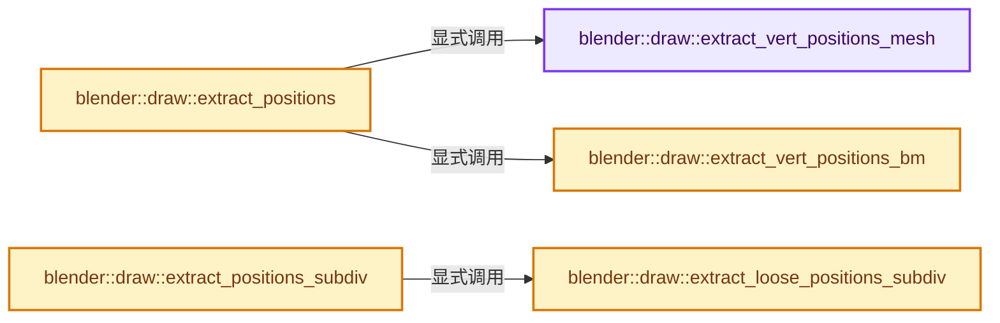
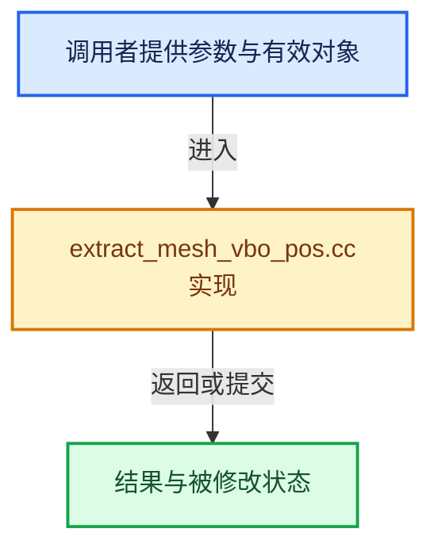

# 实现依赖专题：source/blender/draw/intern/mesh_extractors/extract_mesh_vbo_pos.cc

[方向导航](README.md) · [符号索引](../%E7%AC%A6%E5%8F%B7%E4%BE%9D%E8%B5%96%E4%B8%8E%E5%AE%9E%E7%8E%B0%E7%B4%A2%E5%BC%95.md)

本专题从正文实际调用进入，集中保存共享实现。函数有稳定锚点，可从调用处直接跳到对应完整函数；递归与互相调用通过回链组织。

## 本文件的实现关系






## 完整成员与函数实现

<a id="f-b7e10761e5d7a028"></a>

### `blender::draw::extract_vert_positions_mesh`

实现位置：[source/blender/draw/intern/mesh_extractors/extract_mesh_vbo_pos.cc](../../../../../source/blender/draw/intern/mesh_extractors/extract_mesh_vbo_pos.cc) · L18—L30。

接口参数：

- `const MeshRenderData &mr`
- `MutableSpan<float3> vert_data`
- `MutableSpan<float3> loose_data`

**教学注释版**

<!-- annotated:a172404b2af290 -->

```cpp
static void extract_vert_positions_mesh(const MeshRenderData &mr,
                                        MutableSpan<float3> vert_data,
                                        MutableSpan<float3> loose_data)
{
  // [讲解] loose_data.take_front：从两端裁去或选取一定数量元素形成新视图。
  MutableSpan loose_edge_data = loose_data.take_front(mr.loose_edges.size() * 2);
  // [讲解] loose_data.take_back：从两端裁去或选取一定数量元素形成新视图。
  MutableSpan loose_vert_data = loose_data.take_back(mr.loose_verts.size());
  threading::memory_bandwidth_bound_task(
      mr.vert_positions.size_in_bytes() * 2 + loose_data.size_in_bytes(), [&]() {
        array_utils::copy(mr.vert_positions, vert_data);
        extract_mesh_loose_edge_data(mr.vert_positions, mr.edges, mr.loose_edges, loose_edge_data);
        array_utils::gather(mr.vert_positions, mr.loose_verts, loose_vert_data);
      });
}
```

<details>
<summary>核对原始源码：source/blender/draw/intern/mesh_extractors/extract_mesh_vbo_pos.cc · L18—L30</summary>

<!-- original:a172404b2af290:source/blender/draw/intern/mesh_extractors/extract_mesh_vbo_pos.cc:18:30 -->

```cpp
static void extract_vert_positions_mesh(const MeshRenderData &mr,
                                        MutableSpan<float3> vert_data,
                                        MutableSpan<float3> loose_data)
{
  MutableSpan loose_edge_data = loose_data.take_front(mr.loose_edges.size() * 2);
  MutableSpan loose_vert_data = loose_data.take_back(mr.loose_verts.size());
  threading::memory_bandwidth_bound_task(
      mr.vert_positions.size_in_bytes() * 2 + loose_data.size_in_bytes(), [&]() {
        array_utils::copy(mr.vert_positions, vert_data);
        extract_mesh_loose_edge_data(mr.vert_positions, mr.edges, mr.loose_edges, loose_edge_data);
        array_utils::gather(mr.vert_positions, mr.loose_verts, loose_vert_data);
      });
}
```

</details>

**继续追踪实现**

- `loose_data.take_front` → [blender::MutableSpan::take_front · L635](../01-%E5%9F%BA%E7%A1%80%E5%AE%B9%E5%99%A8%E4%B8%8E%E7%8E%B0%E4%BB%A3CPP/06-MutableSpan%E5%8F%AF%E5%86%99%E8%A7%86%E5%9B%BE.md#f-0a0235d84ddc265d)。
- `mr.loose_edges.size` → [调用协议](../%E6%A8%A1%E6%9D%BF%E5%AE%8F%E4%B8%8E%E5%8A%A8%E6%80%81%E5%88%86%E6%B4%BE%E5%8D%8F%E8%AE%AE.md)：接收对象类型依赖auto、返回值或模板实例；不按同名猜测目标。调用位置L22。
- `loose_data.take_back` → [blender::MutableSpan::take_back · L646](../01-%E5%9F%BA%E7%A1%80%E5%AE%B9%E5%99%A8%E4%B8%8E%E7%8E%B0%E4%BB%A3CPP/06-MutableSpan%E5%8F%AF%E5%86%99%E8%A7%86%E5%9B%BE.md#f-3fce5fbbe328c130)。
- `mr.loose_verts.size` → [调用协议](../%E6%A8%A1%E6%9D%BF%E5%AE%8F%E4%B8%8E%E5%8A%A8%E6%80%81%E5%88%86%E6%B4%BE%E5%8D%8F%E8%AE%AE.md)：接收对象类型依赖auto、返回值或模板实例；不按同名猜测目标。调用位置L23。
- `threading::memory_bandwidth_bound_task` → [blender::threading::memory_bandwidth_bound_task · L250](../11-Depsgraph%E4%B8%8E%E5%B9%B6%E8%A1%8C%E4%BB%BB%E5%8A%A1%E7%B3%BB%E7%BB%9F/07-%E4%BB%BB%E5%8A%A1%E6%B1%A0%E4%B8%8ETBB%E6%8E%A5%E5%85%A5.md#f-aa412ccec656928d)。
- `mr.vert_positions.size_in_bytes` → [调用协议](../%E6%A8%A1%E6%9D%BF%E5%AE%8F%E4%B8%8E%E5%8A%A8%E6%80%81%E5%88%86%E6%B4%BE%E5%8D%8F%E8%AE%AE.md)：接收对象类型依赖auto、返回值或模板实例；不按同名猜测目标。调用位置L25。
- `loose_data.size_in_bytes` → [blender::MutableSpan::size_in_bytes · L507](../01-%E5%9F%BA%E7%A1%80%E5%AE%B9%E5%99%A8%E4%B8%8E%E7%8E%B0%E4%BB%A3CPP/06-MutableSpan%E5%8F%AF%E5%86%99%E8%A7%86%E5%9B%BE.md#f-2e42823b970a8406)。
- `array_utils::copy` → [blender::array_utils::copy · L54](../01-%E5%9F%BA%E7%A1%80%E5%AE%B9%E5%99%A8%E4%B8%8E%E7%8E%B0%E4%BB%A3CPP/20-%E5%AE%B9%E5%99%A8%E9%80%89%E6%8B%A9%E4%B8%8E%E7%8B%AC%E7%AB%8B%E5%AE%9E%E7%8E%B0.md#f-82e21acdac93f91c)；[blender::array_utils::copy · L72](../01-%E5%9F%BA%E7%A1%80%E5%AE%B9%E5%99%A8%E4%B8%8E%E7%8E%B0%E4%BB%A3CPP/20-%E5%AE%B9%E5%99%A8%E9%80%89%E6%8B%A9%E4%B8%8E%E7%8B%AC%E7%AB%8B%E5%AE%9E%E7%8E%B0.md#f-ee9c17de026a6c9a)；[blender::array_utils::copy · L98](../01-%E5%9F%BA%E7%A1%80%E5%AE%B9%E5%99%A8%E4%B8%8E%E7%8E%B0%E4%BB%A3CPP/20-%E5%AE%B9%E5%99%A8%E9%80%89%E6%8B%A9%E4%B8%8E%E7%8B%AC%E7%AB%8B%E5%AE%9E%E7%8E%B0.md#f-ec9fd099c7280717)；[blender::array_utils::copy · L27](../01-%E5%9F%BA%E7%A1%80%E5%AE%B9%E5%99%A8%E4%B8%8E%E7%8E%B0%E4%BB%A3CPP/%E4%BE%9D%E8%B5%96-array_utils-cbb70f.md#f-245f7c23437cf35f)；[blender::array_utils::copy · L43](../01-%E5%9F%BA%E7%A1%80%E5%AE%B9%E5%99%A8%E4%B8%8E%E7%8E%B0%E4%BB%A3CPP/%E4%BE%9D%E8%B5%96-array_utils-cbb70f.md#f-6170524934215b36)。同名重载需按实参类型选择。
- `extract_mesh_loose_edge_data` → [blender::draw::extract_mesh_loose_edge_data · L246](%E4%BE%9D%E8%B5%96-extract_mesh-4bd3fc.md#f-0d5eeb9cb9333f7e)。
- `array_utils::gather` → [blender::array_utils::gather · L187](../01-%E5%9F%BA%E7%A1%80%E5%AE%B9%E5%99%A8%E4%B8%8E%E7%8E%B0%E4%BB%A3CPP/20-%E5%AE%B9%E5%99%A8%E9%80%89%E6%8B%A9%E4%B8%8E%E7%8B%AC%E7%AB%8B%E5%AE%9E%E7%8E%B0.md#f-1760adec5858a42f)；[blender::array_utils::gather · L209](../01-%E5%9F%BA%E7%A1%80%E5%AE%B9%E5%99%A8%E4%B8%8E%E7%8E%B0%E4%BB%A3CPP/20-%E5%AE%B9%E5%99%A8%E9%80%89%E6%8B%A9%E4%B8%8E%E7%8B%AC%E7%AB%8B%E5%AE%9E%E7%8E%B0.md#f-a9f65820788454bf)；[blender::array_utils::gather · L225](../01-%E5%9F%BA%E7%A1%80%E5%AE%B9%E5%99%A8%E4%B8%8E%E7%8E%B0%E4%BB%A3CPP/20-%E5%AE%B9%E5%99%A8%E9%80%89%E6%8B%A9%E4%B8%8E%E7%8B%AC%E7%AB%8B%E5%AE%9E%E7%8E%B0.md#f-279764b4196f0b63)；[blender::array_utils::gather · L237](../01-%E5%9F%BA%E7%A1%80%E5%AE%B9%E5%99%A8%E4%B8%8E%E7%8E%B0%E4%BB%A3CPP/20-%E5%AE%B9%E5%99%A8%E9%80%89%E6%8B%A9%E4%B8%8E%E7%8B%AC%E7%AB%8B%E5%AE%9E%E7%8E%B0.md#f-e310fd489b49341b)；[blender::array_utils::gather · L268](../01-%E5%9F%BA%E7%A1%80%E5%AE%B9%E5%99%A8%E4%B8%8E%E7%8E%B0%E4%BB%A3CPP/20-%E5%AE%B9%E5%99%A8%E9%80%89%E6%8B%A9%E4%B8%8E%E7%8B%AC%E7%AB%8B%E5%AE%9E%E7%8E%B0.md#f-7b21c29791903615)；[blender::array_utils::gather · L63](../01-%E5%9F%BA%E7%A1%80%E5%AE%B9%E5%99%A8%E4%B8%8E%E7%8E%B0%E4%BB%A3CPP/%E4%BE%9D%E8%B5%96-array_utils-cbb70f.md#f-5c2b501b03ddbb1f)；[blender::array_utils::gather · L82](../01-%E5%9F%BA%E7%A1%80%E5%AE%B9%E5%99%A8%E4%B8%8E%E7%8E%B0%E4%BB%A3CPP/%E4%BE%9D%E8%B5%96-array_utils-cbb70f.md#f-ea4dd9e673fe81e4)。同名重载需按实参类型选择。

<a id="f-a30812edb35c02da"></a>

### `blender::draw::extract_vert_positions_bm`

实现位置：[source/blender/draw/intern/mesh_extractors/extract_mesh_vbo_pos.cc](../../../../../source/blender/draw/intern/mesh_extractors/extract_mesh_vbo_pos.cc) · L32—L60。

接口参数：

- `const MeshRenderData &mr`
- `MutableSpan<float3> vert_data`
- `MutableSpan<float3> loose_data`

**教学注释版**

<!-- annotated:78cb71dd6c800b -->

```cpp
static void extract_vert_positions_bm(const MeshRenderData &mr,
                                      MutableSpan<float3> vert_data,
                                      MutableSpan<float3> loose_data)
{
  const BMesh &bm = *mr.bm;
  // [讲解] loose_data.take_front：从两端裁去或选取一定数量元素形成新视图。
  MutableSpan loose_edge_data = loose_data.take_front(mr.loose_edges.size() * 2);
  // [讲解] loose_data.take_back：从两端裁去或选取一定数量元素形成新视图。
  MutableSpan loose_vert_data = loose_data.take_back(mr.loose_verts.size());

  threading::parallel_for(IndexRange(bm.totvert), 4096, [&](const IndexRange range) {
    for (const int i : range) {
      vert_data[i] = bm_vert_co_get(mr, BM_vert_at_index(&const_cast<BMesh &>(bm), i));
    }
  });

  mr.loose_edges.foreach_index(
      [&](const int i, const int pos) {
        const BMEdge &edge = *BM_edge_at_index(&const_cast<BMesh &>(bm), i);
        loose_edge_data[pos * 2 + 0] = bm_vert_co_get(mr, edge.v1);
        loose_edge_data[pos * 2 + 1] = bm_vert_co_get(mr, edge.v2);
      },
      exec_mode::grain_size(4096));

  mr.loose_verts.foreach_index(
      [&](const int i, const int pos) {
        const BMVert &vert = *BM_vert_at_index(&const_cast<BMesh &>(bm), i);
        loose_vert_data[pos] = bm_vert_co_get(mr, &vert);
      },
      exec_mode::grain_size(2048));
}
```

<details>
<summary>核对原始源码：source/blender/draw/intern/mesh_extractors/extract_mesh_vbo_pos.cc · L32—L60</summary>

<!-- original:78cb71dd6c800b:source/blender/draw/intern/mesh_extractors/extract_mesh_vbo_pos.cc:32:60 -->

```cpp
static void extract_vert_positions_bm(const MeshRenderData &mr,
                                      MutableSpan<float3> vert_data,
                                      MutableSpan<float3> loose_data)
{
  const BMesh &bm = *mr.bm;
  MutableSpan loose_edge_data = loose_data.take_front(mr.loose_edges.size() * 2);
  MutableSpan loose_vert_data = loose_data.take_back(mr.loose_verts.size());

  threading::parallel_for(IndexRange(bm.totvert), 4096, [&](const IndexRange range) {
    for (const int i : range) {
      vert_data[i] = bm_vert_co_get(mr, BM_vert_at_index(&const_cast<BMesh &>(bm), i));
    }
  });

  mr.loose_edges.foreach_index(
      [&](const int i, const int pos) {
        const BMEdge &edge = *BM_edge_at_index(&const_cast<BMesh &>(bm), i);
        loose_edge_data[pos * 2 + 0] = bm_vert_co_get(mr, edge.v1);
        loose_edge_data[pos * 2 + 1] = bm_vert_co_get(mr, edge.v2);
      },
      exec_mode::grain_size(4096));

  mr.loose_verts.foreach_index(
      [&](const int i, const int pos) {
        const BMVert &vert = *BM_vert_at_index(&const_cast<BMesh &>(bm), i);
        loose_vert_data[pos] = bm_vert_co_get(mr, &vert);
      },
      exec_mode::grain_size(2048));
}
```

</details>

**沿实际写入检查状态**

- `vert_data[i] = bm_vert_co_get(mr, BM_vert_at_index(&const_cast<BMesh &>(bm), i));`
- `loose_vert_data[pos] = bm_vert_co_get(mr, &vert);`

**继续追踪实现**

- `loose_data.take_front` → [blender::MutableSpan::take_front · L635](../01-%E5%9F%BA%E7%A1%80%E5%AE%B9%E5%99%A8%E4%B8%8E%E7%8E%B0%E4%BB%A3CPP/06-MutableSpan%E5%8F%AF%E5%86%99%E8%A7%86%E5%9B%BE.md#f-0a0235d84ddc265d)。
- `mr.loose_edges.size` → [调用协议](../%E6%A8%A1%E6%9D%BF%E5%AE%8F%E4%B8%8E%E5%8A%A8%E6%80%81%E5%88%86%E6%B4%BE%E5%8D%8F%E8%AE%AE.md)：接收对象类型依赖auto、返回值或模板实例；不按同名猜测目标。调用位置L37。
- `loose_data.take_back` → [blender::MutableSpan::take_back · L646](../01-%E5%9F%BA%E7%A1%80%E5%AE%B9%E5%99%A8%E4%B8%8E%E7%8E%B0%E4%BB%A3CPP/06-MutableSpan%E5%8F%AF%E5%86%99%E8%A7%86%E5%9B%BE.md#f-3fce5fbbe328c130)。
- `mr.loose_verts.size` → [调用协议](../%E6%A8%A1%E6%9D%BF%E5%AE%8F%E4%B8%8E%E5%8A%A8%E6%80%81%E5%88%86%E6%B4%BE%E5%8D%8F%E8%AE%AE.md)：接收对象类型依赖auto、返回值或模板实例；不按同名猜测目标。调用位置L38。
- `threading::parallel_for` → [blender::threading::parallel_for · L68](../11-Depsgraph%E4%B8%8E%E5%B9%B6%E8%A1%8C%E4%BB%BB%E5%8A%A1%E7%B3%BB%E7%BB%9F/07-%E4%BB%BB%E5%8A%A1%E6%B1%A0%E4%B8%8ETBB%E6%8E%A5%E5%85%A5.md#f-838294754c24426c)。
- `IndexRange` → [blender::IndexRange](../01-%E5%9F%BA%E7%A1%80%E5%AE%B9%E5%99%A8%E4%B8%8E%E7%8E%B0%E4%BB%A3CPP/%E4%BE%9D%E8%B5%96-BLI_index_range-7d7cc5.md#t-caa3466d6776)；[blender::gpu::shader::parser::IndexRange](%E4%BE%9D%E8%B5%96-utils-06433d.md#t-82d2bd4ea71c)；[blender::IndexRange](%E4%BE%9D%E8%B5%96-DNA_node_types-6708b9.md#t-0448cc889d39)。
- `bm_vert_co_get` → [blender::draw::bm_vert_co_get · L162](%E4%BE%9D%E8%B5%96-extract_mesh-4bd3fc.md#f-b669e5a0bcf94c9f)。
- `BM_vert_at_index` → [blender::BM_vert_at_index · L110](%E4%BE%9D%E8%B5%96-bmesh_mesh-df20c7.md#f-aced0ebcd417a2f4)。
- `mr.loose_edges.foreach_index` → [调用协议](../%E6%A8%A1%E6%9D%BF%E5%AE%8F%E4%B8%8E%E5%8A%A8%E6%80%81%E5%88%86%E6%B4%BE%E5%8D%8F%E8%AE%AE.md)：接收对象类型依赖auto、返回值或模板实例；不按同名猜测目标。调用位置L46。
- `BM_edge_at_index` → [blender::BM_edge_at_index · L116](%E4%BE%9D%E8%B5%96-bmesh_mesh-df20c7.md#f-81d027fd9e6b4c84)。
- `exec_mode::grain_size` → [blender::exec_mode::grain_size · L79](../01-%E5%9F%BA%E7%A1%80%E5%AE%B9%E5%99%A8%E4%B8%8E%E7%8E%B0%E4%BB%A3CPP/%E4%BE%9D%E8%B5%96-BLI_execution_mode-1528fb.md#f-0b4fc2f9fa6e66e7)。
- `mr.loose_verts.foreach_index` → [调用协议](../%E6%A8%A1%E6%9D%BF%E5%AE%8F%E4%B8%8E%E5%8A%A8%E6%80%81%E5%88%86%E6%B4%BE%E5%8D%8F%E8%AE%AE.md)：接收对象类型依赖auto、返回值或模板实例；不按同名猜测目标。调用位置L54。

<a id="f-b064590b631fe95e"></a>

### `blender::draw::extract_positions`

实现位置：[source/blender/draw/intern/mesh_extractors/extract_mesh_vbo_pos.cc](../../../../../source/blender/draw/intern/mesh_extractors/extract_mesh_vbo_pos.cc) · L62—L82。

接口参数：

- `const MeshRenderData &mr`
- `MeshBufferCache &cache`

**教学注释版**

<!-- annotated:f79a279289e792 -->

```cpp
gpu::VertBufPtr extract_positions(const MeshRenderData &mr, MeshBufferCache &cache)
{
  static const GPUVertFormat format = GPU_vertformat_from_attribute(
      "pos", gpu::VertAttrType::SFLOAT_32_32_32);

  gpu::VertBufPtr vert_vbo = gpu::VertBufPtr(GPU_vertbuf_create_with_format(format));
  GPU_vertbuf_data_alloc(*vert_vbo, mr.verts_num);
  Array<float3> loose_data(mr.loose_indices_num);
  if (mr.extract_type == MeshExtractType::Mesh) {
    extract_vert_positions_mesh(mr, vert_vbo->data<float3>(), loose_data);
  }
  else {
    extract_vert_positions_bm(mr, vert_vbo->data<float3>(), loose_data);
  }

  gpu::VertBufPtr vbo = gpu::VertBufPtr(
      GPU_vertbuf_create_on_device(format, mr.corners_num + mr.loose_indices_num));
  gather_vert_to_corner_gpu(mr, cache, *vert_vbo, *vbo);
  // [讲解] loose_data.as_span：提供数组的借用访问入口。
  loose_data_upload(mr, loose_data.as_span(), *vbo);
  return vbo;
}
```

<details>
<summary>核对原始源码：source/blender/draw/intern/mesh_extractors/extract_mesh_vbo_pos.cc · L62—L82</summary>

<!-- original:f79a279289e792:source/blender/draw/intern/mesh_extractors/extract_mesh_vbo_pos.cc:62:82 -->

```cpp
gpu::VertBufPtr extract_positions(const MeshRenderData &mr, MeshBufferCache &cache)
{
  static const GPUVertFormat format = GPU_vertformat_from_attribute(
      "pos", gpu::VertAttrType::SFLOAT_32_32_32);

  gpu::VertBufPtr vert_vbo = gpu::VertBufPtr(GPU_vertbuf_create_with_format(format));
  GPU_vertbuf_data_alloc(*vert_vbo, mr.verts_num);
  Array<float3> loose_data(mr.loose_indices_num);
  if (mr.extract_type == MeshExtractType::Mesh) {
    extract_vert_positions_mesh(mr, vert_vbo->data<float3>(), loose_data);
  }
  else {
    extract_vert_positions_bm(mr, vert_vbo->data<float3>(), loose_data);
  }

  gpu::VertBufPtr vbo = gpu::VertBufPtr(
      GPU_vertbuf_create_on_device(format, mr.corners_num + mr.loose_indices_num));
  gather_vert_to_corner_gpu(mr, cache, *vert_vbo, *vbo);
  loose_data_upload(mr, loose_data.as_span(), *vbo);
  return vbo;
}
```

</details>

**结果出口**

- `return vbo;`

**继续追踪实现**

- `GPU_vertformat_from_attribute` → [blender::GPU_vertformat_from_attribute · L427](%E4%BE%9D%E8%B5%96-gpu_vertex_format-4f7148.md#f-2643d25087989f8e)。
- `gpu::VertBufPtr` → [调用协议](../%E6%A8%A1%E6%9D%BF%E5%AE%8F%E4%B8%8E%E5%8A%A8%E6%80%81%E5%88%86%E6%B4%BE%E5%8D%8F%E8%AE%AE.md)：函数指针、局部可调用对象或未展开的宏；必须结合调用者环境。调用位置L67。
- `GPU_vertbuf_create_with_format` → [blender::GPU_vertbuf_create_with_format · L71](%E4%BE%9D%E8%B5%96-GPU_vertex_buffer-d7610b.md#f-bd43fe034e852138)。
- `GPU_vertbuf_data_alloc` → [blender::GPU_vertbuf_data_alloc · L172](%E4%BE%9D%E8%B5%96-gpu_vertex_buffer-eaa662.md#f-8ee5cf106e0f2b0f)。
- `extract_vert_positions_mesh` → [blender::draw::extract_vert_positions_mesh · L18](%E4%BE%9D%E8%B5%96-extract_mesh_vbo_pos-9f6624.md#f-b7e10761e5d7a028)。
- `vert_vbo->data<float3>` → [blender::draw::data · L124](%E4%BE%9D%E8%B5%96-DRW_gpu_wrapper-c80c4f.md#f-dc115dc22e0c9f33)；[blender::draw::data · L129](%E4%BE%9D%E8%B5%96-DRW_gpu_wrapper-c80c4f.md#f-5f325cb75387045c)。同名重载需按实参类型选择。
- `extract_vert_positions_bm` → [blender::draw::extract_vert_positions_bm · L32](%E4%BE%9D%E8%B5%96-extract_mesh_vbo_pos-9f6624.md#f-a30812edb35c02da)。
- `GPU_vertbuf_create_on_device` → [blender::GPU_vertbuf_create_on_device · L137](%E4%BE%9D%E8%B5%96-gpu_vertex_buffer-eaa662.md#f-abf244a18691f929)。
- `gather_vert_to_corner_gpu` → [blender::draw::gather_vert_to_corner_gpu · L129](%E4%BE%9D%E8%B5%96-extract_mesh_corner_gpu-46fb3f.md#f-6a7db1cdc2e15e6c)。
- `loose_data_upload` → [blender::draw::loose_data_upload · L289](%E4%BE%9D%E8%B5%96-extract_mesh-4bd3fc.md#f-1d43c35d50f54c24)。
- `loose_data.as_span` → [blender::Array::as_span · L254](../01-%E5%9F%BA%E7%A1%80%E5%AE%B9%E5%99%A8%E4%B8%8E%E7%8E%B0%E4%BB%A3CPP/08-Array%E5%A4%8D%E5%88%B6%E7%A7%BB%E5%8A%A8%E4%B8%8E%E9%94%80%E6%AF%81.md#f-05fc77056a242032)。

<a id="f-60b3aa194014a6b2"></a>

### `blender::draw::extract_loose_positions_subdiv`

实现位置：[source/blender/draw/intern/mesh_extractors/extract_mesh_vbo_pos.cc](../../../../../source/blender/draw/intern/mesh_extractors/extract_mesh_vbo_pos.cc) · L84—L122。

接口参数：

- `const DRWSubdivCache &subdiv_cache`
- `const MeshRenderData &mr`
- `gpu::VertBuf &vbo`

**教学注释版**

<!-- annotated:9995f8d3c545bb -->

```cpp
static void extract_loose_positions_subdiv(const DRWSubdivCache &subdiv_cache,
                                           const MeshRenderData &mr,
                                           gpu::VertBuf &vbo)
{
  const IndexMask &loose_verts = mr.loose_verts;
  const int loose_edges_num = mr.loose_edges.size();
  if (loose_verts.is_empty() && loose_edges_num == 0) {
    return;
  }

  /* Make sure buffer is active for sending loose data. */
  GPU_vertbuf_use(&vbo);

  const int resolution = subdiv_cache.resolution;
  const Span<float3> cached_positions = subdiv_cache.loose_edge_positions;
  const int verts_per_edge = subdiv_verts_per_coarse_edge(subdiv_cache);
  const int edges_per_edge = subdiv_edges_per_coarse_edge(subdiv_cache);

  const int loose_geom_start = subdiv_cache.num_subdiv_loops;

  float3 edge_data[2];
  for (const int i : IndexRange(loose_edges_num)) {
    const int edge_offset = loose_geom_start + i * verts_per_edge;
    // [讲解] cached_positions.slice：建立原连续范围的子视图。
    const Span<float3> positions = cached_positions.slice(i * resolution, resolution);
    for (const int edge : IndexRange(edges_per_edge)) {
      edge_data[0] = positions[edge + 0];
      edge_data[1] = positions[edge + 1];
      GPU_vertbuf_update_sub(
          &vbo, (edge_offset + edge * 2) * sizeof(float3), sizeof(float3) * 2, &edge_data);
    }
  }

  const int loose_verts_start = loose_geom_start + loose_edges_num * verts_per_edge;
  const Span<float3> positions = mr.vert_positions;
  loose_verts.foreach_index([&](const int i, const int pos) {
    GPU_vertbuf_update_sub(
        &vbo, (loose_verts_start + pos) * sizeof(float3), sizeof(float3), &positions[i]);
  });
}
```

<details>
<summary>核对原始源码：source/blender/draw/intern/mesh_extractors/extract_mesh_vbo_pos.cc · L84—L122</summary>

<!-- original:9995f8d3c545bb:source/blender/draw/intern/mesh_extractors/extract_mesh_vbo_pos.cc:84:122 -->

```cpp
static void extract_loose_positions_subdiv(const DRWSubdivCache &subdiv_cache,
                                           const MeshRenderData &mr,
                                           gpu::VertBuf &vbo)
{
  const IndexMask &loose_verts = mr.loose_verts;
  const int loose_edges_num = mr.loose_edges.size();
  if (loose_verts.is_empty() && loose_edges_num == 0) {
    return;
  }

  /* Make sure buffer is active for sending loose data. */
  GPU_vertbuf_use(&vbo);

  const int resolution = subdiv_cache.resolution;
  const Span<float3> cached_positions = subdiv_cache.loose_edge_positions;
  const int verts_per_edge = subdiv_verts_per_coarse_edge(subdiv_cache);
  const int edges_per_edge = subdiv_edges_per_coarse_edge(subdiv_cache);

  const int loose_geom_start = subdiv_cache.num_subdiv_loops;

  float3 edge_data[2];
  for (const int i : IndexRange(loose_edges_num)) {
    const int edge_offset = loose_geom_start + i * verts_per_edge;
    const Span<float3> positions = cached_positions.slice(i * resolution, resolution);
    for (const int edge : IndexRange(edges_per_edge)) {
      edge_data[0] = positions[edge + 0];
      edge_data[1] = positions[edge + 1];
      GPU_vertbuf_update_sub(
          &vbo, (edge_offset + edge * 2) * sizeof(float3), sizeof(float3) * 2, &edge_data);
    }
  }

  const int loose_verts_start = loose_geom_start + loose_edges_num * verts_per_edge;
  const Span<float3> positions = mr.vert_positions;
  loose_verts.foreach_index([&](const int i, const int pos) {
    GPU_vertbuf_update_sub(
        &vbo, (loose_verts_start + pos) * sizeof(float3), sizeof(float3), &positions[i]);
  });
}
```

</details>

**沿实际写入检查状态**

- `edge_data[0] = positions[edge + 0];`
- `edge_data[1] = positions[edge + 1];`

**继续追踪实现**

- `mr.loose_edges.size` → [调用协议](../%E6%A8%A1%E6%9D%BF%E5%AE%8F%E4%B8%8E%E5%8A%A8%E6%80%81%E5%88%86%E6%B4%BE%E5%8D%8F%E8%AE%AE.md)：接收对象类型依赖auto、返回值或模板实例；不按同名猜测目标。调用位置L89。
- `loose_verts.is_empty` → [blender::index_mask::IndexMask::is_empty · L748](../04-%E8%99%9A%E6%8B%9F%E6%95%B0%E7%BB%84%E4%B8%8E%E7%B4%A2%E5%BC%95%E9%80%89%E6%8B%A9/09-%E5%88%86%E6%AE%B5%E5%AD%98%E5%82%A8%E4%B8%8E%E9%81%8D%E5%8E%86.md#f-190ac996386064f4)。
- `GPU_vertbuf_use` → [blender::GPU_vertbuf_use · L295](%E4%BE%9D%E8%B5%96-gpu_vertex_buffer-eaa662.md#f-f2ce61da8df3615a)。
- `subdiv_verts_per_coarse_edge` → [blender::draw::subdiv_verts_per_coarse_edge · L266](%E4%BE%9D%E8%B5%96-draw_subdivision-515402.md#f-57bd5b1d183a1da8)。
- `subdiv_edges_per_coarse_edge` → [blender::draw::subdiv_edges_per_coarse_edge · L260](%E4%BE%9D%E8%B5%96-draw_subdivision-515402.md#f-29b57ae81803ddc2)。
- `IndexRange` → [blender::IndexRange](../01-%E5%9F%BA%E7%A1%80%E5%AE%B9%E5%99%A8%E4%B8%8E%E7%8E%B0%E4%BB%A3CPP/%E4%BE%9D%E8%B5%96-BLI_index_range-7d7cc5.md#t-caa3466d6776)；[blender::gpu::shader::parser::IndexRange](%E4%BE%9D%E8%B5%96-utils-06433d.md#t-82d2bd4ea71c)；[blender::IndexRange](%E4%BE%9D%E8%B5%96-DNA_node_types-6708b9.md#t-0448cc889d39)。
- `cached_positions.slice` → [blender::Span::slice · L141](../01-%E5%9F%BA%E7%A1%80%E5%AE%B9%E5%99%A8%E4%B8%8E%E7%8E%B0%E4%BB%A3CPP/05-Span%E5%8F%AA%E8%AF%BB%E8%BF%9E%E7%BB%AD%E8%A7%86%E5%9B%BE.md#f-380a0e8fdcbd53cc)；[blender::Span::slice · L149](../01-%E5%9F%BA%E7%A1%80%E5%AE%B9%E5%99%A8%E4%B8%8E%E7%8E%B0%E4%BB%A3CPP/05-Span%E5%8F%AA%E8%AF%BB%E8%BF%9E%E7%BB%AD%E8%A7%86%E5%9B%BE.md#f-9b9c15e78dd54eec)。同名重载需按实参类型选择。
- `GPU_vertbuf_update_sub` → [blender::GPU_vertbuf_update_sub · L315](%E4%BE%9D%E8%B5%96-gpu_vertex_buffer-eaa662.md#f-dbb703497ad88d1b)。
- `loose_verts.foreach_index` → [blender::index_mask::IndexMask::foreach_index · L855](../04-%E8%99%9A%E6%8B%9F%E6%95%B0%E7%BB%84%E4%B8%8E%E7%B4%A2%E5%BC%95%E9%80%89%E6%8B%A9/09-%E5%88%86%E6%AE%B5%E5%AD%98%E5%82%A8%E4%B8%8E%E9%81%8D%E5%8E%86.md#f-cd6cd317e2e2812c)。

<a id="f-11f77ea3724e2813"></a>

### `blender::draw::extract_positions_subdiv`

实现位置：[source/blender/draw/intern/mesh_extractors/extract_mesh_vbo_pos.cc](../../../../../source/blender/draw/intern/mesh_extractors/extract_mesh_vbo_pos.cc) · L124—L153。

接口参数：

- `const DRWSubdivCache &subdiv_cache`
- `const MeshRenderData &mr`
- `gpu::VertBufPtr *orco_vbo`

**教学注释版**

<!-- annotated:748b7536d55187 -->

```cpp
gpu::VertBufPtr extract_positions_subdiv(const DRWSubdivCache &subdiv_cache,
                                         const MeshRenderData &mr,
                                         gpu::VertBufPtr *orco_vbo)
{
  static const GPUVertFormat format = GPU_vertformat_from_attribute(
      "pos", gpu::VertAttrType::SFLOAT_32_32_32);
  gpu::VertBufPtr vbo = gpu::VertBufPtr(
      GPU_vertbuf_create_on_device(format, subdiv_full_vbo_size(mr, subdiv_cache)));

  if (subdiv_cache.num_subdiv_loops == 0) {
    extract_loose_positions_subdiv(subdiv_cache, mr, *vbo);
    return vbo;
  }

  if (orco_vbo) {
    /* FIXME(fclem): We use the last component as a way to differentiate from generic vertex
     * attributes. This is a substantial waste of video-ram and should be done another way.
     * Unfortunately, at the time of writing, I did not found any other "non disruptive"
     * alternative. */
    static const GPUVertFormat format = GPU_vertformat_from_attribute(
        "orco", gpu::VertAttrType::SFLOAT_32_32_32_32);
    *orco_vbo = gpu::VertBufPtr(
        GPU_vertbuf_create_on_device(format, subdiv_cache.num_subdiv_loops));
  }

  draw_subdiv_extract_pos(subdiv_cache, vbo.get(), orco_vbo ? orco_vbo->get() : nullptr);

  extract_loose_positions_subdiv(subdiv_cache, mr, *vbo);
  return vbo;
}
```

<details>
<summary>核对原始源码：source/blender/draw/intern/mesh_extractors/extract_mesh_vbo_pos.cc · L124—L153</summary>

<!-- original:748b7536d55187:source/blender/draw/intern/mesh_extractors/extract_mesh_vbo_pos.cc:124:153 -->

```cpp
gpu::VertBufPtr extract_positions_subdiv(const DRWSubdivCache &subdiv_cache,
                                         const MeshRenderData &mr,
                                         gpu::VertBufPtr *orco_vbo)
{
  static const GPUVertFormat format = GPU_vertformat_from_attribute(
      "pos", gpu::VertAttrType::SFLOAT_32_32_32);
  gpu::VertBufPtr vbo = gpu::VertBufPtr(
      GPU_vertbuf_create_on_device(format, subdiv_full_vbo_size(mr, subdiv_cache)));

  if (subdiv_cache.num_subdiv_loops == 0) {
    extract_loose_positions_subdiv(subdiv_cache, mr, *vbo);
    return vbo;
  }

  if (orco_vbo) {
    /* FIXME(fclem): We use the last component as a way to differentiate from generic vertex
     * attributes. This is a substantial waste of video-ram and should be done another way.
     * Unfortunately, at the time of writing, I did not found any other "non disruptive"
     * alternative. */
    static const GPUVertFormat format = GPU_vertformat_from_attribute(
        "orco", gpu::VertAttrType::SFLOAT_32_32_32_32);
    *orco_vbo = gpu::VertBufPtr(
        GPU_vertbuf_create_on_device(format, subdiv_cache.num_subdiv_loops));
  }

  draw_subdiv_extract_pos(subdiv_cache, vbo.get(), orco_vbo ? orco_vbo->get() : nullptr);

  extract_loose_positions_subdiv(subdiv_cache, mr, *vbo);
  return vbo;
}
```

</details>

**结果出口**

- `return vbo;`

**继续追踪实现**

- `GPU_vertformat_from_attribute` → [blender::GPU_vertformat_from_attribute · L427](%E4%BE%9D%E8%B5%96-gpu_vertex_format-4f7148.md#f-2643d25087989f8e)。
- `gpu::VertBufPtr` → [调用协议](../%E6%A8%A1%E6%9D%BF%E5%AE%8F%E4%B8%8E%E5%8A%A8%E6%80%81%E5%88%86%E6%B4%BE%E5%8D%8F%E8%AE%AE.md)：函数指针、局部可调用对象或未展开的宏；必须结合调用者环境。调用位置L130。
- `GPU_vertbuf_create_on_device` → [blender::GPU_vertbuf_create_on_device · L137](%E4%BE%9D%E8%B5%96-gpu_vertex_buffer-eaa662.md#f-abf244a18691f929)。
- `subdiv_full_vbo_size` → [blender::draw::subdiv_full_vbo_size · L278](%E4%BE%9D%E8%B5%96-draw_subdivision-515402.md#f-9ffb9094e78cfdac)。
- `extract_loose_positions_subdiv` → [blender::draw::extract_loose_positions_subdiv · L84](%E4%BE%9D%E8%B5%96-extract_mesh_vbo_pos-9f6624.md#f-60b3aa194014a6b2)。
- `draw_subdiv_extract_pos` → [blender::draw::draw_subdiv_extract_pos · L985](%E4%BE%9D%E8%B5%96-draw_cache_impl_subdivision-33125a.md#f-531a356fd72b2534)。
- `vbo.get` → [blender::draw::GSplatEvalCache::get · L545](%E4%BE%9D%E8%B5%96-draw_cache_impl_gsplat-0b4128.md#f-3fb704a0b74cb9e4)。
- `orco_vbo->get` → [blender::draw::GSplatEvalCache::get · L545](%E4%BE%9D%E8%B5%96-draw_cache_impl_gsplat-0b4128.md#f-3fb704a0b74cb9e4)。
