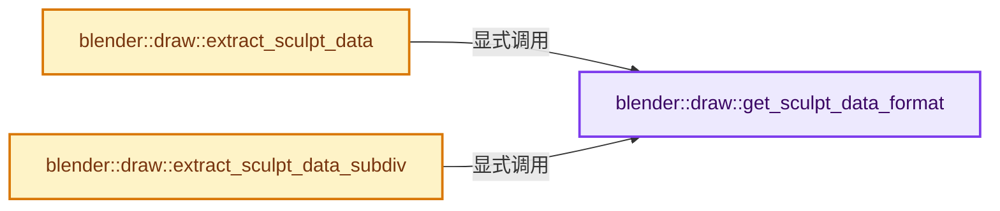
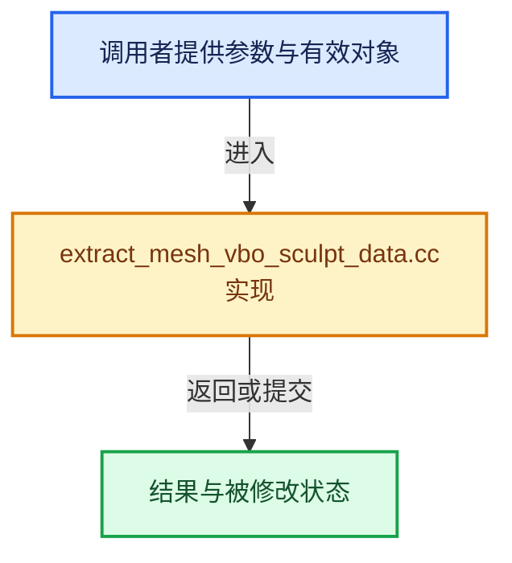

# 实现依赖专题：source/blender/draw/intern/mesh_extractors/extract_mesh_vbo_sculpt_data.cc

[方向导航](README.md) · [符号索引](../%E7%AC%A6%E5%8F%B7%E4%BE%9D%E8%B5%96%E4%B8%8E%E5%AE%9E%E7%8E%B0%E7%B4%A2%E5%BC%95.md)

本专题从正文实际调用进入，集中保存共享实现。函数有稳定锚点，可从调用处直接跳到对应完整函数；递归与互相调用通过回链组织。

## 本文件的实现关系






## 完整成员与函数实现

<a id="f-d3b26d9af7c379ba"></a>

### `blender::draw::get_sculpt_data_format`

实现位置：[source/blender/draw/intern/mesh_extractors/extract_mesh_vbo_sculpt_data.cc](../../../../../source/blender/draw/intern/mesh_extractors/extract_mesh_vbo_sculpt_data.cc) · L21—L30。

**教学注释版**

<!-- annotated:4be044f3e37e5a -->

```cpp
static const GPUVertFormat &get_sculpt_data_format()
{
  static const GPUVertFormat format = []() {
    GPUVertFormat format{};
    GPU_vertformat_attr_add(&format, "fset", gpu::VertAttrType::UNORM_8_8_8_8);
    GPU_vertformat_attr_add(&format, "msk", gpu::VertAttrType::SFLOAT_32);
    return format;
  }();
  return format;
}
```

<details>
<summary>核对原始源码：source/blender/draw/intern/mesh_extractors/extract_mesh_vbo_sculpt_data.cc · L21—L30</summary>

<!-- original:4be044f3e37e5a:source/blender/draw/intern/mesh_extractors/extract_mesh_vbo_sculpt_data.cc:21:30 -->

```cpp
static const GPUVertFormat &get_sculpt_data_format()
{
  static const GPUVertFormat format = []() {
    GPUVertFormat format{};
    GPU_vertformat_attr_add(&format, "fset", gpu::VertAttrType::UNORM_8_8_8_8);
    GPU_vertformat_attr_add(&format, "msk", gpu::VertAttrType::SFLOAT_32);
    return format;
  }();
  return format;
}
```

</details>

**结果出口**

- `return format;`

**继续追踪实现**

- `[]() { GPUVertFormat format{}; GPU_vertformat_attr_add(&format, "fset", gpu::VertAttrType::UNORM_8_8_8_8); GPU_vertformat_attr_add(&format, "msk", gpu::VertAttrType::SFLOAT_32); return format; }` → [调用协议](../%E6%A8%A1%E6%9D%BF%E5%AE%8F%E4%B8%8E%E5%8A%A8%E6%80%81%E5%88%86%E6%B4%BE%E5%8D%8F%E8%AE%AE.md)：函数指针、局部可调用对象或未展开的宏；必须结合调用者环境。调用位置L23。
- `GPU_vertformat_attr_add` → [blender::GPU_vertformat_attr_add · L389](%E4%BE%9D%E8%B5%96-gpu_vertex_format-4f7148.md#f-a36e23f37b97fff4)。

<a id="f-b0ed6732d6b6f6f8"></a>

### `blender::draw::extract_sculpt_data`

实现位置：[source/blender/draw/intern/mesh_extractors/extract_mesh_vbo_sculpt_data.cc](../../../../../source/blender/draw/intern/mesh_extractors/extract_mesh_vbo_sculpt_data.cc) · L32—L104。

接口参数：

- `const MeshRenderData &mr`

**教学注释版**

<!-- annotated:2e66fef2cebf2d -->

```cpp
gpu::VertBufPtr extract_sculpt_data(const MeshRenderData &mr)
{
  gpu::VertBufPtr vbo = gpu::VertBufPtr(GPU_vertbuf_create_with_format(get_sculpt_data_format()));
  GPU_vertbuf_data_alloc(*vbo, mr.corners_num);

  struct gpuSculptData {
    uchar4 face_set_color;
    float mask;
  };

  MutableSpan vbo_data = vbo->data<gpuSculptData>();

  const int default_face_set = mr.mesh->face_sets_color_default;
  const int face_set_seed = mr.mesh->face_sets_color_seed;
  if (mr.extract_type == MeshExtractType::BMesh) {
    const BMesh &bm = *mr.bm;
    const int mask_offset = CustomData_get_offset_named(
        &mr.bm->vdata, CD_PROP_FLOAT, ".sculpt_mask");
    const int face_set_offset = CustomData_get_offset_named(
        &mr.bm->pdata, CD_PROP_INT32, ".sculpt_face_set");
    threading::parallel_for(IndexRange(bm.totface), 2048, [&](const IndexRange range) {
      for (const int face_index : range) {
        const BMFace &face = *BM_face_at_index(&const_cast<BMesh &>(bm), face_index);
        const IndexRange face_range(BM_elem_index_get(BM_FACE_FIRST_LOOP(&face)), face.len);

        uchar4 face_set_color(UCHAR_MAX);
        if (face_set_offset != -1) {
          const int face_set_id = BM_ELEM_CD_GET_INT(&face, face_set_offset);
          if (face_set_id != default_face_set) {
            BKE_paint_face_set_overlay_color_get(face_set_id, face_set_seed, face_set_color);
          }
        }
        // [讲解] vbo_data.slice：建立原连续范围的子视图。
        vbo_data.slice(face_range).fill(gpuSculptData{face_set_color, 0.0f});

        if (mask_offset != -1) {
          const BMLoop *loop = BM_FACE_FIRST_LOOP(&face);
          for ([[maybe_unused]] const int i : IndexRange(face.len)) {
            const int index = BM_elem_index_get(loop);
            vbo_data[index].mask = BM_ELEM_CD_GET_FLOAT(loop->v, mask_offset);
            loop = loop->next;
          }
        }
      }
    });
  }
  else {
    const OffsetIndices faces = mr.faces;
    const Span<int> corner_verts = mr.corner_verts;
    const bke::AttributeAccessor attributes = mr.mesh->attributes();
    const VArraySpan mask = *attributes.lookup<float>(".sculpt_mask", bke::AttrDomain::Point);
    const VArraySpan face_set = *attributes.lookup<int>(".sculpt_face_set", bke::AttrDomain::Face);
    threading::parallel_for(faces.index_range(), 1024, [&](const IndexRange range) {
      for (const int face_index : range) {
        const IndexRange face = faces[face_index];
        uchar4 face_set_color(UCHAR_MAX);
        if (!face_set.is_empty()) {
          const int face_set_id = face_set[face_index];
          if (face_set_id != default_face_set) {
            BKE_paint_face_set_overlay_color_get(face_set_id, face_set_seed, face_set_color);
          }
        }
        vbo_data.slice(face).fill(gpuSculptData{face_set_color, 0.0f});

        if (!mask.is_empty()) {
          for (const int corner : face) {
            vbo_data[corner].mask = mask[corner_verts[corner]];
          }
        }
      }
    });
  }
  return vbo;
}
```

<details>
<summary>核对原始源码：source/blender/draw/intern/mesh_extractors/extract_mesh_vbo_sculpt_data.cc · L32—L104</summary>

<!-- original:2e66fef2cebf2d:source/blender/draw/intern/mesh_extractors/extract_mesh_vbo_sculpt_data.cc:32:104 -->

```cpp
gpu::VertBufPtr extract_sculpt_data(const MeshRenderData &mr)
{
  gpu::VertBufPtr vbo = gpu::VertBufPtr(GPU_vertbuf_create_with_format(get_sculpt_data_format()));
  GPU_vertbuf_data_alloc(*vbo, mr.corners_num);

  struct gpuSculptData {
    uchar4 face_set_color;
    float mask;
  };

  MutableSpan vbo_data = vbo->data<gpuSculptData>();

  const int default_face_set = mr.mesh->face_sets_color_default;
  const int face_set_seed = mr.mesh->face_sets_color_seed;
  if (mr.extract_type == MeshExtractType::BMesh) {
    const BMesh &bm = *mr.bm;
    const int mask_offset = CustomData_get_offset_named(
        &mr.bm->vdata, CD_PROP_FLOAT, ".sculpt_mask");
    const int face_set_offset = CustomData_get_offset_named(
        &mr.bm->pdata, CD_PROP_INT32, ".sculpt_face_set");
    threading::parallel_for(IndexRange(bm.totface), 2048, [&](const IndexRange range) {
      for (const int face_index : range) {
        const BMFace &face = *BM_face_at_index(&const_cast<BMesh &>(bm), face_index);
        const IndexRange face_range(BM_elem_index_get(BM_FACE_FIRST_LOOP(&face)), face.len);

        uchar4 face_set_color(UCHAR_MAX);
        if (face_set_offset != -1) {
          const int face_set_id = BM_ELEM_CD_GET_INT(&face, face_set_offset);
          if (face_set_id != default_face_set) {
            BKE_paint_face_set_overlay_color_get(face_set_id, face_set_seed, face_set_color);
          }
        }
        vbo_data.slice(face_range).fill(gpuSculptData{face_set_color, 0.0f});

        if (mask_offset != -1) {
          const BMLoop *loop = BM_FACE_FIRST_LOOP(&face);
          for ([[maybe_unused]] const int i : IndexRange(face.len)) {
            const int index = BM_elem_index_get(loop);
            vbo_data[index].mask = BM_ELEM_CD_GET_FLOAT(loop->v, mask_offset);
            loop = loop->next;
          }
        }
      }
    });
  }
  else {
    const OffsetIndices faces = mr.faces;
    const Span<int> corner_verts = mr.corner_verts;
    const bke::AttributeAccessor attributes = mr.mesh->attributes();
    const VArraySpan mask = *attributes.lookup<float>(".sculpt_mask", bke::AttrDomain::Point);
    const VArraySpan face_set = *attributes.lookup<int>(".sculpt_face_set", bke::AttrDomain::Face);
    threading::parallel_for(faces.index_range(), 1024, [&](const IndexRange range) {
      for (const int face_index : range) {
        const IndexRange face = faces[face_index];
        uchar4 face_set_color(UCHAR_MAX);
        if (!face_set.is_empty()) {
          const int face_set_id = face_set[face_index];
          if (face_set_id != default_face_set) {
            BKE_paint_face_set_overlay_color_get(face_set_id, face_set_seed, face_set_color);
          }
        }
        vbo_data.slice(face).fill(gpuSculptData{face_set_color, 0.0f});

        if (!mask.is_empty()) {
          for (const int corner : face) {
            vbo_data[corner].mask = mask[corner_verts[corner]];
          }
        }
      }
    });
  }
  return vbo;
}
```

</details>

**沿实际写入检查状态**

- `vbo_data[index].mask = BM_ELEM_CD_GET_FLOAT(loop->v, mask_offset);`
- `loop = loop->next;`
- `vbo_data[corner].mask = mask[corner_verts[corner]];`

**结果出口**

- `return vbo;`

**继续追踪实现**

- `gpu::VertBufPtr` → [调用协议](../%E6%A8%A1%E6%9D%BF%E5%AE%8F%E4%B8%8E%E5%8A%A8%E6%80%81%E5%88%86%E6%B4%BE%E5%8D%8F%E8%AE%AE.md)：函数指针、局部可调用对象或未展开的宏；必须结合调用者环境。调用位置L34。
- `GPU_vertbuf_create_with_format` → [blender::GPU_vertbuf_create_with_format · L71](%E4%BE%9D%E8%B5%96-GPU_vertex_buffer-d7610b.md#f-bd43fe034e852138)。
- `get_sculpt_data_format` → [blender::draw::get_sculpt_data_format · L21](%E4%BE%9D%E8%B5%96-extract_mesh_vbo_sculpt_data-a2023f.md#f-d3b26d9af7c379ba)。
- `GPU_vertbuf_data_alloc` → [blender::GPU_vertbuf_data_alloc · L172](%E4%BE%9D%E8%B5%96-gpu_vertex_buffer-eaa662.md#f-8ee5cf106e0f2b0f)。
- `vbo->data<gpuSculptData>` → [blender::draw::data · L124](%E4%BE%9D%E8%B5%96-DRW_gpu_wrapper-c80c4f.md#f-dc115dc22e0c9f33)；[blender::draw::data · L129](%E4%BE%9D%E8%B5%96-DRW_gpu_wrapper-c80c4f.md#f-5f325cb75387045c)。同名重载需按实参类型选择。
- `CustomData_get_offset_named` → [blender::CustomData_get_offset_named · L3398](%E4%BE%9D%E8%B5%96-customdata-2eef81.md#f-fe199f3da62e9c30)。
- `threading::parallel_for` → [blender::threading::parallel_for · L68](../11-Depsgraph%E4%B8%8E%E5%B9%B6%E8%A1%8C%E4%BB%BB%E5%8A%A1%E7%B3%BB%E7%BB%9F/07-%E4%BB%BB%E5%8A%A1%E6%B1%A0%E4%B8%8ETBB%E6%8E%A5%E5%85%A5.md#f-838294754c24426c)。
- `IndexRange` → [blender::IndexRange](../01-%E5%9F%BA%E7%A1%80%E5%AE%B9%E5%99%A8%E4%B8%8E%E7%8E%B0%E4%BB%A3CPP/%E4%BE%9D%E8%B5%96-BLI_index_range-7d7cc5.md#t-caa3466d6776)；[blender::gpu::shader::parser::IndexRange](%E4%BE%9D%E8%B5%96-utils-06433d.md#t-82d2bd4ea71c)；[blender::IndexRange](%E4%BE%9D%E8%B5%96-DNA_node_types-6708b9.md#t-0448cc889d39)。
- `BM_face_at_index` → [blender::BM_face_at_index · L122](%E4%BE%9D%E8%B5%96-bmesh_mesh-df20c7.md#f-366df62c166d5094)。
- `BM_elem_index_get` → [BM_elem_index_get · L120](%E4%BE%9D%E8%B5%96-bmesh_inline-74f1be.md#m-201981cdc62d)。宏定义由构建条件选择。
- `BM_FACE_FIRST_LOOP` → [BM_FACE_FIRST_LOOP · L697](%E4%BE%9D%E8%B5%96-bmesh_class-4cf146.md#m-c7e10ffb38e6)；[BM_FACE_FIRST_LOOP · L699](%E4%BE%9D%E8%B5%96-bmesh_class-4cf146.md#m-76a054cc4770)。宏定义由构建条件选择。
- `BM_ELEM_CD_GET_INT` → [BM_ELEM_CD_GET_INT · L582](%E4%BE%9D%E8%B5%96-bmesh_class-4cf146.md#m-d722975f4396)。宏定义由构建条件选择。
- `BKE_paint_face_set_overlay_color_get` → [blender::BKE_paint_face_set_overlay_color_get · L2783](%E4%BE%9D%E8%B5%96-paint-dbafe0.md#f-5a0b84737fe7a33f)。
- `vbo_data.slice(face_range).fill` → [调用协议](../%E6%A8%A1%E6%9D%BF%E5%AE%8F%E4%B8%8E%E5%8A%A8%E6%80%81%E5%88%86%E6%B4%BE%E5%8D%8F%E8%AE%AE.md)：接收对象类型依赖auto、返回值或模板实例；不按同名猜测目标。调用位置L64。
- `vbo_data.slice` → [blender::MutableSpan::slice · L579](../01-%E5%9F%BA%E7%A1%80%E5%AE%B9%E5%99%A8%E4%B8%8E%E7%8E%B0%E4%BB%A3CPP/06-MutableSpan%E5%8F%AF%E5%86%99%E8%A7%86%E5%9B%BE.md#f-6808b4aefbf58808)；[blender::MutableSpan::slice · L587](../01-%E5%9F%BA%E7%A1%80%E5%AE%B9%E5%99%A8%E4%B8%8E%E7%8E%B0%E4%BB%A3CPP/06-MutableSpan%E5%8F%AF%E5%86%99%E8%A7%86%E5%9B%BE.md#f-c05b010821861e4f)。同名重载需按实参类型选择。
- `BM_ELEM_CD_GET_FLOAT` → [BM_ELEM_CD_GET_FLOAT · L630](%E4%BE%9D%E8%B5%96-bmesh_class-4cf146.md#m-f02a9920f7a0)。宏定义由构建条件选择。
- `mr.mesh->attributes` → [调用协议](../%E6%A8%A1%E6%9D%BF%E5%AE%8F%E4%B8%8E%E5%8A%A8%E6%80%81%E5%88%86%E6%B4%BE%E5%8D%8F%E8%AE%AE.md)：接收对象类型依赖auto、返回值或模板实例；不按同名猜测目标。调用位置L80。
- `attributes.lookup<float>` → [blender::bke::AttributeAccessor::lookup · L401](%E4%BE%9D%E8%B5%96-attribute_access-bceef3.md#f-4673351b7bb3b651)；[blender::bke::AttributeAccessor::lookup · L585](08-AttributeAccessor%E6%8E%A5%E5%8F%A3.md#f-432b90c796a80893)；[blender::bke::AttributeAccessor::lookup · L602](08-AttributeAccessor%E6%8E%A5%E5%8F%A3.md#f-a60c1a45b85155d9)；[blender::bke::AttributeAccessor::lookup · L611](08-AttributeAccessor%E6%8E%A5%E5%8F%A3.md#f-16ca459803fc30a6)；[blender::bke::AttributeAccessor::lookup · L620](08-AttributeAccessor%E6%8E%A5%E5%8F%A3.md#f-403fd8a9d1a16c6d)。同名重载需按实参类型选择。
- `attributes.lookup<int>` → [blender::bke::AttributeAccessor::lookup · L401](%E4%BE%9D%E8%B5%96-attribute_access-bceef3.md#f-4673351b7bb3b651)；[blender::bke::AttributeAccessor::lookup · L585](08-AttributeAccessor%E6%8E%A5%E5%8F%A3.md#f-432b90c796a80893)；[blender::bke::AttributeAccessor::lookup · L602](08-AttributeAccessor%E6%8E%A5%E5%8F%A3.md#f-a60c1a45b85155d9)；[blender::bke::AttributeAccessor::lookup · L611](08-AttributeAccessor%E6%8E%A5%E5%8F%A3.md#f-16ca459803fc30a6)；[blender::bke::AttributeAccessor::lookup · L620](08-AttributeAccessor%E6%8E%A5%E5%8F%A3.md#f-403fd8a9d1a16c6d)。同名重载需按实参类型选择。
- `faces.index_range` → [blender::offset_indices::OffsetIndices::index_range · L77](02-OffsetIndices%E5%AE%8C%E6%95%B4%E6%8E%A5%E5%8F%A3.md#f-19b5ca1456de007d)。
- `face_set.is_empty` → [调用协议](../%E6%A8%A1%E6%9D%BF%E5%AE%8F%E4%B8%8E%E5%8A%A8%E6%80%81%E5%88%86%E6%B4%BE%E5%8D%8F%E8%AE%AE.md)：由接收对象具体类型或运行时策略提供实现。调用位置L87。
- `vbo_data.slice(face).fill` → [调用协议](../%E6%A8%A1%E6%9D%BF%E5%AE%8F%E4%B8%8E%E5%8A%A8%E6%80%81%E5%88%86%E6%B4%BE%E5%8D%8F%E8%AE%AE.md)：接收对象类型依赖auto、返回值或模板实例；不按同名猜测目标。调用位置L93。
- `mask.is_empty` → [调用协议](../%E6%A8%A1%E6%9D%BF%E5%AE%8F%E4%B8%8E%E5%8A%A8%E6%80%81%E5%88%86%E6%B4%BE%E5%8D%8F%E8%AE%AE.md)：由接收对象具体类型或运行时策略提供实现。调用位置L95。

<a id="f-7d41573d2bf828cc"></a>

### `blender::draw::extract_sculpt_data_subdiv`

实现位置：[source/blender/draw/intern/mesh_extractors/extract_mesh_vbo_sculpt_data.cc](../../../../../source/blender/draw/intern/mesh_extractors/extract_mesh_vbo_sculpt_data.cc) · L106—L185。

接口参数：

- `const MeshRenderData &mr`
- `const DRWSubdivCache &subdiv_cache`

**教学注释版**

<!-- annotated:625cb4702d8fbf -->

```cpp
gpu::VertBufPtr extract_sculpt_data_subdiv(const MeshRenderData &mr,
                                           const DRWSubdivCache &subdiv_cache)
{
  const Mesh &coarse_mesh = *mr.mesh;
  const int subdiv_corners_num = subdiv_cache.num_subdiv_loops;

  /* First, interpolate mask if available. */
  gpu::VertBuf *mask_vbo = nullptr;
  gpu::VertBuf *subdiv_mask_vbo = nullptr;

  const bke::AttributeAccessor attributes = coarse_mesh.attributes();

  if (const VArray mask = *attributes.lookup<float>(".sculpt_mask", bke::AttrDomain::Point)) {
    GPUVertFormat mask_format = {0};
    GPU_vertformat_attr_add(&mask_format, "msk", gpu::VertAttrType::SFLOAT_32);
    const Span<int> corner_verts = coarse_mesh.corner_verts();
    mask_vbo = GPU_vertbuf_calloc();
    GPU_vertbuf_init_with_format(*mask_vbo, mask_format);
    // [讲解] corner_verts.size：查询视图长度或生成对应有效索引区间。
    GPU_vertbuf_data_alloc(*mask_vbo, corner_verts.size());

    MutableSpan mask_vbo_data = mask_vbo->data<float>();
    array_utils::gather(mask, corner_verts, mask_vbo_data);

    subdiv_mask_vbo = GPU_vertbuf_calloc();
    GPU_vertbuf_init_build_on_device(*subdiv_mask_vbo, mask_format, subdiv_corners_num);

    draw_subdiv_interp_custom_data(subdiv_cache, *mask_vbo, *subdiv_mask_vbo, GPU_COMP_F32, 1, 0);
  }

  /* Then, gather face sets. */
  GPUVertFormat face_set_format = {0};
  GPU_vertformat_attr_add(&face_set_format, "msk", gpu::VertAttrType::UNORM_8_8_8_8);

  gpu::VertBuf *face_set_vbo = GPU_vertbuf_calloc();
  GPU_vertbuf_init_with_format(*face_set_vbo, face_set_format);
  GPU_vertbuf_data_alloc(*face_set_vbo, subdiv_corners_num);

  struct gpuFaceSet {
    uchar4 color;
  };

  MutableSpan face_set_vbo_data = face_set_vbo->data<gpuFaceSet>();
  const VArraySpan face_sets = *attributes.lookup<int>(".sculpt_face_set", bke::AttrDomain::Face);
  if (face_sets.is_empty()) {
    // [讲解] face_set_vbo_data.fill：修改已有目标元素，不改变底层容器长度。
    face_set_vbo_data.fill({uchar4{UCHAR_MAX}});
  }
  else {
    const Span<int> subdiv_loop_face_index(subdiv_cache.subdiv_loop_face_index,
                                           subdiv_corners_num);
    const int default_face_set = coarse_mesh.face_sets_color_default;
    const int face_set_seed = coarse_mesh.face_sets_color_seed;
    threading::parallel_for(IndexRange(subdiv_corners_num), 4096, [&](const IndexRange range) {
      for (const int i : range) {
        const int face_index = subdiv_loop_face_index[i];

        uchar4 face_set_color(UCHAR_MAX);
        const int face_set_id = face_sets[face_index];
        /* Skip for the default color face set to render it white. */
        if (face_set_id != default_face_set) {
          BKE_paint_face_set_overlay_color_get(face_set_id, face_set_seed, face_set_color);
        }

        copy_v3_v3_uchar(face_set_vbo_data[i].color, face_set_color);
      }
    });
  }

  /* Finally, interleave mask and face sets. */
  gpu::VertBufPtr vbo = gpu::VertBufPtr(
      GPU_vertbuf_create_on_device(get_sculpt_data_format(), subdiv_corners_num));

  draw_subdiv_build_sculpt_data_buffer(subdiv_cache, subdiv_mask_vbo, face_set_vbo, vbo.get());

  if (mask_vbo) {
    GPU_vertbuf_discard(mask_vbo);
    GPU_vertbuf_discard(subdiv_mask_vbo);
  }
  GPU_vertbuf_discard(face_set_vbo);
  return vbo;
}
```

<details>
<summary>核对原始源码：source/blender/draw/intern/mesh_extractors/extract_mesh_vbo_sculpt_data.cc · L106—L185</summary>

<!-- original:625cb4702d8fbf:source/blender/draw/intern/mesh_extractors/extract_mesh_vbo_sculpt_data.cc:106:185 -->

```cpp
gpu::VertBufPtr extract_sculpt_data_subdiv(const MeshRenderData &mr,
                                           const DRWSubdivCache &subdiv_cache)
{
  const Mesh &coarse_mesh = *mr.mesh;
  const int subdiv_corners_num = subdiv_cache.num_subdiv_loops;

  /* First, interpolate mask if available. */
  gpu::VertBuf *mask_vbo = nullptr;
  gpu::VertBuf *subdiv_mask_vbo = nullptr;

  const bke::AttributeAccessor attributes = coarse_mesh.attributes();

  if (const VArray mask = *attributes.lookup<float>(".sculpt_mask", bke::AttrDomain::Point)) {
    GPUVertFormat mask_format = {0};
    GPU_vertformat_attr_add(&mask_format, "msk", gpu::VertAttrType::SFLOAT_32);
    const Span<int> corner_verts = coarse_mesh.corner_verts();
    mask_vbo = GPU_vertbuf_calloc();
    GPU_vertbuf_init_with_format(*mask_vbo, mask_format);
    GPU_vertbuf_data_alloc(*mask_vbo, corner_verts.size());

    MutableSpan mask_vbo_data = mask_vbo->data<float>();
    array_utils::gather(mask, corner_verts, mask_vbo_data);

    subdiv_mask_vbo = GPU_vertbuf_calloc();
    GPU_vertbuf_init_build_on_device(*subdiv_mask_vbo, mask_format, subdiv_corners_num);

    draw_subdiv_interp_custom_data(subdiv_cache, *mask_vbo, *subdiv_mask_vbo, GPU_COMP_F32, 1, 0);
  }

  /* Then, gather face sets. */
  GPUVertFormat face_set_format = {0};
  GPU_vertformat_attr_add(&face_set_format, "msk", gpu::VertAttrType::UNORM_8_8_8_8);

  gpu::VertBuf *face_set_vbo = GPU_vertbuf_calloc();
  GPU_vertbuf_init_with_format(*face_set_vbo, face_set_format);
  GPU_vertbuf_data_alloc(*face_set_vbo, subdiv_corners_num);

  struct gpuFaceSet {
    uchar4 color;
  };

  MutableSpan face_set_vbo_data = face_set_vbo->data<gpuFaceSet>();
  const VArraySpan face_sets = *attributes.lookup<int>(".sculpt_face_set", bke::AttrDomain::Face);
  if (face_sets.is_empty()) {
    face_set_vbo_data.fill({uchar4{UCHAR_MAX}});
  }
  else {
    const Span<int> subdiv_loop_face_index(subdiv_cache.subdiv_loop_face_index,
                                           subdiv_corners_num);
    const int default_face_set = coarse_mesh.face_sets_color_default;
    const int face_set_seed = coarse_mesh.face_sets_color_seed;
    threading::parallel_for(IndexRange(subdiv_corners_num), 4096, [&](const IndexRange range) {
      for (const int i : range) {
        const int face_index = subdiv_loop_face_index[i];

        uchar4 face_set_color(UCHAR_MAX);
        const int face_set_id = face_sets[face_index];
        /* Skip for the default color face set to render it white. */
        if (face_set_id != default_face_set) {
          BKE_paint_face_set_overlay_color_get(face_set_id, face_set_seed, face_set_color);
        }

        copy_v3_v3_uchar(face_set_vbo_data[i].color, face_set_color);
      }
    });
  }

  /* Finally, interleave mask and face sets. */
  gpu::VertBufPtr vbo = gpu::VertBufPtr(
      GPU_vertbuf_create_on_device(get_sculpt_data_format(), subdiv_corners_num));

  draw_subdiv_build_sculpt_data_buffer(subdiv_cache, subdiv_mask_vbo, face_set_vbo, vbo.get());

  if (mask_vbo) {
    GPU_vertbuf_discard(mask_vbo);
    GPU_vertbuf_discard(subdiv_mask_vbo);
  }
  GPU_vertbuf_discard(face_set_vbo);
  return vbo;
}
```

</details>

**沿实际写入检查状态**

- `mask_vbo = GPU_vertbuf_calloc();`
- `subdiv_mask_vbo = GPU_vertbuf_calloc();`

**结果出口**

- `return vbo;`

**继续追踪实现**

- `coarse_mesh.attributes` → [Mesh::attributes · L1298](03-MPoly%E8%BF%81%E7%A7%BB%E4%B8%8E%E5%85%BC%E5%AE%B9.md#f-607bbfe3e57cfc7f)。
- `attributes.lookup<float>` → [blender::bke::AttributeAccessor::lookup · L401](%E4%BE%9D%E8%B5%96-attribute_access-bceef3.md#f-4673351b7bb3b651)；[blender::bke::AttributeAccessor::lookup · L585](08-AttributeAccessor%E6%8E%A5%E5%8F%A3.md#f-432b90c796a80893)；[blender::bke::AttributeAccessor::lookup · L602](08-AttributeAccessor%E6%8E%A5%E5%8F%A3.md#f-a60c1a45b85155d9)；[blender::bke::AttributeAccessor::lookup · L611](08-AttributeAccessor%E6%8E%A5%E5%8F%A3.md#f-16ca459803fc30a6)；[blender::bke::AttributeAccessor::lookup · L620](08-AttributeAccessor%E6%8E%A5%E5%8F%A3.md#f-403fd8a9d1a16c6d)。同名重载需按实参类型选择。
- `GPU_vertformat_attr_add` → [blender::GPU_vertformat_attr_add · L389](%E4%BE%9D%E8%B5%96-gpu_vertex_format-4f7148.md#f-a36e23f37b97fff4)。
- `coarse_mesh.corner_verts` → [Mesh::corner_verts · L1238](03-MPoly%E8%BF%81%E7%A7%BB%E4%B8%8E%E5%85%BC%E5%AE%B9.md#f-a59c61f583b64bc4)。
- `GPU_vertbuf_calloc` → [blender::GPU_vertbuf_calloc · L112](%E4%BE%9D%E8%B5%96-gpu_vertex_buffer-eaa662.md#f-bddd6e0944c513f4)。
- `GPU_vertbuf_init_with_format` → [GPU_vertbuf_init_with_format · L277](%E4%BE%9D%E8%B5%96-GPU_vertex_buffer-d7610b.md#m-7100390733f1)。宏定义由构建条件选择。
- `GPU_vertbuf_data_alloc` → [blender::GPU_vertbuf_data_alloc · L172](%E4%BE%9D%E8%B5%96-gpu_vertex_buffer-eaa662.md#f-8ee5cf106e0f2b0f)。
- `corner_verts.size` → [blender::Span::size · L256](../01-%E5%9F%BA%E7%A1%80%E5%AE%B9%E5%99%A8%E4%B8%8E%E7%8E%B0%E4%BB%A3CPP/05-Span%E5%8F%AA%E8%AF%BB%E8%BF%9E%E7%BB%AD%E8%A7%86%E5%9B%BE.md#f-5f80fa006089c998)。
- `mask_vbo->data<float>` → [blender::gpu::VertBuf::data · L220](%E4%BE%9D%E8%B5%96-GPU_vertex_buffer-d7610b.md#f-e72412fdddda8bf5)。
- `array_utils::gather` → [blender::array_utils::gather · L187](../01-%E5%9F%BA%E7%A1%80%E5%AE%B9%E5%99%A8%E4%B8%8E%E7%8E%B0%E4%BB%A3CPP/20-%E5%AE%B9%E5%99%A8%E9%80%89%E6%8B%A9%E4%B8%8E%E7%8B%AC%E7%AB%8B%E5%AE%9E%E7%8E%B0.md#f-1760adec5858a42f)；[blender::array_utils::gather · L209](../01-%E5%9F%BA%E7%A1%80%E5%AE%B9%E5%99%A8%E4%B8%8E%E7%8E%B0%E4%BB%A3CPP/20-%E5%AE%B9%E5%99%A8%E9%80%89%E6%8B%A9%E4%B8%8E%E7%8B%AC%E7%AB%8B%E5%AE%9E%E7%8E%B0.md#f-a9f65820788454bf)；[blender::array_utils::gather · L225](../01-%E5%9F%BA%E7%A1%80%E5%AE%B9%E5%99%A8%E4%B8%8E%E7%8E%B0%E4%BB%A3CPP/20-%E5%AE%B9%E5%99%A8%E9%80%89%E6%8B%A9%E4%B8%8E%E7%8B%AC%E7%AB%8B%E5%AE%9E%E7%8E%B0.md#f-279764b4196f0b63)；[blender::array_utils::gather · L237](../01-%E5%9F%BA%E7%A1%80%E5%AE%B9%E5%99%A8%E4%B8%8E%E7%8E%B0%E4%BB%A3CPP/20-%E5%AE%B9%E5%99%A8%E9%80%89%E6%8B%A9%E4%B8%8E%E7%8B%AC%E7%AB%8B%E5%AE%9E%E7%8E%B0.md#f-e310fd489b49341b)；[blender::array_utils::gather · L268](../01-%E5%9F%BA%E7%A1%80%E5%AE%B9%E5%99%A8%E4%B8%8E%E7%8E%B0%E4%BB%A3CPP/20-%E5%AE%B9%E5%99%A8%E9%80%89%E6%8B%A9%E4%B8%8E%E7%8B%AC%E7%AB%8B%E5%AE%9E%E7%8E%B0.md#f-7b21c29791903615)；[blender::array_utils::gather · L63](../01-%E5%9F%BA%E7%A1%80%E5%AE%B9%E5%99%A8%E4%B8%8E%E7%8E%B0%E4%BB%A3CPP/%E4%BE%9D%E8%B5%96-array_utils-cbb70f.md#f-5c2b501b03ddbb1f)；[blender::array_utils::gather · L82](../01-%E5%9F%BA%E7%A1%80%E5%AE%B9%E5%99%A8%E4%B8%8E%E7%8E%B0%E4%BB%A3CPP/%E4%BE%9D%E8%B5%96-array_utils-cbb70f.md#f-ea4dd9e673fe81e4)。同名重载需按实参类型选择。
- `GPU_vertbuf_init_build_on_device` → [blender::GPU_vertbuf_init_build_on_device · L131](%E4%BE%9D%E8%B5%96-gpu_vertex_buffer-eaa662.md#f-715cf1b164e85ce8)。
- `draw_subdiv_interp_custom_data` → [blender::draw::draw_subdiv_interp_custom_data · L1101](%E4%BE%9D%E8%B5%96-draw_cache_impl_subdivision-33125a.md#f-ceae47d7fb7a30da)。
- `face_set_vbo->data<gpuFaceSet>` → [blender::gpu::VertBuf::data · L220](%E4%BE%9D%E8%B5%96-GPU_vertex_buffer-d7610b.md#f-e72412fdddda8bf5)。
- `attributes.lookup<int>` → [blender::bke::AttributeAccessor::lookup · L401](%E4%BE%9D%E8%B5%96-attribute_access-bceef3.md#f-4673351b7bb3b651)；[blender::bke::AttributeAccessor::lookup · L585](08-AttributeAccessor%E6%8E%A5%E5%8F%A3.md#f-432b90c796a80893)；[blender::bke::AttributeAccessor::lookup · L602](08-AttributeAccessor%E6%8E%A5%E5%8F%A3.md#f-a60c1a45b85155d9)；[blender::bke::AttributeAccessor::lookup · L611](08-AttributeAccessor%E6%8E%A5%E5%8F%A3.md#f-16ca459803fc30a6)；[blender::bke::AttributeAccessor::lookup · L620](08-AttributeAccessor%E6%8E%A5%E5%8F%A3.md#f-403fd8a9d1a16c6d)。同名重载需按实参类型选择。
- `face_sets.is_empty` → [调用协议](../%E6%A8%A1%E6%9D%BF%E5%AE%8F%E4%B8%8E%E5%8A%A8%E6%80%81%E5%88%86%E6%B4%BE%E5%8D%8F%E8%AE%AE.md)：由接收对象具体类型或运行时策略提供实现。调用位置L149。
- `face_set_vbo_data.fill` → [blender::MutableSpan::fill · L523](../01-%E5%9F%BA%E7%A1%80%E5%AE%B9%E5%99%A8%E4%B8%8E%E7%8E%B0%E4%BB%A3CPP/06-MutableSpan%E5%8F%AF%E5%86%99%E8%A7%86%E5%9B%BE.md#f-8daedd52c727ec26)。
- `threading::parallel_for` → [blender::threading::parallel_for · L68](../11-Depsgraph%E4%B8%8E%E5%B9%B6%E8%A1%8C%E4%BB%BB%E5%8A%A1%E7%B3%BB%E7%BB%9F/07-%E4%BB%BB%E5%8A%A1%E6%B1%A0%E4%B8%8ETBB%E6%8E%A5%E5%85%A5.md#f-838294754c24426c)。
- `IndexRange` → [blender::IndexRange](../01-%E5%9F%BA%E7%A1%80%E5%AE%B9%E5%99%A8%E4%B8%8E%E7%8E%B0%E4%BB%A3CPP/%E4%BE%9D%E8%B5%96-BLI_index_range-7d7cc5.md#t-caa3466d6776)；[blender::gpu::shader::parser::IndexRange](%E4%BE%9D%E8%B5%96-utils-06433d.md#t-82d2bd4ea71c)；[blender::IndexRange](%E4%BE%9D%E8%B5%96-DNA_node_types-6708b9.md#t-0448cc889d39)。
- `BKE_paint_face_set_overlay_color_get` → [blender::BKE_paint_face_set_overlay_color_get · L2783](%E4%BE%9D%E8%B5%96-paint-dbafe0.md#f-5a0b84737fe7a33f)。
- `copy_v3_v3_uchar` → [blender::copy_v3_v3_uchar · L85](../12-%E7%A9%BA%E9%97%B4%E6%95%B0%E6%8D%AE%E7%BB%93%E6%9E%84%E4%B8%8E%E5%87%A0%E4%BD%95%E7%AE%97%E6%B3%95/%E4%BE%9D%E8%B5%96-math_vector_inline-0c8541.md#f-5d8d4ac0d4d3489c)。
- `gpu::VertBufPtr` → [调用协议](../%E6%A8%A1%E6%9D%BF%E5%AE%8F%E4%B8%8E%E5%8A%A8%E6%80%81%E5%88%86%E6%B4%BE%E5%8D%8F%E8%AE%AE.md)：函数指针、局部可调用对象或未展开的宏；必须结合调用者环境。调用位置L174。
- `GPU_vertbuf_create_on_device` → [blender::GPU_vertbuf_create_on_device · L137](%E4%BE%9D%E8%B5%96-gpu_vertex_buffer-eaa662.md#f-abf244a18691f929)。
- `get_sculpt_data_format` → [blender::draw::get_sculpt_data_format · L21](%E4%BE%9D%E8%B5%96-extract_mesh_vbo_sculpt_data-a2023f.md#f-d3b26d9af7c379ba)。
- `draw_subdiv_build_sculpt_data_buffer` → [blender::draw::draw_subdiv_build_sculpt_data_buffer · L1166](%E4%BE%9D%E8%B5%96-draw_cache_impl_subdivision-33125a.md#f-e66d469365c43ab8)。
- `vbo.get` → [blender::draw::GSplatEvalCache::get · L545](%E4%BE%9D%E8%B5%96-draw_cache_impl_gsplat-0b4128.md#f-3fb704a0b74cb9e4)。
- `GPU_vertbuf_discard` → [blender::GPU_vertbuf_discard · L154](%E4%BE%9D%E8%B5%96-gpu_vertex_buffer-eaa662.md#f-05a0c4598ede18a4)。
