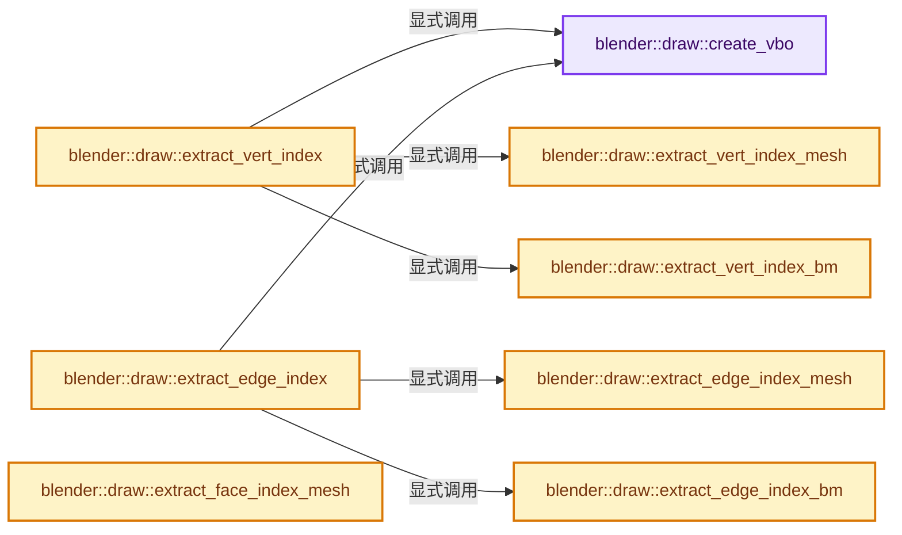
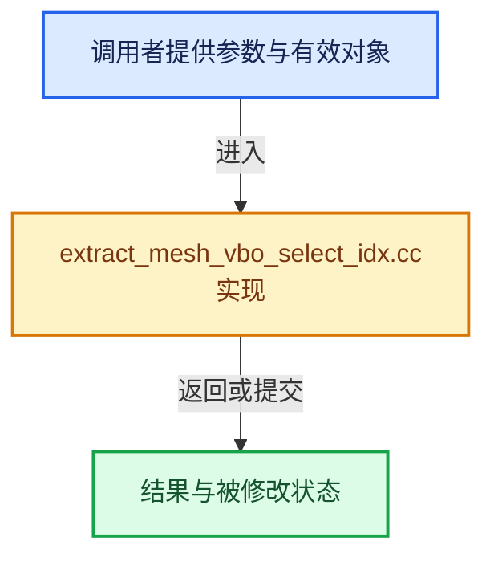

# 实现依赖专题：source/blender/draw/intern/mesh_extractors/extract_mesh_vbo_select_idx.cc

[方向导航](README.md) · [符号索引](../%E7%AC%A6%E5%8F%B7%E4%BE%9D%E8%B5%96%E4%B8%8E%E5%AE%9E%E7%8E%B0%E7%B4%A2%E5%BC%95.md)

本专题从正文实际调用进入，集中保存共享实现。函数有稳定锚点，可从调用处直接跳到对应完整函数；递归与互相调用通过回链组织。

## 本文件的实现关系






## 完整成员与函数实现

<a id="f-956efdd51ae489eb"></a>

### `blender::draw::create_vbo`

实现位置：[source/blender/draw/intern/mesh_extractors/extract_mesh_vbo_select_idx.cc](../../../../../source/blender/draw/intern/mesh_extractors/extract_mesh_vbo_select_idx.cc) · L16—L22。

接口参数：

- `const int size`

**教学注释版**

<!-- annotated:3e24dfc475a047 -->

```cpp
static gpu::VertBufPtr create_vbo(const int size)
{
  static GPUVertFormat format = GPU_vertformat_from_attribute("index", gpu::VertAttrType::SINT_32);
  gpu::VertBufPtr vbo = gpu::VertBufPtr(GPU_vertbuf_create_with_format(format));
  GPU_vertbuf_data_alloc(*vbo, size);
  return vbo;
}
```

<details>
<summary>核对原始源码：source/blender/draw/intern/mesh_extractors/extract_mesh_vbo_select_idx.cc · L16—L22</summary>

<!-- original:3e24dfc475a047:source/blender/draw/intern/mesh_extractors/extract_mesh_vbo_select_idx.cc:16:22 -->

```cpp
static gpu::VertBufPtr create_vbo(const int size)
{
  static GPUVertFormat format = GPU_vertformat_from_attribute("index", gpu::VertAttrType::SINT_32);
  gpu::VertBufPtr vbo = gpu::VertBufPtr(GPU_vertbuf_create_with_format(format));
  GPU_vertbuf_data_alloc(*vbo, size);
  return vbo;
}
```

</details>

**结果出口**

- `return vbo;`

**继续追踪实现**

- `GPU_vertformat_from_attribute` → [blender::GPU_vertformat_from_attribute · L427](%E4%BE%9D%E8%B5%96-gpu_vertex_format-4f7148.md#f-2643d25087989f8e)。
- `gpu::VertBufPtr` → [调用协议](../%E6%A8%A1%E6%9D%BF%E5%AE%8F%E4%B8%8E%E5%8A%A8%E6%80%81%E5%88%86%E6%B4%BE%E5%8D%8F%E8%AE%AE.md)：函数指针、局部可调用对象或未展开的宏；必须结合调用者环境。调用位置L19。
- `GPU_vertbuf_create_with_format` → [blender::GPU_vertbuf_create_with_format · L71](%E4%BE%9D%E8%B5%96-GPU_vertex_buffer-d7610b.md#f-bd43fe034e852138)。
- `GPU_vertbuf_data_alloc` → [blender::GPU_vertbuf_data_alloc · L172](%E4%BE%9D%E8%B5%96-gpu_vertex_buffer-eaa662.md#f-8ee5cf106e0f2b0f)。

<a id="f-b156b90a32b13c81"></a>

### `blender::draw::extract_vert_index_mesh`

实现位置：[source/blender/draw/intern/mesh_extractors/extract_mesh_vbo_select_idx.cc](../../../../../source/blender/draw/intern/mesh_extractors/extract_mesh_vbo_select_idx.cc) · L29—L52。

接口参数：

- `const MeshRenderData &mr`
- `MutableSpan<int> vbo_data`

**教学注释版**

<!-- annotated:71b55d43802656 -->

```cpp
static void extract_vert_index_mesh(const MeshRenderData &mr, MutableSpan<int> vbo_data)
{
  // [讲解] vbo_data.take_front：从两端裁去或选取一定数量元素形成新视图。
  MutableSpan corners_data = vbo_data.take_front(mr.corners_num);
  // [讲解] vbo_data.slice：建立原连续范围的子视图。
  MutableSpan loose_edge_data = vbo_data.slice(mr.corners_num, mr.loose_edges.size() * 2);
  // [讲解] vbo_data.take_back：从两端裁去或选取一定数量元素形成新视图。
  MutableSpan loose_vert_data = vbo_data.take_back(mr.loose_verts.size());

  if (mr.orig_index_vert) {
    const Span<int> orig_index_vert(mr.orig_index_vert, mr.verts_num);
    array_utils::gather(orig_index_vert, mr.corner_verts, corners_data);
    extract_mesh_loose_edge_data(orig_index_vert, mr.edges, mr.loose_edges, loose_edge_data);
    array_utils::gather(orig_index_vert, mr.loose_verts, loose_vert_data);
  }
  else {
    array_utils::copy(mr.corner_verts, corners_data);
    const Span<int2> edges = mr.edges;
    mr.loose_edges.foreach_index_optimized<int>(
        [&](const int i, const int pos) {
          loose_edge_data[pos * 2 + 0] = edges[i][0];
          loose_edge_data[pos * 2 + 1] = edges[i][1];
        },
        exec_mode::grain_size(4096));
    mr.loose_verts.to_indices(loose_vert_data);
  }
}
```

<details>
<summary>核对原始源码：source/blender/draw/intern/mesh_extractors/extract_mesh_vbo_select_idx.cc · L29—L52</summary>

<!-- original:71b55d43802656:source/blender/draw/intern/mesh_extractors/extract_mesh_vbo_select_idx.cc:29:52 -->

```cpp
static void extract_vert_index_mesh(const MeshRenderData &mr, MutableSpan<int> vbo_data)
{
  MutableSpan corners_data = vbo_data.take_front(mr.corners_num);
  MutableSpan loose_edge_data = vbo_data.slice(mr.corners_num, mr.loose_edges.size() * 2);
  MutableSpan loose_vert_data = vbo_data.take_back(mr.loose_verts.size());

  if (mr.orig_index_vert) {
    const Span<int> orig_index_vert(mr.orig_index_vert, mr.verts_num);
    array_utils::gather(orig_index_vert, mr.corner_verts, corners_data);
    extract_mesh_loose_edge_data(orig_index_vert, mr.edges, mr.loose_edges, loose_edge_data);
    array_utils::gather(orig_index_vert, mr.loose_verts, loose_vert_data);
  }
  else {
    array_utils::copy(mr.corner_verts, corners_data);
    const Span<int2> edges = mr.edges;
    mr.loose_edges.foreach_index_optimized<int>(
        [&](const int i, const int pos) {
          loose_edge_data[pos * 2 + 0] = edges[i][0];
          loose_edge_data[pos * 2 + 1] = edges[i][1];
        },
        exec_mode::grain_size(4096));
    mr.loose_verts.to_indices(loose_vert_data);
  }
}
```

</details>

**继续追踪实现**

- `vbo_data.take_front` → [blender::MutableSpan::take_front · L635](../01-%E5%9F%BA%E7%A1%80%E5%AE%B9%E5%99%A8%E4%B8%8E%E7%8E%B0%E4%BB%A3CPP/06-MutableSpan%E5%8F%AF%E5%86%99%E8%A7%86%E5%9B%BE.md#f-0a0235d84ddc265d)。
- `vbo_data.slice` → [blender::MutableSpan::slice · L579](../01-%E5%9F%BA%E7%A1%80%E5%AE%B9%E5%99%A8%E4%B8%8E%E7%8E%B0%E4%BB%A3CPP/06-MutableSpan%E5%8F%AF%E5%86%99%E8%A7%86%E5%9B%BE.md#f-6808b4aefbf58808)；[blender::MutableSpan::slice · L587](../01-%E5%9F%BA%E7%A1%80%E5%AE%B9%E5%99%A8%E4%B8%8E%E7%8E%B0%E4%BB%A3CPP/06-MutableSpan%E5%8F%AF%E5%86%99%E8%A7%86%E5%9B%BE.md#f-c05b010821861e4f)。同名重载需按实参类型选择。
- `mr.loose_edges.size` → [调用协议](../%E6%A8%A1%E6%9D%BF%E5%AE%8F%E4%B8%8E%E5%8A%A8%E6%80%81%E5%88%86%E6%B4%BE%E5%8D%8F%E8%AE%AE.md)：接收对象类型依赖auto、返回值或模板实例；不按同名猜测目标。调用位置L32。
- `vbo_data.take_back` → [blender::MutableSpan::take_back · L646](../01-%E5%9F%BA%E7%A1%80%E5%AE%B9%E5%99%A8%E4%B8%8E%E7%8E%B0%E4%BB%A3CPP/06-MutableSpan%E5%8F%AF%E5%86%99%E8%A7%86%E5%9B%BE.md#f-3fce5fbbe328c130)。
- `mr.loose_verts.size` → [调用协议](../%E6%A8%A1%E6%9D%BF%E5%AE%8F%E4%B8%8E%E5%8A%A8%E6%80%81%E5%88%86%E6%B4%BE%E5%8D%8F%E8%AE%AE.md)：接收对象类型依赖auto、返回值或模板实例；不按同名猜测目标。调用位置L33。
- `array_utils::gather` → [blender::array_utils::gather · L187](../01-%E5%9F%BA%E7%A1%80%E5%AE%B9%E5%99%A8%E4%B8%8E%E7%8E%B0%E4%BB%A3CPP/20-%E5%AE%B9%E5%99%A8%E9%80%89%E6%8B%A9%E4%B8%8E%E7%8B%AC%E7%AB%8B%E5%AE%9E%E7%8E%B0.md#f-1760adec5858a42f)；[blender::array_utils::gather · L209](../01-%E5%9F%BA%E7%A1%80%E5%AE%B9%E5%99%A8%E4%B8%8E%E7%8E%B0%E4%BB%A3CPP/20-%E5%AE%B9%E5%99%A8%E9%80%89%E6%8B%A9%E4%B8%8E%E7%8B%AC%E7%AB%8B%E5%AE%9E%E7%8E%B0.md#f-a9f65820788454bf)；[blender::array_utils::gather · L225](../01-%E5%9F%BA%E7%A1%80%E5%AE%B9%E5%99%A8%E4%B8%8E%E7%8E%B0%E4%BB%A3CPP/20-%E5%AE%B9%E5%99%A8%E9%80%89%E6%8B%A9%E4%B8%8E%E7%8B%AC%E7%AB%8B%E5%AE%9E%E7%8E%B0.md#f-279764b4196f0b63)；[blender::array_utils::gather · L237](../01-%E5%9F%BA%E7%A1%80%E5%AE%B9%E5%99%A8%E4%B8%8E%E7%8E%B0%E4%BB%A3CPP/20-%E5%AE%B9%E5%99%A8%E9%80%89%E6%8B%A9%E4%B8%8E%E7%8B%AC%E7%AB%8B%E5%AE%9E%E7%8E%B0.md#f-e310fd489b49341b)；[blender::array_utils::gather · L268](../01-%E5%9F%BA%E7%A1%80%E5%AE%B9%E5%99%A8%E4%B8%8E%E7%8E%B0%E4%BB%A3CPP/20-%E5%AE%B9%E5%99%A8%E9%80%89%E6%8B%A9%E4%B8%8E%E7%8B%AC%E7%AB%8B%E5%AE%9E%E7%8E%B0.md#f-7b21c29791903615)；[blender::array_utils::gather · L63](../01-%E5%9F%BA%E7%A1%80%E5%AE%B9%E5%99%A8%E4%B8%8E%E7%8E%B0%E4%BB%A3CPP/%E4%BE%9D%E8%B5%96-array_utils-cbb70f.md#f-5c2b501b03ddbb1f)；[blender::array_utils::gather · L82](../01-%E5%9F%BA%E7%A1%80%E5%AE%B9%E5%99%A8%E4%B8%8E%E7%8E%B0%E4%BB%A3CPP/%E4%BE%9D%E8%B5%96-array_utils-cbb70f.md#f-ea4dd9e673fe81e4)。同名重载需按实参类型选择。
- `extract_mesh_loose_edge_data` → [blender::draw::extract_mesh_loose_edge_data · L246](%E4%BE%9D%E8%B5%96-extract_mesh-4bd3fc.md#f-0d5eeb9cb9333f7e)。
- `array_utils::copy` → [blender::array_utils::copy · L54](../01-%E5%9F%BA%E7%A1%80%E5%AE%B9%E5%99%A8%E4%B8%8E%E7%8E%B0%E4%BB%A3CPP/20-%E5%AE%B9%E5%99%A8%E9%80%89%E6%8B%A9%E4%B8%8E%E7%8B%AC%E7%AB%8B%E5%AE%9E%E7%8E%B0.md#f-82e21acdac93f91c)；[blender::array_utils::copy · L72](../01-%E5%9F%BA%E7%A1%80%E5%AE%B9%E5%99%A8%E4%B8%8E%E7%8E%B0%E4%BB%A3CPP/20-%E5%AE%B9%E5%99%A8%E9%80%89%E6%8B%A9%E4%B8%8E%E7%8B%AC%E7%AB%8B%E5%AE%9E%E7%8E%B0.md#f-ee9c17de026a6c9a)；[blender::array_utils::copy · L98](../01-%E5%9F%BA%E7%A1%80%E5%AE%B9%E5%99%A8%E4%B8%8E%E7%8E%B0%E4%BB%A3CPP/20-%E5%AE%B9%E5%99%A8%E9%80%89%E6%8B%A9%E4%B8%8E%E7%8B%AC%E7%AB%8B%E5%AE%9E%E7%8E%B0.md#f-ec9fd099c7280717)；[blender::array_utils::copy · L27](../01-%E5%9F%BA%E7%A1%80%E5%AE%B9%E5%99%A8%E4%B8%8E%E7%8E%B0%E4%BB%A3CPP/%E4%BE%9D%E8%B5%96-array_utils-cbb70f.md#f-245f7c23437cf35f)；[blender::array_utils::copy · L43](../01-%E5%9F%BA%E7%A1%80%E5%AE%B9%E5%99%A8%E4%B8%8E%E7%8E%B0%E4%BB%A3CPP/%E4%BE%9D%E8%B5%96-array_utils-cbb70f.md#f-6170524934215b36)。同名重载需按实参类型选择。
- `mr.loose_edges.foreach_index_optimized<int>` → [调用协议](../%E6%A8%A1%E6%9D%BF%E5%AE%8F%E4%B8%8E%E5%8A%A8%E6%80%81%E5%88%86%E6%B4%BE%E5%8D%8F%E8%AE%AE.md)：接收对象类型依赖auto、返回值或模板实例；不按同名猜测目标。调用位置L44。
- `exec_mode::grain_size` → [blender::exec_mode::grain_size · L79](../01-%E5%9F%BA%E7%A1%80%E5%AE%B9%E5%99%A8%E4%B8%8E%E7%8E%B0%E4%BB%A3CPP/%E4%BE%9D%E8%B5%96-BLI_execution_mode-1528fb.md#f-0b4fc2f9fa6e66e7)。
- `mr.loose_verts.to_indices` → [调用协议](../%E6%A8%A1%E6%9D%BF%E5%AE%8F%E4%B8%8E%E5%8A%A8%E6%80%81%E5%88%86%E6%B4%BE%E5%8D%8F%E8%AE%AE.md)：接收对象类型依赖auto、返回值或模板实例；不按同名猜测目标。调用位置L50。

<a id="f-d1eb9d31880363e2"></a>

### `blender::draw::extract_vert_index_bm`

实现位置：[source/blender/draw/intern/mesh_extractors/extract_mesh_vbo_select_idx.cc](../../../../../source/blender/draw/intern/mesh_extractors/extract_mesh_vbo_select_idx.cc) · L54—L82。

接口参数：

- `const MeshRenderData &mr`
- `MutableSpan<int> vbo_data`

**教学注释版**

<!-- annotated:38cf592dc4fc38 -->

```cpp
static void extract_vert_index_bm(const MeshRenderData &mr, MutableSpan<int> vbo_data)
{
  // [讲解] vbo_data.take_front：从两端裁去或选取一定数量元素形成新视图。
  MutableSpan corners_data = vbo_data.take_front(mr.corners_num);
  // [讲解] vbo_data.slice：建立原连续范围的子视图。
  MutableSpan loose_edge_data = vbo_data.slice(mr.corners_num, mr.loose_edges.size() * 2);
  // [讲解] vbo_data.take_back：从两端裁去或选取一定数量元素形成新视图。
  MutableSpan loose_vert_data = vbo_data.take_back(mr.loose_verts.size());

  const BMesh &bm = *mr.bm;
  threading::parallel_for(IndexRange(bm.totface), 2048, [&](const IndexRange range) {
    for (const int face_index : range) {
      const BMFace &face = *BM_face_at_index(&const_cast<BMesh &>(bm), face_index);
      const BMLoop *loop = BM_FACE_FIRST_LOOP(&face);
      for ([[maybe_unused]] const int i : IndexRange(face.len)) {
        const int index = BM_elem_index_get(loop);
        corners_data[index] = BM_elem_index_get(loop->v);
        loop = loop->next;
      }
    }
  });

  mr.loose_edges.foreach_index(
      [&](const int i, const int pos) {
        const BMEdge &edge = *BM_edge_at_index(&const_cast<BMesh &>(bm), i);
        loose_edge_data[pos * 2 + 0] = BM_elem_index_get(edge.v1);
        loose_edge_data[pos * 2 + 1] = BM_elem_index_get(edge.v2);
      },
      exec_mode::grain_size(4096));

  mr.loose_verts.to_indices(loose_vert_data);
}
```

<details>
<summary>核对原始源码：source/blender/draw/intern/mesh_extractors/extract_mesh_vbo_select_idx.cc · L54—L82</summary>

<!-- original:38cf592dc4fc38:source/blender/draw/intern/mesh_extractors/extract_mesh_vbo_select_idx.cc:54:82 -->

```cpp
static void extract_vert_index_bm(const MeshRenderData &mr, MutableSpan<int> vbo_data)
{
  MutableSpan corners_data = vbo_data.take_front(mr.corners_num);
  MutableSpan loose_edge_data = vbo_data.slice(mr.corners_num, mr.loose_edges.size() * 2);
  MutableSpan loose_vert_data = vbo_data.take_back(mr.loose_verts.size());

  const BMesh &bm = *mr.bm;
  threading::parallel_for(IndexRange(bm.totface), 2048, [&](const IndexRange range) {
    for (const int face_index : range) {
      const BMFace &face = *BM_face_at_index(&const_cast<BMesh &>(bm), face_index);
      const BMLoop *loop = BM_FACE_FIRST_LOOP(&face);
      for ([[maybe_unused]] const int i : IndexRange(face.len)) {
        const int index = BM_elem_index_get(loop);
        corners_data[index] = BM_elem_index_get(loop->v);
        loop = loop->next;
      }
    }
  });

  mr.loose_edges.foreach_index(
      [&](const int i, const int pos) {
        const BMEdge &edge = *BM_edge_at_index(&const_cast<BMesh &>(bm), i);
        loose_edge_data[pos * 2 + 0] = BM_elem_index_get(edge.v1);
        loose_edge_data[pos * 2 + 1] = BM_elem_index_get(edge.v2);
      },
      exec_mode::grain_size(4096));

  mr.loose_verts.to_indices(loose_vert_data);
}
```

</details>

**沿实际写入检查状态**

- `corners_data[index] = BM_elem_index_get(loop->v);`
- `loop = loop->next;`

**继续追踪实现**

- `vbo_data.take_front` → [blender::MutableSpan::take_front · L635](../01-%E5%9F%BA%E7%A1%80%E5%AE%B9%E5%99%A8%E4%B8%8E%E7%8E%B0%E4%BB%A3CPP/06-MutableSpan%E5%8F%AF%E5%86%99%E8%A7%86%E5%9B%BE.md#f-0a0235d84ddc265d)。
- `vbo_data.slice` → [blender::MutableSpan::slice · L579](../01-%E5%9F%BA%E7%A1%80%E5%AE%B9%E5%99%A8%E4%B8%8E%E7%8E%B0%E4%BB%A3CPP/06-MutableSpan%E5%8F%AF%E5%86%99%E8%A7%86%E5%9B%BE.md#f-6808b4aefbf58808)；[blender::MutableSpan::slice · L587](../01-%E5%9F%BA%E7%A1%80%E5%AE%B9%E5%99%A8%E4%B8%8E%E7%8E%B0%E4%BB%A3CPP/06-MutableSpan%E5%8F%AF%E5%86%99%E8%A7%86%E5%9B%BE.md#f-c05b010821861e4f)。同名重载需按实参类型选择。
- `mr.loose_edges.size` → [调用协议](../%E6%A8%A1%E6%9D%BF%E5%AE%8F%E4%B8%8E%E5%8A%A8%E6%80%81%E5%88%86%E6%B4%BE%E5%8D%8F%E8%AE%AE.md)：接收对象类型依赖auto、返回值或模板实例；不按同名猜测目标。调用位置L57。
- `vbo_data.take_back` → [blender::MutableSpan::take_back · L646](../01-%E5%9F%BA%E7%A1%80%E5%AE%B9%E5%99%A8%E4%B8%8E%E7%8E%B0%E4%BB%A3CPP/06-MutableSpan%E5%8F%AF%E5%86%99%E8%A7%86%E5%9B%BE.md#f-3fce5fbbe328c130)。
- `mr.loose_verts.size` → [调用协议](../%E6%A8%A1%E6%9D%BF%E5%AE%8F%E4%B8%8E%E5%8A%A8%E6%80%81%E5%88%86%E6%B4%BE%E5%8D%8F%E8%AE%AE.md)：接收对象类型依赖auto、返回值或模板实例；不按同名猜测目标。调用位置L58。
- `threading::parallel_for` → [blender::threading::parallel_for · L68](../11-Depsgraph%E4%B8%8E%E5%B9%B6%E8%A1%8C%E4%BB%BB%E5%8A%A1%E7%B3%BB%E7%BB%9F/07-%E4%BB%BB%E5%8A%A1%E6%B1%A0%E4%B8%8ETBB%E6%8E%A5%E5%85%A5.md#f-838294754c24426c)。
- `IndexRange` → [blender::IndexRange](../01-%E5%9F%BA%E7%A1%80%E5%AE%B9%E5%99%A8%E4%B8%8E%E7%8E%B0%E4%BB%A3CPP/%E4%BE%9D%E8%B5%96-BLI_index_range-7d7cc5.md#t-caa3466d6776)；[blender::gpu::shader::parser::IndexRange](%E4%BE%9D%E8%B5%96-utils-06433d.md#t-82d2bd4ea71c)；[blender::IndexRange](%E4%BE%9D%E8%B5%96-DNA_node_types-6708b9.md#t-0448cc889d39)。
- `BM_face_at_index` → [blender::BM_face_at_index · L122](%E4%BE%9D%E8%B5%96-bmesh_mesh-df20c7.md#f-366df62c166d5094)。
- `BM_FACE_FIRST_LOOP` → [BM_FACE_FIRST_LOOP · L697](%E4%BE%9D%E8%B5%96-bmesh_class-4cf146.md#m-c7e10ffb38e6)；[BM_FACE_FIRST_LOOP · L699](%E4%BE%9D%E8%B5%96-bmesh_class-4cf146.md#m-76a054cc4770)。宏定义由构建条件选择。
- `BM_elem_index_get` → [BM_elem_index_get · L120](%E4%BE%9D%E8%B5%96-bmesh_inline-74f1be.md#m-201981cdc62d)。宏定义由构建条件选择。
- `mr.loose_edges.foreach_index` → [调用协议](../%E6%A8%A1%E6%9D%BF%E5%AE%8F%E4%B8%8E%E5%8A%A8%E6%80%81%E5%88%86%E6%B4%BE%E5%8D%8F%E8%AE%AE.md)：接收对象类型依赖auto、返回值或模板实例；不按同名猜测目标。调用位置L73。
- `BM_edge_at_index` → [blender::BM_edge_at_index · L116](%E4%BE%9D%E8%B5%96-bmesh_mesh-df20c7.md#f-81d027fd9e6b4c84)。
- `exec_mode::grain_size` → [blender::exec_mode::grain_size · L79](../01-%E5%9F%BA%E7%A1%80%E5%AE%B9%E5%99%A8%E4%B8%8E%E7%8E%B0%E4%BB%A3CPP/%E4%BE%9D%E8%B5%96-BLI_execution_mode-1528fb.md#f-0b4fc2f9fa6e66e7)。
- `mr.loose_verts.to_indices` → [调用协议](../%E6%A8%A1%E6%9D%BF%E5%AE%8F%E4%B8%8E%E5%8A%A8%E6%80%81%E5%88%86%E6%B4%BE%E5%8D%8F%E8%AE%AE.md)：接收对象类型依赖auto、返回值或模板实例；不按同名猜测目标。调用位置L81。

<a id="f-d8f5dcf4374d0472"></a>

### `blender::draw::extract_vert_index`

实现位置：[source/blender/draw/intern/mesh_extractors/extract_mesh_vbo_select_idx.cc](../../../../../source/blender/draw/intern/mesh_extractors/extract_mesh_vbo_select_idx.cc) · L84—L94。

接口参数：

- `const MeshRenderData &mr`

**教学注释版**

<!-- annotated:66f02b12b73431 -->

```cpp
gpu::VertBufPtr extract_vert_index(const MeshRenderData &mr)
{
  gpu::VertBufPtr vbo = create_vbo(mr.corners_num + mr.loose_indices_num);
  if (mr.extract_type == MeshExtractType::Mesh) {
    extract_vert_index_mesh(mr, vbo->data<int>());
  }
  else {
    extract_vert_index_bm(mr, vbo->data<int>());
  }
  return vbo;
}
```

<details>
<summary>核对原始源码：source/blender/draw/intern/mesh_extractors/extract_mesh_vbo_select_idx.cc · L84—L94</summary>

<!-- original:66f02b12b73431:source/blender/draw/intern/mesh_extractors/extract_mesh_vbo_select_idx.cc:84:94 -->

```cpp
gpu::VertBufPtr extract_vert_index(const MeshRenderData &mr)
{
  gpu::VertBufPtr vbo = create_vbo(mr.corners_num + mr.loose_indices_num);
  if (mr.extract_type == MeshExtractType::Mesh) {
    extract_vert_index_mesh(mr, vbo->data<int>());
  }
  else {
    extract_vert_index_bm(mr, vbo->data<int>());
  }
  return vbo;
}
```

</details>

**结果出口**

- `return vbo;`

**继续追踪实现**

- `create_vbo` → [blender::draw::create_vbo · L16](%E4%BE%9D%E8%B5%96-extract_mesh_vbo_select_idx-598ba4.md#f-956efdd51ae489eb)。
- `extract_vert_index_mesh` → [blender::draw::extract_vert_index_mesh · L29](%E4%BE%9D%E8%B5%96-extract_mesh_vbo_select_idx-598ba4.md#f-b156b90a32b13c81)。
- `vbo->data<int>` → [blender::draw::data · L124](%E4%BE%9D%E8%B5%96-DRW_gpu_wrapper-c80c4f.md#f-dc115dc22e0c9f33)；[blender::draw::data · L129](%E4%BE%9D%E8%B5%96-DRW_gpu_wrapper-c80c4f.md#f-5f325cb75387045c)。同名重载需按实参类型选择。
- `extract_vert_index_bm` → [blender::draw::extract_vert_index_bm · L54](%E4%BE%9D%E8%B5%96-extract_mesh_vbo_select_idx-598ba4.md#f-d1eb9d31880363e2)。

<a id="f-315452afb47fb9cd"></a>

### `blender::draw::extract_edge_index_mesh`

实现位置：[source/blender/draw/intern/mesh_extractors/extract_mesh_vbo_select_idx.cc](../../../../../source/blender/draw/intern/mesh_extractors/extract_mesh_vbo_select_idx.cc) · L96—L120。

接口参数：

- `const MeshRenderData &mr`
- `MutableSpan<int> vbo_data`

**教学注释版**

<!-- annotated:1ca2b9fcc34ee7 -->

```cpp
static void extract_edge_index_mesh(const MeshRenderData &mr, MutableSpan<int> vbo_data)
{
  // [讲解] vbo_data.take_front：从两端裁去或选取一定数量元素形成新视图。
  MutableSpan corners_data = vbo_data.take_front(mr.corners_num);
  // [讲解] vbo_data.slice：建立原连续范围的子视图。
  MutableSpan loose_edge_data = vbo_data.slice(mr.corners_num, mr.loose_edges.size() * 2);

  if (mr.orig_index_edge) {
    const Span<int> orig_index_edge(mr.orig_index_edge, mr.edges_num);
    array_utils::gather(orig_index_edge, mr.corner_edges, corners_data);
    mr.loose_edges.foreach_index_optimized<int>(
        [&](const int i, const int pos) {
          loose_edge_data[pos * 2 + 0] = orig_index_edge[i];
          loose_edge_data[pos * 2 + 1] = orig_index_edge[i];
        },
        exec_mode::grain_size(4096));
  }
  else {
    array_utils::copy(mr.corner_edges, corners_data);
    mr.loose_edges.foreach_index_optimized<int>(
        [&](const int i, const int pos) {
          loose_edge_data[pos * 2 + 0] = i;
          loose_edge_data[pos * 2 + 1] = i;
        },
        exec_mode::grain_size(4096));
  }
}
```

<details>
<summary>核对原始源码：source/blender/draw/intern/mesh_extractors/extract_mesh_vbo_select_idx.cc · L96—L120</summary>

<!-- original:1ca2b9fcc34ee7:source/blender/draw/intern/mesh_extractors/extract_mesh_vbo_select_idx.cc:96:120 -->

```cpp
static void extract_edge_index_mesh(const MeshRenderData &mr, MutableSpan<int> vbo_data)
{
  MutableSpan corners_data = vbo_data.take_front(mr.corners_num);
  MutableSpan loose_edge_data = vbo_data.slice(mr.corners_num, mr.loose_edges.size() * 2);

  if (mr.orig_index_edge) {
    const Span<int> orig_index_edge(mr.orig_index_edge, mr.edges_num);
    array_utils::gather(orig_index_edge, mr.corner_edges, corners_data);
    mr.loose_edges.foreach_index_optimized<int>(
        [&](const int i, const int pos) {
          loose_edge_data[pos * 2 + 0] = orig_index_edge[i];
          loose_edge_data[pos * 2 + 1] = orig_index_edge[i];
        },
        exec_mode::grain_size(4096));
  }
  else {
    array_utils::copy(mr.corner_edges, corners_data);
    mr.loose_edges.foreach_index_optimized<int>(
        [&](const int i, const int pos) {
          loose_edge_data[pos * 2 + 0] = i;
          loose_edge_data[pos * 2 + 1] = i;
        },
        exec_mode::grain_size(4096));
  }
}
```

</details>

**继续追踪实现**

- `vbo_data.take_front` → [blender::MutableSpan::take_front · L635](../01-%E5%9F%BA%E7%A1%80%E5%AE%B9%E5%99%A8%E4%B8%8E%E7%8E%B0%E4%BB%A3CPP/06-MutableSpan%E5%8F%AF%E5%86%99%E8%A7%86%E5%9B%BE.md#f-0a0235d84ddc265d)。
- `vbo_data.slice` → [blender::MutableSpan::slice · L579](../01-%E5%9F%BA%E7%A1%80%E5%AE%B9%E5%99%A8%E4%B8%8E%E7%8E%B0%E4%BB%A3CPP/06-MutableSpan%E5%8F%AF%E5%86%99%E8%A7%86%E5%9B%BE.md#f-6808b4aefbf58808)；[blender::MutableSpan::slice · L587](../01-%E5%9F%BA%E7%A1%80%E5%AE%B9%E5%99%A8%E4%B8%8E%E7%8E%B0%E4%BB%A3CPP/06-MutableSpan%E5%8F%AF%E5%86%99%E8%A7%86%E5%9B%BE.md#f-c05b010821861e4f)。同名重载需按实参类型选择。
- `mr.loose_edges.size` → [调用协议](../%E6%A8%A1%E6%9D%BF%E5%AE%8F%E4%B8%8E%E5%8A%A8%E6%80%81%E5%88%86%E6%B4%BE%E5%8D%8F%E8%AE%AE.md)：接收对象类型依赖auto、返回值或模板实例；不按同名猜测目标。调用位置L99。
- `array_utils::gather` → [blender::array_utils::gather · L187](../01-%E5%9F%BA%E7%A1%80%E5%AE%B9%E5%99%A8%E4%B8%8E%E7%8E%B0%E4%BB%A3CPP/20-%E5%AE%B9%E5%99%A8%E9%80%89%E6%8B%A9%E4%B8%8E%E7%8B%AC%E7%AB%8B%E5%AE%9E%E7%8E%B0.md#f-1760adec5858a42f)；[blender::array_utils::gather · L209](../01-%E5%9F%BA%E7%A1%80%E5%AE%B9%E5%99%A8%E4%B8%8E%E7%8E%B0%E4%BB%A3CPP/20-%E5%AE%B9%E5%99%A8%E9%80%89%E6%8B%A9%E4%B8%8E%E7%8B%AC%E7%AB%8B%E5%AE%9E%E7%8E%B0.md#f-a9f65820788454bf)；[blender::array_utils::gather · L225](../01-%E5%9F%BA%E7%A1%80%E5%AE%B9%E5%99%A8%E4%B8%8E%E7%8E%B0%E4%BB%A3CPP/20-%E5%AE%B9%E5%99%A8%E9%80%89%E6%8B%A9%E4%B8%8E%E7%8B%AC%E7%AB%8B%E5%AE%9E%E7%8E%B0.md#f-279764b4196f0b63)；[blender::array_utils::gather · L237](../01-%E5%9F%BA%E7%A1%80%E5%AE%B9%E5%99%A8%E4%B8%8E%E7%8E%B0%E4%BB%A3CPP/20-%E5%AE%B9%E5%99%A8%E9%80%89%E6%8B%A9%E4%B8%8E%E7%8B%AC%E7%AB%8B%E5%AE%9E%E7%8E%B0.md#f-e310fd489b49341b)；[blender::array_utils::gather · L268](../01-%E5%9F%BA%E7%A1%80%E5%AE%B9%E5%99%A8%E4%B8%8E%E7%8E%B0%E4%BB%A3CPP/20-%E5%AE%B9%E5%99%A8%E9%80%89%E6%8B%A9%E4%B8%8E%E7%8B%AC%E7%AB%8B%E5%AE%9E%E7%8E%B0.md#f-7b21c29791903615)；[blender::array_utils::gather · L63](../01-%E5%9F%BA%E7%A1%80%E5%AE%B9%E5%99%A8%E4%B8%8E%E7%8E%B0%E4%BB%A3CPP/%E4%BE%9D%E8%B5%96-array_utils-cbb70f.md#f-5c2b501b03ddbb1f)；[blender::array_utils::gather · L82](../01-%E5%9F%BA%E7%A1%80%E5%AE%B9%E5%99%A8%E4%B8%8E%E7%8E%B0%E4%BB%A3CPP/%E4%BE%9D%E8%B5%96-array_utils-cbb70f.md#f-ea4dd9e673fe81e4)。同名重载需按实参类型选择。
- `mr.loose_edges.foreach_index_optimized<int>` → [调用协议](../%E6%A8%A1%E6%9D%BF%E5%AE%8F%E4%B8%8E%E5%8A%A8%E6%80%81%E5%88%86%E6%B4%BE%E5%8D%8F%E8%AE%AE.md)：接收对象类型依赖auto、返回值或模板实例；不按同名猜测目标。调用位置L104。
- `exec_mode::grain_size` → [blender::exec_mode::grain_size · L79](../01-%E5%9F%BA%E7%A1%80%E5%AE%B9%E5%99%A8%E4%B8%8E%E7%8E%B0%E4%BB%A3CPP/%E4%BE%9D%E8%B5%96-BLI_execution_mode-1528fb.md#f-0b4fc2f9fa6e66e7)。
- `array_utils::copy` → [blender::array_utils::copy · L54](../01-%E5%9F%BA%E7%A1%80%E5%AE%B9%E5%99%A8%E4%B8%8E%E7%8E%B0%E4%BB%A3CPP/20-%E5%AE%B9%E5%99%A8%E9%80%89%E6%8B%A9%E4%B8%8E%E7%8B%AC%E7%AB%8B%E5%AE%9E%E7%8E%B0.md#f-82e21acdac93f91c)；[blender::array_utils::copy · L72](../01-%E5%9F%BA%E7%A1%80%E5%AE%B9%E5%99%A8%E4%B8%8E%E7%8E%B0%E4%BB%A3CPP/20-%E5%AE%B9%E5%99%A8%E9%80%89%E6%8B%A9%E4%B8%8E%E7%8B%AC%E7%AB%8B%E5%AE%9E%E7%8E%B0.md#f-ee9c17de026a6c9a)；[blender::array_utils::copy · L98](../01-%E5%9F%BA%E7%A1%80%E5%AE%B9%E5%99%A8%E4%B8%8E%E7%8E%B0%E4%BB%A3CPP/20-%E5%AE%B9%E5%99%A8%E9%80%89%E6%8B%A9%E4%B8%8E%E7%8B%AC%E7%AB%8B%E5%AE%9E%E7%8E%B0.md#f-ec9fd099c7280717)；[blender::array_utils::copy · L27](../01-%E5%9F%BA%E7%A1%80%E5%AE%B9%E5%99%A8%E4%B8%8E%E7%8E%B0%E4%BB%A3CPP/%E4%BE%9D%E8%B5%96-array_utils-cbb70f.md#f-245f7c23437cf35f)；[blender::array_utils::copy · L43](../01-%E5%9F%BA%E7%A1%80%E5%AE%B9%E5%99%A8%E4%B8%8E%E7%8E%B0%E4%BB%A3CPP/%E4%BE%9D%E8%B5%96-array_utils-cbb70f.md#f-6170524934215b36)。同名重载需按实参类型选择。

<a id="f-88b12f76343a0075"></a>

### `blender::draw::extract_edge_index_bm`

实现位置：[source/blender/draw/intern/mesh_extractors/extract_mesh_vbo_select_idx.cc](../../../../../source/blender/draw/intern/mesh_extractors/extract_mesh_vbo_select_idx.cc) · L122—L146。

接口参数：

- `const MeshRenderData &mr`
- `MutableSpan<int> vbo_data`

**教学注释版**

<!-- annotated:45accaadfdb837 -->

```cpp
static void extract_edge_index_bm(const MeshRenderData &mr, MutableSpan<int> vbo_data)
{
  // [讲解] vbo_data.take_front：从两端裁去或选取一定数量元素形成新视图。
  MutableSpan corners_data = vbo_data.take_front(mr.corners_num);
  // [讲解] vbo_data.slice：建立原连续范围的子视图。
  MutableSpan loose_edge_data = vbo_data.slice(mr.corners_num, mr.loose_edges.size() * 2);

  const BMesh &bm = *mr.bm;
  threading::parallel_for(IndexRange(bm.totface), 2048, [&](const IndexRange range) {
    for (const int face_index : range) {
      const BMFace &face = *BM_face_at_index(&const_cast<BMesh &>(bm), face_index);
      const BMLoop *loop = BM_FACE_FIRST_LOOP(&face);
      for ([[maybe_unused]] const int i : IndexRange(face.len)) {
        const int index = BM_elem_index_get(loop);
        corners_data[index] = BM_elem_index_get(loop->e);
        loop = loop->next;
      }
    }
  });

  mr.loose_edges.foreach_index_optimized<int>(
      [&](const int i, const int pos) {
        loose_edge_data[pos * 2 + 0] = i;
        loose_edge_data[pos * 2 + 1] = i;
      },
      exec_mode::grain_size(4096));
}
```

<details>
<summary>核对原始源码：source/blender/draw/intern/mesh_extractors/extract_mesh_vbo_select_idx.cc · L122—L146</summary>

<!-- original:45accaadfdb837:source/blender/draw/intern/mesh_extractors/extract_mesh_vbo_select_idx.cc:122:146 -->

```cpp
static void extract_edge_index_bm(const MeshRenderData &mr, MutableSpan<int> vbo_data)
{
  MutableSpan corners_data = vbo_data.take_front(mr.corners_num);
  MutableSpan loose_edge_data = vbo_data.slice(mr.corners_num, mr.loose_edges.size() * 2);

  const BMesh &bm = *mr.bm;
  threading::parallel_for(IndexRange(bm.totface), 2048, [&](const IndexRange range) {
    for (const int face_index : range) {
      const BMFace &face = *BM_face_at_index(&const_cast<BMesh &>(bm), face_index);
      const BMLoop *loop = BM_FACE_FIRST_LOOP(&face);
      for ([[maybe_unused]] const int i : IndexRange(face.len)) {
        const int index = BM_elem_index_get(loop);
        corners_data[index] = BM_elem_index_get(loop->e);
        loop = loop->next;
      }
    }
  });

  mr.loose_edges.foreach_index_optimized<int>(
      [&](const int i, const int pos) {
        loose_edge_data[pos * 2 + 0] = i;
        loose_edge_data[pos * 2 + 1] = i;
      },
      exec_mode::grain_size(4096));
}
```

</details>

**沿实际写入检查状态**

- `corners_data[index] = BM_elem_index_get(loop->e);`
- `loop = loop->next;`

**继续追踪实现**

- `vbo_data.take_front` → [blender::MutableSpan::take_front · L635](../01-%E5%9F%BA%E7%A1%80%E5%AE%B9%E5%99%A8%E4%B8%8E%E7%8E%B0%E4%BB%A3CPP/06-MutableSpan%E5%8F%AF%E5%86%99%E8%A7%86%E5%9B%BE.md#f-0a0235d84ddc265d)。
- `vbo_data.slice` → [blender::MutableSpan::slice · L579](../01-%E5%9F%BA%E7%A1%80%E5%AE%B9%E5%99%A8%E4%B8%8E%E7%8E%B0%E4%BB%A3CPP/06-MutableSpan%E5%8F%AF%E5%86%99%E8%A7%86%E5%9B%BE.md#f-6808b4aefbf58808)；[blender::MutableSpan::slice · L587](../01-%E5%9F%BA%E7%A1%80%E5%AE%B9%E5%99%A8%E4%B8%8E%E7%8E%B0%E4%BB%A3CPP/06-MutableSpan%E5%8F%AF%E5%86%99%E8%A7%86%E5%9B%BE.md#f-c05b010821861e4f)。同名重载需按实参类型选择。
- `mr.loose_edges.size` → [调用协议](../%E6%A8%A1%E6%9D%BF%E5%AE%8F%E4%B8%8E%E5%8A%A8%E6%80%81%E5%88%86%E6%B4%BE%E5%8D%8F%E8%AE%AE.md)：接收对象类型依赖auto、返回值或模板实例；不按同名猜测目标。调用位置L125。
- `threading::parallel_for` → [blender::threading::parallel_for · L68](../11-Depsgraph%E4%B8%8E%E5%B9%B6%E8%A1%8C%E4%BB%BB%E5%8A%A1%E7%B3%BB%E7%BB%9F/07-%E4%BB%BB%E5%8A%A1%E6%B1%A0%E4%B8%8ETBB%E6%8E%A5%E5%85%A5.md#f-838294754c24426c)。
- `IndexRange` → [blender::IndexRange](../01-%E5%9F%BA%E7%A1%80%E5%AE%B9%E5%99%A8%E4%B8%8E%E7%8E%B0%E4%BB%A3CPP/%E4%BE%9D%E8%B5%96-BLI_index_range-7d7cc5.md#t-caa3466d6776)；[blender::gpu::shader::parser::IndexRange](%E4%BE%9D%E8%B5%96-utils-06433d.md#t-82d2bd4ea71c)；[blender::IndexRange](%E4%BE%9D%E8%B5%96-DNA_node_types-6708b9.md#t-0448cc889d39)。
- `BM_face_at_index` → [blender::BM_face_at_index · L122](%E4%BE%9D%E8%B5%96-bmesh_mesh-df20c7.md#f-366df62c166d5094)。
- `BM_FACE_FIRST_LOOP` → [BM_FACE_FIRST_LOOP · L697](%E4%BE%9D%E8%B5%96-bmesh_class-4cf146.md#m-c7e10ffb38e6)；[BM_FACE_FIRST_LOOP · L699](%E4%BE%9D%E8%B5%96-bmesh_class-4cf146.md#m-76a054cc4770)。宏定义由构建条件选择。
- `BM_elem_index_get` → [BM_elem_index_get · L120](%E4%BE%9D%E8%B5%96-bmesh_inline-74f1be.md#m-201981cdc62d)。宏定义由构建条件选择。
- `mr.loose_edges.foreach_index_optimized<int>` → [调用协议](../%E6%A8%A1%E6%9D%BF%E5%AE%8F%E4%B8%8E%E5%8A%A8%E6%80%81%E5%88%86%E6%B4%BE%E5%8D%8F%E8%AE%AE.md)：接收对象类型依赖auto、返回值或模板实例；不按同名猜测目标。调用位置L140。
- `exec_mode::grain_size` → [blender::exec_mode::grain_size · L79](../01-%E5%9F%BA%E7%A1%80%E5%AE%B9%E5%99%A8%E4%B8%8E%E7%8E%B0%E4%BB%A3CPP/%E4%BE%9D%E8%B5%96-BLI_execution_mode-1528fb.md#f-0b4fc2f9fa6e66e7)。

<a id="f-fa1d773f0ad46c60"></a>

### `blender::draw::extract_edge_index`

实现位置：[source/blender/draw/intern/mesh_extractors/extract_mesh_vbo_select_idx.cc](../../../../../source/blender/draw/intern/mesh_extractors/extract_mesh_vbo_select_idx.cc) · L148—L158。

接口参数：

- `const MeshRenderData &mr`

**教学注释版**

<!-- annotated:538408ae28f02e -->

```cpp
gpu::VertBufPtr extract_edge_index(const MeshRenderData &mr)
{
  gpu::VertBufPtr vbo = create_vbo(mr.corners_num + mr.loose_edges.size() * 2);
  if (mr.extract_type == MeshExtractType::Mesh) {
    extract_edge_index_mesh(mr, vbo->data<int>());
  }
  else {
    extract_edge_index_bm(mr, vbo->data<int>());
  }
  return vbo;
}
```

<details>
<summary>核对原始源码：source/blender/draw/intern/mesh_extractors/extract_mesh_vbo_select_idx.cc · L148—L158</summary>

<!-- original:538408ae28f02e:source/blender/draw/intern/mesh_extractors/extract_mesh_vbo_select_idx.cc:148:158 -->

```cpp
gpu::VertBufPtr extract_edge_index(const MeshRenderData &mr)
{
  gpu::VertBufPtr vbo = create_vbo(mr.corners_num + mr.loose_edges.size() * 2);
  if (mr.extract_type == MeshExtractType::Mesh) {
    extract_edge_index_mesh(mr, vbo->data<int>());
  }
  else {
    extract_edge_index_bm(mr, vbo->data<int>());
  }
  return vbo;
}
```

</details>

**结果出口**

- `return vbo;`

**继续追踪实现**

- `create_vbo` → [blender::draw::create_vbo · L16](%E4%BE%9D%E8%B5%96-extract_mesh_vbo_select_idx-598ba4.md#f-956efdd51ae489eb)。
- `mr.loose_edges.size` → [调用协议](../%E6%A8%A1%E6%9D%BF%E5%AE%8F%E4%B8%8E%E5%8A%A8%E6%80%81%E5%88%86%E6%B4%BE%E5%8D%8F%E8%AE%AE.md)：接收对象类型依赖auto、返回值或模板实例；不按同名猜测目标。调用位置L150。
- `extract_edge_index_mesh` → [blender::draw::extract_edge_index_mesh · L96](%E4%BE%9D%E8%B5%96-extract_mesh_vbo_select_idx-598ba4.md#f-315452afb47fb9cd)。
- `vbo->data<int>` → [blender::draw::data · L124](%E4%BE%9D%E8%B5%96-DRW_gpu_wrapper-c80c4f.md#f-dc115dc22e0c9f33)；[blender::draw::data · L129](%E4%BE%9D%E8%B5%96-DRW_gpu_wrapper-c80c4f.md#f-5f325cb75387045c)。同名重载需按实参类型选择。
- `extract_edge_index_bm` → [blender::draw::extract_edge_index_bm · L122](%E4%BE%9D%E8%B5%96-extract_mesh_vbo_select_idx-598ba4.md#f-88b12f76343a0075)。

<a id="f-b064d293f465fa67"></a>

### `blender::draw::extract_face_index_mesh`

实现位置：[source/blender/draw/intern/mesh_extractors/extract_mesh_vbo_select_idx.cc](../../../../../source/blender/draw/intern/mesh_extractors/extract_mesh_vbo_select_idx.cc) · L160—L174。

接口参数：

- `const MeshRenderData &mr`
- `MutableSpan<int> vbo_data`

**教学注释版**

<!-- annotated:7961132c1ff52c -->

```cpp
static void extract_face_index_mesh(const MeshRenderData &mr, MutableSpan<int> vbo_data)
{
  const OffsetIndices faces = mr.faces;
  if (mr.orig_index_face) {
    const Span<int> orig_index_face(mr.orig_index_face, mr.edges_num);
    threading::parallel_for(faces.index_range(), 2048, [&](const IndexRange range) {
      for (const int face : range) {
        // [讲解] vbo_data.slice：建立原连续范围的子视图。
        vbo_data.slice(faces[face]).fill(orig_index_face[face]);
      }
    });
  }
  else {
    offset_indices::build_reverse_map(faces, vbo_data);
  }
}
```

<details>
<summary>核对原始源码：source/blender/draw/intern/mesh_extractors/extract_mesh_vbo_select_idx.cc · L160—L174</summary>

<!-- original:7961132c1ff52c:source/blender/draw/intern/mesh_extractors/extract_mesh_vbo_select_idx.cc:160:174 -->

```cpp
static void extract_face_index_mesh(const MeshRenderData &mr, MutableSpan<int> vbo_data)
{
  const OffsetIndices faces = mr.faces;
  if (mr.orig_index_face) {
    const Span<int> orig_index_face(mr.orig_index_face, mr.edges_num);
    threading::parallel_for(faces.index_range(), 2048, [&](const IndexRange range) {
      for (const int face : range) {
        vbo_data.slice(faces[face]).fill(orig_index_face[face]);
      }
    });
  }
  else {
    offset_indices::build_reverse_map(faces, vbo_data);
  }
}
```

</details>

**继续追踪实现**

- `threading::parallel_for` → [blender::threading::parallel_for · L68](../11-Depsgraph%E4%B8%8E%E5%B9%B6%E8%A1%8C%E4%BB%BB%E5%8A%A1%E7%B3%BB%E7%BB%9F/07-%E4%BB%BB%E5%8A%A1%E6%B1%A0%E4%B8%8ETBB%E6%8E%A5%E5%85%A5.md#f-838294754c24426c)。
- `faces.index_range` → [blender::offset_indices::OffsetIndices::index_range · L77](02-OffsetIndices%E5%AE%8C%E6%95%B4%E6%8E%A5%E5%8F%A3.md#f-19b5ca1456de007d)。
- `vbo_data.slice(faces[face]).fill` → [调用协议](../%E6%A8%A1%E6%9D%BF%E5%AE%8F%E4%B8%8E%E5%8A%A8%E6%80%81%E5%88%86%E6%B4%BE%E5%8D%8F%E8%AE%AE.md)：接收对象类型依赖auto、返回值或模板实例；不按同名猜测目标。调用位置L167。
- `vbo_data.slice` → [blender::MutableSpan::slice · L579](../01-%E5%9F%BA%E7%A1%80%E5%AE%B9%E5%99%A8%E4%B8%8E%E7%8E%B0%E4%BB%A3CPP/06-MutableSpan%E5%8F%AF%E5%86%99%E8%A7%86%E5%9B%BE.md#f-6808b4aefbf58808)；[blender::MutableSpan::slice · L587](../01-%E5%9F%BA%E7%A1%80%E5%AE%B9%E5%99%A8%E4%B8%8E%E7%8E%B0%E4%BB%A3CPP/06-MutableSpan%E5%8F%AF%E5%86%99%E8%A7%86%E5%9B%BE.md#f-c05b010821861e4f)。同名重载需按实参类型选择。
- `offset_indices::build_reverse_map` → [blender::offset_indices::build_reverse_map · L169](05-%E9%82%BB%E6%8E%A5%E5%85%B3%E7%B3%BB%E4%B8%8E%E5%89%8D%E7%BC%80%E5%92%8C.md#f-e141ea8969e34cfa)。

<a id="f-102efa624becf3d9"></a>

### `blender::draw::extract_face_index_bm`

实现位置：[source/blender/draw/intern/mesh_extractors/extract_mesh_vbo_select_idx.cc](../../../../../source/blender/draw/intern/mesh_extractors/extract_mesh_vbo_select_idx.cc) · L176—L186。

接口参数：

- `const MeshRenderData &mr`
- `MutableSpan<int> vbo_data`

**教学注释版**

<!-- annotated:e53d0cdd545143 -->

```cpp
static void extract_face_index_bm(const MeshRenderData &mr, MutableSpan<int> vbo_data)
{
  const BMesh &bm = *mr.bm;
  threading::parallel_for(IndexRange(bm.totface), 2048, [&](const IndexRange range) {
    for (const int face_index : range) {
      const BMFace &face = *BM_face_at_index(&const_cast<BMesh &>(bm), face_index);
      const IndexRange face_range(BM_elem_index_get(BM_FACE_FIRST_LOOP(&face)), face.len);
      // [讲解] vbo_data.slice：建立原连续范围的子视图。
      vbo_data.slice(face_range).fill(face_index);
    }
  });
}
```

<details>
<summary>核对原始源码：source/blender/draw/intern/mesh_extractors/extract_mesh_vbo_select_idx.cc · L176—L186</summary>

<!-- original:e53d0cdd545143:source/blender/draw/intern/mesh_extractors/extract_mesh_vbo_select_idx.cc:176:186 -->

```cpp
static void extract_face_index_bm(const MeshRenderData &mr, MutableSpan<int> vbo_data)
{
  const BMesh &bm = *mr.bm;
  threading::parallel_for(IndexRange(bm.totface), 2048, [&](const IndexRange range) {
    for (const int face_index : range) {
      const BMFace &face = *BM_face_at_index(&const_cast<BMesh &>(bm), face_index);
      const IndexRange face_range(BM_elem_index_get(BM_FACE_FIRST_LOOP(&face)), face.len);
      vbo_data.slice(face_range).fill(face_index);
    }
  });
}
```

</details>

**继续追踪实现**

- `threading::parallel_for` → [blender::threading::parallel_for · L68](../11-Depsgraph%E4%B8%8E%E5%B9%B6%E8%A1%8C%E4%BB%BB%E5%8A%A1%E7%B3%BB%E7%BB%9F/07-%E4%BB%BB%E5%8A%A1%E6%B1%A0%E4%B8%8ETBB%E6%8E%A5%E5%85%A5.md#f-838294754c24426c)。
- `IndexRange` → [blender::IndexRange](../01-%E5%9F%BA%E7%A1%80%E5%AE%B9%E5%99%A8%E4%B8%8E%E7%8E%B0%E4%BB%A3CPP/%E4%BE%9D%E8%B5%96-BLI_index_range-7d7cc5.md#t-caa3466d6776)；[blender::gpu::shader::parser::IndexRange](%E4%BE%9D%E8%B5%96-utils-06433d.md#t-82d2bd4ea71c)；[blender::IndexRange](%E4%BE%9D%E8%B5%96-DNA_node_types-6708b9.md#t-0448cc889d39)。
- `BM_face_at_index` → [blender::BM_face_at_index · L122](%E4%BE%9D%E8%B5%96-bmesh_mesh-df20c7.md#f-366df62c166d5094)。
- `BM_elem_index_get` → [BM_elem_index_get · L120](%E4%BE%9D%E8%B5%96-bmesh_inline-74f1be.md#m-201981cdc62d)。宏定义由构建条件选择。
- `BM_FACE_FIRST_LOOP` → [BM_FACE_FIRST_LOOP · L697](%E4%BE%9D%E8%B5%96-bmesh_class-4cf146.md#m-c7e10ffb38e6)；[BM_FACE_FIRST_LOOP · L699](%E4%BE%9D%E8%B5%96-bmesh_class-4cf146.md#m-76a054cc4770)。宏定义由构建条件选择。
- `vbo_data.slice(face_range).fill` → [调用协议](../%E6%A8%A1%E6%9D%BF%E5%AE%8F%E4%B8%8E%E5%8A%A8%E6%80%81%E5%88%86%E6%B4%BE%E5%8D%8F%E8%AE%AE.md)：接收对象类型依赖auto、返回值或模板实例；不按同名猜测目标。调用位置L183。
- `vbo_data.slice` → [blender::MutableSpan::slice · L579](../01-%E5%9F%BA%E7%A1%80%E5%AE%B9%E5%99%A8%E4%B8%8E%E7%8E%B0%E4%BB%A3CPP/06-MutableSpan%E5%8F%AF%E5%86%99%E8%A7%86%E5%9B%BE.md#f-6808b4aefbf58808)；[blender::MutableSpan::slice · L587](../01-%E5%9F%BA%E7%A1%80%E5%AE%B9%E5%99%A8%E4%B8%8E%E7%8E%B0%E4%BB%A3CPP/06-MutableSpan%E5%8F%AF%E5%86%99%E8%A7%86%E5%9B%BE.md#f-c05b010821861e4f)。同名重载需按实参类型选择。

<a id="f-628d593c000ca433"></a>

### `blender::draw::extract_face_index`

实现位置：[source/blender/draw/intern/mesh_extractors/extract_mesh_vbo_select_idx.cc](../../../../../source/blender/draw/intern/mesh_extractors/extract_mesh_vbo_select_idx.cc) · L188—L198。

接口参数：

- `const MeshRenderData &mr`

**教学注释版**

<!-- annotated:fe0f1055f60490 -->

```cpp
gpu::VertBufPtr extract_face_index(const MeshRenderData &mr)
{
  gpu::VertBufPtr vbo = create_vbo(mr.corners_num);
  if (mr.extract_type == MeshExtractType::Mesh) {
    extract_face_index_mesh(mr, vbo->data<int>());
  }
  else {
    extract_face_index_bm(mr, vbo->data<int>());
  }
  return vbo;
}
```

<details>
<summary>核对原始源码：source/blender/draw/intern/mesh_extractors/extract_mesh_vbo_select_idx.cc · L188—L198</summary>

<!-- original:fe0f1055f60490:source/blender/draw/intern/mesh_extractors/extract_mesh_vbo_select_idx.cc:188:198 -->

```cpp
gpu::VertBufPtr extract_face_index(const MeshRenderData &mr)
{
  gpu::VertBufPtr vbo = create_vbo(mr.corners_num);
  if (mr.extract_type == MeshExtractType::Mesh) {
    extract_face_index_mesh(mr, vbo->data<int>());
  }
  else {
    extract_face_index_bm(mr, vbo->data<int>());
  }
  return vbo;
}
```

</details>

**结果出口**

- `return vbo;`

**继续追踪实现**

- `create_vbo` → [blender::draw::create_vbo · L16](%E4%BE%9D%E8%B5%96-extract_mesh_vbo_select_idx-598ba4.md#f-956efdd51ae489eb)。
- `extract_face_index_mesh` → [blender::draw::extract_face_index_mesh · L160](%E4%BE%9D%E8%B5%96-extract_mesh_vbo_select_idx-598ba4.md#f-b064d293f465fa67)。
- `vbo->data<int>` → [blender::draw::data · L124](%E4%BE%9D%E8%B5%96-DRW_gpu_wrapper-c80c4f.md#f-dc115dc22e0c9f33)；[blender::draw::data · L129](%E4%BE%9D%E8%B5%96-DRW_gpu_wrapper-c80c4f.md#f-5f325cb75387045c)。同名重载需按实参类型选择。
- `extract_face_index_bm` → [blender::draw::extract_face_index_bm · L176](%E4%BE%9D%E8%B5%96-extract_mesh_vbo_select_idx-598ba4.md#f-102efa624becf3d9)。

<a id="f-72da4a54462ad81a"></a>

### `blender::draw::extract_vert_idx_loose_geom_subdiv`

实现位置：[source/blender/draw/intern/mesh_extractors/extract_mesh_vbo_select_idx.cc](../../../../../source/blender/draw/intern/mesh_extractors/extract_mesh_vbo_select_idx.cc) · L200—L228。

接口参数：

- `const DRWSubdivCache &subdiv_cache`
- `const MeshRenderData &mr`
- `MutableSpan<int32_t> vbo_data`

**教学注释版**

<!-- annotated:df8cdc8a9d6445 -->

```cpp
static void extract_vert_idx_loose_geom_subdiv(const DRWSubdivCache &subdiv_cache,
                                               const MeshRenderData &mr,
                                               MutableSpan<int32_t> vbo_data)
{
  const IndexMask &loose_verts = mr.loose_verts;
  const IndexMask &loose_edges = mr.loose_edges;
  if (loose_edges.is_empty() && loose_verts.is_empty()) {
    return;
  }

  const Span<int2> coarse_edges = mr.edges;
  const int verts_per_edge = subdiv_verts_per_coarse_edge(subdiv_cache);
  // [讲解] vbo_data.slice：建立原连续范围的子视图。
  MutableSpan<int32_t> edge_data = vbo_data.slice(subdiv_cache.num_subdiv_loops,
                                                  loose_edges.size() * verts_per_edge);
  loose_edges.foreach_index([&](const int i, const int pos) {
    const int2 edge = coarse_edges[i];
    MutableSpan data = edge_data.slice(pos * verts_per_edge, verts_per_edge);
    // [讲解] data.first：按视图边界访问元素。
    data.first() = mr.orig_index_vert ? mr.orig_index_vert[edge[0]] : edge[0];
    // [讲解] data.last：按视图边界访问元素。
    data.last() = mr.orig_index_vert ? mr.orig_index_vert[edge[1]] : edge[1];
  });

  // [讲解] vbo_data.take_back：从两端裁去或选取一定数量元素形成新视图。
  MutableSpan<int32_t> loose_vert_data = vbo_data.take_back(loose_verts.size());
  if (mr.orig_index_vert) {
    array_utils::gather(Span(mr.orig_index_vert, mr.verts_num), loose_verts, loose_vert_data);
  }
  else {
    loose_verts.to_indices(loose_vert_data);
  }
}
```

<details>
<summary>核对原始源码：source/blender/draw/intern/mesh_extractors/extract_mesh_vbo_select_idx.cc · L200—L228</summary>

<!-- original:df8cdc8a9d6445:source/blender/draw/intern/mesh_extractors/extract_mesh_vbo_select_idx.cc:200:228 -->

```cpp
static void extract_vert_idx_loose_geom_subdiv(const DRWSubdivCache &subdiv_cache,
                                               const MeshRenderData &mr,
                                               MutableSpan<int32_t> vbo_data)
{
  const IndexMask &loose_verts = mr.loose_verts;
  const IndexMask &loose_edges = mr.loose_edges;
  if (loose_edges.is_empty() && loose_verts.is_empty()) {
    return;
  }

  const Span<int2> coarse_edges = mr.edges;
  const int verts_per_edge = subdiv_verts_per_coarse_edge(subdiv_cache);
  MutableSpan<int32_t> edge_data = vbo_data.slice(subdiv_cache.num_subdiv_loops,
                                                  loose_edges.size() * verts_per_edge);
  loose_edges.foreach_index([&](const int i, const int pos) {
    const int2 edge = coarse_edges[i];
    MutableSpan data = edge_data.slice(pos * verts_per_edge, verts_per_edge);
    data.first() = mr.orig_index_vert ? mr.orig_index_vert[edge[0]] : edge[0];
    data.last() = mr.orig_index_vert ? mr.orig_index_vert[edge[1]] : edge[1];
  });

  MutableSpan<int32_t> loose_vert_data = vbo_data.take_back(loose_verts.size());
  if (mr.orig_index_vert) {
    array_utils::gather(Span(mr.orig_index_vert, mr.verts_num), loose_verts, loose_vert_data);
  }
  else {
    loose_verts.to_indices(loose_vert_data);
  }
}
```

</details>

**继续追踪实现**

- `loose_edges.is_empty` → [blender::index_mask::IndexMask::is_empty · L748](../04-%E8%99%9A%E6%8B%9F%E6%95%B0%E7%BB%84%E4%B8%8E%E7%B4%A2%E5%BC%95%E9%80%89%E6%8B%A9/09-%E5%88%86%E6%AE%B5%E5%AD%98%E5%82%A8%E4%B8%8E%E9%81%8D%E5%8E%86.md#f-190ac996386064f4)。
- `loose_verts.is_empty` → [blender::index_mask::IndexMask::is_empty · L748](../04-%E8%99%9A%E6%8B%9F%E6%95%B0%E7%BB%84%E4%B8%8E%E7%B4%A2%E5%BC%95%E9%80%89%E6%8B%A9/09-%E5%88%86%E6%AE%B5%E5%AD%98%E5%82%A8%E4%B8%8E%E9%81%8D%E5%8E%86.md#f-190ac996386064f4)。
- `subdiv_verts_per_coarse_edge` → [blender::draw::subdiv_verts_per_coarse_edge · L266](%E4%BE%9D%E8%B5%96-draw_subdivision-515402.md#f-57bd5b1d183a1da8)。
- `vbo_data.slice` → [blender::MutableSpan::slice · L579](../01-%E5%9F%BA%E7%A1%80%E5%AE%B9%E5%99%A8%E4%B8%8E%E7%8E%B0%E4%BB%A3CPP/06-MutableSpan%E5%8F%AF%E5%86%99%E8%A7%86%E5%9B%BE.md#f-6808b4aefbf58808)；[blender::MutableSpan::slice · L587](../01-%E5%9F%BA%E7%A1%80%E5%AE%B9%E5%99%A8%E4%B8%8E%E7%8E%B0%E4%BB%A3CPP/06-MutableSpan%E5%8F%AF%E5%86%99%E8%A7%86%E5%9B%BE.md#f-c05b010821861e4f)。同名重载需按实参类型选择。
- `loose_edges.size` → [blender::index_mask::IndexMask::size · L743](../04-%E8%99%9A%E6%8B%9F%E6%95%B0%E7%BB%84%E4%B8%8E%E7%B4%A2%E5%BC%95%E9%80%89%E6%8B%A9/09-%E5%88%86%E6%AE%B5%E5%AD%98%E5%82%A8%E4%B8%8E%E9%81%8D%E5%8E%86.md#f-0163b32abc9a0d9c)。
- `loose_edges.foreach_index` → [blender::index_mask::IndexMask::foreach_index · L855](../04-%E8%99%9A%E6%8B%9F%E6%95%B0%E7%BB%84%E4%B8%8E%E7%B4%A2%E5%BC%95%E9%80%89%E6%8B%A9/09-%E5%88%86%E6%AE%B5%E5%AD%98%E5%82%A8%E4%B8%8E%E9%81%8D%E5%8E%86.md#f-cd6cd317e2e2812c)。
- `edge_data.slice` → [blender::MutableSpan::slice · L579](../01-%E5%9F%BA%E7%A1%80%E5%AE%B9%E5%99%A8%E4%B8%8E%E7%8E%B0%E4%BB%A3CPP/06-MutableSpan%E5%8F%AF%E5%86%99%E8%A7%86%E5%9B%BE.md#f-6808b4aefbf58808)；[blender::MutableSpan::slice · L587](../01-%E5%9F%BA%E7%A1%80%E5%AE%B9%E5%99%A8%E4%B8%8E%E7%8E%B0%E4%BB%A3CPP/06-MutableSpan%E5%8F%AF%E5%86%99%E8%A7%86%E5%9B%BE.md#f-c05b010821861e4f)。同名重载需按实参类型选择。
- `data.first` → [blender::MutableSpan::first · L685](../01-%E5%9F%BA%E7%A1%80%E5%AE%B9%E5%99%A8%E4%B8%8E%E7%8E%B0%E4%BB%A3CPP/06-MutableSpan%E5%8F%AF%E5%86%99%E8%A7%86%E5%9B%BE.md#f-3126bab9f43cee1c)。
- `data.last` → [blender::MutableSpan::last · L695](../01-%E5%9F%BA%E7%A1%80%E5%AE%B9%E5%99%A8%E4%B8%8E%E7%8E%B0%E4%BB%A3CPP/06-MutableSpan%E5%8F%AF%E5%86%99%E8%A7%86%E5%9B%BE.md#f-73191eeabe29aab7)。
- `vbo_data.take_back` → [blender::MutableSpan::take_back · L646](../01-%E5%9F%BA%E7%A1%80%E5%AE%B9%E5%99%A8%E4%B8%8E%E7%8E%B0%E4%BB%A3CPP/06-MutableSpan%E5%8F%AF%E5%86%99%E8%A7%86%E5%9B%BE.md#f-3fce5fbbe328c130)。
- `loose_verts.size` → [blender::index_mask::IndexMask::size · L743](../04-%E8%99%9A%E6%8B%9F%E6%95%B0%E7%BB%84%E4%B8%8E%E7%B4%A2%E5%BC%95%E9%80%89%E6%8B%A9/09-%E5%88%86%E6%AE%B5%E5%AD%98%E5%82%A8%E4%B8%8E%E9%81%8D%E5%8E%86.md#f-0163b32abc9a0d9c)。
- `array_utils::gather` → [blender::array_utils::gather · L187](../01-%E5%9F%BA%E7%A1%80%E5%AE%B9%E5%99%A8%E4%B8%8E%E7%8E%B0%E4%BB%A3CPP/20-%E5%AE%B9%E5%99%A8%E9%80%89%E6%8B%A9%E4%B8%8E%E7%8B%AC%E7%AB%8B%E5%AE%9E%E7%8E%B0.md#f-1760adec5858a42f)；[blender::array_utils::gather · L209](../01-%E5%9F%BA%E7%A1%80%E5%AE%B9%E5%99%A8%E4%B8%8E%E7%8E%B0%E4%BB%A3CPP/20-%E5%AE%B9%E5%99%A8%E9%80%89%E6%8B%A9%E4%B8%8E%E7%8B%AC%E7%AB%8B%E5%AE%9E%E7%8E%B0.md#f-a9f65820788454bf)；[blender::array_utils::gather · L225](../01-%E5%9F%BA%E7%A1%80%E5%AE%B9%E5%99%A8%E4%B8%8E%E7%8E%B0%E4%BB%A3CPP/20-%E5%AE%B9%E5%99%A8%E9%80%89%E6%8B%A9%E4%B8%8E%E7%8B%AC%E7%AB%8B%E5%AE%9E%E7%8E%B0.md#f-279764b4196f0b63)；[blender::array_utils::gather · L237](../01-%E5%9F%BA%E7%A1%80%E5%AE%B9%E5%99%A8%E4%B8%8E%E7%8E%B0%E4%BB%A3CPP/20-%E5%AE%B9%E5%99%A8%E9%80%89%E6%8B%A9%E4%B8%8E%E7%8B%AC%E7%AB%8B%E5%AE%9E%E7%8E%B0.md#f-e310fd489b49341b)；[blender::array_utils::gather · L268](../01-%E5%9F%BA%E7%A1%80%E5%AE%B9%E5%99%A8%E4%B8%8E%E7%8E%B0%E4%BB%A3CPP/20-%E5%AE%B9%E5%99%A8%E9%80%89%E6%8B%A9%E4%B8%8E%E7%8B%AC%E7%AB%8B%E5%AE%9E%E7%8E%B0.md#f-7b21c29791903615)；[blender::array_utils::gather · L63](../01-%E5%9F%BA%E7%A1%80%E5%AE%B9%E5%99%A8%E4%B8%8E%E7%8E%B0%E4%BB%A3CPP/%E4%BE%9D%E8%B5%96-array_utils-cbb70f.md#f-5c2b501b03ddbb1f)；[blender::array_utils::gather · L82](../01-%E5%9F%BA%E7%A1%80%E5%AE%B9%E5%99%A8%E4%B8%8E%E7%8E%B0%E4%BB%A3CPP/%E4%BE%9D%E8%B5%96-array_utils-cbb70f.md#f-ea4dd9e673fe81e4)。同名重载需按实参类型选择。
- `Span` → [blender::Span](../01-%E5%9F%BA%E7%A1%80%E5%AE%B9%E5%99%A8%E4%B8%8E%E7%8E%B0%E4%BB%A3CPP/%E4%BE%9D%E8%B5%96-BLI_span-6aa95f.md#t-8765a8e0c1d5)；[blender::Span](../01-%E5%9F%BA%E7%A1%80%E5%AE%B9%E5%99%A8%E4%B8%8E%E7%8E%B0%E4%BB%A3CPP/%E4%BE%9D%E8%B5%96-BLI_index_range-7d7cc5.md#t-86091874a1c0)；[blender::Span](%E4%BE%9D%E8%B5%96-DNA_pointcloud_types-cfb82c.md#t-112aa6ed842c)；[blender::Span](%E4%BE%9D%E8%B5%96-DNA_node_types-6708b9.md#t-49ec6fbb9b69)；[blender::Span](%E4%BE%9D%E8%B5%96-DNA_mesh_types-81f02e.md#t-184fd48fb638)；[blender::Span](%E4%BE%9D%E8%B5%96-DNA_anim_types-39c5d9.md#t-d841071994c2)；[blender::Span](%E4%BE%9D%E8%B5%96-RNA_path_fwd-79c989.md#t-4dbb08969e41)。
- `loose_verts.to_indices` → [blender::index_mask::IndexMask::to_indices · L1129](../04-%E8%99%9A%E6%8B%9F%E6%95%B0%E7%BB%84%E4%B8%8E%E7%B4%A2%E5%BC%95%E9%80%89%E6%8B%A9/12-%E9%87%8D%E6%9E%84%E5%8E%86%E5%8F%B2%E4%B8%8E%E5%9F%BA%E5%87%86%E7%BB%83%E4%B9%A0.md#f-9821e0729f14f866)；[blender::index_mask::IndexMask::to_indices · L766](../04-%E8%99%9A%E6%8B%9F%E6%95%B0%E7%BB%84%E4%B8%8E%E7%B4%A2%E5%BC%95%E9%80%89%E6%8B%A9/10-IndexMask%E6%9E%84%E5%BB%BA%E4%B8%8E%E5%B9%B6%E8%A1%8C.md#f-7d2f4148b6937424)。同名重载需按实参类型选择。

<a id="f-bd1004a15ddff127"></a>

### `blender::draw::extract_vert_index_subdiv`

实现位置：[source/blender/draw/intern/mesh_extractors/extract_mesh_vbo_select_idx.cc](../../../../../source/blender/draw/intern/mesh_extractors/extract_mesh_vbo_select_idx.cc) · L230—L255。

接口参数：

- `const DRWSubdivCache &subdiv_cache`
- `const MeshRenderData &mr`

**教学注释版**

<!-- annotated:99fe07bec8bb5b -->

```cpp
gpu::VertBufPtr extract_vert_index_subdiv(const DRWSubdivCache &subdiv_cache,
                                          const MeshRenderData &mr)
{
  const int loose_len = subdiv_loose_edges_num(mr, subdiv_cache) * 2 + mr.loose_verts.size();
  /* Each element points to an element in the `ibo.points`. */
  gpu::VertBufPtr vbo = draw_subdiv_init_origindex_buffer(
      subdiv_cache.verts_orig_index->data<int32_t>().data(),
      subdiv_cache.num_subdiv_loops,
      loose_len);
  if (!mr.orig_index_vert) {
    return vbo;
  }

  /* Remap the vertex indices to those pointed by the origin indices layer. At this point, the
   * VBO data is a copy of #verts_orig_index which contains the coarse vertices indices, so
   * the memory can both be accessed for lookup and immediately overwritten. */
  MutableSpan vbo_data = vbo->data<int32_t>();
  for (int i = 0; i < subdiv_cache.num_subdiv_loops; i++) {
    if (vbo_data[i] == -1) {
      continue;
    }
    vbo_data[i] = mr.orig_index_vert[vbo_data[i]];
  }
  extract_vert_idx_loose_geom_subdiv(subdiv_cache, mr, vbo_data);
  return vbo;
}
```

<details>
<summary>核对原始源码：source/blender/draw/intern/mesh_extractors/extract_mesh_vbo_select_idx.cc · L230—L255</summary>

<!-- original:99fe07bec8bb5b:source/blender/draw/intern/mesh_extractors/extract_mesh_vbo_select_idx.cc:230:255 -->

```cpp
gpu::VertBufPtr extract_vert_index_subdiv(const DRWSubdivCache &subdiv_cache,
                                          const MeshRenderData &mr)
{
  const int loose_len = subdiv_loose_edges_num(mr, subdiv_cache) * 2 + mr.loose_verts.size();
  /* Each element points to an element in the `ibo.points`. */
  gpu::VertBufPtr vbo = draw_subdiv_init_origindex_buffer(
      subdiv_cache.verts_orig_index->data<int32_t>().data(),
      subdiv_cache.num_subdiv_loops,
      loose_len);
  if (!mr.orig_index_vert) {
    return vbo;
  }

  /* Remap the vertex indices to those pointed by the origin indices layer. At this point, the
   * VBO data is a copy of #verts_orig_index which contains the coarse vertices indices, so
   * the memory can both be accessed for lookup and immediately overwritten. */
  MutableSpan vbo_data = vbo->data<int32_t>();
  for (int i = 0; i < subdiv_cache.num_subdiv_loops; i++) {
    if (vbo_data[i] == -1) {
      continue;
    }
    vbo_data[i] = mr.orig_index_vert[vbo_data[i]];
  }
  extract_vert_idx_loose_geom_subdiv(subdiv_cache, mr, vbo_data);
  return vbo;
}
```

</details>

**沿实际写入检查状态**

- `vbo_data[i] = mr.orig_index_vert[vbo_data[i]];`

**结果出口**

- `return vbo;`

**继续追踪实现**

- `subdiv_loose_edges_num` → [blender::draw::subdiv_loose_edges_num · L272](%E4%BE%9D%E8%B5%96-draw_subdivision-515402.md#f-d1a5e50512c1cd67)。
- `mr.loose_verts.size` → [调用协议](../%E6%A8%A1%E6%9D%BF%E5%AE%8F%E4%B8%8E%E5%8A%A8%E6%80%81%E5%88%86%E6%B4%BE%E5%8D%8F%E8%AE%AE.md)：接收对象类型依赖auto、返回值或模板实例；不按同名猜测目标。调用位置L233。
- `draw_subdiv_init_origindex_buffer` → [blender::draw::draw_subdiv_init_origindex_buffer · L143](%E4%BE%9D%E8%B5%96-draw_cache_impl_subdivision-33125a.md#f-3fb68beaee2d1cd9)；[blender::draw::draw_subdiv_init_origindex_buffer · L160](%E4%BE%9D%E8%B5%96-draw_cache_impl_subdivision-33125a.md#f-f2672bab89b8cd4f)。同名重载需按实参类型选择。
- `subdiv_cache.verts_orig_index->data<int32_t>().data` → [调用协议](../%E6%A8%A1%E6%9D%BF%E5%AE%8F%E4%B8%8E%E5%8A%A8%E6%80%81%E5%88%86%E6%B4%BE%E5%8D%8F%E8%AE%AE.md)：接收对象类型依赖auto、返回值或模板实例；不按同名猜测目标。调用位置L236。
- `subdiv_cache.verts_orig_index->data<int32_t>` → [调用协议](../%E6%A8%A1%E6%9D%BF%E5%AE%8F%E4%B8%8E%E5%8A%A8%E6%80%81%E5%88%86%E6%B4%BE%E5%8D%8F%E8%AE%AE.md)：接收对象类型依赖auto、返回值或模板实例；不按同名猜测目标。调用位置L236。
- `vbo->data<int32_t>` → [blender::draw::data · L124](%E4%BE%9D%E8%B5%96-DRW_gpu_wrapper-c80c4f.md#f-dc115dc22e0c9f33)；[blender::draw::data · L129](%E4%BE%9D%E8%B5%96-DRW_gpu_wrapper-c80c4f.md#f-5f325cb75387045c)。同名重载需按实参类型选择。
- `extract_vert_idx_loose_geom_subdiv` → [blender::draw::extract_vert_idx_loose_geom_subdiv · L200](%E4%BE%9D%E8%B5%96-extract_mesh_vbo_select_idx-598ba4.md#f-72da4a54462ad81a)。

<a id="f-01fccd51a7995af7"></a>

### `blender::draw::extract_edge_idx_loose_geom_subdiv`

实现位置：[source/blender/draw/intern/mesh_extractors/extract_mesh_vbo_select_idx.cc](../../../../../source/blender/draw/intern/mesh_extractors/extract_mesh_vbo_select_idx.cc) · L257—L273。

接口参数：

- `const DRWSubdivCache &subdiv_cache`
- `const MeshRenderData &mr`
- `MutableSpan<int32_t> vbo_data`

**教学注释版**

<!-- annotated:7aeec7fe210f6b -->

```cpp
static void extract_edge_idx_loose_geom_subdiv(const DRWSubdivCache &subdiv_cache,
                                               const MeshRenderData &mr,
                                               MutableSpan<int32_t> vbo_data)
{
  const IndexMask &loose_edges = mr.loose_edges;
  if (loose_edges.is_empty()) {
    return;
  }

  const int verts_per_edge = subdiv_verts_per_coarse_edge(subdiv_cache);
  // [讲解] vbo_data.slice：建立原连续范围的子视图。
  MutableSpan data = vbo_data.slice(subdiv_cache.num_subdiv_loops,
                                    loose_edges.size() * verts_per_edge);
  loose_edges.foreach_index([&](const int edge, const int i) {
    const int index = mr.orig_index_edge ? mr.orig_index_edge[edge] : edge;
    data.slice(i * verts_per_edge, verts_per_edge).fill(index);
  });
}
```

<details>
<summary>核对原始源码：source/blender/draw/intern/mesh_extractors/extract_mesh_vbo_select_idx.cc · L257—L273</summary>

<!-- original:7aeec7fe210f6b:source/blender/draw/intern/mesh_extractors/extract_mesh_vbo_select_idx.cc:257:273 -->

```cpp
static void extract_edge_idx_loose_geom_subdiv(const DRWSubdivCache &subdiv_cache,
                                               const MeshRenderData &mr,
                                               MutableSpan<int32_t> vbo_data)
{
  const IndexMask &loose_edges = mr.loose_edges;
  if (loose_edges.is_empty()) {
    return;
  }

  const int verts_per_edge = subdiv_verts_per_coarse_edge(subdiv_cache);
  MutableSpan data = vbo_data.slice(subdiv_cache.num_subdiv_loops,
                                    loose_edges.size() * verts_per_edge);
  loose_edges.foreach_index([&](const int edge, const int i) {
    const int index = mr.orig_index_edge ? mr.orig_index_edge[edge] : edge;
    data.slice(i * verts_per_edge, verts_per_edge).fill(index);
  });
}
```

</details>

**继续追踪实现**

- `loose_edges.is_empty` → [blender::index_mask::IndexMask::is_empty · L748](../04-%E8%99%9A%E6%8B%9F%E6%95%B0%E7%BB%84%E4%B8%8E%E7%B4%A2%E5%BC%95%E9%80%89%E6%8B%A9/09-%E5%88%86%E6%AE%B5%E5%AD%98%E5%82%A8%E4%B8%8E%E9%81%8D%E5%8E%86.md#f-190ac996386064f4)。
- `subdiv_verts_per_coarse_edge` → [blender::draw::subdiv_verts_per_coarse_edge · L266](%E4%BE%9D%E8%B5%96-draw_subdivision-515402.md#f-57bd5b1d183a1da8)。
- `vbo_data.slice` → [blender::MutableSpan::slice · L579](../01-%E5%9F%BA%E7%A1%80%E5%AE%B9%E5%99%A8%E4%B8%8E%E7%8E%B0%E4%BB%A3CPP/06-MutableSpan%E5%8F%AF%E5%86%99%E8%A7%86%E5%9B%BE.md#f-6808b4aefbf58808)；[blender::MutableSpan::slice · L587](../01-%E5%9F%BA%E7%A1%80%E5%AE%B9%E5%99%A8%E4%B8%8E%E7%8E%B0%E4%BB%A3CPP/06-MutableSpan%E5%8F%AF%E5%86%99%E8%A7%86%E5%9B%BE.md#f-c05b010821861e4f)。同名重载需按实参类型选择。
- `loose_edges.size` → [blender::index_mask::IndexMask::size · L743](../04-%E8%99%9A%E6%8B%9F%E6%95%B0%E7%BB%84%E4%B8%8E%E7%B4%A2%E5%BC%95%E9%80%89%E6%8B%A9/09-%E5%88%86%E6%AE%B5%E5%AD%98%E5%82%A8%E4%B8%8E%E9%81%8D%E5%8E%86.md#f-0163b32abc9a0d9c)。
- `loose_edges.foreach_index` → [blender::index_mask::IndexMask::foreach_index · L855](../04-%E8%99%9A%E6%8B%9F%E6%95%B0%E7%BB%84%E4%B8%8E%E7%B4%A2%E5%BC%95%E9%80%89%E6%8B%A9/09-%E5%88%86%E6%AE%B5%E5%AD%98%E5%82%A8%E4%B8%8E%E9%81%8D%E5%8E%86.md#f-cd6cd317e2e2812c)。
- `data.slice(i * verts_per_edge, verts_per_edge).fill` → [调用协议](../%E6%A8%A1%E6%9D%BF%E5%AE%8F%E4%B8%8E%E5%8A%A8%E6%80%81%E5%88%86%E6%B4%BE%E5%8D%8F%E8%AE%AE.md)：接收对象类型依赖auto、返回值或模板实例；不按同名猜测目标。调用位置L271。
- `data.slice` → [blender::MutableSpan::slice · L579](../01-%E5%9F%BA%E7%A1%80%E5%AE%B9%E5%99%A8%E4%B8%8E%E7%8E%B0%E4%BB%A3CPP/06-MutableSpan%E5%8F%AF%E5%86%99%E8%A7%86%E5%9B%BE.md#f-6808b4aefbf58808)；[blender::MutableSpan::slice · L587](../01-%E5%9F%BA%E7%A1%80%E5%AE%B9%E5%99%A8%E4%B8%8E%E7%8E%B0%E4%BB%A3CPP/06-MutableSpan%E5%8F%AF%E5%86%99%E8%A7%86%E5%9B%BE.md#f-c05b010821861e4f)。同名重载需按实参类型选择。

<a id="f-b7d9a7e6190d0272"></a>

### `blender::draw::extract_edge_index_subdiv`

实现位置：[source/blender/draw/intern/mesh_extractors/extract_mesh_vbo_select_idx.cc](../../../../../source/blender/draw/intern/mesh_extractors/extract_mesh_vbo_select_idx.cc) · L275—L284。

接口参数：

- `const DRWSubdivCache &subdiv_cache`
- `const MeshRenderData &mr`

**教学注释版**

<!-- annotated:e00b8b1536b017 -->

```cpp
gpu::VertBufPtr extract_edge_index_subdiv(const DRWSubdivCache &subdiv_cache,
                                          const MeshRenderData &mr)
{
  gpu::VertBufPtr vbo = draw_subdiv_init_origindex_buffer(
      subdiv_cache.edges_orig_index->data<int32_t>().data(),
      subdiv_cache.num_subdiv_loops,
      subdiv_loose_edges_num(mr, subdiv_cache) * 2);
  extract_edge_idx_loose_geom_subdiv(subdiv_cache, mr, vbo->data<int32_t>());
  return vbo;
}
```

<details>
<summary>核对原始源码：source/blender/draw/intern/mesh_extractors/extract_mesh_vbo_select_idx.cc · L275—L284</summary>

<!-- original:e00b8b1536b017:source/blender/draw/intern/mesh_extractors/extract_mesh_vbo_select_idx.cc:275:284 -->

```cpp
gpu::VertBufPtr extract_edge_index_subdiv(const DRWSubdivCache &subdiv_cache,
                                          const MeshRenderData &mr)
{
  gpu::VertBufPtr vbo = draw_subdiv_init_origindex_buffer(
      subdiv_cache.edges_orig_index->data<int32_t>().data(),
      subdiv_cache.num_subdiv_loops,
      subdiv_loose_edges_num(mr, subdiv_cache) * 2);
  extract_edge_idx_loose_geom_subdiv(subdiv_cache, mr, vbo->data<int32_t>());
  return vbo;
}
```

</details>

**结果出口**

- `return vbo;`

**继续追踪实现**

- `draw_subdiv_init_origindex_buffer` → [blender::draw::draw_subdiv_init_origindex_buffer · L143](%E4%BE%9D%E8%B5%96-draw_cache_impl_subdivision-33125a.md#f-3fb68beaee2d1cd9)；[blender::draw::draw_subdiv_init_origindex_buffer · L160](%E4%BE%9D%E8%B5%96-draw_cache_impl_subdivision-33125a.md#f-f2672bab89b8cd4f)。同名重载需按实参类型选择。
- `subdiv_cache.edges_orig_index->data<int32_t>().data` → [调用协议](../%E6%A8%A1%E6%9D%BF%E5%AE%8F%E4%B8%8E%E5%8A%A8%E6%80%81%E5%88%86%E6%B4%BE%E5%8D%8F%E8%AE%AE.md)：接收对象类型依赖auto、返回值或模板实例；不按同名猜测目标。调用位置L279。
- `subdiv_cache.edges_orig_index->data<int32_t>` → [调用协议](../%E6%A8%A1%E6%9D%BF%E5%AE%8F%E4%B8%8E%E5%8A%A8%E6%80%81%E5%88%86%E6%B4%BE%E5%8D%8F%E8%AE%AE.md)：接收对象类型依赖auto、返回值或模板实例；不按同名猜测目标。调用位置L279。
- `subdiv_loose_edges_num` → [blender::draw::subdiv_loose_edges_num · L272](%E4%BE%9D%E8%B5%96-draw_subdivision-515402.md#f-d1a5e50512c1cd67)。
- `extract_edge_idx_loose_geom_subdiv` → [blender::draw::extract_edge_idx_loose_geom_subdiv · L257](%E4%BE%9D%E8%B5%96-extract_mesh_vbo_select_idx-598ba4.md#f-01fccd51a7995af7)。
- `vbo->data<int32_t>` → [blender::draw::data · L124](%E4%BE%9D%E8%B5%96-DRW_gpu_wrapper-c80c4f.md#f-dc115dc22e0c9f33)；[blender::draw::data · L129](%E4%BE%9D%E8%B5%96-DRW_gpu_wrapper-c80c4f.md#f-5f325cb75387045c)。同名重载需按实参类型选择。

<a id="f-6befc2f7c0bc2d4a"></a>

### `blender::draw::extract_face_index_subdiv`

实现位置：[source/blender/draw/intern/mesh_extractors/extract_mesh_vbo_select_idx.cc](../../../../../source/blender/draw/intern/mesh_extractors/extract_mesh_vbo_select_idx.cc) · L286—L304。

接口参数：

- `const DRWSubdivCache &subdiv_cache`
- `const MeshRenderData &mr`

**教学注释版**

<!-- annotated:ab8e6b816b70ff -->

```cpp
gpu::VertBufPtr extract_face_index_subdiv(const DRWSubdivCache &subdiv_cache,
                                          const MeshRenderData &mr)
{
  gpu::VertBufPtr vbo = draw_subdiv_init_origindex_buffer(
      subdiv_cache.subdiv_loop_face_index, subdiv_cache.num_subdiv_loops, 0);

  if (!mr.orig_index_face) {
    return vbo;
  }

  /* Remap the face indices to those pointed by the origin indices layer. At this point, the
   * VBO data is a copy of #subdiv_loop_face_index which contains the coarse face indices, so
   * the memory can both be accessed for lookup and immediately overwritten. */
  MutableSpan vbo_data = vbo->data<int32_t>();
  for (int i = 0; i < subdiv_cache.num_subdiv_loops; i++) {
    vbo_data[i] = mr.orig_index_face[vbo_data[i]];
  }
  return vbo;
}
```

<details>
<summary>核对原始源码：source/blender/draw/intern/mesh_extractors/extract_mesh_vbo_select_idx.cc · L286—L304</summary>

<!-- original:ab8e6b816b70ff:source/blender/draw/intern/mesh_extractors/extract_mesh_vbo_select_idx.cc:286:304 -->

```cpp
gpu::VertBufPtr extract_face_index_subdiv(const DRWSubdivCache &subdiv_cache,
                                          const MeshRenderData &mr)
{
  gpu::VertBufPtr vbo = draw_subdiv_init_origindex_buffer(
      subdiv_cache.subdiv_loop_face_index, subdiv_cache.num_subdiv_loops, 0);

  if (!mr.orig_index_face) {
    return vbo;
  }

  /* Remap the face indices to those pointed by the origin indices layer. At this point, the
   * VBO data is a copy of #subdiv_loop_face_index which contains the coarse face indices, so
   * the memory can both be accessed for lookup and immediately overwritten. */
  MutableSpan vbo_data = vbo->data<int32_t>();
  for (int i = 0; i < subdiv_cache.num_subdiv_loops; i++) {
    vbo_data[i] = mr.orig_index_face[vbo_data[i]];
  }
  return vbo;
}
```

</details>

**沿实际写入检查状态**

- `vbo_data[i] = mr.orig_index_face[vbo_data[i]];`

**结果出口**

- `return vbo;`

**继续追踪实现**

- `draw_subdiv_init_origindex_buffer` → [blender::draw::draw_subdiv_init_origindex_buffer · L143](%E4%BE%9D%E8%B5%96-draw_cache_impl_subdivision-33125a.md#f-3fb68beaee2d1cd9)；[blender::draw::draw_subdiv_init_origindex_buffer · L160](%E4%BE%9D%E8%B5%96-draw_cache_impl_subdivision-33125a.md#f-f2672bab89b8cd4f)。同名重载需按实参类型选择。
- `vbo->data<int32_t>` → [blender::draw::data · L124](%E4%BE%9D%E8%B5%96-DRW_gpu_wrapper-c80c4f.md#f-dc115dc22e0c9f33)；[blender::draw::data · L129](%E4%BE%9D%E8%B5%96-DRW_gpu_wrapper-c80c4f.md#f-5f325cb75387045c)。同名重载需按实参类型选择。

<a id="f-b4534cbe73bdaa34"></a>

### `blender::draw::extract_face_dot_index`

实现位置：[source/blender/draw/intern/mesh_extractors/extract_mesh_vbo_select_idx.cc](../../../../../source/blender/draw/intern/mesh_extractors/extract_mesh_vbo_select_idx.cc) · L306—L322。

接口参数：

- `const MeshRenderData &mr`

**教学注释版**

<!-- annotated:20b905d17d42c0 -->

```cpp
gpu::VertBufPtr extract_face_dot_index(const MeshRenderData &mr)
{
  gpu::VertBufPtr vbo = create_vbo(mr.faces_num);
  if (mr.extract_type == MeshExtractType::Mesh) {
    if (mr.orig_index_face) {
      const Span<int> orig_index_face(mr.orig_index_face, mr.faces_num);
      array_utils::copy(orig_index_face, vbo->data<int>());
    }
    else {
      array_utils::fill_index_range(vbo->data<int>());
    }
  }
  else {
    array_utils::fill_index_range(vbo->data<int>());
  }
  return vbo;
}
```

<details>
<summary>核对原始源码：source/blender/draw/intern/mesh_extractors/extract_mesh_vbo_select_idx.cc · L306—L322</summary>

<!-- original:20b905d17d42c0:source/blender/draw/intern/mesh_extractors/extract_mesh_vbo_select_idx.cc:306:322 -->

```cpp
gpu::VertBufPtr extract_face_dot_index(const MeshRenderData &mr)
{
  gpu::VertBufPtr vbo = create_vbo(mr.faces_num);
  if (mr.extract_type == MeshExtractType::Mesh) {
    if (mr.orig_index_face) {
      const Span<int> orig_index_face(mr.orig_index_face, mr.faces_num);
      array_utils::copy(orig_index_face, vbo->data<int>());
    }
    else {
      array_utils::fill_index_range(vbo->data<int>());
    }
  }
  else {
    array_utils::fill_index_range(vbo->data<int>());
  }
  return vbo;
}
```

</details>

**结果出口**

- `return vbo;`

**继续追踪实现**

- `create_vbo` → [blender::draw::create_vbo · L16](%E4%BE%9D%E8%B5%96-extract_mesh_vbo_select_idx-598ba4.md#f-956efdd51ae489eb)。
- `array_utils::copy` → [blender::array_utils::copy · L54](../01-%E5%9F%BA%E7%A1%80%E5%AE%B9%E5%99%A8%E4%B8%8E%E7%8E%B0%E4%BB%A3CPP/20-%E5%AE%B9%E5%99%A8%E9%80%89%E6%8B%A9%E4%B8%8E%E7%8B%AC%E7%AB%8B%E5%AE%9E%E7%8E%B0.md#f-82e21acdac93f91c)；[blender::array_utils::copy · L72](../01-%E5%9F%BA%E7%A1%80%E5%AE%B9%E5%99%A8%E4%B8%8E%E7%8E%B0%E4%BB%A3CPP/20-%E5%AE%B9%E5%99%A8%E9%80%89%E6%8B%A9%E4%B8%8E%E7%8B%AC%E7%AB%8B%E5%AE%9E%E7%8E%B0.md#f-ee9c17de026a6c9a)；[blender::array_utils::copy · L98](../01-%E5%9F%BA%E7%A1%80%E5%AE%B9%E5%99%A8%E4%B8%8E%E7%8E%B0%E4%BB%A3CPP/20-%E5%AE%B9%E5%99%A8%E9%80%89%E6%8B%A9%E4%B8%8E%E7%8B%AC%E7%AB%8B%E5%AE%9E%E7%8E%B0.md#f-ec9fd099c7280717)；[blender::array_utils::copy · L27](../01-%E5%9F%BA%E7%A1%80%E5%AE%B9%E5%99%A8%E4%B8%8E%E7%8E%B0%E4%BB%A3CPP/%E4%BE%9D%E8%B5%96-array_utils-cbb70f.md#f-245f7c23437cf35f)；[blender::array_utils::copy · L43](../01-%E5%9F%BA%E7%A1%80%E5%AE%B9%E5%99%A8%E4%B8%8E%E7%8E%B0%E4%BB%A3CPP/%E4%BE%9D%E8%B5%96-array_utils-cbb70f.md#f-6170524934215b36)。同名重载需按实参类型选择。
- `vbo->data<int>` → [blender::draw::data · L124](%E4%BE%9D%E8%B5%96-DRW_gpu_wrapper-c80c4f.md#f-dc115dc22e0c9f33)；[blender::draw::data · L129](%E4%BE%9D%E8%B5%96-DRW_gpu_wrapper-c80c4f.md#f-5f325cb75387045c)。同名重载需按实参类型选择。
- `array_utils::fill_index_range` → [blender::array_utils::fill_index_range · L434](07-%E5%88%86%E7%BB%84%E8%AE%BF%E9%97%AE%E4%B8%8E%E5%8F%8D%E5%90%91%E7%B4%A2%E5%BC%95.md#f-f8128b104d76df0f)；[blender::array_utils::fill_index_range · L439](07-%E5%88%86%E7%BB%84%E8%AE%BF%E9%97%AE%E4%B8%8E%E5%8F%8D%E5%90%91%E7%B4%A2%E5%BC%95.md#f-95ca84458bfc7e7e)；[blender::array_utils::fill_index_range · L445](07-%E5%88%86%E7%BB%84%E8%AE%BF%E9%97%AE%E4%B8%8E%E5%8F%8D%E5%90%91%E7%B4%A2%E5%BC%95.md#f-c11b114c213cd61a)。同名重载需按实参类型选择。
