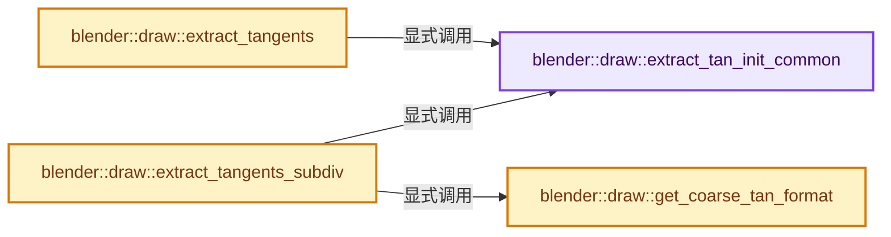
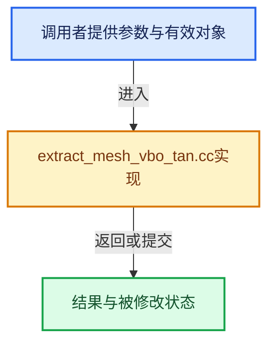

# 实现依赖专题：source/blender/draw/intern/mesh_extractors/extract_mesh_vbo_tan.cc

[方向导航](README.md) · [符号索引](../%E7%AC%A6%E5%8F%B7%E4%BE%9D%E8%B5%96%E4%B8%8E%E5%AE%9E%E7%8E%B0%E7%B4%A2%E5%BC%95.md)

本专题从正文实际调用进入，集中保存共享实现。函数有稳定锚点，可从调用处直接跳到对应完整函数；递归与互相调用通过回链组织。

## 本文件的实现关系






## 完整成员与函数实现

<a id="f-360e41de4e06b9b9"></a>

### `blender::draw::extract_tan_init_common`

实现位置：[source/blender/draw/intern/mesh_extractors/extract_mesh_vbo_tan.cc](../../../../../source/blender/draw/intern/mesh_extractors/extract_mesh_vbo_tan.cc) · L27—L147。

接口参数：

- `const MeshRenderData &mr`
- `const MeshBatchCache &cache`
- `GPUVertFormat *format`
- `gpu::VertAttrType gpu_attr_type`

**教学注释版**

<!-- annotated:77a254a3d32d28 -->

```cpp
static Array<Array<float4>> extract_tan_init_common(const MeshRenderData &mr,
                                                    const MeshBatchCache &cache,
                                                    GPUVertFormat *format,
                                                    gpu::VertAttrType gpu_attr_type)
{
  GPU_vertformat_deinterleave(format);

  VectorSet<std::string> tan_layers = cache.cd_used.tan;
  bool use_orco_tan = cache.cd_used.tan_orco;

  const StringRef active_name = mr.mesh->active_uv_map_name();
  const StringRef default_name = mr.mesh->default_uv_map_name();

  /* FIXME(#91838): This is to avoid a crash when orco tangent was requested but there are valid
   * uv layers. It would be better to fix the root cause. */
  // [讲解] tan_layers.is_empty：查询活项数量或键是否存在。
  if (tan_layers.is_empty() && use_orco_tan && !default_name.is_empty()) {
    // [讲解] tan_layers.add：按哈希与相等关系加入键或键值。
    tan_layers.add(default_name);
    use_orco_tan = false;
  }

  if (use_orco_tan) {
    Array<float4> tangents;
    if (mr.extract_type == MeshExtractType::BMesh) {
      Array<float3> positions = BM_mesh_vert_coords_alloc(mr.bm);
      BKE_mesh_orco_verts_transform(const_cast<Mesh *>(mr.mesh), positions, false);
      tangents = BKE_editmesh_orco_tangents_calc(
          mr.bm, mr.edit_bmesh->looptris, mr.bm_face_normals, mr.bm_loop_normals, positions);
    }
    else {
      Span<float3> orco;
      Array<float3> orco_allocated;
      if (const float3 *orco_ptr = static_cast<const float3 *>(
              CustomData_get_layer(&mr.mesh->vert_data, CD_ORCO)))
      {
        orco = Span(orco_ptr, mr.verts_num);
      }
      else {
        orco_allocated = mr.vert_positions;
        /* TODO: This is not thread-safe. Draw extraction should not modify the mesh. */
        BKE_mesh_orco_verts_transform(const_cast<Mesh *>(mr.mesh), orco_allocated, false);
        orco = orco_allocated;
      }
      tangents = bke::mesh::calc_orco_tangents(mr.vert_positions,
                                               mr.faces,
                                               mr.corner_verts,
                                               mr.mesh->corner_tris(),
                                               mr.mesh->corner_tri_faces(),
                                               mr.sharp_faces,
                                               mr.mesh->vert_normals(),
                                               mr.face_normals,
                                               mr.corner_normals,
                                               orco);
    }

    char attr_name[32], attr_safe_name[GPU_MAX_SAFE_ATTR_NAME];
    GPU_vertformat_safe_attr_name("orco", attr_safe_name, GPU_MAX_SAFE_ATTR_NAME);
    SNPRINTF(attr_name, "t%s", attr_safe_name);
    GPU_vertformat_attr_add(format, attr_name, gpu_attr_type);
    GPU_vertformat_alias_add(format, "t");
    GPU_vertformat_alias_add(format, "at");

    // [讲解] std::move：把表达式转换成可供移动重载选择的值类别；不保证真的移动，不结束源对象寿命，对const值可能选择复制。
    return {std::move(tangents)};
  }

  Vector<StringRef> uv_names;
  for (const StringRef name : tan_layers.as_span().take_front(MAX_MTFACE)) {
    // [讲解] tan_layers.contains：查询活项数量或键是否存在。
    if (tan_layers.contains(name)) {
      char attr_name[32], attr_safe_name[GPU_MAX_SAFE_ATTR_NAME];
      GPU_vertformat_safe_attr_name(name, attr_safe_name, GPU_MAX_SAFE_ATTR_NAME);
      /* Tangent layer name. */
      SNPRINTF(attr_name, "t%s", attr_safe_name);
      GPU_vertformat_attr_add(format, attr_name, gpu_attr_type);
      /* Active render layer name. */
      if (name == default_name) {
        GPU_vertformat_alias_add(format, "t");
      }
      /* Active display layer name. */
      if (name == active_name) {
        GPU_vertformat_alias_add(format, "at");
      }

      // [讲解] uv_names.append：在尾部建立新元素，必要时先扩大存储。
      uv_names.append(name);
    }
  }

  if (uv_names.is_empty()) {
    GPU_vertformat_attr_add(format, "dummy", gpu::VertAttrType::SFLOAT_32);
    return {};
  }

  Array<Array<float4>> results;
  if (mr.extract_type == MeshExtractType::BMesh) {
    results = BKE_editmesh_uv_tangents_calc(
        mr.bm, mr.edit_bmesh->looptris, mr.bm_face_normals, mr.bm_loop_normals, uv_names);
  }
  else {
    // [讲解] uv_names.size：用end_减begin_得到活元素数量。
    Array<VArraySpan<float2>> uv_maps(uv_names.size());
    Array<Span<float2>> uv_map_spans(uv_names.size());
    const bke::AttributeAccessor attributes = mr.mesh->attributes();
    for (const int i : uv_names.index_range()) {
      uv_maps[i] = *attributes.lookup<float2>(uv_names[i], bke::AttrDomain::Corner);
      uv_map_spans[i] = uv_maps[i];
    }
    results = bke::mesh::calc_uv_tangents(mr.vert_positions,
                                          mr.faces,
                                          mr.corner_verts,
                                          mr.mesh->corner_tris(),
                                          mr.mesh->corner_tri_faces(),
                                          mr.sharp_faces,
                                          mr.mesh->vert_normals(),
                                          mr.face_normals,
                                          mr.corner_normals,
                                          uv_map_spans);
  }

  if (format->attr_len == 0) {
    GPU_vertformat_attr_add(format, "dummy", gpu::VertAttrType::SFLOAT_32);
  }

  return results;
}
```

<details>
<summary>核对原始源码：source/blender/draw/intern/mesh_extractors/extract_mesh_vbo_tan.cc · L27—L147</summary>

<!-- original:77a254a3d32d28:source/blender/draw/intern/mesh_extractors/extract_mesh_vbo_tan.cc:27:147 -->

```cpp
static Array<Array<float4>> extract_tan_init_common(const MeshRenderData &mr,
                                                    const MeshBatchCache &cache,
                                                    GPUVertFormat *format,
                                                    gpu::VertAttrType gpu_attr_type)
{
  GPU_vertformat_deinterleave(format);

  VectorSet<std::string> tan_layers = cache.cd_used.tan;
  bool use_orco_tan = cache.cd_used.tan_orco;

  const StringRef active_name = mr.mesh->active_uv_map_name();
  const StringRef default_name = mr.mesh->default_uv_map_name();

  /* FIXME(#91838): This is to avoid a crash when orco tangent was requested but there are valid
   * uv layers. It would be better to fix the root cause. */
  if (tan_layers.is_empty() && use_orco_tan && !default_name.is_empty()) {
    tan_layers.add(default_name);
    use_orco_tan = false;
  }

  if (use_orco_tan) {
    Array<float4> tangents;
    if (mr.extract_type == MeshExtractType::BMesh) {
      Array<float3> positions = BM_mesh_vert_coords_alloc(mr.bm);
      BKE_mesh_orco_verts_transform(const_cast<Mesh *>(mr.mesh), positions, false);
      tangents = BKE_editmesh_orco_tangents_calc(
          mr.bm, mr.edit_bmesh->looptris, mr.bm_face_normals, mr.bm_loop_normals, positions);
    }
    else {
      Span<float3> orco;
      Array<float3> orco_allocated;
      if (const float3 *orco_ptr = static_cast<const float3 *>(
              CustomData_get_layer(&mr.mesh->vert_data, CD_ORCO)))
      {
        orco = Span(orco_ptr, mr.verts_num);
      }
      else {
        orco_allocated = mr.vert_positions;
        /* TODO: This is not thread-safe. Draw extraction should not modify the mesh. */
        BKE_mesh_orco_verts_transform(const_cast<Mesh *>(mr.mesh), orco_allocated, false);
        orco = orco_allocated;
      }
      tangents = bke::mesh::calc_orco_tangents(mr.vert_positions,
                                               mr.faces,
                                               mr.corner_verts,
                                               mr.mesh->corner_tris(),
                                               mr.mesh->corner_tri_faces(),
                                               mr.sharp_faces,
                                               mr.mesh->vert_normals(),
                                               mr.face_normals,
                                               mr.corner_normals,
                                               orco);
    }

    char attr_name[32], attr_safe_name[GPU_MAX_SAFE_ATTR_NAME];
    GPU_vertformat_safe_attr_name("orco", attr_safe_name, GPU_MAX_SAFE_ATTR_NAME);
    SNPRINTF(attr_name, "t%s", attr_safe_name);
    GPU_vertformat_attr_add(format, attr_name, gpu_attr_type);
    GPU_vertformat_alias_add(format, "t");
    GPU_vertformat_alias_add(format, "at");

    return {std::move(tangents)};
  }

  Vector<StringRef> uv_names;
  for (const StringRef name : tan_layers.as_span().take_front(MAX_MTFACE)) {
    if (tan_layers.contains(name)) {
      char attr_name[32], attr_safe_name[GPU_MAX_SAFE_ATTR_NAME];
      GPU_vertformat_safe_attr_name(name, attr_safe_name, GPU_MAX_SAFE_ATTR_NAME);
      /* Tangent layer name. */
      SNPRINTF(attr_name, "t%s", attr_safe_name);
      GPU_vertformat_attr_add(format, attr_name, gpu_attr_type);
      /* Active render layer name. */
      if (name == default_name) {
        GPU_vertformat_alias_add(format, "t");
      }
      /* Active display layer name. */
      if (name == active_name) {
        GPU_vertformat_alias_add(format, "at");
      }

      uv_names.append(name);
    }
  }

  if (uv_names.is_empty()) {
    GPU_vertformat_attr_add(format, "dummy", gpu::VertAttrType::SFLOAT_32);
    return {};
  }

  Array<Array<float4>> results;
  if (mr.extract_type == MeshExtractType::BMesh) {
    results = BKE_editmesh_uv_tangents_calc(
        mr.bm, mr.edit_bmesh->looptris, mr.bm_face_normals, mr.bm_loop_normals, uv_names);
  }
  else {
    Array<VArraySpan<float2>> uv_maps(uv_names.size());
    Array<Span<float2>> uv_map_spans(uv_names.size());
    const bke::AttributeAccessor attributes = mr.mesh->attributes();
    for (const int i : uv_names.index_range()) {
      uv_maps[i] = *attributes.lookup<float2>(uv_names[i], bke::AttrDomain::Corner);
      uv_map_spans[i] = uv_maps[i];
    }
    results = bke::mesh::calc_uv_tangents(mr.vert_positions,
                                          mr.faces,
                                          mr.corner_verts,
                                          mr.mesh->corner_tris(),
                                          mr.mesh->corner_tri_faces(),
                                          mr.sharp_faces,
                                          mr.mesh->vert_normals(),
                                          mr.face_normals,
                                          mr.corner_normals,
                                          uv_map_spans);
  }

  if (format->attr_len == 0) {
    GPU_vertformat_attr_add(format, "dummy", gpu::VertAttrType::SFLOAT_32);
  }

  return results;
}
```

</details>

**沿实际写入检查状态**

- `use_orco_tan = false;`
- `tangents = BKE_editmesh_orco_tangents_calc(`
- `orco = Span(orco_ptr, mr.verts_num);`
- `orco_allocated = mr.vert_positions;`
- `orco = orco_allocated;`
- `tangents = bke::mesh::calc_orco_tangents(mr.vert_positions,`
- `results = BKE_editmesh_uv_tangents_calc(`
- `uv_maps[i] = *attributes.lookup<float2>(uv_names[i], bke::AttrDomain::Corner);`
- `uv_map_spans[i] = uv_maps[i];`
- `results = bke::mesh::calc_uv_tangents(mr.vert_positions,`

**结果出口**

- `return {std::move(tangents)};`
- `return {};`
- `return results;`

**继续追踪实现**

- `GPU_vertformat_deinterleave` → [blender::GPU_vertformat_deinterleave · L535](%E4%BE%9D%E8%B5%96-gpu_vertex_format-4f7148.md#f-a5e5e2b43e5e9f26)。
- `mr.mesh->active_uv_map_name` → [调用协议](../%E6%A8%A1%E6%9D%BF%E5%AE%8F%E4%B8%8E%E5%8A%A8%E6%80%81%E5%88%86%E6%B4%BE%E5%8D%8F%E8%AE%AE.md)：接收对象类型依赖auto、返回值或模板实例；不按同名猜测目标。调用位置L37。
- `mr.mesh->default_uv_map_name` → [调用协议](../%E6%A8%A1%E6%9D%BF%E5%AE%8F%E4%B8%8E%E5%8A%A8%E6%80%81%E5%88%86%E6%B4%BE%E5%8D%8F%E8%AE%AE.md)：接收对象类型依赖auto、返回值或模板实例；不按同名猜测目标。调用位置L38。
- `tan_layers.is_empty` → [blender::VectorSet::is_empty · L619](../01-%E5%9F%BA%E7%A1%80%E5%AE%B9%E5%99%A8%E4%B8%8E%E7%8E%B0%E4%BB%A3CPP/14-VectorSet%E7%A8%B3%E5%AE%9A%E7%B4%A2%E5%BC%95%E4%B8%8E%E5%8E%BB%E9%87%8D.md#f-0d62a24040f63dec)。
- `default_name.is_empty` → [调用协议](../%E6%A8%A1%E6%9D%BF%E5%AE%8F%E4%B8%8E%E5%8A%A8%E6%80%81%E5%88%86%E6%B4%BE%E5%8D%8F%E8%AE%AE.md)：由接收对象具体类型或运行时策略提供实现。调用位置L42。
- `tan_layers.add` → [blender::VectorSet::add · L351](../01-%E5%9F%BA%E7%A1%80%E5%AE%B9%E5%99%A8%E4%B8%8E%E7%8E%B0%E4%BB%A3CPP/14-VectorSet%E7%A8%B3%E5%AE%9A%E7%B4%A2%E5%BC%95%E4%B8%8E%E5%8E%BB%E9%87%8D.md#f-96bfe2bf376d6298)；[blender::VectorSet::add · L355](../01-%E5%9F%BA%E7%A1%80%E5%AE%B9%E5%99%A8%E4%B8%8E%E7%8E%B0%E4%BB%A3CPP/14-VectorSet%E7%A8%B3%E5%AE%9A%E7%B4%A2%E5%BC%95%E4%B8%8E%E5%8E%BB%E9%87%8D.md#f-c0474f6a0568033b)。同名重载需按实参类型选择。
- `BM_mesh_vert_coords_alloc` → [blender::BM_mesh_vert_coords_alloc · L1337](%E4%BE%9D%E8%B5%96-bmesh_mesh-283e2d.md#f-bc4760be1676a19c)。
- `BKE_mesh_orco_verts_transform` → [BKE_mesh_orco_verts_transform · L1737](03-MPoly%E8%BF%81%E7%A7%BB%E4%B8%8E%E5%85%BC%E5%AE%B9.md#f-0310af64073b6afe)；[BKE_mesh_orco_verts_transform · L1760](03-MPoly%E8%BF%81%E7%A7%BB%E4%B8%8E%E5%85%BC%E5%AE%B9.md#f-1e12235ffe4ed6d7)。同名重载需按实参类型选择。
- `BKE_editmesh_orco_tangents_calc` → [blender::BKE_editmesh_orco_tangents_calc · L235](%E4%BE%9D%E8%B5%96-editmesh_tangent-0227c5.md#f-5526ef67ffc09ad3)。
- `CustomData_get_layer` → [blender::CustomData_get_layer · L3308](%E4%BE%9D%E8%B5%96-customdata-2eef81.md#f-add1273f3ef3e57b)。
- `Span` → [blender::Span](../01-%E5%9F%BA%E7%A1%80%E5%AE%B9%E5%99%A8%E4%B8%8E%E7%8E%B0%E4%BB%A3CPP/%E4%BE%9D%E8%B5%96-BLI_span-6aa95f.md#t-8765a8e0c1d5)；[blender::Span](../01-%E5%9F%BA%E7%A1%80%E5%AE%B9%E5%99%A8%E4%B8%8E%E7%8E%B0%E4%BB%A3CPP/%E4%BE%9D%E8%B5%96-BLI_index_range-7d7cc5.md#t-86091874a1c0)；[blender::Span](%E4%BE%9D%E8%B5%96-DNA_pointcloud_types-cfb82c.md#t-112aa6ed842c)；[blender::Span](%E4%BE%9D%E8%B5%96-DNA_node_types-6708b9.md#t-49ec6fbb9b69)；[blender::Span](%E4%BE%9D%E8%B5%96-DNA_mesh_types-81f02e.md#t-184fd48fb638)；[blender::Span](%E4%BE%9D%E8%B5%96-DNA_anim_types-39c5d9.md#t-d841071994c2)；[blender::Span](%E4%BE%9D%E8%B5%96-RNA_path_fwd-79c989.md#t-4dbb08969e41)。
- `bke::mesh::calc_orco_tangents` → [blender::bke::mesh::calc_orco_tangents · L350](%E4%BE%9D%E8%B5%96-mesh_tangent-70e398.md#f-c5a261f7fac29262)。
- `mr.mesh->corner_tris` → [调用协议](../%E6%A8%A1%E6%9D%BF%E5%AE%8F%E4%B8%8E%E5%8A%A8%E6%80%81%E5%88%86%E6%B4%BE%E5%8D%8F%E8%AE%AE.md)：接收对象类型依赖auto、返回值或模板实例；不按同名猜测目标。调用位置L72。
- `mr.mesh->corner_tri_faces` → [调用协议](../%E6%A8%A1%E6%9D%BF%E5%AE%8F%E4%B8%8E%E5%8A%A8%E6%80%81%E5%88%86%E6%B4%BE%E5%8D%8F%E8%AE%AE.md)：接收对象类型依赖auto、返回值或模板实例；不按同名猜测目标。调用位置L73。
- `mr.mesh->vert_normals` → [调用协议](../%E6%A8%A1%E6%9D%BF%E5%AE%8F%E4%B8%8E%E5%8A%A8%E6%80%81%E5%88%86%E6%B4%BE%E5%8D%8F%E8%AE%AE.md)：接收对象类型依赖auto、返回值或模板实例；不按同名猜测目标。调用位置L75。
- `GPU_vertformat_safe_attr_name` → [blender::GPU_vertformat_safe_attr_name · L504](%E4%BE%9D%E8%B5%96-gpu_vertex_format-4f7148.md#f-eee6d101d3a4213e)。
- `SNPRINTF` → [SNPRINTF · L601](../01-%E5%9F%BA%E7%A1%80%E5%AE%B9%E5%99%A8%E4%B8%8E%E7%8E%B0%E4%BB%A3CPP/%E4%BE%9D%E8%B5%96-BLI_string-b43058.md#m-6193d55b5ab8)。宏定义由构建条件选择。
- `GPU_vertformat_attr_add` → [blender::GPU_vertformat_attr_add · L389](%E4%BE%9D%E8%B5%96-gpu_vertex_format-4f7148.md#f-a36e23f37b97fff4)。
- `GPU_vertformat_alias_add` → [blender::GPU_vertformat_alias_add · L418](%E4%BE%9D%E8%B5%96-gpu_vertex_format-4f7148.md#f-5b19cd8281d0191e)。
- `std::move` → [外部契约](https://eel.is/c++draft/utility.forward)：把表达式转换成可供移动重载选择的值类别；不保证真的移动，不结束源对象寿命，对const值可能选择复制。
- `tan_layers.as_span().take_front` → [调用协议](../%E6%A8%A1%E6%9D%BF%E5%AE%8F%E4%B8%8E%E5%8A%A8%E6%80%81%E5%88%86%E6%B4%BE%E5%8D%8F%E8%AE%AE.md)：接收对象类型依赖auto、返回值或模板实例；不按同名猜测目标。调用位置L92。
- `tan_layers.as_span` → [blender::VectorSet::as_span · L326](../01-%E5%9F%BA%E7%A1%80%E5%AE%B9%E5%99%A8%E4%B8%8E%E7%8E%B0%E4%BB%A3CPP/14-VectorSet%E7%A8%B3%E5%AE%9A%E7%B4%A2%E5%BC%95%E4%B8%8E%E5%8E%BB%E9%87%8D.md#f-76ed81b1cfbe99ad)。
- `tan_layers.contains` → [blender::VectorSet::contains · L406](../01-%E5%9F%BA%E7%A1%80%E5%AE%B9%E5%99%A8%E4%B8%8E%E7%8E%B0%E4%BB%A3CPP/14-VectorSet%E7%A8%B3%E5%AE%9A%E7%B4%A2%E5%BC%95%E4%B8%8E%E5%8E%BB%E9%87%8D.md#f-c940dd79693ca442)。
- `uv_names.append` → [blender::Vector::append · L498](../01-%E5%9F%BA%E7%A1%80%E5%AE%B9%E5%99%A8%E4%B8%8E%E7%8E%B0%E4%BB%A3CPP/11-Vector%E6%8F%92%E5%85%A5%E5%88%A0%E9%99%A4%E4%B8%8E%E9%87%8D%E6%8E%92.md#f-5bde268a69e443ec)；[blender::Vector::append · L502](../01-%E5%9F%BA%E7%A1%80%E5%AE%B9%E5%99%A8%E4%B8%8E%E7%8E%B0%E4%BB%A3CPP/11-Vector%E6%8F%92%E5%85%A5%E5%88%A0%E9%99%A4%E4%B8%8E%E9%87%8D%E6%8E%92.md#f-591e0b15e6308532)。同名重载需按实参类型选择。
- `uv_names.is_empty` → [blender::Vector::is_empty · L792](../01-%E5%9F%BA%E7%A1%80%E5%AE%B9%E5%99%A8%E4%B8%8E%E7%8E%B0%E4%BB%A3CPP/11-Vector%E6%8F%92%E5%85%A5%E5%88%A0%E9%99%A4%E4%B8%8E%E9%87%8D%E6%8E%92.md#f-937bbd9cb80bdcc8)。
- `BKE_editmesh_uv_tangents_calc` → [blender::BKE_editmesh_uv_tangents_calc · L182](%E4%BE%9D%E8%B5%96-editmesh_tangent-0227c5.md#f-f8d9a8fbf17e14c8)。
- `uv_names.size` → [blender::Vector::size · L780](../01-%E5%9F%BA%E7%A1%80%E5%AE%B9%E5%99%A8%E4%B8%8E%E7%8E%B0%E4%BB%A3CPP/11-Vector%E6%8F%92%E5%85%A5%E5%88%A0%E9%99%A4%E4%B8%8E%E9%87%8D%E6%8E%92.md#f-714773731767349c)。
- `mr.mesh->attributes` → [调用协议](../%E6%A8%A1%E6%9D%BF%E5%AE%8F%E4%B8%8E%E5%8A%A8%E6%80%81%E5%88%86%E6%B4%BE%E5%8D%8F%E8%AE%AE.md)：接收对象类型依赖auto、返回值或模板实例；不按同名猜测目标。调用位置L125。
- `uv_names.index_range` → [blender::Vector::index_range · L1026](../01-%E5%9F%BA%E7%A1%80%E5%AE%B9%E5%99%A8%E4%B8%8E%E7%8E%B0%E4%BB%A3CPP/12-Vector%E5%BC%82%E5%B8%B8%E5%AE%89%E5%85%A8%E4%B8%8E%E8%BE%B9%E7%95%8C.md#f-ac29cf36ef185ab9)。
- `attributes.lookup<float2>` → [blender::bke::AttributeAccessor::lookup · L401](%E4%BE%9D%E8%B5%96-attribute_access-bceef3.md#f-4673351b7bb3b651)；[blender::bke::AttributeAccessor::lookup · L585](08-AttributeAccessor%E6%8E%A5%E5%8F%A3.md#f-432b90c796a80893)；[blender::bke::AttributeAccessor::lookup · L602](08-AttributeAccessor%E6%8E%A5%E5%8F%A3.md#f-a60c1a45b85155d9)；[blender::bke::AttributeAccessor::lookup · L611](08-AttributeAccessor%E6%8E%A5%E5%8F%A3.md#f-16ca459803fc30a6)；[blender::bke::AttributeAccessor::lookup · L620](08-AttributeAccessor%E6%8E%A5%E5%8F%A3.md#f-403fd8a9d1a16c6d)。同名重载需按实参类型选择。
- `bke::mesh::calc_uv_tangents` → [blender::bke::mesh::calc_uv_tangents · L298](%E4%BE%9D%E8%B5%96-mesh_tangent-70e398.md#f-c9090db32017b89e)。

<a id="f-689aaad7bde1fafc"></a>

### `blender::draw::extract_tangents`

实现位置：[source/blender/draw/intern/mesh_extractors/extract_mesh_vbo_tan.cc](../../../../../source/blender/draw/intern/mesh_extractors/extract_mesh_vbo_tan.cc) · L149—L190。

接口参数：

- `const MeshRenderData &mr`
- `const MeshBatchCache &cache`
- `const bool use_hq`

**教学注释版**

<!-- annotated:a45b88ee80b963 -->

```cpp
gpu::VertBufPtr extract_tangents(const MeshRenderData &mr,
                                 const MeshBatchCache &cache,
                                 const bool use_hq)
{
  gpu::VertAttrType gpu_attr_type = use_hq ? gpu::VertAttrType::SNORM_16_16_16_16 :
                                             gpu::VertAttrType::SNORM_10_10_10_2;

  GPUVertFormat format = {0};
  const Array<Array<float4>> tangents = extract_tan_init_common(mr, cache, &format, gpu_attr_type);

  gpu::VertBufPtr vbo = gpu::VertBufPtr(GPU_vertbuf_create_with_format(format));
  GPU_vertbuf_data_alloc(*vbo, mr.corners_num);

  if (use_hq) {
    MutableSpan tan_data = vbo->data<short4>();
    int vbo_index = 0;
    // [讲解] tangents.index_range：查询固定有效长度及其索引范围。
    for (const int i : tangents.index_range()) {
      const Span<float4> layer_data = tangents[i];
      for (int corner = 0; corner < mr.corners_num; corner++) {
        tan_data[vbo_index] = gpu::convert_normal<short4>(float3(layer_data[corner]));
        tan_data[vbo_index].w = (layer_data[corner][3] > 0.0f) ? SHRT_MAX : SHRT_MIN;
        vbo_index++;
      }
    }
    // [讲解] tan_data.size：查询视图长度或生成对应有效索引区间。
    BLI_assert(vbo_index == tan_data.size());
  }
  else {
    MutableSpan tan_data = vbo->data<int1010102_norm>();
    int vbo_index = 0;
    for (const int i : tangents.index_range()) {
      const Span<float4> layer_data = tangents[i];
      for (int corner = 0; corner < mr.corners_num; corner++) {
        tan_data[vbo_index] = gpu::convert_normal<int1010102_norm>(float3(layer_data[corner]));
        tan_data[vbo_index].w = (layer_data[corner][3] > 0.0f) ? 1 : -2;
        vbo_index++;
      }
    }
    BLI_assert(vbo_index == tan_data.size());
  }

  return vbo;
}
```

<details>
<summary>核对原始源码：source/blender/draw/intern/mesh_extractors/extract_mesh_vbo_tan.cc · L149—L190</summary>

<!-- original:a45b88ee80b963:source/blender/draw/intern/mesh_extractors/extract_mesh_vbo_tan.cc:149:190 -->

```cpp
gpu::VertBufPtr extract_tangents(const MeshRenderData &mr,
                                 const MeshBatchCache &cache,
                                 const bool use_hq)
{
  gpu::VertAttrType gpu_attr_type = use_hq ? gpu::VertAttrType::SNORM_16_16_16_16 :
                                             gpu::VertAttrType::SNORM_10_10_10_2;

  GPUVertFormat format = {0};
  const Array<Array<float4>> tangents = extract_tan_init_common(mr, cache, &format, gpu_attr_type);

  gpu::VertBufPtr vbo = gpu::VertBufPtr(GPU_vertbuf_create_with_format(format));
  GPU_vertbuf_data_alloc(*vbo, mr.corners_num);

  if (use_hq) {
    MutableSpan tan_data = vbo->data<short4>();
    int vbo_index = 0;
    for (const int i : tangents.index_range()) {
      const Span<float4> layer_data = tangents[i];
      for (int corner = 0; corner < mr.corners_num; corner++) {
        tan_data[vbo_index] = gpu::convert_normal<short4>(float3(layer_data[corner]));
        tan_data[vbo_index].w = (layer_data[corner][3] > 0.0f) ? SHRT_MAX : SHRT_MIN;
        vbo_index++;
      }
    }
    BLI_assert(vbo_index == tan_data.size());
  }
  else {
    MutableSpan tan_data = vbo->data<int1010102_norm>();
    int vbo_index = 0;
    for (const int i : tangents.index_range()) {
      const Span<float4> layer_data = tangents[i];
      for (int corner = 0; corner < mr.corners_num; corner++) {
        tan_data[vbo_index] = gpu::convert_normal<int1010102_norm>(float3(layer_data[corner]));
        tan_data[vbo_index].w = (layer_data[corner][3] > 0.0f) ? 1 : -2;
        vbo_index++;
      }
    }
    BLI_assert(vbo_index == tan_data.size());
  }

  return vbo;
}
```

</details>

**沿实际写入检查状态**

- `tan_data[vbo_index] = gpu::convert_normal<short4>(float3(layer_data[corner]));`
- `tan_data[vbo_index].w = (layer_data[corner][3] > 0.0f) ? SHRT_MAX : SHRT_MIN;`
- `tan_data[vbo_index] = gpu::convert_normal<int1010102_norm>(float3(layer_data[corner]));`
- `tan_data[vbo_index].w = (layer_data[corner][3] > 0.0f) ? 1 : -2;`

**结果出口**

- `return vbo;`

**继续追踪实现**

- `extract_tan_init_common` → [blender::draw::extract_tan_init_common · L27](%E4%BE%9D%E8%B5%96-extract_mesh_vbo_tan-163203.md#f-360e41de4e06b9b9)。
- `gpu::VertBufPtr` → [调用协议](../%E6%A8%A1%E6%9D%BF%E5%AE%8F%E4%B8%8E%E5%8A%A8%E6%80%81%E5%88%86%E6%B4%BE%E5%8D%8F%E8%AE%AE.md)：函数指针、局部可调用对象或未展开的宏；必须结合调用者环境。调用位置L159。
- `GPU_vertbuf_create_with_format` → [blender::GPU_vertbuf_create_with_format · L71](%E4%BE%9D%E8%B5%96-GPU_vertex_buffer-d7610b.md#f-bd43fe034e852138)。
- `GPU_vertbuf_data_alloc` → [blender::GPU_vertbuf_data_alloc · L172](%E4%BE%9D%E8%B5%96-gpu_vertex_buffer-eaa662.md#f-8ee5cf106e0f2b0f)。
- `vbo->data<short4>` → [blender::draw::data · L124](%E4%BE%9D%E8%B5%96-DRW_gpu_wrapper-c80c4f.md#f-dc115dc22e0c9f33)；[blender::draw::data · L129](%E4%BE%9D%E8%B5%96-DRW_gpu_wrapper-c80c4f.md#f-5f325cb75387045c)。同名重载需按实参类型选择。
- `tangents.index_range` → [blender::Array::index_range · L371](../01-%E5%9F%BA%E7%A1%80%E5%AE%B9%E5%99%A8%E4%B8%8E%E7%8E%B0%E4%BB%A3CPP/08-Array%E5%A4%8D%E5%88%B6%E7%A7%BB%E5%8A%A8%E4%B8%8E%E9%94%80%E6%AF%81.md#f-50a09e14742887a0)。
- `gpu::convert_normal<short4>` → [blender::gpu::convert_normal · L21](%E4%BE%9D%E8%B5%96-GPU_attribute_convert-3259c7.md#f-d24eef906ebcd8b5)；[blender::gpu::convert_normal · L26](%E4%BE%9D%E8%B5%96-GPU_attribute_convert-3259c7.md#f-40f0824f9b7edbbb)。同名重载需按实参类型选择。
- `float3` → [float3 · L641](%E4%BE%9D%E8%B5%96-smaa-b67bc2.md#m-0ea8254cfdb4)。宏定义由构建条件选择。
- `BLI_assert` → [BLI_assert · L48](../01-%E5%9F%BA%E7%A1%80%E5%AE%B9%E5%99%A8%E4%B8%8E%E7%8E%B0%E4%BB%A3CPP/%E4%BE%9D%E8%B5%96-BLI_assert-cc98e8.md#m-57a88495704d)；[BLI_assert · L63](../01-%E5%9F%BA%E7%A1%80%E5%AE%B9%E5%99%A8%E4%B8%8E%E7%8E%B0%E4%BB%A3CPP/%E4%BE%9D%E8%B5%96-BLI_assert-cc98e8.md#m-d07050020cb5)。宏定义由构建条件选择。
- `tan_data.size` → [blender::MutableSpan::size · L499](../01-%E5%9F%BA%E7%A1%80%E5%AE%B9%E5%99%A8%E4%B8%8E%E7%8E%B0%E4%BB%A3CPP/06-MutableSpan%E5%8F%AF%E5%86%99%E8%A7%86%E5%9B%BE.md#f-1de6a66839c304a8)；[blender::gpu::shader::parser::MutableSpan::size · L87](%E4%BE%9D%E8%B5%96-utils-06433d.md#f-5e684af6ee7990e9)。同名重载需按实参类型选择。
- `vbo->data<int1010102_norm>` → [blender::draw::data · L124](%E4%BE%9D%E8%B5%96-DRW_gpu_wrapper-c80c4f.md#f-dc115dc22e0c9f33)；[blender::draw::data · L129](%E4%BE%9D%E8%B5%96-DRW_gpu_wrapper-c80c4f.md#f-5f325cb75387045c)。同名重载需按实参类型选择。
- `gpu::convert_normal<int1010102_norm>` → [blender::gpu::convert_normal · L21](%E4%BE%9D%E8%B5%96-GPU_attribute_convert-3259c7.md#f-d24eef906ebcd8b5)；[blender::gpu::convert_normal · L26](%E4%BE%9D%E8%B5%96-GPU_attribute_convert-3259c7.md#f-40f0824f9b7edbbb)。同名重载需按实参类型选择。

<a id="f-2d2db4faadcf37ba"></a>

### `blender::draw::get_coarse_tan_format`

实现位置：[source/blender/draw/intern/mesh_extractors/extract_mesh_vbo_tan.cc](../../../../../source/blender/draw/intern/mesh_extractors/extract_mesh_vbo_tan.cc) · L192—L197。

**教学注释版**

<!-- annotated:505d80448a8ef7 -->

```cpp
static const GPUVertFormat &get_coarse_tan_format()
{
  static GPUVertFormat format = GPU_vertformat_from_attribute(
      "tan", gpu::VertAttrType::SFLOAT_32_32_32_32);
  return format;
}
```

<details>
<summary>核对原始源码：source/blender/draw/intern/mesh_extractors/extract_mesh_vbo_tan.cc · L192—L197</summary>

<!-- original:505d80448a8ef7:source/blender/draw/intern/mesh_extractors/extract_mesh_vbo_tan.cc:192:197 -->

```cpp
static const GPUVertFormat &get_coarse_tan_format()
{
  static GPUVertFormat format = GPU_vertformat_from_attribute(
      "tan", gpu::VertAttrType::SFLOAT_32_32_32_32);
  return format;
}
```

</details>

**结果出口**

- `return format;`

**继续追踪实现**

- `GPU_vertformat_from_attribute` → [blender::GPU_vertformat_from_attribute · L427](%E4%BE%9D%E8%B5%96-gpu_vertex_format-4f7148.md#f-2643d25087989f8e)。

<a id="f-239861aa4dfcad1d"></a>

### `blender::draw::extract_tangents_subdiv`

实现位置：[source/blender/draw/intern/mesh_extractors/extract_mesh_vbo_tan.cc](../../../../../source/blender/draw/intern/mesh_extractors/extract_mesh_vbo_tan.cc) · L199—L236。

接口参数：

- `const MeshRenderData &mr`
- `const DRWSubdivCache &subdiv_cache`
- `const MeshBatchCache &cache`

**教学注释版**

<!-- annotated:e264ba1e2eed61 -->

```cpp
gpu::VertBufPtr extract_tangents_subdiv(const MeshRenderData &mr,
                                        const DRWSubdivCache &subdiv_cache,
                                        const MeshBatchCache &cache)
{
  gpu::VertAttrType gpu_attr_type = gpu::VertAttrType::SFLOAT_32_32_32_32;
  GPUVertFormat format = {0};
  const Array<Array<float4>> tangents = extract_tan_init_common(mr, cache, &format, gpu_attr_type);

  gpu::VertBufPtr vbo = gpu::VertBufPtr(
      GPU_vertbuf_create_on_device(format, subdiv_cache.num_subdiv_loops));

  gpu::VertBuf *coarse_vbo = GPU_vertbuf_calloc();
  /* Dynamic as we upload and interpolate layers one at a time. */
  GPU_vertbuf_init_with_format_ex(*coarse_vbo, get_coarse_tan_format(), GPU_USAGE_DYNAMIC);
  GPU_vertbuf_data_alloc(*coarse_vbo, mr.corners_num);

  /* Index of the tangent layer in the compact buffer. Used layers are stored in a single buffer.
   */
  int pack_layer_index = 0;
  // [讲解] tangents.index_range：查询固定有效长度及其索引范围。
  for (const int i : tangents.index_range()) {
    float4 *tan_data = coarse_vbo->data<float4>().data();
    const Span<float4> values = tangents[i];
    for (int corner = 0; corner < mr.corners_num; corner++) {
      *tan_data = values[corner];
      (*tan_data)[3] = (values[corner][3] > 0.0f) ? 1.0f : -1.0f;
      tan_data++;
    }

    /* Ensure data is uploaded properly. */
    GPU_vertbuf_tag_dirty(coarse_vbo);
    /* Include stride in offset. */
    const int dst_offset = int(subdiv_cache.num_subdiv_loops) * 4 * pack_layer_index++;
    draw_subdiv_interp_custom_data(subdiv_cache, *coarse_vbo, *vbo, GPU_COMP_F32, 4, dst_offset);
  }

  GPU_vertbuf_discard(coarse_vbo);
  return vbo;
}
```

<details>
<summary>核对原始源码：source/blender/draw/intern/mesh_extractors/extract_mesh_vbo_tan.cc · L199—L236</summary>

<!-- original:e264ba1e2eed61:source/blender/draw/intern/mesh_extractors/extract_mesh_vbo_tan.cc:199:236 -->

```cpp
gpu::VertBufPtr extract_tangents_subdiv(const MeshRenderData &mr,
                                        const DRWSubdivCache &subdiv_cache,
                                        const MeshBatchCache &cache)
{
  gpu::VertAttrType gpu_attr_type = gpu::VertAttrType::SFLOAT_32_32_32_32;
  GPUVertFormat format = {0};
  const Array<Array<float4>> tangents = extract_tan_init_common(mr, cache, &format, gpu_attr_type);

  gpu::VertBufPtr vbo = gpu::VertBufPtr(
      GPU_vertbuf_create_on_device(format, subdiv_cache.num_subdiv_loops));

  gpu::VertBuf *coarse_vbo = GPU_vertbuf_calloc();
  /* Dynamic as we upload and interpolate layers one at a time. */
  GPU_vertbuf_init_with_format_ex(*coarse_vbo, get_coarse_tan_format(), GPU_USAGE_DYNAMIC);
  GPU_vertbuf_data_alloc(*coarse_vbo, mr.corners_num);

  /* Index of the tangent layer in the compact buffer. Used layers are stored in a single buffer.
   */
  int pack_layer_index = 0;
  for (const int i : tangents.index_range()) {
    float4 *tan_data = coarse_vbo->data<float4>().data();
    const Span<float4> values = tangents[i];
    for (int corner = 0; corner < mr.corners_num; corner++) {
      *tan_data = values[corner];
      (*tan_data)[3] = (values[corner][3] > 0.0f) ? 1.0f : -1.0f;
      tan_data++;
    }

    /* Ensure data is uploaded properly. */
    GPU_vertbuf_tag_dirty(coarse_vbo);
    /* Include stride in offset. */
    const int dst_offset = int(subdiv_cache.num_subdiv_loops) * 4 * pack_layer_index++;
    draw_subdiv_interp_custom_data(subdiv_cache, *coarse_vbo, *vbo, GPU_COMP_F32, 4, dst_offset);
  }

  GPU_vertbuf_discard(coarse_vbo);
  return vbo;
}
```

</details>

**结果出口**

- `return vbo;`

**继续追踪实现**

- `extract_tan_init_common` → [blender::draw::extract_tan_init_common · L27](%E4%BE%9D%E8%B5%96-extract_mesh_vbo_tan-163203.md#f-360e41de4e06b9b9)。
- `gpu::VertBufPtr` → [调用协议](../%E6%A8%A1%E6%9D%BF%E5%AE%8F%E4%B8%8E%E5%8A%A8%E6%80%81%E5%88%86%E6%B4%BE%E5%8D%8F%E8%AE%AE.md)：函数指针、局部可调用对象或未展开的宏；必须结合调用者环境。调用位置L207。
- `GPU_vertbuf_create_on_device` → [blender::GPU_vertbuf_create_on_device · L137](%E4%BE%9D%E8%B5%96-gpu_vertex_buffer-eaa662.md#f-abf244a18691f929)。
- `GPU_vertbuf_calloc` → [blender::GPU_vertbuf_calloc · L112](%E4%BE%9D%E8%B5%96-gpu_vertex_buffer-eaa662.md#f-bddd6e0944c513f4)。
- `GPU_vertbuf_init_with_format_ex` → [blender::GPU_vertbuf_init_with_format_ex · L124](%E4%BE%9D%E8%B5%96-gpu_vertex_buffer-eaa662.md#f-3e5da22fa9f3e3b7)。
- `get_coarse_tan_format` → [blender::draw::get_coarse_tan_format · L192](%E4%BE%9D%E8%B5%96-extract_mesh_vbo_tan-163203.md#f-2d2db4faadcf37ba)。
- `GPU_vertbuf_data_alloc` → [blender::GPU_vertbuf_data_alloc · L172](%E4%BE%9D%E8%B5%96-gpu_vertex_buffer-eaa662.md#f-8ee5cf106e0f2b0f)。
- `tangents.index_range` → [blender::Array::index_range · L371](../01-%E5%9F%BA%E7%A1%80%E5%AE%B9%E5%99%A8%E4%B8%8E%E7%8E%B0%E4%BB%A3CPP/08-Array%E5%A4%8D%E5%88%B6%E7%A7%BB%E5%8A%A8%E4%B8%8E%E9%94%80%E6%AF%81.md#f-50a09e14742887a0)。
- `coarse_vbo->data<float4>().data` → [调用协议](../%E6%A8%A1%E6%9D%BF%E5%AE%8F%E4%B8%8E%E5%8A%A8%E6%80%81%E5%88%86%E6%B4%BE%E5%8D%8F%E8%AE%AE.md)：接收对象类型依赖auto、返回值或模板实例；不按同名猜测目标。调用位置L219。
- `coarse_vbo->data<float4>` → [blender::gpu::VertBuf::data · L220](%E4%BE%9D%E8%B5%96-GPU_vertex_buffer-d7610b.md#f-e72412fdddda8bf5)。
- `GPU_vertbuf_tag_dirty` → [blender::GPU_vertbuf_tag_dirty · L285](%E4%BE%9D%E8%B5%96-gpu_vertex_buffer-eaa662.md#f-9fdbfbaeef33be26)。
- `draw_subdiv_interp_custom_data` → [blender::draw::draw_subdiv_interp_custom_data · L1101](%E4%BE%9D%E8%B5%96-draw_cache_impl_subdivision-33125a.md#f-ceae47d7fb7a30da)。
- `GPU_vertbuf_discard` → [blender::GPU_vertbuf_discard · L154](%E4%BE%9D%E8%B5%96-gpu_vertex_buffer-eaa662.md#f-05a0c4598ede18a4)。
