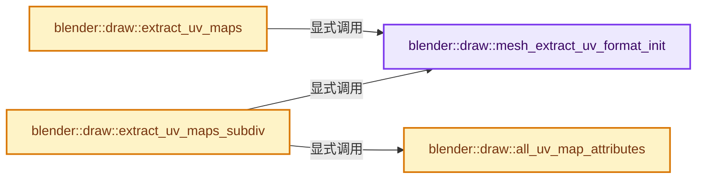
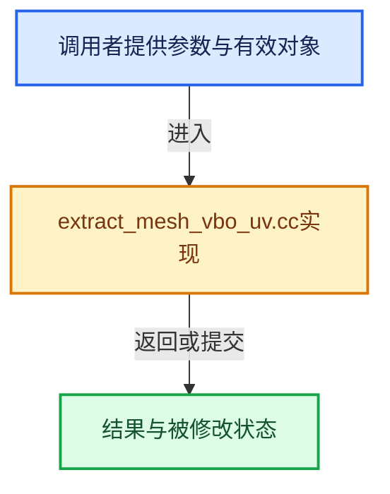

# 实现依赖专题：source/blender/draw/intern/mesh_extractors/extract_mesh_vbo_uv.cc

[方向导航](README.md) · [符号索引](../%E7%AC%A6%E5%8F%B7%E4%BE%9D%E8%B5%96%E4%B8%8E%E5%AE%9E%E7%8E%B0%E7%B4%A2%E5%BC%95.md)

本专题从正文实际调用进入，集中保存共享实现。函数有稳定锚点，可从调用处直接跳到对应完整函数；递归与互相调用通过回链组织。

## 本文件的实现关系






## 完整成员与函数实现

<a id="f-7263c2a3e7d81bc9"></a>

### `blender::draw::mesh_extract_uv_format_init`

实现位置：[source/blender/draw/intern/mesh_extractors/extract_mesh_vbo_uv.cc](../../../../../source/blender/draw/intern/mesh_extractors/extract_mesh_vbo_uv.cc) · L23—L76。

接口参数：

- `GPUVertFormat *format`
- `const MeshBatchCache &cache`
- `const Mesh &mesh`
- `const MeshExtractType extract_type`

**教学注释版**

<!-- annotated:b440a64bb61490 -->

```cpp
static VectorSet<StringRef> mesh_extract_uv_format_init(GPUVertFormat *format,
                                                        const MeshBatchCache &cache,
                                                        const Mesh &mesh,
                                                        const MeshExtractType extract_type)
{
  GPU_vertformat_deinterleave(format);

  VectorSet<StringRef> uv_layers;
  for (const StringRef name : cache.cd_used.uv.as_span().take_front(MAX_MTFACE)) {
    // [讲解] uv_layers.add_new：按哈希与相等关系加入键或键值。
    uv_layers.add_new(name);
  }

  const StringRef active_name = mesh.active_or_default_uv_map_name();
  const StringRef default_name = mesh.default_uv_map_name();

  /* HACK to fix #68857 */
  if (extract_type == MeshExtractType::BMesh && cache.cd_used.edit_uv == 1) {
    if (!bke::attribute_name_is_anonymous(default_name)) {
      // [讲解] uv_layers.add：按哈希与相等关系加入键或键值。
      uv_layers.add(default_name);
    }
  }

  const StringRef stencil_name = [&]() -> StringRef {
    StringRef name = mesh.stencil_uv_map_attribute;
    if (name.is_empty()) {
      name = mesh.active_uv_map_name();
    }
    return name;
  }();

  for (const StringRef name : uv_layers) {
    char attr_name[32], attr_safe_name[GPU_MAX_SAFE_ATTR_NAME];
    GPU_vertformat_safe_attr_name(name, attr_safe_name, GPU_MAX_SAFE_ATTR_NAME);
    SNPRINTF_UTF8(attr_name, "a%s", attr_safe_name);
    GPU_vertformat_attr_add(format, attr_name, gpu::VertAttrType::SFLOAT_32_32);
    if (name == default_name) {
      GPU_vertformat_alias_add(format, "a");
    }
    if (name == active_name) {
      GPU_vertformat_alias_add(format, "au");
      /* Alias to `pos` for edit uvs. */
      GPU_vertformat_alias_add(format, "pos");
    }
    if (name == stencil_name) {
      GPU_vertformat_alias_add(format, "mu");
    }
  }

  if (format->attr_len == 0) {
    GPU_vertformat_attr_add(format, "dummy", gpu::VertAttrType::SFLOAT_32_32);
  }

  return uv_layers;
}
```

<details>
<summary>核对原始源码：source/blender/draw/intern/mesh_extractors/extract_mesh_vbo_uv.cc · L23—L76</summary>

<!-- original:b440a64bb61490:source/blender/draw/intern/mesh_extractors/extract_mesh_vbo_uv.cc:23:76 -->

```cpp
static VectorSet<StringRef> mesh_extract_uv_format_init(GPUVertFormat *format,
                                                        const MeshBatchCache &cache,
                                                        const Mesh &mesh,
                                                        const MeshExtractType extract_type)
{
  GPU_vertformat_deinterleave(format);

  VectorSet<StringRef> uv_layers;
  for (const StringRef name : cache.cd_used.uv.as_span().take_front(MAX_MTFACE)) {
    uv_layers.add_new(name);
  }

  const StringRef active_name = mesh.active_or_default_uv_map_name();
  const StringRef default_name = mesh.default_uv_map_name();

  /* HACK to fix #68857 */
  if (extract_type == MeshExtractType::BMesh && cache.cd_used.edit_uv == 1) {
    if (!bke::attribute_name_is_anonymous(default_name)) {
      uv_layers.add(default_name);
    }
  }

  const StringRef stencil_name = [&]() -> StringRef {
    StringRef name = mesh.stencil_uv_map_attribute;
    if (name.is_empty()) {
      name = mesh.active_uv_map_name();
    }
    return name;
  }();

  for (const StringRef name : uv_layers) {
    char attr_name[32], attr_safe_name[GPU_MAX_SAFE_ATTR_NAME];
    GPU_vertformat_safe_attr_name(name, attr_safe_name, GPU_MAX_SAFE_ATTR_NAME);
    SNPRINTF_UTF8(attr_name, "a%s", attr_safe_name);
    GPU_vertformat_attr_add(format, attr_name, gpu::VertAttrType::SFLOAT_32_32);
    if (name == default_name) {
      GPU_vertformat_alias_add(format, "a");
    }
    if (name == active_name) {
      GPU_vertformat_alias_add(format, "au");
      /* Alias to `pos` for edit uvs. */
      GPU_vertformat_alias_add(format, "pos");
    }
    if (name == stencil_name) {
      GPU_vertformat_alias_add(format, "mu");
    }
  }

  if (format->attr_len == 0) {
    GPU_vertformat_attr_add(format, "dummy", gpu::VertAttrType::SFLOAT_32_32);
  }

  return uv_layers;
}
```

</details>

**沿实际写入检查状态**

- `name = mesh.active_uv_map_name();`

**结果出口**

- `return name;`
- `return uv_layers;`

**继续追踪实现**

- `GPU_vertformat_deinterleave` → [blender::GPU_vertformat_deinterleave · L535](%E4%BE%9D%E8%B5%96-gpu_vertex_format-4f7148.md#f-a5e5e2b43e5e9f26)。
- `cache.cd_used.uv.as_span().take_front` → [调用协议](../%E6%A8%A1%E6%9D%BF%E5%AE%8F%E4%B8%8E%E5%8A%A8%E6%80%81%E5%88%86%E6%B4%BE%E5%8D%8F%E8%AE%AE.md)：接收对象类型依赖auto、返回值或模板实例；不按同名猜测目标。调用位置L31。
- `cache.cd_used.uv.as_span` → [调用协议](../%E6%A8%A1%E6%9D%BF%E5%AE%8F%E4%B8%8E%E5%8A%A8%E6%80%81%E5%88%86%E6%B4%BE%E5%8D%8F%E8%AE%AE.md)：接收对象类型依赖auto、返回值或模板实例；不按同名猜测目标。调用位置L31。
- `uv_layers.add_new` → [blender::VectorSet::add_new · L336](../01-%E5%9F%BA%E7%A1%80%E5%AE%B9%E5%99%A8%E4%B8%8E%E7%8E%B0%E4%BB%A3CPP/14-VectorSet%E7%A8%B3%E5%AE%9A%E7%B4%A2%E5%BC%95%E4%B8%8E%E5%8E%BB%E9%87%8D.md#f-03989f7359a8636d)；[blender::VectorSet::add_new · L340](../01-%E5%9F%BA%E7%A1%80%E5%AE%B9%E5%99%A8%E4%B8%8E%E7%8E%B0%E4%BB%A3CPP/14-VectorSet%E7%A8%B3%E5%AE%9A%E7%B4%A2%E5%BC%95%E4%B8%8E%E5%8E%BB%E9%87%8D.md#f-ef9174f041011a6b)。同名重载需按实参类型选择。
- `mesh.active_or_default_uv_map_name` → [Mesh::active_or_default_uv_map_name · L1337](03-MPoly%E8%BF%81%E7%A7%BB%E4%B8%8E%E5%85%BC%E5%AE%B9.md#f-325a42222bc2c9c2)。
- `mesh.default_uv_map_name` → [Mesh::default_uv_map_name · L1328](03-MPoly%E8%BF%81%E7%A7%BB%E4%B8%8E%E5%85%BC%E5%AE%B9.md#f-69e95ac159da434a)。
- `bke::attribute_name_is_anonymous` → [blender::bke::attribute_name_is_anonymous · L24](../10-%E5%BC%95%E7%94%A8%E7%94%9F%E5%91%BD%E5%91%A8%E6%9C%9F%E4%B8%8EClosure/01-%E5%8C%BF%E5%90%8D%E5%B1%9E%E6%80%A7%E4%B8%8E%E5%BC%95%E7%94%A8%E9%97%AE%E9%A2%98.md#f-ce0c92720483f1bc)。
- `uv_layers.add` → [blender::VectorSet::add · L351](../01-%E5%9F%BA%E7%A1%80%E5%AE%B9%E5%99%A8%E4%B8%8E%E7%8E%B0%E4%BB%A3CPP/14-VectorSet%E7%A8%B3%E5%AE%9A%E7%B4%A2%E5%BC%95%E4%B8%8E%E5%8E%BB%E9%87%8D.md#f-96bfe2bf376d6298)；[blender::VectorSet::add · L355](../01-%E5%9F%BA%E7%A1%80%E5%AE%B9%E5%99%A8%E4%B8%8E%E7%8E%B0%E4%BB%A3CPP/14-VectorSet%E7%A8%B3%E5%AE%9A%E7%B4%A2%E5%BC%95%E4%B8%8E%E5%8E%BB%E9%87%8D.md#f-c0474f6a0568033b)。同名重载需按实参类型选择。
- `[&]() -> StringRef { StringRef name = mesh.stencil_uv_map_attribute; if (name.is_empty()) { name = mesh.active_uv_map_name(); } return name; }` → [调用协议](../%E6%A8%A1%E6%9D%BF%E5%AE%8F%E4%B8%8E%E5%8A%A8%E6%80%81%E5%88%86%E6%B4%BE%E5%8D%8F%E8%AE%AE.md)：函数指针、局部可调用对象或未展开的宏；必须结合调用者环境。调用位置L45。
- `name.is_empty` → [调用协议](../%E6%A8%A1%E6%9D%BF%E5%AE%8F%E4%B8%8E%E5%8A%A8%E6%80%81%E5%88%86%E6%B4%BE%E5%8D%8F%E8%AE%AE.md)：由接收对象具体类型或运行时策略提供实现。调用位置L47。
- `mesh.active_uv_map_name` → [Mesh::active_uv_map_name · L1319](03-MPoly%E8%BF%81%E7%A7%BB%E4%B8%8E%E5%85%BC%E5%AE%B9.md#f-9b4762e851836e79)。
- `GPU_vertformat_safe_attr_name` → [blender::GPU_vertformat_safe_attr_name · L504](%E4%BE%9D%E8%B5%96-gpu_vertex_format-4f7148.md#f-eee6d101d3a4213e)。
- `SNPRINTF_UTF8` → [SNPRINTF_UTF8 · L340](../01-%E5%9F%BA%E7%A1%80%E5%AE%B9%E5%99%A8%E4%B8%8E%E7%8E%B0%E4%BB%A3CPP/%E4%BE%9D%E8%B5%96-BLI_string_utf8-bcc961.md#m-5e57d7a30c64)。宏定义由构建条件选择。
- `GPU_vertformat_attr_add` → [blender::GPU_vertformat_attr_add · L389](%E4%BE%9D%E8%B5%96-gpu_vertex_format-4f7148.md#f-a36e23f37b97fff4)。
- `GPU_vertformat_alias_add` → [blender::GPU_vertformat_alias_add · L418](%E4%BE%9D%E8%B5%96-gpu_vertex_format-4f7148.md#f-5b19cd8281d0191e)。

<a id="f-177af9379cb51576"></a>

### `blender::draw::extract_uv_maps`

实现位置：[source/blender/draw/intern/mesh_extractors/extract_mesh_vbo_uv.cc](../../../../../source/blender/draw/intern/mesh_extractors/extract_mesh_vbo_uv.cc) · L78—L123。

接口参数：

- `const MeshRenderData &mr`
- `const MeshBatchCache &cache`

**教学注释版**

<!-- annotated:d0b91e6185751e -->

```cpp
gpu::VertBufPtr extract_uv_maps(const MeshRenderData &mr, const MeshBatchCache &cache)
{
  GPUVertFormat format = {0};

  int v_len = mr.corners_num;
  const VectorSet<StringRef> uv_layers = mesh_extract_uv_format_init(
      &format, cache, *mr.mesh, mr.extract_type);
  // [讲解] uv_layers.is_empty：查询活项数量或键是否存在。
  if (uv_layers.is_empty()) {
    /* VBO will not be used, only allocate minimum of memory. */
    v_len = 1;
  }

  gpu::VertBufPtr vbo = gpu::VertBufPtr(GPU_vertbuf_create_with_format(format));
  GPU_vertbuf_data_alloc(*vbo, v_len);

  MutableSpan<float2> uv_data = vbo->data<float2>();
  threading::memory_bandwidth_bound_task(uv_data.size_in_bytes() * 2, [&]() {
    if (mr.extract_type == MeshExtractType::BMesh) {
      const BMesh &bm = *mr.bm;
      for (const int i : uv_layers.index_range()) {
        // [讲解] uv_data.slice：建立原连续范围的子视图。
        MutableSpan<float2> data = uv_data.slice(i * bm.totloop, bm.totloop);
        const int offset = CustomData_get_offset_named(&bm.ldata, CD_PROP_FLOAT2, uv_layers[i]);
        threading::parallel_for(IndexRange(bm.totface), 2048, [&](const IndexRange range) {
          for (const int face_index : range) {
            const BMFace &face = *BM_face_at_index(&const_cast<BMesh &>(bm), face_index);
            const BMLoop *loop = BM_FACE_FIRST_LOOP(&face);
            for ([[maybe_unused]] const int i : IndexRange(face.len)) {
              const int index = BM_elem_index_get(loop);
              data[index] = BM_ELEM_CD_GET_FLOAT_P(loop, offset);
              loop = loop->next;
            }
          }
        });
      }
    }
    else {
      const bke::AttributeAccessor attributes = mr.mesh->attributes();
      for (const int i : uv_layers.index_range()) {
        const VArray uv_map = *attributes.lookup_or_default<float2>(
            uv_layers[i], bke::AttrDomain::Corner, float2(0));
        array_utils::copy(uv_map, uv_data.slice(i * mr.corners_num, mr.corners_num));
      }
    }
  });
  return vbo;
}
```

<details>
<summary>核对原始源码：source/blender/draw/intern/mesh_extractors/extract_mesh_vbo_uv.cc · L78—L123</summary>

<!-- original:d0b91e6185751e:source/blender/draw/intern/mesh_extractors/extract_mesh_vbo_uv.cc:78:123 -->

```cpp
gpu::VertBufPtr extract_uv_maps(const MeshRenderData &mr, const MeshBatchCache &cache)
{
  GPUVertFormat format = {0};

  int v_len = mr.corners_num;
  const VectorSet<StringRef> uv_layers = mesh_extract_uv_format_init(
      &format, cache, *mr.mesh, mr.extract_type);
  if (uv_layers.is_empty()) {
    /* VBO will not be used, only allocate minimum of memory. */
    v_len = 1;
  }

  gpu::VertBufPtr vbo = gpu::VertBufPtr(GPU_vertbuf_create_with_format(format));
  GPU_vertbuf_data_alloc(*vbo, v_len);

  MutableSpan<float2> uv_data = vbo->data<float2>();
  threading::memory_bandwidth_bound_task(uv_data.size_in_bytes() * 2, [&]() {
    if (mr.extract_type == MeshExtractType::BMesh) {
      const BMesh &bm = *mr.bm;
      for (const int i : uv_layers.index_range()) {
        MutableSpan<float2> data = uv_data.slice(i * bm.totloop, bm.totloop);
        const int offset = CustomData_get_offset_named(&bm.ldata, CD_PROP_FLOAT2, uv_layers[i]);
        threading::parallel_for(IndexRange(bm.totface), 2048, [&](const IndexRange range) {
          for (const int face_index : range) {
            const BMFace &face = *BM_face_at_index(&const_cast<BMesh &>(bm), face_index);
            const BMLoop *loop = BM_FACE_FIRST_LOOP(&face);
            for ([[maybe_unused]] const int i : IndexRange(face.len)) {
              const int index = BM_elem_index_get(loop);
              data[index] = BM_ELEM_CD_GET_FLOAT_P(loop, offset);
              loop = loop->next;
            }
          }
        });
      }
    }
    else {
      const bke::AttributeAccessor attributes = mr.mesh->attributes();
      for (const int i : uv_layers.index_range()) {
        const VArray uv_map = *attributes.lookup_or_default<float2>(
            uv_layers[i], bke::AttrDomain::Corner, float2(0));
        array_utils::copy(uv_map, uv_data.slice(i * mr.corners_num, mr.corners_num));
      }
    }
  });
  return vbo;
}
```

</details>

**沿实际写入检查状态**

- `v_len = 1;`
- `data[index] = BM_ELEM_CD_GET_FLOAT_P(loop, offset);`
- `loop = loop->next;`

**结果出口**

- `return vbo;`

**继续追踪实现**

- `mesh_extract_uv_format_init` → [blender::draw::mesh_extract_uv_format_init · L23](%E4%BE%9D%E8%B5%96-extract_mesh_vbo_uv-5b7e3e.md#f-7263c2a3e7d81bc9)。
- `uv_layers.is_empty` → [blender::VectorSet::is_empty · L619](../01-%E5%9F%BA%E7%A1%80%E5%AE%B9%E5%99%A8%E4%B8%8E%E7%8E%B0%E4%BB%A3CPP/14-VectorSet%E7%A8%B3%E5%AE%9A%E7%B4%A2%E5%BC%95%E4%B8%8E%E5%8E%BB%E9%87%8D.md#f-0d62a24040f63dec)。
- `gpu::VertBufPtr` → [调用协议](../%E6%A8%A1%E6%9D%BF%E5%AE%8F%E4%B8%8E%E5%8A%A8%E6%80%81%E5%88%86%E6%B4%BE%E5%8D%8F%E8%AE%AE.md)：函数指针、局部可调用对象或未展开的宏；必须结合调用者环境。调用位置L90。
- `GPU_vertbuf_create_with_format` → [blender::GPU_vertbuf_create_with_format · L71](%E4%BE%9D%E8%B5%96-GPU_vertex_buffer-d7610b.md#f-bd43fe034e852138)。
- `GPU_vertbuf_data_alloc` → [blender::GPU_vertbuf_data_alloc · L172](%E4%BE%9D%E8%B5%96-gpu_vertex_buffer-eaa662.md#f-8ee5cf106e0f2b0f)。
- `vbo->data<float2>` → [blender::draw::data · L124](%E4%BE%9D%E8%B5%96-DRW_gpu_wrapper-c80c4f.md#f-dc115dc22e0c9f33)；[blender::draw::data · L129](%E4%BE%9D%E8%B5%96-DRW_gpu_wrapper-c80c4f.md#f-5f325cb75387045c)。同名重载需按实参类型选择。
- `threading::memory_bandwidth_bound_task` → [blender::threading::memory_bandwidth_bound_task · L250](../11-Depsgraph%E4%B8%8E%E5%B9%B6%E8%A1%8C%E4%BB%BB%E5%8A%A1%E7%B3%BB%E7%BB%9F/07-%E4%BB%BB%E5%8A%A1%E6%B1%A0%E4%B8%8ETBB%E6%8E%A5%E5%85%A5.md#f-aa412ccec656928d)。
- `uv_data.size_in_bytes` → [blender::MutableSpan::size_in_bytes · L507](../01-%E5%9F%BA%E7%A1%80%E5%AE%B9%E5%99%A8%E4%B8%8E%E7%8E%B0%E4%BB%A3CPP/06-MutableSpan%E5%8F%AF%E5%86%99%E8%A7%86%E5%9B%BE.md#f-2e42823b970a8406)。
- `uv_layers.index_range` → [blender::VectorSet::index_range · L589](../01-%E5%9F%BA%E7%A1%80%E5%AE%B9%E5%99%A8%E4%B8%8E%E7%8E%B0%E4%BB%A3CPP/14-VectorSet%E7%A8%B3%E5%AE%9A%E7%B4%A2%E5%BC%95%E4%B8%8E%E5%8E%BB%E9%87%8D.md#f-da5115bdc28bb390)。
- `uv_data.slice` → [blender::MutableSpan::slice · L579](../01-%E5%9F%BA%E7%A1%80%E5%AE%B9%E5%99%A8%E4%B8%8E%E7%8E%B0%E4%BB%A3CPP/06-MutableSpan%E5%8F%AF%E5%86%99%E8%A7%86%E5%9B%BE.md#f-6808b4aefbf58808)；[blender::MutableSpan::slice · L587](../01-%E5%9F%BA%E7%A1%80%E5%AE%B9%E5%99%A8%E4%B8%8E%E7%8E%B0%E4%BB%A3CPP/06-MutableSpan%E5%8F%AF%E5%86%99%E8%A7%86%E5%9B%BE.md#f-c05b010821861e4f)。同名重载需按实参类型选择。
- `CustomData_get_offset_named` → [blender::CustomData_get_offset_named · L3398](%E4%BE%9D%E8%B5%96-customdata-2eef81.md#f-fe199f3da62e9c30)。
- `threading::parallel_for` → [blender::threading::parallel_for · L68](../11-Depsgraph%E4%B8%8E%E5%B9%B6%E8%A1%8C%E4%BB%BB%E5%8A%A1%E7%B3%BB%E7%BB%9F/07-%E4%BB%BB%E5%8A%A1%E6%B1%A0%E4%B8%8ETBB%E6%8E%A5%E5%85%A5.md#f-838294754c24426c)。
- `IndexRange` → [blender::IndexRange](../01-%E5%9F%BA%E7%A1%80%E5%AE%B9%E5%99%A8%E4%B8%8E%E7%8E%B0%E4%BB%A3CPP/%E4%BE%9D%E8%B5%96-BLI_index_range-7d7cc5.md#t-caa3466d6776)；[blender::gpu::shader::parser::IndexRange](%E4%BE%9D%E8%B5%96-utils-06433d.md#t-82d2bd4ea71c)；[blender::IndexRange](%E4%BE%9D%E8%B5%96-DNA_node_types-6708b9.md#t-0448cc889d39)。
- `BM_face_at_index` → [blender::BM_face_at_index · L122](%E4%BE%9D%E8%B5%96-bmesh_mesh-df20c7.md#f-366df62c166d5094)。
- `BM_FACE_FIRST_LOOP` → [BM_FACE_FIRST_LOOP · L697](%E4%BE%9D%E8%B5%96-bmesh_class-4cf146.md#m-c7e10ffb38e6)；[BM_FACE_FIRST_LOOP · L699](%E4%BE%9D%E8%B5%96-bmesh_class-4cf146.md#m-76a054cc4770)。宏定义由构建条件选择。
- `BM_elem_index_get` → [BM_elem_index_get · L120](%E4%BE%9D%E8%B5%96-bmesh_inline-74f1be.md#m-201981cdc62d)。宏定义由构建条件选择。
- `BM_ELEM_CD_GET_FLOAT_P` → [BM_ELEM_CD_GET_FLOAT_P · L635](%E4%BE%9D%E8%B5%96-bmesh_class-4cf146.md#m-544f72c45c1b)；[BM_ELEM_CD_GET_FLOAT_P · L661](%E4%BE%9D%E8%B5%96-bmesh_class-4cf146.md#m-c11efbe96e86)。宏定义由构建条件选择。
- `mr.mesh->attributes` → [调用协议](../%E6%A8%A1%E6%9D%BF%E5%AE%8F%E4%B8%8E%E5%8A%A8%E6%80%81%E5%88%86%E6%B4%BE%E5%8D%8F%E8%AE%AE.md)：接收对象类型依赖auto、返回值或模板实例；不按同名猜测目标。调用位置L114。
- `attributes.lookup_or_default<float2>` → [blender::bke::AttributeAccessor::lookup_or_default · L415](%E4%BE%9D%E8%B5%96-attribute_access-bceef3.md#f-a0cc3e316f1da4bd)；[blender::bke::AttributeAccessor::lookup_or_default · L643](08-AttributeAccessor%E6%8E%A5%E5%8F%A3.md#f-e3d2ed81ebe0af61)。同名重载需按实参类型选择。
- `float2` → [float2::float2 · L45](%E4%BE%9D%E8%B5%96-sky_math-8091a6.md#f-04c2783f21f996aa)；[float2::float2 · L47](%E4%BE%9D%E8%B5%96-sky_math-8091a6.md#f-dba79c4c10e5ea46)；[float2::float2 · L49](%E4%BE%9D%E8%B5%96-sky_math-8091a6.md#f-920ca90efa37bf0b)；[float2::float2 · L51](%E4%BE%9D%E8%B5%96-sky_math-8091a6.md#f-4b3fbf848d719a63)；[float2::float2 · L53](%E4%BE%9D%E8%B5%96-sky_math-8091a6.md#f-9b2acd8475cc2843)；[float2::float2 · L55](%E4%BE%9D%E8%B5%96-sky_math-8091a6.md#f-1e9233a9a231be51)。同名重载需按实参类型选择。
- `array_utils::copy` → [blender::array_utils::copy · L54](../01-%E5%9F%BA%E7%A1%80%E5%AE%B9%E5%99%A8%E4%B8%8E%E7%8E%B0%E4%BB%A3CPP/20-%E5%AE%B9%E5%99%A8%E9%80%89%E6%8B%A9%E4%B8%8E%E7%8B%AC%E7%AB%8B%E5%AE%9E%E7%8E%B0.md#f-82e21acdac93f91c)；[blender::array_utils::copy · L72](../01-%E5%9F%BA%E7%A1%80%E5%AE%B9%E5%99%A8%E4%B8%8E%E7%8E%B0%E4%BB%A3CPP/20-%E5%AE%B9%E5%99%A8%E9%80%89%E6%8B%A9%E4%B8%8E%E7%8B%AC%E7%AB%8B%E5%AE%9E%E7%8E%B0.md#f-ee9c17de026a6c9a)；[blender::array_utils::copy · L98](../01-%E5%9F%BA%E7%A1%80%E5%AE%B9%E5%99%A8%E4%B8%8E%E7%8E%B0%E4%BB%A3CPP/20-%E5%AE%B9%E5%99%A8%E9%80%89%E6%8B%A9%E4%B8%8E%E7%8B%AC%E7%AB%8B%E5%AE%9E%E7%8E%B0.md#f-ec9fd099c7280717)；[blender::array_utils::copy · L27](../01-%E5%9F%BA%E7%A1%80%E5%AE%B9%E5%99%A8%E4%B8%8E%E7%8E%B0%E4%BB%A3CPP/%E4%BE%9D%E8%B5%96-array_utils-cbb70f.md#f-245f7c23437cf35f)；[blender::array_utils::copy · L43](../01-%E5%9F%BA%E7%A1%80%E5%AE%B9%E5%99%A8%E4%B8%8E%E7%8E%B0%E4%BB%A3CPP/%E4%BE%9D%E8%B5%96-array_utils-cbb70f.md#f-6170524934215b36)。同名重载需按实参类型选择。

<a id="f-1f9f8ac2d4ba4c27"></a>

### `blender::draw::all_uv_map_attributes`

实现位置：[source/blender/draw/intern/mesh_extractors/extract_mesh_vbo_uv.cc](../../../../../source/blender/draw/intern/mesh_extractors/extract_mesh_vbo_uv.cc) · L125—L135。

接口参数：

- `const Mesh &mesh`

**教学注释版**

<!-- annotated:aab152defb6328 -->

```cpp
static VectorSet<StringRef> all_uv_map_attributes(const Mesh &mesh)
{
  const bke::AttributeAccessor attributes = mesh.attributes();
  VectorSet<StringRef> result;
  attributes.foreach_attribute([&](const bke::AttributeIter &iter) {
    if (iter.domain == bke::AttrDomain::Corner && iter.data_type == bke::AttrType::Float2) {
      // [讲解] result.add：按哈希与相等关系加入键或键值。
      result.add(iter.name);
    }
  });
  return result;
}
```

<details>
<summary>核对原始源码：source/blender/draw/intern/mesh_extractors/extract_mesh_vbo_uv.cc · L125—L135</summary>

<!-- original:aab152defb6328:source/blender/draw/intern/mesh_extractors/extract_mesh_vbo_uv.cc:125:135 -->

```cpp
static VectorSet<StringRef> all_uv_map_attributes(const Mesh &mesh)
{
  const bke::AttributeAccessor attributes = mesh.attributes();
  VectorSet<StringRef> result;
  attributes.foreach_attribute([&](const bke::AttributeIter &iter) {
    if (iter.domain == bke::AttrDomain::Corner && iter.data_type == bke::AttrType::Float2) {
      result.add(iter.name);
    }
  });
  return result;
}
```

</details>

**结果出口**

- `return result;`

**继续追踪实现**

- `mesh.attributes` → [Mesh::attributes · L1298](03-MPoly%E8%BF%81%E7%A7%BB%E4%B8%8E%E5%85%BC%E5%AE%B9.md#f-607bbfe3e57cfc7f)。
- `attributes.foreach_attribute` → [blender::bke::AttributeAccessor::foreach_attribute · L687](08-AttributeAccessor%E6%8E%A5%E5%8F%A3.md#f-44723ac57e0d1fa4)。
- `result.add` → [blender::VectorSet::add · L351](../01-%E5%9F%BA%E7%A1%80%E5%AE%B9%E5%99%A8%E4%B8%8E%E7%8E%B0%E4%BB%A3CPP/14-VectorSet%E7%A8%B3%E5%AE%9A%E7%B4%A2%E5%BC%95%E4%B8%8E%E5%8E%BB%E9%87%8D.md#f-96bfe2bf376d6298)；[blender::VectorSet::add · L355](../01-%E5%9F%BA%E7%A1%80%E5%AE%B9%E5%99%A8%E4%B8%8E%E7%8E%B0%E4%BB%A3CPP/14-VectorSet%E7%A8%B3%E5%AE%9A%E7%B4%A2%E5%BC%95%E4%B8%8E%E5%8E%BB%E9%87%8D.md#f-c0474f6a0568033b)。同名重载需按实参类型选择。

<a id="f-c32b1f6163d23184"></a>

### `blender::draw::extract_uv_maps_subdiv`

实现位置：[source/blender/draw/intern/mesh_extractors/extract_mesh_vbo_uv.cc](../../../../../source/blender/draw/intern/mesh_extractors/extract_mesh_vbo_uv.cc) · L137—L173。

接口参数：

- `const DRWSubdivCache &subdiv_cache`
- `const MeshBatchCache &cache`

**教学注释版**

<!-- annotated:bbe2f58df8a473 -->

```cpp
gpu::VertBufPtr extract_uv_maps_subdiv(const DRWSubdivCache &subdiv_cache,
                                       const MeshBatchCache &cache)
{
  const Mesh *coarse_mesh = subdiv_cache.mesh;
  GPUVertFormat format = {0};

  const VectorSet<StringRef> uv_layers = mesh_extract_uv_format_init(
      &format, cache, *coarse_mesh, MeshExtractType::Mesh);

  uint v_len = subdiv_cache.num_subdiv_loops;
  // [讲解] uv_layers.is_empty：查询活项数量或键是否存在。
  if (uv_layers.is_empty()) {
    /* TODO(kevindietrich): handle this more gracefully. */
    v_len = 1;
  }

  gpu::VertBufPtr vbo = gpu::VertBufPtr(GPU_vertbuf_create_on_device(format, v_len));

  if (uv_layers.is_empty()) {
    return vbo;
  }

  const VectorSet<StringRef> all_uv_maps = all_uv_map_attributes(*coarse_mesh);

  /* Index of the UV layer in the compact buffer. Used UV layers are stored in a single buffer. */
  for (const int pack_layer_index : uv_layers.index_range()) {
    const StringRef name = uv_layers[pack_layer_index];
    /* This lookup may fail because some modifiers (e.g. Skin)
     * do not generate UV maps. See: #151787. */
    const int i = all_uv_maps.index_of_try(name);
    if (i == -1) {
      continue;
    }
    const int offset = int(subdiv_cache.num_subdiv_loops) * pack_layer_index;
    draw_subdiv_extract_uvs(subdiv_cache, vbo.get(), i, offset);
  }
  return vbo;
}
```

<details>
<summary>核对原始源码：source/blender/draw/intern/mesh_extractors/extract_mesh_vbo_uv.cc · L137—L173</summary>

<!-- original:bbe2f58df8a473:source/blender/draw/intern/mesh_extractors/extract_mesh_vbo_uv.cc:137:173 -->

```cpp
gpu::VertBufPtr extract_uv_maps_subdiv(const DRWSubdivCache &subdiv_cache,
                                       const MeshBatchCache &cache)
{
  const Mesh *coarse_mesh = subdiv_cache.mesh;
  GPUVertFormat format = {0};

  const VectorSet<StringRef> uv_layers = mesh_extract_uv_format_init(
      &format, cache, *coarse_mesh, MeshExtractType::Mesh);

  uint v_len = subdiv_cache.num_subdiv_loops;
  if (uv_layers.is_empty()) {
    /* TODO(kevindietrich): handle this more gracefully. */
    v_len = 1;
  }

  gpu::VertBufPtr vbo = gpu::VertBufPtr(GPU_vertbuf_create_on_device(format, v_len));

  if (uv_layers.is_empty()) {
    return vbo;
  }

  const VectorSet<StringRef> all_uv_maps = all_uv_map_attributes(*coarse_mesh);

  /* Index of the UV layer in the compact buffer. Used UV layers are stored in a single buffer. */
  for (const int pack_layer_index : uv_layers.index_range()) {
    const StringRef name = uv_layers[pack_layer_index];
    /* This lookup may fail because some modifiers (e.g. Skin)
     * do not generate UV maps. See: #151787. */
    const int i = all_uv_maps.index_of_try(name);
    if (i == -1) {
      continue;
    }
    const int offset = int(subdiv_cache.num_subdiv_loops) * pack_layer_index;
    draw_subdiv_extract_uvs(subdiv_cache, vbo.get(), i, offset);
  }
  return vbo;
}
```

</details>

**沿实际写入检查状态**

- `v_len = 1;`

**结果出口**

- `return vbo;`

**继续追踪实现**

- `mesh_extract_uv_format_init` → [blender::draw::mesh_extract_uv_format_init · L23](%E4%BE%9D%E8%B5%96-extract_mesh_vbo_uv-5b7e3e.md#f-7263c2a3e7d81bc9)。
- `uv_layers.is_empty` → [blender::VectorSet::is_empty · L619](../01-%E5%9F%BA%E7%A1%80%E5%AE%B9%E5%99%A8%E4%B8%8E%E7%8E%B0%E4%BB%A3CPP/14-VectorSet%E7%A8%B3%E5%AE%9A%E7%B4%A2%E5%BC%95%E4%B8%8E%E5%8E%BB%E9%87%8D.md#f-0d62a24040f63dec)。
- `gpu::VertBufPtr` → [调用协议](../%E6%A8%A1%E6%9D%BF%E5%AE%8F%E4%B8%8E%E5%8A%A8%E6%80%81%E5%88%86%E6%B4%BE%E5%8D%8F%E8%AE%AE.md)：函数指针、局部可调用对象或未展开的宏；必须结合调用者环境。调用位置L152。
- `GPU_vertbuf_create_on_device` → [blender::GPU_vertbuf_create_on_device · L137](%E4%BE%9D%E8%B5%96-gpu_vertex_buffer-eaa662.md#f-abf244a18691f929)。
- `all_uv_map_attributes` → [blender::draw::all_uv_map_attributes · L125](%E4%BE%9D%E8%B5%96-extract_mesh_vbo_uv-5b7e3e.md#f-1f9f8ac2d4ba4c27)。
- `uv_layers.index_range` → [blender::VectorSet::index_range · L589](../01-%E5%9F%BA%E7%A1%80%E5%AE%B9%E5%99%A8%E4%B8%8E%E7%8E%B0%E4%BB%A3CPP/14-VectorSet%E7%A8%B3%E5%AE%9A%E7%B4%A2%E5%BC%95%E4%B8%8E%E5%8E%BB%E9%87%8D.md#f-da5115bdc28bb390)。
- `all_uv_maps.index_of_try` → [blender::VectorSet::index_of_try · L492](../01-%E5%9F%BA%E7%A1%80%E5%AE%B9%E5%99%A8%E4%B8%8E%E7%8E%B0%E4%BB%A3CPP/14-VectorSet%E7%A8%B3%E5%AE%9A%E7%B4%A2%E5%BC%95%E4%B8%8E%E5%8E%BB%E9%87%8D.md#f-216c9238b6003f1a)。
- `draw_subdiv_extract_uvs` → [blender::draw::draw_subdiv_extract_uvs · L1042](%E4%BE%9D%E8%B5%96-draw_cache_impl_subdivision-33125a.md#f-173ff377e09498c0)。
- `vbo.get` → [blender::draw::GSplatEvalCache::get · L545](%E4%BE%9D%E8%B5%96-draw_cache_impl_gsplat-0b4128.md#f-3fb704a0b74cb9e4)。
