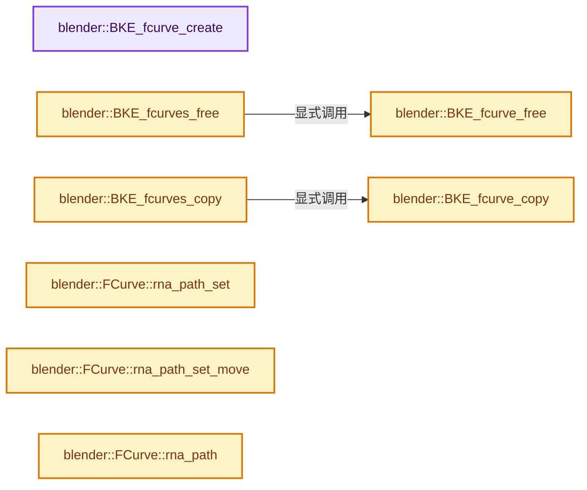
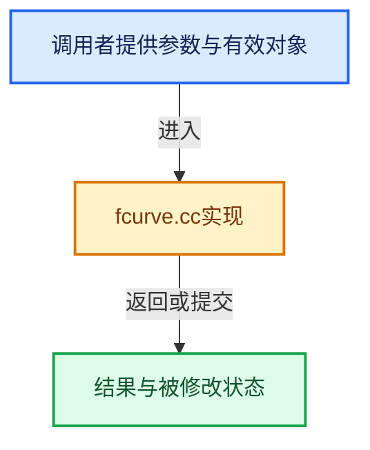

# 实现依赖专题：source/blender/blenkernel/intern/fcurve.cc

[方向导航](README.md) · [符号索引](../%E7%AC%A6%E5%8F%B7%E4%BE%9D%E8%B5%96%E4%B8%8E%E5%AE%9E%E7%8E%B0%E7%B4%A2%E5%BC%95.md)

本专题从正文实际调用进入，集中保存共享实现。函数有稳定锚点，可从调用处直接跳到对应完整函数；递归与互相调用通过回链组织。

## 本文件的实现关系






## 完整成员与函数实现

<a id="f-bbb58c4e165bc0b9"></a>

### `blender::BKE_fcurve_create`

实现位置：[source/blender/blenkernel/intern/fcurve.cc](../../../../../source/blender/blenkernel/intern/fcurve.cc) · L66—L71。

**教学注释版**

<!-- annotated:df4f3db9f99439 -->

```cpp
FCurve *BKE_fcurve_create()
{
  FCurve *fcu = MEM_new<FCurve>(__func__);
  fcu->runtime = MEM_new<FCurveRuntime>(__func__);
  return fcu;
}
```

<details>
<summary>核对原始源码：source/blender/blenkernel/intern/fcurve.cc · L66—L71</summary>

<!-- original:df4f3db9f99439:source/blender/blenkernel/intern/fcurve.cc:66:71 -->

```cpp
FCurve *BKE_fcurve_create()
{
  FCurve *fcu = MEM_new<FCurve>(__func__);
  fcu->runtime = MEM_new<FCurveRuntime>(__func__);
  return fcu;
}
```

</details>

**沿实际写入检查状态**

- `fcu->runtime = MEM_new<FCurveRuntime>(__func__);`

**结果出口**

- `return fcu;`

**继续追踪实现**

- `MEM_new<FCurve>` → [MEM_new · L351](../03-%E5%86%85%E5%AD%98%E5%88%86%E9%85%8D%E4%B8%8E%E8%BF%90%E8%A1%8C%E6%97%B6%E7%B1%BB%E5%9E%8B/%E4%BE%9D%E8%B5%96-MEM_guardedalloc-b54eca.md#f-115f9b6784f89912)。
- `MEM_new<FCurveRuntime>` → [MEM_new · L351](../03-%E5%86%85%E5%AD%98%E5%88%86%E9%85%8D%E4%B8%8E%E8%BF%90%E8%A1%8C%E6%97%B6%E7%B1%BB%E5%9E%8B/%E4%BE%9D%E8%B5%96-MEM_guardedalloc-b54eca.md#f-115f9b6784f89912)。

<a id="f-1eca4335cbc9e0eb"></a>

### `blender::BKE_fcurve_free`

实现位置：[source/blender/blenkernel/intern/fcurve.cc](../../../../../source/blender/blenkernel/intern/fcurve.cc) · L79—L99。

接口参数：

- `FCurve *fcu`

**教学注释版**

<!-- annotated:4998c9c7a0af2c -->

```cpp
void BKE_fcurve_free(FCurve *fcu)
{
  if (fcu == nullptr) {
    return;
  }

  /* Free curve data. */
  MEM_SAFE_DELETE(fcu->bezt);
  MEM_SAFE_DELETE(fcu->fpt);

  /* Free RNA-path, as this were allocated when getting the path string. */
  MEM_SAFE_DELETE(fcu->rna_path_ptr);

  /* Free extra data - i.e. modifiers, and driver. */
  fcurve_free_driver(fcu);
  free_fmodifiers(&fcu->modifiers);

  /* Free the f-curve itself. */
  MEM_delete(fcu->runtime);
  MEM_delete(fcu);
}
```

<details>
<summary>核对原始源码：source/blender/blenkernel/intern/fcurve.cc · L79—L99</summary>

<!-- original:4998c9c7a0af2c:source/blender/blenkernel/intern/fcurve.cc:79:99 -->

```cpp
void BKE_fcurve_free(FCurve *fcu)
{
  if (fcu == nullptr) {
    return;
  }

  /* Free curve data. */
  MEM_SAFE_DELETE(fcu->bezt);
  MEM_SAFE_DELETE(fcu->fpt);

  /* Free RNA-path, as this were allocated when getting the path string. */
  MEM_SAFE_DELETE(fcu->rna_path_ptr);

  /* Free extra data - i.e. modifiers, and driver. */
  fcurve_free_driver(fcu);
  free_fmodifiers(&fcu->modifiers);

  /* Free the f-curve itself. */
  MEM_delete(fcu->runtime);
  MEM_delete(fcu);
}
```

</details>

**继续追踪实现**

- `MEM_SAFE_DELETE` → [MEM_SAFE_DELETE · L436](../03-%E5%86%85%E5%AD%98%E5%88%86%E9%85%8D%E4%B8%8E%E8%BF%90%E8%A1%8C%E6%97%B6%E7%B1%BB%E5%9E%8B/%E4%BE%9D%E8%B5%96-MEM_guardedalloc-b54eca.md#m-eadb3bc5b902)。宏定义由构建条件选择。
- `fcurve_free_driver` → [blender::fcurve_free_driver · L1043](%E4%BE%9D%E8%B5%96-fcurve_driver-ac5bc2.md#f-a3cc6e7afb88bfb2)。
- `free_fmodifiers` → [blender::free_fmodifiers · L1321](%E4%BE%9D%E8%B5%96-fmodifier-bf33eb.md#f-70774f004fea93d4)。
- `MEM_delete` → [MEM_delete · L400](../03-%E5%86%85%E5%AD%98%E5%88%86%E9%85%8D%E4%B8%8E%E8%BF%90%E8%A1%8C%E6%97%B6%E7%B1%BB%E5%9E%8B/%E4%BE%9D%E8%B5%96-MEM_guardedalloc-b54eca.md#f-9049ffdd1682887c)。

<a id="f-8d7f34aa906ce734"></a>

### `blender::BKE_fcurves_free`

实现位置：[source/blender/blenkernel/intern/fcurve.cc](../../../../../source/blender/blenkernel/intern/fcurve.cc) · L101—L118。

接口参数：

- `ListBaseT<FCurve> *list`

**教学注释版**

<!-- annotated:d83d750b83fb30 -->

```cpp
void BKE_fcurves_free(ListBaseT<FCurve> *list)
{
  /* Sanity check. */
  if (list == nullptr) {
    return;
  }

  /* Free data, no need to call #BLI_remlink before freeing each curve,
   * as we store reference to next, and freeing only touches the curve it's given. */
  FCurve *fcn = nullptr;
  for (FCurve *fcu = list->first(); fcu; fcu = fcn) {
    fcn = fcu->next;
    BKE_fcurve_free(fcu);
  }

  /* Clear pointers just in case. */
  list->clear_no_delete();
}
```

<details>
<summary>核对原始源码：source/blender/blenkernel/intern/fcurve.cc · L101—L118</summary>

<!-- original:d83d750b83fb30:source/blender/blenkernel/intern/fcurve.cc:101:118 -->

```cpp
void BKE_fcurves_free(ListBaseT<FCurve> *list)
{
  /* Sanity check. */
  if (list == nullptr) {
    return;
  }

  /* Free data, no need to call #BLI_remlink before freeing each curve,
   * as we store reference to next, and freeing only touches the curve it's given. */
  FCurve *fcn = nullptr;
  for (FCurve *fcu = list->first(); fcu; fcu = fcn) {
    fcn = fcu->next;
    BKE_fcurve_free(fcu);
  }

  /* Clear pointers just in case. */
  list->clear_no_delete();
}
```

</details>

**沿实际写入检查状态**

- `fcn = fcu->next;`

**继续追踪实现**

- `list->first` → [blender::ListBaseT::first · L102](%E4%BE%9D%E8%B5%96-DNA_listBase-48dbc9.md#f-3d12ff35da057c9e)；[blender::ListBaseT::first · L106](%E4%BE%9D%E8%B5%96-DNA_listBase-48dbc9.md#f-0df87c3480e059f9)。同名重载需按实参类型选择。
- `BKE_fcurve_free` → [blender::BKE_fcurve_free · L79](%E4%BE%9D%E8%B5%96-fcurve-593e2e.md#f-1eca4335cbc9e0eb)。
- `list->clear_no_delete` → [blender::ListBaseT::clear_no_delete · L68](%E4%BE%9D%E8%B5%96-DNA_listBase-48dbc9.md#f-431defdf189ae643)。

<a id="f-f9bf6ba1975f49bc"></a>

### `blender::BKE_fcurve_copy`

实现位置：[source/blender/blenkernel/intern/fcurve.cc](../../../../../source/blender/blenkernel/intern/fcurve.cc) · L126—L155。

接口参数：

- `const FCurve *fcu`

**教学注释版**

<!-- annotated:f622535480a89f -->

```cpp
FCurve *BKE_fcurve_copy(const FCurve *fcu)
{
  /* Sanity check. */
  if (fcu == nullptr) {
    return nullptr;
  }

  /* Make a copy. */
  FCurve *fcu_d = MEM_dupalloc(fcu);
  fcu_d->runtime = MEM_new<bke::FCurveRuntime>(__func__, *fcu->runtime);

  fcu_d->next = fcu_d->prev = nullptr;
  fcu_d->grp = nullptr;

  /* Copy curve data. */
  fcu_d->bezt = MEM_dupalloc(fcu_d->bezt);
  fcu_d->fpt = MEM_dupalloc(fcu_d->fpt);

  /* Copy rna-path. */
  fcu_d->rna_path_ptr = MEM_dupalloc(fcu_d->rna_path_ptr);

  /* Copy driver. */
  fcu_d->driver = fcurve_copy_driver(fcu_d->driver);

  /* Copy modifiers. */
  copy_fmodifiers(&fcu_d->modifiers, &fcu->modifiers);

  /* Return new data. */
  return fcu_d;
}
```

<details>
<summary>核对原始源码：source/blender/blenkernel/intern/fcurve.cc · L126—L155</summary>

<!-- original:f622535480a89f:source/blender/blenkernel/intern/fcurve.cc:126:155 -->

```cpp
FCurve *BKE_fcurve_copy(const FCurve *fcu)
{
  /* Sanity check. */
  if (fcu == nullptr) {
    return nullptr;
  }

  /* Make a copy. */
  FCurve *fcu_d = MEM_dupalloc(fcu);
  fcu_d->runtime = MEM_new<bke::FCurveRuntime>(__func__, *fcu->runtime);

  fcu_d->next = fcu_d->prev = nullptr;
  fcu_d->grp = nullptr;

  /* Copy curve data. */
  fcu_d->bezt = MEM_dupalloc(fcu_d->bezt);
  fcu_d->fpt = MEM_dupalloc(fcu_d->fpt);

  /* Copy rna-path. */
  fcu_d->rna_path_ptr = MEM_dupalloc(fcu_d->rna_path_ptr);

  /* Copy driver. */
  fcu_d->driver = fcurve_copy_driver(fcu_d->driver);

  /* Copy modifiers. */
  copy_fmodifiers(&fcu_d->modifiers, &fcu->modifiers);

  /* Return new data. */
  return fcu_d;
}
```

</details>

**沿实际写入检查状态**

- `fcu_d->runtime = MEM_new<bke::FCurveRuntime>(__func__, *fcu->runtime);`
- `fcu_d->next = fcu_d->prev = nullptr;`
- `fcu_d->grp = nullptr;`
- `fcu_d->bezt = MEM_dupalloc(fcu_d->bezt);`
- `fcu_d->fpt = MEM_dupalloc(fcu_d->fpt);`
- `fcu_d->rna_path_ptr = MEM_dupalloc(fcu_d->rna_path_ptr);`
- `fcu_d->driver = fcurve_copy_driver(fcu_d->driver);`

**结果出口**

- `return nullptr;`
- `return fcu_d;`

**继续追踪实现**

- `MEM_dupalloc` → [MEM_dupalloc · L627](../03-%E5%86%85%E5%AD%98%E5%88%86%E9%85%8D%E4%B8%8E%E8%BF%90%E8%A1%8C%E6%97%B6%E7%B1%BB%E5%9E%8B/%E4%BE%9D%E8%B5%96-MEM_guardedalloc-b54eca.md#f-78a72b71e3c57010)。
- `MEM_new<bke::FCurveRuntime>` → [MEM_new · L351](../03-%E5%86%85%E5%AD%98%E5%88%86%E9%85%8D%E4%B8%8E%E8%BF%90%E8%A1%8C%E6%97%B6%E7%B1%BB%E5%9E%8B/%E4%BE%9D%E8%B5%96-MEM_guardedalloc-b54eca.md#f-115f9b6784f89912)。
- `fcurve_copy_driver` → [blender::fcurve_copy_driver · L1075](%E4%BE%9D%E8%B5%96-fcurve_driver-ac5bc2.md#f-6dee218e96d6e2b4)。
- `copy_fmodifiers` → [blender::copy_fmodifiers · L1253](%E4%BE%9D%E8%B5%96-fmodifier-bf33eb.md#f-e43a4f17723ec755)。

<a id="f-63469f0f9cea1060"></a>

### `blender::BKE_fcurves_copy`

实现位置：[source/blender/blenkernel/intern/fcurve.cc](../../../../../source/blender/blenkernel/intern/fcurve.cc) · L157—L172。

接口参数：

- `ListBaseT<FCurve> *dst`
- `ListBaseT<FCurve> *src`

**教学注释版**

<!-- annotated:425dff71438575 -->

```cpp
void BKE_fcurves_copy(ListBaseT<FCurve> *dst, ListBaseT<FCurve> *src)
{
  /* Sanity checks. */
  if (ELEM(nullptr, dst, src)) {
    return;
  }

  /* Clear destination list first. */
  dst->clear_no_delete();

  /* Copy one-by-one. */
  for (FCurve &sfcu : *src) {
    FCurve *dfcu = BKE_fcurve_copy(&sfcu);
    BLI_addtail(dst, dfcu);
  }
}
```

<details>
<summary>核对原始源码：source/blender/blenkernel/intern/fcurve.cc · L157—L172</summary>

<!-- original:425dff71438575:source/blender/blenkernel/intern/fcurve.cc:157:172 -->

```cpp
void BKE_fcurves_copy(ListBaseT<FCurve> *dst, ListBaseT<FCurve> *src)
{
  /* Sanity checks. */
  if (ELEM(nullptr, dst, src)) {
    return;
  }

  /* Clear destination list first. */
  dst->clear_no_delete();

  /* Copy one-by-one. */
  for (FCurve &sfcu : *src) {
    FCurve *dfcu = BKE_fcurve_copy(&sfcu);
    BLI_addtail(dst, dfcu);
  }
}
```

</details>

**继续追踪实现**

- `ELEM` → [ELEM · L88](%E4%BE%9D%E8%B5%96-GHOST_utildefines-34b996.md#m-d28724a15928)；[ELEM · L135](../01-%E5%9F%BA%E7%A1%80%E5%AE%B9%E5%99%A8%E4%B8%8E%E7%8E%B0%E4%BB%A3CPP/%E4%BE%9D%E8%B5%96-BLI_utildefines-293a0a.md#m-d6572de7cae0)。宏定义由构建条件选择。
- `dst->clear_no_delete` → [blender::ListBaseT::clear_no_delete · L68](%E4%BE%9D%E8%B5%96-DNA_listBase-48dbc9.md#f-431defdf189ae643)。
- `BKE_fcurve_copy` → [blender::BKE_fcurve_copy · L126](%E4%BE%9D%E8%B5%96-fcurve-593e2e.md#f-f9bf6ba1975f49bc)。
- `BLI_addtail` → [blender::BLI_addtail · L118](../01-%E5%9F%BA%E7%A1%80%E5%AE%B9%E5%99%A8%E4%B8%8E%E7%8E%B0%E4%BB%A3CPP/%E4%BE%9D%E8%B5%96-listbase-2816d9.md#f-4fb027713fa3115b)。

<a id="f-3809806ab92b7a0f"></a>

### `blender::FCurve::rna_path_set`

实现位置：[source/blender/blenkernel/intern/fcurve.cc](../../../../../source/blender/blenkernel/intern/fcurve.cc) · L174—L180。

接口参数：

- `const StringRef path`

**教学注释版**

<!-- annotated:27b3bd57d949f1 -->

```cpp
void FCurve::rna_path_set(const StringRef path)
{
  MEM_SAFE_DELETE(this->rna_path_ptr);
  this->rna_path_ptr = BLI_strdupn(path.data(), path.size());
  this->runtime->parsed_rna_path = ParsedRNAPath<>::from_string(
      StringRefNull(this->rna_path_ptr, path.size()));
}
```

<details>
<summary>核对原始源码：source/blender/blenkernel/intern/fcurve.cc · L174—L180</summary>

<!-- original:27b3bd57d949f1:source/blender/blenkernel/intern/fcurve.cc:174:180 -->

```cpp
void FCurve::rna_path_set(const StringRef path)
{
  MEM_SAFE_DELETE(this->rna_path_ptr);
  this->rna_path_ptr = BLI_strdupn(path.data(), path.size());
  this->runtime->parsed_rna_path = ParsedRNAPath<>::from_string(
      StringRefNull(this->rna_path_ptr, path.size()));
}
```

</details>

**沿实际写入检查状态**

- `this->rna_path_ptr = BLI_strdupn(path.data(), path.size());`
- `this->runtime->parsed_rna_path = ParsedRNAPath<>::from_string(`

**继续追踪实现**

- `MEM_SAFE_DELETE` → [MEM_SAFE_DELETE · L436](../03-%E5%86%85%E5%AD%98%E5%88%86%E9%85%8D%E4%B8%8E%E8%BF%90%E8%A1%8C%E6%97%B6%E7%B1%BB%E5%9E%8B/%E4%BE%9D%E8%B5%96-MEM_guardedalloc-b54eca.md#m-eadb3bc5b902)。宏定义由构建条件选择。
- `BLI_strdupn` → [blender::BLI_strdupn · L32](../01-%E5%9F%BA%E7%A1%80%E5%AE%B9%E5%99%A8%E4%B8%8E%E7%8E%B0%E4%BB%A3CPP/%E4%BE%9D%E8%B5%96-string-1d986f.md#f-65dc033cf6e67cff)。
- `path.data` → [blender::StringRefBase::data · L209](../01-%E5%9F%BA%E7%A1%80%E5%AE%B9%E5%99%A8%E4%B8%8E%E7%8E%B0%E4%BB%A3CPP/15-StringRef%E5%AD%97%E7%AC%A6%E4%B8%B2%E8%A7%86%E5%9B%BE.md#f-cced1a1ccd124155)。
- `path.size` → [blender::MainAllIDsIterator::size · L1291](%E4%BE%9D%E8%B5%96-main-ffa8b3.md#f-520d1311c646452f)。
- `ParsedRNAPath<>::from_string` → [blender::std::optional<ParsedRNAPath<N>> ParsedRNAPath<N>::from_string · L193](%E4%BE%9D%E8%B5%96-rna_path-495878.md#f-29fb30a98412611d)。
- `StringRefNull` → [blender::StringRefNull::StringRefNull · L496](../01-%E5%9F%BA%E7%A1%80%E5%AE%B9%E5%99%A8%E4%B8%8E%E7%8E%B0%E4%BB%A3CPP/15-StringRef%E5%AD%97%E7%AC%A6%E4%B8%B2%E8%A7%86%E5%9B%BE.md#f-936c98fc0d9ae39e)；[blender::StringRefNull::StringRefNull · L502](../01-%E5%9F%BA%E7%A1%80%E5%AE%B9%E5%99%A8%E4%B8%8E%E7%8E%B0%E4%BB%A3CPP/15-StringRef%E5%AD%97%E7%AC%A6%E4%B8%B2%E8%A7%86%E5%9B%BE.md#f-cf03ac0c28007ee0)；[blender::StringRefNull::StringRefNull · L512](../01-%E5%9F%BA%E7%A1%80%E5%AE%B9%E5%99%A8%E4%B8%8E%E7%8E%B0%E4%BB%A3CPP/15-StringRef%E5%AD%97%E7%AC%A6%E4%B8%B2%E8%A7%86%E5%9B%BE.md#f-8a14273318bc57e1)；[blender::StringRefNull::StringRefNull · L523](../01-%E5%9F%BA%E7%A1%80%E5%AE%B9%E5%99%A8%E4%B8%8E%E7%8E%B0%E4%BB%A3CPP/15-StringRef%E5%AD%97%E7%AC%A6%E4%B8%B2%E8%A7%86%E5%9B%BE.md#f-e1cc63a4ff92775b)。同名重载需按实参类型选择。

<a id="f-feffe802a84cd660"></a>

### `blender::FCurve::rna_path_set_move`

实现位置：[source/blender/blenkernel/intern/fcurve.cc](../../../../../source/blender/blenkernel/intern/fcurve.cc) · L182—L187。

接口参数：

- `char *path`

**教学注释版**

<!-- annotated:00f01197cf569c -->

```cpp
void FCurve::rna_path_set_move(char *path)
{
  MEM_SAFE_DELETE(this->rna_path_ptr);
  this->rna_path_ptr = path;
  this->runtime->parsed_rna_path = ParsedRNAPath<>::from_string(path);
}
```

<details>
<summary>核对原始源码：source/blender/blenkernel/intern/fcurve.cc · L182—L187</summary>

<!-- original:00f01197cf569c:source/blender/blenkernel/intern/fcurve.cc:182:187 -->

```cpp
void FCurve::rna_path_set_move(char *path)
{
  MEM_SAFE_DELETE(this->rna_path_ptr);
  this->rna_path_ptr = path;
  this->runtime->parsed_rna_path = ParsedRNAPath<>::from_string(path);
}
```

</details>

**沿实际写入检查状态**

- `this->rna_path_ptr = path;`
- `this->runtime->parsed_rna_path = ParsedRNAPath<>::from_string(path);`

**继续追踪实现**

- `MEM_SAFE_DELETE` → [MEM_SAFE_DELETE · L436](../03-%E5%86%85%E5%AD%98%E5%88%86%E9%85%8D%E4%B8%8E%E8%BF%90%E8%A1%8C%E6%97%B6%E7%B1%BB%E5%9E%8B/%E4%BE%9D%E8%B5%96-MEM_guardedalloc-b54eca.md#m-eadb3bc5b902)。宏定义由构建条件选择。
- `ParsedRNAPath<>::from_string` → [blender::std::optional<ParsedRNAPath<N>> ParsedRNAPath<N>::from_string · L193](%E4%BE%9D%E8%B5%96-rna_path-495878.md#f-29fb30a98412611d)。

<a id="f-b3be61588d36ab9c"></a>

### `blender::FCurve::rna_path`

实现位置：[source/blender/blenkernel/intern/fcurve.cc](../../../../../source/blender/blenkernel/intern/fcurve.cc) · L189—L192。

**教学注释版**

<!-- annotated:b59dc234b26f5f -->

```cpp
StringRefNull FCurve::rna_path() const
{
  return this->rna_path_ptr ? StringRefNull(this->rna_path_ptr) : StringRefNull("");
}
```

<details>
<summary>核对原始源码：source/blender/blenkernel/intern/fcurve.cc · L189—L192</summary>

<!-- original:b59dc234b26f5f:source/blender/blenkernel/intern/fcurve.cc:189:192 -->

```cpp
StringRefNull FCurve::rna_path() const
{
  return this->rna_path_ptr ? StringRefNull(this->rna_path_ptr) : StringRefNull("");
}
```

</details>

**结果出口**

- `return this->rna_path_ptr ? StringRefNull(this->rna_path_ptr) : StringRefNull("");`

**继续追踪实现**

- `StringRefNull` → [blender::StringRefNull::StringRefNull · L496](../01-%E5%9F%BA%E7%A1%80%E5%AE%B9%E5%99%A8%E4%B8%8E%E7%8E%B0%E4%BB%A3CPP/15-StringRef%E5%AD%97%E7%AC%A6%E4%B8%B2%E8%A7%86%E5%9B%BE.md#f-936c98fc0d9ae39e)；[blender::StringRefNull::StringRefNull · L502](../01-%E5%9F%BA%E7%A1%80%E5%AE%B9%E5%99%A8%E4%B8%8E%E7%8E%B0%E4%BB%A3CPP/15-StringRef%E5%AD%97%E7%AC%A6%E4%B8%B2%E8%A7%86%E5%9B%BE.md#f-cf03ac0c28007ee0)；[blender::StringRefNull::StringRefNull · L512](../01-%E5%9F%BA%E7%A1%80%E5%AE%B9%E5%99%A8%E4%B8%8E%E7%8E%B0%E4%BB%A3CPP/15-StringRef%E5%AD%97%E7%AC%A6%E4%B8%B2%E8%A7%86%E5%9B%BE.md#f-8a14273318bc57e1)；[blender::StringRefNull::StringRefNull · L523](../01-%E5%9F%BA%E7%A1%80%E5%AE%B9%E5%99%A8%E4%B8%8E%E7%8E%B0%E4%BB%A3CPP/15-StringRef%E5%AD%97%E7%AC%A6%E4%B8%B2%E8%A7%86%E5%9B%BE.md#f-e1cc63a4ff92775b)。同名重载需按实参类型选择。

<a id="f-3a8e2ed50f572880"></a>

### `blender::FCurve::rna_path_parsed`

实现位置：[source/blender/blenkernel/intern/fcurve.cc](../../../../../source/blender/blenkernel/intern/fcurve.cc) · L194—L200。

**教学注释版**

<!-- annotated:5dbb41c0c9d886 -->

```cpp
ParsedRNAPathRef FCurve::rna_path_parsed() const
{
  if (!this->runtime->parsed_rna_path) {
    return {};
  }
  return *this->runtime->parsed_rna_path;
}
```

<details>
<summary>核对原始源码：source/blender/blenkernel/intern/fcurve.cc · L194—L200</summary>

<!-- original:5dbb41c0c9d886:source/blender/blenkernel/intern/fcurve.cc:194:200 -->

```cpp
ParsedRNAPathRef FCurve::rna_path_parsed() const
{
  if (!this->runtime->parsed_rna_path) {
    return {};
  }
  return *this->runtime->parsed_rna_path;
}
```

</details>

**结果出口**

- `return {};`
- `return *this->runtime->parsed_rna_path;`

**继续追踪实现**

本实现没有需要继续展开的显式调用；检查返回表达式、对象转换和调用者前置条件。

<a id="f-24ed980a4da9dd25"></a>

### `blender::BKE_fmodifier_name_set`

实现位置：[source/blender/blenkernel/intern/fcurve.cc](../../../../../source/blender/blenkernel/intern/fcurve.cc) · L202—L217。

接口参数：

- `FModifier *fcm`
- `const char *name`

**教学注释版**

<!-- annotated:4f31f78e5299f3 -->

```cpp
void BKE_fmodifier_name_set(FModifier *fcm, const char *name)
{
  /* Copy new Modifier name. */
  STRNCPY(fcm->name, name);

  /* Set default modifier name when name parameter is an empty string.
   * Ensure the name is unique. */
  const FModifierTypeInfo *fmi = get_fmodifier_typeinfo(fcm->type);
  ListBaseT<FModifier> list = BLI_listbase_from_link(fcm);
  BLI_uniquename(&list,
                 fcm,
                 CTX_DATA_(BLT_I18NCONTEXT_ID_ACTION, fmi->name),
                 '.',
                 offsetof(FModifier, name),
                 sizeof(fcm->name));
}
```

<details>
<summary>核对原始源码：source/blender/blenkernel/intern/fcurve.cc · L202—L217</summary>

<!-- original:4f31f78e5299f3:source/blender/blenkernel/intern/fcurve.cc:202:217 -->

```cpp
void BKE_fmodifier_name_set(FModifier *fcm, const char *name)
{
  /* Copy new Modifier name. */
  STRNCPY(fcm->name, name);

  /* Set default modifier name when name parameter is an empty string.
   * Ensure the name is unique. */
  const FModifierTypeInfo *fmi = get_fmodifier_typeinfo(fcm->type);
  ListBaseT<FModifier> list = BLI_listbase_from_link(fcm);
  BLI_uniquename(&list,
                 fcm,
                 CTX_DATA_(BLT_I18NCONTEXT_ID_ACTION, fmi->name),
                 '.',
                 offsetof(FModifier, name),
                 sizeof(fcm->name));
}
```

</details>

**继续追踪实现**

- `STRNCPY` → [blender::STRNCPY · L690](../01-%E5%9F%BA%E7%A1%80%E5%AE%B9%E5%99%A8%E4%B8%8E%E7%8E%B0%E4%BB%A3CPP/%E4%BE%9D%E8%B5%96-BLI_string-b43058.md#f-6b2d861724026be6)。
- `get_fmodifier_typeinfo` → [blender::get_fmodifier_typeinfo · L1146](%E4%BE%9D%E8%B5%96-fmodifier-bf33eb.md#f-8a15fdc34a8a2845)。
- `BLI_listbase_from_link` → [blender::BLI_listbase_from_link · L814](../01-%E5%9F%BA%E7%A1%80%E5%AE%B9%E5%99%A8%E4%B8%8E%E7%8E%B0%E4%BB%A3CPP/%E4%BE%9D%E8%B5%96-listbase-2816d9.md#f-54d83055e6f726c5)；[blender::BLI_listbase_from_link · L44](../01-%E5%9F%BA%E7%A1%80%E5%AE%B9%E5%99%A8%E4%B8%8E%E7%8E%B0%E4%BB%A3CPP/%E4%BE%9D%E8%B5%96-BLI_listbase-7dbed3.md#f-c2fa8aa0bf6b15f7)。同名重载需按实参类型选择。
- `BLI_uniquename` → [blender::BLI_uniquename · L491](../01-%E5%9F%BA%E7%A1%80%E5%AE%B9%E5%99%A8%E4%B8%8E%E7%8E%B0%E4%BB%A3CPP/%E4%BE%9D%E8%B5%96-string_utils-bbfe0c.md#f-bcf1a000dbfb87d1)。
- `CTX_DATA_` → [CTX_DATA_ · L56](%E4%BE%9D%E8%B5%96-BLT_translation-c89e58.md#m-4611dbdcc407)。宏定义由构建条件选择。

<a id="f-e20962fb75ced2e8"></a>

### `blender::BKE_fmodifier_ensure_flag`

实现位置：[source/blender/blenkernel/intern/fcurve.cc](../../../../../source/blender/blenkernel/intern/fcurve.cc) · L219—L227。

接口参数：

- `ListBaseT<FModifier> *modifiers`

**教学注释版**

<!-- annotated:a12afd5097aaa0 -->

```cpp
void BKE_fmodifier_ensure_flag(ListBaseT<FModifier> *modifiers)
{
  for (FModifier &fcm : *modifiers) {
    const FModifierTypeInfo *fmi = get_fmodifier_typeinfo(fcm.type);
    if (fmi && fmi->requires_flag & FMI_REQUIRES_ORIGINAL_DATA) {
      SET_FLAG_FROM_TEST(fcm.flag, &fcm != modifiers->first(), FMODIFIER_FLAG_DISABLED);
    }
  }
}
```

<details>
<summary>核对原始源码：source/blender/blenkernel/intern/fcurve.cc · L219—L227</summary>

<!-- original:a12afd5097aaa0:source/blender/blenkernel/intern/fcurve.cc:219:227 -->

```cpp
void BKE_fmodifier_ensure_flag(ListBaseT<FModifier> *modifiers)
{
  for (FModifier &fcm : *modifiers) {
    const FModifierTypeInfo *fmi = get_fmodifier_typeinfo(fcm.type);
    if (fmi && fmi->requires_flag & FMI_REQUIRES_ORIGINAL_DATA) {
      SET_FLAG_FROM_TEST(fcm.flag, &fcm != modifiers->first(), FMODIFIER_FLAG_DISABLED);
    }
  }
}
```

</details>

**继续追踪实现**

- `get_fmodifier_typeinfo` → [blender::get_fmodifier_typeinfo · L1146](%E4%BE%9D%E8%B5%96-fmodifier-bf33eb.md#f-8a15fdc34a8a2845)。
- `SET_FLAG_FROM_TEST` → [SET_FLAG_FROM_TEST · L557](../01-%E5%9F%BA%E7%A1%80%E5%AE%B9%E5%99%A8%E4%B8%8E%E7%8E%B0%E4%BB%A3CPP/%E4%BE%9D%E8%B5%96-BLI_utildefines-293a0a.md#m-8e0dc83e01a8)。宏定义由构建条件选择。
- `modifiers->first` → [blender::ListBaseT::first · L102](%E4%BE%9D%E8%B5%96-DNA_listBase-48dbc9.md#f-3d12ff35da057c9e)；[blender::ListBaseT::first · L106](%E4%BE%9D%E8%B5%96-DNA_listBase-48dbc9.md#f-0df87c3480e059f9)。同名重载需按实参类型选择。

<a id="f-072b1b2e8dc76f61"></a>

### `blender::BKE_fcurve_foreach_id`

实现位置：[source/blender/blenkernel/intern/fcurve.cc](../../../../../source/blender/blenkernel/intern/fcurve.cc) · L229—L242。

接口参数：

- `FCurve *fcu`
- `LibraryForeachIDData *data`

**教学注释版**

<!-- annotated:4ac473a7508c76 -->

```cpp
void BKE_fcurve_foreach_id(FCurve *fcu, LibraryForeachIDData *data)
{
  ChannelDriver *driver = fcu->driver;

  if (driver != nullptr) {
    for (DriverVar &dvar : driver->variables) {
      /* only used targets */
      DRIVER_TARGETS_USED_LOOPER_BEGIN (&dvar) {
        BKE_LIB_FOREACHID_PROCESS_ID(data, dtar->id, IDWALK_CB_NOP);
      }
      DRIVER_TARGETS_LOOPER_END;
    }
  }
}
```

<details>
<summary>核对原始源码：source/blender/blenkernel/intern/fcurve.cc · L229—L242</summary>

<!-- original:4ac473a7508c76:source/blender/blenkernel/intern/fcurve.cc:229:242 -->

```cpp
void BKE_fcurve_foreach_id(FCurve *fcu, LibraryForeachIDData *data)
{
  ChannelDriver *driver = fcu->driver;

  if (driver != nullptr) {
    for (DriverVar &dvar : driver->variables) {
      /* only used targets */
      DRIVER_TARGETS_USED_LOOPER_BEGIN (&dvar) {
        BKE_LIB_FOREACHID_PROCESS_ID(data, dtar->id, IDWALK_CB_NOP);
      }
      DRIVER_TARGETS_LOOPER_END;
    }
  }
}
```

</details>

**继续追踪实现**

- `BKE_LIB_FOREACHID_PROCESS_ID` → [BKE_LIB_FOREACHID_PROCESS_ID · L276](%E4%BE%9D%E8%B5%96-BKE_lib_query-b986a2.md#m-bd783c561d42)。宏定义由构建条件选择。

<a id="f-864773db4a7699eb"></a>

### `blender::id_data_find_fcurve`

实现位置：[source/blender/blenkernel/intern/fcurve.cc](../../../../../source/blender/blenkernel/intern/fcurve.cc) · L246—L288。

接口参数：

- `ID *id`
- `void *data`
- `StructRNA *type`
- `const char *prop_name`
- `int index`
- `bool *r_driven`

**教学注释版**

<!-- annotated:1107469f5b2ae9 -->

```cpp
FCurve *id_data_find_fcurve(
    ID *id, void *data, StructRNA *type, const char *prop_name, int index, bool *r_driven)
{
  /* Anim vars */
  AnimData *adt = BKE_animdata_from_id(id);

  /* Rna vars */
  PropertyRNA *prop;

  if (r_driven) {
    *r_driven = false;
  }

  /* Only use the current action ??? */
  if (ELEM(nullptr, adt, adt->action)) {
    return nullptr;
  }

  PointerRNA ptr = RNA_pointer_create_discrete(id, type, data);
  prop = RNA_struct_find_property(&ptr, prop_name);
  if (prop == nullptr) {
    return nullptr;
  }

  const std::optional<std::string> path = RNA_path_from_ID_to_property(&ptr, prop);
  if (!path) {
    return nullptr;
  }

  /* FIXME: The way drivers are handled here (always nullptr-ifying `fcu`) is very weird, this
   * needs to be re-checked I think?. */
  bool is_driven = false;
  FCurve *fcu = BKE_animadata_fcurve_find_by_rna_path(
      adt, path->c_str(), index, nullptr, &is_driven);
  if (is_driven) {
    if (r_driven != nullptr) {
      *r_driven = is_driven;
    }
    fcu = nullptr;
  }

  return fcu;
}
```

<details>
<summary>核对原始源码：source/blender/blenkernel/intern/fcurve.cc · L246—L288</summary>

<!-- original:1107469f5b2ae9:source/blender/blenkernel/intern/fcurve.cc:246:288 -->

```cpp
FCurve *id_data_find_fcurve(
    ID *id, void *data, StructRNA *type, const char *prop_name, int index, bool *r_driven)
{
  /* Anim vars */
  AnimData *adt = BKE_animdata_from_id(id);

  /* Rna vars */
  PropertyRNA *prop;

  if (r_driven) {
    *r_driven = false;
  }

  /* Only use the current action ??? */
  if (ELEM(nullptr, adt, adt->action)) {
    return nullptr;
  }

  PointerRNA ptr = RNA_pointer_create_discrete(id, type, data);
  prop = RNA_struct_find_property(&ptr, prop_name);
  if (prop == nullptr) {
    return nullptr;
  }

  const std::optional<std::string> path = RNA_path_from_ID_to_property(&ptr, prop);
  if (!path) {
    return nullptr;
  }

  /* FIXME: The way drivers are handled here (always nullptr-ifying `fcu`) is very weird, this
   * needs to be re-checked I think?. */
  bool is_driven = false;
  FCurve *fcu = BKE_animadata_fcurve_find_by_rna_path(
      adt, path->c_str(), index, nullptr, &is_driven);
  if (is_driven) {
    if (r_driven != nullptr) {
      *r_driven = is_driven;
    }
    fcu = nullptr;
  }

  return fcu;
}
```

</details>

**沿实际写入检查状态**

- `prop = RNA_struct_find_property(&ptr, prop_name);`
- `fcu = nullptr;`

**结果出口**

- `return nullptr;`
- `return fcu;`

**继续追踪实现**

- `BKE_animdata_from_id` → [blender::BKE_animdata_from_id · L93](%E4%BE%9D%E8%B5%96-anim_data-56c81c.md#f-354e5421ff0a6c96)。
- `ELEM` → [ELEM · L88](%E4%BE%9D%E8%B5%96-GHOST_utildefines-34b996.md#m-d28724a15928)；[ELEM · L135](../01-%E5%9F%BA%E7%A1%80%E5%AE%B9%E5%99%A8%E4%B8%8E%E7%8E%B0%E4%BB%A3CPP/%E4%BE%9D%E8%B5%96-BLI_utildefines-293a0a.md#m-d6572de7cae0)。宏定义由构建条件选择。
- `RNA_pointer_create_discrete` → [blender::RNA_pointer_create_discrete · L181](%E4%BE%9D%E8%B5%96-rna_access-706bea.md#f-592a276e869c6d94)。
- `RNA_struct_find_property` → [blender::RNA_struct_find_property · L855](%E4%BE%9D%E8%B5%96-rna_access-706bea.md#f-75b0f3b3cc89dd4c)；[blender::RNA_struct_find_property · L874](%E4%BE%9D%E8%B5%96-rna_access-706bea.md#f-7fb7ab238d64680f)。同名重载需按实参类型选择。
- `RNA_path_from_ID_to_property` → [blender::RNA_path_from_ID_to_property · L1234](%E4%BE%9D%E8%B5%96-rna_path-495878.md#f-ef329046496e4c69)。
- `BKE_animadata_fcurve_find_by_rna_path` → [blender::BKE_animadata_fcurve_find_by_rna_path · L335](%E4%BE%9D%E8%B5%96-fcurve-593e2e.md#f-190e8ad018dd6122)。
- `path->c_str` → [外部契约](https://eel.is/c++draft/)：这个边界按实际表达式及所属类型核对参数、返回值、寿命与失败行为。这里提供接口入口，不声称已解释该第三方版本的内部实现。

<a id="f-8ed9925a0e597e12"></a>

### `blender::BKE_fcurve_find`

实现位置：[source/blender/blenkernel/intern/fcurve.cc](../../../../../source/blender/blenkernel/intern/fcurve.cc) · L290—L309。

接口参数：

- `ListBaseT<FCurve> *list`
- `const char rna_path[]`
- `const int array_index`

**教学注释版**

<!-- annotated:fa04eaa8f0ecc9 -->

```cpp
FCurve *BKE_fcurve_find(ListBaseT<FCurve> *list, const char rna_path[], const int array_index)
{
  /* Sanity checks. */
  if (ELEM(nullptr, list, rna_path) || array_index < 0) {
    return nullptr;
  }

  /* Check paths of curves, then array indices... */
  for (FCurve &fcu : *list) {
    /* Check indices first, much cheaper than a string comparison. */
    /* Simple string-compare (this assumes that they have the same root...) */
    if (fcu.array_index == array_index && fcu.rna_path_ptr && fcu.rna_path_ptr[0] == rna_path[0] &&
        STREQ(fcu.rna_path_ptr, rna_path)) [[unlikely]]
    {
      return &fcu;
    }
  }

  return nullptr;
}
```

<details>
<summary>核对原始源码：source/blender/blenkernel/intern/fcurve.cc · L290—L309</summary>

<!-- original:fa04eaa8f0ecc9:source/blender/blenkernel/intern/fcurve.cc:290:309 -->

```cpp
FCurve *BKE_fcurve_find(ListBaseT<FCurve> *list, const char rna_path[], const int array_index)
{
  /* Sanity checks. */
  if (ELEM(nullptr, list, rna_path) || array_index < 0) {
    return nullptr;
  }

  /* Check paths of curves, then array indices... */
  for (FCurve &fcu : *list) {
    /* Check indices first, much cheaper than a string comparison. */
    /* Simple string-compare (this assumes that they have the same root...) */
    if (fcu.array_index == array_index && fcu.rna_path_ptr && fcu.rna_path_ptr[0] == rna_path[0] &&
        STREQ(fcu.rna_path_ptr, rna_path)) [[unlikely]]
    {
      return &fcu;
    }
  }

  return nullptr;
}
```

</details>

**结果出口**

- `return nullptr;`
- `return &fcu;`

**继续追踪实现**

- `ELEM` → [ELEM · L88](%E4%BE%9D%E8%B5%96-GHOST_utildefines-34b996.md#m-d28724a15928)；[ELEM · L135](../01-%E5%9F%BA%E7%A1%80%E5%AE%B9%E5%99%A8%E4%B8%8E%E7%8E%B0%E4%BB%A3CPP/%E4%BE%9D%E8%B5%96-BLI_utildefines-293a0a.md#m-d6572de7cae0)。宏定义由构建条件选择。
- `STREQ` → [STREQ · L112](%E4%BE%9D%E8%B5%96-GHOST_utildefines-34b996.md#m-9549fb6aafd2)；[STREQ · L451](../01-%E5%9F%BA%E7%A1%80%E5%AE%B9%E5%99%A8%E4%B8%8E%E7%8E%B0%E4%BB%A3CPP/%E4%BE%9D%E8%B5%96-BLI_utildefines-293a0a.md#m-c7b745bcfad2)；[STREQ · L55](%E4%BE%9D%E8%B5%96-clog-a0bec8.md#m-96e78f386894)。宏定义由构建条件选择。

<a id="f-190e8ad018dd6122"></a>

### `blender::BKE_animadata_fcurve_find_by_rna_path`

实现位置：[source/blender/blenkernel/intern/fcurve.cc](../../../../../source/blender/blenkernel/intern/fcurve.cc) · L335—L369。

接口参数：

- `AnimData *animdata`
- `const char *rna_path`
- `int rna_index`
- `bAction **r_action`
- `bool *r_driven`

**教学注释版**

<!-- annotated:be2b7ba07720f1 -->

```cpp
FCurve *BKE_animadata_fcurve_find_by_rna_path(
    AnimData *animdata, const char *rna_path, int rna_index, bAction **r_action, bool *r_driven)
{
  if (r_driven != nullptr) {
    *r_driven = false;
  }
  if (r_action != nullptr) {
    *r_action = nullptr;
  }

  FCurve *fcurve = animrig::fcurve_find_in_action_slot(
      animdata->action, animdata->slot_handle, {rna_path, rna_index});
  if (fcurve) {
    /* Action takes priority over drivers. */
    if (r_action) {
      *r_action = animdata->action;
    }
    return fcurve;
  }

  /* If not animated, check if driven. */
  const bool has_drivers = !animdata->drivers.is_empty();
  if (has_drivers) {
    FCurve *fcu = BKE_fcurve_find(&animdata->drivers, rna_path, rna_index);

    if (fcu != nullptr) {
      if (r_driven != nullptr) {
        *r_driven = true;
      }
      return fcu;
    }
  }

  return nullptr;
}
```

<details>
<summary>核对原始源码：source/blender/blenkernel/intern/fcurve.cc · L335—L369</summary>

<!-- original:be2b7ba07720f1:source/blender/blenkernel/intern/fcurve.cc:335:369 -->

```cpp
FCurve *BKE_animadata_fcurve_find_by_rna_path(
    AnimData *animdata, const char *rna_path, int rna_index, bAction **r_action, bool *r_driven)
{
  if (r_driven != nullptr) {
    *r_driven = false;
  }
  if (r_action != nullptr) {
    *r_action = nullptr;
  }

  FCurve *fcurve = animrig::fcurve_find_in_action_slot(
      animdata->action, animdata->slot_handle, {rna_path, rna_index});
  if (fcurve) {
    /* Action takes priority over drivers. */
    if (r_action) {
      *r_action = animdata->action;
    }
    return fcurve;
  }

  /* If not animated, check if driven. */
  const bool has_drivers = !animdata->drivers.is_empty();
  if (has_drivers) {
    FCurve *fcu = BKE_fcurve_find(&animdata->drivers, rna_path, rna_index);

    if (fcu != nullptr) {
      if (r_driven != nullptr) {
        *r_driven = true;
      }
      return fcu;
    }
  }

  return nullptr;
}
```

</details>

**结果出口**

- `return fcurve;`
- `return fcu;`
- `return nullptr;`

**继续追踪实现**

- `animrig::fcurve_find_in_action_slot` → [blender::animrig::fcurve_find_in_action_slot · L2598](%E4%BE%9D%E8%B5%96-action-a70714.md#f-c3cab50b200f033c)。
- `animdata->drivers.is_empty` → [调用协议](../%E6%A8%A1%E6%9D%BF%E5%AE%8F%E4%B8%8E%E5%8A%A8%E6%80%81%E5%88%86%E6%B4%BE%E5%8D%8F%E8%AE%AE.md)：接收对象类型依赖auto、返回值或模板实例；不按同名猜测目标。调用位置L356。
- `BKE_fcurve_find` → [blender::BKE_fcurve_find · L290](%E4%BE%9D%E8%B5%96-fcurve-593e2e.md#f-8ed9925a0e597e12)。

<a id="f-ac8daff42475301f"></a>

### `blender::BKE_fcurve_find_by_rna_context_ui`

实现位置：[source/blender/blenkernel/intern/fcurve.cc](../../../../../source/blender/blenkernel/intern/fcurve.cc) · L383—L454。

接口参数：

- `bContext *`
- `const PointerRNA *ptr`
- `PropertyRNA *prop`
- `int rnaindex`
- `AnimData **r_animdata`
- `bAction **r_action`
- `bool *r_driven`
- `bool *r_special`

**教学注释版**

<!-- annotated:d2a432663927e8 -->

```cpp
FCurve *BKE_fcurve_find_by_rna_context_ui(bContext * /*C*/,
                                          const PointerRNA *ptr,
                                          PropertyRNA *prop,
                                          int rnaindex,
                                          AnimData **r_animdata,
                                          bAction **r_action,
                                          bool *r_driven,
                                          bool *r_special)
{
  if (r_animdata != nullptr) {
    *r_animdata = nullptr;
  }
  if (r_action != nullptr) {
    *r_action = nullptr;
  }
  if (r_driven != nullptr) {
    *r_driven = false;
  }
  if (r_special) {
    *r_special = false;
  }

  /* Special case for NLA Control Curves... */
  if (BKE_nlastrip_has_curves_for_property(ptr, prop)) {
    NlaStrip *strip = static_cast<NlaStrip *>(ptr->data);

    /* Set the special flag, since it cannot be a normal action/driver
     * if we've been told to start looking here...
     */
    if (r_special) {
      *r_special = true;
    }
    if (r_driven) {
      *r_driven = false;
    }
    if (r_animdata) {
      *r_animdata = nullptr;
    }
    if (r_action) {
      *r_action = nullptr;
    }

    /* The F-Curve either exists or it doesn't here... */
    return BKE_fcurve_find(&strip->fcurves, RNA_property_identifier(prop), rnaindex);
  }

  /* There must be some RNA-pointer + property combo. */
  if (!prop || !ptr->owner_id || !RNA_property_animateable(ptr, prop)) {
    return nullptr;
  }

  AnimData *adt = BKE_animdata_from_id(ptr->owner_id);
  if (adt == nullptr) {
    return nullptr;
  }

  /* XXX This function call can become a performance bottleneck. */
  const std::optional<std::string> rna_path = RNA_path_from_ID_to_property(ptr, prop);
  if (!rna_path) {
    return nullptr;
  }

  /* Standard F-Curve from animdata - Animation (Action) or Drivers. */
  FCurve *fcu = BKE_animadata_fcurve_find_by_rna_path(
      adt, rna_path->c_str(), rnaindex, r_action, r_driven);

  if (fcu != nullptr && r_animdata != nullptr) {
    *r_animdata = adt;
  }

  return fcu;
}
```

<details>
<summary>核对原始源码：source/blender/blenkernel/intern/fcurve.cc · L383—L454</summary>

<!-- original:d2a432663927e8:source/blender/blenkernel/intern/fcurve.cc:383:454 -->

```cpp
FCurve *BKE_fcurve_find_by_rna_context_ui(bContext * /*C*/,
                                          const PointerRNA *ptr,
                                          PropertyRNA *prop,
                                          int rnaindex,
                                          AnimData **r_animdata,
                                          bAction **r_action,
                                          bool *r_driven,
                                          bool *r_special)
{
  if (r_animdata != nullptr) {
    *r_animdata = nullptr;
  }
  if (r_action != nullptr) {
    *r_action = nullptr;
  }
  if (r_driven != nullptr) {
    *r_driven = false;
  }
  if (r_special) {
    *r_special = false;
  }

  /* Special case for NLA Control Curves... */
  if (BKE_nlastrip_has_curves_for_property(ptr, prop)) {
    NlaStrip *strip = static_cast<NlaStrip *>(ptr->data);

    /* Set the special flag, since it cannot be a normal action/driver
     * if we've been told to start looking here...
     */
    if (r_special) {
      *r_special = true;
    }
    if (r_driven) {
      *r_driven = false;
    }
    if (r_animdata) {
      *r_animdata = nullptr;
    }
    if (r_action) {
      *r_action = nullptr;
    }

    /* The F-Curve either exists or it doesn't here... */
    return BKE_fcurve_find(&strip->fcurves, RNA_property_identifier(prop), rnaindex);
  }

  /* There must be some RNA-pointer + property combo. */
  if (!prop || !ptr->owner_id || !RNA_property_animateable(ptr, prop)) {
    return nullptr;
  }

  AnimData *adt = BKE_animdata_from_id(ptr->owner_id);
  if (adt == nullptr) {
    return nullptr;
  }

  /* XXX This function call can become a performance bottleneck. */
  const std::optional<std::string> rna_path = RNA_path_from_ID_to_property(ptr, prop);
  if (!rna_path) {
    return nullptr;
  }

  /* Standard F-Curve from animdata - Animation (Action) or Drivers. */
  FCurve *fcu = BKE_animadata_fcurve_find_by_rna_path(
      adt, rna_path->c_str(), rnaindex, r_action, r_driven);

  if (fcu != nullptr && r_animdata != nullptr) {
    *r_animdata = adt;
  }

  return fcu;
}
```

</details>

**结果出口**

- `return BKE_fcurve_find(&strip->fcurves, RNA_property_identifier(prop), rnaindex);`
- `return nullptr;`
- `return fcu;`

**继续追踪实现**

- `BKE_nlastrip_has_curves_for_property` → [blender::BKE_nlastrip_has_curves_for_property · L1899](%E4%BE%9D%E8%B5%96-nla-763f5d.md#f-0290f571ce2d1e76)。
- `BKE_fcurve_find` → [blender::BKE_fcurve_find · L290](%E4%BE%9D%E8%B5%96-fcurve-593e2e.md#f-8ed9925a0e597e12)。
- `RNA_property_identifier` → [blender::RNA_property_identifier · L1275](%E4%BE%9D%E8%B5%96-rna_access-706bea.md#f-67de6dc6c76092df)。
- `RNA_property_animateable` → [blender::RNA_property_animateable · L2439](%E4%BE%9D%E8%B5%96-rna_access-706bea.md#f-e1c78c87e38a75a8)。
- `BKE_animdata_from_id` → [blender::BKE_animdata_from_id · L93](%E4%BE%9D%E8%B5%96-anim_data-56c81c.md#f-354e5421ff0a6c96)。
- `RNA_path_from_ID_to_property` → [blender::RNA_path_from_ID_to_property · L1234](%E4%BE%9D%E8%B5%96-rna_path-495878.md#f-ef329046496e4c69)。
- `BKE_animadata_fcurve_find_by_rna_path` → [blender::BKE_animadata_fcurve_find_by_rna_path · L335](%E4%BE%9D%E8%B5%96-fcurve-593e2e.md#f-190e8ad018dd6122)。
- `rna_path->c_str` → [外部契约](https://eel.is/c++draft/)：这个边界按实际表达式及所属类型核对参数、返回值、寿命与失败行为。这里提供接口入口，不声称已解释该第三方版本的内部实现。

<a id="f-62305c0150162ad5"></a>

### `blender::BKE_fcurve_bezt_binarysearch_index_ex`

实现位置：[source/blender/blenkernel/intern/fcurve.cc](../../../../../source/blender/blenkernel/intern/fcurve.cc) · L466—L532。

接口参数：

- `const BezTriple array[]`
- `const float frame`
- `const int arraylen`
- `const float threshold`
- `bool *r_replace`

**教学注释版**

<!-- annotated:274427431edbe4 -->

```cpp
static int BKE_fcurve_bezt_binarysearch_index_ex(const BezTriple array[],
                                                 const float frame,
                                                 const int arraylen,
                                                 const float threshold,
                                                 bool *r_replace)
{
  int start = 0, end = arraylen;

  /* Initialize replace-flag first. */
  *r_replace = false;

  /* Sneaky optimizations (don't go through searching process if...):
   * - Keyframe to be added is to be added out of current bounds.
   * - Keyframe to be added would replace one of the existing ones on bounds.
   */
  if (arraylen <= 0 || array == nullptr) {
    CLOG_WARN(&LOG, "encountered invalid array");
    return 0;
  }

  /* Check whether to add before/after/on. */
  /* 'First' Keyframe (when only one keyframe, this case is used) */
  float framenum = array[0].vec[1][0];
  if (IS_EQT(frame, framenum, threshold)) {
    *r_replace = true;
    return 0;
  }
  if (frame < framenum) {
    return 0;
  }

  /* 'Last' Keyframe */
  framenum = array[(arraylen - 1)].vec[1][0];
  if (IS_EQT(frame, framenum, threshold)) {
    *r_replace = true;
    return (arraylen - 1);
  }
  if (frame > framenum) {
    return arraylen;
  }

  while (start <= end) {
    /* Compute and get midpoint. */

    /* We calculate the midpoint this way to avoid int overflows... */
    const int mid = start + ((end - start) / 2);

    const float midfra = array[mid].vec[1][0];

    /* Check if exactly equal to midpoint. */
    if (IS_EQT(frame, midfra, threshold)) {
      *r_replace = true;
      return mid;
    }

    /* Repeat in upper/lower half. */
    if (frame > midfra) {
      start = mid + 1;
    }
    else {
      end = mid - 1;
    }
  }

  /* Not found, so return where to place it. */
  return start;
}
```

<details>
<summary>核对原始源码：source/blender/blenkernel/intern/fcurve.cc · L466—L532</summary>

<!-- original:274427431edbe4:source/blender/blenkernel/intern/fcurve.cc:466:532 -->

```cpp
static int BKE_fcurve_bezt_binarysearch_index_ex(const BezTriple array[],
                                                 const float frame,
                                                 const int arraylen,
                                                 const float threshold,
                                                 bool *r_replace)
{
  int start = 0, end = arraylen;

  /* Initialize replace-flag first. */
  *r_replace = false;

  /* Sneaky optimizations (don't go through searching process if...):
   * - Keyframe to be added is to be added out of current bounds.
   * - Keyframe to be added would replace one of the existing ones on bounds.
   */
  if (arraylen <= 0 || array == nullptr) {
    CLOG_WARN(&LOG, "encountered invalid array");
    return 0;
  }

  /* Check whether to add before/after/on. */
  /* 'First' Keyframe (when only one keyframe, this case is used) */
  float framenum = array[0].vec[1][0];
  if (IS_EQT(frame, framenum, threshold)) {
    *r_replace = true;
    return 0;
  }
  if (frame < framenum) {
    return 0;
  }

  /* 'Last' Keyframe */
  framenum = array[(arraylen - 1)].vec[1][0];
  if (IS_EQT(frame, framenum, threshold)) {
    *r_replace = true;
    return (arraylen - 1);
  }
  if (frame > framenum) {
    return arraylen;
  }

  while (start <= end) {
    /* Compute and get midpoint. */

    /* We calculate the midpoint this way to avoid int overflows... */
    const int mid = start + ((end - start) / 2);

    const float midfra = array[mid].vec[1][0];

    /* Check if exactly equal to midpoint. */
    if (IS_EQT(frame, midfra, threshold)) {
      *r_replace = true;
      return mid;
    }

    /* Repeat in upper/lower half. */
    if (frame > midfra) {
      start = mid + 1;
    }
    else {
      end = mid - 1;
    }
  }

  /* Not found, so return where to place it. */
  return start;
}
```

</details>

**沿实际写入检查状态**

- `framenum = array[(arraylen - 1)].vec[1][0];`
- `start = mid + 1;`
- `end = mid - 1;`

**结果出口**

- `return 0;`
- `return (arraylen - 1);`
- `return arraylen;`
- `return mid;`
- `return start;`

**继续追踪实现**

- `CLOG_WARN` → [CLOG_WARN · L189](%E4%BE%9D%E8%B5%96-CLG_log-e9051b.md#m-9da21a06cdbe)。宏定义由构建条件选择。
- `IS_EQT` → [IS_EQT · L155](../01-%E5%9F%BA%E7%A1%80%E5%AE%B9%E5%99%A8%E4%B8%8E%E7%8E%B0%E4%BB%A3CPP/%E4%BE%9D%E8%B5%96-BLI_utildefines-293a0a.md#m-b5fb74be649a)。宏定义由构建条件选择。

<a id="f-27878b888b41addc"></a>

### `blender::BKE_fcurve_bezt_binarysearch_index`

实现位置：[source/blender/blenkernel/intern/fcurve.cc](../../../../../source/blender/blenkernel/intern/fcurve.cc) · L534—L542。

接口参数：

- `const BezTriple array[]`
- `const float frame`
- `const int arraylen`
- `bool *r_replace`

**教学注释版**

<!-- annotated:d487fca6121267 -->

```cpp
int BKE_fcurve_bezt_binarysearch_index(const BezTriple array[],
                                       const float frame,
                                       const int arraylen,
                                       bool *r_replace)
{
  /* This is just a wrapper which uses the default threshold. */
  return BKE_fcurve_bezt_binarysearch_index_ex(
      array, frame, arraylen, BEZT_BINARYSEARCH_THRESH, r_replace);
}
```

<details>
<summary>核对原始源码：source/blender/blenkernel/intern/fcurve.cc · L534—L542</summary>

<!-- original:d487fca6121267:source/blender/blenkernel/intern/fcurve.cc:534:542 -->

```cpp
int BKE_fcurve_bezt_binarysearch_index(const BezTriple array[],
                                       const float frame,
                                       const int arraylen,
                                       bool *r_replace)
{
  /* This is just a wrapper which uses the default threshold. */
  return BKE_fcurve_bezt_binarysearch_index_ex(
      array, frame, arraylen, BEZT_BINARYSEARCH_THRESH, r_replace);
}
```

</details>

**结果出口**

- `return BKE_fcurve_bezt_binarysearch_index_ex(`

**继续追踪实现**

- `BKE_fcurve_bezt_binarysearch_index_ex` → [blender::BKE_fcurve_bezt_binarysearch_index_ex · L466](%E4%BE%9D%E8%B5%96-fcurve-593e2e.md#f-62305c0150162ad5)。

<a id="f-84f930e525188f0e"></a>

### `blender::get_bounding_bezt_indices`

实现位置：[source/blender/blenkernel/intern/fcurve.cc](../../../../../source/blender/blenkernel/intern/fcurve.cc) · L553—L614。

接口参数：

- `const FCurve *fcu`
- `const bool selected_keys_only`
- `const float frame_range[2]`
- `int *r_first`
- `int *r_last`

**教学注释版**

<!-- annotated:c4d4d4a5a05013 -->

```cpp
static bool get_bounding_bezt_indices(const FCurve *fcu,
                                      const bool selected_keys_only,
                                      const float frame_range[2],
                                      int *r_first,
                                      int *r_last)
{
  /* Sanity checks. */
  if (fcu->bezt == nullptr) {
    return false;
  }

  *r_first = 0;
  *r_last = fcu->totvert - 1;

  bool found = false;
  if (frame_range != nullptr) {
    /* If a range is passed in find the first and last keyframe within that range. */
    bool replace = false;
    *r_first = BKE_fcurve_bezt_binarysearch_index(
        fcu->bezt, frame_range[0], fcu->totvert, &replace);
    *r_last = BKE_fcurve_bezt_binarysearch_index(
        fcu->bezt, frame_range[1], fcu->totvert, &replace);

    /* If first and last index are the same, no keyframes were found in the range. */
    if (*r_first == *r_last) {
      return false;
    }

    /* The binary search returns an index where a keyframe would be inserted,
     * so it needs to be clamped to ensure it is in range of the array. */
    *r_first = clamp_i(*r_first, 0, fcu->totvert - 1);
    *r_last = clamp_i(*r_last - 1, 0, fcu->totvert - 1);
  }

  /* Only include selected items? */
  if (selected_keys_only) {
    /* Find first selected. */
    for (int i = *r_first; i <= *r_last; i++) {
      BezTriple *bezt = &fcu->bezt[i];
      if (BEZT_ISSEL_ANY(bezt)) {
        *r_first = i;
        found = true;
        break;
      }
    }

    /* Find last selected. */
    for (int i = *r_last; i >= *r_first; i--) {
      BezTriple *bezt = &fcu->bezt[i];
      if (BEZT_ISSEL_ANY(bezt)) {
        *r_last = i;
        found = true;
        break;
      }
    }
  }
  else {
    found = true;
  }

  return found;
}
```

<details>
<summary>核对原始源码：source/blender/blenkernel/intern/fcurve.cc · L553—L614</summary>

<!-- original:c4d4d4a5a05013:source/blender/blenkernel/intern/fcurve.cc:553:614 -->

```cpp
static bool get_bounding_bezt_indices(const FCurve *fcu,
                                      const bool selected_keys_only,
                                      const float frame_range[2],
                                      int *r_first,
                                      int *r_last)
{
  /* Sanity checks. */
  if (fcu->bezt == nullptr) {
    return false;
  }

  *r_first = 0;
  *r_last = fcu->totvert - 1;

  bool found = false;
  if (frame_range != nullptr) {
    /* If a range is passed in find the first and last keyframe within that range. */
    bool replace = false;
    *r_first = BKE_fcurve_bezt_binarysearch_index(
        fcu->bezt, frame_range[0], fcu->totvert, &replace);
    *r_last = BKE_fcurve_bezt_binarysearch_index(
        fcu->bezt, frame_range[1], fcu->totvert, &replace);

    /* If first and last index are the same, no keyframes were found in the range. */
    if (*r_first == *r_last) {
      return false;
    }

    /* The binary search returns an index where a keyframe would be inserted,
     * so it needs to be clamped to ensure it is in range of the array. */
    *r_first = clamp_i(*r_first, 0, fcu->totvert - 1);
    *r_last = clamp_i(*r_last - 1, 0, fcu->totvert - 1);
  }

  /* Only include selected items? */
  if (selected_keys_only) {
    /* Find first selected. */
    for (int i = *r_first; i <= *r_last; i++) {
      BezTriple *bezt = &fcu->bezt[i];
      if (BEZT_ISSEL_ANY(bezt)) {
        *r_first = i;
        found = true;
        break;
      }
    }

    /* Find last selected. */
    for (int i = *r_last; i >= *r_first; i--) {
      BezTriple *bezt = &fcu->bezt[i];
      if (BEZT_ISSEL_ANY(bezt)) {
        *r_last = i;
        found = true;
        break;
      }
    }
  }
  else {
    found = true;
  }

  return found;
}
```

</details>

**沿实际写入检查状态**

- `found = true;`

**结果出口**

- `return false;`
- `return found;`

**继续追踪实现**

- `BKE_fcurve_bezt_binarysearch_index` → [blender::BKE_fcurve_bezt_binarysearch_index · L534](%E4%BE%9D%E8%B5%96-fcurve-593e2e.md#f-27878b888b41addc)。
- `clamp_i` → [blender::clamp_i · L400](../12-%E7%A9%BA%E9%97%B4%E6%95%B0%E6%8D%AE%E7%BB%93%E6%9E%84%E4%B8%8E%E5%87%A0%E4%BD%95%E7%AE%97%E6%B3%95/%E4%BE%9D%E8%B5%96-math_base_inline-546b00.md#f-e9a0b16ec537d580)。
- `BEZT_ISSEL_ANY` → [BEZT_ISSEL_ANY · L352](%E4%BE%9D%E8%B5%96-DNA_curve_types-befcca.md#m-28f6639b851f)。宏定义由构建条件选择。

<a id="f-240aa0c3067fe348"></a>

### `blender::calculate_bezt_bounds_x`

实现位置：[source/blender/blenkernel/intern/fcurve.cc](../../../../../source/blender/blenkernel/intern/fcurve.cc) · L616—L633。

接口参数：

- `BezTriple *bezt_array`
- `const int index_range[2]`
- `const bool include_handles`
- `float *r_min`
- `float *r_max`

**教学注释版**

<!-- annotated:d0be831bf9db85 -->

```cpp
static void calculate_bezt_bounds_x(BezTriple *bezt_array,
                                    const int index_range[2],
                                    const bool include_handles,
                                    float *r_min,
                                    float *r_max)
{
  *r_min = bezt_array[index_range[0]].vec[1][0];
  *r_max = bezt_array[index_range[1]].vec[1][0];

  if (include_handles) {
    /* Need to check all handles because they might extend beyond their neighboring keys. */
    for (int i = index_range[0]; i <= index_range[1]; i++) {
      const BezTriple *bezt = &bezt_array[i];
      // [讲解] std::min：按比较关系选取较小值；截断范围时还需先满足非负和可表示范围，min本身不会证明边界安全。
      *r_min = std::min({*r_min, bezt->vec[0][0], bezt->vec[1][0]});
      // [讲解] std::max：按比较关系选取较大值。本讲解中的增长公式同时满足最低请求和几何增长；若保存返回引用，还需注意实参寿命。
      *r_max = std::max({*r_max, bezt->vec[1][0], bezt->vec[2][0]});
    }
  }
}
```

<details>
<summary>核对原始源码：source/blender/blenkernel/intern/fcurve.cc · L616—L633</summary>

<!-- original:d0be831bf9db85:source/blender/blenkernel/intern/fcurve.cc:616:633 -->

```cpp
static void calculate_bezt_bounds_x(BezTriple *bezt_array,
                                    const int index_range[2],
                                    const bool include_handles,
                                    float *r_min,
                                    float *r_max)
{
  *r_min = bezt_array[index_range[0]].vec[1][0];
  *r_max = bezt_array[index_range[1]].vec[1][0];

  if (include_handles) {
    /* Need to check all handles because they might extend beyond their neighboring keys. */
    for (int i = index_range[0]; i <= index_range[1]; i++) {
      const BezTriple *bezt = &bezt_array[i];
      *r_min = std::min({*r_min, bezt->vec[0][0], bezt->vec[1][0]});
      *r_max = std::max({*r_max, bezt->vec[1][0], bezt->vec[2][0]});
    }
  }
}
```

</details>

**继续追踪实现**

- `std::min` → [外部契约](https://eel.is/c++draft/alg.min.max)：按比较关系选取较小值；截断范围时还需先满足非负和可表示范围，min本身不会证明边界安全。
- `std::max` → [外部契约](https://eel.is/c++draft/alg.min.max)：按比较关系选取较大值。本讲解中的增长公式同时满足最低请求和几何增长；若保存返回引用，还需注意实参寿命。

<a id="f-8e5f4a5845b783b7"></a>

### `blender::BKE_fcurve_calc_range`

实现位置：[source/blender/blenkernel/intern/fcurve.cc](../../../../../source/blender/blenkernel/intern/fcurve.cc) · L748—L782。

接口参数：

- `const FCurve *fcu`
- `float *r_min`
- `float *r_max`
- `const bool selected_keys_only`

**教学注释版**

<!-- annotated:b1ead94298131a -->

```cpp
bool BKE_fcurve_calc_range(const FCurve *fcu,
                           float *r_min,
                           float *r_max,
                           const bool selected_keys_only)
{
  float min = 0.0f;
  float max = 0.0f;
  bool foundvert = false;

  if (fcu->totvert == 0) {
    return false;
  }

  if (fcu->bezt) {
    int index_range[2];
    foundvert = get_bounding_bezt_indices(
        fcu, selected_keys_only, nullptr, &index_range[0], &index_range[1]);
    if (!foundvert) {
      return false;
    }
    const bool include_handles = false;
    calculate_bezt_bounds_x(fcu->bezt, index_range, include_handles, &min, &max);
  }
  else if (fcu->fpt) {
    min = fcu->fpt[0].vec[0];
    max = fcu->fpt[fcu->totvert - 1].vec[0];

    foundvert = true;
  }

  *r_min = min;
  *r_max = max;

  return foundvert;
}
```

<details>
<summary>核对原始源码：source/blender/blenkernel/intern/fcurve.cc · L748—L782</summary>

<!-- original:b1ead94298131a:source/blender/blenkernel/intern/fcurve.cc:748:782 -->

```cpp
bool BKE_fcurve_calc_range(const FCurve *fcu,
                           float *r_min,
                           float *r_max,
                           const bool selected_keys_only)
{
  float min = 0.0f;
  float max = 0.0f;
  bool foundvert = false;

  if (fcu->totvert == 0) {
    return false;
  }

  if (fcu->bezt) {
    int index_range[2];
    foundvert = get_bounding_bezt_indices(
        fcu, selected_keys_only, nullptr, &index_range[0], &index_range[1]);
    if (!foundvert) {
      return false;
    }
    const bool include_handles = false;
    calculate_bezt_bounds_x(fcu->bezt, index_range, include_handles, &min, &max);
  }
  else if (fcu->fpt) {
    min = fcu->fpt[0].vec[0];
    max = fcu->fpt[fcu->totvert - 1].vec[0];

    foundvert = true;
  }

  *r_min = min;
  *r_max = max;

  return foundvert;
}
```

</details>

**沿实际写入检查状态**

- `foundvert = get_bounding_bezt_indices(`
- `min = fcu->fpt[0].vec[0];`
- `max = fcu->fpt[fcu->totvert - 1].vec[0];`
- `foundvert = true;`

**结果出口**

- `return false;`
- `return foundvert;`

**继续追踪实现**

- `get_bounding_bezt_indices` → [blender::get_bounding_bezt_indices · L553](%E4%BE%9D%E8%B5%96-fcurve-593e2e.md#f-84f930e525188f0e)。
- `calculate_bezt_bounds_x` → [blender::calculate_bezt_bounds_x · L616](%E4%BE%9D%E8%B5%96-fcurve-593e2e.md#f-240aa0c3067fe348)。

<a id="f-6391b1039972570b"></a>

### `blender::BKE_fcurve_active_keyframe_set`

实现位置：[source/blender/blenkernel/intern/fcurve.cc](../../../../../source/blender/blenkernel/intern/fcurve.cc) · L823—L842。

接口参数：

- `FCurve *fcu`
- `const BezTriple *active_bezt`

**教学注释版**

<!-- annotated:8436602592ab6c -->

```cpp
void BKE_fcurve_active_keyframe_set(FCurve *fcu, const BezTriple *active_bezt)
{
  if (active_bezt == nullptr) {
    fcu->active_keyframe_index = FCURVE_ACTIVE_KEYFRAME_NONE;
    return;
  }

  /* Gracefully handle out-of-bounds pointers. Ideally this would do a BLI_assert() as well, but
   * then the unit tests would break in debug mode. */
  const ptrdiff_t offset = active_bezt - fcu->bezt;
  if (offset < 0 || offset >= fcu->totvert) {
    fcu->active_keyframe_index = FCURVE_ACTIVE_KEYFRAME_NONE;
    return;
  }

  /* The active keyframe should always be selected. */
  BLI_assert_msg(BEZT_ISSEL_ANY(active_bezt), "active keyframe must be selected");

  fcu->active_keyframe_index = int(offset);
}
```

<details>
<summary>核对原始源码：source/blender/blenkernel/intern/fcurve.cc · L823—L842</summary>

<!-- original:8436602592ab6c:source/blender/blenkernel/intern/fcurve.cc:823:842 -->

```cpp
void BKE_fcurve_active_keyframe_set(FCurve *fcu, const BezTriple *active_bezt)
{
  if (active_bezt == nullptr) {
    fcu->active_keyframe_index = FCURVE_ACTIVE_KEYFRAME_NONE;
    return;
  }

  /* Gracefully handle out-of-bounds pointers. Ideally this would do a BLI_assert() as well, but
   * then the unit tests would break in debug mode. */
  const ptrdiff_t offset = active_bezt - fcu->bezt;
  if (offset < 0 || offset >= fcu->totvert) {
    fcu->active_keyframe_index = FCURVE_ACTIVE_KEYFRAME_NONE;
    return;
  }

  /* The active keyframe should always be selected. */
  BLI_assert_msg(BEZT_ISSEL_ANY(active_bezt), "active keyframe must be selected");

  fcu->active_keyframe_index = int(offset);
}
```

</details>

**沿实际写入检查状态**

- `fcu->active_keyframe_index = FCURVE_ACTIVE_KEYFRAME_NONE;`
- `fcu->active_keyframe_index = int(offset);`

**继续追踪实现**

- `BLI_assert_msg` → [BLI_assert_msg · L55](../01-%E5%9F%BA%E7%A1%80%E5%AE%B9%E5%99%A8%E4%B8%8E%E7%8E%B0%E4%BB%A3CPP/%E4%BE%9D%E8%B5%96-BLI_assert-cc98e8.md#m-695eed20dceb)；[BLI_assert_msg · L64](../01-%E5%9F%BA%E7%A1%80%E5%AE%B9%E5%99%A8%E4%B8%8E%E7%8E%B0%E4%BB%A3CPP/%E4%BE%9D%E8%B5%96-BLI_assert-cc98e8.md#m-7de5563de4db)。宏定义由构建条件选择。
- `BEZT_ISSEL_ANY` → [BEZT_ISSEL_ANY · L352](%E4%BE%9D%E8%B5%96-DNA_curve_types-befcca.md#m-28f6639b851f)。宏定义由构建条件选择。

<a id="f-56f9fd9f02ae8a4f"></a>

### `blender::BKE_fcurve_are_keyframes_usable`

实现位置：[source/blender/blenkernel/intern/fcurve.cc](../../../../../source/blender/blenkernel/intern/fcurve.cc) · L884—L935。

接口参数：

- `const FCurve &fcu`

**教学注释版**

<!-- annotated:fb16f8b20369ed -->

```cpp
bool BKE_fcurve_are_keyframes_usable(const FCurve &fcu)
{
  /* F-Curve must not have samples - samples are mutually exclusive of keyframes. */
  if (fcu.fpt) {
    return false;
  }

  /* If it has modifiers, none of these should "drastically" alter the curve. */
  if (fcu.modifiers.first()) {
    /* Check modifiers from last to first, as last will be more influential. */
    /* TODO: optionally, only check modifier if it is the active one... (Joshua Leung 2010) */
    for (const FModifier &fcm : fcu.modifiers.items_reversed()) {
      /* Ignore if muted/disabled. */
      if (fcm.flag & (FMODIFIER_FLAG_DISABLED | FMODIFIER_FLAG_MUTED)) {
        continue;
      }

      /* Type checks. */
      switch (fcm.type) {
        /* Clearly harmless - do nothing. */
        case FMODIFIER_TYPE_CYCLES:
        case FMODIFIER_TYPE_STEPPED:
        case FMODIFIER_TYPE_NOISE:
          break;

        /* Sometimes harmful - depending on whether they're "additive" or not. */
        case FMODIFIER_TYPE_GENERATOR: {
          FMod_Generator *data = static_cast<FMod_Generator *>(fcm.data);

          if ((data->flag & FCM_GENERATOR_ADDITIVE) == 0) {
            return false;
          }
          break;
        }
        case FMODIFIER_TYPE_FN_GENERATOR: {
          FMod_FunctionGenerator *data = static_cast<FMod_FunctionGenerator *>(fcm.data);

          if ((data->flag & FCM_GENERATOR_ADDITIVE) == 0) {
            return false;
          }
          break;
        }
        /* Always harmful - cannot allow. */
        default:
          return false;
      }
    }
  }

  /* Keyframes are usable. */
  return true;
}
```

<details>
<summary>核对原始源码：source/blender/blenkernel/intern/fcurve.cc · L884—L935</summary>

<!-- original:fb16f8b20369ed:source/blender/blenkernel/intern/fcurve.cc:884:935 -->

```cpp
bool BKE_fcurve_are_keyframes_usable(const FCurve &fcu)
{
  /* F-Curve must not have samples - samples are mutually exclusive of keyframes. */
  if (fcu.fpt) {
    return false;
  }

  /* If it has modifiers, none of these should "drastically" alter the curve. */
  if (fcu.modifiers.first()) {
    /* Check modifiers from last to first, as last will be more influential. */
    /* TODO: optionally, only check modifier if it is the active one... (Joshua Leung 2010) */
    for (const FModifier &fcm : fcu.modifiers.items_reversed()) {
      /* Ignore if muted/disabled. */
      if (fcm.flag & (FMODIFIER_FLAG_DISABLED | FMODIFIER_FLAG_MUTED)) {
        continue;
      }

      /* Type checks. */
      switch (fcm.type) {
        /* Clearly harmless - do nothing. */
        case FMODIFIER_TYPE_CYCLES:
        case FMODIFIER_TYPE_STEPPED:
        case FMODIFIER_TYPE_NOISE:
          break;

        /* Sometimes harmful - depending on whether they're "additive" or not. */
        case FMODIFIER_TYPE_GENERATOR: {
          FMod_Generator *data = static_cast<FMod_Generator *>(fcm.data);

          if ((data->flag & FCM_GENERATOR_ADDITIVE) == 0) {
            return false;
          }
          break;
        }
        case FMODIFIER_TYPE_FN_GENERATOR: {
          FMod_FunctionGenerator *data = static_cast<FMod_FunctionGenerator *>(fcm.data);

          if ((data->flag & FCM_GENERATOR_ADDITIVE) == 0) {
            return false;
          }
          break;
        }
        /* Always harmful - cannot allow. */
        default:
          return false;
      }
    }
  }

  /* Keyframes are usable. */
  return true;
}
```

</details>

**结果出口**

- `return false;`
- `return true;`

**继续追踪实现**

- `fcu.modifiers.first` → [调用协议](../%E6%A8%A1%E6%9D%BF%E5%AE%8F%E4%B8%8E%E5%8A%A8%E6%80%81%E5%88%86%E6%B4%BE%E5%8D%8F%E8%AE%AE.md)：接收对象类型依赖auto、返回值或模板实例；不按同名猜测目标。调用位置L892。
- `fcu.modifiers.items_reversed` → [调用协议](../%E6%A8%A1%E6%9D%BF%E5%AE%8F%E4%B8%8E%E5%8A%A8%E6%80%81%E5%88%86%E6%B4%BE%E5%8D%8F%E8%AE%AE.md)：接收对象类型依赖auto、返回值或模板实例；不按同名猜测目标。调用位置L895。

<a id="f-d362e5b7a80afd15"></a>

### `blender::BKE_fcurve_is_protected`

实现位置：[source/blender/blenkernel/intern/fcurve.cc](../../../../../source/blender/blenkernel/intern/fcurve.cc) · L937—L940。

接口参数：

- `const FCurve &fcu`

**教学注释版**

<!-- annotated:87b7c80e4b34be -->

```cpp
bool BKE_fcurve_is_protected(const FCurve &fcu)
{
  return ((fcu.flag & FCURVE_PROTECTED) || (fcu.grp && (fcu.grp->flag & AGRP_PROTECTED)));
}
```

<details>
<summary>核对原始源码：source/blender/blenkernel/intern/fcurve.cc · L937—L940</summary>

<!-- original:87b7c80e4b34be:source/blender/blenkernel/intern/fcurve.cc:937:940 -->

```cpp
bool BKE_fcurve_is_protected(const FCurve &fcu)
{
  return ((fcu.flag & FCURVE_PROTECTED) || (fcu.grp && (fcu.grp->flag & AGRP_PROTECTED)));
}
```

</details>

**结果出口**

- `return ((fcu.flag & FCURVE_PROTECTED) || (fcu.grp && (fcu.grp->flag & AGRP_PROTECTED)));`

**继续追踪实现**

本实现没有需要继续展开的显式调用；检查返回表达式、对象转换和调用者前置条件。

<a id="f-81d26fb8b5861dc9"></a>

### `blender::BKE_fcurve_is_keyframable`

实现位置：[source/blender/blenkernel/intern/fcurve.cc](../../../../../source/blender/blenkernel/intern/fcurve.cc) · L964—L978。

接口参数：

- `const FCurve &fcu`

**教学注释版**

<!-- annotated:13873f005732cc -->

```cpp
bool BKE_fcurve_is_keyframable(const FCurve &fcu)
{
  /* F-Curve's keyframes must be "usable" (i.e. visible + have an effect on final result) */
  if (BKE_fcurve_are_keyframes_usable(fcu) == 0) {
    return false;
  }

  /* F-Curve must currently be editable too. */
  if (BKE_fcurve_is_protected(fcu)) {
    return false;
  }

  /* F-Curve is keyframable. */
  return true;
}
```

<details>
<summary>核对原始源码：source/blender/blenkernel/intern/fcurve.cc · L964—L978</summary>

<!-- original:13873f005732cc:source/blender/blenkernel/intern/fcurve.cc:964:978 -->

```cpp
bool BKE_fcurve_is_keyframable(const FCurve &fcu)
{
  /* F-Curve's keyframes must be "usable" (i.e. visible + have an effect on final result) */
  if (BKE_fcurve_are_keyframes_usable(fcu) == 0) {
    return false;
  }

  /* F-Curve must currently be editable too. */
  if (BKE_fcurve_is_protected(fcu)) {
    return false;
  }

  /* F-Curve is keyframable. */
  return true;
}
```

</details>

**结果出口**

- `return false;`
- `return true;`

**继续追踪实现**

- `BKE_fcurve_are_keyframes_usable` → [blender::BKE_fcurve_are_keyframes_usable · L884](%E4%BE%9D%E8%B5%96-fcurve-593e2e.md#f-56f9fd9f02ae8a4f)。
- `BKE_fcurve_is_protected` → [blender::BKE_fcurve_is_protected · L937](%E4%BE%9D%E8%B5%96-fcurve-593e2e.md#f-d362e5b7a80afd15)。

<a id="f-e343e77a8f3f8b44"></a>

### `blender::BKE_fcurve_get_cycle_type`

实现位置：[source/blender/blenkernel/intern/fcurve.cc](../../../../../source/blender/blenkernel/intern/fcurve.cc) · L1116—L1148。

接口参数：

- `const FCurve &fcu`

**教学注释版**

<!-- annotated:de7b10a900cca5 -->

```cpp
eFCU_Cycle_Type BKE_fcurve_get_cycle_type(const FCurve &fcu)
{
  FModifier *fcm = fcu.modifiers.first();

  if (!fcm || fcm->type != FMODIFIER_TYPE_CYCLES) {
    return FCU_CYCLE_NONE;
  }

  if (fcm->flag & (FMODIFIER_FLAG_DISABLED | FMODIFIER_FLAG_MUTED)) {
    return FCU_CYCLE_NONE;
  }

  if (fcm->flag & (FMODIFIER_FLAG_RANGERESTRICT | FMODIFIER_FLAG_USEINFLUENCE)) {
    return FCU_CYCLE_NONE;
  }

  FMod_Cycles *data = static_cast<FMod_Cycles *>(fcm->data);

  if (data && data->after_cycles == 0 && data->before_cycles == 0) {
    if (data->before_mode == FCM_EXTRAPOLATE_CYCLIC && data->after_mode == FCM_EXTRAPOLATE_CYCLIC)
    {
      return FCU_CYCLE_PERFECT;
    }

    if (ELEM(data->before_mode, FCM_EXTRAPOLATE_CYCLIC, FCM_EXTRAPOLATE_CYCLIC_OFFSET) &&
        ELEM(data->after_mode, FCM_EXTRAPOLATE_CYCLIC, FCM_EXTRAPOLATE_CYCLIC_OFFSET))
    {
      return FCU_CYCLE_OFFSET;
    }
  }

  return FCU_CYCLE_NONE;
}
```

<details>
<summary>核对原始源码：source/blender/blenkernel/intern/fcurve.cc · L1116—L1148</summary>

<!-- original:de7b10a900cca5:source/blender/blenkernel/intern/fcurve.cc:1116:1148 -->

```cpp
eFCU_Cycle_Type BKE_fcurve_get_cycle_type(const FCurve &fcu)
{
  FModifier *fcm = fcu.modifiers.first();

  if (!fcm || fcm->type != FMODIFIER_TYPE_CYCLES) {
    return FCU_CYCLE_NONE;
  }

  if (fcm->flag & (FMODIFIER_FLAG_DISABLED | FMODIFIER_FLAG_MUTED)) {
    return FCU_CYCLE_NONE;
  }

  if (fcm->flag & (FMODIFIER_FLAG_RANGERESTRICT | FMODIFIER_FLAG_USEINFLUENCE)) {
    return FCU_CYCLE_NONE;
  }

  FMod_Cycles *data = static_cast<FMod_Cycles *>(fcm->data);

  if (data && data->after_cycles == 0 && data->before_cycles == 0) {
    if (data->before_mode == FCM_EXTRAPOLATE_CYCLIC && data->after_mode == FCM_EXTRAPOLATE_CYCLIC)
    {
      return FCU_CYCLE_PERFECT;
    }

    if (ELEM(data->before_mode, FCM_EXTRAPOLATE_CYCLIC, FCM_EXTRAPOLATE_CYCLIC_OFFSET) &&
        ELEM(data->after_mode, FCM_EXTRAPOLATE_CYCLIC, FCM_EXTRAPOLATE_CYCLIC_OFFSET))
    {
      return FCU_CYCLE_OFFSET;
    }
  }

  return FCU_CYCLE_NONE;
}
```

</details>

**结果出口**

- `return FCU_CYCLE_NONE;`
- `return FCU_CYCLE_PERFECT;`
- `return FCU_CYCLE_OFFSET;`

**继续追踪实现**

- `fcu.modifiers.first` → [调用协议](../%E6%A8%A1%E6%9D%BF%E5%AE%8F%E4%B8%8E%E5%8A%A8%E6%80%81%E5%88%86%E6%B4%BE%E5%8D%8F%E8%AE%AE.md)：接收对象类型依赖auto、返回值或模板实例；不按同名猜测目标。调用位置L1118。
- `ELEM` → [ELEM · L88](%E4%BE%9D%E8%B5%96-GHOST_utildefines-34b996.md#m-d28724a15928)；[ELEM · L135](../01-%E5%9F%BA%E7%A1%80%E5%AE%B9%E5%99%A8%E4%B8%8E%E7%8E%B0%E4%BB%A3CPP/%E4%BE%9D%E8%B5%96-BLI_utildefines-293a0a.md#m-d6572de7cae0)。宏定义由构建条件选择。

<a id="f-be8340e358e0733e"></a>

### `blender::BKE_fcurve_is_cyclic`

实现位置：[source/blender/blenkernel/intern/fcurve.cc](../../../../../source/blender/blenkernel/intern/fcurve.cc) · L1150—L1153。

接口参数：

- `const FCurve &fcu`

**教学注释版**

<!-- annotated:0f63894991254a -->

```cpp
bool BKE_fcurve_is_cyclic(const FCurve &fcu)
{
  return BKE_fcurve_get_cycle_type(fcu) != FCU_CYCLE_NONE;
}
```

<details>
<summary>核对原始源码：source/blender/blenkernel/intern/fcurve.cc · L1150—L1153</summary>

<!-- original:0f63894991254a:source/blender/blenkernel/intern/fcurve.cc:1150:1153 -->

```cpp
bool BKE_fcurve_is_cyclic(const FCurve &fcu)
{
  return BKE_fcurve_get_cycle_type(fcu) != FCU_CYCLE_NONE;
}
```

</details>

**结果出口**

- `return BKE_fcurve_get_cycle_type(fcu) != FCU_CYCLE_NONE;`

**继续追踪实现**

- `BKE_fcurve_get_cycle_type` → [blender::BKE_fcurve_get_cycle_type · L1116](%E4%BE%9D%E8%B5%96-fcurve-593e2e.md#f-e343e77a8f3f8b44)。

<a id="f-b1a7921993ee3ba3"></a>

### `blender::cycle_offset_triple`

实现位置：[source/blender/blenkernel/intern/fcurve.cc](../../../../../source/blender/blenkernel/intern/fcurve.cc) · L1159—L1176。

接口参数：

- `bool cycle`
- `BezTriple *out`
- `const BezTriple *in`
- `const BezTriple *from`
- `const BezTriple *to`

**教学注释版**

<!-- annotated:510e2e40129b2e -->

```cpp
static BezTriple *cycle_offset_triple(
    bool cycle, BezTriple *out, const BezTriple *in, const BezTriple *from, const BezTriple *to)
{
  if (!cycle) {
    return nullptr;
  }

  // [讲解] memcpy：复制字节，源与目标不应重叠。类型生命周期、对齐和可复制表示须由调用者证明，不是任意对象的复制构造。
  memcpy(out, in, sizeof(BezTriple));

  float delta[3];
  sub_v3_v3v3(delta, to->vec[1], from->vec[1]);

  for (int i = 0; i < 3; i++) {
    add_v3_v3(out->vec[i], delta);
  }

  return out;
}
```

<details>
<summary>核对原始源码：source/blender/blenkernel/intern/fcurve.cc · L1159—L1176</summary>

<!-- original:510e2e40129b2e:source/blender/blenkernel/intern/fcurve.cc:1159:1176 -->

```cpp
static BezTriple *cycle_offset_triple(
    bool cycle, BezTriple *out, const BezTriple *in, const BezTriple *from, const BezTriple *to)
{
  if (!cycle) {
    return nullptr;
  }

  memcpy(out, in, sizeof(BezTriple));

  float delta[3];
  sub_v3_v3v3(delta, to->vec[1], from->vec[1]);

  for (int i = 0; i < 3; i++) {
    add_v3_v3(out->vec[i], delta);
  }

  return out;
}
```

</details>

**结果出口**

- `return nullptr;`
- `return out;`

**继续追踪实现**

- `memcpy` → [外部契约](https://eel.is/c++draft/cstring.syn)：复制字节，源与目标不应重叠。类型生命周期、对齐和可复制表示须由调用者证明，不是任意对象的复制构造。
- `sub_v3_v3v3` → [blender::sub_v3_v3v3 · L360](../12-%E7%A9%BA%E9%97%B4%E6%95%B0%E6%8D%AE%E7%BB%93%E6%9E%84%E4%B8%8E%E5%87%A0%E4%BD%95%E7%AE%97%E6%B3%95/%E4%BE%9D%E8%B5%96-math_vector_inline-0c8541.md#f-23781c252db8b30c)。
- `add_v3_v3` → [blender::add_v3_v3 · L286](../12-%E7%A9%BA%E9%97%B4%E6%95%B0%E6%8D%AE%E7%BB%93%E6%9E%84%E4%B8%8E%E5%87%A0%E4%BD%95%E7%AE%97%E6%B3%95/%E4%BE%9D%E8%B5%96-math_vector_inline-0c8541.md#f-e7930c6fdefe462c)。

<a id="f-142f206258b76ad8"></a>

### `blender::BKE_fcurve_handles_recalc_ex`

实现位置：[source/blender/blenkernel/intern/fcurve.cc](../../../../../source/blender/blenkernel/intern/fcurve.cc) · L1178—L1260。

接口参数：

- `FCurve &fcu`
- `const eBezTriple_Flag handle_sel_flag`

**教学注释版**

<!-- annotated:7f94db5ec97291 -->

```cpp
void BKE_fcurve_handles_recalc_ex(FCurve &fcu, const eBezTriple_Flag handle_sel_flag)
{
  /* Error checking:
   * - Need at least two points.
   * - Need bezier keys.
   * - Only bezier-interpolation has handles (for now).
   */
  if (fcu.bezt == nullptr ||
      (fcu.totvert < 2) /* || ELEM(fcu->ipo, BEZT_IPO_CONST, BEZT_IPO_LIN) */)
  {
    return;
  }

  /* If the first modifier is Cycles, smooth the curve through the cycle. */
  BezTriple *first = &fcu.bezt[0];
  BezTriple *last = &fcu.bezt[fcu.totvert - 1];
  const bool cycle = BKE_fcurve_is_cyclic(fcu) && BEZT_IS_AUTOH(first) && BEZT_IS_AUTOH(last);

  threading::parallel_for(IndexRange(fcu.totvert), 256, [&](const IndexRange range) {
    BezTriple tmp;
    for (const int i : range) {
      BezTriple *bezt = &fcu.bezt[i];
      BezTriple *prev = nullptr;
      BezTriple *next = nullptr;
      if (i > 0) {
        prev = (bezt - 1);
      }
      else {
        prev = cycle_offset_triple(cycle, &tmp, &fcu.bezt[fcu.totvert - 2], last, first);
      }
      if (i < fcu.totvert - 1) {
        next = (bezt + 1);
      }
      else {
        next = cycle_offset_triple(cycle, &tmp, &fcu.bezt[1], first, last);
      }

      /* Clamp timing of handles to be on either side of beztriple. The threshold with
       * increment/decrement ulp ensures that the handle length doesn't reach 0 at which point
       * there would be no way to ensure that handles stay aligned. This adds an issue where if a
       * handle is scaled to 0, the other side is set to be horizontal.
       * See #141029 for more info. */
      const float threshold = 0.001;
      CLAMP_MAX(bezt->vec[0][0], decrement_ulp(bezt->vec[1][0] - threshold));
      CLAMP_MIN(bezt->vec[2][0], increment_ulp(bezt->vec[1][0] + threshold));

      /* Calculate auto-handles. */
      BKE_nurb_handle_calc_ex(bezt, prev, next, handle_sel_flag, true, fcu.auto_smoothing);

      /* For automatic ease in and out. */
      if (BEZT_IS_AUTOH(bezt) && !cycle) {
        /* Only do this on first or last beztriple. */
        if (ELEM(i, 0, fcu.totvert - 1)) {
          /* Set both handles to have same horizontal value as keyframe. */
          if (fcu.extend == FCURVE_EXTRAPOLATE_CONSTANT) {
            bezt->vec[0][1] = bezt->vec[2][1] = bezt->vec[1][1];
            /* Remember that these keyframes are special, they don't need to be adjusted. */
            bezt->auto_handle_type = HD_AUTOTYPE_LOCKED_FINAL;
          }
        }
      }

      /* Avoid total smoothing failure on duplicate keyframes (can happen during grab). */
      if (prev && prev->vec[1][0] >= bezt->vec[1][0]) {
        prev->auto_handle_type = bezt->auto_handle_type = HD_AUTOTYPE_LOCKED_FINAL;
      }
    }
  });

  /* If cyclic extrapolation and Auto Clamp has triggered, ensure it is symmetric. */
  if (cycle && (first->auto_handle_type != HD_AUTOTYPE_NORMAL ||
                last->auto_handle_type != HD_AUTOTYPE_NORMAL))
  {
    first->vec[0][1] = first->vec[2][1] = first->vec[1][1];
    last->vec[0][1] = last->vec[2][1] = last->vec[1][1];
    first->auto_handle_type = last->auto_handle_type = HD_AUTOTYPE_LOCKED_FINAL;
  }

  /* Do a second pass for auto handle: compute the handle to have 0 acceleration step. */
  if (fcu.auto_smoothing != FCURVE_SMOOTH_NONE) {
    BKE_nurb_handle_smooth_fcurve(fcu.bezt, fcu.totvert, cycle);
  }
}
```

<details>
<summary>核对原始源码：source/blender/blenkernel/intern/fcurve.cc · L1178—L1260</summary>

<!-- original:7f94db5ec97291:source/blender/blenkernel/intern/fcurve.cc:1178:1260 -->

```cpp
void BKE_fcurve_handles_recalc_ex(FCurve &fcu, const eBezTriple_Flag handle_sel_flag)
{
  /* Error checking:
   * - Need at least two points.
   * - Need bezier keys.
   * - Only bezier-interpolation has handles (for now).
   */
  if (fcu.bezt == nullptr ||
      (fcu.totvert < 2) /* || ELEM(fcu->ipo, BEZT_IPO_CONST, BEZT_IPO_LIN) */)
  {
    return;
  }

  /* If the first modifier is Cycles, smooth the curve through the cycle. */
  BezTriple *first = &fcu.bezt[0];
  BezTriple *last = &fcu.bezt[fcu.totvert - 1];
  const bool cycle = BKE_fcurve_is_cyclic(fcu) && BEZT_IS_AUTOH(first) && BEZT_IS_AUTOH(last);

  threading::parallel_for(IndexRange(fcu.totvert), 256, [&](const IndexRange range) {
    BezTriple tmp;
    for (const int i : range) {
      BezTriple *bezt = &fcu.bezt[i];
      BezTriple *prev = nullptr;
      BezTriple *next = nullptr;
      if (i > 0) {
        prev = (bezt - 1);
      }
      else {
        prev = cycle_offset_triple(cycle, &tmp, &fcu.bezt[fcu.totvert - 2], last, first);
      }
      if (i < fcu.totvert - 1) {
        next = (bezt + 1);
      }
      else {
        next = cycle_offset_triple(cycle, &tmp, &fcu.bezt[1], first, last);
      }

      /* Clamp timing of handles to be on either side of beztriple. The threshold with
       * increment/decrement ulp ensures that the handle length doesn't reach 0 at which point
       * there would be no way to ensure that handles stay aligned. This adds an issue where if a
       * handle is scaled to 0, the other side is set to be horizontal.
       * See #141029 for more info. */
      const float threshold = 0.001;
      CLAMP_MAX(bezt->vec[0][0], decrement_ulp(bezt->vec[1][0] - threshold));
      CLAMP_MIN(bezt->vec[2][0], increment_ulp(bezt->vec[1][0] + threshold));

      /* Calculate auto-handles. */
      BKE_nurb_handle_calc_ex(bezt, prev, next, handle_sel_flag, true, fcu.auto_smoothing);

      /* For automatic ease in and out. */
      if (BEZT_IS_AUTOH(bezt) && !cycle) {
        /* Only do this on first or last beztriple. */
        if (ELEM(i, 0, fcu.totvert - 1)) {
          /* Set both handles to have same horizontal value as keyframe. */
          if (fcu.extend == FCURVE_EXTRAPOLATE_CONSTANT) {
            bezt->vec[0][1] = bezt->vec[2][1] = bezt->vec[1][1];
            /* Remember that these keyframes are special, they don't need to be adjusted. */
            bezt->auto_handle_type = HD_AUTOTYPE_LOCKED_FINAL;
          }
        }
      }

      /* Avoid total smoothing failure on duplicate keyframes (can happen during grab). */
      if (prev && prev->vec[1][0] >= bezt->vec[1][0]) {
        prev->auto_handle_type = bezt->auto_handle_type = HD_AUTOTYPE_LOCKED_FINAL;
      }
    }
  });

  /* If cyclic extrapolation and Auto Clamp has triggered, ensure it is symmetric. */
  if (cycle && (first->auto_handle_type != HD_AUTOTYPE_NORMAL ||
                last->auto_handle_type != HD_AUTOTYPE_NORMAL))
  {
    first->vec[0][1] = first->vec[2][1] = first->vec[1][1];
    last->vec[0][1] = last->vec[2][1] = last->vec[1][1];
    first->auto_handle_type = last->auto_handle_type = HD_AUTOTYPE_LOCKED_FINAL;
  }

  /* Do a second pass for auto handle: compute the handle to have 0 acceleration step. */
  if (fcu.auto_smoothing != FCURVE_SMOOTH_NONE) {
    BKE_nurb_handle_smooth_fcurve(fcu.bezt, fcu.totvert, cycle);
  }
}
```

</details>

**沿实际写入检查状态**

- `prev = (bezt - 1);`
- `prev = cycle_offset_triple(cycle, &tmp, &fcu.bezt[fcu.totvert - 2], last, first);`
- `next = (bezt + 1);`
- `next = cycle_offset_triple(cycle, &tmp, &fcu.bezt[1], first, last);`
- `bezt->vec[0][1] = bezt->vec[2][1] = bezt->vec[1][1];`
- `bezt->auto_handle_type = HD_AUTOTYPE_LOCKED_FINAL;`
- `prev->auto_handle_type = bezt->auto_handle_type = HD_AUTOTYPE_LOCKED_FINAL;`
- `first->vec[0][1] = first->vec[2][1] = first->vec[1][1];`
- `last->vec[0][1] = last->vec[2][1] = last->vec[1][1];`
- `first->auto_handle_type = last->auto_handle_type = HD_AUTOTYPE_LOCKED_FINAL;`

**继续追踪实现**

- `BKE_fcurve_is_cyclic` → [blender::BKE_fcurve_is_cyclic · L1150](%E4%BE%9D%E8%B5%96-fcurve-593e2e.md#f-be8340e358e0733e)。
- `BEZT_IS_AUTOH` → [BEZT_IS_AUTOH · L427](%E4%BE%9D%E8%B5%96-DNA_curve_types-befcca.md#m-49d7b808c90b)。宏定义由构建条件选择。
- `threading::parallel_for` → [blender::threading::parallel_for · L68](../11-Depsgraph%E4%B8%8E%E5%B9%B6%E8%A1%8C%E4%BB%BB%E5%8A%A1%E7%B3%BB%E7%BB%9F/07-%E4%BB%BB%E5%8A%A1%E6%B1%A0%E4%B8%8ETBB%E6%8E%A5%E5%85%A5.md#f-838294754c24426c)。
- `IndexRange` → [blender::IndexRange](../01-%E5%9F%BA%E7%A1%80%E5%AE%B9%E5%99%A8%E4%B8%8E%E7%8E%B0%E4%BB%A3CPP/%E4%BE%9D%E8%B5%96-BLI_index_range-7d7cc5.md#t-caa3466d6776)；[blender::gpu::shader::parser::IndexRange](%E4%BE%9D%E8%B5%96-utils-06433d.md#t-82d2bd4ea71c)；[blender::IndexRange](%E4%BE%9D%E8%B5%96-DNA_node_types-6708b9.md#t-0448cc889d39)。
- `cycle_offset_triple` → [blender::cycle_offset_triple · L1159](%E4%BE%9D%E8%B5%96-fcurve-593e2e.md#f-b1a7921993ee3ba3)。
- `CLAMP_MAX` → [CLAMP_MAX · L211](../01-%E5%9F%BA%E7%A1%80%E5%AE%B9%E5%99%A8%E4%B8%8E%E7%8E%B0%E4%BB%A3CPP/%E4%BE%9D%E8%B5%96-BLI_utildefines-293a0a.md#m-ff513c0bdcc5)。宏定义由构建条件选择。
- `decrement_ulp` → [blender::decrement_ulp · L500](../12-%E7%A9%BA%E9%97%B4%E6%95%B0%E6%8D%AE%E7%BB%93%E6%9E%84%E4%B8%8E%E5%87%A0%E4%BD%95%E7%AE%97%E6%B3%95/%E4%BE%9D%E8%B5%96-math_base_inline-546b00.md#f-3beff0262a706955)。
- `CLAMP_MIN` → [CLAMP_MIN · L219](../01-%E5%9F%BA%E7%A1%80%E5%AE%B9%E5%99%A8%E4%B8%8E%E7%8E%B0%E4%BB%A3CPP/%E4%BE%9D%E8%B5%96-BLI_utildefines-293a0a.md#m-fd63318fbafb)。宏定义由构建条件选择。
- `increment_ulp` → [blender::increment_ulp · L475](../12-%E7%A9%BA%E9%97%B4%E6%95%B0%E6%8D%AE%E7%BB%93%E6%9E%84%E4%B8%8E%E5%87%A0%E4%BD%95%E7%AE%97%E6%B3%95/%E4%BE%9D%E8%B5%96-math_base_inline-546b00.md#f-1ae72d15ef832f61)。
- `BKE_nurb_handle_calc_ex` → [blender::BKE_nurb_handle_calc_ex · L3981](%E4%BE%9D%E8%B5%96-curve-ae13d5.md#f-ccaf091899545da7)。
- `ELEM` → [ELEM · L88](%E4%BE%9D%E8%B5%96-GHOST_utildefines-34b996.md#m-d28724a15928)；[ELEM · L135](../01-%E5%9F%BA%E7%A1%80%E5%AE%B9%E5%99%A8%E4%B8%8E%E7%8E%B0%E4%BB%A3CPP/%E4%BE%9D%E8%B5%96-BLI_utildefines-293a0a.md#m-d6572de7cae0)。宏定义由构建条件选择。
- `BKE_nurb_handle_smooth_fcurve` → [blender::BKE_nurb_handle_smooth_fcurve · L3926](%E4%BE%9D%E8%B5%96-curve-ae13d5.md#f-ea76a4a87390ce44)。

<a id="f-0673929c9eae7450"></a>

### `blender::BKE_fcurve_handles_recalc`

实现位置：[source/blender/blenkernel/intern/fcurve.cc](../../../../../source/blender/blenkernel/intern/fcurve.cc) · L1298—L1301。

接口参数：

- `FCurve &fcu`

**教学注释版**

<!-- annotated:542266660b49e9 -->

```cpp
void BKE_fcurve_handles_recalc(FCurve &fcu)
{
  BKE_fcurve_handles_recalc_ex(fcu, BEZT_FLAG_SELECT);
}
```

<details>
<summary>核对原始源码：source/blender/blenkernel/intern/fcurve.cc · L1298—L1301</summary>

<!-- original:542266660b49e9:source/blender/blenkernel/intern/fcurve.cc:1298:1301 -->

```cpp
void BKE_fcurve_handles_recalc(FCurve &fcu)
{
  BKE_fcurve_handles_recalc_ex(fcu, BEZT_FLAG_SELECT);
}
```

</details>

**继续追踪实现**

- `BKE_fcurve_handles_recalc_ex` → [blender::BKE_fcurve_handles_recalc_ex · L1178](%E4%BE%9D%E8%B5%96-fcurve-593e2e.md#f-142f206258b76ad8)。

<a id="f-bd64ca368293029b"></a>

### `blender::BKE_fcurve_correct_bezpart`

实现位置：[source/blender/blenkernel/intern/fcurve.cc](../../../../../source/blender/blenkernel/intern/fcurve.cc) · L1406—L1444。

接口参数：

- `const float v1[2]`
- `float v2[2]`
- `float v3[2]`
- `const float v4[2]`

**教学注释版**

<!-- annotated:d76e434c374dcc -->

```cpp
void BKE_fcurve_correct_bezpart(const float v1[2], float v2[2], float v3[2], const float v4[2])
{
  float h1[2], h2[2], len1, len2, len, fac;

  /* Calculate handle deltas. */
  h1[0] = v1[0] - v2[0];
  h1[1] = v1[1] - v2[1];

  h2[0] = v4[0] - v3[0];
  h2[1] = v4[1] - v3[1];

  /* Calculate distances:
   * - len  = Span of time between keyframes.
   * - len1 = Length of handle of start key.
   * - len2 = Length of handle of end key.
   */
  len = v4[0] - v1[0];
  len1 = fabsf(h1[0]);
  len2 = fabsf(h2[0]);

  /* If the handles have no length, no need to do any corrections. */
  if ((len1 + len2) == 0.0f) {
    return;
  }

  /* To prevent looping or rewinding, handles cannot
   * exceed the adjacent key-frames time position. */
  if (len1 > len) {
    fac = len / len1;
    v2[0] = (v1[0] - fac * h1[0]);
    v2[1] = (v1[1] - fac * h1[1]);
  }

  if (len2 > len) {
    fac = len / len2;
    v3[0] = (v4[0] - fac * h2[0]);
    v3[1] = (v4[1] - fac * h2[1]);
  }
}
```

<details>
<summary>核对原始源码：source/blender/blenkernel/intern/fcurve.cc · L1406—L1444</summary>

<!-- original:d76e434c374dcc:source/blender/blenkernel/intern/fcurve.cc:1406:1444 -->

```cpp
void BKE_fcurve_correct_bezpart(const float v1[2], float v2[2], float v3[2], const float v4[2])
{
  float h1[2], h2[2], len1, len2, len, fac;

  /* Calculate handle deltas. */
  h1[0] = v1[0] - v2[0];
  h1[1] = v1[1] - v2[1];

  h2[0] = v4[0] - v3[0];
  h2[1] = v4[1] - v3[1];

  /* Calculate distances:
   * - len  = Span of time between keyframes.
   * - len1 = Length of handle of start key.
   * - len2 = Length of handle of end key.
   */
  len = v4[0] - v1[0];
  len1 = fabsf(h1[0]);
  len2 = fabsf(h2[0]);

  /* If the handles have no length, no need to do any corrections. */
  if ((len1 + len2) == 0.0f) {
    return;
  }

  /* To prevent looping or rewinding, handles cannot
   * exceed the adjacent key-frames time position. */
  if (len1 > len) {
    fac = len / len1;
    v2[0] = (v1[0] - fac * h1[0]);
    v2[1] = (v1[1] - fac * h1[1]);
  }

  if (len2 > len) {
    fac = len / len2;
    v3[0] = (v4[0] - fac * h2[0]);
    v3[1] = (v4[1] - fac * h2[1]);
  }
}
```

</details>

**沿实际写入检查状态**

- `h1[0] = v1[0] - v2[0];`
- `h1[1] = v1[1] - v2[1];`
- `h2[0] = v4[0] - v3[0];`
- `h2[1] = v4[1] - v3[1];`
- `len = v4[0] - v1[0];`
- `len1 = fabsf(h1[0]);`
- `len2 = fabsf(h2[0]);`
- `fac = len / len1;`
- `v2[0] = (v1[0] - fac * h1[0]);`
- `v2[1] = (v1[1] - fac * h1[1]);`
- `fac = len / len2;`
- `v3[0] = (v4[0] - fac * h2[0]);`
- `v3[1] = (v4[1] - fac * h2[1]);`

**继续追踪实现**

- `fabsf` → [fabsf · L21](%E4%BE%9D%E8%B5%96-radial_tiling_shared-98abf9.md#m-02cc4c69cfb3)；[fabsf · L43](%E4%BE%9D%E8%B5%96-radial_tiling_shared-98abf9.md#m-04effe61803b)；[fabsf · L74](%E4%BE%9D%E8%B5%96-radial_tiling_shared-98abf9.md#m-927dd4eba7dc)；[fabsf · L25](../01-%E5%9F%BA%E7%A1%80%E5%AE%B9%E5%99%A8%E4%B8%8E%E7%8E%B0%E4%BB%A3CPP/%E4%BE%9D%E8%B5%96-radial_tiling_shared-7989a4.md#m-8348d6b3d08f)；[fabsf · L47](../01-%E5%9F%BA%E7%A1%80%E5%AE%B9%E5%99%A8%E4%B8%8E%E7%8E%B0%E4%BB%A3CPP/%E4%BE%9D%E8%B5%96-radial_tiling_shared-7989a4.md#m-13b7e0b6d84f)；[fabsf · L78](../01-%E5%9F%BA%E7%A1%80%E5%AE%B9%E5%99%A8%E4%B8%8E%E7%8E%B0%E4%BB%A3CPP/%E4%BE%9D%E8%B5%96-radial_tiling_shared-7989a4.md#m-326c83464a0d)；[fabsf · L21](%E4%BE%9D%E8%B5%96-node_radial_tiling_shared-b14bc2.md#m-7c3ee12fc119)；[fabsf · L43](%E4%BE%9D%E8%B5%96-node_radial_tiling_shared-b14bc2.md#m-9112db0e2dd1)；[fabsf · L74](%E4%BE%9D%E8%B5%96-node_radial_tiling_shared-b14bc2.md#m-ee4e61908a6f)；[fabsf · L167](%E4%BE%9D%E8%B5%96-compat-56205c.md#m-b039ee6c1601)；[fabsf · L265](%E4%BE%9D%E8%B5%96-compat-efe0e9.md#m-6b21869e9f3f)。宏定义由构建条件选择。

<a id="f-a497a802646a0a7a"></a>

### `blender::solve_cubic`

实现位置：[source/blender/blenkernel/intern/fcurve.cc](../../../../../source/blender/blenkernel/intern/fcurve.cc) · L1452—L1561。

接口参数：

- `double c0`
- `double c1`
- `double c2`
- `double c3`
- `float *o`

**教学注释版**

<!-- annotated:b9607be7b50a14 -->

```cpp
static int solve_cubic(double c0, double c1, double c2, double c3, float *o)
{
  double a, b, c, p, q, d, t, phi;
  int nr = 0;

  if (c3 != 0.0) {
    a = c2 / c3;
    b = c1 / c3;
    c = c0 / c3;
    a = a / 3;

    p = b / 3 - a * a;
    q = (2 * a * a * a - a * b + c) / 2;
    d = q * q + p * p * p;

    if (d > 0.0) {
      t = sqrt(d);
      o[0] = float(sqrt3d(-q + t) + sqrt3d(-q - t) - a);

      if ((o[0] >= float(SMALL)) && (o[0] <= 1.000001f)) {
        return 1;
      }
      return 0;
    }

    if (d == 0.0) {
      t = sqrt3d(-q);
      o[0] = float(2 * t - a);

      if ((o[0] >= float(SMALL)) && (o[0] <= 1.000001f)) {
        nr++;
      }
      o[nr] = float(-t - a);

      if ((o[nr] >= float(SMALL)) && (o[nr] <= 1.000001f)) {
        return nr + 1;
      }
      return nr;
    }

    phi = acos(-q / sqrt(-(p * p * p)));
    t = sqrt(-p);
    p = cos(phi / 3);
    q = sqrt(3 - 3 * p * p);
    o[0] = float(2 * t * p - a);

    if ((o[0] >= float(SMALL)) && (o[0] <= 1.000001f)) {
      nr++;
    }
    o[nr] = float(-t * (p + q) - a);

    if ((o[nr] >= float(SMALL)) && (o[nr] <= 1.000001f)) {
      nr++;
    }
    o[nr] = float(-t * (p - q) - a);

    if ((o[nr] >= float(SMALL)) && (o[nr] <= 1.000001f)) {
      return nr + 1;
    }
    return nr;
  }
  a = c2;
  b = c1;
  c = c0;

  if (a != 0.0) {
    /* Discriminant */
    p = b * b - 4 * a * c;

    if (p > 0) {
      p = sqrt(p);
      o[0] = float((-b - p) / (2 * a));

      if ((o[0] >= float(SMALL)) && (o[0] <= 1.000001f)) {
        nr++;
      }
      o[nr] = float((-b + p) / (2 * a));

      if ((o[nr] >= float(SMALL)) && (o[nr] <= 1.000001f)) {
        return nr + 1;
      }
      return nr;
    }

    if (p == 0) {
      o[0] = float(-b / (2 * a));
      if ((o[0] >= float(SMALL)) && (o[0] <= 1.000001f)) {
        return 1;
      }
    }

    return 0;
  }

  if (b != 0.0) {
    o[0] = float(-c / b);

    if ((o[0] >= float(SMALL)) && (o[0] <= 1.000001f)) {
      return 1;
    }
    return 0;
  }

  if (c == 0.0) {
    o[0] = 0.0;
    return 1;
  }

  return 0;
}
```

<details>
<summary>核对原始源码：source/blender/blenkernel/intern/fcurve.cc · L1452—L1561</summary>

<!-- original:b9607be7b50a14:source/blender/blenkernel/intern/fcurve.cc:1452:1561 -->

```cpp
static int solve_cubic(double c0, double c1, double c2, double c3, float *o)
{
  double a, b, c, p, q, d, t, phi;
  int nr = 0;

  if (c3 != 0.0) {
    a = c2 / c3;
    b = c1 / c3;
    c = c0 / c3;
    a = a / 3;

    p = b / 3 - a * a;
    q = (2 * a * a * a - a * b + c) / 2;
    d = q * q + p * p * p;

    if (d > 0.0) {
      t = sqrt(d);
      o[0] = float(sqrt3d(-q + t) + sqrt3d(-q - t) - a);

      if ((o[0] >= float(SMALL)) && (o[0] <= 1.000001f)) {
        return 1;
      }
      return 0;
    }

    if (d == 0.0) {
      t = sqrt3d(-q);
      o[0] = float(2 * t - a);

      if ((o[0] >= float(SMALL)) && (o[0] <= 1.000001f)) {
        nr++;
      }
      o[nr] = float(-t - a);

      if ((o[nr] >= float(SMALL)) && (o[nr] <= 1.000001f)) {
        return nr + 1;
      }
      return nr;
    }

    phi = acos(-q / sqrt(-(p * p * p)));
    t = sqrt(-p);
    p = cos(phi / 3);
    q = sqrt(3 - 3 * p * p);
    o[0] = float(2 * t * p - a);

    if ((o[0] >= float(SMALL)) && (o[0] <= 1.000001f)) {
      nr++;
    }
    o[nr] = float(-t * (p + q) - a);

    if ((o[nr] >= float(SMALL)) && (o[nr] <= 1.000001f)) {
      nr++;
    }
    o[nr] = float(-t * (p - q) - a);

    if ((o[nr] >= float(SMALL)) && (o[nr] <= 1.000001f)) {
      return nr + 1;
    }
    return nr;
  }
  a = c2;
  b = c1;
  c = c0;

  if (a != 0.0) {
    /* Discriminant */
    p = b * b - 4 * a * c;

    if (p > 0) {
      p = sqrt(p);
      o[0] = float((-b - p) / (2 * a));

      if ((o[0] >= float(SMALL)) && (o[0] <= 1.000001f)) {
        nr++;
      }
      o[nr] = float((-b + p) / (2 * a));

      if ((o[nr] >= float(SMALL)) && (o[nr] <= 1.000001f)) {
        return nr + 1;
      }
      return nr;
    }

    if (p == 0) {
      o[0] = float(-b / (2 * a));
      if ((o[0] >= float(SMALL)) && (o[0] <= 1.000001f)) {
        return 1;
      }
    }

    return 0;
  }

  if (b != 0.0) {
    o[0] = float(-c / b);

    if ((o[0] >= float(SMALL)) && (o[0] <= 1.000001f)) {
      return 1;
    }
    return 0;
  }

  if (c == 0.0) {
    o[0] = 0.0;
    return 1;
  }

  return 0;
}
```

</details>

**沿实际写入检查状态**

- `a = c2 / c3;`
- `b = c1 / c3;`
- `c = c0 / c3;`
- `a = a / 3;`
- `p = b / 3 - a * a;`
- `q = (2 * a * a * a - a * b + c) / 2;`
- `d = q * q + p * p * p;`
- `t = sqrt(d);`
- `o[0] = float(sqrt3d(-q + t) + sqrt3d(-q - t) - a);`
- `t = sqrt3d(-q);`
- `o[0] = float(2 * t - a);`
- `o[nr] = float(-t - a);`
- `phi = acos(-q / sqrt(-(p * p * p)));`
- `t = sqrt(-p);`
- `p = cos(phi / 3);`
- `q = sqrt(3 - 3 * p * p);`
- `o[0] = float(2 * t * p - a);`
- `o[nr] = float(-t * (p + q) - a);`
- `o[nr] = float(-t * (p - q) - a);`
- `a = c2;`
- `b = c1;`
- `c = c0;`
- `p = b * b - 4 * a * c;`
- `p = sqrt(p);`
- `o[0] = float((-b - p) / (2 * a));`
- `o[nr] = float((-b + p) / (2 * a));`
- `o[0] = float(-b / (2 * a));`
- `o[0] = float(-c / b);`
- `o[0] = 0.0;`

**结果出口**

- `return 1;`
- `return 0;`
- `return nr + 1;`
- `return nr;`

**继续追踪实现**

- `sqrt` → [外部契约](https://eel.is/c++draft/)：这个边界按实际表达式及所属类型核对参数、返回值、寿命与失败行为。这里提供接口入口，不声称已解释该第三方版本的内部实现。
- `sqrt3d` → [blender::sqrt3d · L62](../12-%E7%A9%BA%E9%97%B4%E6%95%B0%E6%8D%AE%E7%BB%93%E6%9E%84%E4%B8%8E%E5%87%A0%E4%BD%95%E7%AE%97%E6%B3%95/%E4%BE%9D%E8%B5%96-math_base_inline-546b00.md#f-0bea385d37402d45)。
- `acos` → [acos · L121](%E4%BE%9D%E8%B5%96-gpu_shader_cxx_builtin-8ae191.md#m-a491293e37c4)。宏定义由构建条件选择。
- `cos` → [外部契约](https://eel.is/c++draft/)：这个边界按实际表达式及所属类型核对参数、返回值、寿命与失败行为。这里提供接口入口，不声称已解释该第三方版本的内部实现。

<a id="f-2c9ddd2f5b8f017d"></a>

### `blender::findzero`

实现位置：[source/blender/blenkernel/intern/fcurve.cc](../../../../../source/blender/blenkernel/intern/fcurve.cc) · L1564—L1572。

接口参数：

- `float x`
- `float q0`
- `float q1`
- `float q2`
- `float q3`
- `float *o`

**教学注释版**

<!-- annotated:7477d379a1bc71 -->

```cpp
static int findzero(float x, float q0, float q1, float q2, float q3, float *o)
{
  const double c0 = q0 - x;
  const double c1 = 3.0f * (q1 - q0);
  const double c2 = 3.0f * (q0 - 2.0f * q1 + q2);
  const double c3 = q3 - q0 + 3.0f * (q1 - q2);

  return solve_cubic(c0, c1, c2, c3, o);
}
```

<details>
<summary>核对原始源码：source/blender/blenkernel/intern/fcurve.cc · L1564—L1572</summary>

<!-- original:7477d379a1bc71:source/blender/blenkernel/intern/fcurve.cc:1564:1572 -->

```cpp
static int findzero(float x, float q0, float q1, float q2, float q3, float *o)
{
  const double c0 = q0 - x;
  const double c1 = 3.0f * (q1 - q0);
  const double c2 = 3.0f * (q0 - 2.0f * q1 + q2);
  const double c3 = q3 - q0 + 3.0f * (q1 - q2);

  return solve_cubic(c0, c1, c2, c3, o);
}
```

</details>

**结果出口**

- `return solve_cubic(c0, c1, c2, c3, o);`

**继续追踪实现**

- `solve_cubic` → [blender::solve_cubic · L1452](%E4%BE%9D%E8%B5%96-fcurve-593e2e.md#f-a497a802646a0a7a)。

<a id="f-cae2718ae55a5a04"></a>

### `blender::berekeny`

实现位置：[source/blender/blenkernel/intern/fcurve.cc](../../../../../source/blender/blenkernel/intern/fcurve.cc) · L1574—L1588。

接口参数：

- `float f1`
- `float f2`
- `float f3`
- `float f4`
- `float *o`
- `int b`

**教学注释版**

<!-- annotated:0976af3e6b3f39 -->

```cpp
static void berekeny(float f1, float f2, float f3, float f4, float *o, int b)
{
  float t, c0, c1, c2, c3;
  int a;

  c0 = f1;
  c1 = 3.0f * (f2 - f1);
  c2 = 3.0f * (f1 - 2.0f * f2 + f3);
  c3 = f4 - f1 + 3.0f * (f2 - f3);

  for (a = 0; a < b; a++) {
    t = o[a];
    o[a] = c0 + t * c1 + t * t * c2 + t * t * t * c3;
  }
}
```

<details>
<summary>核对原始源码：source/blender/blenkernel/intern/fcurve.cc · L1574—L1588</summary>

<!-- original:0976af3e6b3f39:source/blender/blenkernel/intern/fcurve.cc:1574:1588 -->

```cpp
static void berekeny(float f1, float f2, float f3, float f4, float *o, int b)
{
  float t, c0, c1, c2, c3;
  int a;

  c0 = f1;
  c1 = 3.0f * (f2 - f1);
  c2 = 3.0f * (f1 - 2.0f * f2 + f3);
  c3 = f4 - f1 + 3.0f * (f2 - f3);

  for (a = 0; a < b; a++) {
    t = o[a];
    o[a] = c0 + t * c1 + t * t * c2 + t * t * t * c3;
  }
}
```

</details>

**沿实际写入检查状态**

- `c0 = f1;`
- `c1 = 3.0f * (f2 - f1);`
- `c2 = 3.0f * (f1 - 2.0f * f2 + f3);`
- `c3 = f4 - f1 + 3.0f * (f2 - f3);`
- `t = o[a];`
- `o[a] = c0 + t * c1 + t * t * c2 + t * t * t * c3;`

**继续追踪实现**

本实现没有需要继续展开的显式调用；检查返回表达式、对象转换和调用者前置条件。

<a id="f-eb3a64d7e9e3bec0"></a>

### `blender::BKE_fcurve_bezt_subdivide_handles`

实现位置：[source/blender/blenkernel/intern/fcurve.cc](../../../../../source/blender/blenkernel/intern/fcurve.cc) · L1596—L1656。

接口参数：

- `BezTriple *bezt`
- `BezTriple *prev`
- `BezTriple *next`
- `float *r_pdelta`

**教学注释版**

<!-- annotated:f3aff9cd3dec56 -->

```cpp
bool BKE_fcurve_bezt_subdivide_handles(BezTriple *bezt,
                                       BezTriple *prev,
                                       BezTriple *next,
                                       float *r_pdelta)
{
  /* The four points that make up this section of the Bezier curve. */
  const float *prev_coords = prev->vec[1];
  float *prev_handle_right = prev->vec[2];
  float *next_handle_left = next->vec[0];
  const float *next_coords = next->vec[1];

  float *new_handle_left = bezt->vec[0];
  const float *new_coords = bezt->vec[1];
  float *new_handle_right = bezt->vec[2];

  if (new_coords[0] <= prev_coords[0] || new_coords[0] >= next_coords[0]) {
    /* The new keyframe is outside the (prev_coords, next_coords) range. */
    return false;
  }

  /* Apply evaluation-time limits and compute the effective curve. */
  BKE_fcurve_correct_bezpart(prev_coords, prev_handle_right, next_handle_left, next_coords);
  float roots[4];
  if (!findzero(new_coords[0],
                prev_coords[0],
                prev_handle_right[0],
                next_handle_left[0],
                next_coords[0],
                roots))
  {
    return false;
  }

  const float t = roots[0]; /* Percentage of the curve at which the split should occur. */
  if (t <= 0.0f || t >= 1.0f) {
    /* The split would occur outside the curve, which isn't possible. */
    return false;
  }

  /* De Casteljau split, requires three iterations of splitting.
   * See https://pomax.github.io/bezierinfo/#decasteljau */
  float split1[3][2], split2[2][2], split3[2];
  interp_v2_v2v2(split1[0], prev_coords, prev_handle_right, t);
  interp_v2_v2v2(split1[1], prev_handle_right, next_handle_left, t);
  interp_v2_v2v2(split1[2], next_handle_left, next_coords, t);
  interp_v2_v2v2(split2[0], split1[0], split1[1], t);
  interp_v2_v2v2(split2[1], split1[1], split1[2], t);
  interp_v2_v2v2(split3, split2[0], split2[1], t);

  /* Update the existing handles. */
  copy_v2_v2(prev_handle_right, split1[0]);
  copy_v2_v2(next_handle_left, split1[2]);

  float diff_coords[2];
  sub_v2_v2v2(diff_coords, new_coords, split3);
  add_v2_v2v2(new_handle_left, split2[0], diff_coords);
  add_v2_v2v2(new_handle_right, split2[1], diff_coords);

  *r_pdelta = diff_coords[1];
  return true;
}
```

<details>
<summary>核对原始源码：source/blender/blenkernel/intern/fcurve.cc · L1596—L1656</summary>

<!-- original:f3aff9cd3dec56:source/blender/blenkernel/intern/fcurve.cc:1596:1656 -->

```cpp
bool BKE_fcurve_bezt_subdivide_handles(BezTriple *bezt,
                                       BezTriple *prev,
                                       BezTriple *next,
                                       float *r_pdelta)
{
  /* The four points that make up this section of the Bezier curve. */
  const float *prev_coords = prev->vec[1];
  float *prev_handle_right = prev->vec[2];
  float *next_handle_left = next->vec[0];
  const float *next_coords = next->vec[1];

  float *new_handle_left = bezt->vec[0];
  const float *new_coords = bezt->vec[1];
  float *new_handle_right = bezt->vec[2];

  if (new_coords[0] <= prev_coords[0] || new_coords[0] >= next_coords[0]) {
    /* The new keyframe is outside the (prev_coords, next_coords) range. */
    return false;
  }

  /* Apply evaluation-time limits and compute the effective curve. */
  BKE_fcurve_correct_bezpart(prev_coords, prev_handle_right, next_handle_left, next_coords);
  float roots[4];
  if (!findzero(new_coords[0],
                prev_coords[0],
                prev_handle_right[0],
                next_handle_left[0],
                next_coords[0],
                roots))
  {
    return false;
  }

  const float t = roots[0]; /* Percentage of the curve at which the split should occur. */
  if (t <= 0.0f || t >= 1.0f) {
    /* The split would occur outside the curve, which isn't possible. */
    return false;
  }

  /* De Casteljau split, requires three iterations of splitting.
   * See https://pomax.github.io/bezierinfo/#decasteljau */
  float split1[3][2], split2[2][2], split3[2];
  interp_v2_v2v2(split1[0], prev_coords, prev_handle_right, t);
  interp_v2_v2v2(split1[1], prev_handle_right, next_handle_left, t);
  interp_v2_v2v2(split1[2], next_handle_left, next_coords, t);
  interp_v2_v2v2(split2[0], split1[0], split1[1], t);
  interp_v2_v2v2(split2[1], split1[1], split1[2], t);
  interp_v2_v2v2(split3, split2[0], split2[1], t);

  /* Update the existing handles. */
  copy_v2_v2(prev_handle_right, split1[0]);
  copy_v2_v2(next_handle_left, split1[2]);

  float diff_coords[2];
  sub_v2_v2v2(diff_coords, new_coords, split3);
  add_v2_v2v2(new_handle_left, split2[0], diff_coords);
  add_v2_v2v2(new_handle_right, split2[1], diff_coords);

  *r_pdelta = diff_coords[1];
  return true;
}
```

</details>

**结果出口**

- `return false;`
- `return true;`

**继续追踪实现**

- `BKE_fcurve_correct_bezpart` → [blender::BKE_fcurve_correct_bezpart · L1406](%E4%BE%9D%E8%B5%96-fcurve-593e2e.md#f-bd64ca368293029b)。
- `findzero` → [blender::findzero · L1564](%E4%BE%9D%E8%B5%96-fcurve-593e2e.md#f-2c9ddd2f5b8f017d)。
- `interp_v2_v2v2` → [blender::interp_v2_v2v2 · L26](../12-%E7%A9%BA%E9%97%B4%E6%95%B0%E6%8D%AE%E7%BB%93%E6%9E%84%E4%B8%8E%E5%87%A0%E4%BD%95%E7%AE%97%E6%B3%95/%E4%BE%9D%E8%B5%96-math_vector-5f35fa.md#f-20d77926433c82d6)。
- `copy_v2_v2` → [blender::copy_v2_v2 · L41](../12-%E7%A9%BA%E9%97%B4%E6%95%B0%E6%8D%AE%E7%BB%93%E6%9E%84%E4%B8%8E%E5%87%A0%E4%BD%95%E7%AE%97%E6%B3%95/%E4%BE%9D%E8%B5%96-math_vector_inline-0c8541.md#f-e736ee2dd71cd821)。
- `sub_v2_v2v2` → [blender::sub_v2_v2v2 · L335](../12-%E7%A9%BA%E9%97%B4%E6%95%B0%E6%8D%AE%E7%BB%93%E6%9E%84%E4%B8%8E%E5%87%A0%E4%BD%95%E7%AE%97%E6%B3%95/%E4%BE%9D%E8%B5%96-math_vector_inline-0c8541.md#f-f37d18ab53de26ca)。
- `add_v2_v2v2` → [blender::add_v2_v2v2 · L280](../12-%E7%A9%BA%E9%97%B4%E6%95%B0%E6%8D%AE%E7%BB%93%E6%9E%84%E4%B8%8E%E5%87%A0%E4%BD%95%E7%AE%97%E6%B3%95/%E4%BE%9D%E8%B5%96-math_vector_inline-0c8541.md#f-60692cc4a79da4ce)。

<a id="f-960dac7d52753be2"></a>

### `blender::fcurve_eval_keyframes_extrapolate`

实现位置：[source/blender/blenkernel/intern/fcurve.cc](../../../../../source/blender/blenkernel/intern/fcurve.cc) · L2006—L2056。

接口参数：

- `const FCurve *fcu`
- `const BezTriple *bezts`
- `float evaltime`
- `int endpoint_offset`
- `int direction_to_neighbor`

**教学注释版**

<!-- annotated:70baa302408690 -->

```cpp
static float fcurve_eval_keyframes_extrapolate(const FCurve *fcu,
                                               const BezTriple *bezts,
                                               float evaltime,
                                               int endpoint_offset,
                                               int direction_to_neighbor)
{
  /* The first/last keyframe. */
  const BezTriple *endpoint_bezt = bezts + endpoint_offset;
  /* The second (to last) keyframe. */
  const BezTriple *neighbor_bezt = endpoint_bezt + direction_to_neighbor;

  if (endpoint_bezt->ipo == BEZT_IPO_CONST || fcu->extend == FCURVE_EXTRAPOLATE_CONSTANT ||
      (fcu->flag & FCURVE_DISCRETE_VALUES) != 0)
  {
    /* Constant (BEZT_IPO_HORIZ) extrapolation or constant interpolation, so just extend the
     * endpoint's value. */
    return endpoint_bezt->vec[1][1];
  }

  if (endpoint_bezt->ipo == BEZT_IPO_LIN) {
    /* Use the next center point instead of our own handle for linear interpolated extrapolate. */
    if (fcu->totvert == 1) {
      return endpoint_bezt->vec[1][1];
    }

    const float dx = endpoint_bezt->vec[1][0] - evaltime;
    float fac = neighbor_bezt->vec[1][0] - endpoint_bezt->vec[1][0];

    /* Prevent division by zero. */
    if (fac == 0.0f) {
      return endpoint_bezt->vec[1][1];
    }

    fac = (neighbor_bezt->vec[1][1] - endpoint_bezt->vec[1][1]) / fac;
    return endpoint_bezt->vec[1][1] - (fac * dx);
  }

  /* Use the gradient of the second handle (later) of neighbor to calculate the gradient and thus
   * the value of the curve at evaluation time. */
  const int handle = direction_to_neighbor > 0 ? 0 : 2;
  const float dx = endpoint_bezt->vec[1][0] - evaltime;
  float fac = endpoint_bezt->vec[1][0] - endpoint_bezt->vec[handle][0];

  /* Prevent division by zero. */
  if (fac == 0.0f) {
    return endpoint_bezt->vec[1][1];
  }

  fac = (endpoint_bezt->vec[1][1] - endpoint_bezt->vec[handle][1]) / fac;
  return endpoint_bezt->vec[1][1] - (fac * dx);
}
```

<details>
<summary>核对原始源码：source/blender/blenkernel/intern/fcurve.cc · L2006—L2056</summary>

<!-- original:70baa302408690:source/blender/blenkernel/intern/fcurve.cc:2006:2056 -->

```cpp
static float fcurve_eval_keyframes_extrapolate(const FCurve *fcu,
                                               const BezTriple *bezts,
                                               float evaltime,
                                               int endpoint_offset,
                                               int direction_to_neighbor)
{
  /* The first/last keyframe. */
  const BezTriple *endpoint_bezt = bezts + endpoint_offset;
  /* The second (to last) keyframe. */
  const BezTriple *neighbor_bezt = endpoint_bezt + direction_to_neighbor;

  if (endpoint_bezt->ipo == BEZT_IPO_CONST || fcu->extend == FCURVE_EXTRAPOLATE_CONSTANT ||
      (fcu->flag & FCURVE_DISCRETE_VALUES) != 0)
  {
    /* Constant (BEZT_IPO_HORIZ) extrapolation or constant interpolation, so just extend the
     * endpoint's value. */
    return endpoint_bezt->vec[1][1];
  }

  if (endpoint_bezt->ipo == BEZT_IPO_LIN) {
    /* Use the next center point instead of our own handle for linear interpolated extrapolate. */
    if (fcu->totvert == 1) {
      return endpoint_bezt->vec[1][1];
    }

    const float dx = endpoint_bezt->vec[1][0] - evaltime;
    float fac = neighbor_bezt->vec[1][0] - endpoint_bezt->vec[1][0];

    /* Prevent division by zero. */
    if (fac == 0.0f) {
      return endpoint_bezt->vec[1][1];
    }

    fac = (neighbor_bezt->vec[1][1] - endpoint_bezt->vec[1][1]) / fac;
    return endpoint_bezt->vec[1][1] - (fac * dx);
  }

  /* Use the gradient of the second handle (later) of neighbor to calculate the gradient and thus
   * the value of the curve at evaluation time. */
  const int handle = direction_to_neighbor > 0 ? 0 : 2;
  const float dx = endpoint_bezt->vec[1][0] - evaltime;
  float fac = endpoint_bezt->vec[1][0] - endpoint_bezt->vec[handle][0];

  /* Prevent division by zero. */
  if (fac == 0.0f) {
    return endpoint_bezt->vec[1][1];
  }

  fac = (endpoint_bezt->vec[1][1] - endpoint_bezt->vec[handle][1]) / fac;
  return endpoint_bezt->vec[1][1] - (fac * dx);
}
```

</details>

**沿实际写入检查状态**

- `fac = (neighbor_bezt->vec[1][1] - endpoint_bezt->vec[1][1]) / fac;`
- `fac = (endpoint_bezt->vec[1][1] - endpoint_bezt->vec[handle][1]) / fac;`

**结果出口**

- `return endpoint_bezt->vec[1][1];`
- `return endpoint_bezt->vec[1][1] - (fac * dx);`

**继续追踪实现**

本实现没有需要继续展开的显式调用；检查返回表达式、对象转换和调用者前置条件。

<a id="f-8cb82458276a38ac"></a>

### `blender::fcurve_eval_keyframes_interpolate`

实现位置：[source/blender/blenkernel/intern/fcurve.cc](../../../../../source/blender/blenkernel/intern/fcurve.cc) · L2058—L2319。

接口参数：

- `const FCurve *fcu`
- `const BezTriple *bezts`
- `float evaltime`

**教学注释版**

<!-- annotated:791890d0580964 -->

```cpp
static float fcurve_eval_keyframes_interpolate(const FCurve *fcu,
                                               const BezTriple *bezts,
                                               float evaltime)
{
  const float eps = 1.e-8f;
  uint a;

  /* Evaluation-time occurs somewhere in the middle of the curve. */
  bool exact = false;

  /* Use binary search to find appropriate keyframes...
   *
   * The threshold here has the following constraints:
   * - 0.001 is too coarse:
   *   We get artifacts with 2cm driver movements at 1BU = 1m (see #40332).
   *
   * - 0.00001 is too fine:
   *   Weird errors, like selecting the wrong keyframe range (see #39207), occur.
   *   This lower bound was established in b888a32eee8147b028464336ad2404d8155c64dd.
   */
  a = BKE_fcurve_bezt_binarysearch_index_ex(bezts, evaltime, fcu->totvert, 0.0001, &exact);
  const BezTriple *bezt = bezts + a;

  if (exact) {
    /* Index returned must be interpreted differently when it sits on top of an existing keyframe
     * - That keyframe is the start of the segment we need (see action_bug_2.blend in #39207).
     */
    return bezt->vec[1][1];
  }

  /* Index returned refers to the keyframe that the eval-time occurs *before*
   * - hence, that keyframe marks the start of the segment we're dealing with.
   */
  const BezTriple *prevbezt = (a > 0) ? (bezt - 1) : bezt;

  /* Use if the key is directly on the frame, in rare cases this is needed else we get 0.0 instead.
   * XXX: consult #39207 for examples of files where failure of these checks can cause issues. */
  if (fabsf(bezt->vec[1][0] - evaltime) < eps) {
    return bezt->vec[1][1];
  }

  if (evaltime < prevbezt->vec[1][0] || bezt->vec[1][0] < evaltime) {
    if (G.debug & G_DEBUG) {
      printf("   ERROR: failed eval - p=%f b=%f, t=%f (%f)\n",
             prevbezt->vec[1][0],
             bezt->vec[1][0],
             evaltime,
             fabsf(bezt->vec[1][0] - evaltime));
    }
    return 0.0f;
  }

  /* Evaluation-time occurs within the interval defined by these two keyframes. */
  const float begin = prevbezt->vec[1][1];
  const float change = bezt->vec[1][1] - prevbezt->vec[1][1];
  const float duration = bezt->vec[1][0] - prevbezt->vec[1][0];
  const float time = evaltime - prevbezt->vec[1][0];
  const float amplitude = prevbezt->amplitude;
  const float period = prevbezt->period;

  /* Value depends on interpolation mode. */
  if ((prevbezt->ipo == BEZT_IPO_CONST) || (fcu->flag & FCURVE_DISCRETE_VALUES) || (duration == 0))
  {
    /* Constant (evaltime not relevant, so no interpolation needed). */
    return prevbezt->vec[1][1];
  }

  switch (prevbezt->ipo) {
    /* Interpolation ...................................... */
    case BEZT_IPO_BEZ: {
      float v1[2], v2[2], v3[2], v4[2], opl[32];

      /* Bezier interpolation. */
      /* (v1, v2) are the first keyframe and its 2nd handle. */
      v1[0] = prevbezt->vec[1][0];
      v1[1] = prevbezt->vec[1][1];
      v2[0] = prevbezt->vec[2][0];
      v2[1] = prevbezt->vec[2][1];
      /* (v3, v4) are the last keyframe's 1st handle + the last keyframe. */
      v3[0] = bezt->vec[0][0];
      v3[1] = bezt->vec[0][1];
      v4[0] = bezt->vec[1][0];
      v4[1] = bezt->vec[1][1];

      if (fabsf(v1[1] - v4[1]) < FLT_EPSILON && fabsf(v2[1] - v3[1]) < FLT_EPSILON &&
          fabsf(v3[1] - v4[1]) < FLT_EPSILON)
      {
        /* Optimization: If all the handles are flat/at the same values,
         * the value is simply the shared value (see #40372 -> F91346).
         */
        return v1[1];
      }
      /* Adjust handles so that they don't overlap (forming a loop). */
      BKE_fcurve_correct_bezpart(v1, v2, v3, v4);

      /* Try to get a value for this position - if failure, try another set of points. */
      if (!findzero(evaltime, v1[0], v2[0], v3[0], v4[0], opl)) {
        if (G.debug & G_DEBUG) {
          printf("    ERROR: findzero() failed at %f with %f %f %f %f\n",
                 evaltime,
                 v1[0],
                 v2[0],
                 v3[0],
                 v4[0]);
        }
        return 0.0;
      }

      berekeny(v1[1], v2[1], v3[1], v4[1], opl, 1);
      return opl[0];
    }
    case BEZT_IPO_LIN:
      /* Linear - simply linearly interpolate between values of the two keyframes. */
      return BLI_easing_linear_ease(time, begin, change, duration);

    /* Easing ............................................ */
    case BEZT_IPO_BACK:
      switch (prevbezt->easing) {
        case BEZT_IPO_EASE_IN:
          return BLI_easing_back_ease_in(time, begin, change, duration, prevbezt->back);
        case BEZT_IPO_EASE_OUT:
          return BLI_easing_back_ease_out(time, begin, change, duration, prevbezt->back);
        case BEZT_IPO_EASE_IN_OUT:
          return BLI_easing_back_ease_in_out(time, begin, change, duration, prevbezt->back);

        default: /* Default/Auto: same as ease out. */
          return BLI_easing_back_ease_out(time, begin, change, duration, prevbezt->back);
      }
      break;

    case BEZT_IPO_BOUNCE:
      switch (prevbezt->easing) {
        case BEZT_IPO_EASE_IN:
          return BLI_easing_bounce_ease_in(time, begin, change, duration);
        case BEZT_IPO_EASE_OUT:
          return BLI_easing_bounce_ease_out(time, begin, change, duration);
        case BEZT_IPO_EASE_IN_OUT:
          return BLI_easing_bounce_ease_in_out(time, begin, change, duration);

        default: /* Default/Auto: same as ease out. */
          return BLI_easing_bounce_ease_out(time, begin, change, duration);
      }
      break;

    case BEZT_IPO_CIRC:
      switch (prevbezt->easing) {
        case BEZT_IPO_EASE_IN:
          return BLI_easing_circ_ease_in(time, begin, change, duration);
        case BEZT_IPO_EASE_OUT:
          return BLI_easing_circ_ease_out(time, begin, change, duration);
        case BEZT_IPO_EASE_IN_OUT:
          return BLI_easing_circ_ease_in_out(time, begin, change, duration);

        default: /* Default/Auto: same as ease in. */
          return BLI_easing_circ_ease_in(time, begin, change, duration);
      }
      break;

    case BEZT_IPO_CUBIC:
      switch (prevbezt->easing) {
        case BEZT_IPO_EASE_IN:
          return BLI_easing_cubic_ease_in(time, begin, change, duration);
        case BEZT_IPO_EASE_OUT:
          return BLI_easing_cubic_ease_out(time, begin, change, duration);
        case BEZT_IPO_EASE_IN_OUT:
          return BLI_easing_cubic_ease_in_out(time, begin, change, duration);

        default: /* Default/Auto: same as ease in. */
          return BLI_easing_cubic_ease_in(time, begin, change, duration);
      }
      break;

    case BEZT_IPO_ELASTIC:
      switch (prevbezt->easing) {
        case BEZT_IPO_EASE_IN:
          return BLI_easing_elastic_ease_in(time, begin, change, duration, amplitude, period);
        case BEZT_IPO_EASE_OUT:
          return BLI_easing_elastic_ease_out(time, begin, change, duration, amplitude, period);
        case BEZT_IPO_EASE_IN_OUT:
          return BLI_easing_elastic_ease_in_out(time, begin, change, duration, amplitude, period);

        default: /* Default/Auto: same as ease out. */
          return BLI_easing_elastic_ease_out(time, begin, change, duration, amplitude, period);
      }
      break;

    case BEZT_IPO_EXPO:
      switch (prevbezt->easing) {
        case BEZT_IPO_EASE_IN:
          return BLI_easing_expo_ease_in(time, begin, change, duration);
        case BEZT_IPO_EASE_OUT:
          return BLI_easing_expo_ease_out(time, begin, change, duration);
        case BEZT_IPO_EASE_IN_OUT:
          return BLI_easing_expo_ease_in_out(time, begin, change, duration);

        default: /* Default/Auto: same as ease in. */
          return BLI_easing_expo_ease_in(time, begin, change, duration);
      }
      break;

    case BEZT_IPO_QUAD:
      switch (prevbezt->easing) {
        case BEZT_IPO_EASE_IN:
          return BLI_easing_quad_ease_in(time, begin, change, duration);
        case BEZT_IPO_EASE_OUT:
          return BLI_easing_quad_ease_out(time, begin, change, duration);
        case BEZT_IPO_EASE_IN_OUT:
          return BLI_easing_quad_ease_in_out(time, begin, change, duration);

        default: /* Default/Auto: same as ease in. */
          return BLI_easing_quad_ease_in(time, begin, change, duration);
      }
      break;

    case BEZT_IPO_QUART:
      switch (prevbezt->easing) {
        case BEZT_IPO_EASE_IN:
          return BLI_easing_quart_ease_in(time, begin, change, duration);
        case BEZT_IPO_EASE_OUT:
          return BLI_easing_quart_ease_out(time, begin, change, duration);
        case BEZT_IPO_EASE_IN_OUT:
          return BLI_easing_quart_ease_in_out(time, begin, change, duration);

        default: /* Default/Auto: same as ease in. */
          return BLI_easing_quart_ease_in(time, begin, change, duration);
      }
      break;

    case BEZT_IPO_QUINT:
      switch (prevbezt->easing) {
        case BEZT_IPO_EASE_IN:
          return BLI_easing_quint_ease_in(time, begin, change, duration);
        case BEZT_IPO_EASE_OUT:
          return BLI_easing_quint_ease_out(time, begin, change, duration);
        case BEZT_IPO_EASE_IN_OUT:
          return BLI_easing_quint_ease_in_out(time, begin, change, duration);

        default: /* Default/Auto: same as ease in. */
          return BLI_easing_quint_ease_in(time, begin, change, duration);
      }
      break;

    case BEZT_IPO_SINE:
      switch (prevbezt->easing) {
        case BEZT_IPO_EASE_IN:
          return BLI_easing_sine_ease_in(time, begin, change, duration);
        case BEZT_IPO_EASE_OUT:
          return BLI_easing_sine_ease_out(time, begin, change, duration);
        case BEZT_IPO_EASE_IN_OUT:
          return BLI_easing_sine_ease_in_out(time, begin, change, duration);

        default: /* Default/Auto: same as ease in. */
          return BLI_easing_sine_ease_in(time, begin, change, duration);
      }
      break;

    default:
      return prevbezt->vec[1][1];
  }

  return 0.0f;
}
```

<details>
<summary>核对原始源码：source/blender/blenkernel/intern/fcurve.cc · L2058—L2319</summary>

<!-- original:791890d0580964:source/blender/blenkernel/intern/fcurve.cc:2058:2319 -->

```cpp
static float fcurve_eval_keyframes_interpolate(const FCurve *fcu,
                                               const BezTriple *bezts,
                                               float evaltime)
{
  const float eps = 1.e-8f;
  uint a;

  /* Evaluation-time occurs somewhere in the middle of the curve. */
  bool exact = false;

  /* Use binary search to find appropriate keyframes...
   *
   * The threshold here has the following constraints:
   * - 0.001 is too coarse:
   *   We get artifacts with 2cm driver movements at 1BU = 1m (see #40332).
   *
   * - 0.00001 is too fine:
   *   Weird errors, like selecting the wrong keyframe range (see #39207), occur.
   *   This lower bound was established in b888a32eee8147b028464336ad2404d8155c64dd.
   */
  a = BKE_fcurve_bezt_binarysearch_index_ex(bezts, evaltime, fcu->totvert, 0.0001, &exact);
  const BezTriple *bezt = bezts + a;

  if (exact) {
    /* Index returned must be interpreted differently when it sits on top of an existing keyframe
     * - That keyframe is the start of the segment we need (see action_bug_2.blend in #39207).
     */
    return bezt->vec[1][1];
  }

  /* Index returned refers to the keyframe that the eval-time occurs *before*
   * - hence, that keyframe marks the start of the segment we're dealing with.
   */
  const BezTriple *prevbezt = (a > 0) ? (bezt - 1) : bezt;

  /* Use if the key is directly on the frame, in rare cases this is needed else we get 0.0 instead.
   * XXX: consult #39207 for examples of files where failure of these checks can cause issues. */
  if (fabsf(bezt->vec[1][0] - evaltime) < eps) {
    return bezt->vec[1][1];
  }

  if (evaltime < prevbezt->vec[1][0] || bezt->vec[1][0] < evaltime) {
    if (G.debug & G_DEBUG) {
      printf("   ERROR: failed eval - p=%f b=%f, t=%f (%f)\n",
             prevbezt->vec[1][0],
             bezt->vec[1][0],
             evaltime,
             fabsf(bezt->vec[1][0] - evaltime));
    }
    return 0.0f;
  }

  /* Evaluation-time occurs within the interval defined by these two keyframes. */
  const float begin = prevbezt->vec[1][1];
  const float change = bezt->vec[1][1] - prevbezt->vec[1][1];
  const float duration = bezt->vec[1][0] - prevbezt->vec[1][0];
  const float time = evaltime - prevbezt->vec[1][0];
  const float amplitude = prevbezt->amplitude;
  const float period = prevbezt->period;

  /* Value depends on interpolation mode. */
  if ((prevbezt->ipo == BEZT_IPO_CONST) || (fcu->flag & FCURVE_DISCRETE_VALUES) || (duration == 0))
  {
    /* Constant (evaltime not relevant, so no interpolation needed). */
    return prevbezt->vec[1][1];
  }

  switch (prevbezt->ipo) {
    /* Interpolation ...................................... */
    case BEZT_IPO_BEZ: {
      float v1[2], v2[2], v3[2], v4[2], opl[32];

      /* Bezier interpolation. */
      /* (v1, v2) are the first keyframe and its 2nd handle. */
      v1[0] = prevbezt->vec[1][0];
      v1[1] = prevbezt->vec[1][1];
      v2[0] = prevbezt->vec[2][0];
      v2[1] = prevbezt->vec[2][1];
      /* (v3, v4) are the last keyframe's 1st handle + the last keyframe. */
      v3[0] = bezt->vec[0][0];
      v3[1] = bezt->vec[0][1];
      v4[0] = bezt->vec[1][0];
      v4[1] = bezt->vec[1][1];

      if (fabsf(v1[1] - v4[1]) < FLT_EPSILON && fabsf(v2[1] - v3[1]) < FLT_EPSILON &&
          fabsf(v3[1] - v4[1]) < FLT_EPSILON)
      {
        /* Optimization: If all the handles are flat/at the same values,
         * the value is simply the shared value (see #40372 -> F91346).
         */
        return v1[1];
      }
      /* Adjust handles so that they don't overlap (forming a loop). */
      BKE_fcurve_correct_bezpart(v1, v2, v3, v4);

      /* Try to get a value for this position - if failure, try another set of points. */
      if (!findzero(evaltime, v1[0], v2[0], v3[0], v4[0], opl)) {
        if (G.debug & G_DEBUG) {
          printf("    ERROR: findzero() failed at %f with %f %f %f %f\n",
                 evaltime,
                 v1[0],
                 v2[0],
                 v3[0],
                 v4[0]);
        }
        return 0.0;
      }

      berekeny(v1[1], v2[1], v3[1], v4[1], opl, 1);
      return opl[0];
    }
    case BEZT_IPO_LIN:
      /* Linear - simply linearly interpolate between values of the two keyframes. */
      return BLI_easing_linear_ease(time, begin, change, duration);

    /* Easing ............................................ */
    case BEZT_IPO_BACK:
      switch (prevbezt->easing) {
        case BEZT_IPO_EASE_IN:
          return BLI_easing_back_ease_in(time, begin, change, duration, prevbezt->back);
        case BEZT_IPO_EASE_OUT:
          return BLI_easing_back_ease_out(time, begin, change, duration, prevbezt->back);
        case BEZT_IPO_EASE_IN_OUT:
          return BLI_easing_back_ease_in_out(time, begin, change, duration, prevbezt->back);

        default: /* Default/Auto: same as ease out. */
          return BLI_easing_back_ease_out(time, begin, change, duration, prevbezt->back);
      }
      break;

    case BEZT_IPO_BOUNCE:
      switch (prevbezt->easing) {
        case BEZT_IPO_EASE_IN:
          return BLI_easing_bounce_ease_in(time, begin, change, duration);
        case BEZT_IPO_EASE_OUT:
          return BLI_easing_bounce_ease_out(time, begin, change, duration);
        case BEZT_IPO_EASE_IN_OUT:
          return BLI_easing_bounce_ease_in_out(time, begin, change, duration);

        default: /* Default/Auto: same as ease out. */
          return BLI_easing_bounce_ease_out(time, begin, change, duration);
      }
      break;

    case BEZT_IPO_CIRC:
      switch (prevbezt->easing) {
        case BEZT_IPO_EASE_IN:
          return BLI_easing_circ_ease_in(time, begin, change, duration);
        case BEZT_IPO_EASE_OUT:
          return BLI_easing_circ_ease_out(time, begin, change, duration);
        case BEZT_IPO_EASE_IN_OUT:
          return BLI_easing_circ_ease_in_out(time, begin, change, duration);

        default: /* Default/Auto: same as ease in. */
          return BLI_easing_circ_ease_in(time, begin, change, duration);
      }
      break;

    case BEZT_IPO_CUBIC:
      switch (prevbezt->easing) {
        case BEZT_IPO_EASE_IN:
          return BLI_easing_cubic_ease_in(time, begin, change, duration);
        case BEZT_IPO_EASE_OUT:
          return BLI_easing_cubic_ease_out(time, begin, change, duration);
        case BEZT_IPO_EASE_IN_OUT:
          return BLI_easing_cubic_ease_in_out(time, begin, change, duration);

        default: /* Default/Auto: same as ease in. */
          return BLI_easing_cubic_ease_in(time, begin, change, duration);
      }
      break;

    case BEZT_IPO_ELASTIC:
      switch (prevbezt->easing) {
        case BEZT_IPO_EASE_IN:
          return BLI_easing_elastic_ease_in(time, begin, change, duration, amplitude, period);
        case BEZT_IPO_EASE_OUT:
          return BLI_easing_elastic_ease_out(time, begin, change, duration, amplitude, period);
        case BEZT_IPO_EASE_IN_OUT:
          return BLI_easing_elastic_ease_in_out(time, begin, change, duration, amplitude, period);

        default: /* Default/Auto: same as ease out. */
          return BLI_easing_elastic_ease_out(time, begin, change, duration, amplitude, period);
      }
      break;

    case BEZT_IPO_EXPO:
      switch (prevbezt->easing) {
        case BEZT_IPO_EASE_IN:
          return BLI_easing_expo_ease_in(time, begin, change, duration);
        case BEZT_IPO_EASE_OUT:
          return BLI_easing_expo_ease_out(time, begin, change, duration);
        case BEZT_IPO_EASE_IN_OUT:
          return BLI_easing_expo_ease_in_out(time, begin, change, duration);

        default: /* Default/Auto: same as ease in. */
          return BLI_easing_expo_ease_in(time, begin, change, duration);
      }
      break;

    case BEZT_IPO_QUAD:
      switch (prevbezt->easing) {
        case BEZT_IPO_EASE_IN:
          return BLI_easing_quad_ease_in(time, begin, change, duration);
        case BEZT_IPO_EASE_OUT:
          return BLI_easing_quad_ease_out(time, begin, change, duration);
        case BEZT_IPO_EASE_IN_OUT:
          return BLI_easing_quad_ease_in_out(time, begin, change, duration);

        default: /* Default/Auto: same as ease in. */
          return BLI_easing_quad_ease_in(time, begin, change, duration);
      }
      break;

    case BEZT_IPO_QUART:
      switch (prevbezt->easing) {
        case BEZT_IPO_EASE_IN:
          return BLI_easing_quart_ease_in(time, begin, change, duration);
        case BEZT_IPO_EASE_OUT:
          return BLI_easing_quart_ease_out(time, begin, change, duration);
        case BEZT_IPO_EASE_IN_OUT:
          return BLI_easing_quart_ease_in_out(time, begin, change, duration);

        default: /* Default/Auto: same as ease in. */
          return BLI_easing_quart_ease_in(time, begin, change, duration);
      }
      break;

    case BEZT_IPO_QUINT:
      switch (prevbezt->easing) {
        case BEZT_IPO_EASE_IN:
          return BLI_easing_quint_ease_in(time, begin, change, duration);
        case BEZT_IPO_EASE_OUT:
          return BLI_easing_quint_ease_out(time, begin, change, duration);
        case BEZT_IPO_EASE_IN_OUT:
          return BLI_easing_quint_ease_in_out(time, begin, change, duration);

        default: /* Default/Auto: same as ease in. */
          return BLI_easing_quint_ease_in(time, begin, change, duration);
      }
      break;

    case BEZT_IPO_SINE:
      switch (prevbezt->easing) {
        case BEZT_IPO_EASE_IN:
          return BLI_easing_sine_ease_in(time, begin, change, duration);
        case BEZT_IPO_EASE_OUT:
          return BLI_easing_sine_ease_out(time, begin, change, duration);
        case BEZT_IPO_EASE_IN_OUT:
          return BLI_easing_sine_ease_in_out(time, begin, change, duration);

        default: /* Default/Auto: same as ease in. */
          return BLI_easing_sine_ease_in(time, begin, change, duration);
      }
      break;

    default:
      return prevbezt->vec[1][1];
  }

  return 0.0f;
}
```

</details>

**沿实际写入检查状态**

- `a = BKE_fcurve_bezt_binarysearch_index_ex(bezts, evaltime, fcu->totvert, 0.0001, &exact);`
- `v1[0] = prevbezt->vec[1][0];`
- `v1[1] = prevbezt->vec[1][1];`
- `v2[0] = prevbezt->vec[2][0];`
- `v2[1] = prevbezt->vec[2][1];`
- `v3[0] = bezt->vec[0][0];`
- `v3[1] = bezt->vec[0][1];`
- `v4[0] = bezt->vec[1][0];`
- `v4[1] = bezt->vec[1][1];`

**结果出口**

- `return bezt->vec[1][1];`
- `return 0.0f;`
- `return prevbezt->vec[1][1];`
- `return v1[1];`
- `return 0.0;`
- `return opl[0];`
- `return BLI_easing_linear_ease(time, begin, change, duration);`
- `return BLI_easing_back_ease_in(time, begin, change, duration, prevbezt->back);`
- `return BLI_easing_back_ease_out(time, begin, change, duration, prevbezt->back);`
- `return BLI_easing_back_ease_in_out(time, begin, change, duration, prevbezt->back);`
- `return BLI_easing_bounce_ease_in(time, begin, change, duration);`
- `return BLI_easing_bounce_ease_out(time, begin, change, duration);`
- `return BLI_easing_bounce_ease_in_out(time, begin, change, duration);`
- `return BLI_easing_circ_ease_in(time, begin, change, duration);`
- `return BLI_easing_circ_ease_out(time, begin, change, duration);`
- `return BLI_easing_circ_ease_in_out(time, begin, change, duration);`
- `return BLI_easing_cubic_ease_in(time, begin, change, duration);`
- `return BLI_easing_cubic_ease_out(time, begin, change, duration);`
- `return BLI_easing_cubic_ease_in_out(time, begin, change, duration);`
- `return BLI_easing_elastic_ease_in(time, begin, change, duration, amplitude, period);`
- `return BLI_easing_elastic_ease_out(time, begin, change, duration, amplitude, period);`
- `return BLI_easing_elastic_ease_in_out(time, begin, change, duration, amplitude, period);`
- `return BLI_easing_expo_ease_in(time, begin, change, duration);`
- `return BLI_easing_expo_ease_out(time, begin, change, duration);`
- `return BLI_easing_expo_ease_in_out(time, begin, change, duration);`
- `return BLI_easing_quad_ease_in(time, begin, change, duration);`
- `return BLI_easing_quad_ease_out(time, begin, change, duration);`
- `return BLI_easing_quad_ease_in_out(time, begin, change, duration);`
- `return BLI_easing_quart_ease_in(time, begin, change, duration);`
- `return BLI_easing_quart_ease_out(time, begin, change, duration);`
- `return BLI_easing_quart_ease_in_out(time, begin, change, duration);`
- `return BLI_easing_quint_ease_in(time, begin, change, duration);`
- `return BLI_easing_quint_ease_out(time, begin, change, duration);`
- `return BLI_easing_quint_ease_in_out(time, begin, change, duration);`
- `return BLI_easing_sine_ease_in(time, begin, change, duration);`
- `return BLI_easing_sine_ease_out(time, begin, change, duration);`
- `return BLI_easing_sine_ease_in_out(time, begin, change, duration);`

**继续追踪实现**

- `BKE_fcurve_bezt_binarysearch_index_ex` → [blender::BKE_fcurve_bezt_binarysearch_index_ex · L466](%E4%BE%9D%E8%B5%96-fcurve-593e2e.md#f-62305c0150162ad5)。
- `fabsf` → [fabsf · L21](%E4%BE%9D%E8%B5%96-radial_tiling_shared-98abf9.md#m-02cc4c69cfb3)；[fabsf · L43](%E4%BE%9D%E8%B5%96-radial_tiling_shared-98abf9.md#m-04effe61803b)；[fabsf · L74](%E4%BE%9D%E8%B5%96-radial_tiling_shared-98abf9.md#m-927dd4eba7dc)；[fabsf · L25](../01-%E5%9F%BA%E7%A1%80%E5%AE%B9%E5%99%A8%E4%B8%8E%E7%8E%B0%E4%BB%A3CPP/%E4%BE%9D%E8%B5%96-radial_tiling_shared-7989a4.md#m-8348d6b3d08f)；[fabsf · L47](../01-%E5%9F%BA%E7%A1%80%E5%AE%B9%E5%99%A8%E4%B8%8E%E7%8E%B0%E4%BB%A3CPP/%E4%BE%9D%E8%B5%96-radial_tiling_shared-7989a4.md#m-13b7e0b6d84f)；[fabsf · L78](../01-%E5%9F%BA%E7%A1%80%E5%AE%B9%E5%99%A8%E4%B8%8E%E7%8E%B0%E4%BB%A3CPP/%E4%BE%9D%E8%B5%96-radial_tiling_shared-7989a4.md#m-326c83464a0d)；[fabsf · L21](%E4%BE%9D%E8%B5%96-node_radial_tiling_shared-b14bc2.md#m-7c3ee12fc119)；[fabsf · L43](%E4%BE%9D%E8%B5%96-node_radial_tiling_shared-b14bc2.md#m-9112db0e2dd1)；[fabsf · L74](%E4%BE%9D%E8%B5%96-node_radial_tiling_shared-b14bc2.md#m-ee4e61908a6f)；[fabsf · L167](%E4%BE%9D%E8%B5%96-compat-56205c.md#m-b039ee6c1601)；[fabsf · L265](%E4%BE%9D%E8%B5%96-compat-efe0e9.md#m-6b21869e9f3f)。宏定义由构建条件选择。
- `printf` → [外部契约](https://eel.is/c++draft/)：这个边界按实际表达式及所属类型核对参数、返回值、寿命与失败行为。这里提供接口入口，不声称已解释该第三方版本的内部实现。
- `BKE_fcurve_correct_bezpart` → [blender::BKE_fcurve_correct_bezpart · L1406](%E4%BE%9D%E8%B5%96-fcurve-593e2e.md#f-bd64ca368293029b)。
- `findzero` → [blender::findzero · L1564](%E4%BE%9D%E8%B5%96-fcurve-593e2e.md#f-2c9ddd2f5b8f017d)。
- `berekeny` → [blender::berekeny · L1574](%E4%BE%9D%E8%B5%96-fcurve-593e2e.md#f-cae2718ae55a5a04)。
- `BLI_easing_linear_ease` → [blender::BLI_easing_linear_ease · L284](../01-%E5%9F%BA%E7%A1%80%E5%AE%B9%E5%99%A8%E4%B8%8E%E7%8E%B0%E4%BB%A3CPP/%E4%BE%9D%E8%B5%96-easing-90b817.md#f-f767bed48a7bf7ec)。
- `BLI_easing_back_ease_in` → [blender::BLI_easing_back_ease_in · L20](../01-%E5%9F%BA%E7%A1%80%E5%AE%B9%E5%99%A8%E4%B8%8E%E7%8E%B0%E4%BB%A3CPP/%E4%BE%9D%E8%B5%96-easing-90b817.md#f-28127cab1ca8d674)。
- `BLI_easing_back_ease_out` → [blender::BLI_easing_back_ease_out · L27](../01-%E5%9F%BA%E7%A1%80%E5%AE%B9%E5%99%A8%E4%B8%8E%E7%8E%B0%E4%BB%A3CPP/%E4%BE%9D%E8%B5%96-easing-90b817.md#f-47e4bb1a6a4b8748)。
- `BLI_easing_back_ease_in_out` → [blender::BLI_easing_back_ease_in_out · L34](../01-%E5%9F%BA%E7%A1%80%E5%AE%B9%E5%99%A8%E4%B8%8E%E7%8E%B0%E4%BB%A3CPP/%E4%BE%9D%E8%B5%96-easing-90b817.md#f-c8c0e1d059a63bef)。
- `BLI_easing_bounce_ease_in` → [blender::BLI_easing_bounce_ease_in · L63](../01-%E5%9F%BA%E7%A1%80%E5%AE%B9%E5%99%A8%E4%B8%8E%E7%8E%B0%E4%BB%A3CPP/%E4%BE%9D%E8%B5%96-easing-90b817.md#f-cb5ab50da67bfc6b)。
- `BLI_easing_bounce_ease_out` → [blender::BLI_easing_bounce_ease_out · L45](../01-%E5%9F%BA%E7%A1%80%E5%AE%B9%E5%99%A8%E4%B8%8E%E7%8E%B0%E4%BB%A3CPP/%E4%BE%9D%E8%B5%96-easing-90b817.md#f-bacdba7df4fb8745)。
- `BLI_easing_bounce_ease_in_out` → [blender::BLI_easing_bounce_ease_in_out · L68](../01-%E5%9F%BA%E7%A1%80%E5%AE%B9%E5%99%A8%E4%B8%8E%E7%8E%B0%E4%BB%A3CPP/%E4%BE%9D%E8%B5%96-easing-90b817.md#f-324970010eadc540)。
- `BLI_easing_circ_ease_in` → [blender::BLI_easing_circ_ease_in · L77](../01-%E5%9F%BA%E7%A1%80%E5%AE%B9%E5%99%A8%E4%B8%8E%E7%8E%B0%E4%BB%A3CPP/%E4%BE%9D%E8%B5%96-easing-90b817.md#f-42128ad5f9eb399e)。
- `BLI_easing_circ_ease_out` → [blender::BLI_easing_circ_ease_out · L83](../01-%E5%9F%BA%E7%A1%80%E5%AE%B9%E5%99%A8%E4%B8%8E%E7%8E%B0%E4%BB%A3CPP/%E4%BE%9D%E8%B5%96-easing-90b817.md#f-3d75ace5877f1342)。
- `BLI_easing_circ_ease_in_out` → [blender::BLI_easing_circ_ease_in_out · L89](../01-%E5%9F%BA%E7%A1%80%E5%AE%B9%E5%99%A8%E4%B8%8E%E7%8E%B0%E4%BB%A3CPP/%E4%BE%9D%E8%B5%96-easing-90b817.md#f-f20d22436d3accf8)。
- `BLI_easing_cubic_ease_in` → [blender::BLI_easing_cubic_ease_in · L98](../01-%E5%9F%BA%E7%A1%80%E5%AE%B9%E5%99%A8%E4%B8%8E%E7%8E%B0%E4%BB%A3CPP/%E4%BE%9D%E8%B5%96-easing-90b817.md#f-12fb5ac6817bbf7a)。
- `BLI_easing_cubic_ease_out` → [blender::BLI_easing_cubic_ease_out · L104](../01-%E5%9F%BA%E7%A1%80%E5%AE%B9%E5%99%A8%E4%B8%8E%E7%8E%B0%E4%BB%A3CPP/%E4%BE%9D%E8%B5%96-easing-90b817.md#f-0c147a037ee2cb51)。
- `BLI_easing_cubic_ease_in_out` → [blender::BLI_easing_cubic_ease_in_out · L110](../01-%E5%9F%BA%E7%A1%80%E5%AE%B9%E5%99%A8%E4%B8%8E%E7%8E%B0%E4%BB%A3CPP/%E4%BE%9D%E8%B5%96-easing-90b817.md#f-de3022122ebf1044)。
- `BLI_easing_elastic_ease_in` → [blender::BLI_easing_elastic_ease_in · L148](../01-%E5%9F%BA%E7%A1%80%E5%AE%B9%E5%99%A8%E4%B8%8E%E7%8E%B0%E4%BB%A3CPP/%E4%BE%9D%E8%B5%96-easing-90b817.md#f-b40bf94a03ff2113)。
- `BLI_easing_elastic_ease_out` → [blender::BLI_easing_elastic_ease_out · L181](../01-%E5%9F%BA%E7%A1%80%E5%AE%B9%E5%99%A8%E4%B8%8E%E7%8E%B0%E4%BB%A3CPP/%E4%BE%9D%E8%B5%96-easing-90b817.md#f-85614f9d6c3a128d)。
- `BLI_easing_elastic_ease_in_out` → [blender::BLI_easing_elastic_ease_in_out · L213](../01-%E5%9F%BA%E7%A1%80%E5%AE%B9%E5%99%A8%E4%B8%8E%E7%8E%B0%E4%BB%A3CPP/%E4%BE%9D%E8%B5%96-easing-90b817.md#f-d2ce5d9e0db61844)。
- `BLI_easing_expo_ease_in` → [blender::BLI_easing_expo_ease_in · L257](../01-%E5%9F%BA%E7%A1%80%E5%AE%B9%E5%99%A8%E4%B8%8E%E7%8E%B0%E4%BB%A3CPP/%E4%BE%9D%E8%B5%96-easing-90b817.md#f-2467722cfc428f14)。
- `BLI_easing_expo_ease_out` → [blender::BLI_easing_expo_ease_out · L265](../01-%E5%9F%BA%E7%A1%80%E5%AE%B9%E5%99%A8%E4%B8%8E%E7%8E%B0%E4%BB%A3CPP/%E4%BE%9D%E8%B5%96-easing-90b817.md#f-0de3d0f3b6409a15)。
- `BLI_easing_expo_ease_in_out` → [blender::BLI_easing_expo_ease_in_out · L273](../01-%E5%9F%BA%E7%A1%80%E5%AE%B9%E5%99%A8%E4%B8%8E%E7%8E%B0%E4%BB%A3CPP/%E4%BE%9D%E8%B5%96-easing-90b817.md#f-1129c547d23f0d11)。
- `BLI_easing_quad_ease_in` → [blender::BLI_easing_quad_ease_in · L289](../01-%E5%9F%BA%E7%A1%80%E5%AE%B9%E5%99%A8%E4%B8%8E%E7%8E%B0%E4%BB%A3CPP/%E4%BE%9D%E8%B5%96-easing-90b817.md#f-3721f7d055826b2f)。
- `BLI_easing_quad_ease_out` → [blender::BLI_easing_quad_ease_out · L295](../01-%E5%9F%BA%E7%A1%80%E5%AE%B9%E5%99%A8%E4%B8%8E%E7%8E%B0%E4%BB%A3CPP/%E4%BE%9D%E8%B5%96-easing-90b817.md#f-5901153bf085a5d0)。
- `BLI_easing_quad_ease_in_out` → [blender::BLI_easing_quad_ease_in_out · L301](../01-%E5%9F%BA%E7%A1%80%E5%AE%B9%E5%99%A8%E4%B8%8E%E7%8E%B0%E4%BB%A3CPP/%E4%BE%9D%E8%B5%96-easing-90b817.md#f-14638d6c8699078c)。
- `BLI_easing_quart_ease_in` → [blender::BLI_easing_quart_ease_in · L310](../01-%E5%9F%BA%E7%A1%80%E5%AE%B9%E5%99%A8%E4%B8%8E%E7%8E%B0%E4%BB%A3CPP/%E4%BE%9D%E8%B5%96-easing-90b817.md#f-fd2b8e31fc7676be)。
- `BLI_easing_quart_ease_out` → [blender::BLI_easing_quart_ease_out · L316](../01-%E5%9F%BA%E7%A1%80%E5%AE%B9%E5%99%A8%E4%B8%8E%E7%8E%B0%E4%BB%A3CPP/%E4%BE%9D%E8%B5%96-easing-90b817.md#f-c488032134cdafef)。
- `BLI_easing_quart_ease_in_out` → [blender::BLI_easing_quart_ease_in_out · L322](../01-%E5%9F%BA%E7%A1%80%E5%AE%B9%E5%99%A8%E4%B8%8E%E7%8E%B0%E4%BB%A3CPP/%E4%BE%9D%E8%B5%96-easing-90b817.md#f-81cf7fc94c0e42ca)。
- `BLI_easing_quint_ease_in` → [blender::BLI_easing_quint_ease_in · L331](../01-%E5%9F%BA%E7%A1%80%E5%AE%B9%E5%99%A8%E4%B8%8E%E7%8E%B0%E4%BB%A3CPP/%E4%BE%9D%E8%B5%96-easing-90b817.md#f-8270b79ceb275ec0)。
- `BLI_easing_quint_ease_out` → [blender::BLI_easing_quint_ease_out · L336](../01-%E5%9F%BA%E7%A1%80%E5%AE%B9%E5%99%A8%E4%B8%8E%E7%8E%B0%E4%BB%A3CPP/%E4%BE%9D%E8%B5%96-easing-90b817.md#f-e170adbf629de048)。
- `BLI_easing_quint_ease_in_out` → [blender::BLI_easing_quint_ease_in_out · L341](../01-%E5%9F%BA%E7%A1%80%E5%AE%B9%E5%99%A8%E4%B8%8E%E7%8E%B0%E4%BB%A3CPP/%E4%BE%9D%E8%B5%96-easing-90b817.md#f-a2c5445c692e86d4)。
- `BLI_easing_sine_ease_in` → [blender::BLI_easing_sine_ease_in · L350](../01-%E5%9F%BA%E7%A1%80%E5%AE%B9%E5%99%A8%E4%B8%8E%E7%8E%B0%E4%BB%A3CPP/%E4%BE%9D%E8%B5%96-easing-90b817.md#f-c6841b043468f4db)。
- `BLI_easing_sine_ease_out` → [blender::BLI_easing_sine_ease_out · L355](../01-%E5%9F%BA%E7%A1%80%E5%AE%B9%E5%99%A8%E4%B8%8E%E7%8E%B0%E4%BB%A3CPP/%E4%BE%9D%E8%B5%96-easing-90b817.md#f-7815798dc1986fed)。
- `BLI_easing_sine_ease_in_out` → [blender::BLI_easing_sine_ease_in_out · L360](../01-%E5%9F%BA%E7%A1%80%E5%AE%B9%E5%99%A8%E4%B8%8E%E7%8E%B0%E4%BB%A3CPP/%E4%BE%9D%E8%B5%96-easing-90b817.md#f-20c33aaf5decd6d0)。

<a id="f-e61e81f300f63d8c"></a>

### `blender::fcurve_eval_keyframes`

实现位置：[source/blender/blenkernel/intern/fcurve.cc](../../../../../source/blender/blenkernel/intern/fcurve.cc) · L2322—L2334。

接口参数：

- `const FCurve *fcu`
- `const BezTriple *bezts`
- `float evaltime`

**教学注释版**

<!-- annotated:676cda8944bd42 -->

```cpp
static float fcurve_eval_keyframes(const FCurve *fcu, const BezTriple *bezts, float evaltime)
{
  if (evaltime <= bezts->vec[1][0]) {
    return fcurve_eval_keyframes_extrapolate(fcu, bezts, evaltime, 0, +1);
  }

  const BezTriple *lastbezt = bezts + fcu->totvert - 1;
  if (lastbezt->vec[1][0] <= evaltime) {
    return fcurve_eval_keyframes_extrapolate(fcu, bezts, evaltime, fcu->totvert - 1, -1);
  }

  return fcurve_eval_keyframes_interpolate(fcu, bezts, evaltime);
}
```

<details>
<summary>核对原始源码：source/blender/blenkernel/intern/fcurve.cc · L2322—L2334</summary>

<!-- original:676cda8944bd42:source/blender/blenkernel/intern/fcurve.cc:2322:2334 -->

```cpp
static float fcurve_eval_keyframes(const FCurve *fcu, const BezTriple *bezts, float evaltime)
{
  if (evaltime <= bezts->vec[1][0]) {
    return fcurve_eval_keyframes_extrapolate(fcu, bezts, evaltime, 0, +1);
  }

  const BezTriple *lastbezt = bezts + fcu->totvert - 1;
  if (lastbezt->vec[1][0] <= evaltime) {
    return fcurve_eval_keyframes_extrapolate(fcu, bezts, evaltime, fcu->totvert - 1, -1);
  }

  return fcurve_eval_keyframes_interpolate(fcu, bezts, evaltime);
}
```

</details>

**结果出口**

- `return fcurve_eval_keyframes_extrapolate(fcu, bezts, evaltime, 0, +1);`
- `return fcurve_eval_keyframes_extrapolate(fcu, bezts, evaltime, fcu->totvert - 1, -1);`
- `return fcurve_eval_keyframes_interpolate(fcu, bezts, evaltime);`

**继续追踪实现**

- `fcurve_eval_keyframes_extrapolate` → [blender::fcurve_eval_keyframes_extrapolate · L2006](%E4%BE%9D%E8%B5%96-fcurve-593e2e.md#f-960dac7d52753be2)。
- `fcurve_eval_keyframes_interpolate` → [blender::fcurve_eval_keyframes_interpolate · L2058](%E4%BE%9D%E8%B5%96-fcurve-593e2e.md#f-8cb82458276a38ac)。

<a id="f-a287a3e6f207451e"></a>

### `blender::fcurve_eval_samples`

实现位置：[source/blender/blenkernel/intern/fcurve.cc](../../../../../source/blender/blenkernel/intern/fcurve.cc) · L2337—L2370。

接口参数：

- `const FCurve *fcu`
- `const FPoint *fpts`
- `float evaltime`

**教学注释版**

<!-- annotated:9e179c65b1b825 -->

```cpp
static float fcurve_eval_samples(const FCurve *fcu, const FPoint *fpts, float evaltime)
{
  float cvalue = 0.0f;

  /* Get pointers. */
  const FPoint *prevfpt = fpts;
  const FPoint *lastfpt = prevfpt + fcu->totvert - 1;

  /* Evaluation time at or past endpoints? */
  if (prevfpt->vec[0] >= evaltime) {
    /* Before or on first sample, so just extend value. */
    cvalue = prevfpt->vec[1];
  }
  else if (lastfpt->vec[0] <= evaltime) {
    /* After or on last sample, so just extend value. */
    cvalue = lastfpt->vec[1];
  }
  else {
    float t = fabsf(evaltime - floorf(evaltime));

    /* Find the one on the right frame (assume that these are spaced on 1-frame intervals). */
    const FPoint *fpt = prevfpt + (int(evaltime) - int(prevfpt->vec[0]));

    /* If not exactly on the frame, perform linear interpolation with the next one. */
    if (t != 0.0f && t < 1.0f) {
      cvalue = interpf(fpt->vec[1], (fpt + 1)->vec[1], 1.0f - t);
    }
    else {
      cvalue = fpt->vec[1];
    }
  }

  return cvalue;
}
```

<details>
<summary>核对原始源码：source/blender/blenkernel/intern/fcurve.cc · L2337—L2370</summary>

<!-- original:9e179c65b1b825:source/blender/blenkernel/intern/fcurve.cc:2337:2370 -->

```cpp
static float fcurve_eval_samples(const FCurve *fcu, const FPoint *fpts, float evaltime)
{
  float cvalue = 0.0f;

  /* Get pointers. */
  const FPoint *prevfpt = fpts;
  const FPoint *lastfpt = prevfpt + fcu->totvert - 1;

  /* Evaluation time at or past endpoints? */
  if (prevfpt->vec[0] >= evaltime) {
    /* Before or on first sample, so just extend value. */
    cvalue = prevfpt->vec[1];
  }
  else if (lastfpt->vec[0] <= evaltime) {
    /* After or on last sample, so just extend value. */
    cvalue = lastfpt->vec[1];
  }
  else {
    float t = fabsf(evaltime - floorf(evaltime));

    /* Find the one on the right frame (assume that these are spaced on 1-frame intervals). */
    const FPoint *fpt = prevfpt + (int(evaltime) - int(prevfpt->vec[0]));

    /* If not exactly on the frame, perform linear interpolation with the next one. */
    if (t != 0.0f && t < 1.0f) {
      cvalue = interpf(fpt->vec[1], (fpt + 1)->vec[1], 1.0f - t);
    }
    else {
      cvalue = fpt->vec[1];
    }
  }

  return cvalue;
}
```

</details>

**沿实际写入检查状态**

- `cvalue = prevfpt->vec[1];`
- `cvalue = lastfpt->vec[1];`
- `cvalue = interpf(fpt->vec[1], (fpt + 1)->vec[1], 1.0f - t);`
- `cvalue = fpt->vec[1];`

**结果出口**

- `return cvalue;`

**继续追踪实现**

- `fabsf` → [fabsf · L21](%E4%BE%9D%E8%B5%96-radial_tiling_shared-98abf9.md#m-02cc4c69cfb3)；[fabsf · L43](%E4%BE%9D%E8%B5%96-radial_tiling_shared-98abf9.md#m-04effe61803b)；[fabsf · L74](%E4%BE%9D%E8%B5%96-radial_tiling_shared-98abf9.md#m-927dd4eba7dc)；[fabsf · L25](../01-%E5%9F%BA%E7%A1%80%E5%AE%B9%E5%99%A8%E4%B8%8E%E7%8E%B0%E4%BB%A3CPP/%E4%BE%9D%E8%B5%96-radial_tiling_shared-7989a4.md#m-8348d6b3d08f)；[fabsf · L47](../01-%E5%9F%BA%E7%A1%80%E5%AE%B9%E5%99%A8%E4%B8%8E%E7%8E%B0%E4%BB%A3CPP/%E4%BE%9D%E8%B5%96-radial_tiling_shared-7989a4.md#m-13b7e0b6d84f)；[fabsf · L78](../01-%E5%9F%BA%E7%A1%80%E5%AE%B9%E5%99%A8%E4%B8%8E%E7%8E%B0%E4%BB%A3CPP/%E4%BE%9D%E8%B5%96-radial_tiling_shared-7989a4.md#m-326c83464a0d)；[fabsf · L21](%E4%BE%9D%E8%B5%96-node_radial_tiling_shared-b14bc2.md#m-7c3ee12fc119)；[fabsf · L43](%E4%BE%9D%E8%B5%96-node_radial_tiling_shared-b14bc2.md#m-9112db0e2dd1)；[fabsf · L74](%E4%BE%9D%E8%B5%96-node_radial_tiling_shared-b14bc2.md#m-ee4e61908a6f)；[fabsf · L167](%E4%BE%9D%E8%B5%96-compat-56205c.md#m-b039ee6c1601)；[fabsf · L265](%E4%BE%9D%E8%B5%96-compat-efe0e9.md#m-6b21869e9f3f)。宏定义由构建条件选择。
- `floorf` → [floorf · L22](%E4%BE%9D%E8%B5%96-radial_tiling_shared-98abf9.md#m-fb64dda1b0f0)；[floorf · L44](%E4%BE%9D%E8%B5%96-radial_tiling_shared-98abf9.md#m-25e4a157b53d)；[floorf · L75](%E4%BE%9D%E8%B5%96-radial_tiling_shared-98abf9.md#m-e128f662cbe8)；[floorf · L26](../01-%E5%9F%BA%E7%A1%80%E5%AE%B9%E5%99%A8%E4%B8%8E%E7%8E%B0%E4%BB%A3CPP/%E4%BE%9D%E8%B5%96-radial_tiling_shared-7989a4.md#m-ebadf845d492)；[floorf · L48](../01-%E5%9F%BA%E7%A1%80%E5%AE%B9%E5%99%A8%E4%B8%8E%E7%8E%B0%E4%BB%A3CPP/%E4%BE%9D%E8%B5%96-radial_tiling_shared-7989a4.md#m-efe0b148573a)；[floorf · L79](../01-%E5%9F%BA%E7%A1%80%E5%AE%B9%E5%99%A8%E4%B8%8E%E7%8E%B0%E4%BB%A3CPP/%E4%BE%9D%E8%B5%96-radial_tiling_shared-7989a4.md#m-9df2f26758e8)；[floorf · L22](%E4%BE%9D%E8%B5%96-node_radial_tiling_shared-b14bc2.md#m-6b2e29ad4b19)；[floorf · L44](%E4%BE%9D%E8%B5%96-node_radial_tiling_shared-b14bc2.md#m-f90222d9b445)；[floorf · L75](%E4%BE%9D%E8%B5%96-node_radial_tiling_shared-b14bc2.md#m-938380992bb5)；[floorf · L172](%E4%BE%9D%E8%B5%96-compat-56205c.md#m-176475a253a6)；[floorf · L270](%E4%BE%9D%E8%B5%96-compat-efe0e9.md#m-fb37dbc77698)；[floorf · L49](%E4%BE%9D%E8%B5%96-GPU_shader_shared_utils-0adda3.md#m-e7115fdd7560)；[floorf · L70](%E4%BE%9D%E8%B5%96-GPU_shader_shared_utils-0adda3.md#m-aee5f6a438e4)。宏定义由构建条件选择。
- `interpf` → [blender::interpf · L78](../12-%E7%A9%BA%E9%97%B4%E6%95%B0%E6%8D%AE%E7%BB%93%E6%9E%84%E4%B8%8E%E5%87%A0%E4%BD%95%E7%AE%97%E6%B3%95/%E4%BE%9D%E8%B5%96-math_base_inline-546b00.md#f-b3f626d354a18194)。

<a id="f-2ece44e6e6890678"></a>

### `blender::evaluate_fcurve_ex`

实现位置：[source/blender/blenkernel/intern/fcurve.cc](../../../../../source/blender/blenkernel/intern/fcurve.cc) · L2381—L2414。

接口参数：

- `const FCurve *fcu`
- `float evaltime`
- `float cvalue`

**教学注释版**

<!-- annotated:b819957cb0cfdc -->

```cpp
static float evaluate_fcurve_ex(const FCurve *fcu, float evaltime, float cvalue)
{
  /* Evaluate modifiers which modify time to evaluate the base curve at. */
  FModifiersStackStorage storage;
  storage.modifier_count = fcu->modifiers.count();
  storage.size_per_modifier = evaluate_fmodifiers_storage_size_per_modifier(&fcu->modifiers);
  storage.buffer = alloca(storage.modifier_count * storage.size_per_modifier);

  const float devaltime = evaluate_time_fmodifiers(
      &storage, &fcu->modifiers, fcu, cvalue, evaltime);

  /* Evaluate curve-data
   * - 'devaltime' instead of 'evaltime', as this is the time that the last time-modifying
   *   F-Curve modifier on the stack requested the curve to be evaluated at.
   */
  if (fcu->bezt) {
    cvalue = fcurve_eval_keyframes(fcu, fcu->bezt, devaltime);
  }
  else if (fcu->fpt) {
    cvalue = fcurve_eval_samples(fcu, fcu->fpt, devaltime);
  }

  /* Evaluate modifiers. */
  evaluate_value_fmodifiers(&storage, &fcu->modifiers, fcu, &cvalue, devaltime);

  /* If curve can only have integral values, perform truncation (i.e. drop the decimal part)
   * here so that the curve can be sampled correctly.
   */
  if (fcu->flag & FCURVE_INT_VALUES) {
    cvalue = floorf(cvalue + 0.5f);
  }

  return cvalue;
}
```

<details>
<summary>核对原始源码：source/blender/blenkernel/intern/fcurve.cc · L2381—L2414</summary>

<!-- original:b819957cb0cfdc:source/blender/blenkernel/intern/fcurve.cc:2381:2414 -->

```cpp
static float evaluate_fcurve_ex(const FCurve *fcu, float evaltime, float cvalue)
{
  /* Evaluate modifiers which modify time to evaluate the base curve at. */
  FModifiersStackStorage storage;
  storage.modifier_count = fcu->modifiers.count();
  storage.size_per_modifier = evaluate_fmodifiers_storage_size_per_modifier(&fcu->modifiers);
  storage.buffer = alloca(storage.modifier_count * storage.size_per_modifier);

  const float devaltime = evaluate_time_fmodifiers(
      &storage, &fcu->modifiers, fcu, cvalue, evaltime);

  /* Evaluate curve-data
   * - 'devaltime' instead of 'evaltime', as this is the time that the last time-modifying
   *   F-Curve modifier on the stack requested the curve to be evaluated at.
   */
  if (fcu->bezt) {
    cvalue = fcurve_eval_keyframes(fcu, fcu->bezt, devaltime);
  }
  else if (fcu->fpt) {
    cvalue = fcurve_eval_samples(fcu, fcu->fpt, devaltime);
  }

  /* Evaluate modifiers. */
  evaluate_value_fmodifiers(&storage, &fcu->modifiers, fcu, &cvalue, devaltime);

  /* If curve can only have integral values, perform truncation (i.e. drop the decimal part)
   * here so that the curve can be sampled correctly.
   */
  if (fcu->flag & FCURVE_INT_VALUES) {
    cvalue = floorf(cvalue + 0.5f);
  }

  return cvalue;
}
```

</details>

**沿实际写入检查状态**

- `storage.modifier_count = fcu->modifiers.count();`
- `storage.size_per_modifier = evaluate_fmodifiers_storage_size_per_modifier(&fcu->modifiers);`
- `storage.buffer = alloca(storage.modifier_count * storage.size_per_modifier);`
- `cvalue = fcurve_eval_keyframes(fcu, fcu->bezt, devaltime);`
- `cvalue = fcurve_eval_samples(fcu, fcu->fpt, devaltime);`
- `cvalue = floorf(cvalue + 0.5f);`

**结果出口**

- `return cvalue;`

**继续追踪实现**

- `fcu->modifiers.count` → [调用协议](../%E6%A8%A1%E6%9D%BF%E5%AE%8F%E4%B8%8E%E5%8A%A8%E6%80%81%E5%88%86%E6%B4%BE%E5%8D%8F%E8%AE%AE.md)：接收对象类型依赖auto、返回值或模板实例；不按同名猜测目标。调用位置L2385。
- `evaluate_fmodifiers_storage_size_per_modifier` → [blender::evaluate_fmodifiers_storage_size_per_modifier · L1410](%E4%BE%9D%E8%B5%96-fmodifier-bf33eb.md#f-6426d51a11efc623)。
- `alloca` → [alloca · L19](../01-%E5%9F%BA%E7%A1%80%E5%AE%B9%E5%99%A8%E4%B8%8E%E7%8E%B0%E4%BB%A3CPP/%E4%BE%9D%E8%B5%96-BLI_compiler_compat-2153af.md#m-3f4c0afdcf42)。宏定义由构建条件选择。
- `evaluate_time_fmodifiers` → [blender::evaluate_time_fmodifiers · L1482](%E4%BE%9D%E8%B5%96-fmodifier-bf33eb.md#f-25943653f88123ee)。
- `fcurve_eval_keyframes` → [blender::fcurve_eval_keyframes · L2322](%E4%BE%9D%E8%B5%96-fcurve-593e2e.md#f-e61e81f300f63d8c)。
- `fcurve_eval_samples` → [blender::fcurve_eval_samples · L2337](%E4%BE%9D%E8%B5%96-fcurve-593e2e.md#f-a287a3e6f207451e)。
- `evaluate_value_fmodifiers` → [blender::evaluate_value_fmodifiers · L1540](%E4%BE%9D%E8%B5%96-fmodifier-bf33eb.md#f-23da5b8798f5d052)。
- `floorf` → [floorf · L22](%E4%BE%9D%E8%B5%96-radial_tiling_shared-98abf9.md#m-fb64dda1b0f0)；[floorf · L44](%E4%BE%9D%E8%B5%96-radial_tiling_shared-98abf9.md#m-25e4a157b53d)；[floorf · L75](%E4%BE%9D%E8%B5%96-radial_tiling_shared-98abf9.md#m-e128f662cbe8)；[floorf · L26](../01-%E5%9F%BA%E7%A1%80%E5%AE%B9%E5%99%A8%E4%B8%8E%E7%8E%B0%E4%BB%A3CPP/%E4%BE%9D%E8%B5%96-radial_tiling_shared-7989a4.md#m-ebadf845d492)；[floorf · L48](../01-%E5%9F%BA%E7%A1%80%E5%AE%B9%E5%99%A8%E4%B8%8E%E7%8E%B0%E4%BB%A3CPP/%E4%BE%9D%E8%B5%96-radial_tiling_shared-7989a4.md#m-efe0b148573a)；[floorf · L79](../01-%E5%9F%BA%E7%A1%80%E5%AE%B9%E5%99%A8%E4%B8%8E%E7%8E%B0%E4%BB%A3CPP/%E4%BE%9D%E8%B5%96-radial_tiling_shared-7989a4.md#m-9df2f26758e8)；[floorf · L22](%E4%BE%9D%E8%B5%96-node_radial_tiling_shared-b14bc2.md#m-6b2e29ad4b19)；[floorf · L44](%E4%BE%9D%E8%B5%96-node_radial_tiling_shared-b14bc2.md#m-f90222d9b445)；[floorf · L75](%E4%BE%9D%E8%B5%96-node_radial_tiling_shared-b14bc2.md#m-938380992bb5)；[floorf · L172](%E4%BE%9D%E8%B5%96-compat-56205c.md#m-176475a253a6)；[floorf · L270](%E4%BE%9D%E8%B5%96-compat-efe0e9.md#m-fb37dbc77698)；[floorf · L49](%E4%BE%9D%E8%B5%96-GPU_shader_shared_utils-0adda3.md#m-e7115fdd7560)；[floorf · L70](%E4%BE%9D%E8%B5%96-GPU_shader_shared_utils-0adda3.md#m-aee5f6a438e4)。宏定义由构建条件选择。

<a id="f-83388654bf008ed3"></a>

### `blender::evaluate_fcurve`

实现位置：[source/blender/blenkernel/intern/fcurve.cc](../../../../../source/blender/blenkernel/intern/fcurve.cc) · L2416—L2421。

接口参数：

- `const FCurve *fcu`
- `float evaltime`

**教学注释版**

<!-- annotated:9ba67a1bfe0878 -->

```cpp
float evaluate_fcurve(const FCurve *fcu, float evaltime)
{
  BLI_assert(fcu->driver == nullptr);

  return evaluate_fcurve_ex(fcu, evaltime, 0.0);
}
```

<details>
<summary>核对原始源码：source/blender/blenkernel/intern/fcurve.cc · L2416—L2421</summary>

<!-- original:9ba67a1bfe0878:source/blender/blenkernel/intern/fcurve.cc:2416:2421 -->

```cpp
float evaluate_fcurve(const FCurve *fcu, float evaltime)
{
  BLI_assert(fcu->driver == nullptr);

  return evaluate_fcurve_ex(fcu, evaltime, 0.0);
}
```

</details>

**结果出口**

- `return evaluate_fcurve_ex(fcu, evaltime, 0.0);`

**继续追踪实现**

- `BLI_assert` → [BLI_assert · L48](../01-%E5%9F%BA%E7%A1%80%E5%AE%B9%E5%99%A8%E4%B8%8E%E7%8E%B0%E4%BB%A3CPP/%E4%BE%9D%E8%B5%96-BLI_assert-cc98e8.md#m-57a88495704d)；[BLI_assert · L63](../01-%E5%9F%BA%E7%A1%80%E5%AE%B9%E5%99%A8%E4%B8%8E%E7%8E%B0%E4%BB%A3CPP/%E4%BE%9D%E8%B5%96-BLI_assert-cc98e8.md#m-d07050020cb5)。宏定义由构建条件选择。
- `evaluate_fcurve_ex` → [blender::evaluate_fcurve_ex · L2381](%E4%BE%9D%E8%B5%96-fcurve-593e2e.md#f-2ece44e6e6890678)。

<a id="f-6e688d128de67574"></a>

### `blender::evaluate_fcurve_driver`

实现位置：[source/blender/blenkernel/intern/fcurve.cc](../../../../../source/blender/blenkernel/intern/fcurve.cc) · L2444—L2490。

接口参数：

- `PathResolvedRNA *anim_rna`
- `FCurve *fcu`
- `ChannelDriver *driver_orig`
- `const AnimationEvalContext *anim_eval_context`

**教学注释版**

<!-- annotated:45a0a8d5ef4942 -->

```cpp
float evaluate_fcurve_driver(PathResolvedRNA *anim_rna,
                             FCurve *fcu,
                             ChannelDriver *driver_orig,
                             const AnimationEvalContext *anim_eval_context)
{
  BLI_assert(fcu->driver != nullptr);
  float cvalue = 0.0f;
  float evaltime = anim_eval_context->eval_time;

  /* If there is a driver (only if this F-Curve is acting as 'driver'),
   * evaluate it to find value to use as `evaltime` since drivers essentially act as alternative
   * input (i.e. in place of 'time') for F-Curves. */
  if (fcu->driver) {
    /* Evaluation-time now serves as input for the curve. */
    evaltime = evaluate_driver(anim_rna, fcu->driver, driver_orig, anim_eval_context);

    /* Only do a default 1-1 mapping if it's unlikely that anything else will set a value... */
    if (fcu->totvert == 0) {
      bool do_linear = true;

      /* Out-of-range F-Modifiers will block, as will those which just plain overwrite the values
       * XXX: additive is a bit more dicey; it really depends then if things are in range or not...
       */
      for (FModifier &fcm : fcu->modifiers) {
        /* If there are range-restrictions, we must definitely block #36950. */
        if ((fcm.flag & FMODIFIER_FLAG_RANGERESTRICT) == 0 ||
            (fcm.sfra <= evaltime && fcm.efra >= evaltime))
        {
          /* Within range: here it probably doesn't matter,
           * though we'd want to check on additive. */
        }
        else {
          /* Outside range: modifier shouldn't contribute to the curve here,
           * though it does in other areas, so neither should the driver! */
          do_linear = false;
        }
      }

      /* Only copy over results if none of the modifiers disagreed with this. */
      if (do_linear) {
        cvalue = evaltime;
      }
    }
  }

  return evaluate_fcurve_ex(fcu, evaltime, cvalue);
}
```

<details>
<summary>核对原始源码：source/blender/blenkernel/intern/fcurve.cc · L2444—L2490</summary>

<!-- original:45a0a8d5ef4942:source/blender/blenkernel/intern/fcurve.cc:2444:2490 -->

```cpp
float evaluate_fcurve_driver(PathResolvedRNA *anim_rna,
                             FCurve *fcu,
                             ChannelDriver *driver_orig,
                             const AnimationEvalContext *anim_eval_context)
{
  BLI_assert(fcu->driver != nullptr);
  float cvalue = 0.0f;
  float evaltime = anim_eval_context->eval_time;

  /* If there is a driver (only if this F-Curve is acting as 'driver'),
   * evaluate it to find value to use as `evaltime` since drivers essentially act as alternative
   * input (i.e. in place of 'time') for F-Curves. */
  if (fcu->driver) {
    /* Evaluation-time now serves as input for the curve. */
    evaltime = evaluate_driver(anim_rna, fcu->driver, driver_orig, anim_eval_context);

    /* Only do a default 1-1 mapping if it's unlikely that anything else will set a value... */
    if (fcu->totvert == 0) {
      bool do_linear = true;

      /* Out-of-range F-Modifiers will block, as will those which just plain overwrite the values
       * XXX: additive is a bit more dicey; it really depends then if things are in range or not...
       */
      for (FModifier &fcm : fcu->modifiers) {
        /* If there are range-restrictions, we must definitely block #36950. */
        if ((fcm.flag & FMODIFIER_FLAG_RANGERESTRICT) == 0 ||
            (fcm.sfra <= evaltime && fcm.efra >= evaltime))
        {
          /* Within range: here it probably doesn't matter,
           * though we'd want to check on additive. */
        }
        else {
          /* Outside range: modifier shouldn't contribute to the curve here,
           * though it does in other areas, so neither should the driver! */
          do_linear = false;
        }
      }

      /* Only copy over results if none of the modifiers disagreed with this. */
      if (do_linear) {
        cvalue = evaltime;
      }
    }
  }

  return evaluate_fcurve_ex(fcu, evaltime, cvalue);
}
```

</details>

**沿实际写入检查状态**

- `evaltime = evaluate_driver(anim_rna, fcu->driver, driver_orig, anim_eval_context);`
- `do_linear = false;`
- `cvalue = evaltime;`

**结果出口**

- `return evaluate_fcurve_ex(fcu, evaltime, cvalue);`

**继续追踪实现**

- `BLI_assert` → [BLI_assert · L48](../01-%E5%9F%BA%E7%A1%80%E5%AE%B9%E5%99%A8%E4%B8%8E%E7%8E%B0%E4%BB%A3CPP/%E4%BE%9D%E8%B5%96-BLI_assert-cc98e8.md#m-57a88495704d)；[BLI_assert · L63](../01-%E5%9F%BA%E7%A1%80%E5%AE%B9%E5%99%A8%E4%B8%8E%E7%8E%B0%E4%BB%A3CPP/%E4%BE%9D%E8%B5%96-BLI_assert-cc98e8.md#m-d07050020cb5)。宏定义由构建条件选择。
- `evaluate_driver` → [blender::evaluate_driver · L1406](%E4%BE%9D%E8%B5%96-fcurve_driver-ac5bc2.md#f-4a7e42e87b41437d)。
- `evaluate_fcurve_ex` → [blender::evaluate_fcurve_ex · L2381](%E4%BE%9D%E8%B5%96-fcurve-593e2e.md#f-2ece44e6e6890678)。

<a id="f-d6df9e9e77afd03e"></a>

### `blender::BKE_fcurve_is_empty`

实现位置：[source/blender/blenkernel/intern/fcurve.cc](../../../../../source/blender/blenkernel/intern/fcurve.cc) · L2492—L2496。

接口参数：

- `const FCurve *fcu`

**教学注释版**

<!-- annotated:5f4c0bdeb4dcd8 -->

```cpp
bool BKE_fcurve_is_empty(const FCurve *fcu)
{
  return fcu->totvert == 0 && fcu->driver == nullptr &&
         !list_has_suitable_fmodifier(&fcu->modifiers, 0, FMI_TYPE_GENERATE_CURVE);
}
```

<details>
<summary>核对原始源码：source/blender/blenkernel/intern/fcurve.cc · L2492—L2496</summary>

<!-- original:5f4c0bdeb4dcd8:source/blender/blenkernel/intern/fcurve.cc:2492:2496 -->

```cpp
bool BKE_fcurve_is_empty(const FCurve *fcu)
{
  return fcu->totvert == 0 && fcu->driver == nullptr &&
         !list_has_suitable_fmodifier(&fcu->modifiers, 0, FMI_TYPE_GENERATE_CURVE);
}
```

</details>

**结果出口**

- `return fcu->totvert == 0 && fcu->driver == nullptr &&`

**继续追踪实现**

- `list_has_suitable_fmodifier` → [blender::list_has_suitable_fmodifier · L1373](%E4%BE%9D%E8%B5%96-fmodifier-bf33eb.md#f-39117f6d3d680d97)。

<a id="f-b79d1d1beb2a8966"></a>

### `blender::calculate_fcurve`

实现位置：[source/blender/blenkernel/intern/fcurve.cc](../../../../../source/blender/blenkernel/intern/fcurve.cc) · L2498—L2519。

接口参数：

- `PathResolvedRNA *anim_rna`
- `FCurve *fcu`
- `const AnimationEvalContext *anim_eval_context`

**教学注释版**

<!-- annotated:5f66b4c8b917be -->

```cpp
float calculate_fcurve(PathResolvedRNA *anim_rna,
                       FCurve *fcu,
                       const AnimationEvalContext *anim_eval_context)
{
  /* Only calculate + set curval (overriding the existing value) if curve has
   * any data which warrants this...
   */
  if (BKE_fcurve_is_empty(fcu)) {
    return 0.0f;
  }

  /* Calculate and set curval (evaluates driver too if necessary). */
  float curval;
  if (fcu->driver) {
    curval = evaluate_fcurve_driver(anim_rna, fcu, fcu->driver, anim_eval_context);
  }
  else {
    curval = evaluate_fcurve(fcu, anim_eval_context->eval_time);
  }
  fcu->runtime->curval = curval; /* Debug display only, not thread safe! */
  return curval;
}
```

<details>
<summary>核对原始源码：source/blender/blenkernel/intern/fcurve.cc · L2498—L2519</summary>

<!-- original:5f66b4c8b917be:source/blender/blenkernel/intern/fcurve.cc:2498:2519 -->

```cpp
float calculate_fcurve(PathResolvedRNA *anim_rna,
                       FCurve *fcu,
                       const AnimationEvalContext *anim_eval_context)
{
  /* Only calculate + set curval (overriding the existing value) if curve has
   * any data which warrants this...
   */
  if (BKE_fcurve_is_empty(fcu)) {
    return 0.0f;
  }

  /* Calculate and set curval (evaluates driver too if necessary). */
  float curval;
  if (fcu->driver) {
    curval = evaluate_fcurve_driver(anim_rna, fcu, fcu->driver, anim_eval_context);
  }
  else {
    curval = evaluate_fcurve(fcu, anim_eval_context->eval_time);
  }
  fcu->runtime->curval = curval; /* Debug display only, not thread safe! */
  return curval;
}
```

</details>

**沿实际写入检查状态**

- `curval = evaluate_fcurve_driver(anim_rna, fcu, fcu->driver, anim_eval_context);`
- `curval = evaluate_fcurve(fcu, anim_eval_context->eval_time);`
- `fcu->runtime->curval = curval; /* Debug display only, not thread safe! */`

**结果出口**

- `return 0.0f;`
- `return curval;`

**继续追踪实现**

- `BKE_fcurve_is_empty` → [blender::BKE_fcurve_is_empty · L2492](%E4%BE%9D%E8%B5%96-fcurve-593e2e.md#f-d6df9e9e77afd03e)。
- `evaluate_fcurve_driver` → [blender::evaluate_fcurve_driver · L2444](%E4%BE%9D%E8%B5%96-fcurve-593e2e.md#f-6e688d128de67574)。
- `evaluate_fcurve` → [blender::evaluate_fcurve · L2416](%E4%BE%9D%E8%B5%96-fcurve-593e2e.md#f-83388654bf008ed3)。

<a id="f-7aaef879b0531724"></a>

### `blender::BKE_fmodifiers_blend_write`

实现位置：[source/blender/blenkernel/intern/fcurve.cc](../../../../../source/blender/blenkernel/intern/fcurve.cc) · L2527—L2568。

接口参数：

- `BlendWriter *writer`
- `ListBaseT<FModifier> *fmodifiers`

**教学注释版**

<!-- annotated:ea6a74b96ec995 -->

```cpp
void BKE_fmodifiers_blend_write(BlendWriter *writer, ListBaseT<FModifier> *fmodifiers)
{
  /* Write all modifiers first (for faster reloading) */
  writer->write_struct_list(fmodifiers);

  /* Modifiers */
  for (FModifier &fcm : *fmodifiers) {
    const FModifierTypeInfo *fmi = fmodifier_get_typeinfo(&fcm);

    /* Write the specific data */
    if (fmi && fcm.data) {
      /* firstly, just write the plain fmi->data struct */
      writer->write_struct_by_name(fmi->struct_name, fcm.data);

      /* do any modifier specific stuff */
      switch (fcm.type) {
        case FMODIFIER_TYPE_GENERATOR: {
          FMod_Generator *data = static_cast<FMod_Generator *>(fcm.data);

          /* write coefficients array */
          if (data->coefficients) {
            writer->write_float_array(data->arraysize, data->coefficients);
          }

          break;
        }
        case FMODIFIER_TYPE_ENVELOPE: {
          FMod_Envelope *data = static_cast<FMod_Envelope *>(fcm.data);

          /* write envelope data */
          if (data->data) {
            writer->write_struct_array(data->totvert, data->data);
          }

          break;
        }
        default:
          break;
      }
    }
  }
}
```

<details>
<summary>核对原始源码：source/blender/blenkernel/intern/fcurve.cc · L2527—L2568</summary>

<!-- original:ea6a74b96ec995:source/blender/blenkernel/intern/fcurve.cc:2527:2568 -->

```cpp
void BKE_fmodifiers_blend_write(BlendWriter *writer, ListBaseT<FModifier> *fmodifiers)
{
  /* Write all modifiers first (for faster reloading) */
  writer->write_struct_list(fmodifiers);

  /* Modifiers */
  for (FModifier &fcm : *fmodifiers) {
    const FModifierTypeInfo *fmi = fmodifier_get_typeinfo(&fcm);

    /* Write the specific data */
    if (fmi && fcm.data) {
      /* firstly, just write the plain fmi->data struct */
      writer->write_struct_by_name(fmi->struct_name, fcm.data);

      /* do any modifier specific stuff */
      switch (fcm.type) {
        case FMODIFIER_TYPE_GENERATOR: {
          FMod_Generator *data = static_cast<FMod_Generator *>(fcm.data);

          /* write coefficients array */
          if (data->coefficients) {
            writer->write_float_array(data->arraysize, data->coefficients);
          }

          break;
        }
        case FMODIFIER_TYPE_ENVELOPE: {
          FMod_Envelope *data = static_cast<FMod_Envelope *>(fcm.data);

          /* write envelope data */
          if (data->data) {
            writer->write_struct_array(data->totvert, data->data);
          }

          break;
        }
        default:
          break;
      }
    }
  }
}
```

</details>

**继续追踪实现**

- `writer->write_struct_list` → [blender::BlendWriter::write_struct_list · L298](%E4%BE%9D%E8%B5%96-BLO_read_write-a54308.md#f-8aca3b06a9458bda)。
- `fmodifier_get_typeinfo` → [blender::fmodifier_get_typeinfo · L1165](%E4%BE%9D%E8%B5%96-fmodifier-bf33eb.md#f-15ca95a876ffc567)。
- `writer->write_struct_by_name` → [blender::BlendWriter::write_struct_by_name · L2208](%E4%BE%9D%E8%B5%96-writefile-3eb36f.md#f-885176a5d7529f0f)。
- `writer->write_float_array` → [blender::BlendWriter::write_float_array · L2329](%E4%BE%9D%E8%B5%96-writefile-3eb36f.md#f-566325287e562d57)。
- `writer->write_struct_array` → [blender::BlendWriter::write_struct_array · L267](%E4%BE%9D%E8%B5%96-BLO_read_write-a54308.md#f-0dbd1649a1c88312)。

<a id="f-047a998734d256c6"></a>

### `blender::BKE_fmodifiers_blend_read_data`

实现位置：[source/blender/blenkernel/intern/fcurve.cc](../../../../../source/blender/blenkernel/intern/fcurve.cc) · L2570—L2611。

接口参数：

- `BlendDataReader *reader`
- `ListBaseT<FModifier> *fmodifiers`
- `FCurve *curve`

**教学注释版**

<!-- annotated:3fef5e3dad7d98 -->

```cpp
void BKE_fmodifiers_blend_read_data(BlendDataReader *reader,
                                    ListBaseT<FModifier> *fmodifiers,
                                    FCurve *curve)
{
  for (FModifier &fcm : *fmodifiers) {
    const FModifierTypeInfo *fmi = fmodifier_get_typeinfo(&fcm);

    /* relink general data */
    if (fmi) {
      fcm.data = BLO_read_struct_by_name_array(reader, fmi->struct_name, 1, fcm.data);
    }
    else {
      /* This can happen when the blend file has data for a modifier that doesn't exist in this
       * Blender version (when the blend file is newer). */
      BLO_reportf_wrap(BLO_read_data_reports(reader),
                       RPT_WARNING,
                       RPT_("F-Curve modifier lost on '%s[%d]' because it has an unknown type"),
                       curve->rna_path().c_str(),
                       curve->array_index);
      fcm.data = nullptr;
    }
    fcm.curve = curve;

    /* do relinking of data for specific types */
    switch (fcm.type) {
      case FMODIFIER_TYPE_GENERATOR: {
        FMod_Generator *data = static_cast<FMod_Generator *>(fcm.data);
        BLO_read_array_and_validate_size(reader, &data->coefficients, &data->arraysize);
        break;
      }
      case FMODIFIER_TYPE_ENVELOPE: {
        FMod_Envelope *data = static_cast<FMod_Envelope *>(fcm.data);

        BLO_read_array_and_validate_size(reader, &data->data, &data->totvert);

        break;
      }
      default:
        break;
    }
  }
}
```

<details>
<summary>核对原始源码：source/blender/blenkernel/intern/fcurve.cc · L2570—L2611</summary>

<!-- original:3fef5e3dad7d98:source/blender/blenkernel/intern/fcurve.cc:2570:2611 -->

```cpp
void BKE_fmodifiers_blend_read_data(BlendDataReader *reader,
                                    ListBaseT<FModifier> *fmodifiers,
                                    FCurve *curve)
{
  for (FModifier &fcm : *fmodifiers) {
    const FModifierTypeInfo *fmi = fmodifier_get_typeinfo(&fcm);

    /* relink general data */
    if (fmi) {
      fcm.data = BLO_read_struct_by_name_array(reader, fmi->struct_name, 1, fcm.data);
    }
    else {
      /* This can happen when the blend file has data for a modifier that doesn't exist in this
       * Blender version (when the blend file is newer). */
      BLO_reportf_wrap(BLO_read_data_reports(reader),
                       RPT_WARNING,
                       RPT_("F-Curve modifier lost on '%s[%d]' because it has an unknown type"),
                       curve->rna_path().c_str(),
                       curve->array_index);
      fcm.data = nullptr;
    }
    fcm.curve = curve;

    /* do relinking of data for specific types */
    switch (fcm.type) {
      case FMODIFIER_TYPE_GENERATOR: {
        FMod_Generator *data = static_cast<FMod_Generator *>(fcm.data);
        BLO_read_array_and_validate_size(reader, &data->coefficients, &data->arraysize);
        break;
      }
      case FMODIFIER_TYPE_ENVELOPE: {
        FMod_Envelope *data = static_cast<FMod_Envelope *>(fcm.data);

        BLO_read_array_and_validate_size(reader, &data->data, &data->totvert);

        break;
      }
      default:
        break;
    }
  }
}
```

</details>

**沿实际写入检查状态**

- `fcm.data = BLO_read_struct_by_name_array(reader, fmi->struct_name, 1, fcm.data);`
- `fcm.data = nullptr;`
- `fcm.curve = curve;`

**继续追踪实现**

- `fmodifier_get_typeinfo` → [blender::fmodifier_get_typeinfo · L1165](%E4%BE%9D%E8%B5%96-fmodifier-bf33eb.md#f-15ca95a876ffc567)。
- `BLO_read_struct_by_name_array` → [BLO_read_struct_by_name_array · L6298](%E4%BE%9D%E8%B5%96-readfile-05cc37.md#f-e8bddf45332c44e2)。
- `BLO_reportf_wrap` → [blender::BLO_reportf_wrap · L228](%E4%BE%9D%E8%B5%96-readfile-05cc37.md#f-404ef4f090c5be59)。
- `BLO_read_data_reports` → [BLO_read_data_reports · L6528](%E4%BE%9D%E8%B5%96-readfile-05cc37.md#f-e9f84ec356e92f56)。
- `RPT_` → [RPT_ · L51](%E4%BE%9D%E8%B5%96-BLT_translation-c89e58.md#m-c13f94a1a934)。宏定义由构建条件选择。
- `curve->rna_path().c_str` → [调用协议](../%E6%A8%A1%E6%9D%BF%E5%AE%8F%E4%B8%8E%E5%8A%A8%E6%80%81%E5%88%86%E6%B4%BE%E5%8D%8F%E8%AE%AE.md)：接收对象类型依赖auto、返回值或模板实例；不按同名猜测目标。调用位置L2587。
- `curve->rna_path` → [blender::FCurve::rna_path · L189](%E4%BE%9D%E8%B5%96-fcurve-593e2e.md#f-b3be61588d36ab9c)。
- `BLO_read_array_and_validate_size` → [blender::BLO_read_array_and_validate_size · L571](%E4%BE%9D%E8%B5%96-BLO_read_write-a54308.md#f-645e9600b66d0b15)。

<a id="f-8c2e6a969bd2b8df"></a>

### `blender::BKE_fcurve_blend_write_data`

实现位置：[source/blender/blenkernel/intern/fcurve.cc](../../../../../source/blender/blenkernel/intern/fcurve.cc) · L2613—L2647。

接口参数：

- `BlendWriter *writer`
- `FCurve *fcu`

**教学注释版**

<!-- annotated:2e6eaf0dec7910 -->

```cpp
void BKE_fcurve_blend_write_data(BlendWriter *writer, FCurve *fcu)
{
  /* curve data */
  if (fcu->bezt) {
    writer->write_struct_array(fcu->totvert, fcu->bezt);
  }
  if (fcu->fpt) {
    writer->write_struct_array(fcu->totvert, fcu->fpt);
  }

  if (fcu->rna_path_ptr) {
    writer->write_string(fcu->rna_path_ptr);
  }

  /* driver data */
  if (fcu->driver) {
    ChannelDriver *driver = fcu->driver;

    writer->write_struct(driver);

    /* variables */
    writer->write_struct_list(&driver->variables);
    for (DriverVar &dvar : driver->variables) {
      DRIVER_TARGETS_USED_LOOPER_BEGIN (&dvar) {
        if (dtar->rna_path) {
          writer->write_string(dtar->rna_path);
        }
      }
      DRIVER_TARGETS_LOOPER_END;
    }
  }

  /* write F-Modifiers */
  BKE_fmodifiers_blend_write(writer, &fcu->modifiers);
}
```

<details>
<summary>核对原始源码：source/blender/blenkernel/intern/fcurve.cc · L2613—L2647</summary>

<!-- original:2e6eaf0dec7910:source/blender/blenkernel/intern/fcurve.cc:2613:2647 -->

```cpp
void BKE_fcurve_blend_write_data(BlendWriter *writer, FCurve *fcu)
{
  /* curve data */
  if (fcu->bezt) {
    writer->write_struct_array(fcu->totvert, fcu->bezt);
  }
  if (fcu->fpt) {
    writer->write_struct_array(fcu->totvert, fcu->fpt);
  }

  if (fcu->rna_path_ptr) {
    writer->write_string(fcu->rna_path_ptr);
  }

  /* driver data */
  if (fcu->driver) {
    ChannelDriver *driver = fcu->driver;

    writer->write_struct(driver);

    /* variables */
    writer->write_struct_list(&driver->variables);
    for (DriverVar &dvar : driver->variables) {
      DRIVER_TARGETS_USED_LOOPER_BEGIN (&dvar) {
        if (dtar->rna_path) {
          writer->write_string(dtar->rna_path);
        }
      }
      DRIVER_TARGETS_LOOPER_END;
    }
  }

  /* write F-Modifiers */
  BKE_fmodifiers_blend_write(writer, &fcu->modifiers);
}
```

</details>

**继续追踪实现**

- `writer->write_struct_array` → [blender::BlendWriter::write_struct_array · L267](%E4%BE%9D%E8%B5%96-BLO_read_write-a54308.md#f-0dbd1649a1c88312)。
- `writer->write_string` → [blender::BlendWriter::write_string · L2357](%E4%BE%9D%E8%B5%96-writefile-3eb36f.md#f-3fd83db72afbdcbe)。
- `writer->write_struct` → [blender::BlendWriter::write_struct · L236](%E4%BE%9D%E8%B5%96-BLO_read_write-a54308.md#f-65ffd01269f4b779)。
- `writer->write_struct_list` → [blender::BlendWriter::write_struct_list · L298](%E4%BE%9D%E8%B5%96-BLO_read_write-a54308.md#f-8aca3b06a9458bda)。
- `BKE_fmodifiers_blend_write` → [blender::BKE_fmodifiers_blend_write · L2527](%E4%BE%9D%E8%B5%96-fcurve-593e2e.md#f-7aaef879b0531724)。

<a id="f-71c799ac5051e852"></a>

### `blender::BKE_fcurve_blend_write_listbase`

实现位置：[source/blender/blenkernel/intern/fcurve.cc](../../../../../source/blender/blenkernel/intern/fcurve.cc) · L2649—L2657。

接口参数：

- `BlendWriter *writer`
- `ListBaseT<FCurve> *fcurves`

**教学注释版**

<!-- annotated:3c9f3ab740c1fa -->

```cpp
void BKE_fcurve_blend_write_listbase(BlendWriter *writer, ListBaseT<FCurve> *fcurves)
{
  writer->write_struct_list(fcurves, [](BlendStructWriter<FCurve> &struct_writer) {
    struct_writer.shallow_data.runtime = nullptr;
  });
  for (FCurve &fcu : *fcurves) {
    BKE_fcurve_blend_write_data(writer, &fcu);
  }
}
```

<details>
<summary>核对原始源码：source/blender/blenkernel/intern/fcurve.cc · L2649—L2657</summary>

<!-- original:3c9f3ab740c1fa:source/blender/blenkernel/intern/fcurve.cc:2649:2657 -->

```cpp
void BKE_fcurve_blend_write_listbase(BlendWriter *writer, ListBaseT<FCurve> *fcurves)
{
  writer->write_struct_list(fcurves, [](BlendStructWriter<FCurve> &struct_writer) {
    struct_writer.shallow_data.runtime = nullptr;
  });
  for (FCurve &fcu : *fcurves) {
    BKE_fcurve_blend_write_data(writer, &fcu);
  }
}
```

</details>

**沿实际写入检查状态**

- `struct_writer.shallow_data.runtime = nullptr;`

**继续追踪实现**

- `writer->write_struct_list` → [blender::BlendWriter::write_struct_list · L298](%E4%BE%9D%E8%B5%96-BLO_read_write-a54308.md#f-8aca3b06a9458bda)。
- `BKE_fcurve_blend_write_data` → [blender::BKE_fcurve_blend_write_data · L2613](%E4%BE%9D%E8%B5%96-fcurve-593e2e.md#f-8c2e6a969bd2b8df)。

<a id="f-5953b8d264ce25c7"></a>

### `blender::BKE_fcurve_blend_read_data`

实现位置：[source/blender/blenkernel/intern/fcurve.cc](../../../../../source/blender/blenkernel/intern/fcurve.cc) · L2659—L2719。

接口参数：

- `BlendDataReader *reader`
- `FCurve *fcu`

**教学注释版**

<!-- annotated:0f6ed4b1ef19a4 -->

```cpp
void BKE_fcurve_blend_read_data(BlendDataReader *reader, FCurve *fcu)
{
  /* Curve data: only one of `bezt`/`fpt` is set, so guard validation to avoid clobbering
   * `totvert` when reading the unset pointer. */
  fcu->runtime = MEM_new<bke::FCurveRuntime>(__func__);
  if (fcu->bezt) {
    BLO_read_array_and_validate_size(reader, &fcu->bezt, &fcu->totvert);
  }
  if (fcu->fpt) {
    BLO_read_array_and_validate_size(reader, &fcu->fpt, &fcu->totvert);
  }

  /* rna path */
  BLO_read_string(reader, &fcu->rna_path_ptr);
  if (fcu->rna_path_ptr) {
    fcu->runtime->parsed_rna_path = ParsedRNAPath<>::from_string(fcu->rna_path_ptr);
  }

  /* group */
  BLO_read_struct(reader, bActionGroup, &fcu->grp);

  /* clear disabled flag - allows disabled drivers to be tried again (#32155),
   * but also means that another method for "reviving disabled F-Curves" exists
   */
  fcu->flag &= ~FCURVE_DISABLED;

  /* driver */
  BLO_read_struct(reader, ChannelDriver, &fcu->driver);
  if (fcu->driver) {
    ChannelDriver *driver = fcu->driver;

    /* Compiled expression data will need to be regenerated
     * (old pointer may still be set here). */
    driver->expr_comp = nullptr;
    driver->expr_simple = nullptr;

    /* Give the driver a fresh chance - the operating environment may be different now
     * (addons, etc. may be different) so the driver namespace may be sane now #32155. */
    driver->flag &= ~(DRIVER_FLAG_INVALID | DRIVER_FLAG_PYTHON_BLOCKED);

    /* relink variables, targets and their paths */
    BLO_read_struct_list(reader, DriverVar, &driver->variables);
    for (DriverVar &dvar : driver->variables) {
      DRIVER_TARGETS_LOOPER_BEGIN (&dvar) {
        /* only relink the targets being used */
        if (tarIndex < dvar.num_targets) {
          BLO_read_string(reader, &dtar->rna_path);
        }
        else {
          dtar->rna_path = nullptr;
          dtar->id = nullptr;
        }
      }
      DRIVER_TARGETS_LOOPER_END;
    }
  }

  /* modifiers */
  BLO_read_struct_list(reader, FModifier, &fcu->modifiers);
  BKE_fmodifiers_blend_read_data(reader, &fcu->modifiers, fcu);
}
```

<details>
<summary>核对原始源码：source/blender/blenkernel/intern/fcurve.cc · L2659—L2719</summary>

<!-- original:0f6ed4b1ef19a4:source/blender/blenkernel/intern/fcurve.cc:2659:2719 -->

```cpp
void BKE_fcurve_blend_read_data(BlendDataReader *reader, FCurve *fcu)
{
  /* Curve data: only one of `bezt`/`fpt` is set, so guard validation to avoid clobbering
   * `totvert` when reading the unset pointer. */
  fcu->runtime = MEM_new<bke::FCurveRuntime>(__func__);
  if (fcu->bezt) {
    BLO_read_array_and_validate_size(reader, &fcu->bezt, &fcu->totvert);
  }
  if (fcu->fpt) {
    BLO_read_array_and_validate_size(reader, &fcu->fpt, &fcu->totvert);
  }

  /* rna path */
  BLO_read_string(reader, &fcu->rna_path_ptr);
  if (fcu->rna_path_ptr) {
    fcu->runtime->parsed_rna_path = ParsedRNAPath<>::from_string(fcu->rna_path_ptr);
  }

  /* group */
  BLO_read_struct(reader, bActionGroup, &fcu->grp);

  /* clear disabled flag - allows disabled drivers to be tried again (#32155),
   * but also means that another method for "reviving disabled F-Curves" exists
   */
  fcu->flag &= ~FCURVE_DISABLED;

  /* driver */
  BLO_read_struct(reader, ChannelDriver, &fcu->driver);
  if (fcu->driver) {
    ChannelDriver *driver = fcu->driver;

    /* Compiled expression data will need to be regenerated
     * (old pointer may still be set here). */
    driver->expr_comp = nullptr;
    driver->expr_simple = nullptr;

    /* Give the driver a fresh chance - the operating environment may be different now
     * (addons, etc. may be different) so the driver namespace may be sane now #32155. */
    driver->flag &= ~(DRIVER_FLAG_INVALID | DRIVER_FLAG_PYTHON_BLOCKED);

    /* relink variables, targets and their paths */
    BLO_read_struct_list(reader, DriverVar, &driver->variables);
    for (DriverVar &dvar : driver->variables) {
      DRIVER_TARGETS_LOOPER_BEGIN (&dvar) {
        /* only relink the targets being used */
        if (tarIndex < dvar.num_targets) {
          BLO_read_string(reader, &dtar->rna_path);
        }
        else {
          dtar->rna_path = nullptr;
          dtar->id = nullptr;
        }
      }
      DRIVER_TARGETS_LOOPER_END;
    }
  }

  /* modifiers */
  BLO_read_struct_list(reader, FModifier, &fcu->modifiers);
  BKE_fmodifiers_blend_read_data(reader, &fcu->modifiers, fcu);
}
```

</details>

**沿实际写入检查状态**

- `fcu->runtime = MEM_new<bke::FCurveRuntime>(__func__);`
- `fcu->runtime->parsed_rna_path = ParsedRNAPath<>::from_string(fcu->rna_path_ptr);`
- `fcu->flag &= ~FCURVE_DISABLED;`
- `driver->expr_comp = nullptr;`
- `driver->expr_simple = nullptr;`
- `driver->flag &= ~(DRIVER_FLAG_INVALID | DRIVER_FLAG_PYTHON_BLOCKED);`
- `dtar->rna_path = nullptr;`
- `dtar->id = nullptr;`

**继续追踪实现**

- `MEM_new<bke::FCurveRuntime>` → [MEM_new · L351](../03-%E5%86%85%E5%AD%98%E5%88%86%E9%85%8D%E4%B8%8E%E8%BF%90%E8%A1%8C%E6%97%B6%E7%B1%BB%E5%9E%8B/%E4%BE%9D%E8%B5%96-MEM_guardedalloc-b54eca.md#f-115f9b6784f89912)。
- `BLO_read_array_and_validate_size` → [blender::BLO_read_array_and_validate_size · L571](%E4%BE%9D%E8%B5%96-BLO_read_write-a54308.md#f-645e9600b66d0b15)。
- `BLO_read_string` → [BLO_read_string · L6348](%E4%BE%9D%E8%B5%96-readfile-05cc37.md#f-b9cb42e390941235)；[BLO_read_string · L6370](%E4%BE%9D%E8%B5%96-readfile-05cc37.md#f-1bb75b8661d718d2)；[BLO_read_string · L6375](%E4%BE%9D%E8%B5%96-readfile-05cc37.md#f-5714da923b3ad83d)。同名重载需按实参类型选择。
- `ParsedRNAPath<>::from_string` → [blender::std::optional<ParsedRNAPath<N>> ParsedRNAPath<N>::from_string · L193](%E4%BE%9D%E8%B5%96-rna_path-495878.md#f-29fb30a98412611d)。
- `BLO_read_struct` → [BLO_read_struct · L477](%E4%BE%9D%E8%B5%96-BLO_read_write-a54308.md#m-d307fd6f7c0e)。宏定义由构建条件选择。
- `BLO_read_struct_list` → [BLO_read_struct_list · L542](%E4%BE%9D%E8%B5%96-BLO_read_write-a54308.md#m-7f0b2171679f)。宏定义由构建条件选择。
- `BKE_fmodifiers_blend_read_data` → [blender::BKE_fmodifiers_blend_read_data · L2570](%E4%BE%9D%E8%B5%96-fcurve-593e2e.md#f-047a998734d256c6)。

<a id="f-b0cc393285189524"></a>

### `blender::BKE_fcurve_blend_read_data_listbase`

实现位置：[source/blender/blenkernel/intern/fcurve.cc](../../../../../source/blender/blenkernel/intern/fcurve.cc) · L2721—L2727。

接口参数：

- `BlendDataReader *reader`
- `ListBaseT<FCurve> *fcurves`

**教学注释版**

<!-- annotated:9f163cdc5e934a -->

```cpp
void BKE_fcurve_blend_read_data_listbase(BlendDataReader *reader, ListBaseT<FCurve> *fcurves)
{
  /* Link F-Curve data to F-Curve again (non ID-libraries). */
  for (FCurve &fcu : *fcurves) {
    BKE_fcurve_blend_read_data(reader, &fcu);
  }
}
```

<details>
<summary>核对原始源码：source/blender/blenkernel/intern/fcurve.cc · L2721—L2727</summary>

<!-- original:9f163cdc5e934a:source/blender/blenkernel/intern/fcurve.cc:2721:2727 -->

```cpp
void BKE_fcurve_blend_read_data_listbase(BlendDataReader *reader, ListBaseT<FCurve> *fcurves)
{
  /* Link F-Curve data to F-Curve again (non ID-libraries). */
  for (FCurve &fcu : *fcurves) {
    BKE_fcurve_blend_read_data(reader, &fcu);
  }
}
```

</details>

**继续追踪实现**

- `BKE_fcurve_blend_read_data` → [blender::BKE_fcurve_blend_read_data · L2659](%E4%BE%9D%E8%B5%96-fcurve-593e2e.md#f-5953b8d264ce25c7)。
