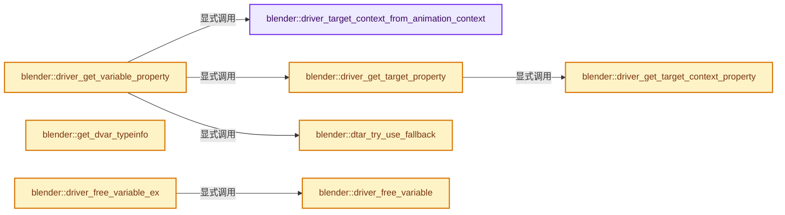
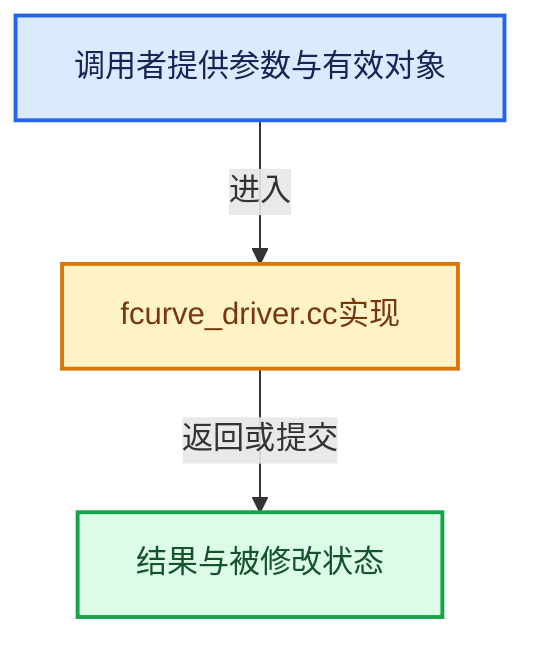

# 实现依赖专题：source/blender/blenkernel/intern/fcurve_driver.cc

[方向导航](README.md) · [符号索引](../%E7%AC%A6%E5%8F%B7%E4%BE%9D%E8%B5%96%E4%B8%8E%E5%AE%9E%E7%8E%B0%E7%B4%A2%E5%BC%95.md)

本专题从正文实际调用进入，集中保存共享实现。函数有稳定锚点，可从调用处直接跳到对应完整函数；递归与互相调用通过回链组织。

## 本文件的实现关系






## 完整成员与函数实现

<a id="f-3879156378fbf136"></a>

### `blender::driver_target_context_from_animation_context`

实现位置：[source/blender/blenkernel/intern/fcurve_driver.cc](../../../../../source/blender/blenkernel/intern/fcurve_driver.cc) · L92—L101。

接口参数：

- `const AnimationEvalContext *anim_eval_context`

**教学注释版**

<!-- annotated:f1c846e075a9ec -->

```cpp
static DriverTargetContext driver_target_context_from_animation_context(
    const AnimationEvalContext *anim_eval_context)
{
  DriverTargetContext driver_target_context;

  driver_target_context.scene = DEG_get_evaluated_scene(anim_eval_context->depsgraph);
  driver_target_context.view_layer = DEG_get_evaluated_view_layer(anim_eval_context->depsgraph);

  return driver_target_context;
}
```

<details>
<summary>核对原始源码：source/blender/blenkernel/intern/fcurve_driver.cc · L92—L101</summary>

<!-- original:f1c846e075a9ec:source/blender/blenkernel/intern/fcurve_driver.cc:92:101 -->

```cpp
static DriverTargetContext driver_target_context_from_animation_context(
    const AnimationEvalContext *anim_eval_context)
{
  DriverTargetContext driver_target_context;

  driver_target_context.scene = DEG_get_evaluated_scene(anim_eval_context->depsgraph);
  driver_target_context.view_layer = DEG_get_evaluated_view_layer(anim_eval_context->depsgraph);

  return driver_target_context;
}
```

</details>

**沿实际写入检查状态**

- `driver_target_context.scene = DEG_get_evaluated_scene(anim_eval_context->depsgraph);`
- `driver_target_context.view_layer = DEG_get_evaluated_view_layer(anim_eval_context->depsgraph);`

**结果出口**

- `return driver_target_context;`

**继续追踪实现**

- `DEG_get_evaluated_scene` → [blender::DEG_get_evaluated_scene · L212](../11-Depsgraph%E4%B8%8E%E5%B9%B6%E8%A1%8C%E4%BB%BB%E5%8A%A1%E7%B3%BB%E7%BB%9F/%E4%BE%9D%E8%B5%96-depsgraph_query-e8b1e4.md#f-be7729d26a71d3fd)。
- `DEG_get_evaluated_view_layer` → [blender::DEG_get_evaluated_view_layer · L222](../11-Depsgraph%E4%B8%8E%E5%B9%B6%E8%A1%8C%E4%BB%BB%E5%8A%A1%E7%B3%BB%E7%BB%9F/%E4%BE%9D%E8%B5%96-depsgraph_query-e8b1e4.md#f-3962e192bc426a3c)。

<a id="f-db59d8073f26c04b"></a>

### `blender::driver_get_target_context_property`

实现位置：[source/blender/blenkernel/intern/fcurve_driver.cc](../../../../../source/blender/blenkernel/intern/fcurve_driver.cc) · L105—L129。

接口参数：

- `const DriverTargetContext *driver_target_context`
- `DriverTarget *dtar`
- `PointerRNA *r_property_ptr`

**教学注释版**

<!-- annotated:27174e3203fec0 -->

```cpp
static bool driver_get_target_context_property(const DriverTargetContext *driver_target_context,
                                               DriverTarget *dtar,
                                               PointerRNA *r_property_ptr)
{
  switch (dtar->context_property) {
    case DTAR_CONTEXT_PROPERTY_ACTIVE_SCENE:
      *r_property_ptr = RNA_id_pointer_create(&driver_target_context->scene->id);
      return true;

    case DTAR_CONTEXT_PROPERTY_ACTIVE_VIEW_LAYER: {
      *r_property_ptr = RNA_pointer_create_discrete(
          &driver_target_context->scene->id, RNA_ViewLayer, driver_target_context->view_layer);
      return true;
    }
  }

  BLI_assert_unreachable();

  /* Reset to a nullptr RNA pointer.
   * This allows to more gracefully handle issues with unsupported configuration (forward
   * compatibility. for example). */
  *r_property_ptr = {};

  return false;
}
```

<details>
<summary>核对原始源码：source/blender/blenkernel/intern/fcurve_driver.cc · L105—L129</summary>

<!-- original:27174e3203fec0:source/blender/blenkernel/intern/fcurve_driver.cc:105:129 -->

```cpp
static bool driver_get_target_context_property(const DriverTargetContext *driver_target_context,
                                               DriverTarget *dtar,
                                               PointerRNA *r_property_ptr)
{
  switch (dtar->context_property) {
    case DTAR_CONTEXT_PROPERTY_ACTIVE_SCENE:
      *r_property_ptr = RNA_id_pointer_create(&driver_target_context->scene->id);
      return true;

    case DTAR_CONTEXT_PROPERTY_ACTIVE_VIEW_LAYER: {
      *r_property_ptr = RNA_pointer_create_discrete(
          &driver_target_context->scene->id, RNA_ViewLayer, driver_target_context->view_layer);
      return true;
    }
  }

  BLI_assert_unreachable();

  /* Reset to a nullptr RNA pointer.
   * This allows to more gracefully handle issues with unsupported configuration (forward
   * compatibility. for example). */
  *r_property_ptr = {};

  return false;
}
```

</details>

**结果出口**

- `return true;`
- `return false;`

**继续追踪实现**

- `RNA_id_pointer_create` → [blender::RNA_id_pointer_create · L170](%E4%BE%9D%E8%B5%96-rna_access-706bea.md#f-d41a2d612ae3a7b6)。
- `RNA_pointer_create_discrete` → [blender::RNA_pointer_create_discrete · L181](%E4%BE%9D%E8%B5%96-rna_access-706bea.md#f-592a276e869c6d94)。
- `BLI_assert_unreachable` → [BLI_assert_unreachable · L77](../01-%E5%9F%BA%E7%A1%80%E5%AE%B9%E5%99%A8%E4%B8%8E%E7%8E%B0%E4%BB%A3CPP/%E4%BE%9D%E8%B5%96-BLI_assert-cc98e8.md#m-7a2d91a67d8e)。宏定义由构建条件选择。

<a id="f-b8e38630a6ebe192"></a>

### `blender::driver_get_target_property`

实现位置：[source/blender/blenkernel/intern/fcurve_driver.cc](../../../../../source/blender/blenkernel/intern/fcurve_driver.cc) · L131—L147。

接口参数：

- `const DriverTargetContext *driver_target_context`
- `DriverVar *dvar`
- `DriverTarget *dtar`
- `PointerRNA *r_prop`

**教学注释版**

<!-- annotated:3cfb858d3addb7 -->

```cpp
bool driver_get_target_property(const DriverTargetContext *driver_target_context,
                                DriverVar *dvar,
                                DriverTarget *dtar,
                                PointerRNA *r_prop)
{
  if (dvar->type == DVAR_TYPE_CONTEXT_PROP) {
    return driver_get_target_context_property(driver_target_context, dtar, r_prop);
  }

  if (dtar->id == nullptr) {
    return false;
  }

  *r_prop = RNA_id_pointer_create(dtar->id);

  return true;
}
```

<details>
<summary>核对原始源码：source/blender/blenkernel/intern/fcurve_driver.cc · L131—L147</summary>

<!-- original:3cfb858d3addb7:source/blender/blenkernel/intern/fcurve_driver.cc:131:147 -->

```cpp
bool driver_get_target_property(const DriverTargetContext *driver_target_context,
                                DriverVar *dvar,
                                DriverTarget *dtar,
                                PointerRNA *r_prop)
{
  if (dvar->type == DVAR_TYPE_CONTEXT_PROP) {
    return driver_get_target_context_property(driver_target_context, dtar, r_prop);
  }

  if (dtar->id == nullptr) {
    return false;
  }

  *r_prop = RNA_id_pointer_create(dtar->id);

  return true;
}
```

</details>

**结果出口**

- `return driver_get_target_context_property(driver_target_context, dtar, r_prop);`
- `return false;`
- `return true;`

**继续追踪实现**

- `driver_get_target_context_property` → [blender::driver_get_target_context_property · L105](%E4%BE%9D%E8%B5%96-fcurve_driver-ac5bc2.md#f-db59d8073f26c04b)。
- `RNA_id_pointer_create` → [blender::RNA_id_pointer_create · L170](%E4%BE%9D%E8%B5%96-rna_access-706bea.md#f-d41a2d612ae3a7b6)。

<a id="f-b9a0e10cf6c27d38"></a>

### `blender::dtar_try_use_fallback`

实现位置：[source/blender/blenkernel/intern/fcurve_driver.cc](../../../../../source/blender/blenkernel/intern/fcurve_driver.cc) · L153—L162。

接口参数：

- `DriverTarget *dtar`

**教学注释版**

<!-- annotated:ec76e761284a15 -->

```cpp
static bool dtar_try_use_fallback(DriverTarget *dtar)
{
  if ((dtar->options & DTAR_OPTION_USE_FALLBACK) == 0) {
    return false;
  }

  dtar->flag &= ~DTAR_FLAG_INVALID;
  dtar->flag |= DTAR_FLAG_FALLBACK_USED;
  return true;
}
```

<details>
<summary>核对原始源码：source/blender/blenkernel/intern/fcurve_driver.cc · L153—L162</summary>

<!-- original:ec76e761284a15:source/blender/blenkernel/intern/fcurve_driver.cc:153:162 -->

```cpp
static bool dtar_try_use_fallback(DriverTarget *dtar)
{
  if ((dtar->options & DTAR_OPTION_USE_FALLBACK) == 0) {
    return false;
  }

  dtar->flag &= ~DTAR_FLAG_INVALID;
  dtar->flag |= DTAR_FLAG_FALLBACK_USED;
  return true;
}
```

</details>

**沿实际写入检查状态**

- `dtar->flag &= ~DTAR_FLAG_INVALID;`
- `dtar->flag |= DTAR_FLAG_FALLBACK_USED;`

**结果出口**

- `return false;`
- `return true;`

**继续追踪实现**

本实现没有需要继续展开的显式调用；检查返回表达式、对象转换和调用者前置条件。

<a id="f-0f5b6f7072456d64"></a>

### `blender::driver_get_variable_property`

实现位置：[source/blender/blenkernel/intern/fcurve_driver.cc](../../../../../source/blender/blenkernel/intern/fcurve_driver.cc) · L281—L378。

接口参数：

- `const AnimationEvalContext *anim_eval_context`
- `ChannelDriver *driver`
- `DriverVar *dvar`
- `DriverTarget *dtar`
- `PointerRNA *r_ptr`
- `PropertyRNA **r_prop`
- `int *r_index`

**教学注释版**

<!-- annotated:3208a38a534680 -->

```cpp
eDriverVariablePropertyResult driver_get_variable_property(
    const AnimationEvalContext *anim_eval_context,
    ChannelDriver *driver,
    DriverVar *dvar,
    DriverTarget *dtar,
    PointerRNA *r_ptr,
    PropertyRNA **r_prop,
    int *r_index)
{
  PointerRNA ptr;
  PropertyRNA *prop;
  int index = -1;

  /* Sanity check. */
  if (ELEM(nullptr, driver, dtar)) {
    return DRIVER_VAR_PROPERTY_INVALID;
  }

  dtar->flag &= ~DTAR_FLAG_FALLBACK_USED;

  /* Get RNA-pointer for the data-block given in target. */
  const DriverTargetContext driver_target_context = driver_target_context_from_animation_context(
      anim_eval_context);
  PointerRNA target_ptr;
  if (!driver_get_target_property(&driver_target_context, dvar, dtar, &target_ptr)) {
    if (G.debug & G_DEBUG) {
      CLOG_ERROR(&LOG, "driver has an invalid target to use (path = %s)", dtar->rna_path);
    }

    driver->flag |= DRIVER_FLAG_INVALID;
    dtar->flag |= DTAR_FLAG_INVALID;
    return DRIVER_VAR_PROPERTY_INVALID;
  }

  /* Get property to read from, and get value as appropriate. */
  if (dtar->rna_path == nullptr || dtar->rna_path[0] == '\0') {
    ptr = {};
    prop = nullptr; /* OK. */
  }
  else if (RNA_path_resolve_full(&target_ptr, dtar->rna_path, &ptr, &prop, &index)) {
    /* OK. */
  }
  else {
    if (dtar_try_use_fallback(dtar)) {
      ptr = {};
      *r_prop = nullptr;
      *r_index = -1;
      return DRIVER_VAR_PROPERTY_FALLBACK;
    }

    /* Path couldn't be resolved. */
    if (G.debug & G_DEBUG) {
      CLOG_ERROR(&LOG,
                 "Driver Evaluation Error: cannot resolve target for %s -> %s",
                 target_ptr.owner_id->name,
                 dtar->rna_path);
    }

    ptr = {};
    *r_prop = nullptr;
    *r_index = -1;

    driver->flag |= DRIVER_FLAG_INVALID;
    dtar->flag |= DTAR_FLAG_INVALID;
    return DRIVER_VAR_PROPERTY_INVALID;
  }

  *r_ptr = ptr;
  *r_prop = prop;
  *r_index = index;
  const bool allow_no_index = true;

  /* Verify the array index and apply fallback if appropriate. */
  if (prop && RNA_property_array_check(prop)) {
    if ((index < 0 && !allow_no_index) || index >= RNA_property_array_length(&ptr, prop)) {
      if (dtar_try_use_fallback(dtar)) {
        return DRIVER_VAR_PROPERTY_FALLBACK;
      }

      /* Out of bounds. */
      if (G.debug & G_DEBUG) {
        CLOG_ERROR(&LOG,
                   "Driver Evaluation Error: array index is out of bounds for %s -> %s (%d)",
                   ptr.owner_id->name,
                   dtar->rna_path,
                   index);
      }

      driver->flag |= DRIVER_FLAG_INVALID;
      dtar->flag |= DTAR_FLAG_INVALID;
      return DRIVER_VAR_PROPERTY_INVALID_INDEX;
    }
  }

  /* If we're still here, we should be ok. */
  dtar->flag &= ~DTAR_FLAG_INVALID;
  return DRIVER_VAR_PROPERTY_SUCCESS;
}
```

<details>
<summary>核对原始源码：source/blender/blenkernel/intern/fcurve_driver.cc · L281—L378</summary>

<!-- original:3208a38a534680:source/blender/blenkernel/intern/fcurve_driver.cc:281:378 -->

```cpp
eDriverVariablePropertyResult driver_get_variable_property(
    const AnimationEvalContext *anim_eval_context,
    ChannelDriver *driver,
    DriverVar *dvar,
    DriverTarget *dtar,
    PointerRNA *r_ptr,
    PropertyRNA **r_prop,
    int *r_index)
{
  PointerRNA ptr;
  PropertyRNA *prop;
  int index = -1;

  /* Sanity check. */
  if (ELEM(nullptr, driver, dtar)) {
    return DRIVER_VAR_PROPERTY_INVALID;
  }

  dtar->flag &= ~DTAR_FLAG_FALLBACK_USED;

  /* Get RNA-pointer for the data-block given in target. */
  const DriverTargetContext driver_target_context = driver_target_context_from_animation_context(
      anim_eval_context);
  PointerRNA target_ptr;
  if (!driver_get_target_property(&driver_target_context, dvar, dtar, &target_ptr)) {
    if (G.debug & G_DEBUG) {
      CLOG_ERROR(&LOG, "driver has an invalid target to use (path = %s)", dtar->rna_path);
    }

    driver->flag |= DRIVER_FLAG_INVALID;
    dtar->flag |= DTAR_FLAG_INVALID;
    return DRIVER_VAR_PROPERTY_INVALID;
  }

  /* Get property to read from, and get value as appropriate. */
  if (dtar->rna_path == nullptr || dtar->rna_path[0] == '\0') {
    ptr = {};
    prop = nullptr; /* OK. */
  }
  else if (RNA_path_resolve_full(&target_ptr, dtar->rna_path, &ptr, &prop, &index)) {
    /* OK. */
  }
  else {
    if (dtar_try_use_fallback(dtar)) {
      ptr = {};
      *r_prop = nullptr;
      *r_index = -1;
      return DRIVER_VAR_PROPERTY_FALLBACK;
    }

    /* Path couldn't be resolved. */
    if (G.debug & G_DEBUG) {
      CLOG_ERROR(&LOG,
                 "Driver Evaluation Error: cannot resolve target for %s -> %s",
                 target_ptr.owner_id->name,
                 dtar->rna_path);
    }

    ptr = {};
    *r_prop = nullptr;
    *r_index = -1;

    driver->flag |= DRIVER_FLAG_INVALID;
    dtar->flag |= DTAR_FLAG_INVALID;
    return DRIVER_VAR_PROPERTY_INVALID;
  }

  *r_ptr = ptr;
  *r_prop = prop;
  *r_index = index;
  const bool allow_no_index = true;

  /* Verify the array index and apply fallback if appropriate. */
  if (prop && RNA_property_array_check(prop)) {
    if ((index < 0 && !allow_no_index) || index >= RNA_property_array_length(&ptr, prop)) {
      if (dtar_try_use_fallback(dtar)) {
        return DRIVER_VAR_PROPERTY_FALLBACK;
      }

      /* Out of bounds. */
      if (G.debug & G_DEBUG) {
        CLOG_ERROR(&LOG,
                   "Driver Evaluation Error: array index is out of bounds for %s -> %s (%d)",
                   ptr.owner_id->name,
                   dtar->rna_path,
                   index);
      }

      driver->flag |= DRIVER_FLAG_INVALID;
      dtar->flag |= DTAR_FLAG_INVALID;
      return DRIVER_VAR_PROPERTY_INVALID_INDEX;
    }
  }

  /* If we're still here, we should be ok. */
  dtar->flag &= ~DTAR_FLAG_INVALID;
  return DRIVER_VAR_PROPERTY_SUCCESS;
}
```

</details>

**沿实际写入检查状态**

- `dtar->flag &= ~DTAR_FLAG_FALLBACK_USED;`
- `driver->flag |= DRIVER_FLAG_INVALID;`
- `dtar->flag |= DTAR_FLAG_INVALID;`
- `ptr = {};`
- `prop = nullptr; /* OK. */`
- `dtar->flag &= ~DTAR_FLAG_INVALID;`

**结果出口**

- `return DRIVER_VAR_PROPERTY_INVALID;`
- `return DRIVER_VAR_PROPERTY_FALLBACK;`
- `return DRIVER_VAR_PROPERTY_INVALID_INDEX;`
- `return DRIVER_VAR_PROPERTY_SUCCESS;`

**继续追踪实现**

- `ELEM` → [ELEM · L88](%E4%BE%9D%E8%B5%96-GHOST_utildefines-34b996.md#m-d28724a15928)；[ELEM · L135](../01-%E5%9F%BA%E7%A1%80%E5%AE%B9%E5%99%A8%E4%B8%8E%E7%8E%B0%E4%BB%A3CPP/%E4%BE%9D%E8%B5%96-BLI_utildefines-293a0a.md#m-d6572de7cae0)。宏定义由构建条件选择。
- `driver_target_context_from_animation_context` → [blender::driver_target_context_from_animation_context · L92](%E4%BE%9D%E8%B5%96-fcurve_driver-ac5bc2.md#f-3879156378fbf136)。
- `driver_get_target_property` → [blender::driver_get_target_property · L131](%E4%BE%9D%E8%B5%96-fcurve_driver-ac5bc2.md#f-b8e38630a6ebe192)。
- `CLOG_ERROR` → [CLOG_ERROR · L188](%E4%BE%9D%E8%B5%96-CLG_log-e9051b.md#m-081575cdc8d0)。宏定义由构建条件选择。
- `RNA_path_resolve_full` → [blender::RNA_path_resolve_full · L545](%E4%BE%9D%E8%B5%96-rna_path-495878.md#f-df07a240b3b9a13a)。
- `dtar_try_use_fallback` → [blender::dtar_try_use_fallback · L153](%E4%BE%9D%E8%B5%96-fcurve_driver-ac5bc2.md#f-b9a0e10cf6c27d38)。
- `RNA_property_array_check` → [blender::RNA_property_array_check · L1376](%E4%BE%9D%E8%B5%96-rna_access-706bea.md#f-efbdada33e42c28c)。
- `RNA_property_array_length` → [blender::RNA_property_array_length · L1371](%E4%BE%9D%E8%B5%96-rna_access-706bea.md#f-2258ce063a075147)。

<a id="f-b68fc11f58adf1a4"></a>

### `blender::get_dvar_typeinfo`

实现位置：[source/blender/blenkernel/intern/fcurve_driver.cc](../../../../../source/blender/blenkernel/intern/fcurve_driver.cc) · L842—L850。

接口参数：

- `eDriverVar_Types type`

**教学注释版**

<!-- annotated:1dd500d40df8ee -->

```cpp
static const DriverVarTypeInfo *get_dvar_typeinfo(eDriverVar_Types type)
{
  /* Check if valid type. */
  if (uint32_t(type) < MAX_DVAR_TYPES) {
    return &dvar_types[type];
  }

  return nullptr;
}
```

<details>
<summary>核对原始源码：source/blender/blenkernel/intern/fcurve_driver.cc · L842—L850</summary>

<!-- original:1dd500d40df8ee:source/blender/blenkernel/intern/fcurve_driver.cc:842:850 -->

```cpp
static const DriverVarTypeInfo *get_dvar_typeinfo(eDriverVar_Types type)
{
  /* Check if valid type. */
  if (uint32_t(type) < MAX_DVAR_TYPES) {
    return &dvar_types[type];
  }

  return nullptr;
}
```

</details>

**结果出口**

- `return &dvar_types[type];`
- `return nullptr;`

**继续追踪实现**

本实现没有需要继续展开的显式调用；检查返回表达式、对象转换和调用者前置条件。

<a id="f-8a8c286e818756ea"></a>

### `blender::driver_free_variable`

实现位置：[source/blender/blenkernel/intern/fcurve_driver.cc](../../../../../source/blender/blenkernel/intern/fcurve_driver.cc) · L858—L880。

接口参数：

- `ListBaseT<DriverVar> *variables`
- `DriverVar *dvar`

**教学注释版**

<!-- annotated:13291ef4f1dad0 -->

```cpp
void driver_free_variable(ListBaseT<DriverVar> *variables, DriverVar *dvar)
{
  /* Sanity checks. */
  if (dvar == nullptr) {
    return;
  }

  /* Free target vars:
   * - need to go over all of them, not just up to the ones that are used
   *   currently, since there may be some lingering RNA paths from
   *   previous users needing freeing
   */
  DRIVER_TARGETS_LOOPER_BEGIN (dvar) {
    /* Free RNA path if applicable. */
    if (dtar->rna_path) {
      MEM_delete(dtar->rna_path);
    }
  }
  DRIVER_TARGETS_LOOPER_END;

  /* Remove the variable from the driver. */
  BLI_freelinkN(variables, dvar);
}
```

<details>
<summary>核对原始源码：source/blender/blenkernel/intern/fcurve_driver.cc · L858—L880</summary>

<!-- original:13291ef4f1dad0:source/blender/blenkernel/intern/fcurve_driver.cc:858:880 -->

```cpp
void driver_free_variable(ListBaseT<DriverVar> *variables, DriverVar *dvar)
{
  /* Sanity checks. */
  if (dvar == nullptr) {
    return;
  }

  /* Free target vars:
   * - need to go over all of them, not just up to the ones that are used
   *   currently, since there may be some lingering RNA paths from
   *   previous users needing freeing
   */
  DRIVER_TARGETS_LOOPER_BEGIN (dvar) {
    /* Free RNA path if applicable. */
    if (dtar->rna_path) {
      MEM_delete(dtar->rna_path);
    }
  }
  DRIVER_TARGETS_LOOPER_END;

  /* Remove the variable from the driver. */
  BLI_freelinkN(variables, dvar);
}
```

</details>

**继续追踪实现**

- `MEM_delete` → [MEM_delete · L400](../03-%E5%86%85%E5%AD%98%E5%88%86%E9%85%8D%E4%B8%8E%E8%BF%90%E8%A1%8C%E6%97%B6%E7%B1%BB%E5%9E%8B/%E4%BE%9D%E8%B5%96-MEM_guardedalloc-b54eca.md#f-9049ffdd1682887c)。
- `BLI_freelinkN` → [blender::BLI_freelinkN · L277](../01-%E5%9F%BA%E7%A1%80%E5%AE%B9%E5%99%A8%E4%B8%8E%E7%8E%B0%E4%BB%A3CPP/%E4%BE%9D%E8%B5%96-listbase-2816d9.md#f-c7719591852af7da)。

<a id="f-b3fb84ccc947765d"></a>

### `blender::driver_free_variable_ex`

实现位置：[source/blender/blenkernel/intern/fcurve_driver.cc](../../../../../source/blender/blenkernel/intern/fcurve_driver.cc) · L882—L889。

接口参数：

- `ChannelDriver *driver`
- `DriverVar *dvar`

**教学注释版**

<!-- annotated:a1d33b5110aa3f -->

```cpp
void driver_free_variable_ex(ChannelDriver *driver, DriverVar *dvar)
{
  /* Remove and free the driver variable. */
  driver_free_variable(&driver->variables, dvar);

  /* Since driver variables are cached, the expression needs re-compiling too. */
  BKE_driver_invalidate_expression(driver, false, true);
}
```

<details>
<summary>核对原始源码：source/blender/blenkernel/intern/fcurve_driver.cc · L882—L889</summary>

<!-- original:a1d33b5110aa3f:source/blender/blenkernel/intern/fcurve_driver.cc:882:889 -->

```cpp
void driver_free_variable_ex(ChannelDriver *driver, DriverVar *dvar)
{
  /* Remove and free the driver variable. */
  driver_free_variable(&driver->variables, dvar);

  /* Since driver variables are cached, the expression needs re-compiling too. */
  BKE_driver_invalidate_expression(driver, false, true);
}
```

</details>

**继续追踪实现**

- `driver_free_variable` → [blender::driver_free_variable · L858](%E4%BE%9D%E8%B5%96-fcurve_driver-ac5bc2.md#f-8a8c286e818756ea)。
- `BKE_driver_invalidate_expression` → [blender::BKE_driver_invalidate_expression · L1262](%E4%BE%9D%E8%B5%96-fcurve_driver-ac5bc2.md#f-116c340c20708513)。

<a id="f-fc683737474abaab"></a>

### `blender::driver_variables_copy`

实现位置：[source/blender/blenkernel/intern/fcurve_driver.cc](../../../../../source/blender/blenkernel/intern/fcurve_driver.cc) · L891—L906。

接口参数：

- `ListBaseT<DriverVar> *dst_vars`
- `const ListBaseT<DriverVar> *src_vars`

**教学注释版**

<!-- annotated:697ff909ffefe1 -->

```cpp
void driver_variables_copy(ListBaseT<DriverVar> *dst_vars, const ListBaseT<DriverVar> *src_vars)
{
  BLI_assert(dst_vars->is_empty());
  BLI_duplicatelist(dst_vars, src_vars);

  for (DriverVar &dvar : *dst_vars) {
    /* Need to go over all targets so that we don't leave any dangling paths. */
    DRIVER_TARGETS_LOOPER_BEGIN (&dvar) {
      /* Make a copy of target's rna path if available. */
      if (dtar->rna_path) {
        dtar->rna_path = MEM_dupalloc(dtar->rna_path);
      }
    }
    DRIVER_TARGETS_LOOPER_END;
  }
}
```

<details>
<summary>核对原始源码：source/blender/blenkernel/intern/fcurve_driver.cc · L891—L906</summary>

<!-- original:697ff909ffefe1:source/blender/blenkernel/intern/fcurve_driver.cc:891:906 -->

```cpp
void driver_variables_copy(ListBaseT<DriverVar> *dst_vars, const ListBaseT<DriverVar> *src_vars)
{
  BLI_assert(dst_vars->is_empty());
  BLI_duplicatelist(dst_vars, src_vars);

  for (DriverVar &dvar : *dst_vars) {
    /* Need to go over all targets so that we don't leave any dangling paths. */
    DRIVER_TARGETS_LOOPER_BEGIN (&dvar) {
      /* Make a copy of target's rna path if available. */
      if (dtar->rna_path) {
        dtar->rna_path = MEM_dupalloc(dtar->rna_path);
      }
    }
    DRIVER_TARGETS_LOOPER_END;
  }
}
```

</details>

**沿实际写入检查状态**

- `dtar->rna_path = MEM_dupalloc(dtar->rna_path);`

**继续追踪实现**

- `BLI_assert` → [BLI_assert · L48](../01-%E5%9F%BA%E7%A1%80%E5%AE%B9%E5%99%A8%E4%B8%8E%E7%8E%B0%E4%BB%A3CPP/%E4%BE%9D%E8%B5%96-BLI_assert-cc98e8.md#m-57a88495704d)；[BLI_assert · L63](../01-%E5%9F%BA%E7%A1%80%E5%AE%B9%E5%99%A8%E4%B8%8E%E7%8E%B0%E4%BB%A3CPP/%E4%BE%9D%E8%B5%96-BLI_assert-cc98e8.md#m-d07050020cb5)。宏定义由构建条件选择。
- `dst_vars->is_empty` → [blender::ListBaseT::is_empty · L54](%E4%BE%9D%E8%B5%96-DNA_listBase-48dbc9.md#f-189938e5bf0f989b)。
- `BLI_duplicatelist` → [blender::BLI_duplicatelist · L834](../01-%E5%9F%BA%E7%A1%80%E5%AE%B9%E5%99%A8%E4%B8%8E%E7%8E%B0%E4%BB%A3CPP/%E4%BE%9D%E8%B5%96-listbase-2816d9.md#f-d840cb64a1b265dc)。
- `MEM_dupalloc` → [MEM_dupalloc · L627](../03-%E5%86%85%E5%AD%98%E5%88%86%E9%85%8D%E4%B8%8E%E8%BF%90%E8%A1%8C%E6%97%B6%E7%B1%BB%E5%9E%8B/%E4%BE%9D%E8%B5%96-MEM_guardedalloc-b54eca.md#f-78a72b71e3c57010)。

<a id="f-a3cc6e7afb88bfb2"></a>

### `blender::fcurve_free_driver`

实现位置：[source/blender/blenkernel/intern/fcurve_driver.cc](../../../../../source/blender/blenkernel/intern/fcurve_driver.cc) · L1043—L1073。

接口参数：

- `FCurve *fcu`

**教学注释版**

<!-- annotated:adb9f2c6df0943 -->

```cpp
void fcurve_free_driver(FCurve *fcu)
{
  ChannelDriver *driver;
  DriverVar *dvar, *dvarn;

  /* Sanity checks. */
  if (ELEM(nullptr, fcu, fcu->driver)) {
    return;
  }
  driver = fcu->driver;

  /* Free driver targets. */
  for (dvar = driver->variables.first(); dvar; dvar = dvarn) {
    dvarn = dvar->next;
    driver_free_variable_ex(driver, dvar);
  }

#ifdef WITH_PYTHON
  /* Free compiled driver expression. */
  if (driver->expr_comp) {
    BPY_DECREF(driver->expr_comp);
  }
#endif

  BLI_expr_pylike_free(driver->expr_simple);

  /* Free driver itself, then set F-Curve's point to this to nullptr
   * (as the curve may still be used). */
  MEM_delete(driver);
  fcu->driver = nullptr;
}
```

<details>
<summary>核对原始源码：source/blender/blenkernel/intern/fcurve_driver.cc · L1043—L1073</summary>

<!-- original:adb9f2c6df0943:source/blender/blenkernel/intern/fcurve_driver.cc:1043:1073 -->

```cpp
void fcurve_free_driver(FCurve *fcu)
{
  ChannelDriver *driver;
  DriverVar *dvar, *dvarn;

  /* Sanity checks. */
  if (ELEM(nullptr, fcu, fcu->driver)) {
    return;
  }
  driver = fcu->driver;

  /* Free driver targets. */
  for (dvar = driver->variables.first(); dvar; dvar = dvarn) {
    dvarn = dvar->next;
    driver_free_variable_ex(driver, dvar);
  }

#ifdef WITH_PYTHON
  /* Free compiled driver expression. */
  if (driver->expr_comp) {
    BPY_DECREF(driver->expr_comp);
  }
#endif

  BLI_expr_pylike_free(driver->expr_simple);

  /* Free driver itself, then set F-Curve's point to this to nullptr
   * (as the curve may still be used). */
  MEM_delete(driver);
  fcu->driver = nullptr;
}
```

</details>

**沿实际写入检查状态**

- `driver = fcu->driver;`
- `dvarn = dvar->next;`
- `fcu->driver = nullptr;`

**继续追踪实现**

- `ELEM` → [ELEM · L88](%E4%BE%9D%E8%B5%96-GHOST_utildefines-34b996.md#m-d28724a15928)；[ELEM · L135](../01-%E5%9F%BA%E7%A1%80%E5%AE%B9%E5%99%A8%E4%B8%8E%E7%8E%B0%E4%BB%A3CPP/%E4%BE%9D%E8%B5%96-BLI_utildefines-293a0a.md#m-d6572de7cae0)。宏定义由构建条件选择。
- `driver->variables.first` → [调用协议](../%E6%A8%A1%E6%9D%BF%E5%AE%8F%E4%B8%8E%E5%8A%A8%E6%80%81%E5%88%86%E6%B4%BE%E5%8D%8F%E8%AE%AE.md)：接收对象类型依赖auto、返回值或模板实例；不按同名猜测目标。调用位置L1055。
- `driver_free_variable_ex` → [blender::driver_free_variable_ex · L882](%E4%BE%9D%E8%B5%96-fcurve_driver-ac5bc2.md#f-b3fb84ccc947765d)。
- `BPY_DECREF` → [blender::BPY_DECREF · L793](%E4%BE%9D%E8%B5%96-bpy_interface-b3b9e6.md#f-dac6cc29baaa27be)。
- `BLI_expr_pylike_free` → [blender::BLI_expr_pylike_free · L112](../01-%E5%9F%BA%E7%A1%80%E5%AE%B9%E5%99%A8%E4%B8%8E%E7%8E%B0%E4%BB%A3CPP/%E4%BE%9D%E8%B5%96-expr_pylike_eval-bd9286.md#f-ef454d4707f27b54)。
- `MEM_delete` → [MEM_delete · L400](../03-%E5%86%85%E5%AD%98%E5%88%86%E9%85%8D%E4%B8%8E%E8%BF%90%E8%A1%8C%E6%97%B6%E7%B1%BB%E5%9E%8B/%E4%BE%9D%E8%B5%96-MEM_guardedalloc-b54eca.md#f-9049ffdd1682887c)。

<a id="f-6dee218e96d6e2b4"></a>

### `blender::fcurve_copy_driver`

实现位置：[source/blender/blenkernel/intern/fcurve_driver.cc](../../../../../source/blender/blenkernel/intern/fcurve_driver.cc) · L1075—L1097。

接口参数：

- `const ChannelDriver *driver`

**教学注释版**

<!-- annotated:b528579e8cca74 -->

```cpp
ChannelDriver *fcurve_copy_driver(const ChannelDriver *driver)
{
  ChannelDriver *ndriver;

  /* Sanity checks. */
  if (driver == nullptr) {
    return nullptr;
  }

  /* Copy all data. */
  ndriver = MEM_dupalloc(driver);
  ndriver->expr_comp = nullptr;
  ndriver->expr_simple = nullptr;

  /* Copy variables. */

  /* To get rid of refs to non-copied data (that's still used on original). */
  ndriver->variables.clear_no_delete();
  driver_variables_copy(&ndriver->variables, &driver->variables);

  /* Return the new driver. */
  return ndriver;
}
```

<details>
<summary>核对原始源码：source/blender/blenkernel/intern/fcurve_driver.cc · L1075—L1097</summary>

<!-- original:b528579e8cca74:source/blender/blenkernel/intern/fcurve_driver.cc:1075:1097 -->

```cpp
ChannelDriver *fcurve_copy_driver(const ChannelDriver *driver)
{
  ChannelDriver *ndriver;

  /* Sanity checks. */
  if (driver == nullptr) {
    return nullptr;
  }

  /* Copy all data. */
  ndriver = MEM_dupalloc(driver);
  ndriver->expr_comp = nullptr;
  ndriver->expr_simple = nullptr;

  /* Copy variables. */

  /* To get rid of refs to non-copied data (that's still used on original). */
  ndriver->variables.clear_no_delete();
  driver_variables_copy(&ndriver->variables, &driver->variables);

  /* Return the new driver. */
  return ndriver;
}
```

</details>

**沿实际写入检查状态**

- `ndriver = MEM_dupalloc(driver);`
- `ndriver->expr_comp = nullptr;`
- `ndriver->expr_simple = nullptr;`

**结果出口**

- `return nullptr;`
- `return ndriver;`

**继续追踪实现**

- `MEM_dupalloc` → [MEM_dupalloc · L627](../03-%E5%86%85%E5%AD%98%E5%88%86%E9%85%8D%E4%B8%8E%E8%BF%90%E8%A1%8C%E6%97%B6%E7%B1%BB%E5%9E%8B/%E4%BE%9D%E8%B5%96-MEM_guardedalloc-b54eca.md#f-78a72b71e3c57010)。
- `ndriver->variables.clear_no_delete` → [调用协议](../%E6%A8%A1%E6%9D%BF%E5%AE%8F%E4%B8%8E%E5%8A%A8%E6%80%81%E5%88%86%E6%B4%BE%E5%8D%8F%E8%AE%AE.md)：接收对象类型依赖auto、返回值或模板实例；不按同名猜测目标。调用位置L1092。
- `driver_variables_copy` → [blender::driver_variables_copy · L891](%E4%BE%9D%E8%B5%96-fcurve_driver-ac5bc2.md#f-fc683737474abaab)。

<a id="f-4e266db8befecdae"></a>

### `blender::driver_compile_simple_expr_impl`

实现位置：[source/blender/blenkernel/intern/fcurve_driver.cc](../../../../../source/blender/blenkernel/intern/fcurve_driver.cc) · L1113—L1128。

接口参数：

- `ChannelDriver *driver`

**教学注释版**

<!-- annotated:55bcf4548876ae -->

```cpp
static ExprPyLike_Parsed *driver_compile_simple_expr_impl(ChannelDriver *driver)
{
  /* Prepare parameter names. */
  int names_len = driver->variables.count();
  const char **names = static_cast<const char **>(
      BLI_array_alloca(names, names_len + VAR_INDEX_CUSTOM));
  int i = VAR_INDEX_CUSTOM;

  names[VAR_INDEX_FRAME] = "frame";

  for (DriverVar &dvar : driver->variables) {
    names[i++] = dvar.name;
  }

  return BLI_expr_pylike_parse(driver->expression, names, names_len + VAR_INDEX_CUSTOM);
}
```

<details>
<summary>核对原始源码：source/blender/blenkernel/intern/fcurve_driver.cc · L1113—L1128</summary>

<!-- original:55bcf4548876ae:source/blender/blenkernel/intern/fcurve_driver.cc:1113:1128 -->

```cpp
static ExprPyLike_Parsed *driver_compile_simple_expr_impl(ChannelDriver *driver)
{
  /* Prepare parameter names. */
  int names_len = driver->variables.count();
  const char **names = static_cast<const char **>(
      BLI_array_alloca(names, names_len + VAR_INDEX_CUSTOM));
  int i = VAR_INDEX_CUSTOM;

  names[VAR_INDEX_FRAME] = "frame";

  for (DriverVar &dvar : driver->variables) {
    names[i++] = dvar.name;
  }

  return BLI_expr_pylike_parse(driver->expression, names, names_len + VAR_INDEX_CUSTOM);
}
```

</details>

**沿实际写入检查状态**

- `names[VAR_INDEX_FRAME] = "frame";`

**结果出口**

- `return BLI_expr_pylike_parse(driver->expression, names, names_len + VAR_INDEX_CUSTOM);`

**继续追踪实现**

- `driver->variables.count` → [调用协议](../%E6%A8%A1%E6%9D%BF%E5%AE%8F%E4%B8%8E%E5%8A%A8%E6%80%81%E5%88%86%E6%B4%BE%E5%8D%8F%E8%AE%AE.md)：接收对象类型依赖auto、返回值或模板实例；不按同名猜测目标。调用位置L1116。
- `BLI_array_alloca` → [BLI_array_alloca · L18](../01-%E5%9F%BA%E7%A1%80%E5%AE%B9%E5%99%A8%E4%B8%8E%E7%8E%B0%E4%BB%A3CPP/%E4%BE%9D%E8%B5%96-BLI_alloca-c79275.md#m-6f2643116b59)。宏定义由构建条件选择。
- `BLI_expr_pylike_parse` → [blender::BLI_expr_pylike_parse · L1040](../01-%E5%9F%BA%E7%A1%80%E5%AE%B9%E5%99%A8%E4%B8%8E%E7%8E%B0%E4%BB%A3CPP/%E4%BE%9D%E8%B5%96-expr_pylike_eval-bd9286.md#f-79c977bc0b2189b7)。

<a id="f-84133e3b371c1f93"></a>

### `blender::driver_check_simple_expr_depends_on_time`

实现位置：[source/blender/blenkernel/intern/fcurve_driver.cc](../../../../../source/blender/blenkernel/intern/fcurve_driver.cc) · L1130—L1134。

接口参数：

- `const ExprPyLike_Parsed *expr`

**教学注释版**

<!-- annotated:806fc9e2162efa -->

```cpp
static bool driver_check_simple_expr_depends_on_time(const ExprPyLike_Parsed *expr)
{
  /* Check if the 'frame' parameter is actually used. */
  return BLI_expr_pylike_is_using_param(expr, VAR_INDEX_FRAME);
}
```

<details>
<summary>核对原始源码：source/blender/blenkernel/intern/fcurve_driver.cc · L1130—L1134</summary>

<!-- original:806fc9e2162efa:source/blender/blenkernel/intern/fcurve_driver.cc:1130:1134 -->

```cpp
static bool driver_check_simple_expr_depends_on_time(const ExprPyLike_Parsed *expr)
{
  /* Check if the 'frame' parameter is actually used. */
  return BLI_expr_pylike_is_using_param(expr, VAR_INDEX_FRAME);
}
```

</details>

**结果出口**

- `return BLI_expr_pylike_is_using_param(expr, VAR_INDEX_FRAME);`

**继续追踪实现**

- `BLI_expr_pylike_is_using_param` → [blender::BLI_expr_pylike_is_using_param · L127](../01-%E5%9F%BA%E7%A1%80%E5%AE%B9%E5%99%A8%E4%B8%8E%E7%8E%B0%E4%BB%A3CPP/%E4%BE%9D%E8%B5%96-expr_pylike_eval-bd9286.md#f-005b9ec316e045ed)。

<a id="f-f6c6182967ac2900"></a>

### `blender::driver_evaluate_simple_expr`

实现位置：[source/blender/blenkernel/intern/fcurve_driver.cc](../../../../../source/blender/blenkernel/intern/fcurve_driver.cc) · L1136—L1179。

接口参数：

- `const AnimationEvalContext *anim_eval_context`
- `ChannelDriver *driver`
- `ExprPyLike_Parsed *expr`
- `float *result`
- `float time`

**教学注释版**

<!-- annotated:a3609cc263b176 -->

```cpp
static bool driver_evaluate_simple_expr(const AnimationEvalContext *anim_eval_context,
                                        ChannelDriver *driver,
                                        ExprPyLike_Parsed *expr,
                                        float *result,
                                        float time)
{
  /* Prepare parameter values. */
  int vars_len = driver->variables.count();
  double *vars = static_cast<double *>(BLI_array_alloca(vars, vars_len + VAR_INDEX_CUSTOM));
  int i = VAR_INDEX_CUSTOM;

  vars[VAR_INDEX_FRAME] = time;

  for (DriverVar &dvar : driver->variables) {
    vars[i++] = driver_get_variable_value(anim_eval_context, driver, &dvar);
  }

  /* Evaluate expression. */
  double result_val;
  eExprPyLike_EvalStatus status = BLI_expr_pylike_eval(
      expr, vars, vars_len + VAR_INDEX_CUSTOM, &result_val);
  const char *message;

  switch (status) {
    case EXPR_PYLIKE_SUCCESS:
      if (isfinite(result_val)) {
        *result = float(result_val);
      }
      return true;

    case EXPR_PYLIKE_DIV_BY_ZERO:
    case EXPR_PYLIKE_MATH_ERROR:
      message = (status == EXPR_PYLIKE_DIV_BY_ZERO) ? "Division by Zero" : "Math Domain Error";
      CLOG_ERROR(&LOG, "%s in Driver: '%s'", message, driver->expression);

      driver->flag |= DRIVER_FLAG_INVALID;
      return true;

    default:
      /* Arriving here means a bug, not user error. */
      CLOG_ERROR(&LOG, "simple driver expression evaluation failed: '%s'", driver->expression);
      return false;
  }
}
```

<details>
<summary>核对原始源码：source/blender/blenkernel/intern/fcurve_driver.cc · L1136—L1179</summary>

<!-- original:a3609cc263b176:source/blender/blenkernel/intern/fcurve_driver.cc:1136:1179 -->

```cpp
static bool driver_evaluate_simple_expr(const AnimationEvalContext *anim_eval_context,
                                        ChannelDriver *driver,
                                        ExprPyLike_Parsed *expr,
                                        float *result,
                                        float time)
{
  /* Prepare parameter values. */
  int vars_len = driver->variables.count();
  double *vars = static_cast<double *>(BLI_array_alloca(vars, vars_len + VAR_INDEX_CUSTOM));
  int i = VAR_INDEX_CUSTOM;

  vars[VAR_INDEX_FRAME] = time;

  for (DriverVar &dvar : driver->variables) {
    vars[i++] = driver_get_variable_value(anim_eval_context, driver, &dvar);
  }

  /* Evaluate expression. */
  double result_val;
  eExprPyLike_EvalStatus status = BLI_expr_pylike_eval(
      expr, vars, vars_len + VAR_INDEX_CUSTOM, &result_val);
  const char *message;

  switch (status) {
    case EXPR_PYLIKE_SUCCESS:
      if (isfinite(result_val)) {
        *result = float(result_val);
      }
      return true;

    case EXPR_PYLIKE_DIV_BY_ZERO:
    case EXPR_PYLIKE_MATH_ERROR:
      message = (status == EXPR_PYLIKE_DIV_BY_ZERO) ? "Division by Zero" : "Math Domain Error";
      CLOG_ERROR(&LOG, "%s in Driver: '%s'", message, driver->expression);

      driver->flag |= DRIVER_FLAG_INVALID;
      return true;

    default:
      /* Arriving here means a bug, not user error. */
      CLOG_ERROR(&LOG, "simple driver expression evaluation failed: '%s'", driver->expression);
      return false;
  }
}
```

</details>

**沿实际写入检查状态**

- `vars[VAR_INDEX_FRAME] = time;`
- `message = (status == EXPR_PYLIKE_DIV_BY_ZERO) ? "Division by Zero" : "Math Domain Error";`
- `driver->flag |= DRIVER_FLAG_INVALID;`

**结果出口**

- `return true;`
- `return false;`

**继续追踪实现**

- `driver->variables.count` → [调用协议](../%E6%A8%A1%E6%9D%BF%E5%AE%8F%E4%B8%8E%E5%8A%A8%E6%80%81%E5%88%86%E6%B4%BE%E5%8D%8F%E8%AE%AE.md)：接收对象类型依赖auto、返回值或模板实例；不按同名猜测目标。调用位置L1143。
- `BLI_array_alloca` → [BLI_array_alloca · L18](../01-%E5%9F%BA%E7%A1%80%E5%AE%B9%E5%99%A8%E4%B8%8E%E7%8E%B0%E4%BB%A3CPP/%E4%BE%9D%E8%B5%96-BLI_alloca-c79275.md#m-6f2643116b59)。宏定义由构建条件选择。
- `driver_get_variable_value` → [blender::driver_get_variable_value · L1288](%E4%BE%9D%E8%B5%96-fcurve_driver-ac5bc2.md#f-3fbf47fd23666df0)。
- `BLI_expr_pylike_eval` → [blender::BLI_expr_pylike_eval · L150](../01-%E5%9F%BA%E7%A1%80%E5%AE%B9%E5%99%A8%E4%B8%8E%E7%8E%B0%E4%BB%A3CPP/%E4%BE%9D%E8%B5%96-expr_pylike_eval-bd9286.md#f-07017475a965a239)。
- `isfinite` → [isfinite · L125](%E4%BE%9D%E8%B5%96-math_base-b01ba9.md#m-ec002db2e0ff)。宏定义由构建条件选择。
- `CLOG_ERROR` → [CLOG_ERROR · L188](%E4%BE%9D%E8%B5%96-CLG_log-e9051b.md#m-081575cdc8d0)。宏定义由构建条件选择。

<a id="f-9130ff6ab2c00c55"></a>

### `blender::driver_compile_simple_expr`

实现位置：[source/blender/blenkernel/intern/fcurve_driver.cc](../../../../../source/blender/blenkernel/intern/fcurve_driver.cc) · L1182—L1203。

接口参数：

- `ChannelDriver *driver`

**教学注释版**

<!-- annotated:e1a07dab2237d4 -->

```cpp
static bool driver_compile_simple_expr(ChannelDriver *driver)
{
  if (driver->expr_simple != nullptr) {
    return true;
  }

  if (driver->type != DRIVER_TYPE_PYTHON) {
    return false;
  }

  /* It's safe to parse in multiple threads; at worst it'll
   * waste some effort, but in return avoids mutex contention. */
  ExprPyLike_Parsed *expr = driver_compile_simple_expr_impl(driver);

  /* Store the result if the field is still nullptr, or discard
   * it if another thread got here first. */
  if (atomic_cas_ptr(reinterpret_cast<void **>(&driver->expr_simple), nullptr, expr) != nullptr) {
    BLI_expr_pylike_free(expr);
  }

  return true;
}
```

<details>
<summary>核对原始源码：source/blender/blenkernel/intern/fcurve_driver.cc · L1182—L1203</summary>

<!-- original:e1a07dab2237d4:source/blender/blenkernel/intern/fcurve_driver.cc:1182:1203 -->

```cpp
static bool driver_compile_simple_expr(ChannelDriver *driver)
{
  if (driver->expr_simple != nullptr) {
    return true;
  }

  if (driver->type != DRIVER_TYPE_PYTHON) {
    return false;
  }

  /* It's safe to parse in multiple threads; at worst it'll
   * waste some effort, but in return avoids mutex contention. */
  ExprPyLike_Parsed *expr = driver_compile_simple_expr_impl(driver);

  /* Store the result if the field is still nullptr, or discard
   * it if another thread got here first. */
  if (atomic_cas_ptr(reinterpret_cast<void **>(&driver->expr_simple), nullptr, expr) != nullptr) {
    BLI_expr_pylike_free(expr);
  }

  return true;
}
```

</details>

**结果出口**

- `return true;`
- `return false;`

**继续追踪实现**

- `driver_compile_simple_expr_impl` → [blender::driver_compile_simple_expr_impl · L1113](%E4%BE%9D%E8%B5%96-fcurve_driver-ac5bc2.md#f-4e266db8befecdae)。
- `atomic_cas_ptr` → [atomic_cas_ptr · L197](%E4%BE%9D%E8%B5%96-atomic_ops_ext-271a62.md#f-ee2a2811444a3927)。
- `BLI_expr_pylike_free` → [blender::BLI_expr_pylike_free · L112](../01-%E5%9F%BA%E7%A1%80%E5%AE%B9%E5%99%A8%E4%B8%8E%E7%8E%B0%E4%BB%A3CPP/%E4%BE%9D%E8%B5%96-expr_pylike_eval-bd9286.md#f-ef454d4707f27b54)。

<a id="f-c4b6ddc4a7c29a5b"></a>

### `blender::driver_try_evaluate_simple_expr`

实现位置：[source/blender/blenkernel/intern/fcurve_driver.cc](../../../../../source/blender/blenkernel/intern/fcurve_driver.cc) · L1207—L1219。

接口参数：

- `const AnimationEvalContext *anim_eval_context`
- `ChannelDriver *driver`
- `ChannelDriver *driver_orig`
- `float *result`
- `float time`

**教学注释版**

<!-- annotated:0fd9a08a4fea17 -->

```cpp
static bool driver_try_evaluate_simple_expr(const AnimationEvalContext *anim_eval_context,
                                            ChannelDriver *driver,
                                            ChannelDriver *driver_orig,
                                            float *result,
                                            float time)
{
  *result = 0.0f;

  return driver_compile_simple_expr(driver_orig) &&
         BLI_expr_pylike_is_valid(driver_orig->expr_simple) &&
         driver_evaluate_simple_expr(
             anim_eval_context, driver, driver_orig->expr_simple, result, time);
}
```

<details>
<summary>核对原始源码：source/blender/blenkernel/intern/fcurve_driver.cc · L1207—L1219</summary>

<!-- original:0fd9a08a4fea17:source/blender/blenkernel/intern/fcurve_driver.cc:1207:1219 -->

```cpp
static bool driver_try_evaluate_simple_expr(const AnimationEvalContext *anim_eval_context,
                                            ChannelDriver *driver,
                                            ChannelDriver *driver_orig,
                                            float *result,
                                            float time)
{
  *result = 0.0f;

  return driver_compile_simple_expr(driver_orig) &&
         BLI_expr_pylike_is_valid(driver_orig->expr_simple) &&
         driver_evaluate_simple_expr(
             anim_eval_context, driver, driver_orig->expr_simple, result, time);
}
```

</details>

**结果出口**

- `return driver_compile_simple_expr(driver_orig) &&`

**继续追踪实现**

- `driver_compile_simple_expr` → [blender::driver_compile_simple_expr · L1182](%E4%BE%9D%E8%B5%96-fcurve_driver-ac5bc2.md#f-9130ff6ab2c00c55)。
- `BLI_expr_pylike_is_valid` → [blender::BLI_expr_pylike_is_valid · L117](../01-%E5%9F%BA%E7%A1%80%E5%AE%B9%E5%99%A8%E4%B8%8E%E7%8E%B0%E4%BB%A3CPP/%E4%BE%9D%E8%B5%96-expr_pylike_eval-bd9286.md#f-c994be5524037aae)。
- `driver_evaluate_simple_expr` → [blender::driver_evaluate_simple_expr · L1136](%E4%BE%9D%E8%B5%96-fcurve_driver-ac5bc2.md#f-f6c6182967ac2900)。

<a id="f-91a62ca765383fd5"></a>

### `blender::BKE_driver_has_simple_expression`

实现位置：[source/blender/blenkernel/intern/fcurve_driver.cc](../../../../../source/blender/blenkernel/intern/fcurve_driver.cc) · L1221—L1224。

接口参数：

- `ChannelDriver *driver`

**教学注释版**

<!-- annotated:d55c14a899f7cd -->

```cpp
bool BKE_driver_has_simple_expression(ChannelDriver *driver)
{
  return driver_compile_simple_expr(driver) && BLI_expr_pylike_is_valid(driver->expr_simple);
}
```

<details>
<summary>核对原始源码：source/blender/blenkernel/intern/fcurve_driver.cc · L1221—L1224</summary>

<!-- original:d55c14a899f7cd:source/blender/blenkernel/intern/fcurve_driver.cc:1221:1224 -->

```cpp
bool BKE_driver_has_simple_expression(ChannelDriver *driver)
{
  return driver_compile_simple_expr(driver) && BLI_expr_pylike_is_valid(driver->expr_simple);
}
```

</details>

**结果出口**

- `return driver_compile_simple_expr(driver) && BLI_expr_pylike_is_valid(driver->expr_simple);`

**继续追踪实现**

- `driver_compile_simple_expr` → [blender::driver_compile_simple_expr · L1182](%E4%BE%9D%E8%B5%96-fcurve_driver-ac5bc2.md#f-9130ff6ab2c00c55)。
- `BLI_expr_pylike_is_valid` → [blender::BLI_expr_pylike_is_valid · L117](../01-%E5%9F%BA%E7%A1%80%E5%AE%B9%E5%99%A8%E4%B8%8E%E7%8E%B0%E4%BB%A3CPP/%E4%BE%9D%E8%B5%96-expr_pylike_eval-bd9286.md#f-c994be5524037aae)。

<a id="f-fecb35eb42051b1b"></a>

### `blender::python_driver_exression_depends_on_time`

实现位置：[source/blender/blenkernel/intern/fcurve_driver.cc](../../../../../source/blender/blenkernel/intern/fcurve_driver.cc) · L1228—L1245。

接口参数：

- `const char *expression`

**教学注释版**

<!-- annotated:c66211267b85cb -->

```cpp
static bool python_driver_exression_depends_on_time(const char *expression)
{
  if (expression[0] == '\0') {
    /* Empty expression depends on nothing. */
    return false;
  }
  if (strchr(expression, '(') != nullptr) {
    /* Function calls are considered dependent on a time. */
    return true;
  }
  if (strstr(expression, "frame") != nullptr) {
    /* Variable `frame` depends on time. */
    /* TODO(sergey): This is a bit weak, but not sure about better way of handling this. */
    return true;
  }
  /* Possible indirect time relation s should be handled via variable targets. */
  return false;
}
```

<details>
<summary>核对原始源码：source/blender/blenkernel/intern/fcurve_driver.cc · L1228—L1245</summary>

<!-- original:c66211267b85cb:source/blender/blenkernel/intern/fcurve_driver.cc:1228:1245 -->

```cpp
static bool python_driver_exression_depends_on_time(const char *expression)
{
  if (expression[0] == '\0') {
    /* Empty expression depends on nothing. */
    return false;
  }
  if (strchr(expression, '(') != nullptr) {
    /* Function calls are considered dependent on a time. */
    return true;
  }
  if (strstr(expression, "frame") != nullptr) {
    /* Variable `frame` depends on time. */
    /* TODO(sergey): This is a bit weak, but not sure about better way of handling this. */
    return true;
  }
  /* Possible indirect time relation s should be handled via variable targets. */
  return false;
}
```

</details>

**结果出口**

- `return false;`
- `return true;`

**继续追踪实现**

- `strchr` → [调用协议](../%E6%A8%A1%E6%9D%BF%E5%AE%8F%E4%B8%8E%E5%8A%A8%E6%80%81%E5%88%86%E6%B4%BE%E5%8D%8F%E8%AE%AE.md)：函数指针、局部可调用对象或未展开的宏；必须结合调用者环境。调用位置L1234。
- `strstr` → [调用协议](../%E6%A8%A1%E6%9D%BF%E5%AE%8F%E4%B8%8E%E5%8A%A8%E6%80%81%E5%88%86%E6%B4%BE%E5%8D%8F%E8%AE%AE.md)：函数指针、局部可调用对象或未展开的宏；必须结合调用者环境。调用位置L1238。

<a id="f-ec6cef2b6535f349"></a>

### `blender::BKE_driver_expression_depends_on_time`

实现位置：[source/blender/blenkernel/intern/fcurve_driver.cc](../../../../../source/blender/blenkernel/intern/fcurve_driver.cc) · L1247—L1260。

接口参数：

- `ChannelDriver *driver`

**教学注释版**

<!-- annotated:c9e119bff06599 -->

```cpp
bool BKE_driver_expression_depends_on_time(ChannelDriver *driver)
{
  if (driver->type != DRIVER_TYPE_PYTHON) {
    return false;
  }

  if (BKE_driver_has_simple_expression(driver)) {
    /* Simple expressions can be checked exactly. */
    return driver_check_simple_expr_depends_on_time(driver->expr_simple);
  }

  /* Otherwise, heuristically scan the expression string for certain patterns. */
  return python_driver_exression_depends_on_time(driver->expression);
}
```

<details>
<summary>核对原始源码：source/blender/blenkernel/intern/fcurve_driver.cc · L1247—L1260</summary>

<!-- original:c9e119bff06599:source/blender/blenkernel/intern/fcurve_driver.cc:1247:1260 -->

```cpp
bool BKE_driver_expression_depends_on_time(ChannelDriver *driver)
{
  if (driver->type != DRIVER_TYPE_PYTHON) {
    return false;
  }

  if (BKE_driver_has_simple_expression(driver)) {
    /* Simple expressions can be checked exactly. */
    return driver_check_simple_expr_depends_on_time(driver->expr_simple);
  }

  /* Otherwise, heuristically scan the expression string for certain patterns. */
  return python_driver_exression_depends_on_time(driver->expression);
}
```

</details>

**结果出口**

- `return false;`
- `return driver_check_simple_expr_depends_on_time(driver->expr_simple);`
- `return python_driver_exression_depends_on_time(driver->expression);`

**继续追踪实现**

- `BKE_driver_has_simple_expression` → [blender::BKE_driver_has_simple_expression · L1221](%E4%BE%9D%E8%B5%96-fcurve_driver-ac5bc2.md#f-91a62ca765383fd5)。
- `driver_check_simple_expr_depends_on_time` → [blender::driver_check_simple_expr_depends_on_time · L1130](%E4%BE%9D%E8%B5%96-fcurve_driver-ac5bc2.md#f-84133e3b371c1f93)。
- `python_driver_exression_depends_on_time` → [blender::python_driver_exression_depends_on_time · L1228](%E4%BE%9D%E8%B5%96-fcurve_driver-ac5bc2.md#f-fecb35eb42051b1b)。

<a id="f-116c340c20708513"></a>

### `blender::BKE_driver_invalidate_expression`

实现位置：[source/blender/blenkernel/intern/fcurve_driver.cc](../../../../../source/blender/blenkernel/intern/fcurve_driver.cc) · L1262—L1280。

接口参数：

- `ChannelDriver *driver`
- `bool expr_changed`
- `bool varname_changed`

**教学注释版**

<!-- annotated:40d37c19244187 -->

```cpp
void BKE_driver_invalidate_expression(ChannelDriver *driver,
                                      bool expr_changed,
                                      bool varname_changed)
{
  if (expr_changed || varname_changed) {
    BLI_expr_pylike_free(driver->expr_simple);
    driver->expr_simple = nullptr;
  }

#ifdef WITH_PYTHON
  if (expr_changed) {
    driver->flag |= DRIVER_FLAG_RECOMPILE;
  }

  if (varname_changed) {
    driver->flag |= DRIVER_FLAG_RENAMEVAR;
  }
#endif
}
```

<details>
<summary>核对原始源码：source/blender/blenkernel/intern/fcurve_driver.cc · L1262—L1280</summary>

<!-- original:40d37c19244187:source/blender/blenkernel/intern/fcurve_driver.cc:1262:1280 -->

```cpp
void BKE_driver_invalidate_expression(ChannelDriver *driver,
                                      bool expr_changed,
                                      bool varname_changed)
{
  if (expr_changed || varname_changed) {
    BLI_expr_pylike_free(driver->expr_simple);
    driver->expr_simple = nullptr;
  }

#ifdef WITH_PYTHON
  if (expr_changed) {
    driver->flag |= DRIVER_FLAG_RECOMPILE;
  }

  if (varname_changed) {
    driver->flag |= DRIVER_FLAG_RENAMEVAR;
  }
#endif
}
```

</details>

**沿实际写入检查状态**

- `driver->expr_simple = nullptr;`
- `driver->flag |= DRIVER_FLAG_RECOMPILE;`
- `driver->flag |= DRIVER_FLAG_RENAMEVAR;`

**继续追踪实现**

- `BLI_expr_pylike_free` → [blender::BLI_expr_pylike_free · L112](../01-%E5%9F%BA%E7%A1%80%E5%AE%B9%E5%99%A8%E4%B8%8E%E7%8E%B0%E4%BB%A3CPP/%E4%BE%9D%E8%B5%96-expr_pylike_eval-bd9286.md#f-ef454d4707f27b54)。

<a id="f-3fbf47fd23666df0"></a>

### `blender::driver_get_variable_value`

实现位置：[source/blender/blenkernel/intern/fcurve_driver.cc](../../../../../source/blender/blenkernel/intern/fcurve_driver.cc) · L1288—L1312。

接口参数：

- `const AnimationEvalContext *anim_eval_context`
- `ChannelDriver *driver`
- `DriverVar *dvar`

**教学注释版**

<!-- annotated:764a77a79ec1fb -->

```cpp
float driver_get_variable_value(const AnimationEvalContext *anim_eval_context,
                                ChannelDriver *driver,
                                DriverVar *dvar)
{
  const DriverVarTypeInfo *dvti;

  /* Sanity check. */
  if (ELEM(nullptr, driver, dvar)) {
    return 0.0f;
  }

  /* Call the relevant callbacks to get the variable value
   * using the variable type info, storing the obtained value
   * in `dvar->curval` so that drivers can be debugged. */
  dvti = get_dvar_typeinfo(dvar->type);

  if (dvti && dvti->get_value) {
    dvar->curval = dvti->get_value(anim_eval_context, driver, dvar);
  }
  else {
    dvar->curval = 0.0f;
  }

  return dvar->curval;
}
```

<details>
<summary>核对原始源码：source/blender/blenkernel/intern/fcurve_driver.cc · L1288—L1312</summary>

<!-- original:764a77a79ec1fb:source/blender/blenkernel/intern/fcurve_driver.cc:1288:1312 -->

```cpp
float driver_get_variable_value(const AnimationEvalContext *anim_eval_context,
                                ChannelDriver *driver,
                                DriverVar *dvar)
{
  const DriverVarTypeInfo *dvti;

  /* Sanity check. */
  if (ELEM(nullptr, driver, dvar)) {
    return 0.0f;
  }

  /* Call the relevant callbacks to get the variable value
   * using the variable type info, storing the obtained value
   * in `dvar->curval` so that drivers can be debugged. */
  dvti = get_dvar_typeinfo(dvar->type);

  if (dvti && dvti->get_value) {
    dvar->curval = dvti->get_value(anim_eval_context, driver, dvar);
  }
  else {
    dvar->curval = 0.0f;
  }

  return dvar->curval;
}
```

</details>

**沿实际写入检查状态**

- `dvti = get_dvar_typeinfo(dvar->type);`
- `dvar->curval = dvti->get_value(anim_eval_context, driver, dvar);`
- `dvar->curval = 0.0f;`

**结果出口**

- `return 0.0f;`
- `return dvar->curval;`

**继续追踪实现**

- `ELEM` → [ELEM · L88](%E4%BE%9D%E8%B5%96-GHOST_utildefines-34b996.md#m-d28724a15928)；[ELEM · L135](../01-%E5%9F%BA%E7%A1%80%E5%AE%B9%E5%99%A8%E4%B8%8E%E7%8E%B0%E4%BB%A3CPP/%E4%BE%9D%E8%B5%96-BLI_utildefines-293a0a.md#m-d6572de7cae0)。宏定义由构建条件选择。
- `get_dvar_typeinfo` → [blender::get_dvar_typeinfo · L842](%E4%BE%9D%E8%B5%96-fcurve_driver-ac5bc2.md#f-b68fc11f58adf1a4)。
- `dvti->get_value` → [调用协议](../%E6%A8%A1%E6%9D%BF%E5%AE%8F%E4%B8%8E%E5%8A%A8%E6%80%81%E5%88%86%E6%B4%BE%E5%8D%8F%E8%AE%AE.md)：由接收对象具体类型或运行时策略提供实现。调用位置L1305。

<a id="f-52fb9e2948e1aa55"></a>

### `blender::evaluate_driver_sum`

实现位置：[source/blender/blenkernel/intern/fcurve_driver.cc](../../../../../source/blender/blenkernel/intern/fcurve_driver.cc) · L1314—L1344。

接口参数：

- `const AnimationEvalContext *anim_eval_context`
- `ChannelDriver *driver`

**教学注释版**

<!-- annotated:2af2729edbff9f -->

```cpp
static void evaluate_driver_sum(const AnimationEvalContext *anim_eval_context,
                                ChannelDriver *driver)
{
  DriverVar *dvar;

  /* Check how many variables there are first (i.e. just one?). */
  if (driver->variables.is_single()) {
    /* Just one target, so just use that. */
    dvar = driver->variables.first();
    driver->curval = driver_get_variable_value(anim_eval_context, driver, dvar);
    return;
  }

  /* More than one target, so average the values of the targets. */
  float value = 0.0f;
  int tot = 0;

  /* Loop through targets, adding (hopefully we don't get any overflow!). */
  for (DriverVar &dvar : driver->variables) {
    value += driver_get_variable_value(anim_eval_context, driver, &dvar);
    tot++;
  }

  /* Perform operations on the total if appropriate. */
  if (driver->type == DRIVER_TYPE_AVERAGE) {
    driver->curval = tot ? (value / float(tot)) : 0.0f;
  }
  else {
    driver->curval = value;
  }
}
```

<details>
<summary>核对原始源码：source/blender/blenkernel/intern/fcurve_driver.cc · L1314—L1344</summary>

<!-- original:2af2729edbff9f:source/blender/blenkernel/intern/fcurve_driver.cc:1314:1344 -->

```cpp
static void evaluate_driver_sum(const AnimationEvalContext *anim_eval_context,
                                ChannelDriver *driver)
{
  DriverVar *dvar;

  /* Check how many variables there are first (i.e. just one?). */
  if (driver->variables.is_single()) {
    /* Just one target, so just use that. */
    dvar = driver->variables.first();
    driver->curval = driver_get_variable_value(anim_eval_context, driver, dvar);
    return;
  }

  /* More than one target, so average the values of the targets. */
  float value = 0.0f;
  int tot = 0;

  /* Loop through targets, adding (hopefully we don't get any overflow!). */
  for (DriverVar &dvar : driver->variables) {
    value += driver_get_variable_value(anim_eval_context, driver, &dvar);
    tot++;
  }

  /* Perform operations on the total if appropriate. */
  if (driver->type == DRIVER_TYPE_AVERAGE) {
    driver->curval = tot ? (value / float(tot)) : 0.0f;
  }
  else {
    driver->curval = value;
  }
}
```

</details>

**沿实际写入检查状态**

- `dvar = driver->variables.first();`
- `driver->curval = driver_get_variable_value(anim_eval_context, driver, dvar);`
- `value += driver_get_variable_value(anim_eval_context, driver, &dvar);`
- `driver->curval = tot ? (value / float(tot)) : 0.0f;`
- `driver->curval = value;`

**继续追踪实现**

- `driver->variables.is_single` → [调用协议](../%E6%A8%A1%E6%9D%BF%E5%AE%8F%E4%B8%8E%E5%8A%A8%E6%80%81%E5%88%86%E6%B4%BE%E5%8D%8F%E8%AE%AE.md)：接收对象类型依赖auto、返回值或模板实例；不按同名猜测目标。调用位置L1320。
- `driver->variables.first` → [调用协议](../%E6%A8%A1%E6%9D%BF%E5%AE%8F%E4%B8%8E%E5%8A%A8%E6%80%81%E5%88%86%E6%B4%BE%E5%8D%8F%E8%AE%AE.md)：接收对象类型依赖auto、返回值或模板实例；不按同名猜测目标。调用位置L1322。
- `driver_get_variable_value` → [blender::driver_get_variable_value · L1288](%E4%BE%9D%E8%B5%96-fcurve_driver-ac5bc2.md#f-3fbf47fd23666df0)。

<a id="f-c2dd463dcc1d4c08"></a>

### `blender::evaluate_driver_min_max`

实现位置：[source/blender/blenkernel/intern/fcurve_driver.cc](../../../../../source/blender/blenkernel/intern/fcurve_driver.cc) · L1346—L1376。

接口参数：

- `const AnimationEvalContext *anim_eval_context`
- `ChannelDriver *driver`

**教学注释版**

<!-- annotated:4849865be56d03 -->

```cpp
static void evaluate_driver_min_max(const AnimationEvalContext *anim_eval_context,
                                    ChannelDriver *driver)
{
  float value = 0.0f;

  /* Loop through the variables, getting the values and comparing them to existing ones. */
  for (DriverVar &dvar : driver->variables) {
    /* Get value. */
    float tmp_val = driver_get_variable_value(anim_eval_context, driver, &dvar);

    /* Store this value if appropriate. */
    if (dvar.prev) {
      /* Check if greater/smaller than the baseline. */
      if (driver->type == DRIVER_TYPE_MAX) {
        /* Max? */
        // [讲解] std::max：按比较关系选取较大值。本讲解中的增长公式同时满足最低请求和几何增长；若保存返回引用，还需注意实参寿命。
        value = std::max(tmp_val, value);
      }
      else {
        /* Min? */
        // [讲解] std::min：按比较关系选取较小值；截断范围时还需先满足非负和可表示范围，min本身不会证明边界安全。
        value = std::min(tmp_val, value);
      }
    }
    else {
      /* First item - make this the baseline for comparisons. */
      value = tmp_val;
    }
  }

  /* Store value in driver. */
  driver->curval = value;
}
```

<details>
<summary>核对原始源码：source/blender/blenkernel/intern/fcurve_driver.cc · L1346—L1376</summary>

<!-- original:4849865be56d03:source/blender/blenkernel/intern/fcurve_driver.cc:1346:1376 -->

```cpp
static void evaluate_driver_min_max(const AnimationEvalContext *anim_eval_context,
                                    ChannelDriver *driver)
{
  float value = 0.0f;

  /* Loop through the variables, getting the values and comparing them to existing ones. */
  for (DriverVar &dvar : driver->variables) {
    /* Get value. */
    float tmp_val = driver_get_variable_value(anim_eval_context, driver, &dvar);

    /* Store this value if appropriate. */
    if (dvar.prev) {
      /* Check if greater/smaller than the baseline. */
      if (driver->type == DRIVER_TYPE_MAX) {
        /* Max? */
        value = std::max(tmp_val, value);
      }
      else {
        /* Min? */
        value = std::min(tmp_val, value);
      }
    }
    else {
      /* First item - make this the baseline for comparisons. */
      value = tmp_val;
    }
  }

  /* Store value in driver. */
  driver->curval = value;
}
```

</details>

**沿实际写入检查状态**

- `value = std::max(tmp_val, value);`
- `value = std::min(tmp_val, value);`
- `value = tmp_val;`
- `driver->curval = value;`

**继续追踪实现**

- `driver_get_variable_value` → [blender::driver_get_variable_value · L1288](%E4%BE%9D%E8%B5%96-fcurve_driver-ac5bc2.md#f-3fbf47fd23666df0)。
- `std::max` → [外部契约](https://eel.is/c++draft/alg.min.max)：按比较关系选取较大值。本讲解中的增长公式同时满足最低请求和几何增长；若保存返回引用，还需注意实参寿命。
- `std::min` → [外部契约](https://eel.is/c++draft/alg.min.max)：按比较关系选取较小值；截断范围时还需先满足非负和可表示范围，min本身不会证明边界安全。

<a id="f-600565d095386df8"></a>

### `blender::evaluate_driver_python`

实现位置：[source/blender/blenkernel/intern/fcurve_driver.cc](../../../../../source/blender/blenkernel/intern/fcurve_driver.cc) · L1378—L1404。

接口参数：

- `PathResolvedRNA *anim_rna`
- `ChannelDriver *driver`
- `ChannelDriver *driver_orig`
- `const AnimationEvalContext *anim_eval_context`

**教学注释版**

<!-- annotated:e04d501babc287 -->

```cpp
static void evaluate_driver_python(PathResolvedRNA *anim_rna,
                                   ChannelDriver *driver,
                                   ChannelDriver *driver_orig,
                                   const AnimationEvalContext *anim_eval_context)
{
  /* Check for empty or invalid expression. */
  if ((driver_orig->expression[0] == '\0') || (driver_orig->flag & DRIVER_FLAG_INVALID)) {
    driver->curval = 0.0f;
  }
  else if (!driver_try_evaluate_simple_expr(anim_eval_context,
                                            driver,
                                            driver_orig,
                                            &driver->curval,
                                            anim_eval_context->eval_time))
  {
#ifdef WITH_PYTHON
    /* This evaluates the expression using Python, and returns its result:
     * - on errors it reports, then returns 0.0f. */
    std::scoped_lock lock(python_driver_lock);

    driver->curval = BPY_driver_exec(anim_rna, driver, driver_orig, anim_eval_context);

#else  /* WITH_PYTHON */
    UNUSED_VARS(anim_rna, anim_eval_context);
#endif /* WITH_PYTHON */
  }
}
```

<details>
<summary>核对原始源码：source/blender/blenkernel/intern/fcurve_driver.cc · L1378—L1404</summary>

<!-- original:e04d501babc287:source/blender/blenkernel/intern/fcurve_driver.cc:1378:1404 -->

```cpp
static void evaluate_driver_python(PathResolvedRNA *anim_rna,
                                   ChannelDriver *driver,
                                   ChannelDriver *driver_orig,
                                   const AnimationEvalContext *anim_eval_context)
{
  /* Check for empty or invalid expression. */
  if ((driver_orig->expression[0] == '\0') || (driver_orig->flag & DRIVER_FLAG_INVALID)) {
    driver->curval = 0.0f;
  }
  else if (!driver_try_evaluate_simple_expr(anim_eval_context,
                                            driver,
                                            driver_orig,
                                            &driver->curval,
                                            anim_eval_context->eval_time))
  {
#ifdef WITH_PYTHON
    /* This evaluates the expression using Python, and returns its result:
     * - on errors it reports, then returns 0.0f. */
    std::scoped_lock lock(python_driver_lock);

    driver->curval = BPY_driver_exec(anim_rna, driver, driver_orig, anim_eval_context);

#else  /* WITH_PYTHON */
    UNUSED_VARS(anim_rna, anim_eval_context);
#endif /* WITH_PYTHON */
  }
}
```

</details>

**沿实际写入检查状态**

- `driver->curval = 0.0f;`
- `driver->curval = BPY_driver_exec(anim_rna, driver, driver_orig, anim_eval_context);`

**继续追踪实现**

- `driver_try_evaluate_simple_expr` → [blender::driver_try_evaluate_simple_expr · L1207](%E4%BE%9D%E8%B5%96-fcurve_driver-ac5bc2.md#f-c4b6ddc4a7c29a5b)。
- `BPY_driver_exec` → [blender::BPY_driver_exec · L321](%E4%BE%9D%E8%B5%96-bpy_driver-8536b8.md#f-5e894a4ded86c749)。
- `UNUSED_VARS` → [UNUSED_VARS · L522](../01-%E5%9F%BA%E7%A1%80%E5%AE%B9%E5%99%A8%E4%B8%8E%E7%8E%B0%E4%BB%A3CPP/%E4%BE%9D%E8%B5%96-BLI_utildefines-293a0a.md#m-013582537634)；[UNUSED_VARS · L41](%E4%BE%9D%E8%B5%96-GPU_shader_shared_utils-0adda3.md#m-05d9d7a33da0)；[UNUSED_VARS · L62](%E4%BE%9D%E8%B5%96-GPU_shader_shared_utils-0adda3.md#m-e12c683a4aca)。宏定义由构建条件选择。

<a id="f-4a7e42e87b41437d"></a>

### `blender::evaluate_driver`

实现位置：[source/blender/blenkernel/intern/fcurve_driver.cc](../../../../../source/blender/blenkernel/intern/fcurve_driver.cc) · L1406—L1437。

接口参数：

- `PathResolvedRNA *anim_rna`
- `ChannelDriver *driver`
- `ChannelDriver *driver_orig`
- `const AnimationEvalContext *anim_eval_context`

**教学注释版**

<!-- annotated:9866f57ccb9be6 -->

```cpp
float evaluate_driver(PathResolvedRNA *anim_rna,
                      ChannelDriver *driver,
                      ChannelDriver *driver_orig,
                      const AnimationEvalContext *anim_eval_context)
{
  /* Check if driver can be evaluated. */
  if (driver_orig->flag & DRIVER_FLAG_INVALID) {
    return 0.0f;
  }

  switch (driver->type) {
    case DRIVER_TYPE_AVERAGE: /* Average values of driver targets. */
    case DRIVER_TYPE_SUM:     /* Sum values of driver targets. */
      evaluate_driver_sum(anim_eval_context, driver);
      break;
    case DRIVER_TYPE_MIN: /* Smallest value. */
    case DRIVER_TYPE_MAX: /* Largest value. */
      evaluate_driver_min_max(anim_eval_context, driver);
      break;
    case DRIVER_TYPE_PYTHON: /* Expression. */
      evaluate_driver_python(anim_rna, driver, driver_orig, anim_eval_context);
      break;
    default:
      /* Special 'hack' - just use stored value
       * This is currently used as the mechanism which allows animated settings to be able
       * to be changed via the UI. */
      break;
  }

  /* Return value for driver. */
  return driver->curval;
}
```

<details>
<summary>核对原始源码：source/blender/blenkernel/intern/fcurve_driver.cc · L1406—L1437</summary>

<!-- original:9866f57ccb9be6:source/blender/blenkernel/intern/fcurve_driver.cc:1406:1437 -->

```cpp
float evaluate_driver(PathResolvedRNA *anim_rna,
                      ChannelDriver *driver,
                      ChannelDriver *driver_orig,
                      const AnimationEvalContext *anim_eval_context)
{
  /* Check if driver can be evaluated. */
  if (driver_orig->flag & DRIVER_FLAG_INVALID) {
    return 0.0f;
  }

  switch (driver->type) {
    case DRIVER_TYPE_AVERAGE: /* Average values of driver targets. */
    case DRIVER_TYPE_SUM:     /* Sum values of driver targets. */
      evaluate_driver_sum(anim_eval_context, driver);
      break;
    case DRIVER_TYPE_MIN: /* Smallest value. */
    case DRIVER_TYPE_MAX: /* Largest value. */
      evaluate_driver_min_max(anim_eval_context, driver);
      break;
    case DRIVER_TYPE_PYTHON: /* Expression. */
      evaluate_driver_python(anim_rna, driver, driver_orig, anim_eval_context);
      break;
    default:
      /* Special 'hack' - just use stored value
       * This is currently used as the mechanism which allows animated settings to be able
       * to be changed via the UI. */
      break;
  }

  /* Return value for driver. */
  return driver->curval;
}
```

</details>

**结果出口**

- `return 0.0f;`
- `return driver->curval;`

**继续追踪实现**

- `evaluate_driver_sum` → [blender::evaluate_driver_sum · L1314](%E4%BE%9D%E8%B5%96-fcurve_driver-ac5bc2.md#f-52fb9e2948e1aa55)。
- `evaluate_driver_min_max` → [blender::evaluate_driver_min_max · L1346](%E4%BE%9D%E8%B5%96-fcurve_driver-ac5bc2.md#f-c2dd463dcc1d4c08)。
- `evaluate_driver_python` → [blender::evaluate_driver_python · L1378](%E4%BE%9D%E8%B5%96-fcurve_driver-ac5bc2.md#f-600565d095386df8)。
