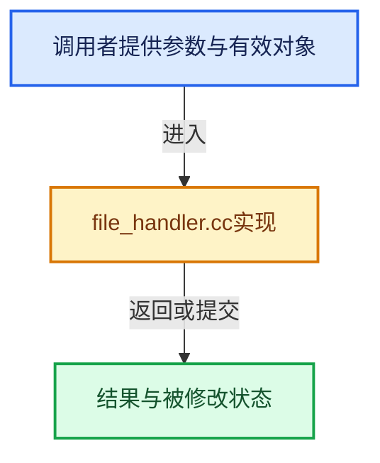

# 实现依赖专题：source/blender/blenkernel/intern/file_handler.cc

[方向导航](README.md) · [符号索引](../%E7%AC%A6%E5%8F%B7%E4%BE%9D%E8%B5%96%E4%B8%8E%E5%AE%9E%E7%8E%B0%E7%B4%A2%E5%BC%95.md)

本专题从正文实际调用进入，集中保存共享实现。函数有稳定锚点，可从调用处直接跳到对应完整函数；递归与互相调用通过回链组织。

## 本文件的实现关系





## 完整成员与函数实现

<a id="f-c54d43d2534637db"></a>

### `blender::bke::file_handlers_vector`

实现位置：[source/blender/blenkernel/intern/file_handler.cc](../../../../../source/blender/blenkernel/intern/file_handler.cc) · L20—L24。

**教学注释版**

<!-- annotated:454d3a91070567 -->

```cpp
static Vector<std::unique_ptr<FileHandlerType>> &file_handlers_vector()
{
  static Vector<std::unique_ptr<FileHandlerType>> file_handlers;
  return file_handlers;
}
```

<details>
<summary>核对原始源码：source/blender/blenkernel/intern/file_handler.cc · L20—L24</summary>

<!-- original:454d3a91070567:source/blender/blenkernel/intern/file_handler.cc:20:24 -->

```cpp
static Vector<std::unique_ptr<FileHandlerType>> &file_handlers_vector()
{
  static Vector<std::unique_ptr<FileHandlerType>> file_handlers;
  return file_handlers;
}
```

</details>

**结果出口**

- `return file_handlers;`

**继续追踪实现**

本实现没有需要继续展开的显式调用；检查返回表达式、对象转换和调用者前置条件。

<a id="f-44c01099794d976c"></a>

### `blender::bke::file_handlers`

实现位置：[source/blender/blenkernel/intern/file_handler.cc](../../../../../source/blender/blenkernel/intern/file_handler.cc) · L26—L29。

**教学注释版**

<!-- annotated:4a0ffc3f61a6c3 -->

```cpp
Span<std::unique_ptr<FileHandlerType>> file_handlers()
{
  return file_handlers_vector();
}
```

<details>
<summary>核对原始源码：source/blender/blenkernel/intern/file_handler.cc · L26—L29</summary>

<!-- original:4a0ffc3f61a6c3:source/blender/blenkernel/intern/file_handler.cc:26:29 -->

```cpp
Span<std::unique_ptr<FileHandlerType>> file_handlers()
{
  return file_handlers_vector();
}
```

</details>

**结果出口**

- `return file_handlers_vector();`

**继续追踪实现**

- `file_handlers_vector` → [blender::bke::file_handlers_vector · L20](%E4%BE%9D%E8%B5%96-file_handler-b4f1b9.md#f-c54d43d2534637db)。

<a id="f-7fda21f28d9b0f1a"></a>

### `blender::bke::file_handler_find`

实现位置：[source/blender/blenkernel/intern/file_handler.cc](../../../../../source/blender/blenkernel/intern/file_handler.cc) · L31—L42。

接口参数：

- `const StringRef idname`

**教学注释版**

<!-- annotated:d8aff6689ab13c -->

```cpp
FileHandlerType *file_handler_find(const StringRef idname)
{
  const auto *itr = std::find_if(file_handlers().begin(),
                                 file_handlers().end(),
                                 [idname](const std::unique_ptr<FileHandlerType> &file_handler) {
                                   return idname == file_handler->idname;
                                 });
  if (itr != file_handlers().end()) {
    return itr->get();
  }
  return nullptr;
}
```

<details>
<summary>核对原始源码：source/blender/blenkernel/intern/file_handler.cc · L31—L42</summary>

<!-- original:d8aff6689ab13c:source/blender/blenkernel/intern/file_handler.cc:31:42 -->

```cpp
FileHandlerType *file_handler_find(const StringRef idname)
{
  const auto *itr = std::find_if(file_handlers().begin(),
                                 file_handlers().end(),
                                 [idname](const std::unique_ptr<FileHandlerType> &file_handler) {
                                   return idname == file_handler->idname;
                                 });
  if (itr != file_handlers().end()) {
    return itr->get();
  }
  return nullptr;
}
```

</details>

**结果出口**

- `return idname == file_handler->idname;`
- `return itr->get();`
- `return nullptr;`

**继续追踪实现**

- `std::find_if` → [外部契约](https://eel.is/c++draft/)：这个边界按实际表达式及所属类型核对参数、返回值、寿命与失败行为。这里提供接口入口，不声称已解释该第三方版本的内部实现。
- `file_handlers().begin` → [调用协议](../%E6%A8%A1%E6%9D%BF%E5%AE%8F%E4%B8%8E%E5%8A%A8%E6%80%81%E5%88%86%E6%B4%BE%E5%8D%8F%E8%AE%AE.md)：接收对象类型依赖auto、返回值或模板实例；不按同名猜测目标。调用位置L33。
- `file_handlers` → [blender::bke::file_handlers · L26](%E4%BE%9D%E8%B5%96-file_handler-b4f1b9.md#f-44c01099794d976c)。
- `file_handlers().end` → [调用协议](../%E6%A8%A1%E6%9D%BF%E5%AE%8F%E4%B8%8E%E5%8A%A8%E6%80%81%E5%88%86%E6%B4%BE%E5%8D%8F%E8%AE%AE.md)：接收对象类型依赖auto、返回值或模板实例；不按同名猜测目标。调用位置L34。
- `itr->get` → [调用协议](../%E6%A8%A1%E6%9D%BF%E5%AE%8F%E4%B8%8E%E5%8A%A8%E6%80%81%E5%88%86%E6%B4%BE%E5%8D%8F%E8%AE%AE.md)：接收对象类型依赖auto、返回值或模板实例；不按同名猜测目标。调用位置L39。
