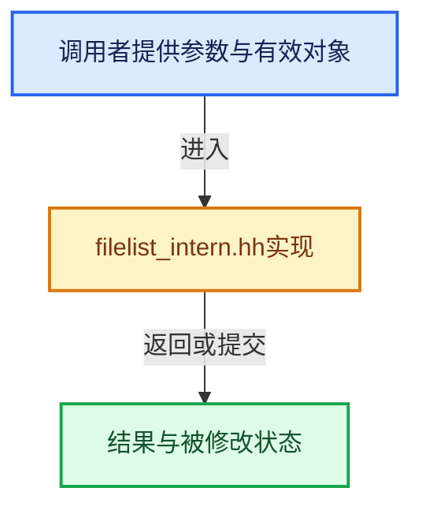

# 实现依赖专题：source/blender/editors/space_file/filelist/filelist_intern.hh

[方向导航](README.md) · [符号索引](../%E7%AC%A6%E5%8F%B7%E4%BE%9D%E8%B5%96%E4%B8%8E%E5%AE%9E%E7%8E%B0%E7%B4%A2%E5%BC%95.md)

本专题从正文实际调用进入，集中保存共享实现。函数有稳定锚点，可从调用处直接跳到对应完整函数；递归与互相调用通过回链组织。

## 本文件的实现关系





## 相关类型布局与成员入口

<a id="t-598f8e52ad50"></a>

### `blender::AssetLibraryReference`

原始声明：[source/blender/editors/space_file/filelist/filelist_intern.hh](../../../../../source/blender/editors/space_file/filelist/filelist_intern.hh) · L30—L30。

以下保留类的数据声明与编译条件，成员函数实现通过后面的精确链接阅读。

<!-- annotated:6980f6ea41f790 -->

```cpp
struct AssetLibraryReference;
```

<details>
<summary>核对原始源码：source/blender/editors/space_file/filelist/filelist_intern.hh · L30—L30</summary>

<!-- original:6980f6ea41f790:source/blender/editors/space_file/filelist/filelist_intern.hh:30:30 -->

```cpp
struct AssetLibraryReference;
```

</details>


## 完整成员与函数实现

<a id="f-dc9b7c618de7c189"></a>

### `blender::FileListInternEntry::get_asset`

实现位置：[source/blender/editors/space_file/filelist/filelist_intern.hh](../../../../../source/blender/editors/space_file/filelist/filelist_intern.hh) · L98—L109。

**教学注释版**

<!-- annotated:b7886fff727d79 -->

```cpp
  asset_system::AssetRepresentation *get_asset() const
  {
    if (std::shared_ptr<asset_system::AssetRepresentation> asset_ptr = asset.lock()) {
      /* Returning a raw pointer from a shared pointer and destructing the shared pointer
       * immediately afterwards isn't entirely clean. But it's just a way to get the raw pointer
       * from the weak pointer. Nothing should free the asset in the asset library meanwhile, so
       * this should be fine really. */
      BLI_assert(asset_ptr.use_count() > 1);
      return asset_ptr.get();
    }
    return nullptr;
  }
```

<details>
<summary>核对原始源码：source/blender/editors/space_file/filelist/filelist_intern.hh · L98—L109</summary>

<!-- original:b7886fff727d79:source/blender/editors/space_file/filelist/filelist_intern.hh:98:109 -->

```cpp
  asset_system::AssetRepresentation *get_asset() const
  {
    if (std::shared_ptr<asset_system::AssetRepresentation> asset_ptr = asset.lock()) {
      /* Returning a raw pointer from a shared pointer and destructing the shared pointer
       * immediately afterwards isn't entirely clean. But it's just a way to get the raw pointer
       * from the weak pointer. Nothing should free the asset in the asset library meanwhile, so
       * this should be fine really. */
      BLI_assert(asset_ptr.use_count() > 1);
      return asset_ptr.get();
    }
    return nullptr;
  }
```

</details>

**结果出口**

- `return asset_ptr.get();`
- `return nullptr;`

**继续追踪实现**

- `asset.lock` → [外部契约](https://eel.is/c++draft/)：这个边界按实际表达式及所属类型核对参数、返回值、寿命与失败行为。这里提供接口入口，不声称已解释该第三方版本的内部实现。
- `BLI_assert` → [BLI_assert · L48](../01-%E5%9F%BA%E7%A1%80%E5%AE%B9%E5%99%A8%E4%B8%8E%E7%8E%B0%E4%BB%A3CPP/%E4%BE%9D%E8%B5%96-BLI_assert-cc98e8.md#m-57a88495704d)；[BLI_assert · L63](../01-%E5%9F%BA%E7%A1%80%E5%AE%B9%E5%99%A8%E4%B8%8E%E7%8E%B0%E4%BB%A3CPP/%E4%BE%9D%E8%B5%96-BLI_assert-cc98e8.md#m-d07050020cb5)。宏定义由构建条件选择。
- `asset_ptr.use_count` → [外部契约](https://eel.is/c++draft/)：这个边界按实际表达式及所属类型核对参数、返回值、寿命与失败行为。这里提供接口入口，不声称已解释该第三方版本的内部实现。
- `asset_ptr.get` → [外部契约](https://eel.is/c++draft/)：这个边界按实际表达式及所属类型核对参数、返回值、寿命与失败行为。这里提供接口入口，不声称已解释该第三方版本的内部实现。
