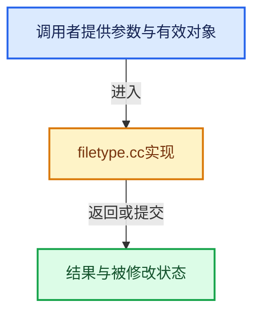

# 实现依赖专题：source/blender/imbuf/intern/filetype.cc

[方向导航](README.md) · [符号索引](../%E7%AC%A6%E5%8F%B7%E4%BE%9D%E8%B5%96%E4%B8%8E%E5%AE%9E%E7%8E%B0%E7%B4%A2%E5%BC%95.md)

本专题从正文实际调用进入，集中保存共享实现。函数有稳定锚点，可从调用处直接跳到对应完整函数；递归与互相调用通过回链组织。

## 本文件的实现关系





## 完整成员与函数实现

<a id="f-b40d122196ad491a"></a>

### `blender::IMB_file_type_from_ftype`

实现位置：[source/blender/imbuf/intern/filetype.cc](../../../../../source/blender/imbuf/intern/filetype.cc) · L328—L336。

接口参数：

- `eImbFileType ftype`

**教学注释版**

<!-- annotated:d6e72579950d78 -->

```cpp
const ImFileType *IMB_file_type_from_ftype(eImbFileType ftype)
{
  for (const ImFileType *type = IMB_FILE_TYPES; type < IMB_FILE_TYPES_LAST; type++) {
    if (ftype == type->filetype) {
      return type;
    }
  }
  return nullptr;
}
```

<details>
<summary>核对原始源码：source/blender/imbuf/intern/filetype.cc · L328—L336</summary>

<!-- original:d6e72579950d78:source/blender/imbuf/intern/filetype.cc:328:336 -->

```cpp
const ImFileType *IMB_file_type_from_ftype(eImbFileType ftype)
{
  for (const ImFileType *type = IMB_FILE_TYPES; type < IMB_FILE_TYPES_LAST; type++) {
    if (ftype == type->filetype) {
      return type;
    }
  }
  return nullptr;
}
```

</details>

**结果出口**

- `return type;`
- `return nullptr;`

**继续追踪实现**

本实现没有需要继续展开的显式调用；检查返回表达式、对象转换和调用者前置条件。

<a id="f-c9e03c01df50037f"></a>

### `blender::IMB_file_type_from_ibuf`

实现位置：[source/blender/imbuf/intern/filetype.cc](../../../../../source/blender/imbuf/intern/filetype.cc) · L338—L341。

接口参数：

- `const ImBuf *ibuf`

**教学注释版**

<!-- annotated:e5125ec9e1b12f -->

```cpp
const ImFileType *IMB_file_type_from_ibuf(const ImBuf *ibuf)
{
  return IMB_file_type_from_ftype(ibuf->ftype);
}
```

<details>
<summary>核对原始源码：source/blender/imbuf/intern/filetype.cc · L338—L341</summary>

<!-- original:e5125ec9e1b12f:source/blender/imbuf/intern/filetype.cc:338:341 -->

```cpp
const ImFileType *IMB_file_type_from_ibuf(const ImBuf *ibuf)
{
  return IMB_file_type_from_ftype(ibuf->ftype);
}
```

</details>

**结果出口**

- `return IMB_file_type_from_ftype(ibuf->ftype);`

**继续追踪实现**

- `IMB_file_type_from_ftype` → [blender::IMB_file_type_from_ftype · L328](%E4%BE%9D%E8%B5%96-filetype-3df4ff.md#f-b40d122196ad491a)。
